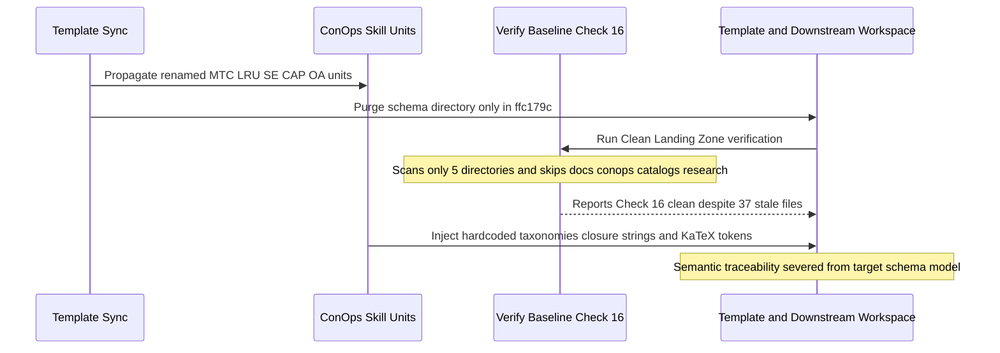

## 1. Context and References

<!-- test-target: crates/verify-baseline/tests/clean_landing_zone_tests.rs -->

- **File**: `AGENTS.md:22-25`
- **Pillar**: Semantic Traceability
- **Symptom**: Check 16 Clean Landing Zone rules (`AGENTS.md:22-25`, `AGENTS.md:12`, `README.md:13-15`, `.pipeline/constitution.md:51`, `.pipeline/ACTIVE_RULES_BUNDLE.md:50`) enforce cleanliness across only 5 directories (`schema/`, `docs/epics/`, `docs/features/`, `docs/user-stories/`, `docs/use-cases/`), omitting `docs/conops/`, `docs/catalogs/`, `docs/research/`, `docs/interfaces/`, `docs/safety/`, and `docs/management/`. Concurrently, `skills/spec-conops-engineering/resources/units/conops/` embeds hardcoded domain taxonomies (`CAP-01..05`, `OA-01..08`, `MTC-01..05`, `LRU-01..04`, `SE-01..06`, `15-min SLA`), auto-closing `Fixes #...` references, and unsubstituted `{{...}}` template placeholders inside KaTeX `$...$` math blocks.
- **Test-Target**: `crates/verify-baseline/tests/clean_landing_zone_tests.rs`

## 2. Root Cause Analysis (5 Whys)

1. **Why did Check 16 fail to flag 37 stale `2026-09-02` specification and research files in `DEAP-uas-infrastructure-safety` (`aaf3d5f`) while `skills/spec-conops-engineering/resources/units/` simultaneously injects ungrounded taxonomies?** Because `AGENTS.md:22-25` (`Clean Landing Zone Mandate`), `AGENTS.md:12`, `README.md:13-15`, `.pipeline/constitution.md:51`, and `.pipeline/ACTIVE_RULES_BUNDLE.md:50` define Clean Landing Zones over only 5 directories (`schema/`, `docs/epics/`, `docs/features/`, `docs/user-stories/`, `docs/use-cases/`), leaving `docs/conops/`, `docs/catalogs/`, `docs/research/`, `docs/interfaces/`, `docs/safety/`, and `docs/management/` unguarded.
2. **Why did those unguarded directories and skill resource units contain concrete maintenance, capability, and support equipment taxonomies?** Because downstream commits `3c76449` (2026-09-02) and `266221a` (2026-09-03) authored concrete `MTC-01..05` task cards, `GSE-01..06` equipment, and the `MTC-01A` `15-min SLA` rapid turnaround workflow in `docs/conops/units/conops/10_MAINTENANCE_AND_GSE_SUPPORT.md`, and upstream synchronization commits (`cc40490`, `eb54948`, `9b245a2`, restored in `5b952c1`) propagated renamed copies (`GSE` -> `SE`, `UC-04` -> `UCL-04`, airframe terms -> generic enclosure terms) into `skills/spec-conops-engineering/resources/units/`.
3. **Why did lexical renaming fail to restore schema-driven semantic traceability in the skill units?** Because surface noun replacement preserved concrete capability hierarchies (`CAP-01..05`), operational activities (`OA-01..08`), mechanical LRU latch designs (`ZIF Cam-Lock`, `Blind-Mate`, `Bayonet Collar`), `SE-01..SE-06` support equipment suites, `Fixes #124, #140, #141` issue-closure strings, and raw `{{...}}` tokens embedded inside `$...$` math expressions.
4. **Why did template cleanup commit `ffc179c` (`fix(template): purge schema pollution`, 2026-09-27) miss the stale `docs/conops/`, `docs/catalogs/`, and `docs/research/` artifacts?** Because `ffc179c` deleted `schema/UAS_INFRASTRUCTURE_SAFETY.sysml` (831 lines) and `schema/domain_config.json` (258 lines) aligned with the 5-directory Clean Landing Zone definition, leaving 37 non-`.gitkeep` artifacts across `docs/{conops,catalogs,research}` in `aaf3d5f` / `a292fa2` until manual downstream cleanup in `a561589`.
5. **Why does this contamination recur across upstream template distribution and downstream ConOps synthesis?** Because Check 16 neither covers all 11 specification/artifact landing directories nor inspects `skills/*/resources/` templates for hardcoded taxonomy IDs, `Fixes #` non-closure violations, or `{{...}}` placeholders inside KaTeX math spans.

## 3. Correctness Analysis

The **Pure Schema-Driven Compiler Invariant** (`AGENTS.md:17-20`, `.pipeline/constitution.md:50`, `rules/conops-mission-intent-integrity.md:49`) requires all downstream engineering artifacts to trace deterministically to AST nodes in `schema/*.sysml`, while the **Clean Landing Zone Mandate** (`AGENTS.md:22-25`, `.pipeline/constitution.md:51`) requires upstream distribution templates to ship empty landing zones containing only `.gitkeep`.

1. **Incomplete Landing Zone Coverage (`AGENTS.md:22-25`, `AGENTS.md:12`, `README.md:13-15`, `.pipeline/constitution.md:51`, `.pipeline/ACTIVE_RULES_BUNDLE.md:50`)**: All five governance statements enumerate only `schema/`, `docs/epics/`, `docs/features/`, `docs/user-stories/`, and `docs/use-cases/`. In `DEAP-uas-infrastructure-safety` at `aaf3d5f` (`2026-10-31`) and `template/main` (`a292fa2`), `git ls-tree -r -l` confirms 37 non-`.gitkeep` artifacts persisted after `ffc179c`: `docs/conops/CONOPS.md` (227,678 B, dated `2026-09-02`), `docs/conops/MISSION_INTENT.md` (48,224 B, dated `2026-09-02`), 22 unit files under `docs/conops/units/{conops,mission_intent}/`, 3 catalog files under `docs/catalogs/`, and 10 research files (`.docx`, `.pdf`, `.txt`, `.md`) under `docs/research/`. Meanwhile, `docs/interfaces/.gitkeep`, `docs/safety/.gitkeep`, and `docs/management/.gitkeep` exist as landing zones yet remain absent from Check 16.
2. **Hardcoded Domain Taxonomies in Skill Templates (`skills/spec-conops-engineering/resources/units/conops/`)**: Still present at `HEAD` (`a561589`):
   - `03_PROPOSED_CAPABILITIES.md:44-98`: hardcodes `CAP-01..05` (`Edge Neural Processing Node`, `Independent Hardware Safety Watchdog`), fixed allocation tags (`/// OperationalAllocation: [CAP-01.1]`..`[CAP-05.3]`), and a hardcoded reserve constant `E_reserve / E_capacity >= 0.20` (line `96`).
   - `06_UAF_OPERATIONAL_ACTIVITIES.md:15-133`: hardcodes `OA-01..08` (`PreOperationHealthVerification` through `PostOperationSecureShutdown`) and 6 performer nodes (`Core Controller Node`, `Sensor Suite Node`, `Safety Watchdog Node`, `PACE Transceiver Node`, `Resource Management Node`, `Operator Station Node`).
   - `10_MAINTENANCE_AND_GSE_SUPPORT.md:45-169`: hardcodes `MTC-01..05` task cards (lines `48-55`), the `15-min SLA` 7-step rapid sortie turnaround protocol (lines `57-108`), `LRU-01..04` replacement procedures including `Ruggedized ZIF Cam-Lock Backplane`, `Polarized Keyed Blind-Mate Rail`, `Kinematic Mount with Bayonet Collar`, and `Precision Index Dowel & Bayonet Ring` (lines `113-140`), and `SE-01..SE-06` support equipment (`Multi-Bay Intelligent Resource Management Hub`, `Ruggedized Field Control Terminal`, `Telescoping Antenna Transceiver Mast`, `Environmental Diagnostic Test Unit`, `Precision Sensor Alignment Rig`, `Automated Calibration & Metrology Bench`, lines `142-165`).
3. **KaTeX Rendering Corruption (`rules/latex-katex-integrity.md:9-11, 15`)**: `10_MAINTENANCE_AND_GSE_SUPPORT.md` lines `58`, `94`, `108`, `120`, `125`, `130`, and `135` embed unsubstituted template tokens (`{{RAPID_TURNAROUND_SLA_MIN}}`, `{{SWAP_TIME_BATTERY_MAX_MIN}}`, `{{SWAP_TIME_FC_MAX_MIN}}`, `{{SWAP_TIME_PAYLOAD_MAX_MIN}}`, `{{SWAP_TIME_ACTUATOR_MAX_MIN}}`) inside inline `$...$` math spans alongside `\text{ min}`. Inside TeX/KaTeX math mode, `_` acts as a subscript operator and `{`/`}` act as group delimiters, corrupting un-substituted identifiers into malformed subscript sequences (and violating the prohibition on unit macros inside math mode). The same pattern appears in `05_OPERATIONAL_STATE_SPACE_AND_RISK.md:111-112, 136, 144`, `08_ENVIRONMENTAL_MIL_STD_810H.md:44, 77, 95`, and `11_IMPACTS_AND_TRADE_STUDIES.md:25, 27`.
4. **Commit Non-Closure & Orphan Tracker Citations (`.pipeline/constitution.md:281`, `AGENTS.md:125`)**: `10_MAINTENANCE_AND_GSE_SUPPORT.md:6, 11, 46, 58, 111, 143, 155` embed `Fixes #124, #140, #141` (and `04_SYSTEM_CAPABILITIES_AND_FUNCTIONS.md:9, 39, 73`, `04_USER_CLASSES_AND_STAKEHOLDERS.md:9, 39, 73`, `11_IMPACTS_AND_TRADE_STUDIES.md:6, 30` embed `Fixes #120, #119` and `Fixes #118, #129, #132`) directly inside generated ConOps unit boilerplate.

## 4. UML Diagrams



## 5. Affected Callers / Downstream Impact

- `AGENTS.md:22-25`, `AGENTS.md:12`, `README.md:13-15`, `.pipeline/constitution.md:51`, `.pipeline/ACTIVE_RULES_BUNDLE.md:50` -- omit 6 specification landing directories (`docs/conops/`, `docs/catalogs/`, `docs/research/`, `docs/interfaces/`, `docs/safety/`, `docs/management/`) from the Clean Landing Zone Mandate.
- `DEAP-uas-infrastructure-safety` (`aaf3d5f` / `a292fa2` template consumers) -- distribute 37 stale `2026-09-02` ConOps, catalog, and research artifacts undetected by Check 16 until manually removed (`a561589`).
- `skills/spec-conops-engineering/SKILL.md` (`Worker ConOps` & `assemble-conops` consumers) -- inherit fabricated `CAP-01..05`, `OA-01..08`, `MTC-01..05`, `LRU-01..04`, `SE-01..06` taxonomies, `15-min SLA` constraints, `Fixes #...` non-closure tags, and broken `$...{{...}}...$` KaTeX math instead of deriving tables and allocations from the active `schema/*.sysml` AST.

## 6. Proposed Correction

<!-- MUST NOT use regex (Check 34: deterministic linear slice/char scanning, no regex crate). MUST be domain-agnostic for upstream crates (Check 19). -->

1. Expand the Clean Landing Zone Mandate in `AGENTS.md:22-25` (plus `AGENTS.md:12`, `README.md:13-15`, `.pipeline/constitution.md:51`, `.pipeline/ACTIVE_RULES_BUNDLE.md:50`) and `verify-baseline` Check 16 to cover all 11 specification and artifact landing directories: `schema/`, `docs/epics/`, `docs/features/`, `docs/user-stories/`, `docs/use-cases/`, `docs/conops/`, `docs/catalogs/`, `docs/research/`, `docs/interfaces/`, `docs/safety/`, and `docs/management/`.
2. Replace concrete taxonomy tables, `Fixes #...` citations, and inline math `{{...}}` tokens in `skills/spec-conops-engineering/resources/units/` with pure schema-bound structural skeleton placeholders and enforce deterministic linear template hygiene checks in `verify-baseline`:

```rust
use std::fs;
use std::path::Path;

pub const TEMPLATE_LANDING_ZONES: &[&str] = &[
    "schema",
    "docs/epics",
    "docs/features",
    "docs/user-stories",
    "docs/use-cases",
    "docs/conops",
    "docs/catalogs",
    "docs/research",
    "docs/interfaces",
    "docs/safety",
    "docs/management",
];

pub fn verify_clean_landing_zones(root: &Path, violations: &mut Vec<String>) {
    for rel in TEMPLATE_LANDING_ZONES {
        let dir = root.join(rel);
        if dir.is_dir() {
            collect_non_gitkeep_entries(root, &dir, violations);
        }
    }
}

fn collect_non_gitkeep_entries(root: &Path, dir: &Path, violations: &mut Vec<String>) {
    let Ok(entries) = fs::read_dir(dir) else {
        return;
    };
    for entry in entries.flatten() {
        let path = entry.path();
        if path.is_dir() {
            collect_non_gitkeep_entries(root, &path, violations);
            continue;
        }
        let is_gitkeep = path.file_name().and_then(|n| n.to_str()) == Some(".gitkeep");
        if !is_gitkeep {
            let shown = path.strip_prefix(root).unwrap_or(&path);
            violations.push(format!("Check 16 violation: non-gitkeep artifact {}", shown.display()));
        }
    }
}

pub fn line_has_template_token_in_inline_math(line: &str) -> bool {
    let bytes = line.as_bytes();
    let mut in_inline_math = false;
    let mut i = 0usize;
    while i < bytes.len() {
        if bytes[i] == b'$' {
            if i + 1 < bytes.len() && bytes[i + 1] == b'$' {
                i += 2;
                continue;
            }
            in_inline_math = !in_inline_math;
            i += 1;
            continue;
        }
        if in_inline_math && i + 1 < bytes.len() && bytes[i] == b'{' && bytes[i + 1] == b'{' {
            return true;
        }
        i += 1;
    }
    false
}

pub fn line_has_auto_closure_ref(line: &str) -> bool {
    let lower = line.to_ascii_lowercase();
    let prefixes = ["fix ", "fixes ", "fixed ", "close ", "closes ", "closed ", "resolve ", "resolves ", "resolved "];
    for prefix in prefixes {
        let mut search_from = 0usize;
        while let Some(pos) = lower[search_from..].find(prefix) {
            let after = &lower[search_from + pos + prefix.len()..];
            let trimmed = after.trim_start();
            if let Some(rest) = trimmed.strip_prefix('#') {
                if rest.bytes().next().is_some_and(|b| b.is_ascii_digit()) {
                    return true;
                }
            }
            search_from += pos + prefix.len();
        }
    }
    false
}
```

## 7. Relationship to Existing Issues

Discovered in audit -- new finding (distinct from closed `#69` on `.agents/skills` symlink divergence and closed `#82` which originally introduced `MTC-01A` in downstream commit `266221a`).

## Audit Source

Adversarial Semantic Traceability Audit
SEVERITY: Critical
FILE_LOCATION: AGENTS.md:22-25
