| Attribute | Value |
| :--- | :--- |
| **Title** | Concept of Operations (ConOps) |
| **Version** | 1.0.0 |
| **Date** | 2026-11-16 |

# Concept of Operations (ConOps)

## Table of Contents

- [1. Scope, System Identification & Normative Baseline](#1-scope-system-identification--normative-baseline)
- [2. Current Situation, Deficiency Analysis & Operational Motivation](#2-current-situation-deficiency-analysis--operational-motivation)
- [3. Proposed Capabilities & Operational Justification (Trade-Offs)](#3-proposed-capabilities--operational-justification-trade-offs)
- [4. System Operational Architecture & Physical Subsystem Decomposition](#4-system-operational-architecture--physical-subsystem-decomposition)
- [5. Operational State Space, Boundary Containment & Risk Assessment](#5-operational-state-space-boundary-containment--risk-assessment)
- [6. OMG UAF Operational Activity Taxonomy](#6-omg-uaf-operational-activity-taxonomy)
- [7. Operational Information Exchange (Op-Tx) Matrix](#7-operational-information-exchange-op-tx-matrix)
- [8. Environmental Operating Limits & Stress Qualification](#8-environmental-operating-limits--stress-qualification)
- [9. Multi-Threaded Operational Scenarios & System Timelines](#9-multi-threaded-operational-scenarios--system-timelines)
- [10. Maintenance & Sustainment Concepts (O/I/D Maintenance)](#10-maintenance--sustainment-concepts-oid-maintenance)
- [11. Operational Impacts, System Limitations & Documented Trade Studies](#11-operational-impacts-system-limitations--documented-trade-studies)
- [12. Emergency Decision & Contingency Matrix](#12-emergency-decision--contingency-matrix)

## 1. Scope, System Identification & Normative Baseline

### 1.1 System Identification & Operational Domain

This Concept of Operations (ConOps) establishes the Level 1B operational concept, system boundaries, normative compliance baseline, and stakeholder/user class taxonomy for the **Avenger 5 V2.5 Uncrewed Aircraft System (`Avenger5V25UasSystem`)** in accordance with `ISO/IEC/IEEE 29148:2018` (`§6.4`, `Annex A §A.2`), `IEEE Std 1362-1998` (`§4`, `§4.3`), `ISO/IEC/IEEE 15288:2023` (`§6.4.2`, `§6.4.3`, `§6.4.4`, `§6.4.9`), `INCOSE SE Handbook v5.0` (`§2.3.5.4`, `§2.3.5.9`), and `OMG UAF v2.0` (`Operational Viewpoint` and `Resources Viewpoint`).

The authoritative system baseline integrates four OEM-grounded constituent elements defined in `.pipeline/schema.sysml` and `.pipeline/schema-digest.json`:

1. **Air Vehicle & Avionics Stack (`Avenger 5 V2.5` / `ASTK A5 V2.5`)**: Manufactured by `UAB Unmanned Defense Systems`, featuring a `17.0 kg` Maximum Takeoff Weight (MTOW) X-wing pusher airframe (`1.8 m` wingspan, `1.6 m` length, `1.1 m` height), rear folding propeller driven by an `IBEX160` ESC and `AXI 5345/16 HD GOLD LINE V3` BLDC motor, `12S2P Li metal BEI maximus20` main battery (`36.0-50.4 V` operating bus, `49.0-50.0 V` pre-flight check threshold, `200.0 A` inline fuse, `90.0 min` / `5400.0 s` endurance with `0.20` statutory Bingo reserve), `Cube orange+` primary flight controller (`ASTK A5 V2.5`), `RPI CM5004032` companion computer, segregated `CAN 1` and `CAN 2` DroneCAN buses, `Septentrio Asterx-m3 pro` RTK GNSS with dual `mRo RM3100` mag/baro and heated `CUAV SKYE2` pitot dead-reckoning fallback, `DTC 4.4-5.0 GHz` `AES-256` FHSS `2.0 W` datalink, and `Nighthawk2UZ` (`128` Day/Thermal, `X40` zoom) + `Trip6` EO/IR target tracker.
2. **Pneumatic Rail Catapult (`ELI Military Simulations PL-40 Rev 2.6`)**: Disassembled `3`-section `5.0 m` (`12.0 deg` elevation) pneumatic launcher charged to `13.0-14.0 bar` via dual `Makita BL1860B` (`18.0 V`, `6000 mAh`) battery packs (with `14.5 V` UVLO cutoff) or `16.0 bar` DIN `8 mm` PCP auxiliary supply, delivering `~23.0 m/s` (`22.7-23.5 m/s` at `17.0 kg`, strictly `<= 25.0 m/s`) exit impulse through a purely mechanical carriage interface (`IF-MECH-001`) with **zero electrical or CAN conductors** between launcher and UAV.
3. **Ordnance Safe & Arm Device (`Artron ESAD AB00-0054-01AA-0005`)**: `NATO STANAG 4187` and `MIL-STD-461G` compliant all-electronic in-line high-voltage initiation train paired with the ESAD Sensor Board, `<= 5.0 kg` Warhead Holder (`4980 +/- 20 g` tested holder unit), `RBF #3` umbilical continuity plug (`< 0.5 Ohm` at `20.0 mA`), and supervised by `RPI CM5004032` over differential `RS-485` (`100.0 Hz`, ``, `Frame Integrity Check XModem`) plus hardware arming discrete `DSC_IN1`.
4. **Ground Control & Tactical C2 (`SwarmC2` & Ground RF Station)**: `SwarmC2` mission planning, pre-flight BIT, flight-mode supervision, and positive Human-in-the-Loop (HITL) weapon control software on a rugged `Windows 11` tablet, linked (wired or via optional `200.0 m` fiber spool) to the `DTC 4.4-5.0 GHz` Ground Radio Box, Directional Antenna Rotator with `MARS 23 dBi` DIR and `OMNI` antennas, transport-box ESD grounding point, and external tactical C2 consumers (`ATAK`, `SitaWare HQ`, `DELTA`).

- **Operational Domain Classification**: `UAF::OperationalDomain::TacticalLoiteringMunitionUAS` -- tactical mid-range precision strike and reconnaissance uncrewed aircraft operations featuring pneumatic catapult deployment, encrypted RF command and video relay, GNSS-denied inertial/air-data navigation, and positive HITL terminal engagement or safe abort/recovery.
- **Architectural & Single Source of Truth (SSOT) Model Scope**: Grounded strictly to `Avenger5V25IntegratedSystem` in `.pipeline/schema.sysml` (`15` SysML `part def` assemblies comprising the root integrated system plus `14` physical/software subsystem parts, `24` `connection def` topology links `CONN_01` through `CONN_24`, `19` operational activities `OA-01` through `OA-19`, `24` operational information exchanges `OpTx-01` through `OpTx-24`, `8` operational scenarios `SCN-01` through `SCN-08`, `5` lifecycle/failsafe `state def` machines, `46` `requirement def` elements, `18` `constraint def` invariants, and `8` verification `test case def` suites `TC_01` through `TC_08`).
- **Explicit Baseline Architecture Exclusions & Dispositions**:
 - **Software-Hosted Simplex Run-Time Assurance (`standaloneRtaBoxCount == 0`)**: `ASTM F3269-17` Simplex RTA boundary monitoring and envelope clamping execute strictly in software on `FlightControllerCubeOrangePlus`; no standalone RTA hardware box exists in the system baseline.
 - **Strictly Mechanical Launcher Interface (`electricalWireToUavCount == 0`)**: `PL-40` mechanical launch interface `IF-MECH-001` transmits axial launch acceleration only; zero electrical, power, or CAN umbilical wires connect `PL-40` to the airframe.
 - **Production failsafe containment Recovery Excluded (`rndRecoveryOptionInstalled == false`)**: Production `Avenger 5 V2.5` includes no recovery failsafe containment (`Recovery System: No`); optional `2x 50.0 V` EPS pyrotechnic igniter lines remain inhibited.
 - **Dual-Baseline Envelope & Power Grounding (`GAP-01`, `GAP-02`, `GAP-05`)**: Conservative control limits reconcile `V1` manual and `V2.5` spec sheet envelopes (`24.0-42.0 m/s` horizontal flight, `55.0 m/s` hard engagement cap, `80.0 m/s` `VNE`), anchor battery health strictly to `12S2P` `36.0-50.4 V` (`49.0-50.0 V` pre-flight, rejecting legacy `24-25 V` UI artifacts), and enforce active brownout alerting because the EPS `14.0 V` rail sits at `0.0 V` margin above the `Artron ESAD` `14.0 V` minimum `VDC_IN`.

---

### 1.2 Physical, Legal & Operational Boundaries

System operations are bounded physically, legally, and procedurally across three operational segments (`Air Vehicle Segment`, `Launch Segment`, and `Ground Control Segment`):

- **Physical & Environmental Boundaries**: Operations are restricted to the `-20.0 to +50.0 degC` ambient temperature range, `<= 12.0 m/s` surface ground wind at catapult launch, `<= 28.0 m/s` cruise wind, and `<= 5000.0 m` service ceiling (`50.0-3000.0 m` `SwarmC2` mission waypoint altitude band). Ground staging enforces mandatory transport-box ESD equalization prior to handling and a minimum `10.0 m` spatial separation between the UAV and the Ground Radio Box during pre-flight setup.
- **Legal, Safety & Ordnance Boundaries**: Lethal actuation requires positive HITL control per `DoD Directive 3000.09 §4.1.a` (`2.0-5.0 s` EO target track hold, `>= 5.0 s` ESAD self-destruct hold with `Slide to confirm`, and irreversible `Power Off ESAD`). Ordnance arming enforces `NATO STANAG 4187 Ed. 5` independent barriers (`SS1` inertial launch acceleration and `SS2` `Safe Distance Exceed == 1`), strict power-before-pull ordering (`UAV Power RBF #2` ON and clean ESAD PBIT `< 50.0 V` before removing `ESAD RBF #3`), and deterministic `SAFE_SCRUB_ABORT` depressurization and safing (`GAP-SCRUB`) before crew approach on launch scrub or hangfire. Airspace containment enforces `JARUS SORA v2.5` Ground Risk Buffer separation, polygon inclusion/exclusion geofences, and `0.20` statutory Bingo reserve (`1080.0 s`).
- **Level 1B Information Abstraction Boundary**: This ConOps governs Level 1B operational viewpoints, `UCL-01` through `UCL-05` user classes, operational activities (`OA-01` through `OA-19`), operational exchanges (`OpTx-01` through `OpTx-24`), and scenarios (`SCN-01` through `SCN-08`). Wire-level pinouts, serial frame, register bitmasks, and Frame Integrity Check equations are isolated to Level 1C Interface Control Documents (`docs/icd/`), and downstream software/hardware system use cases reside strictly in Level 2 SyRS artifacts (`docs/use-cases/`).

**Table 1.1: System Physical, Operational & Architectural Boundary Baseline**

| Boundary Domain | Parameter | Value | Units | Constraint / Qualifier | SSOT Reference |
| :--- | :--- | :--- | :--- | :--- | :--- |
| Airframe & Mass | Maximum Takeoff Weight (MTOW) | 17.0 | kg | Within 30.0 kg PL-40 rail limit | `.pipeline/schema.sysml` (`ElectricPropulsionUnit`) |
| Airframe & Mass | Nominal Wingspan | 1.8 | m | 1803 mm CAD envelope | `schema/extracted/01_avenger5_platform_and_architecture.md` |
| Airframe & Mass | Nominal Overall Length | 1.6 | m | 1576 mm CAD envelope | `schema/extracted/01_avenger5_platform_and_architecture.md` |
| Airframe & Mass | Nominal Assembled Height | 1.1 | m | 1095-1112 mm CAD envelope | `schema/extracted/01_avenger5_platform_and_architecture.md` |
| Ordnance Payload | Maximum Warhead Mass | 5.0 | kg | 4.98 +/- 0.02 kg tested holder unit | `.pipeline/schema.sysml` (`ArtronEsadAndSensorUnit`) |
| Energy & Endurance | Main 12S2P DC Bus Operating Range | 36.0-50.4 | V | Li metal BEI maximus20, 200.0 A fuse | `.pipeline/schema.sysml` (`MainBatteryAndFuseUnit`) |
| Energy & Endurance | Pre-Flight Battery Check Window | 49.0-50.0 | V | Rejects legacy 24-25 V UI screenshots (GAP-05) | `.pipeline/schema.sysml` (`MainBatteryPreFlightVoltageConstraint`) |
| Energy & Endurance | Maximum Endurance | 5400.0 | s | Equivalent to 90.0 min nominal | `.pipeline/schema.sysml` (`MainBatteryAndFuseUnit`) |
| Energy & Endurance | Statutory Bingo Reserve Ratio | 0.20 | ratio | 1080.0 s reserve floor triggers RTL | `.pipeline/schema.sysml` (`BingoEnergyReserveConstraint`) |
| Regulated Power | EPS Servo Rail Voltage | 8.0 | V | Feeds 8x HV6160-DroneCAN actuators | `.pipeline/schema.sysml` (`ElectronicPowerSystemEps`) |
| Regulated Power | EPS DTC Radio Rail Voltage | 12.0 | V | Radio accepts 8.0-17.0 V input | `.pipeline/schema.sysml` (`OnboardEthernetAndC2RadioUnit`) |
| Regulated Power | EPS ESAD Rail Voltage | 14.0 | V | Zero brownout margin vs 14.0 V min VDC_IN (GAP-01) | `.pipeline/schema.sysml` (`EpsEsadZeroBrownoutMarginConstraint`) |
| Flight Envelope | Stall / V1 Minimum Airspeed | 24.0 / 26.0 | m/s | 24.0 m/s V2.5 stall; 26.0 m/s V1 min climb | `.pipeline/schema.sysml` (`FlightEnvelopeSpeedConstraint`) |
| Flight Envelope | Cruise Airspeed (V2.5 / V1) | 31.0 / 30.0 | m/s | Nominal horizontal cruise speed | `.pipeline/schema.sysml` (`ElectricPropulsionUnit`) |
| Flight Envelope | Max Horizontal Airspeed (V2.5 / V1) | 42.0 / 38.0 | m/s | Dual-baseline horizontal ceiling (GAP-02) | `.pipeline/schema.sysml` (`ElectricPropulsionUnit`) |
| Flight Envelope | Terminal Engagement Speed Cap | 55.0 | m/s | Hard cap; triggers Abort Engaging if exceeded | `.pipeline/schema.sysml` (`FlightEnvelopeSpeedConstraint`) |
| Flight Envelope | Structural Never-Exceed Speed (VNE) | 80.0 | m/s | Airframe structural dive ceiling | `.pipeline/schema.sysml` (`FlightEnvelopeSpeedConstraint`) |
| Flight Envelope | Dive / Shallow Approach Angle | 22.0 / 15.0 | deg | 22.0 deg max dive; 15.0 deg shallow | `.pipeline/schema.sysml` (`EoIrSeekerAndTrackerUnit`) |
| Airspace & Weather | Service Ceiling | 5000.0 | m | Maximum aerodynamic ceiling | `.pipeline/schema.sysml` (`ElectricPropulsionUnit`) |
| Airspace & Weather | Mission Waypoint Altitude Range | 50.0-3000.0 | m | SwarmC2 slider in 250.0 m increments | `.pipeline/schema.sysml` (`SwarmC2OperatorConsole`) |
| Airspace & Weather | Minimum Loiter Orbit Radius | 300.0 | m | SwarmC2 clockwise LOITER default floor | `.pipeline/schema.sysml` (`SwarmC2OperatorConsole`) |
| Airspace & Weather | Ground / Cruise Wind Limits | 12.0 / 28.0 | m/s | Max surface launch / airborne cruise wind | `.pipeline/schema.sysml` (`ElectricPropulsionUnit`) |
| Airspace & Weather | Ambient Operating Temperature | -20.0 to +50.0 | degC | Qualified environmental operating band | `.pipeline/schema.sysml` (`ElectricPropulsionUnit`) |
| Terminal & Seeker | Terminal Accuracy (CEP) | 0.5 | m | Upper bound (< 50 cm) on stationary targets | `.pipeline/schema.sysml` (`EoIrSeekerAndTrackerUnit`) |
| Terminal & Seeker | EO Track Hold Duration | 2.0-5.0 | s | Mandatory daylight lock hold prior to dive | `.pipeline/schema.sysml` (`EngagementSpeedAndTrackHoldConstraint`) |
| Launch Catapult | PL-40 Rail Length | 5.0 | m | 4938.0 mm CAD rail; 1.28 m packed sections | `.pipeline/schema.sysml` (`Pl40PneumaticLauncher`) |
| Launch Catapult | PL-40 Rail Elevation | 12.0 | deg | Fixed nominal launch angle | `.pipeline/schema.sysml` (`Pl40PneumaticLauncher`) |
| Launch Catapult | PL-40 Operating Tank Pressure | 13.0-14.0 | bar | 0.05 bar hysteresis; 16.0 bar aux PCP max | `.pipeline/schema.sysml` (`Pl40MassAndExitVelocityConstraint`) |
| Launch Catapult | PL-40 Rail Exit Velocity | 23.0 | m/s | 22.7-23.5 m/s at 17.0 kg; <= 25.0 m/s cap (GAP-03) | `.pipeline/schema.sysml` (`Pl40PneumaticLauncher`) |
| Launch Catapult | Compressor Pack UVLO Cutoff / Restart | 14.5 / 16.0 | V | 2x Makita BL1860B 18.0 V; 5.0 s restart wait | `.pipeline/schema.sysml` (`Pl40UvloAndDualSwitchConstraint`) |
| Launch Catapult | Dual Firing Switch Hold Duration | 2.0 | s | Minimum simultaneous dual-switch hold | `.pipeline/schema.sysml` (`Pl40UvloAndDualSwitchConstraint`) |
| Launch Catapult | PL-40 to UAV Electrical Wires | 0 | count | Strictly mechanical interface (IF-MECH-001) | `.pipeline/schema.sysml` (`Pl40PneumaticLauncher`) |
| C2 & RF Link | DTC Datalink RF Band | 4.4-5.0 | GHz | AES-256 FHSS, 2.0 W (2x 1.0 W) | `.pipeline/schema.sysml` (`OnboardEthernetAndC2RadioUnit`) |
| C2 & RF Link | Radio Line-of-Sight (RLOS) | 60.0 / 90.0 | km | Baseline / V2.5 extended (180.0 km V1 spec) | `.pipeline/schema.sysml` (`OnboardEthernetAndC2RadioUnit`) |
| C2 & RF Link | Ground Radio-to-UAV Separation | 10.0 | m | Minimum ground prep separation | `.pipeline/schema.sysml` (`GroundCrewSeparationAndEsdConstraint`) |
| C2 & RF Link | GCS Failsafe RTL Timeout Baseline | 105.0 | s | Triggers RTL + ESAD timeout disarm | `.pipeline/schema.sysml` (`SwarmC2OperatorConsole`) |
| Ordnance Interlock | ESAD Cyclic Supervision Frequency | 100.0 | Hz | 0.01 s period; <= 10.0 ms timeout (GAP-04) | `.pipeline/schema.sysml` (`CompanionComputeRpiCm5`) |
| Ordnance Interlock | PBIT Safe HV Limit / J401 Fire Envelope | 50.0 / 1800.0 | V | PBIT strictly < 50.0 V; J401 0.0-1800.0 V | `.pipeline/schema.sysml` (`WarheadMassAndPbitHvSafetyConstraint`) |
| Ordnance Interlock | ESAD Self-Destruct Hold Duration | 5.0 | s | Minimum button hold + Slide to confirm | `.pipeline/schema.sysml` (`SwarmC2OperatorConsole`) |

---

### 1.3 Normative Baseline & Declared-Total Population Allocation

All requirements, operational tasks, safety constraints, and control patterns across this ConOps and the companion Tactical Mission Intent specification are grounded strictly to the **Declared-Total Population Register** and **External Additions Registry** established in `docs/research/RESEARCH_INVENTORY.md`. No uncited or speculative obligations are permitted. Across Section 2 of `docs/research/RESEARCH_INVENTORY.md`, `18` normative standards contribute `48` distinct public clause citations allocated across `4` Normative Obligations (`OBL-01` through `OBL-04`), `4` Safety Constraints (`INT-01` through `INT-04`), `4` METL Tasks (`MET-01` through `MET-04`), and `4` Control Patterns (`CTL-01` through `CTL-04`), complemented by `2` OEM baseline extensions (`EXT-01` and `EXT-02`).

**Table 1.2: Normative Baseline & Declared-Total Population Allocation (`RESEARCH_INVENTORY.md`)**

| Population ID | Category | Standard / Baseline ID | Public Clause Citation | Verification Mechanism | ConOps & Mission Intent Scope Allocation |
| :--- | :--- | :--- | :--- | :--- | :--- |
| `OBL-01` | Normative Obligation | ISO/IEC/IEEE 29148:2018; IEEE Std 1362-1998 | ISO/IEC/IEEE 29148:2018 §6.4, §8.4, Annex A (§A.2); IEEE Std 1362-1998 §4, §4.3 | Inspection & Requirements Traceability Audit | Establishes `CONOPS.md`, `MISSION_INTENT.md`, and 1:1 traceability across all `15` SysML `part def` assemblies in `Avenger5V25IntegratedSystem` |
| `OBL-02` | Normative Obligation | ISO/IEC/IEEE 15288:2023; INCOSE SE Handbook v5.0 | ISO/IEC/IEEE 15288:2023 §6.4.2, §6.4.3, §6.4.4, §6.4.9; INCOSE SE Handbook v5.0 §2.3.5.4, §2.3.5.9 | Interface Conformance & Verification Audit | Governs architectural partitioning across `CONN_01` through `CONN_24`, `46` `requirement def` elements, and `TC_01` through `TC_08` verification mapping |
| `OBL-03` | Normative Obligation | OMG UAF v2.0 | OMG UAF v2.0 Operational Viewpoint (Op-Cn / Op-Sr), Resources Viewpoint (Rs-Tx / Rs-Tr) | UAF Metamodel & Signal Dictionary Parity Check | Governs `19` operational activities (`OA-01` through `OA-19`), `24` operational exchanges (`OpTx-01` through `OpTx-24`), and `8` scenarios (`SCN-01` through `SCN-08`) |
| `OBL-04` | Normative Obligation | NIST SP 800-82r3 | NIST SP 800-82r3 Chapter 6, Appendix F (AC, IA, SC) | Cryptographic Link & Access Control Verification (`TC_08`) | Enforces `AES-256` FHSS link encryption, `SwarmC2` role authentication (`Pilot`, `Payload`, `Launch Assistant`), and locked external `USB/ETH` service umbilical lid |
| `INT-01` | Safety Constraint | NATO STANAG 4187 Ed. 5; MIL-STD-331D | NATO STANAG 4187 Ed. 5 Chapter 2, Chapter 3, Annex A; MIL-STD-331D Group A Test A3, Test A4.1, Test A5 | Ordnance Barrier Sequence & Mechanical Drop Qualification (`TC_06`) | Mandates zero pre-launch single-point failures, dual barriers `SS1` (inertial launch) and `SS2` (`Safe Distance Exceed`), power-before-pull `RBF #3`, safe PBIT HV, and gated `J401` detonation |
| `INT-02` | Safety Constraint | MIL-STD-882E; SAE ARP4754A / ARP4761 | MIL-STD-882E Task 202, Task 205, Task 206; SAE ARP4754A §5.1; SAE ARP4761 §3.1-3.3 | STPA / PHA / SHA / O&SHA & PSSA Traceability Matrix Audit | Traces `4` System Losses (`REQ_L_01` through `REQ_L_04`), `6` Hazards (`REQ_H_01` through `REQ_H_06`), `8` UCAs (`REQ_UCA_01` through `REQ_UCA_08`), and `16` Safety Constraints (`REQ_SC_01` through `REQ_SC_16`) |
| `INT-03` | Safety Constraint | MIL-STD-1629A; RTCA DO-178C / RTCA DO-254 | MIL-STD-1629A Method 101, Method 102; RTCA DO-178C §6.3, §11.0; RTCA DO-254 §10.0 | FMECA Criticality Audit & Software/Hardware Assurance Review (`TC_03`, `TC_06`) | Mandates full AST part FMECA (`RPN = S * O * D`), `Cube orange+` and `Artron ESAD` assurance lifecycle evidence, and `GAP-REL` / `GAP-WCET` tracking |
| `INT-04` | Safety Constraint | MIL-STD-461G; MIL-STD-810H | MIL-STD-461G CS114, CS116, CS118, RE102, RS103; MIL-STD-810H Method 501.7, 502.7, 506.6, 510.7, 514.8, 516.8 | EMI/EMC & Environmental Qualification Test Audit | Governs `Artron ESAD` EMI/ESD immunity and thermal, wind, rain, sand/dust, vibration, and shock qualification envelopes (`GAP-ENV`) |
| `MET-01` | METL Task | ISO/IEC/IEEE 29148:2018; IEEE Std 1362-1998 | ISO/IEC/IEEE 29148:2018 Annex A (§A.2); IEEE Std 1362-1998 §4.3 | End-to-End Operational Mission Demonstration (`TC_01` through `TC_08`) | Realizes end-to-end operational mission threads (`SCN-01` through `SCN-08`) from pre-flight BIT and PL-40 launch through cruise, EO/IR dive, ordnance supervision, and safe shutdown/scrub |
| `MET-02` | METL Task | JARUS SORA v2.5 | JARUS SORA v2.5 Annex B, Annex C | Ground Risk Buffer & Operational Containment Verification (`TC_02`, `TC_08`) | Establishes operational volume boundaries, Ground Risk Buffer (GRB), statutory Bingo energy reserve, waypoint/loiter geometry, and ground radio safety standoff |
| `MET-03` | METL Task | DoD Directive 3000.09 | DoD Directive 3000.09 §4.1.a | HITL Engagement Authorization & Abort Verification (`TC_05`, `TC_06`, `TC_08`) | Enforces positive HITL judgment over lethal force via EO target track hold, ESAD self-destruct hold + `Slide to confirm`, irreversible `Power Off ESAD`, and overspeed `Abort Engaging` |
| `MET-04` | METL Task | MIL-STD-882E | MIL-STD-882E Task 206 | Operating & Support Hazard Analysis Scrub Drill (`TC_08`) | Mandates `SAFE_SCRUB_ABORT` (`GAP-SCRUB`): `Main Valve 4` close and tank bleed, red safety pin restoration, ESAD power-off safing, and `RBF #3` reinsertion prior to `RBF #2` disconnect |
| `CTL-01` | Control Pattern | ASTM F3269-17 | ASTM F3269-17 §5.2 | Simplex Boundary Clamping & Failsafe Override Test (`TC_03`) | Mandates software-hosted Simplex RTA inside `FlightControllerCubeOrangePlus` (zero standalone RTA boxes) enforcing stall, engagement dive, structural `VNE`, and Bingo RTL limits |
| `CTL-02` | Control Pattern | RTCA DO-362A | RTCA DO-362A §2.2, §3.2 | Lost-Link Timeout & PACE C2 Degradation Test (`TC_04`) | Governs PACE C2 transitions (`DIR` to `OMNI` to GNSS-denied DR to Emergency `GCS Failsafe` RTL + `Disarm ESAD On GCS Timeout`) |
| `CTL-03` | Control Pattern | RTCA DO-178C / RTCA DO-254; NATO STANAG 4187 Ed. 5 | RTCA DO-178C §6.3; NATO STANAG 4187 Ed. 5 Chapter 2 | Protocol Framing, Watchdog & Premature Arm Gate Test (`TC_04`, `TC_06`) | Mandates `CompanionComputeRpiCm5` cyclic `RS-485` `Frame Integrity Check XModem` supervision of `Artron ESAD` and Arm Stage 2 hardware pulse gating (`FaultStates` bit 4 lockout on premature pulse) |
| `CTL-04` | Control Pattern | SAE ARP4754A / ARP4761 | SAE ARP4754A §5.1; SAE ARP4761 §3.2 | Bus Isolation, 12S2P Voltage & Brownout Guard Test (`TC_01`, `TC_02`, `TC_03`) | Enforces physical segregation of `CAN 1` (Power Meter, EPS, tail fins `#1` through `#4`) and `CAN 2` (splitter, wings `#5` through `#8`, dual `RM3100`, `SKYE2`), `12S2P` monitoring, and `GAP-01` ESAD brownout guard |
| `EXT-01` | Domain Extension | OEM Avenger 5 V2.5 & Artron ESAD Baseline (`AB00-0054-01AA-0005`) | `AVENGER 5 Spec sheet_rev3.pdf (#p1-#p3); Avenger5_V2.5_block_diagram_rev5.pdf (#p1); A5-user-manual 2.pdf (#p8-#p90); A5_prep and safety_rev7.pdf (#p5-#p23); ESAD ICD_for Excalibur_AB00-0054-01AA-0005 2 1.pdf (#p1-#p28)` | Automated Schema-to-OEM Parity & Checksum Audit | Grounds `37` airborne/ordnance/GCS BOM items (`BOM-AV-001` through `BOM-AV-026`, `BOM-ORD-001` through `BOM-ORD-005`, `BOM-GCS-001` through `BOM-GCS-006`), `126` parametric limits, and `12` gap dispositions (`GAP-01` through `GAP-07`, `GAP-WCET`, `GAP-REL`, `GAP-SEPDIST`, `GAP-ENV`, `GAP-SCRUB`) |
| `EXT-02` | External Addition | OEM ELI PL-40 Rev 2.6 Launcher Baseline | `UAV_launcher_PL-40_user_manual_rev_2.6.pdf (#p3-#p4, #p6, #p18, #p21-#p28, #p29-#p45)` | Launch Rail Mechanical Interface & Pressure/UVLO Gate Audit (`TC_07`) | Grounds `5` launcher BOM items (`BOM-LCH-001` through `BOM-LCH-005`), `50` parametric limits (`PRM-PL40-001` through `PRM-PL40-050`), compressor UVLO, dual-switch firing hold, and zero-wire rail launch (`IF-MECH-001`) |

---

### 1.4 Stakeholder Roster & Operational User Class Taxonomy (`UCL-01` through `UCL-05`)

In accordance with `ISO/IEC/IEEE 29148:2018` (`§5.2.4`, `§6.4.2`), operational stakeholders and direct human/external system actors are formally partitioned to preserve clear operational accountability and Human-in-the-Loop (HITL) weapon-release governance across all mission phases. Operational User Classes strictly employ the `UCL-xx` identifier taxonomy (`UCL-01` through `UCL-05`), maintaining strict separation from downstream Level 2 functional specifications.

**Table 1.3: System Stakeholder Roster**

| Stakeholder Group | Representative Entities | Primary Operational Interest & Accountability | Mapped User Classes |
| :--- | :--- | :--- | :--- |
| Mission & Tactical Operations Authority | Tactical Unit Commander, Joint Fires Coordination Cell | Mission intent satisfaction, ROE compliance, target verification, and `5W` / `CFF` tactical battle-management integration | `UCL-01`, `UCL-02`, `UCL-04` |
| Flight & Payload Operations Crew | `SwarmC2` Authenticated `Pilot` and `Payload` Operators | Safe trajectory execution, GNSS-denied navigation resilience, EO/IR target lock supervision, and positive HITL arm/abort/self-destruct control | `UCL-01`, `UCL-02` |
| Launch Staging & Ground Safety Crew | `SwarmC2` Authenticated `Launch Assistant` Crew | ESD-safe ground assembly, `PL-40` pressurization and dual-switch release, ordered `RBF #1` / `RBF #2` / `RBF #3` sequence, and scrub execution | `UCL-03`, `UCL-05` |
| Field Sustainment & Arming Safety Oversight | Ordnance Technicians, Battery/Launcher Maintainers, Range Safety Officer | Warhead/ESAD mechanical integration, `12S2P` battery and `PL-40` O/I/D sustainment, umbilical port security, and `SAFE_SCRUB_ABORT` hangfire clearance | `UCL-05` |
| Airspace & Certification Authorities | Range Safety Authority, SORA / Ordnance Compliance Assessors | Ground Risk Buffer containment, `NATO STANAG 4187` dual-barrier assurance, and `ASTM F3269-17` Simplex RTA verification | `UCL-01`, `UCL-03`, `UCL-05` |
| OEM System & Equipment Authorities | `UAB Unmanned Defense Systems`, `ELI Military Simulations`, `Artron` | Hardware baseline integrity, depot overhaul, OEM parametric limit adherence, and field gap closure (`GAP-01` through `GAP-SCRUB`) | `UCL-05` |

**Table 1.4: Operational User Class Taxonomy (`UCL-01` through `UCL-05`)**

| User Class ID | Title | Player / Operator Classification | Interfacing Stakeholder | Characteristics & Operational Scope | Training / Qualification Standard | Constraint / Normative Source |
| :--- | :--- | :--- | :--- | :--- | :--- | :--- |
| `UCL-01` | Pilot Operator | Direct Flight Operator (`SwarmC2` `Pilot` role) | `UCL-02` Payload Operator, `UCL-03` Launch Assistant, Airspace / Range Safety Authority | Authenticates on rugged `Windows 11` `SwarmC2` tablet; authors and validates flight plans (mission name length, waypoint altitude slider, minimum loiter orbit, exclusion/inclusion polygon geofences); monitors pre-flight telemetry, pitot, magnetometer, and `MainBatteryPreFlightVoltageConstraint` checks; commands flight modes (`AUTO`, `CRUISE`, `LOITER`, `GUIDED`, `RTL`, `MANUAL` under `Advanced` flag); invokes `Disable GNSS` INS/DR fallback (`I'm Here` / `I'm Looking Here` fixes); switches `OMNI`/`DIR` antennas; executes abort/`RTL` overrides. | Verified qualification across `A5 User Manual`, `PL-40`, `Warhead`, `ESAD`, and `SwarmC2` manuals; flight contingency & GNSS-denied navigation proficiency | `ISO/IEC/IEEE 29148:2018 §5.2.4`; `NIST SP 800-82r3 Appendix F`; `RTCA DO-362A §2.2, §3.2`; `ASTM F3269-17 §5.2`; `SwarmC2OperatorConsole`; `FlightControllerCubeOrangePlus` |
| `UCL-02` | Payload Operator | Direct Sensor & Ordnance Supervisory Operator (`SwarmC2` `Payload` role) | `UCL-01` Pilot Operator, `UCL-04` External Tactical C2, Tactical Commander | Authenticates on `SwarmC2`; steers `Nighthawk2UZ` EO/IR gimbal (`Day/Thermal`, `X40` zoom) and `Trip6` tracker; verifies all six engagement preconditions (`GCS Failsafe` margin, warhead `ARMED`, EO daylight track hold, target elevation bound, clear LOS); supervises terminal `ATTACK` dive within `EngagementSpeedAndTrackHoldConstraint` bounds (`Abort Engaging` on saturation/overspeed); invokes in-flight `Reboot Gimbal` on freeze; commands positive HITL ESAD arm, self-destruct hold with `Slide to confirm`, or irreversible `Power Off ESAD`; exports `5W` / `CFF` target reports. | Verified qualification across `A5 User Manual`, `ESAD`, `Warhead`, and `SwarmC2` manuals; positive HITL target-engagement and weapon-abort certification | `DoD Directive 3000.09 §4.1.a`; `NATO STANAG 4187 Ed. 5 Chapter 2 & 3`; `NIST SP 800-82r3 Appendix F`; `EoIrSeekerAndTrackerUnit`; `ArtronEsadAndSensorUnit` |
| `UCL-03` | Launch Assistant | Direct Ground Staging & Catapult Operator (`SwarmC2` `Launch Assistant` role) | `UCL-01` Pilot Operator, `UCL-02` Payload Operator, `UCL-05` Field Sustainment & Arming Safety Lead | Authenticates on `SwarmC2`; sets up ground station, calibrates Antenna Rotator (`Auto Follow` / fine step), and touches transport-box ESD point BEFORE handling UAV; enforces `GroundCrewSeparationAndEsdConstraint` radio-to-UAV standoff; assembles and pressurizes `ELI PL-40 Rev 2.6` rail within `Pl40MassAndExitVelocityConstraint` and `Pl40UvloAndDualSwitchConstraint` limits; performs two-person lift and rail mounting; verifies rearward pusher prop folding and removes `RBF #1` covers before pulling `UAV Power RBF #2` and locking RBF/umbilical lids; removes `ESAD RBF #3` ONLY upon `SwarmC2` prompt after all eight preconditions pass; clears personnel rear of rail, pulls red carriage safety pin, opens `Main Valve 4`, and holds dual firing switches for launch or executes `SAFE_SCRUB_ABORT` depressurization on hangfire. | Verified qualification across `A5 Prep & Safety`, `PL-40 Rev 2.6`, `ESAD`, and `SwarmC2` launch checklist procedures; ESD and pneumatic/ordnance safety training | `MIL-STD-882E Task 206`; `NATO STANAG 4187 Ed. 5 Chapter 2`; `JARUS SORA v2.5 Annex B`; `Pl40PneumaticLauncher`; `GroundRfStationAndAntennaTracker` |
| `UCL-04` | External Tactical C2 (`ATAK`, `SitaWare HQ`, `DELTA`) | External Interfacing Tactical Battle-Management Systems | `UCL-02` Payload Operator, `UCL-01` Pilot Operator, Joint Fires Coordination Cell | Consumes formatted `5W` (`Five Whiskey`) and `CFF` (`Call For Fire`) targeting intelligence exported from `SwarmC2OperatorConsole`; provides external operational boundaries, target tasking, and airspace deconfliction constraints for operator mission planning; isolated from direct unmediated flight-control or ESAD ordnance actuation paths. | Tactical C2 operator certification for `ATAK`, `SitaWare HQ`, or `DELTA` data exchange and ROE coordination | `ISO/IEC/IEEE 29148:2018 §6.4`; `OMG UAF v2.0 Operational Viewpoint`; `NIST SP 800-82r3 Chapter 6`; `DoD Directive 3000.09 §4.1.a`; `SwarmC2OperatorConsole` |
| `UCL-05` | Field Sustainment & Arming Safety Lead | Field Safety Supervisor & O/I/D Maintenance Specialist | `UCL-03` Launch Assistant, `UCL-01` Pilot Operator, `UCL-02` Payload Operator, OEM Depot Support | Governs Organizational, Intermediate, and Depot (O/I/D) sustainment; executes warhead/ESAD/sensor-board mounting, `RED FACE TO TOUCH HOLDER` alignment, and CTQ mass/CG verification; inspects `12S2P` packs for swelling/damage (NO-GO gate) and verifies fuselage-to-battery ID/QR match and inline automotive fuse; tracks `PL-40` rope/bearing replacement intervals and `USB/ETH` umbilical lid locking; oversees `SAFE_SCRUB_ABORT` (`GAP-SCRUB`) hangfire wait, tank bleed, red pin reinsertion, ESAD discharge verification, and `RBF #3` reinstallation prior to `RBF #2` disconnect. | Certified ordnance safety lead, high-rate lithium battery handler, `PL-40` mechanical maintainer, and O/I/D quality/safety authority | `MIL-STD-882E Task 205 & Task 206`; `MIL-STD-1629A Method 101 & 102`; `NATO STANAG 4187 Ed. 5 Chapter 2`; `MIL-STD-331D Group A`; `ArtronEsadAndSensorUnit`; `MainBatteryAndFuseUnit` |

- **Role Separation & Positive HITL Accountability**: No single crew action can bypass dual-gate launch or ordnance safety barriers. `UCL-03` requires `UCL-01` / `UCL-02` pre-flight `SwarmC2` verification (`8` preconditions passed) before pulling `ESAD RBF #3`; `UCL-02` cannot energize ESAD high voltage (`J401`) on the ground because mechanical/inertial `SS1` launch acceleration and `SS2` safe separation (`Safe Distance Exceed == 1`) reside strictly downstream of `PL-40` catapult release; and `UCL-05` retains explicit stop-work authority over `NO-GO` battery defects, premature `RBF #3` faults, and `SAFE_SCRUB_ABORT` hangfire recovery.

/// OperationalAllocation: [OA-01]
/// OperationalAllocation: [OA-19]
/// OperationalAllocation: [MET-01]
/// OperationalAllocation: [MET-02]
/// OperationalAllocation: [MET-03]
/// OperationalAllocation: [MET-04]

## 2. Current Situation, Deficiency Analysis & Operational Motivation

- **Baseline Effective Date:** `2026-11-16`
- **Target System Baseline:** `Avenger 5 V2.5 UAS` (`Avenger5V25UasSystem`: `ASTK A5 V2.5` Air Vehicle, `ELI Military Simulations PL-40 Rev 2.6` Pneumatic Catapult Launcher, `Artron ESAD AB00-0054-01AA-0005` Electronic Safe and Arm Device, and `SwarmC2` Ground Control Station)
- **Authoritative SSOT Grounding:** Synthesized from `.pipeline/schema.sysml` (`REQ_SAF_01` through `REQ_SAF_12`), `schema/extracted/05_engineering_gaps_and_synthesis_ledger.md`, `schema/extracted/parametric_limits.md`, and `docs/research/FAILURE_MODE_REGISTRY.md` (Section 1).

### 2.1 Current Operational Baseline (Unharmonized Multi-OEM Predecessor State)

Prior to synthesizing a closed-loop Concept of Operations (ConOps), operational guidance for the `Avenger 5 V2.5 UAS` mission system was fragmented across six unharmonized OEM PDF artifacts: `AVENGER 5 Spec sheet_rev3.pdf` (`V2.5` performance baseline), `A5-user-manual 2.pdf` (`V1`-era `SwarmC2` user manual), `A5_prep and safety_rev7.pdf` (field assembly and safety checklist), `Avenger5_V2.5_block_diagram_rev5.pdf` (electrical and bus topology), `UAV_launcher_PL-40_user_manual_rev_2.6.pdf` (general-purpose catapult manual), and `ESAD ICD_for Excalibur_AB00-0054-01AA-0005 2 1.pdf` (ordnance safe-and-arm ICD originally titled for `Avenger 3`).

Operating directly from these disconnected manuals creates an inconsistent predecessor baseline characterized by three foundational architectural realities and cross-document conflicts:

1. **Non-Production Recovery Exclusion:** Production `Avenger 5 V2.5` airframes incorporate zero recovery parachutes (`Recovery System: No`; `rndRecoveryOptionInstalled == false`). The `2x 50.0 V` Electronic Power System (`EPS`) burn-wire lines remain strictly inhibited as non-production `Optional RnD` hardware. Consequently, every launched sortie must execute controlled fixed-wing flight, compliant Return-to-Launch (`RTL`) diversion, or authorized terminal engagement without passive recovery fallback.
2. **Zero-Wire Mechanical Launcher Coupling (`IF-MECH-001`):** The `ELI Military Simulations PL-40 Rev 2.6` pneumatic catapult (`30.0 kg` structural limit) delivers launch impulse exclusively mechanically across `IF-MECH-001` (`electricalWireToUavCount == 0`). No electrical, power, or `CAN` telemetry umbilical bridges the launcher and airframe, leaving the `PL-40` operator blind to UAV propulsion readiness and battery state unless coordinated via an explicit closed-loop Go/No-Go gate.
3. **Software-Hosted Simplex Run-Time Assurance (`Cube orange+` and `RPI CM5004032`):** `ASTM F3269-17` Simplex Run-Time Assurance (`RTA`) executes strictly in software on `Cube orange+` in supervision with `RPI CM5004032` (`standaloneRtaBoxCount == 0`), bridged to the `Artron ESAD` over `RS-485` and hardware discrete interlocks.

Without unified ConOps state synchronization across these segments, field crews rely on ambiguous prose instructions, legacy UI screenshots, incompatible voltage and speed claims across `V1` and `V2.5` documents, and incomplete launch-abort instructions.

---

### 2.2 Technical, Operational & Human Deficiency Analysis

#### 2.2.1 Electrical Interface & Telemetry Ambiguities (`GAP-01`, `GAP-04`, `GAP-05`)

- **Zero-Margin EPS-to-ESAD Power Feed (`GAP-01` / `REQ_SAF_01`):** `Avenger5_V2.5_block_diagram_rev5.pdf` drives the `Artron ESAD` from a regulated `14.0 V` EPS rail (`PRM-AV-010`), whereas the ESAD ICD defines `VDC_IN` (`GE_POW`) minimum `14.0 V` (`PRM-ESAD-001`), nominal `28.0 V` (`PRM-ESAD-002`), and maximum `32.0 V` (`PRM-ESAD-003`). Operating at the exact `14.0 V` minimum yields `0.0 V` brownout margin against harness resistance (`I * R`) or transient load sags, exposing the ESAD to mid-flight undervoltage resets or `FaultLockout` (`FAILURE_MODE_REGISTRY.md` dominant risk driver). The synthesized ConOps baseline enforces explicit `CrossRingBoundary` and `SignalContract` supervision (`14.0 V` to `32.0 V`), active brownout alarming, and deterministic `EsadBusWatchdogFaultFallback` leading to irreversible `Power Off ESAD` safing on voltage sag.
- **ESAD Platform Naming & Ring 2-to-Ring 3 Supervision Discrepancy (`GAP-04` / `REQ_SAF_04`, `REQ_SC_08`):** The ESAD ICD is titled for `Avenger 3` (`28.0 V` nominal) and contains conflicting polling prose on page 15 citing both `100.0 Hz` (`0.01 s` cycle) and `100 ms` wording alongside a `5.0 ms` reply ceiling and `10.0 ms` incomplete-packet timeout (`PRM-ESAD-017` through `PRM-ESAD-020`). On `Avenger 5 V2.5`, `RPI CM5004032` bridges `SwarmC2` IP/MAVLink messaging to the ESAD over half-duplex `` `8N1` `RS-485` (`Frame Integrity Check XModem`) plus hardware discrete `DSC_IN1` (`1000.0 Hz` `2`-pulse arm enable) and the umbilical continuity loop `UMB` (`0.5 Ohm` ceiling at `20.0 mA`). The synthesized ConOps designates `RPI CM5004032` as the sole Operational Controller (`OC Master`) across the supervised `Ring 2`-to-`Ring 3` boundary, anchored strictly to `100.0 Hz` (`0.01 s` period) and `10.0 ms` watchdog fault isolation.
- **Legacy `23.9 V` / `25.0 V` UI Artifacts vs. `12S2P` Normative Bus & `OBS` Camera Ambiguity (`GAP-05` / `REQ_SAF_05`):** `A5-user-manual 2.pdf` retains legacy `23.9 V` and `25.0 V` (`6S`-era) telemetry screenshots alongside normative `12S2P` pre-flight check text specifying `49.0 V` to `50.0 V` (`PRM-AV-003`, `PRM-AV-004`, across a `36.0 V` to `50.4 V` `12S2P` pack envelope). In addition, pages 79 and 81 of the same manual contradict one another regarding `OBS` gimbal joystick control. Relying on legacy voltage figures risks launching with a critically depleted `12S2P` battery (`< 36.0 V`), leading to propulsion loss on an airframe without failsafe containment recovery. The synthesized ConOps formally rejects `23.9 V` to `25.0 V` UI artifacts, locks all Go/No-Go battery checks to `12S2P` `49.0 V` to `50.0 V` pre-flight (`36.0 V` floor), and resolves `OBS` operator payload mode rules.

#### 2.2.2 Flight Envelope, Launch Exit Margin & Propulsion Synchronization (`GAP-02`, `GAP-03`)

- **Unharmonized V1 vs. V2.5 Airspeed & RLOS Envelopes (`GAP-02` / `REQ_SAF_02`):** `A5-user-manual 2.pdf` (`V1`) specifies `26.0 m/s` minimum horizontal speed, `30.0 m/s` cruise, `38.0 m/s` max horizontal, `55.0 m/s` max dive, and `60.0 km` / `180.0 km` Radio Line-of-Sight (`RLOS`) range. Conversely, `AVENGER 5 Spec sheet_rev3.pdf` (`V2.5`) specifies `24.0 m/s` stall, `31.0 m/s` cruise, `42.0 m/s` max horizontal, `80.0 m/s` dive (`VNE`), and `60.0 km` / `90.0 km` RLOS range (`PRM-PERF-004` through `PRM-PERF-011`, `PRM-RF-006` through `PRM-RF-008`). Executing terminal dives up to the `V2.5` `80.0 m/s` structural figure saturates the `Nighthawk2UZ` / `Trip6` seeker gimbal above `55.0 m/s` (triggering `Abort Engaging` per page 88), while planning missions to a legacy `180.0 km` RLOS claim exceeds `V2.5` datalink capacity. The synthesized ConOps establishes an inner conservative control envelope: `24.0 m/s` to `26.0 m/s` stall-margin floor (verifying climb transition above `26.0 m/s`), `30.0 m/s` to `31.0 m/s` nominal cruise, `38.0 m/s` to `42.0 m/s` horizontal band, `55.0 m/s` software Simplex RTA engagement cap (`AirspeedDiveCapClamped`), `80.0 m/s` airframe structural `VNE`, and `60.0 km` nominal / `90.0 km` extended RLOS boundary.
- **PL-40 Catapult Exit Deficit vs. Stall Speed at `17.0 kg` MTOW (`GAP-03` / `REQ_SAF_03`):** The `Avenger 5` MTOW is `17.0 kg` (`PRM-AF-008`), and the `SwarmC2` launch checklist commands `13.0 bar` to `14.0 bar` tank pressure (`PRM-PL40-027`, `PRM-PL40-028`). `PL-40` Table 2 lists exit velocities of `24.3 m/s` to `25.3 m/s` at `15.0 kg` (violating the `25.0 m/s` `OVER 25 LIMIT` launcher carriage ceiling at `14.0 bar`) and `21.1 m/s` to `21.9 m/s` at `20.0 kg` (`PRM-PL40-045` through `PRM-PL40-050`). Interpolating to `17.0 kg` produces `22.7 m/s` to `23.5 m/s` (`~23.0 m/s` nominal, `PRM-PL40-003` through `PRM-PL40-005`), leaving a negative airspeed margin below the `24.0 m/s` to `26.0 m/s` stall envelope without immediate electric pusher thrust and headwind margin (`<= 12.0 m/s` ground wind limit, `PRM-PERF-016`). The synthesized ConOps mandates a hard pre-launch Go/No-Go interlock binding verified pusher motor readiness, `13.0 bar` to `14.0 bar` regulated pressure, surface wind compliance, and `<= 25.0 m/s` launcher carriage speed protection.

#### 2.2.3 Procedural Interlocks, Safe-Separation Semantics & Abort Scrub Gaps (`GAP-06`, `GAP-07`, `GAP-SCRUB`)

- **Unformalized `RBF #3` Power-Before-Pull Sequencing (`GAP-06` / `REQ_SAF_06`):** `A5_prep and safety_rev7.pdf` (pages 21 and 23) warns that pulling `ESAD R.B.F. #3` prior to UAV and ESAD power-up by `Power R.B.F. #2` induces an **immediate ESAD fault**, yet unharmonized procedures lack an enforceable cross-subsystem interlock gating `RBF #1`, `RBF #2`, `PBIT`, and `RBF #3`. The synthesized ConOps locks `EsadSafeArmState` and `UavFlightLifecycleState` so `RBF #1` removal and folded-prop verification precede `RBF #2` power-on, `12S2P` `49.0 V` to `50.0 V` confirmation, `UMB` loop verification, and ESAD PBIT (`< 50.0 V` internal HV ceiling, `PRM-ESAD-029`) across eight preconditions before `SwarmC2` prompts `RBF #3` extraction.
- **Inverted `ESAD SS2` `"within safe distance"` Wording (`GAP-07` / `REQ_SAF_07`, `REQ_SC_11`):** `A5-user-manual 2.pdf` (page 84) erroneously states that `ARM STAGE 2` occurs `"within safe distance from launch point"`, directly contradicting `ESAD ICD` (pages 21 and 23) `Safe Distance Exceed == 1` (`SS2 Active`). Misinterpreting `"within"` as valid near the launch point would permit arming and `0.0 V` to `1800.0 V` high-voltage charging (`PRM-ESAD-031`) inside the friendly crew hazard zone. The synthesized ConOps aligns all operator displays and state transitions strictly to **exceeding** minimum safe separation distance and arming timer (`Safe Distance Exceed == 1`) after `SS1` launch acceleration sensing, gated by explicit Human-in-the-Loop (`HITL`) authorization before `DSC_IN1` and high-voltage charging.
- **Absence of Post-`RBF #3` / Post-Pin Launch Scrub & Hangfire Sequence (`GAP-SCRUB` / `REQ_SAF_12`, `REQ_SC_16`):** Neither `A5_prep and safety_rev7.pdf`, `A5-user-manual 2.pdf`, nor `UAV_launcher_PL-40_user_manual_rev_2.6.pdf` documents an abort, hangfire wait, or unload sequence once `ESAD R.B.F. #3` has been pulled, `PL-40` Main Outlet Valve `(4)` is open, or the carriage red safety pin is removed (`GAP-SCRUB`). Leaving crews to improvise around a charged `13.0 bar` to `14.0 bar` pneumatic rail and an unpinned ESAD represents an acute catastrophic hazard (`FAILURE_MODE_REGISTRY.md` peak `RPN` risk driver). The synthesized ConOps establishes `SAFE_SCRUB_ABORT` as a mandatory contingency sequence (`Pl40LauncherState::ScrubbedSafeDepressurized` and `UavFlightLifecycleState::SafePostFlightShutdown`): `5.0 s` ESAD abort/self-destruct hold (`PRM-GCS-010`) plus irreversible `Power Off ESAD`, closure of `PL-40` Main Valve `(4)` with tank bleed to `0.0 bar`, carriage red safety pin reinsertion prior to crew approach, and reverse `RBF #3` reinstallation prior to `RBF #2` power disconnect.

#### 2.2.4 Missing OEM Quantitative Assurance, Reliability & Calibration Bounds (`GAP-WCET`, `GAP-REL`, `GAP-SEPDIST`, `GAP-ENV`)

Four classes of quantitative engineering parameters required by `DO-178C`, `JARUS SORA v2.5`, and `MIL-STD-882E` are absent from the six customer OEM PDFs and are governed explicitly inside `.pipeline/schema.sysml` (`REQ_SAF_08` through `REQ_SAF_11`):

- **Timing & WCET Budgets (`GAP-WCET` / `REQ_SAF_08`):** Unprinted execution rates and worst-case execution time (`WCET`) budgets for `Cube orange+` EKF2/attitude loops, `DroneCAN` (`CAN 1` / `CAN 2`) bus bitrates, `HV6160-DroneCAN` servo cycles, `Septentrio Asterx-m3 pro` GNSS solution rate, `Trip6` tracker latency, `RPI CM5004032` Linux scheduling jitter, and `SwarmC2` RF round-trip latency. The ConOps anchors deterministic timing around the grounded `100.0 Hz` (`0.01 s`) ESAD `RS-485` cycle (`5.0 ms` reply, `10.0 ms` timeout) and designates avionics RMA/WCET parameters as mission-contract targets awaiting bench measurement.
- **Component Reliability & MTBF (`GAP-REL` / `REQ_SAF_09`):** Unprinted piece-part failure rates (`lambda`) and MTBF figures across `Cube orange+`, `IBEX160`, `AXI 5345/16`, `HV6160-DroneCAN`, `mRo RM3100`, `CUAV SKYE2`, `maximus20 12S2P`, `DTC 4.4-5.0 GHz` radio, `Trip6`, `Nighthawk2UZ`, and `ESAD` FPGA/CPLD. Disclosed across `15 / 15` AST `part def` assemblies (`61` failure modes: `39` `SSOT`, `22` `Derived`, peak `RPN` `192`) in `docs/research/FAILURE_MODE_REGISTRY.md` using conservative class baselines.
- **Safe-Separation, Torque & Unprinted CTQ Units (`GAP-SEPDIST` / `REQ_SAF_10`):** Unprinted numeric ESAD safe-separation distance (`m`), launch acceleration threshold (`g`), arming timer (`s`), fastener torque specs (`3x M3` at `75.0 mm` BCD and `M6 x 30.0 mm` wing bolts), and unprinted engineering units on `4.98 kg` (`+/- 0.02 kg`) warhead holder CTQ datums (`30.57` CG and `173.00` overall). Locked behind mandatory calibration sign-off before field arming.
- **Energy, Thermal & Environmental Cutoffs (`GAP-ENV` / `REQ_SAF_11`):** Unprinted `12S2P` battery pack energy (`Wh` / `Ah`), minimum SoC `RTL` floor (governed as a derived `0.20` statutory Bingo reserve across `5400.0 s` max endurance under `JARUS SORA v2.5` / `MIL-STD-882E`), `ESC` / motor continuous current and thermal shutdown cutoffs, `PL-40` tank internal volume (`L`), relief cracking pressure (`bar`), IP ingress / rain / icing limits, and numeric catapult / warhead safe standoff distance beyond the `10.0 m` ground radio separation rule (`PRM-GCS-001`).

---

### 2.3 Deficiency Traceability & Baseline Comparison Matrices

#### Table 2.1: Deficiency & Engineering Gap Synthesis Matrix

| Gap ID | Deficiency Category | Unharmonized / Legacy Baseline Condition | Operational & Safety Consequence | Synthesized ConOps Disposition & SysML Trace |
| :--- | :--- | :--- | :--- | :--- |
| `GAP-01` | Electrical Interface | EPS regulated feed equals ESAD `VDC_IN` minimum (`Avenger 3` ICD nominal is higher) | Zero cable-drop (`I * R`) brownout margin; mid-flight ESAD reset or fault lockout | Enforce `CrossRingBoundary` `SignalContract`, brownout telemetry alarm, and Power Off ESAD on sag (`REQ_SAF_01`) |
| `GAP-02` | Flight & RF Envelope | `V1` user manual and `V2.5` spec sheet conflict on stall, cruise, horizontal, dive, and RLOS limits | Gimbal saturation in high-speed dives; unintended C2 link loss beyond `V2.5` RF horizon | Adopt conservative inner envelope (`AirspeedDiveCapClamped` engagement cap and `V2.5` RLOS cap) (`REQ_SAF_02`) |
| `GAP-03` | Launch Exit Margin | `PL-40` interpolated exit speed at Avenger 5 MTOW falls below aircraft stall speed; lighter weights exceed carriage limit | Post-rail stall risk without active pusher thrust and headwind; mechanical launcher over-speed | Enforce Go/No-Go gate linking pusher readiness, regulated pressure, wind bound, and carriage limit (`REQ_SAF_03`) |
| `GAP-04` | Platform & Bus Bridge | ICD titled `Avenger 3` bridges via `RPI CM5004032` with conflicting polling prose (`Hz` vs `ms`) | Desynchronized arming state or undetected serial framing drops across `Ring 2` to `Ring 3` | Model `RPI CM5004032` as sole `OC Master` polling ESAD with watchdog timeout and `Frame Integrity Check` validation (`REQ_SAF_04`, `REQ_SC_08`) |
| `GAP-05` | UI Voltage & `OBS` Mode | Legacy `6S`-era UI screenshots contradict normative `12S2P` battery checks; `OBS` joystick text conflicts | Crew launches with under-charged pack on non-failsafe containment airframe; payload tracking confusion | Anchor health checks strictly to `12S2P` envelope; deprecate legacy screenshots; unify `OBS` mode (`REQ_SAF_05`) |
| `GAP-06` | Interlock Ordering | Pulling `ESAD R.B.F. #3` before `Power R.B.F. #2` power-on causes immediate ESAD fault without gated checklist | Latched `FaultLockout` on launch rail requiring unsafe field reset under mounted ordnance | Enforce `PreFlightCheck` -> `BootAndPbit` -> `SafeRbfInstalled` -> `SafeRbfRemoved` sequence (`REQ_SAF_06`) |
| `GAP-07` | Safe-Separation Logic | `SwarmC2` manual states arming `"within safe distance"` while ESAD ICD mandates `Safe Distance Exceed` | Literal interpretation permits HV charging and arming inside friendly launch hazard zone | Bind `ArmStage2Armed` strictly to `Safe Distance Exceed == 1` after `SS1` plus HITL authorization (`REQ_SAF_07`, `REQ_SC_11`) |
| `GAP-SCRUB` | Contingency & Hangfire | Zero OEM scrub or hangfire procedure once `RBF #3` is removed, Main Valve `(4)` open, or pin pulled | Crew exposed to pressurized catapult rail and unpinned live ordnance during late abort | Formalize `SAFE_SCRUB_ABORT` (`Power Off ESAD`, valve bleed to zero, pin restore, reverse `RBF`) (`REQ_SAF_12`, `REQ_SC_16`) |
| `GAP-WCET` | Real-Time Timing | Unprinted EKF2, `CAN 1`/`CAN 2`, servo, GNSS, tracker, Linux jitter, and C2 round-trip latency | Unverified scheduling jitter across flight control and safety supervision loops | Anchor deterministic cycle to grounded ESAD `RS-485` rate; track RMA/WCET targets for bench test (`REQ_SAF_08`) |
| `GAP-REL` | Hardware Reliability | Unprinted piece-part `lambda` and MTBF across avionics, propulsion, battery, RF, gimbal, and ESAD | Missing empirical hardware failure probabilities for FMECA/FTA gates | Parameterize `15` AST parts (`61` modes, peak `RPN` `192`) in `FAILURE_MODE_REGISTRY.md` baselines (`REQ_SAF_09`) |
| `GAP-SEPDIST` | Safe-Sep & Fasteners | Unprinted numeric `SS2` distance, launch `g` threshold, arming timer, fastener torque, and CTQ units | Uncalibrated arming thresholds and structural torque verification gaps | Enforce parameterized SysML calibration constraints requiring sign-off prior to field arming (`REQ_SAF_10`) |
| `GAP-ENV` | Energy & Environment | Unprinted pack `Wh`/`Ah`, SoC floor, thermal/current cutoffs, tank volume, relief pressure, IP/rain/icing, standoff | Unbounded energy-reserve, thermal-derating, and ground standoff margins | Enforce grounded temperature/wind bounds, radio standoff, and derived statutory Bingo reserve (`REQ_SAF_11`) |

#### Table 2.2: Legacy / Discrepant vs. Synthesized Closed-Loop Envelope Parameters

Note: Every numeric entry strictly isolates the pure scalar `Value` and non-numeric `Units` columns in accordance with `schema/extracted/parametric_limits.md` (Check 26).

| Param ID | Gap Ref | Parameter & Baseline Condition | Value | Units | Synthesized ConOps Disposition | Source & SysML Trace |
| :--- | :--- | :--- | :--- | :--- | :--- | :--- |
| `PRM-AV-010` | `GAP-01` | EPS Output Voltage to ESAD | 14.0 | V | Equal to ESAD min input; zero brownout margin | `Avenger5_V2.5_block_diagram_rev5.pdf#p1` / `REQ_SAF_01` |
| `PRM-ESAD-001` | `GAP-01` | ESAD `VDC_IN` Minimum Input Voltage | 14.0 | V | Brownout alarm and irreversible Power Off ESAD on sag | `ESAD ICD#p14` / `REQ_SAF_01` |
| `PRM-ESAD-002` | `GAP-01` | ESAD `VDC_IN` ICD Nominal Voltage | 28.0 | V | Avenger 3 ICD nominal vs Avenger 5 EPS feed | `ESAD ICD#p14` / `REQ_SAF_01` |
| `PRM-ESAD-003` | `GAP-01` | ESAD `VDC_IN` Maximum Input Voltage | 32.0 | V | Upper `SignalContract` ceiling on ESAD rail | `ESAD ICD#p14` / `REQ_SAF_01` |
| `PRM-PERF-004` | `GAP-02` | Stall / Minimum Speed (V2.5 Spec Sheet) | 24.0 | m/s | Lower bound of harmonized stall envelope | `AVENGER 5 Spec sheet_rev3.pdf#p3` / `REQ_SAF_02` |
| `PRM-PERF-005` | `GAP-02` | Minimum Speed (V1 User Manual) | 26.0 | m/s | Conservative climb transition airspeed floor | `A5-user-manual 2.pdf#p10` / `REQ_SAF_02` |
| `PRM-PERF-006` | `GAP-02` | Cruise Speed (V1 User Manual) | 30.0 | m/s | Lower nominal cruise envelope bound | `A5-user-manual 2.pdf#p10` / `REQ_SAF_02` |
| `PRM-PERF-007` | `GAP-02` | Cruise Speed (V2.5 Spec Sheet) | 31.0 | m/s | Upper nominal cruise envelope bound | `AVENGER 5 Spec sheet_rev3.pdf#p3` / `REQ_SAF_02` |
| `PRM-PERF-008` | `GAP-02` | Max Horizontal Speed (V1 User Manual) | 38.0 | m/s | Conservative horizontal envelope ceiling | `A5-user-manual 2.pdf#p10` / `REQ_SAF_02` |
| `PRM-PERF-009` | `GAP-02` | Max Horizontal Speed (V2.5 Spec Sheet) | 42.0 | m/s | V2.5 horizontal airspeed limit | `AVENGER 5 Spec sheet_rev3.pdf#p3` / `REQ_SAF_02` |
| `PRM-PERF-010` | `GAP-02` | Target Engagement Dive Speed Cap (V1) | 55.0 | m/s | Software Simplex RTA engagement cap (gimbal saturation limit) | `A5-user-manual 2.pdf#p10,#p88` / `REQ_SAF_02` |
| `PRM-PERF-011` | `GAP-02` | Structural Dive Limit `VNE` (V2.5 Spec Sheet) | 80.0 | m/s | Structural airframe ceiling only (above engagement cap) | `AVENGER 5 Spec sheet_rev3.pdf#p3` / `REQ_SAF_02` |
| `PRM-RF-006` | `GAP-02` | Baseline RLOS Datalink Range | 60.0 | km | Nominal operational RLOS boundary | `AVENGER 5 Spec sheet_rev3.pdf#p3` / `REQ_SAF_02` |
| `PRM-RF-007` | `GAP-02` | Extended RLOS Range (V2.5 Spec Sheet) | 90.0 | km | Harmonized extended RLOS ceiling | `AVENGER 5 Spec sheet_rev3.pdf#p3` / `REQ_SAF_02` |
| `PRM-RF-008` | `GAP-02` | Extended RLOS Range (V1 User Manual) | 180.0 | km | Rejected legacy V1 claim exceeding V2.5 spec | `A5-user-manual 2.pdf#p10` / `REQ_SAF_02` |
| `PRM-AF-008` | `GAP-03` | Avenger 5 Maximum Takeoff Weight (MTOW) | 17.0 | kg | Baseline airframe mass for PL-40 interpolation | `AVENGER 5 Spec sheet_rev3.pdf#p3` / `REQ_SAF_03` |
| `PRM-PL40-002` | `GAP-03` | PL-40 Max Rated Launch Exit Velocity | 25.0 | m/s | Hard carriage structural exit limit | `UAV_launcher_PL-40_user_manual_rev_2.6.pdf#p3,#p24,#p37` / `REQ_SAF_03` |
| `PRM-PL40-045` | `GAP-03` | PL-40 Exit Velocity (Table 2: lower test weight, lower pressure) | 24.3 | m/s | OEM calibration point below rating limit | `UAV_launcher_PL-40_user_manual_rev_2.6.pdf#p37` / `REQ_SAF_03` |
| `PRM-PL40-046` | `GAP-03` | PL-40 Exit Velocity (Table 2: lower test weight, upper pressure) | 25.3 | m/s | Exceeds rated carriage ceiling (OVER 25 LIMIT) | `UAV_launcher_PL-40_user_manual_rev_2.6.pdf#p37` / `REQ_SAF_03` |
| `PRM-PL40-004` | `GAP-03` | Interpolated Exit Velocity Lower Bound (Avenger 5 MTOW) | 22.7 | m/s | Lower interpolated exit bound at minimum launch pressure | `UAV_launcher_PL-40_user_manual_rev_2.6.pdf#p37` / `REQ_SAF_03` |
| `PRM-PL40-003` | `GAP-03` | Interpolated Exit Velocity Nominal (Avenger 5 MTOW) | 23.0 | m/s | Below stall floor; requires active thrust and headwind | `UAV_launcher_PL-40_user_manual_rev_2.6.pdf#p37` / `REQ_SAF_03` |
| `PRM-PL40-005` | `GAP-03` | Interpolated Exit Velocity Upper Bound (Avenger 5 MTOW) | 23.5 | m/s | Upper interpolated exit bound at maximum launch pressure | `UAV_launcher_PL-40_user_manual_rev_2.6.pdf#p37` / `REQ_SAF_03` |
| `PRM-PL40-027` | `GAP-03` | PL-40 Launch Operating Pressure Min | 13.0 | ratio | Go/No-Go minimum pneumatic tank pressure (Normalized pressure ratio P / 100 kPa; OEM: 13.0 bar) | `A5-user-manual 2.pdf#p54` / `REQ_SAF_03` |
| `PRM-PL40-028` | `GAP-03` | PL-40 Launch Operating Pressure Max | 14.0 | ratio | Auto-cutoff and Go/No-Go upper pressure limit (Normalized pressure ratio P / 100 kPa; OEM: 14.0 bar) | `UAV_launcher_PL-40_user_manual_rev_2.6.pdf#p22,#p37` / `REQ_SAF_03` |
| `PRM-PERF-016` | `GAP-03` | Ground / Launch Wind Tolerance Max | 12.0 | m/s | Maximum authorized surface launch wind limit | `AVENGER 5 Spec sheet_rev3.pdf#p3` / `REQ_SAF_03` |
| `PRM-ESAD-017` | `GAP-04` | ESAD RS-485 Polling Frequency | 100.0 | Hz | Anchored OC Master cycle (resolves ambiguous wording) | `ESAD ICD#p15` / `REQ_SAF_04`, `REQ_SC_08` |
| `PRM-ESAD-018` | `GAP-04` | ESAD RS-485 Polling Period | 0.01 | s | Derived periodic cycle of RPI-to-ESAD bridge | `ESAD ICD#p15` / `REQ_SAF_04`, `REQ_SC_08` |
| `PRM-ESAD-019` | `GAP-04` | ESAD RS-485 Watchdog / Incomplete Timeout | 10.0 | ms | Triggers `EsadBusWatchdogFaultFallback` on exceedance | `ESAD ICD#p15` / `REQ_SAF_04`, `REQ_SC_08` |
| `PRM-ESAD-020` | `GAP-04` | ESAD RS-485 Reply Max Latency | 5.0 | ms | Maximum allowed ESAD response turnaround time | `ESAD ICD#p15` / `REQ_SAF_04`, `REQ_SC_08` |
| `LEGACY-UI-01` | `GAP-05` | Legacy UI Battery Screenshot Voltage (Lower) | 23.9 | V | Rejected legacy screenshot artifact; superseded by `12S2P` baseline | `A5-user-manual 2.pdf#p56` / `REQ_SAF_05` |
| `LEGACY-UI-02` | `GAP-05` | Legacy UI Battery Screenshot Voltage (Upper) | 25.0 | V | Rejected legacy screenshot artifact; superseded by `12S2P` baseline | `A5-user-manual 2.pdf#p56` / `REQ_SAF_05` |
| `PRM-AV-001` | `GAP-05` | Main `12S2P` Bus Minimum Voltage | 36.0 | V | Critical low-voltage RTL and energy protection floor | `Avenger5_V2.5_block_diagram_rev5.pdf#p1` / `REQ_SAF_05` |
| `PRM-AV-002` | `GAP-05` | Main `12S2P` Bus Maximum Voltage | 50.4 | V | Fully charged `12S2P` lithium bus upper limit | `Avenger5_V2.5_block_diagram_rev5.pdf#p1` / `REQ_SAF_05` |
| `PRM-AV-003` | `GAP-05` | Pre-Flight Battery Check Minimum | 49.0 | V | Minimum Go/No-Go pre-flight pack pass voltage | `A5-user-manual 2.pdf#p53,#p56` / `REQ_SAF_05` |
| `PRM-AV-004` | `GAP-05` | Pre-Flight Battery Check Nominal Max | 50.0 | V | Nominal pre-flight full charge pass voltage | `A5-user-manual 2.pdf#p56` / `REQ_SAF_05` |
| `PRM-ESAD-029` | `GAP-06` | ESAD PBIT Safe Internal HV Ceiling | 50.0 | V | Required safe PBIT condition before `RBF #3` removal | `ESAD ICD#p18` / `REQ_SAF_06` |
| `PRM-ESAD-031` | `GAP-07` | ESAD High-Voltage Firing Output Max | 1800.0 | V | Permitted only after `Safe Distance Exceed == 1` (`SS2`) | `ESAD ICD#p18` / `REQ_SAF_07`, `REQ_SC_11` |
| `PRM-GCS-010` | `GAP-SCRUB` | ESAD Self-Destruct / Scrub Abort Hold Min | 5.0 | s | Minimum operator hold before Slide-to-Confirm | `A5-user-manual 2.pdf#p84` / `REQ_SAF_12`, `REQ_SC_16` |
| `PRM-PERF-002` | `GAP-ENV` | Maximum Endurance (SI) | 5400.0 | s | Endurance ceiling governing Bingo energy model | `AVENGER 5 Spec sheet_rev3.pdf#p2,#p3` / `REQ_SAF_11` |
| `PRM-PERF-003` | `GAP-ENV` | Derived Statutory Bingo Energy Reserve | 0.20 | ratio | Mandatory reserve floor triggering autonomous RTL | `JARUS SORA v2.5 / MIL-STD-882E` / `REQ_SAF_11` |
| `PRM-PERF-018` | `GAP-ENV` | Minimum Ambient Operating Temperature | 253.15 | Dimensionless | Grounded cold-weather operating envelope limit (Normalized Kelvin scalar T / 1.0 K; OEM: -20.0 degC) | `AVENGER 5 Spec sheet_rev3.pdf#p3` / `REQ_SAF_11` |
| `PRM-PERF-019` | `GAP-ENV` | Maximum Ambient Operating Temperature | 323.15 | Dimensionless | Grounded high-temperature operating envelope limit (Normalized Kelvin scalar T / 1.0 K; OEM: 50.0 degC) | `AVENGER 5 Spec sheet_rev3.pdf#p3` / `REQ_SAF_11` |
| `PRM-GCS-001` | `GAP-ENV` | Ground Radio / Crew Minimum Separation | 10.0 | m | Ground RF safety standoff during prep | `A5-user-manual 2.pdf#p52` / `REQ_SC_15` |

#### Table 2.3: Unpublished OEM Quantitative Bounds & Calibration Register

| Gap ID | Affected Subsystems | Unpublished OEM Quantitative Attributes | ConOps & Verification Disposition | SysML Requirement Trace |
| :--- | :--- | :--- | :--- | :--- |
| `GAP-WCET` | `Cube orange+`, `CAN 1` / `CAN 2`, `HV6160-DroneCAN`, `Septentrio Asterx-m3 pro`, `Trip6`, `RPI CM5004032`, `SwarmC2` | EKF2/attitude loop rates, `CAN` bitrates, servo feedback rate, GNSS solution rate, tracker latency, Linux jitter/WCET, C2 RF round-trip latency | Anchor cycle to grounded ESAD `RS-485` polling rate; mark avionics RMA and WCET budgets as mission-contract targets awaiting bench measurement | `REQ_SAF_08` |
| `GAP-REL` | All `15` AST `part def` assemblies (`Cube orange+`, `IBEX160`, `AXI 5345/16`, `HV6160`, `RM3100`, `SKYE2`, `maximus20`, `DTC`, `Trip6`, `Nighthawk2UZ`, `ESAD` FPGA/CPLD) | Piece-part failure rates (`lambda`), Mean Time Between Failures (`MTBF`), and supplier reliability distributions | Parameterize FMECA and FTA safety gates using conservative component-class baselines in `docs/research/FAILURE_MODE_REGISTRY.md` pending OEM release | `REQ_SAF_09` |
| `GAP-SEPDIST` | `Artron ESAD`, Warhead Holder Payload, Airframe Wing Mounts | Numeric safe-separation distance, launch acceleration threshold, arming timer duration, `M3` / `M6` fastener torque, and warhead holder CTQ units (`PRM-AF-012` through `PRM-AF-014`) | Declare parameterized SysML constraints requiring formal field calibration sign-off prior to live ordnance arming | `REQ_SAF_10` |
| `GAP-ENV` | `maximus20 12S2P` Battery, `IBEX160` ESC, `AXI 5345/16` Motor, `PL-40` Tank & Airframe | Pack energy (`Wh` / `Ah`), minimum SoC `RTL` floor, continuous current and thermal shutoff limits, tank internal volume, relief cracking pressure, IP/rain/icing limits, and numeric catapult/warhead standoff | Track unprinted thermal, electrical, and pneumatic thresholds as mandatory operational calibration limits alongside derived Bingo energy reserve | `REQ_SAF_11` |

---

### 2.4 Operational Motivation for the Synthesized Closed-Loop ConOps

Harmonizing the `Avenger 5 V2.5 UAS`, `PL-40 Rev 2.6` catapult, `Artron ESAD`, and `SwarmC2` into a single Level 1B Concept of Operations is driven by four non-negotiable engineering motivations:

1. **Closed-Loop System-of-Systems State Synchronization:** Replaces uncoordinated multi-PDF procedures with coupled, machine-verifiable operational state machines (`UavFlightLifecycleState`, `EsadSafeArmState`, `Pl40LauncherState`, and `RtaEnvelopeMonitorState`) binding all `12` OEM engineering gaps directly to `REQ_SAF_01` through `REQ_SAF_12`.
2. **Enforceable Human-in-the-Loop (HITL) Ordnance & Launch Interlocks:** Eliminates ambiguous `SwarmC2` `"within safe distance"` text (`GAP-07`) and unsequenced `RBF #3` removal hazards (`GAP-06`), ensuring that `Safe Distance Exceed == 1` (`SS2`), ordered `RBF #1 -> RBF #2 -> PBIT -> RBF #3` activation, and explicit operator authorization tokens strictly precede physical arming and high-voltage charging.
3. **Deterministic Non-failsafe containment Flight Protection via Software Simplex RTA:** Because production `Avenger 5 V2.5` flies without failsafe containment recovery and experiences a `0.0 V` nominal EPS-to-ESAD voltage margin (`GAP-01`) alongside a narrow catapult launch velocity margin (`GAP-03`), software-hosted `ASTM F3269-17` Simplex RTA on `Cube orange+` and `100.0 Hz` supervision on `RPI CM5004032` provide deterministic dive-speed clamping (`55.0 m/s`), link-loss / brownout safing, and statutory `0.20` Bingo energy reserve enforcement.
4. **Closed-Loop Abort Safety & Traceable Calibration Governance:** Closes the unaddressed `GAP-SCRUB` ground abort exposure through a formal `SAFE_SCRUB_ABORT` protocol (`REQ_SC_16`, `REQ_SAF_12`) while establishing explicit bench-calibration and qualification gates (`GAP-WCET`, `GAP-REL`, `GAP-SEPDIST`, `GAP-ENV`) for downstream Level 1C Interface Control Documents (`ICD`) and Level 2 System Requirements Specifications (`SyRS`).

## 3. Proposed Capabilities & Operational Justification (Trade-Offs)

| Document Attribute | Specification |
| :--- | :--- |
| **Unit Title** | Proposed Capabilities & Operational Justification (Trade-Offs) |
| **Effective Date** | `2026-11-16` |
| **Document Version** | `1.0.0` |
| **System Baseline** | `Avenger5V25UasSystem` (`Avenger 5 V2.5 UAS` / `ASTK A5 V2.5` + `ELI PL-40 Rev 2.6` + `Artron ESAD AB00-0054-01AA-0005` + `SwarmC2`) |
| **JSON Schema Mapping** | `proposed_capabilities` (`mission_drivers`, `value_proposition`, `trade_off_analysis`) |
| **Normative Governance** | `ISO/IEC/IEEE 29148:2018` §6.4, §8.4, Annex A (§A.2); `IEEE Std 1362-1998` §4, §4.3; `ISO/IEC/IEEE 15288:2023` §6.4.2-§6.4.4; `INCOSE SE Handbook v5.0` §2.3.5.4; `OMG UAF v2.0` |
| **SSOT Model Binding** | `.pipeline/schema.sysml` (`CAP-01` through `CAP-08`), `.pipeline/schema-digest.json`, `docs/research/RESEARCH_INVENTORY.md`, `schema/extracted/01_avenger5_platform_and_architecture.md`, `schema/extracted/parametric_limits.md` |

---

### 3.1 Mission Drivers & Capability Derivation Baseline

In accordance with `ISO/IEC/IEEE 29148:2018` Annex A (§A.2), `IEEE Std 1362-1998` §4, and `INCOSE SE Handbook v5.0` §2.3.5.4, the proposed capabilities of `Avenger5V25IntegratedSystem` are derived deterministically from the eight SysML v2 `capability def` AST nodes declared in `.pipeline/schema.sysml` (`CAP-01` through `CAP-08`, counted as `capability_defs: 8` in `.pipeline/schema-digest.json`). Every proposed capability closes an empirical technical, safety, or operational deficiency grounded in the OEM hardware/parametric baseline (`EXT-01`, `EXT-02`) and the `12` OEM engineering gap dispositions (`GAP-01` through `GAP-07`, `GAP-WCET`, `GAP-REL`, `GAP-SEPDIST`, `GAP-ENV`, `GAP-SCRUB`), while satisfying the `16` declared normative obligations (`OBL-01` through `OBL-04`, `INT-01` through `INT-04`, `MET-01` through `MET-04`, `CTL-01` through `CTL-04`) in `docs/research/RESEARCH_INVENTORY.md`.

Production `Avenger 5 V2.5` (`Avenger5V25UasSystem`) is a tactical loitering munition uncrewed aircraft system (`17.0 kg` MTOW X-wing pusher airframe carrying a `<= 5.0 kg` lethal package) requiring rapid field deployment from a zero-wire pneumatic rail catapult (`ELI PL-40 Rev 2.6`), resilient flight stability and GNSS-denied dead-reckoning across contested RF environments, positive human-in-the-loop (HITL) control over terminal EO/IR engagement (`<= 0.5 m` CEP), and strictly gated electronic ordnance initiation (`Artron ESAD AB00-0054-01AA-0005`). The production baseline specifies no recovery system (Recovery System: No; `ProductionNoParachuteConstraint`: `productionRecoverySystemInstalled == false`, `rndRecoveryOptionInstalled == false`), runs `ASTM F3269-17` Simplex Run-Time Assurance (RTA) exclusively in software inside `FlightControllerCubeOrangePlus` (`standaloneRtaBoxCount == 0`), and isolates the launcher from airframe avionics across a purely mechanical catapult rail (`electricalWireToUavCount == 0`, `IF-MECH-001`).

#### Table 3.1: Mission Drivers & Normative Capability Allocation Matrix

| Driver ID | Mission Driver & Operational Need | Derived Capability ID | Declared SysML `capability def` | Normative Obligations & Standards | Bound Scenarios & Operational Activities |
| :--- | :--- | :--- | :--- | :--- | :--- |
| `DRV-01` | Provide a compact `17.0 kg` tactical airframe envelope with high-voltage `12S2P` energy capacity (`5400.0 s` endurance), pre-flight pack verification (`49.0-50.0 V`), and statutory `0.20` Bingo energy reserve (`GAP-05`, `GAP-ENV`) | `CAP-01` | `AirframeStructuralAndEnergySupply` | `OBL-01`, `MET-02` (`JARUS SORA v2.5` Annex B/C), `INT-04` (`MIL-STD-810H` Methods 501.7, 502.7, 514.8, 516.8), `CTL-04`, `EXT-01` | `SCN-01`, `SCN-02`; `OA-01`, `OA-04` |
| `DRV-02` | Enforce `RBF #2` main bus energization before `RBF #3` pull (`GAP-06`), drive electric pusher propulsion (`24.0-80.0 m/s` envelope up to `5000.0 m`), and distribute isolated regulated rails (`8.0 V`, `12.0 V`, `14.0 V` per `GAP-01`) | `CAP-02` | `SwitchedPropulsionAndRegulatedDistribution` | `INT-02` (`MIL-STD-882E` Task 202, Task 205), `INT-03` (`MIL-STD-1629A` Method 101/102), `CTL-04` (`SAE ARP4754A` §5.1; `SAE ARP4761` §3.2), `EXT-01` | `SCN-01`, `SCN-02`, `SCN-08`; `OA-01`, `OA-02`, `OA-03`, `OA-04` |
| `DRV-03` | Prevent flight envelope excursions (`55.0 m/s` engagement cap / `80.0 m/s` VNE per `GAP-02`) and single-bus actuation blackouts without external RTA hardware overhead (`GAP-WCET`) | `CAP-03` | `AutonomousFlightControlAndSimplexRta` | `CTL-01` (`ASTM F3269-17` §5.2), `CTL-04` (`SAE ARP4754A` §5.1; `SAE ARP4761` §3.2), `INT-03` (`RTCA DO-178C` §6.3, §11.0; `RTCA DO-254` §10.0), `EXT-01` | `SCN-02`, `SCN-03`, `SCN-04`; `OA-05`, `OA-09` |
| `DRV-04` | Sustain navigation continuity under satellite jamming/denial (`Disable GNSS`) with dual `mRo RM3100` and `CUAV SKYE2` dead-reckoning and supervise real-time `100 Hz` RS-485 ESAD health (`GAP-04`) | `CAP-04` | `CompanionSupervisionAndGnssDeniedNav` | `CTL-02` (`RTCA DO-362A` §2.2, §3.2), `CTL-03` (`RTCA DO-178C` §6.3; `NATO STANAG 4187 Ed. 5` Chapter 2), `INT-03`, `EXT-01` | `SCN-01`, `SCN-03`, `SCN-05`; `OA-06`, `OA-07`, `OA-08` |
| `DRV-05` | Maintain encrypted `4.4-5.0 GHz` (`AES-256` FHSS) BVLOS/RLOS command, video, and positive HITL EO/IR target lock (`<= 0.5 m` CEP) with gimbal freeze recovery (`OA-14`) | `CAP-05` | `EncryptedDatalinkAndEoIrTerminalGuidance` | `OBL-04` (`NIST SP 800-82r3` Chapter 6, Appendix F AC/IA/SC), `CTL-02` (`RTCA DO-362A`), `MET-01`, `MET-03` (`DoD Directive 3000.09` §4.1.a), `EXT-01` | `SCN-03`, `SCN-04`, `SCN-07`; `OA-13`, `OA-14` |
| `DRV-06` | Guarantee zero premature high-voltage ordnance arming (`< 50.0 V` PBIT) via independent `STANAG 4187` dual physical barriers (`SS1` + `SS2` per `GAP-07`), `RBF #3` power-before-pull (`GAP-06`), and deterministic abort (`GAP-SCRUB`) | `CAP-06` | `Stanag4187SafeArmAndOrdnanceInterlock` | `INT-01` (`NATO STANAG 4187 Ed. 5` Chapter 2/3/Annex A; `MIL-STD-331D` Group A Tests A3, A4.1, A5), `INT-04` (`MIL-STD-461G` CS114/116/118/RE102/RS103), `MET-03`, `CTL-03`, `EXT-01` | `SCN-01`, `SCN-03`, `SCN-05`, `SCN-08`; `OA-08`, `OA-10`, `OA-11`, `OA-12`, `OA-17` |
| `DRV-07` | Deploy and launch `17.0 kg` aircraft safely in austere terrain (`~23.0 m/s` exit, `<= 25.0 m/s` limit per `GAP-03`) with zero airframe-to-rail electrical wires and clean hangfire scrub (`GAP-SCRUB`) | `CAP-07` | `PneumaticRailCatapultLaunch` | `EXT-02` (`ELI PL-40 Rev 2.6`), `MET-01`, `MET-04` (`MIL-STD-882E` Task 206), `OBL-02` | `SCN-06`, `SCN-08`; `OA-15`, `OA-16`, `OA-17` |
| `DRV-08` | Enforce `>= 8` char role access control (`UCL-01`, `UCL-02`, `UCL-03`), ESD and `>= 10.0 m` ground crew safety, calibrated `23.0 dBi` RF tracking, mission bounds, and `5W / CFF` tactical export | `CAP-08` | `SwarmC2MissionCommandAndGroundRfTracking` | `OBL-04` (`NIST SP 800-82r3`), `MET-01`, `MET-02` (`JARUS SORA v2.5`), `MET-03` (`DoD Directive 3000.09` §4.1.a), `CTL-02`, `EXT-01` | `SCN-07`, `SCN-08`; `OA-18`, `OA-19` |

---

### 3.2 Proposed Capabilities Taxonomy (AST `capability def` Baseline: `CAP-01` through `CAP-08`)

#### 3.2.1 `CAP-01`: `AirframeStructuralAndEnergySupply`

- **AST Symbol & Source Binding:** `capability def AirframeStructuralAndEnergySupply` (`.pipeline/schema.sysml` line 338).
- **Capability Scope:** Provides the modular X-wing pusher airframe structural envelope (`1.8 m` nominal / `1803.0 mm` CAD wingspan, `1.6 m` nominal / `1576.0 mm` CAD fuselage length, `1.1 m` nominal / `1095.0-1112.0 mm` CAD height, `17.0 kg` MTOW, `M6 x 30.0 mm` wing bolts tightened with a `10.0 mm` spanner, `-20.0 to +50.0 degC` ambient qualification) integrated with a removable `12S2P Li metal BEI maximus20` primary battery (`36.0-50.4 V` DC bus, `49.0-50.0 V` pre-flight pass band per `GAP-05`, `200.0 A` inline automotive fuse) sized for up to `90.0 min` (`5400.0 s`) endurance with a mandatory `0.20` statutory Bingo energy reserve (`1080.0 s`).
- **Realizing `part def` Assemblies & Interfaces:** `Avenger5V25IntegratedSystem`, `MainBatteryAndFuseUnit`, and `ElectricPropulsionUnit` (structural envelope and `RBF #1` covers/prop-fold strap), connected across `OpTx-01` (`CONN_01`: `batteryAndFuse.protectedDcOut` -> `powerMeter.mainDcIn`).
- **Allocated Activities, Constraints & Verification:** Executes `OA-01` (`ValidateBatteryAndPowerOnRbf2`) and `OA-04` (`MonitorBingoEnergyReserve`) under `MainBatteryPreFlightVoltageConstraint`, `BingoEnergyReserveConstraint`, and `ProductionNoParachuteConstraint` across `SCN-01` and `SCN-02`, verified by `TC_01_PreflightPowerAndRbfSequence` and `TC_02_BingoReserveAndEpsBrownoutMonitor`.

#### 3.2.2 `CAP-02`: `SwitchedPropulsionAndRegulatedDistribution`

- **AST Symbol & Source Binding:** `capability def SwitchedPropulsionAndRegulatedDistribution` (`.pipeline/schema.sysml` line 340).
- **Capability Scope:** Gates primary DC bus power through the `PowerMeterAndRbfSwitch` (`UAV Power R.B.F. Key #2 (XT60E-F)`), enforcing strict power-before-pull sequencing (`pullRbf2BeforeRbf3 == true`, `GAP-06`). Commands the rear folding pusher propeller via `PWM` throttle from `Power Meter` to `IBEX160` ESC and `AXI 5345/16 HD GOLD LINE V3` BLDC motor across `24.0-80.0 m/s` flight envelopes up to `5000.0 m` service ceiling (`12.0 m/s` ground wind, `28.0 m/s` cruise wind tolerance), while bridging `ESC UART` telemetry (RPM, ESC/motor temperature, bus voltage, current) onto `CAN 1`. Simultaneously drives a `970.0 cm` DC trunk to `ElectronicPowerSystemEps` to regulate `8.0 V` (`8x` servos), `12.0 V` (`DTC` radio, `8.0-17.0 V` allowed input), `14.0 V` (`Artron ESAD` per `GAP-01`), pitot/mag/gimbal sensor rails, and irreversible `Power Off ESAD` rail isolation (with optional `2x 50.0 V` RnD recovery igniter outputs permanently inhibited on production).
- **Realizing `part def` Assemblies & Interfaces:** `PowerMeterAndRbfSwitch`, `ElectricPropulsionUnit`, and `ElectronicPowerSystemEps` interconnected across `OpTx-01` through `OpTx-10` (`CONN_01` through `CONN_10`).
- **Allocated Activities, Constraints & Verification:** Executes `OA-01`, `OA-02` (`CommandPusherThrottleAndReadEscTelem`), `OA-03` (`DistributeRegulatedPowerRails`), and `OA-04` under `EpsEsadZeroBrownoutMarginConstraint` and `FlightEnvelopeSpeedConstraint` across `SCN-01`, `SCN-02`, and `SCN-08`, verified by `TC_01_PreflightPowerAndRbfSequence` and `TC_02_BingoReserveAndEpsBrownoutMonitor`.

#### 3.2.3 `CAP-03`: `AutonomousFlightControlAndSimplexRta`

- **AST Symbol & Source Binding:** `capability def AutonomousFlightControlAndSimplexRta` (`.pipeline/schema.sysml` line 602).
- **Capability Scope:** Executes EKF2 inertial/sensor state estimation, inner-loop aerodynamic stabilization, and physically segregated DroneCAN surface actuation inside `FlightControllerCubeOrangePlus` (`ASTK A5 V2.5` stack) without an external RTA hardware box (`simplexRtaSoftwareHosted == true`, `standaloneRtaBoxCount == 0`). `CAN 1` (`970.0 cm` trunk + `4x 120.0 cm` stubs) drives `4x HV6160-DroneCAN` tail ruddervator servos (`#1` through `#4`, mixed pitch/yaw skid-turn without banking) alongside `Power Meter` and `EPS` taps, while `CAN 2` routes through a `CAN/power splitter PCB` in a strictly series daisy-chain across `4x HV6160-DroneCAN` wing roll servos (`#5` through `#8`) for active roll stabilization. Hosts software `ASTM F3269-17` Simplex RTA monitors (`RtaEnvelopeMonitorState`) enforcing the `55.0 m/s` engagement speed cap (`Abort Engaging`), `80.0 m/s` structural `VNE` limit (`GAP-02`), geofence containment, Bingo/sag RTL, GCS loss RTL, and ESAD bus-fault disarmament requests.
- **Realizing `part def` Assemblies & Interfaces:** `FlightControllerCubeOrangePlus` and `DroneCanSurfaceActuation` across `OpTx-04` (`CONN_04`), `OpTx-09` through `OpTx-12` (`CONN_09` through `CONN_12`), and `OpTx-14` through `OpTx-17` (`CONN_14` through `CONN_17`).
- **Allocated Activities, Constraints & Verification:** Executes `OA-05` (`ExecuteSimplexRtaEnvelopeCheck`) and `OA-09` (`ActuateTailAndWingSurfaces`) under `SimplexRtaSoftwareHostingConstraint`, `CanTopologyIsolationConstraint`, and `FlightEnvelopeSpeedConstraint` across `SCN-02`, `SCN-03`, and `SCN-04`, verified by `TC_03_SimplexRtaEnvelopeAndActuation`.

#### 3.2.4 `CAP-04`: `CompanionSupervisionAndGnssDeniedNav`

- **AST Symbol & Source Binding:** `capability def CompanionSupervisionAndGnssDeniedNav` (`.pipeline/schema.sysml` line 604).
- **Capability Scope:** Runs the `RPI CM5004032` companion mission computer (`CompanionComputeRpiCm5`, `OC Master`) to bridge `SwarmC2` IP over onboard Ethernet (`CONN_18`), exchange telemetry/commands with `Cube orange+` over `Serial` (`CONN_14`), and execute `100 Hz` (`0.01 s` period) `` `8N1` half-duplex RS-485 `Frame Integrity Check XModem` supervisory polling of the `Artron ESAD` (`<= 5.0 ms` reply latency, `<= 10.0 ms` incomplete/watchdog timeout per `GAP-04`) paired with Stage 2 `DSC_IN1` (`1000.0 Hz`, `1.0 ms` period, `50.0 percent` duty, `2` pulses) discrete hardware arming (`CONN_20`). In parallel, `NavigationAndAirDataSuite` fuses `Septentrio Asterx-m3 pro` RTK GNSS + `Talysman TW3972EXF` antenna (`Serial`, `CONN_15`) with dual redundant `mRo RM3100` magnetometers/barometers and heated `CUAV SKYE2` pitot airspeed (`CAN 2` daisy-chain end-nodes, `CONN_13`) to sustain INS/dead-reckoning (`DR`) flight when GNSS fails or operator `Disable GNSS` is commanded, gated pre-flight by `<= 3.0 m/s` calm-air and `>= 10.0 m/s` airflow checks.
- **Realizing `part def` Assemblies & Interfaces:** `CompanionComputeRpiCm5` and `NavigationAndAirDataSuite` across `OpTx-07` (`CONN_07`), `OpTx-13` through `OpTx-15` (`CONN_13` through `CONN_15`), `OpTx-18` (`CONN_18`), and `OpTx-20` (`CONN_20`).
- **Allocated Activities, Constraints & Verification:** Executes `OA-06` (`RunPitotAndMagPreflightCheck`), `OA-07` (`SwitchToGnssDeniedDeadReckoning`), and `OA-08` (`SuperviseEsadOcMasterCycle`) under `PitotPreflightCalibrationConstraint` and `EsadRs485ProtocolTimingConstraint` across `SCN-01`, `SCN-03`, and `SCN-05`, verified by `TC_04_GnssDeniedDrAndPaceLinkFailsafe` and `TC_06_EsadProtocolInterlockAndHvFireGate`.

#### 3.2.5 `CAP-05`: `EncryptedDatalinkAndEoIrTerminalGuidance`

- **AST Symbol & Source Binding:** `capability def EncryptedDatalinkAndEoIrTerminalGuidance` (`.pipeline/schema.sysml` line 900).
- **Capability Scope:** Establishes `4.4-5.0 GHz` `AES-256` FHSS air-ground RF command and HD video transport at `2.0 W` total TX power (`2x 1.0 W` dual `MPSL4400` antennas) across `60.0 km` baseline and `90.0 km` V2.5 extended (`180.0 km` V1 manual) RLOS (`GAP-02`), backed by an internal switched Ethernet fabric and lockable external `USB/ETH` service interface (`OnboardEthernetAndC2RadioUnit`). Integrates the `Nighthawk2UZ` 2-axis stabilized EO/IR gimbal (`1280 x 720 px` daylight and thermal sensors, `40.0x` zoom, `-45.0 to +135.0 deg` pitch, `-165.0 to +165.0 deg` yaw/roll) with `Trip6` camera compute (`Power + HDMI`, `ETH`, `Serial` to `Cube orange+`), supporting `2.0-5.0 s` operator-supervised target lock hold, shallow `15.0 deg` approach (`22.0 deg` max dive, `<= 15.0 deg` initial target elevation), automatic `Abort Engaging` above `55.0 m/s`, in-flight `Reboot Gimbal` Ethernet recovery, and `<= 0.5 m` (`<= 50.0 cm`) terminal CEP against stationary targets.
- **Realizing `part def` Assemblies & Interfaces:** `OnboardEthernetAndC2RadioUnit` and `EoIrSeekerAndTrackerUnit` across `OpTx-05` (`CONN_05`), `OpTx-08` (`CONN_08`), `OpTx-16` through `OpTx-19` (`CONN_16` through `CONN_19`), and `OpTx-21` (`CONN_21`).
- **Allocated Activities, Constraints & Verification:** Executes `OA-13` (`AcquireAndTrackTerminalTarget`) and `OA-14` (`RebootGimbalAndBridgeEthernet`) under `EngagementSpeedAndTrackHoldConstraint` and `PaceC2LinkState` across `SCN-03`, `SCN-04`, and `SCN-07`, verified by `TC_05_EoIrTargetTrackAndSpeedCapAbort`.

#### 3.2.6 `CAP-06`: `Stanag4187SafeArmAndOrdnanceInterlock`

- **AST Symbol & Source Binding:** `capability def Stanag4187SafeArmAndOrdnanceInterlock` (`.pipeline/schema.sysml` line 902).
- **Capability Scope:** Enforces `NATO STANAG 4187 Ed. 5` all-electronic safe, arm, and initiation control across `ArtronEsadAndSensorUnit` (`AB00-0054-01AA-0005`, `MIL-STD-461G`, `MIL-STD-331D` Group A drop qualified, `3x M3` `75.0 mm` BCD mount) and Sensor Board (`2x M2` mount, `5.0 V` regulated interface, ORed `IRQ_L` proximity/impact trigger) coupled to a `<= 5.0 kg` warhead (`4.98 +/- 0.02 kg` tested holder mass, `1.5 mm` hex terminal fasteners). Combines `RBF #3` `UMB` continuity (`< 0.5 Ohm` at `20.0 mA`) enforcing `RBF #2` power-before-pull ordering (`GAP-06`), pre-flight PBIT confirming `< 50.0 V` internal HV (`WarheadMassAndPbitHvSafetyConstraint`), dual independent physical barriers `SS1` (inertial launch acceleration via `CONN_24`) and `SS2` (`Safe Distance Exceed == 1` per `GAP-07` and `GAP-SEPDIST`), Stage 2 `DSC_IN1` `1000.0 Hz` `2`-pulse discrete gate strictly after `SS1` + `SS2` (premature pulsing latches fault lockout), `100 Hz` RS-485 `Frame Integrity Check XModem` supervision across `14.0-32.0 V` `VDC_IN` (`GAP-01`), `0-1800 V` `J401` fire output, `>= 5.0 s` self-destruct hold + Slide-to-Confirm, `Disarm ESAD On GCS Timeout`, and irreversible `Power Off ESAD`.
- **Realizing `part def` Assemblies & Interfaces:** `ArtronEsadAndSensorUnit`, supervised by `CompanionComputeRpiCm5` (`OpTx-20` / `CONN_20`), powered by `ElectronicPowerSystemEps` (`OpTx-06` / `CONN_06`), and triggered mechanically by launch inertia (`OpTx-24` / `CONN_24`).
- **Allocated Activities, Constraints & Verification:** Executes `OA-08`, `OA-10` (`ExecuteEsadBootAndPbit`), `OA-11` (`TransitionEsadArmingSequence`), `OA-12` (`CommandEsadAbortAndSelfDestruct`), and `OA-17` under `EsadInputVoltageAndBrownoutConstraint`, `EsadRbf3PowerBeforePullConstraint`, `EsadSafeDistanceExceedConstraint`, `EsadRs485ProtocolTimingConstraint`, and `EsadSafeArmState` across `SCN-01`, `SCN-03`, `SCN-05`, and `SCN-08`, verified by `TC_06_EsadProtocolInterlockAndHvFireGate` and `TC_08_EmergencyScrubHangfireAndC2Auth`.

#### 3.2.7 `CAP-07`: `PneumaticRailCatapultLaunch`

- **AST Symbol & Source Binding:** `capability def PneumaticRailCatapultLaunch` (`.pipeline/schema.sysml` line 1151).
- **Capability Scope:** Provides expeditionary mechanical rail launch (`ELI Military Simulations PL-40 Rev 2.6`: `5.0 m` nominal / `4938.0 mm` CAD length, `1.28 m` disassembled sections, `12.0 deg` elevation, `1116.0 mm` rail top height, `602.0 mm` front leg span, `5.0 min` field setup, `68.0 kg` system total = `43.0 kg` case + `25.0 kg` compressor, `30.0 kg` max supported MTOW, `100` launch rope/bearing maintenance interval). Pressurizes the pneumatic tank to `13.0-14.0 bar` (`<= 8.0 min` fill, `0.05 bar` cutoff hysteresis) from `2x Makita BL1860B` (`18.0 V`, `6000.0 mAh`, `<= 14.5 V` UVLO cutoff, `>= 16.0 V` after `5.0 s` restart) or a `16.0 bar` DIN `8.0 mm` external PCP source, enforces `>= 2` lift crew, prop-safe carriage zone clearance (`145.0-155.5 mm`), `<= 12.0 m/s` ground headwind, carriage red safety pin pull, Main Valve `4` open, and simultaneous `>= 2.0 s` dual safety-covered switch firing hold, imparting `~23.0 m/s` (`22.7-23.5 m/s` at `17.0 kg`, capped `<= 25.0 m/s` per `GAP-03`) with **zero electrical or CAN conductors to the UAV (`electricalWireToUavCount == 0`, `IF-MECH-001`)**, plus `SAFE_SCRUB_ABORT` depressurization (`GAP-SCRUB`).
- **Realizing `part def` Assemblies & Interfaces:** `Pl40PneumaticLauncher` driving `ElectricPropulsionUnit` across pure mechanical impulse interface `OpTx-23` (`CONN_23`: `pl40Launcher.mechLaunchOut` -> `propulsionAndAirframe.mechLaunchRailIn`).
- **Allocated Activities, Constraints & Verification:** Executes `OA-15` (`ChargePl40CompressorWithUvloCheck`), `OA-16` (`ExecuteLaunchGoNoGoAndDualTrigger`), and `OA-17` (`DepressurizeAndScrubPl40Launcher`) under `Pl40MassAndExitVelocityConstraint`, `Pl40UvloAndDualSwitchConstraint`, and `Pl40LauncherState` across `SCN-06` and `SCN-08`, verified by `TC_07_Pl40RailChargeLaunchAndZeroWire` and `TC_08_EmergencyScrubHangfireAndC2Auth`.

#### 3.2.8 `CAP-08`: `SwarmC2MissionCommandAndGroundRfTracking`

- **AST Symbol & Source Binding:** `capability def SwarmC2MissionCommandAndGroundRfTracking` (`.pipeline/schema.sysml` line 1153).
- **Capability Scope:** Governs ground mission command, RF tracking, and operator safety via `SwarmC2OperatorConsole` (`Windows 11` rugged tablet) and `GroundRfStationAndAntennaTracker`. Enforces `>= 8` char role-based authentication across `UCL-01` (`Pilot`), `UCL-02` (`Payload Operator`), and `UCL-03` (`Launch Assistant`), Transport Box ESD grounding touch, `>= 10.0 m` UAV-to-Ground Radio Box separation, `Directional Antenna Rotator` calibration (`Auto Follow` + `0.5 deg` CW/CCW azimuth fine step) strictly BEFORE touching the UAV, `MARS 23.0 dBi` directional + OMNI antennas (`4.4-5.0 GHz`, `2.0 W`) with optional `200.0 m` fiber tether, `24` char mission naming, `50.0-3000.0 m` waypoint/altitude slider (`250.0 m` major step), `>= 300.0 m` loiter radius, `2.0 min` telemetry detect window, `105.0 s` GCS failsafe timeout, `>= 5.0 s` ESAD self-destruct hold + Slide-to-Confirm, and `5W / CFF` target report export to `ATAK`, `SitaWare HQ`, and `DELTA`.
- **Realizing `part def` Assemblies & Interfaces:** `SwarmC2OperatorConsole` and `GroundRfStationAndAntennaTracker` connected across `OpTx-22` (`CONN_22`) and `OpTx-21` (`CONN_21`).
- **Allocated Activities, Constraints & Verification:** Executes `OA-18` (`AuthenticateOperatorAndCalibrateRotator`) and `OA-19` (`ExportTargetReport5wCff`) under `SwarmC2AuthAndMissionBoundsConstraint` and `GroundCrewSeparationAndEsdConstraint` across `SCN-07` and `SCN-08`, verified by `TC_08_EmergencyScrubHangfireAndC2Auth`.

#### Table 3.2: Quantitative Capability Envelopes & Grounded Parametric Bounds (`CAP-01` through `CAP-08`)

*(All rows obey Check 26 strict separation: pure numeric scalars in `Value`, pure unit tokens with zero numbers in `Units`, and zero inline math expressions inside cells.)*

| Capability ID | Param ID | Parameter Description | Bound / Qualifier | Value | Units | Normative / OEM Source |
| :--- | :--- | :--- | :--- | :--- | :--- | :--- |
| `CAP-01` | `PRM-AF-001` | Nominal assembled wingspan (`1803.0 mm` CAD) | Nominal | 1.8 | m | `AVENGER 5 Spec sheet_rev3.pdf#p3` |
| `CAP-01` | `PRM-AF-003` | Nominal assembled overall length (`1576.0 mm` CAD) | Nominal | 1.6 | m | `AVENGER 5 Spec sheet_rev3.pdf#p3` |
| `CAP-01` | `PRM-AF-008` | Maximum authorized takeoff weight (MTOW) | Max | 17.0 | kg | `AVENGER 5 Spec sheet_rev3.pdf#p3` |
| `CAP-01` | `PRM-PERF-002` | Maximum mission endurance (`90.0 min` equivalent) | Max | 5400.0 | s | `AVENGER 5 Spec sheet_rev3.pdf#p2` |
| `CAP-01` | `PRM-PERF-003` | Derived statutory Bingo energy reserve fraction | Min | 0.20 | ratio | `JARUS SORA v2.5` / `MIL-STD-882E` |
| `CAP-01` | `PRM-AV-001` | `12S2P` main battery DC bus floor (`36.0-50.4 V`) | Min | 36.0 | V | `Avenger5_V2.5_block_diagram_rev5.pdf#p1` |
| `CAP-01` | `PRM-AV-002` | `12S2P` main battery DC bus ceiling (`36.0-50.4 V`) | Max | 50.4 | V | `Avenger5_V2.5_block_diagram_rev5.pdf#p1` |
| `CAP-01` | `PRM-AV-003` | Pre-flight battery check voltage floor (`GAP-05`) | Min | 49.0 | V | `A5-user-manual 2.pdf#p53`, `#p56` |
| `CAP-01` | `PRM-AV-004` | Pre-flight battery check nominal ceiling (`GAP-05`) | Max | 50.0 | V | `A5-user-manual 2.pdf#p56` |
| `CAP-01` | `PRM-AV-005` | Main battery inline automotive fuse rating | Exact | 200.0 | A | `Avenger5_V2.5_block_diagram_rev5.pdf#p1` |
| `CAP-02` | `PRM-AV-006` | Regulated EPS servo power rail (`8x HV6160-DroneCAN`) | Nominal | 8.0 | V | `Avenger5_V2.5_block_diagram_rev5.pdf#p1` |
| `CAP-02` | `PRM-AV-007` | Regulated EPS C2 radio rail (`8.0-17.0 V` input window) | Nominal | 12.0 | V | `Avenger5_V2.5_block_diagram_rev5.pdf#p1` |
| `CAP-02` | `PRM-AV-010` | Regulated EPS ESAD rail (`GAP-01` zero brownout margin) | Nominal | 14.0 | V | `Avenger5_V2.5_block_diagram_rev5.pdf#p1` |
| `CAP-02` | `PRM-AV-012` | Fuselage power and `CAN 1` trunk harness length | Nominal | 970.0 | cm | `Avenger5_V2.5_block_diagram_rev5.pdf#p1` |
| `CAP-02` | `PRM-PERF-015` | Airframe maximum operational service ceiling | Max | 5000.0 | m | `AVENGER 5 Spec sheet_rev3.pdf#p3` |
| `CAP-02` | `PRM-PERF-018` | Airframe minimum ambient operating temperature (Normalized Kelvin scalar T / 1.0 K; OEM: -20.0 degC) | Min | 253.15 | Dimensionless | `AVENGER 5 Spec sheet_rev3.pdf#p3` |
| `CAP-02` | `PRM-PERF-019` | Airframe maximum ambient operating temperature (Normalized Kelvin scalar T / 1.0 K; OEM: 50.0 degC) | Max | 323.15 | Dimensionless | `AVENGER 5 Spec sheet_rev3.pdf#p3` |
| `CAP-03` | `PRM-PERF-004` | Stall airspeed per V2.5 Spec Sheet (`26.0 m/s` V1 min) | Min | 24.0 | m/s | `AVENGER 5 Spec sheet_rev3.pdf#p3` |
| `CAP-03` | `PRM-PERF-007` | Nominal cruise airspeed per V2.5 Spec (`30.0 m/s` V1) | Nominal | 31.0 | m/s | `AVENGER 5 Spec sheet_rev3.pdf#p3` |
| `CAP-03` | `PRM-PERF-009` | Max horizontal airspeed per V2.5 Spec (`38.0 m/s` V1) | Max | 42.0 | m/s | `AVENGER 5 Spec sheet_rev3.pdf#p3` |
| `CAP-03` | `PRM-PERF-010` | Target engagement speed cap (Simplex RTA dive limit) | Max | 55.0 | m/s | `A5-user-manual 2.pdf#p10`, `#p88` |
| `CAP-03` | `PRM-PERF-011` | Structural dive speed limit VNE per V2.5 Spec (`GAP-02`) | Max | 80.0 | m/s | `AVENGER 5 Spec sheet_rev3.pdf#p3` |
| `CAP-03` | `PRM-AV-013` | `CAN 1` tail fin servo stub length (`4x` stubs) | Nominal | 120.0 | cm | `Avenger5_V2.5_block_diagram_rev5.pdf#p1` |
| `CAP-03` | `PRM-AV-014` | Tail ruddervator servos on `CAN 1` (`HV6160-DroneCAN`) | Exact | 4 | count | `Avenger5_V2.5_block_diagram_rev5.pdf#p1` |
| `CAP-03` | `PRM-AV-015` | Wing roll servos on `CAN 2` (`HV6160-DroneCAN`) | Exact | 4 | count | `Avenger5_V2.5_block_diagram_rev5.pdf#p1` |
| `CAP-04` | `PRM-AV-016` | Dual redundant `mRo RM3100` mag/baro modules (`CAN 2`) | Exact | 2 | count | `Avenger5_V2.5_block_diagram_rev5.pdf#p1` |
| `CAP-04` | `PRM-AV-017` | Pre-flight calm-air pitot upper speed threshold | Max | 3.0 | m/s | `A5-user-manual 2.pdf#p56` |
| `CAP-04` | `PRM-AV-018` | Pre-flight airflow pitot lower speed threshold | Min | 10.0 | m/s | `A5-user-manual 2.pdf#p56` |
| `CAP-04` | `PRM-ESAD-014` | `RPI CM5` to ESAD half-duplex RS- rate (`8N1`) | Exact | 115200 | bps | `ESAD ICD AB00-0054-01AA-0005#p14-15` |
| `CAP-04` | `PRM-ESAD-017` | `RPI CM5` to ESAD supervisory polling rate (`GAP-04`) | Exact | 100.0 | Hz | `ESAD ICD AB00-0054-01AA-0005#p15` |
| `CAP-04` | `PRM-ESAD-019` | RS-485 incomplete frame / watchdog timeout | Max | 10.0 | ms | `ESAD ICD AB00-0054-01AA-0005#p15` |
| `CAP-04` | `PRM-ESAD-020` | ESAD maximum reply latency from command end | Max | 5.0 | ms | `ESAD ICD AB00-0054-01AA-0005#p15` |
| `CAP-05` | `PRM-RF-001` | `DTC` FHSS C2 radio operating frequency floor | Min | 4.4 | GHz | `AVENGER 5 Spec sheet_rev3.pdf#p3` |
| `CAP-05` | `PRM-RF-002` | `DTC` FHSS C2 radio operating frequency ceiling | Max | 5.0 | GHz | `AVENGER 5 Spec sheet_rev3.pdf#p3` |
| `CAP-05` | `PRM-RF-003` | `DTC` C2 radio total RF TX power (`2x 1.0 W` antennas) | Max | 2.0 | W | `AVENGER 5 Spec sheet_rev3.pdf#p3` |
| `CAP-05` | `PRM-RF-005` | `DTC` C2 datalink cryptographic key bit length (`AES-256`, 256 bits) | Exact | 256 | count | `AVENGER 5 Spec sheet_rev3.pdf#p3` |
| `CAP-05` | `PRM-RF-006` | Baseline RF radio line-of-sight (RLOS) range | Nominal | 60.0 | km | `AVENGER 5 Spec sheet_rev3.pdf#p3` |
| `CAP-05` | `PRM-RF-007` | Extended RLOS range per V2.5 Spec (`180.0 km` V1 manual) | Max | 90.0 | km | `AVENGER 5 Spec sheet_rev3.pdf#p3` |
| `CAP-05` | `PRM-AV-019` | `Nighthawk2UZ` day/thermal horizontal resolution (1280 pixels) | Exact | 1280 | count | `AVENGER 5 Spec sheet_rev3.pdf#p3` |
| `CAP-05` | `PRM-AV-021` | `Nighthawk2UZ` combined optical/digital zoom magnification ratio (OEM: 40.0x zoom) | Max | 40.0 | ratio | `AVENGER 5 Spec sheet_rev3.pdf#p3` |
| `CAP-05` | `PRM-GCS-011` | Minimum EO daylight track hold prior to engagement | Min | 2.0 | s | `A5-user-manual 2.pdf#p88` |
| `CAP-05` | `PRM-PERF-020` | Terminal circular error probable (CEP) vs stationary target | Max | 0.5 | m | `AVENGER 5 Spec sheet_rev3.pdf#p1`, `#p2` |
| `CAP-06` | `PRM-AF-009` | Maximum authorized lethal package / warhead mass | Max | 5.0 | kg | `AVENGER 5 Spec sheet_rev3.pdf#p2` |
| `CAP-06` | `PRM-ESAD-001` | ESAD `VDC_IN` minimum operating input (`GAP-01`) | Min | 14.0 | V | `ESAD ICD AB00-0054-01AA-0005#p14` |
| `CAP-06` | `PRM-ESAD-003` | ESAD `VDC_IN` maximum operating input (`28.0 V` nom) | Max | 32.0 | V | `ESAD ICD AB00-0054-01AA-0005#p14` |
| `CAP-06` | `PRM-ESAD-004` | `RBF #3` umbilical continuity loop (`UMB`) max voltage drop at `20.0 mA` sense current (OEM: `0.5 Ohm` max resistance) | Max | 0.01 | V | `ESAD ICD AB00-0054-01AA-0005#p14` |
| `CAP-06` | `PRM-ESAD-005` | `RBF #3` umbilical loop (`UMB`) continuity sense current | Nominal | 20.0 | mA | `ESAD ICD AB00-0054-01AA-0005#p14` |
| `CAP-06` | `PRM-ESAD-006` | Stage 2 `DSC_IN1` discrete arm square-wave frequency | Exact | 1000.0 | Hz | `ESAD ICD AB00-0054-01AA-0005#p14` |
| `CAP-06` | `PRM-ESAD-009` | Stage 2 `DSC_IN1` required discrete arm pulse count (`2` pulses) | Exact | 2 | count | `ESAD ICD AB00-0054-01AA-0005#p14` |
| `CAP-06` | `PRM-ESAD-029` | Pre-flight PBIT safe internal high-voltage ceiling | Max | 50.0 | V | `ESAD ICD AB00-0054-01AA-0005#p18`, `#p26-27` |
| `CAP-06` | `PRM-ESAD-031` | Armed `J401` high-voltage initiation charge ceiling | Max | 1800.0 | V | `ESAD ICD AB00-0054-01AA-0005#p18`, `#p26-27` |
| `CAP-06` | `PRM-GCS-010` | Minimum operator hold before Slide-to-Confirm ESAD abort | Min | 5.0 | s | `A5-user-manual 2.pdf#p84` |
| `CAP-07` | `PRM-PL40-001` | `PL-40` maximum supported aircraft takeoff mass | Max | 30.0 | kg | `UAV_launcher_PL-40_user_manual_rev_2.6.pdf#p3` |
| `CAP-07` | `PRM-PL40-002` | `PL-40` hard maximum rated carriage exit velocity (`GAP-03`) | Max | 25.0 | m/s | `UAV_launcher_PL-40_user_manual_rev_2.6.pdf#p3`, `#p24` |
| `CAP-07` | `PRM-PL40-003` | Avenger 5 interpolated rail exit velocity (`17.0 kg`) | Nominal | 23.0 | m/s | `UAV_launcher_PL-40_user_manual_rev_2.6.pdf#p37` |
| `CAP-07` | `PRM-PL40-006` | Fixed `PL-40` pneumatic launch rail elevation angle | Exact | 12.0 | deg | `UAV_launcher_PL-40_user_manual_rev_2.6.pdf#p37`, `#p41` |
| `CAP-07` | `PRM-PL40-007` | Assembled 3-section launch rail nominal length | Nominal | 5.0 | m | `UAV_launcher_PL-40_user_manual_rev_2.6.pdf#p37` |
| `CAP-07` | `PRM-PL40-027` | Avenger 5 operating pneumatic launch pressure floor (Normalized pressure ratio P / 100 kPa; OEM: `13.0 bar`) | Min | 13.0 | ratio | `A5-user-manual 2.pdf#p54` |
| `CAP-07` | `PRM-PL40-028` | `PL-40` onboard compressor max pressure / launch ceiling (Normalized pressure ratio P / 100 kPa; OEM: `14.0 bar`) | Max | 14.0 | ratio | `UAV_launcher_PL-40_user_manual_rev_2.6.pdf#p22`, `#p37` |
| `CAP-07` | `PRM-PL40-034` | `Makita BL1860B` (`18.0 V`) compressor UVLO cutoff floor | Min | 14.5 | V | `UAV_launcher_PL-40_user_manual_rev_2.6.pdf#p23` |
| `CAP-07` | `PRM-PL40-037` | Dual safety-covered launch switch simultaneous hold | Min | 2.0 | s | `UAV_launcher_PL-40_user_manual_rev_2.6.pdf#p25-26` |
| `CAP-07` | `PRM-PERF-016` | Maximum authorized ground headwind during launch | Max | 12.0 | m/s | `AVENGER 5 Spec sheet_rev3.pdf#p3` |
| `CAP-08` | `PRM-RF-009` | Directional `MARS` ground tracking antenna gain | Nominal | 23.0 | dBi | `A5-user-manual 2.pdf#p11` |
| `CAP-08` | `PRM-RF-010` | `Antenna Rotator` fine manual azimuth step (`Auto Follow`) | Exact | 0.5 | deg | `A5-user-manual 2.pdf#p72-74` |
| `CAP-08` | `PRM-RF-012` | Optional tactical fiber spool between GCS and Radio Box | Max | 200.0 | m | `A5-user-manual 2.pdf#p11` |
| `CAP-08` | `PRM-GCS-001` | Minimum UAV-to-Ground Radio Box separation during prep | Min | 10.0 | m | `A5-user-manual 2.pdf#p52` |
| `CAP-08` | `PRM-GCS-004` | Minimum mission waypoint altitude and slider floor | Min | 50.0 | m | `A5-user-manual 2.pdf#p46-48`, `#p63` |
| `CAP-08` | `PRM-GCS-005` | Dynamic mission altitude slider upper limit | Max | 3000.0 | m | `A5-user-manual 2.pdf#p63`, `#p65` |
| `CAP-08` | `PRM-GCS-007` | Minimum CW loiter radius enforced by `SwarmC2` | Min | 300.0 | m | `A5-user-manual 2.pdf#p46-48`, `#p59-64` |
| `CAP-08` | `PRM-GCS-008` | GCS failsafe lost-link RTL timeout example baseline | Nominal | 105.0 | s | `A5-user-manual 2.pdf#p34` |
| `CAP-08` | `PRM-GCS-009` | Operator role login minimum password character count (OEM: `8 chars`) | Min | 8 | count | `A5-user-manual 2.pdf#p27-29` |

---

### 3.3 Operational Value Proposition & Effectiveness Quantification

The integrated `CAP-01` through `CAP-08` architecture delivers measurable mission effectiveness (`INCOSE SE Handbook v5.0` §2.3.5.4, `JARUS SORA v2.5` Annex B/C, `DoD Directive 3000.09` §4.1.a) without incurring external hardware complexity:

1. **Expeditionary Launch Agility & Zero-Wire Clean Separation:** The `ELI PL-40 Rev 2.6` catapult deploys in `5.0 min` (`43.0 kg` rail case + `25.0 kg` compressor), pressurizes within `<= 8.0 min`, and launches a `17.0 kg` airframe at `~23.0 m/s` with zero airframe-to-launcher electrical wires (`IF-MECH-001`), eliminating runway dependency and dynamic umbilical tear hazards.
2. **Long-Endurance, Protected Energy Envelope:** Combining the `12S2P` `36.0-50.4 V` architecture (`49.0-50.0 V` pre-flight verification) with a `0.20` statutory Bingo reserve (`1080.0 s`) guarantees `4320.0 s` (`72.0 min`) of productive tactical loiter while preserving deterministic RTL energy margin and minimizing resistive (`I^2 * R`) trunk drop across the `970.0 cm` bus feeding the `14.0 V` ESAD converter (`GAP-01`).
3. **Resilience in Contested RF & GNSS-Denied Environments:** Dual `mRo RM3100` magnetometers/barometers and heated `CUAV SKYE2` pitot on physically isolated `CAN 2` enable deterministic `Disable GNSS` dead-reckoning continuity, complemented by `4.4-5.0 GHz` `AES-256` FHSS links (`60.0-90.0 km` RLOS, `23.0 dBi` `MARS` directional tracking, optional `200.0 m` fiber spool standoff) and `105.0 s` autonomous lost-link failsafe + ESAD disarm.
4. **Precision Lethal Effectiveness Under Positive Human Judgment:** Stabilized `1280 x 720 px` Day/Thermal (`40.0x` zoom) EO/IR tracking (`2.0-5.0 s` hold) achieves `<= 0.5 m` terminal CEP while enforcing a software `ASTM F3269-17` Simplex dive clamp (`<= 55.0 m/s` engagement abort vs `80.0 m/s` VNE), `NATO STANAG 4187 Ed. 5` dual barriers (`SS1` + `SS2`), `>= 5.0 s` self-destruct hold + Slide-to-Confirm, and `5W / CFF` digital interoperability (`ATAK`, `SitaWare HQ`, `DELTA`).

#### Quantitative Endurance Reserve & ESAD Voltage Margin Formulation

$$
\begin{aligned}
t_{\mathrm{bingo}} &= \rho_{\mathrm{bingo}} \cdot t_{\mathrm{endurance,max}} \\
t_{\mathrm{usable}} &= (1 - \rho_{\mathrm{bingo}}) \cdot t_{\mathrm{endurance,max}} \\
\Delta V_{\mathrm{esad,margin}} &= V_{\mathrm{EPS,esad}} - V_{\mathrm{ESAD,min}} - \Delta V_{\mathrm{harness}}
\end{aligned}
$$

#### Parameter Definitions & Engineering Units

| Parameter | Symbol | Units | Constraint / Rule | Description |
| :--- | :--- | :--- | :--- | :--- |
| Maximum Endurance | t_endurance_max | s | t_endurance_max = 5400.0 | Maximum airframe endurance (`90.0 min`) under nominal conditions (`PRM-PERF-002`) |
| Statutory Bingo Reserve Ratio | rho_bingo | ratio | rho_bingo >= 0.20 | Mandatory reserve fraction enforcing RTL before depletion (`PRM-PERF-003`) |
| Statutory Bingo Reserve Time | t_bingo | s | t_bingo >= 1080.0 | Protected energy flight duration (`0.20 * 5400.0`) reserved for RTL (`OA-04`) |
| Usable Tactical Mission Time | t_usable | s | t_usable <= 4320.0 | Maximum productive sortie time before Bingo RTL trigger (`72.0 min`) |
| EPS ESAD Rail Output | V_EPS_esad | V | V_EPS_esad = 14.0 | Regulated DC rail output from `ElectronicPowerSystemEps` to ESAD (`PRM-AV-010`) |
| ESAD Minimum Input Floor | V_ESAD_min | V | V_ESAD_min = 14.0 | Minimum specified `VDC_IN` (`GE_POW`) floor at `Artron ESAD` (`PRM-ESAD-001`) |
| Harness Voltage Drop | Delta V_harness | V | Delta V_harness >= 0.0 | Resistive drop along EPS-to-ESAD interconnect causing `GAP-01` brownout risk |
| ESAD Input Voltage Margin | Delta V_esad_margin | V | Delta V_esad_margin <= 0.0 | Net margin at `V_EPS_esad = 14.0` (`0.0 V` before drop, requiring `GAP-01` guard) |

#### Table 3.3: Operational Value Proposition Summary Across Capability Tiers

| Capability ID | Predecessor / Unmitigated Operational Limitation | Quantified Value Delivered by Proposed Capability | Traceable Verification Basis |
| :--- | :--- | :--- | :--- |
| `CAP-01` | Unverified pack state-of-charge (`GAP-05` `24 V` UI confusion) and unquantified endurance exhaustion risk | Enforces `49.0-50.0 V` pre-flight check, `200.0 A` overcurrent fuse, and `1080.0 s` (`0.20`) protected Bingo RTL reserve across `5400.0 s` max endurance | `TC_01_PreflightPowerAndRbfSequence`, `TC_02_BingoReserveAndEpsBrownoutMonitor` |
| `CAP-02` | Out-of-order `RBF #3` removal causing immediate ESAD fault (`GAP-06`) and undetected ESAD supply brownout (`GAP-01`) | Deterministic `RBF #2` before `RBF #3` bus gating, continuous ESC telemetry onto `CAN 1`, and active `14.0 V` brownout supervision + irreversible `Power Off ESAD` | `TC_01_PreflightPowerAndRbfSequence`, `TC_02_BingoReserveAndEpsBrownoutMonitor` |
| `CAP-03` | Single-bus actuator failures and unguarded dive overspeed (`> 55.0 m/s` gimbal saturation) | Dual-bus `CAN 1` / `CAN 2` fault isolation (`4x` tail + `4x` wing) plus software Simplex RTA (`0` external boxes) clamping `<= 55.0 m/s` engagement and `<= 80.0 m/s` VNE | `TC_03_SimplexRtaEnvelopeAndActuation` |
| `CAP-04` | Loss of navigation under GNSS denial and unmonitored ESAD bus timing drifts (`GAP-04`) | Seamless `RM3100`/`SKYE2` INS/DR fallback (`3.0/10.0 m/s` pitot gate) plus deterministic `100 Hz` (`10.0 ms` timeout) `RPI CM5` RS-485 ESAD supervision | `TC_04_GnssDeniedDrAndPaceLinkFailsafe`, `TC_06_EsadProtocolInterlockAndHvFireGate` |
| `CAP-05` | Unencrypted links, frozen gimbal video requiring hard landing, and high terminal dispersion | `4.4-5.0 GHz` `AES-256` FHSS (`60.0-90.0 km` RLOS), `40.0x` HD Day/Thermal EO/IR (`<= 0.5 m` CEP), and in-flight `Reboot Gimbal` over Ethernet | `TC_05_EoIrTargetTrackAndSpeedCapAbort` |
| `CAP-06` | Single-point electronic arming risk and unsafe hangfire approach (`GAP-07`, `GAP-SCRUB`) | `STANAG 4187` dual physical barriers (`SS1` + `SS2`), `< 50.0 V` PBIT, `DSC_IN1` `1 kHz` `2`-pulse hardware gate, `>= 5.0 s` self-destruct hold, and safe scrub safing | `TC_06_EsadProtocolInterlockAndHvFireGate`, `TC_08_EmergencyScrubHangfireAndC2Auth` |
| `CAP-07` | Prepared-runway dependency, umbilical snag hazards, and `< 15 kg` overspeed / `17 kg` underspeed margin (`GAP-03`) | `5.0 min` setup pneumatic rail (`13.0-14.0 bar`, `14.5 V` Makita UVLO, `0` wires to UAV) delivering `~23.0 m/s` exit (`<= 25.0 m/s` cap) and `Main Valve 4` bleed scrub | `TC_07_Pl40RailChargeLaunchAndZeroWire`, `TC_08_EmergencyScrubHangfireAndC2Auth` |
| `CAP-08` | Unauthenticated GCS control, premature UAV contact before rotator calibration, and manual target relay | Role auth (`>= 8` chars across `UCL-01`, `UCL-02`, `UCL-03`), ESD + `>= 10.0 m` separation, `0.5 deg` rotator calibration, `105.0 s` failsafe, and `5W / CFF` export | `TC_08_EmergencyScrubHangfireAndC2Auth` |

---

### 3.4 Engineering Trade-Off Analysis (`TRD-01` through `TRD-05`)

Five foundational architectural trade studies govern the `Avenger5V25IntegratedSystem` design baseline. Each study contrasts the selected SysML v2 architecture against the rejected alternative, tracing SWaP, safety (`MIL-STD-882E`, `SAE ARP4761`, `NATO STANAG 4187 Ed. 5`), fault containment, and open OEM gap mitigations directly to `.pipeline/schema.sysml` constraints and verification test cases.

#### 3.4.1 `TRD-01`: Mechanical Zero-Wire `PL-40` Launch Rail (`IF-MECH-001`) vs. Electrical Umbilical Interface

- **Decision Scope:** Launch interface topology between `Pl40PneumaticLauncher` (`CAP-07`) and the `17.0 kg` airframe (`ElectricPropulsionUnit`, `PowerMeterAndRbfSwitch`, `ArtronEsadAndSensorUnit`).
- **Selected Architecture (Option A -- Pure Mechanical Impulse Interface):** Zero electrical, power, or CAN conductors cross the `PL-40 <-> UAV` rail boundary (`electricalWireToUavCount == 0`, `CONN_23` / `OpTx-23`, `IF-MECH-001`). Energy transfer is strictly pneumatic-to-mechanical along the `5.0 m` (`4938.0 mm` CAD) `12.0 deg` rail (`13.0-14.0 bar`, `~23.0 m/s` exit velocity at `17.0 kg`), while UAV bus energization (`RBF #2`), pre-flight BIT, and `4.4-5.0 GHz` C2 supervision operate autonomously on internal `12S2P` battery and RF telemetry at `>= 10.0 m` ground radio separation. `SS1` launch acceleration is sensed purely inertially onboard (`CONN_24` / `OpTx-24`).
- **Rejected Alternative (Option B -- Hardwired Electrical / CAN Launch Umbilical):** Ground umbilical cable supplying external rail power, ground BIT telemetry, or discrete launch-arm signals to the airframe carriage interface.
- **Justification & Accepted Mitigations:** Eliminating the umbilical prevents dynamic cable snagging, shear-connector fouling, pin-arcing, and `MIL-STD-461G` ESD/EMI transient injection (`CS114`, `CS118`) along the `~23.0 m/s` catapult stroke, and enables safe `SAFE_SCRUB_ABORT` (`OA-17`, `GAP-SCRUB`) tank bleeding and red pin reinstallation without unplugging live power next to an energized airframe. Because `~23.0 m/s` exit at `17.0 kg` lies slightly below the `24.0-26.0 m/s` aerodynamic stall window (`GAP-03`) and no rail wire inhibits pusher spin-up, `OA-16` enforces pre-launch verification of `RBF #1` prop-fold/cover removal, `145.0-155.5 mm` carriage prop-safe upper zone clearance, `13.0-14.0 bar` gauge pressure, `<= 12.0 m/s` headwind, and live RF BIT before pulling the red safety pin and holding the dual firing switches for `>= 2.0 s` (`TC_07_Pl40RailChargeLaunchAndZeroWire`).

#### 3.4.2 `TRD-02`: Software-Hosted `ASTM F3269-17` Simplex RTA on `Cube orange+` vs. Standalone External RTA Hardware Box

- **Decision Scope:** Run-Time Assurance (`RtaEnvelopeMonitorState`) hosting and flight envelope protection (`CAP-03`) on `FlightControllerCubeOrangePlus`.
- **Selected Architecture (Option A -- Software-Hosted Simplex RTA Inside `Cube orange+`):** `ASTM F3269-17` §5.2 Simplex monitoring and recovery logic execute directly in software partitions on `Cube orange+` (`simplexRtaSoftwareHosted == true`, `standaloneRtaBoxCount == 0`), enforcing the `<= 55.0 m/s` engagement speed abort, `<= 80.0 m/s` structural `VNE` limit (`GAP-02`), `105.0 s` GCS loss RTL, `0.20` Bingo / `36.0 V` sag RTL, and ESAD bus-fault disarming (`OA-05`).
- **Rejected Alternative (Option B -- Standalone External RTA Hardware Box):** Independent physical monitor box inserted in series between `Cube orange+` and the `CAN 1` / `CAN 2` servo harnesses and `Power Meter`.
- **Justification & Accepted Mitigations:** Within a `17.0 kg` MTOW airframe carrying a `<= 5.0 kg` warhead (`4.98 +/- 0.02 kg` tested), `12S2P` battery, `970.0 cm` trunk, `RPI CM5004032`, `Trip6`/`Nighthawk2UZ`, `DTC` radio, and `Artron ESAD`, an external RTA box adds unbudgeted mass, volume, connector failure modes (`MIL-STD-1629A`), and additional regulated DC load onto an EPS already operating at `0.0 V` brownout margin on its `14.0 V` ESAD rail (`GAP-01`). Co-locating Simplex RTA on `Cube orange+` requires strict `RTCA DO-178C` §6.3 partitioning and closure of unprinted OEM control-loop WCET/RMA measurements (`GAP-WCET`) via `TC_03_SimplexRtaEnvelopeAndActuation` before operational release.

#### 3.4.3 `TRD-03`: Physical Bus Isolation of `CAN 1` (Star/Tap Power & Tail Fins) vs. `CAN 2` (Series Daisy-Chain Wings & Air-Data Sensors)

- **Decision Scope:** Onboard DroneCAN bus architecture (`canBusCount == 2`) connecting `FlightControllerCubeOrangePlus`, `PowerMeterAndRbfSwitch`, `ElectronicPowerSystemEps`, `DroneCanSurfaceActuation`, and `NavigationAndAirDataSuite` (`CAP-02`, `CAP-03`, `CAP-04`).
- **Selected Architecture (Option A -- Dual Physically Isolated Asymmetric DroneCAN Buses):** `CAN 1` operates as a multi-drop star/tap bus (`970.0 cm` trunk + `4x 120.0 cm` stubs) linking `Cube orange+` (`can1Master`) to `EPS`, `Power Meter` (carrying `IBEX160` ESC UART telemetry), and `4x HV6160-DroneCAN` tail ruddervator servos (`#1` through `#4`, mixed pitch/yaw skid-turn). `CAN 2` operates as a strictly series daisy-chain from `Cube orange+` (`can2Master`) through the `CAN/power splitter PCB` across `4x HV6160-DroneCAN` wing roll servos (`#5 -> #6 -> #7 -> #8`) to `2x mRo RM3100` magnetometers/barometers and `CUAV SKYE2` heated pitot (`CONN_12`, `CONN_13`).
- **Rejected Alternative (Option B -- Single Unified DroneCAN Bus):** All `8x` servos, power/EPS nodes, and air-data sensors multiplexed onto one shared CAN segment.
- **Justification & Accepted Mitigations:** Physical separation (`CanTopologyIsolationConstraint`, `CTL-04`, `SAE ARP4754A` §5.1) prevents any single bus short, open stub, or babbling servo from causing total loss of flight control and telemetry: a `CAN 2` wing/sensor fault leaves `CAN 1` pitch/yaw ruddervators (`#1` through `#4`), `EPS`, and `Power Meter` Bingo/ESC telemetry fully operational for RTL recovery, while a `CAN 1` fault preserves `CAN 2` active wing roll (`#5` through `#8`), dual `RM3100`, and `SKYE2` pitot. Because `CAN 2` uses a series daisy-chain where an upstream break disconnects downstream `RM3100`/`SKYE2` sensors, `Septentrio` RTK GNSS remains on an independent `Serial` link (`CONN_15`), `2x RM3100` provide dual sensor redundancy, and `OA-06` verifies full `CAN 2` sensor enumeration pre-flight (`TC_03`, `TC_04`).

#### 3.4.4 `TRD-04`: Dual-Barrier `STANAG 4187` ESAD Supervision on `RPI CM5004032` (`Ring 2 -> Ring 3`) vs. Direct Autopilot Coupling or Single-Barrier Arming

- **Decision Scope:** Ordnance safety architecture and protocol mediation across `FlightControllerCubeOrangePlus`, `CompanionComputeRpiCm5`, `ElectronicPowerSystemEps`, and `ArtronEsadAndSensorUnit` (`CAP-04`, `CAP-06`).
- **Selected Architecture (Option A -- Mediated `RPI CM5004032` OC Master Supervision + Dual `STANAG 4187` Barriers):** `RPI CM5004032` (`Ring 2`) isolates `Cube orange+` flight navigation and `SwarmC2` IP from `Artron ESAD` (`Ring 3`), enforcing `100 Hz` (`0.01 s`) half-duplex `` `8N1` RS-485 `Frame Integrity Check XModem` polling (`<= 5.0 ms` reply, `<= 10.0 ms` timeout per `GAP-04`) alongside out-of-band hardware `DSC_IN1` (`1000.0 Hz`, `2` pulses). High-voltage charging (`0-1800 V` on `J401`) requires sequential satisfaction of `RBF #2` power-before-pull `RBF #3` (`UMB < 0.5 Ohm @ 20.0 mA`, `GAP-06`), pre-flight PBIT `< 50.0 V`, physical barrier `SS1` (inertial launch acceleration, `CONN_24`), physical barrier `SS2` (`Safe Distance Exceed == 1`, `GAP-07`), HITL authorization (`DoD Directive 3000.09` §4.1.a), Stage 2 `DSC_IN1`, and `J102` Sensor Board ORed `IRQ_L` trigger (`OA-10`, `OA-11`).
- **Rejected Alternatives (Option B / C):** (B) Direct `Cube orange+` serial connection to ESAD without an isolated OC Master and hardware `DSC_IN1` pulse gate; (C) Software-only single-barrier arming omitting `SS1`/`SS2` or `RBF #3` ordering.
- **Justification & Accepted Mitigations:** Eliminates single-point failures across software, RS-485 bus corruption, and mechanical handling (`INT-01`, `NATO STANAG 4187 Ed. 5` Chapter 2/3, `MIL-STD-331D` Group A drop tests), and isolates `100 Hz` ESAD watchdog polling from `Cube orange+` real-time flight control loops while preserving HITL abort (`>= 5.0 s` self-destruct hold + Slide-to-Confirm, `Disarm ESAD On GCS Timeout`, and irreversible `Power Off ESAD` via `EPS`). Accepted engineering gaps (`GAP-01` zero voltage margin between `14.0 V` EPS output and `14.0 V` ESAD `VDC_IN` minimum; `GAP-SEPDIST` unprinted numeric safe-separation meters/seconds/`g` thresholds) are explicitly mitigated via `EpsEsadZeroBrownoutMarginConstraint` monitoring (`TC_02`), fault-lockout testing (`TC_06`), and mandatory calibration sign-off before field arming.

#### 3.4.5 `TRD-05`: `12S2P` Li-Metal `BEI maximus20` Energy Architecture (`36.0-50.4 V`) & `0.20` Statutory Bingo Reserve (`1080.0 s`)

- **Decision Scope:** Primary energy storage voltage class, harness power loss across the `970.0 cm` trunk, pre-flight voltage gating, and statutory Bingo reserve policy (`CAP-01`, `CAP-02`).
- **Selected Architecture (Option A -- `12S2P` `36.0-50.4 V` Bus with `49.0-50.0 V` Pre-Flight Gate & `0.20` Bingo Reserve):** Standardizes on the `12S2P Li metal BEI maximus20` pack (`36.0-50.4 V` bus, `49.0-50.0 V` pre-flight check, `200.0 A` fuse) feeding `IBEX160` ESC and `EPS` over the `970.0 cm` fuselage trunk, combined with an active `0.20` (`1080.0 s`) Bingo reserve floor (`4320.0 s` usable mission endurance out of `5400.0 s`) and `36.0 V` sag RTL trigger (`OA-04`).
- **Rejected Alternative (Option B -- Legacy `24 V` Nominal Pack Model or Zero-Reserve Mission Sizing):** Retaining conflicting legacy `24 V` UI voltage expectations (`legacy24VUiRejected == true`, `GAP-05`) or permitting `100.0 percent` endurance depletion without an autonomous Bingo RTL floor.
- **Justification & Accepted Mitigations:** Operating at `36.0-50.4 V` instead of `24 V` nominal halves DC trunk current for identical propulsion and payload power, reducing resistive (`I^2 * R`) voltage drop across the `970.0 cm` harness and `200.0 A` fuse so `EPS` maintains stable regulation for the zero-margin `14.0 V` ESAD rail (`GAP-01`). Simultaneously, rejecting legacy `24 V` UI artifacts (`MainBatteryPreFlightVoltageConstraint`: `49.0-50.0 V`) prevents launching with depleted cells, and the `0.20` (`1080.0 s`) reserve enforces `JARUS SORA v2.5` operational volume containment (`MET-02`). Because OEM sheets omit `Wh`/`Ah` capacity and ESC thermal cutoffs (`GAP-ENV`), continuous `Power Meter` V/I monitoring (`OA-02`) dual-triggers RTL on either `0.20` remaining endurance or `<= 36.0 V` bus sag (`TC_01`, `TC_02`).

#### Table 3.4: Engineering Trade-Off Evaluation Matrix (`TRD-01` through `TRD-05`)

| Trade-Off ID | Selected Option (`Option A`) | Rejected Alternative (`Option B`) | Primary Engineering Justification | Accepted Risk & Residual Mitigation | Bound SysML AST Nodes |
| :--- | :--- | :--- | :--- | :--- | :--- |
| `TRD-01` | Zero-wire mechanical `PL-40` rail (`IF-MECH-001`, `0` wires) | Hardwired UAV-to-rail electrical/CAN umbilical | Eliminates umbilical snag/shear, ESD/EMI coupling (`MIL-STD-461G`), and enables safe hangfire bleed (`OA-17`) at `>= 10.0 m` standoff | No wire prop-inhibit and `~23.0 m/s` exit near `24.0-26.0 m/s` stall (`GAP-03`); mitigated by `OA-16` Go/No-Go, `RBF #1` check, `13.0-14.0 bar`, `<= 12.0 m/s` headwind, and `TC_07` | `CAP-07`, `Pl40PneumaticLauncher`, `Pl40MassAndExitVelocityConstraint`, `TC_07_Pl40RailChargeLaunchAndZeroWire` |
| `TRD-02` | Software Simplex RTA on `Cube orange+` (`0` external boxes) | Standalone external RTA hardware box | Saves MTOW inside `17.0 kg` limit, avoids added EPS power drain (`GAP-01`), and removes inline actuator FMECA single points | Shared processor requires `DO-178C` §6.3 partitioning and unprinted WCET measurement (`GAP-WCET`); mitigated by `TC_03` dive/overspeed verification | `CAP-03`, `FlightControllerCubeOrangePlus`, `SimplexRtaSoftwareHostingConstraint`, `TC_03_SimplexRtaEnvelopeAndActuation` |
| `TRD-03` | Physical `CAN 1` (star/tap tail + power) vs `CAN 2` (series wing + air-data) | Single unified DroneCAN bus | Prevents single bus fault from killing both pitch/yaw and roll (`SAE ARP4754A` §5.1); isolates ESC EMI from `RM3100` | Upstream `CAN 2` daisy-chain break drops wing roll + `RM3100`/`SKYE2`; mitigated by `CAN 1` pitch/yaw RTL, `Serial` GNSS (`CONN_15`), and `OA-06` BIT | `CAP-03`, `CAP-04`, `DroneCanSurfaceActuation`, `CanTopologyIsolationConstraint`, `TC_03_SimplexRtaEnvelopeAndActuation` |
| `TRD-04` | `RPI CM5` `100 Hz` RS-485 + `DSC_IN1` + `STANAG 4187` `SS1`/`SS2` | Direct `Cube` coupling or software-only single barrier | Zero pre-launch SPF (`INT-01`), isolates `100 Hz` RS-485 watchdog (`GAP-04`) from `Cube`, enforces `DoD Directive 3000.09` HITL | `0.0 V` margin on `14.0 V` ESAD rail (`GAP-01`) and unprinted `GAP-SEPDIST` constants; mitigated by `TC_02` brownout monitor, `TC_06` lockout, and field calibration | `CAP-04`, `CAP-06`, `CompanionComputeRpiCm5`, `ArtronEsadAndSensorUnit`, `EsadSafeDistanceExceedConstraint`, `TC_06_EsadProtocolInterlockAndHvFireGate` |
| `TRD-05` | `12S2P` `36.0-50.4 V` (`49.0-50.0 V` check) + `0.20` Bingo (`1080.0 s`) | Legacy `24 V` nominal assumption or zero-reserve sizing | Halves `970.0 cm` trunk current to protect `14.0 V` EPS rail (`GAP-01`); rejects depleted packs (`GAP-05`); guarantees `SORA` RTL | Unprinted `Wh`/`Ah` capacity and ESC cutoffs (`GAP-ENV`); mitigated by `CAN 1` `Power Meter` telemetry (`OA-02`), dual Bingo/sag triggers, and `TC_01`/`TC_02` | `CAP-01`, `CAP-02`, `MainBatteryAndFuseUnit`, `MainBatteryPreFlightVoltageConstraint`, `BingoEnergyReserveConstraint`, `TC_01_PreflightPowerAndRbfSequence` |

#### Table 3.5: Quantitative Trade-Off Thresholds & Verification Targets

| Trade-Off ID | Metric Description | Qualifier | Value | Units | Source / Verification Gate |
| :--- | :--- | :--- | :--- | :--- | :--- |
| `TRD-01` | Electrical / CAN conductors across `PL-40` to UAV rail (`IF-MECH-001`) | Exact | 0 | count | `.pipeline/schema.sysml` (`electricalWireToUavCount`) |
| `TRD-01` | Avenger 5 interpolated rail exit velocity (`17.0 kg` vs `25.0 m/s` max) | Nominal | 23.0 | m/s | `PRM-PL40-003` (`GAP-03`), `TC_07` |
| `TRD-02` | Standalone external RTA hardware box count (`Cube orange+` software-hosted) | Exact | 0 | count | `.pipeline/schema.sysml` (`standaloneRtaBoxCount`) |
| `TRD-02` | Simplex RTA terminal engagement speed clamp (`Abort Engaging`) | Max | 55.0 | m/s | `PRM-PERF-010` (`GAP-02`), `TC_03` |
| `TRD-03` | Physically isolated DroneCAN controller buses (`CAN 1` vs `CAN 2`) | Exact | 2 | count | `.pipeline/schema.sysml` (`canBusCount`), `CTL-04` |
| `TRD-03` | `CAN 1` fuselage power and actuation trunk length | Nominal | 970.0 | cm | `PRM-AV-012`, `Avenger5_V2.5_block_diagram_rev5.pdf#p1` |
| `TRD-04` | `RPI CM5` to `Artron ESAD` RS-485 supervisory poll frequency | Exact | 100.0 | Hz | `PRM-ESAD-017` (`GAP-04`), `TC_06` |
| `TRD-04` | Net EPS-to-ESAD voltage margin (`14.0 V` rail vs `14.0 V` `VDC_IN` min) | Max | 0.0 | V | `PRM-AV-010`, `PRM-ESAD-001` (`GAP-01`), `TC_02` |
| `TRD-05` | Pre-flight `12S2P` battery voltage acceptance floor (`GAP-05`) | Min | 49.0 | V | `PRM-AV-003`, `TC_01` |
| `TRD-05` | Protected Bingo reserve flight duration (`0.20 * 5400.0 s`) | Min | 1080.0 | s | `PRM-PERF-002`, `PRM-PERF-003`, `TC_02` |

---

### 3.5 Traceability Closure & Open OEM Gap Governance

All eight declared AST capabilities (`CAP-01` through `CAP-08`) map cleanly onto the `15` declared `part def` operational nodes, `19` operational activities (`OA-01` through `OA-19`), `24` operational exchanges (`OpTx-01` through `OpTx-24` / `CONN_01` through `CONN_24`), `8` operational scenarios (`SCN-01` through `SCN-08`), `18` AST `constraint def` checks, `5` AST `state def` machines, and `8` verification test cases (`TC_01` through `TC_08`) without speculative hardware additions. Open engineering gaps requiring empirical bench characterization (`GAP-WCET` control-loop timing, `GAP-REL` component failure rates, `GAP-SEPDIST` safe-separation distance/timer/`g` thresholds and fastener torques, `GAP-ENV` `Wh`/`Ah` capacity and tank volume/IP limits, and `GAP-SCRUB` hangfire hold intervals) remain explicitly isolated as calibration-gated parameters tracked across downstream verification and Level 2 SyRS requirements rather than masked by assumed constants.

/// OperationalAllocation: [OA-01]
/// OperationalAllocation: [OA-02]
/// OperationalAllocation: [OA-03]
/// OperationalAllocation: [OA-04]
/// OperationalAllocation: [OA-05]
/// OperationalAllocation: [OA-06]
/// OperationalAllocation: [OA-07]
/// OperationalAllocation: [OA-08]
/// OperationalAllocation: [OA-09]
/// OperationalAllocation: [OA-10]
/// OperationalAllocation: [OA-11]
/// OperationalAllocation: [OA-12]
/// OperationalAllocation: [OA-13]
/// OperationalAllocation: [OA-14]
/// OperationalAllocation: [OA-15]
/// OperationalAllocation: [OA-16]
/// OperationalAllocation: [OA-17]
/// OperationalAllocation: [OA-18]
/// OperationalAllocation: [OA-19]
/// OperationalAllocation: [MET-01]
/// OperationalAllocation: [MET-02]
/// OperationalAllocation: [MET-03]
/// OperationalAllocation: [MET-04]

## 4. System Operational Architecture & Physical Subsystem Decomposition

**System Baseline:** `Avenger5V25UasSystem` (`Avenger 5 V2.5 UAS` / `ASTK A5 V2.5` + `ELI Military Simulations PL-40 Rev 2.6` + `Artron ESAD AB00-0054-01AA-0005` + `SwarmC2`) | **Document Date:** `2026-11-16` | **Governing Standards:** IEEE Std 1362-1998 §5.1 and §5.3, DoDAF v2.02 SV-1, ISO/IEC/IEEE 29148:2018 §6.4.2 and §6.4.3, ISO/IEC/IEEE 15288:2023 §6.4.2 and §6.4.3, INCOSE SE Handbook v5.0 §3.4.4, OMG UAF v2.0, ASTM F3269-17, STANAG 4187, MIL-STD-461, and MIL-STD-882E.

---

### 4.1 Super-System Operational Context & Platform Architecture (DoDAF SV-1)

In accordance with IEEE Std 1362-1998 §5.1 and §5.3, DoDAF v2.02 SV-1, and ISO/IEC/IEEE 29148:2018 §6.4.2 through §6.4.3, the `Avenger5V25IntegratedSystem` architecture partitions physical subsystems and Line Replaceable Units (LRUs) across four operational packages derived directly from the SysML v2 Single Source of Truth (SSOT) model in [`.pipeline/schema.sysml`](../../.pipeline/schema.sysml):
1. `GroundLaunchAndCommandSegment`: `SwarmC2OperatorConsole`, `GroundRfStationAndAntennaTracker`, and `Pl40PneumaticLauncher`.
2. `AirframePowerAndPropulsion`: `MainBatteryAndFuseUnit`, `PowerMeterAndRbfSwitch`, `ElectricPropulsionUnit`, and `ElectronicPowerSystemEps`.
3. `AvionicsGuidanceAndControl`: `FlightControllerCubeOrangePlus`, `DroneCanSurfaceActuation`, `NavigationAndAirDataSuite`, and `CompanionComputeRpiCm5`.
4. `MissionPayloadsCommsAndOrdnanceSafety`: `OnboardEthernetAndC2RadioUnit`, `EoIrSeekerAndTrackerUnit`, and `ArtronEsadAndSensorUnit`.

**Architectural Boundary & Hardware-Faithful Invariants:**
- **Software-Hosted Simplex RTA (Zero Standalone RTA Box):** The ASTM F3269-17 Simplex Run-Time Assurance (RTA) envelope monitor executes strictly in software on `FlightControllerCubeOrangePlus` (`Cube orange+`), coordinated with ordnance supervision on `CompanionComputeRpiCm5` (`RPI CM5004032`); zero standalone RTA hardware box exists in the physical architecture (`standaloneRtaBoxCount == 0`).
- **Purely Mechanical Launcher Interface (`IF-MECH-001`):** `Pl40PneumaticLauncher` (`ELI PL-40 Rev 2.6`) imparts mechanical catapult acceleration (`CONN-23`) with zero electrical, CAN, or discrete umbilical cables connected to the airframe (`electricalWireToUavCount == 0`). Launch acceleration (`SS1`) is sensed onboard by `ArtronEsadAndSensorUnit` and `Cube orange+` IMU (`CONN-24`).
- **Production Recovery Exclusion:** Production `Avenger V2.5` excludes recovery parachutes (`Recovery System: No`; `productionRecoverySystemInstalled == false`). The `2x 50.0 V` pyrotechnic failsafe containment cover igniter outputs on `ElectronicPowerSystemEps` remain inhibited as `Optional RnD` (`rndRecoveryOptionInstalled == false`).
- **Level 1B Operational Boundary:** Section 4 captures logical port interfaces, subsystem envelopes, and operational connection flows (`CONN-01` through `CONN-24` and `EXT-01` through `EXT-06`). Detailed wire-level connector pinouts, wire gauges, register bitmasks, and RS-485 serial /framing belong strictly in Level 1C Interface Control Documents (`ICD_01_SYSTEM_INTERFACE_MATRIX.md` and `ICD_02_MASTER_SIGNAL_DICTIONARY.md`).

#### Figure 4.1: Super-System Operational Context (DoDAF SV-1 | SSOT: `docs/architecture/views/sv1_super_system.mmd`)

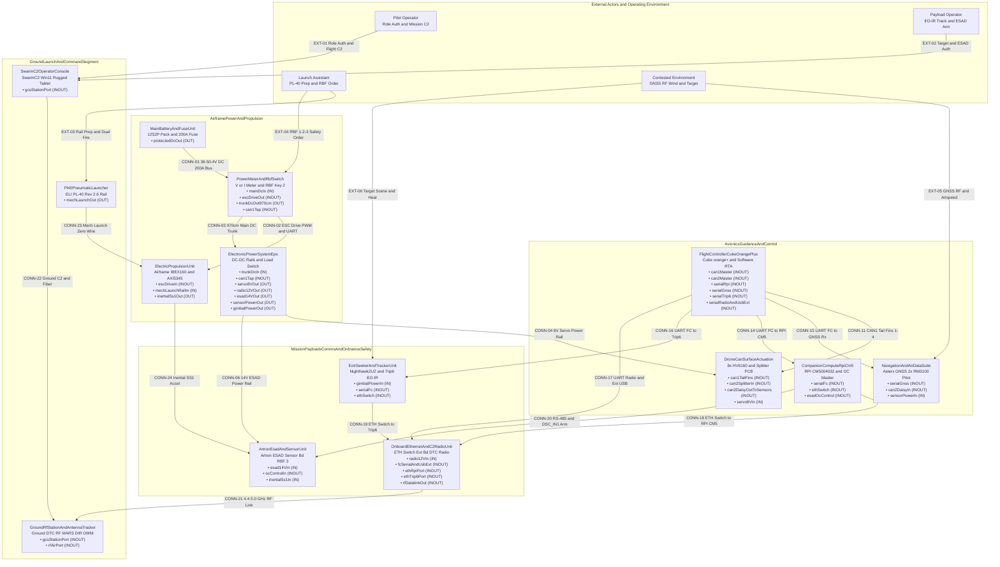

#### Figure 4.2: Platform Subsystems Tier Breakdown (DoDAF SV-1 | SSOT: `docs/architecture/views/sv1_platform_subsystems.mmd`)

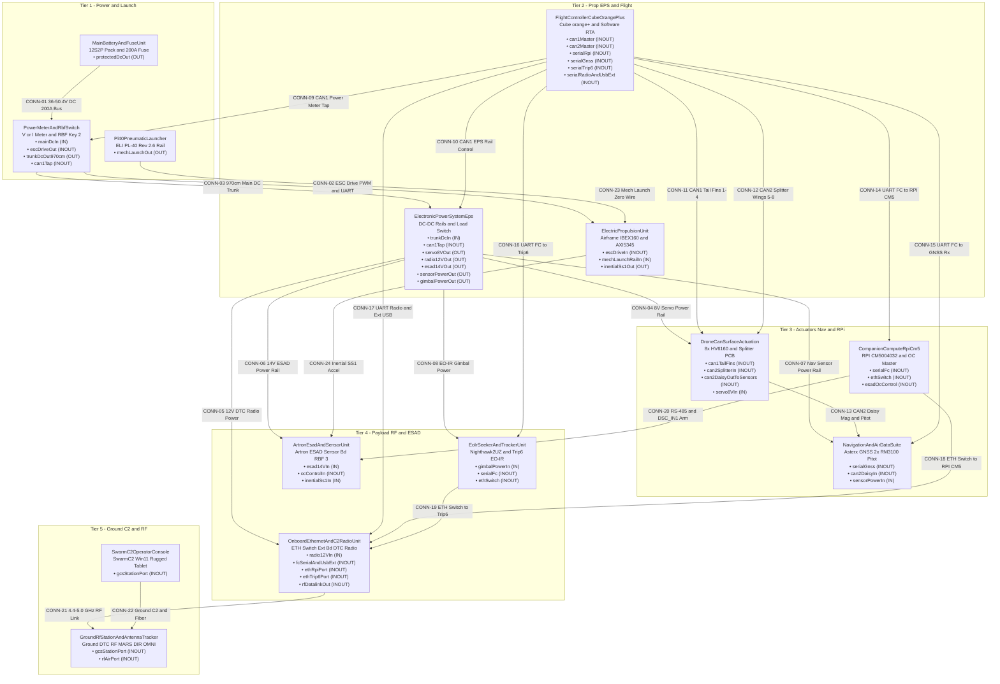

---

### 4.2 Super-System Segment Allocation Matrix

Table 4.2 allocates 100% of the 15 SysML v2 `part def` declarations present in [`.pipeline/schema.sysml`](../../.pipeline/schema.sysml) and [`.pipeline/schema-digest.json`](../../.pipeline/schema-digest.json) across operational segments with direct machine-resolvable Level 0 SSOT citations.

#### Table 4.2: Super-System Segment Allocation Matrix (100% AST `part def` Coverage)

| Subsystem Part | Operational Segment | SSOT Ground Truth Source & Citation | Primary Functional Role |
| :--- | :--- | :--- | :--- |
| `Avenger5V25IntegratedSystem` | Root Integrated Super-System (`Avenger5V25UasSystem`) | [schema/extracted/01_avenger5_platform_and_architecture.md](../../schema/extracted/01_avenger5_platform_and_architecture.md) (`AVENGER 5 Spec sheet_rev3.pdf#p1` through `#p4`, `Avenger5_V2.5_block_diagram_rev5.pdf#p1`) \| SysML v2: `part def Avenger5V25IntegratedSystem` | Top-level super-system composition instantiating all 14 physical/ground subsystems and all 24 operational interconnects (`CONN-01` through `CONN-24`) with zero standalone RTA box, zero launcher electrical wires, and no production failsafe containment. |
| `MainBatteryAndFuseUnit` | `AirframePowerAndPropulsion` | [schema/extracted/oem_bom.md](../../schema/extracted/oem_bom.md) (`BOM-AV-002`, `BOM-AV-003`; `Avenger5_V2.5_block_diagram_rev5.pdf#p1`, `A5-user-manual 2.pdf#p56`, `A5_prep and safety_rev7.pdf#p12` through `#p14`) \| SysML v2: `part def MainBatteryAndFuseUnit` | Removable 12S2P Li-metal primary propulsion and avionics battery pack paired with an inline automotive overcurrent protection fuse feeding the main unregulated DC bus. |
| `PowerMeterAndRbfSwitch` | `AirframePowerAndPropulsion` | [schema/extracted/oem_bom.md](../../schema/extracted/oem_bom.md) (`BOM-AV-004`, `BOM-AV-005`; `Avenger5_V2.5_block_diagram_rev5.pdf#p1`, `A5_prep and safety_rev7.pdf#p21`) \| SysML v2: `part def PowerMeterAndRbfSwitch` | Integrated voltage/current power meter and main bus switch gated by UAV Power Remove Before Flight Key #2; feeds ESC power/PWM throttle, bridges ESC UART telemetry onto DroneCAN Bus 1, and drives the main DC trunk to EPS. |
| `ElectricPropulsionUnit` | `AirframePowerAndPropulsion` | [schema/extracted/01_avenger5_platform_and_architecture.md](../../schema/extracted/01_avenger5_platform_and_architecture.md) (`BOM-AV-001`, `BOM-AV-006`, `BOM-AV-007`, `BOM-AV-008`, `BOM-AV-025`; `AVENGER 5 Spec sheet_rev3.pdf#p1` through `#p3`, `Avenger5_V2.5_block_diagram_rev5.pdf#p1`, `A5-user-manual 2.pdf#p8` through `#p10`) \| SysML v2: `part def ElectricPropulsionUnit` | X-wing pusher airframe structural envelope, brushless electronic speed controller, BLDC pusher motor, rear folding propeller, and pre-flight protective covers/strap receiving mechanical catapult thrust and transmitting rigid-body launch acceleration. |
| `ElectronicPowerSystemEps` | `AirframePowerAndPropulsion` | [schema/extracted/interface_table.md](../../schema/extracted/interface_table.md) (`BOM-AV-009`, `BOM-AV-026`, `IF-PWR-006` through `IF-PWR-011`; `Avenger5_V2.5_block_diagram_rev5.pdf#p1`, `A5-user-manual 2.pdf#p10`, `#p36`) \| SysML v2: `part def ElectronicPowerSystemEps` | DC/DC power regulation and load-switching unit converting main trunk power into dedicated servo, C2 radio, ordnance ESAD, navigation sensor, and EO/IR gimbal rails under DroneCAN Bus 1 supervision, while keeping optional RnD recovery rails disabled. |
| `FlightControllerCubeOrangePlus` | `AvionicsGuidanceAndControl` | [schema/extracted/oem_bom.md](../../schema/extracted/oem_bom.md) (`BOM-AV-010`; `Avenger5_V2.5_block_diagram_rev5.pdf#p1`, `A5-user-manual 2.pdf#p88`) \| SysML v2: `part def FlightControllerCubeOrangePlus` | Primary autopilot, INS/EKF2 state estimator, dual-bus DroneCAN master, multi-port UART coordinator, and software-hosted ASTM F3269-17 Simplex RTA envelope monitor enforcing speed caps and failsafe RTL statecharts. |
| `CompanionComputeRpiCm5` | `AvionicsGuidanceAndControl` | [schema/extracted/interface_table.md](../../schema/extracted/interface_table.md) (`BOM-AV-011`, `IF-SER-001`, `IF-ETH-001`, `IF-ORD-001`, `IF-ORD-002`; `Avenger5_V2.5_block_diagram_rev5.pdf#p1`, `ESAD ICD_for Excalibur_AB00-0054-01AA-0005 2 1.pdf#p15`) \| SysML v2: `part def CompanionComputeRpiCm5` | Companion mission computer functioning as SwarmC2 IP bridge and sole Ordnance Computer (OC) Master supervising the Artron ESAD via high-rate RS-485 polling and hardware arming discrete signaling. |
| `NavigationAndAirDataSuite` | `AvionicsGuidanceAndControl` | [schema/extracted/oem_bom.md](../../schema/extracted/oem_bom.md) (`BOM-AV-014` through `BOM-AV-017`; `AVENGER 5 Spec sheet_rev3.pdf#p3`, `Avenger5_V2.5_block_diagram_rev5.pdf#p1`) \| SysML v2: `part def NavigationAndAirDataSuite` | RTK-capable multi-constellation GNSS receiver and antenna paired with dual redundant magnetometer/barometer modules and a heated airspeed pitot sensor on DroneCAN Bus 2 supporting GNSS-denied dead-reckoning fallback. |
| `DroneCanSurfaceActuation` | `AvionicsGuidanceAndControl` | [schema/extracted/01_avenger5_platform_and_architecture.md](../../schema/extracted/01_avenger5_platform_and_architecture.md) (`BOM-AV-018` through `BOM-AV-020`; `Avenger5_V2.5_block_diagram_rev5.pdf#p1`) \| SysML v2: `part def DroneCanSurfaceActuation` | Eight DroneCAN servo actuators partitioned into four mixed pitch/yaw tail ruddervator servos on DroneCAN Bus 1 and four active roll wing panel servos behind a CAN/power splitter PCB on DroneCAN Bus 2. |
| `OnboardEthernetAndC2RadioUnit` | `MissionPayloadsCommsAndOrdnanceSafety` | [schema/extracted/oem_bom.md](../../schema/extracted/oem_bom.md) (`BOM-AV-012`, `BOM-AV-013`, `BOM-AV-021`, `BOM-AV-022`; `AVENGER 5 Spec sheet_rev3.pdf#p3`, `Avenger5_V2.5_block_diagram_rev5.pdf#p1`, `A5_prep and safety_rev7.pdf#p21`) \| SysML v2: `part def OnboardEthernetAndC2RadioUnit` | Internal switched Ethernet fabric, lockable external USB/ETH service board, AES-256 FHSS C-band C2/video datalink transceiver, and dual airborne RF antennas connecting onboard compute and seeker streams to the ground station. |
| `EoIrSeekerAndTrackerUnit` | `MissionPayloadsCommsAndOrdnanceSafety` | [schema/extracted/01_avenger5_platform_and_architecture.md](../../schema/extracted/01_avenger5_platform_and_architecture.md) (`BOM-AV-023`, `BOM-AV-024`; `AVENGER 5 Spec sheet_rev3.pdf#p1` through `#p3`, `Avenger5_V2.5_block_diagram_rev5.pdf#p1`, `A5-user-manual 2.pdf#p38`, `#p86` through `#p90`) \| SysML v2: `part def EoIrSeekerAndTrackerUnit` | Two-axis stabilized Day/Thermal EO/IR gimbal and dedicated camera auto-tracker compute module performing target lock acquisition, terminal dive guidance steering, and in-flight gimbal reboot recovery. |
| `ArtronEsadAndSensorUnit` | `MissionPayloadsCommsAndOrdnanceSafety` | [schema/extracted/oem_bom.md](../../schema/extracted/oem_bom.md) (`BOM-ORD-001` through `BOM-ORD-005`; `Avenger5_V2.5_block_diagram_rev5.pdf#p1`, `ESAD ICD_for Excalibur_AB00-0054-01AA-0005 2 1.pdf#p1` through `#p28`, `A5_prep and safety_rev7.pdf#p9` through `#p23`) \| SysML v2: `part def ArtronEsadAndSensorUnit` | STANAG 4187 all-electronic Safe and Arm Device, proximity/impact sensor board, ESAD Remove Before Flight Key #3 umbilical interlock, and modular warhead holder enforcing multi-barrier inertial, safe-separation, and command-gated detonation safety. |
| `Pl40PneumaticLauncher` | `GroundLaunchAndCommandSegment` | [schema/extracted/oem_bom.md](../../schema/extracted/oem_bom.md) (`BOM-LCH-001` through `BOM-LCH-005`; `UAV_launcher_PL-40_user_manual_rev_2.6.pdf#p3` through `#p45`) \| SysML v2: `part def Pl40PneumaticLauncher` | Portable three-section pneumatic rail catapult, battery-powered compressor with UVLO cutoff, carriage/safety pin, manual main outlet valve, and dual-switch firing box providing purely mechanical airframe acceleration. |
| `SwarmC2OperatorConsole` | `GroundLaunchAndCommandSegment` | [schema/extracted/oem_bom.md](../../schema/extracted/oem_bom.md) (`BOM-GCS-001`; `AVENGER 5 Spec sheet_rev3.pdf#p3`, `A5-user-manual 2.pdf#p11`, `#p27` through `#p29`, `A5_prep and safety_rev7.pdf#p6`) \| SysML v2: `part def SwarmC2OperatorConsole` | Rugged Windows 11 tactical C2 tablet hosting SwarmC2 software for role-authenticated mission planning, flight/seeker/ordnance HITL authorization, failsafe supervision, and 5W/CFF tactical target export. |
| `GroundRfStationAndAntennaTracker` | `GroundLaunchAndCommandSegment` | [schema/extracted/oem_bom.md](../../schema/extracted/oem_bom.md) (`BOM-GCS-002` through `BOM-GCS-006`; `AVENGER 5 Spec sheet_rev3.pdf#p3`, `A5-user-manual 2.pdf#p11`, `#p52`, `#p55`, `#p72` through `#p74`, `A5_prep and safety_rev7.pdf#p6` through `#p9`) \| SysML v2: `part def GroundRfStationAndAntennaTracker` | Ground C-band RF transceiver box, directional azimuth antenna rotator, high-gain directional and omnidirectional antennas, optional tactical fiber spool tether, and mandatory transport-box ESD grounding point. |

---

### 4.3 Subsystem Architecture (100% AST Part Coverage)

Every declared SysML v2 `part def` node in [`.pipeline/schema.sysml`](../../.pipeline/schema.sysml) (`15` of `15` nodes, `100%` bijection) is decomposed below with exact port parity, operational envelopes, lifecycle state bindings, safety interlocks, and SSOT provenance.

#### 4.3.1 `Avenger5V25IntegratedSystem` Subsystem Architecture

- **Functional Purpose & Scope:** Root super-system composition (`package Avenger5V25UasSystem`) unifying all 14 ground, launch, power, propulsion, avionics, datalink, EO/IR seeker, and ordnance safety subsystems to deliver precision mid-range strike missions across Operational Activities `OA-01` through `OA-19` and Operational Scenarios `SCN-01` through `SCN-08`. Enforces zero standalone RTA hardware box (`standaloneRtaBoxCount == 0`), purely mechanical rail launch (`electricalWireToUavCount == 0`), and production exclusion of recovery parachutes (`productionRecoverySystemInstalled == false`).
- **Physical & Logical Interface / Port Allocations:** Declares and binds all 24 internal and air-ground connection topologies (`CONN-01` through `CONN-24`; SysML `CONN_01` through `CONN_24`) across its 14 instantiated subsystem parts (`batteryAndFuse`, `powerMeter`, `propulsionAndAirframe`, `eps`, `flightController`, `companionComputer`, `navAirData`, `surfaceActuators`, `commsUnit`, `seekerUnit`, `esadUnit`, `pl40Launcher`, `swarmC2Console`, `groundRfStation`), plus external actor/environment boundaries (`EXT-01` through `EXT-06`) shown in Figure 4.1.
- **Power, Mass & Resource Envelopes:** Air vehicle MTOW `17.0 kg` (within `30.0 kg` PL-40 rail capacity) with `1.8 m` (`1803.0 mm` CAD) wingspan, `1.6 m` (`1576.0 mm` CAD) length, `1.1 m` (`1095.0-1112.0 mm` CAD) assembled height, and up to `5.0 kg` warhead mass; primary `36.0-50.4 V` DC main bus yielding up to `90.0 min` (`5400.0 s`) endurance across `-20.0 to +50.0 degC`; ground PL-40 system mass `68.0 kg` (`43.0 kg` rail case + `25.0 kg` compressor). Unprinted component-level mass/energy budgets are governed as calibration targets under `REQ_SAF_11` (`GAP-ENV`).
- **Operational Role & Statechart Integration:** Integrates all five system `state def` state machines (`UavFlightLifecycleState`, `RtaEnvelopeMonitorState`, `EsadSafeArmState`, `PaceC2LinkState`, and `Pl40LauncherState`) across pre-flight checkout, catapult launch, cruise/loiter, terminal engagement, abort/RTB, and safe shutdown (`Phi_lifecycle`).
- **Safety Invariants, Containment Interlocks & FMECA Linkage:** Enforces system-level loss and hazard barriers (`REQ_L_01` through `REQ_L_04`, `REQ_H_01` through `REQ_H_06`, `REQ_UCA_01` through `REQ_UCA_08`, `REQ_SC_01` through `REQ_SC_16`) alongside gap dispositions (`REQ_SAF_01` through `REQ_SAF_12`), ASTM F3269-17 software Simplex RTA (`SimplexRtaSoftwareHostingConstraint`), STANAG 4187 ESAD barriers, and Section 12 emergency triggers (`EMG-01` through `EMG-07`).
- **SSOT Ground Truth Mapping:** [schema/extracted/01_avenger5_platform_and_architecture.md](../../schema/extracted/01_avenger5_platform_and_architecture.md) (System Identification and Bus Topologies; `AVENGER 5 Spec sheet_rev3.pdf#p1` through `#p4`, `Avenger5_V2.5_block_diagram_rev5.pdf#p1`) | SysML v2: `part def Avenger5V25IntegratedSystem`

#### 4.3.2 `MainBatteryAndFuseUnit` Subsystem Architecture

- **Functional Purpose & Scope:** Supplies primary onboard electrical energy storage and main-bus overcurrent protection via a removable `12S2P Li metal BEI maximus20` pack (`BOM-AV-002`, matched by ID/QR to the fuselage) and an inline `200.0 A` automotive fuse (`BOM-AV-003`). Supports `OA-01` (`ValidateBatteryAndPowerOnRbf2`) and `OA-04` (`MonitorBingoEnergyReserve`) within `AirframePowerAndPropulsion`.
- **Physical & Logical Interface / Port Allocations:** Exposes `protectedDcOut (OUT)` (`MainBatteryDcOutPort`, `IF-PWR-001` and `IF-PWR-002`) carrying `MainDcBusPower` on `CONN-01` to `PowerMeterAndRbfSwitch.mainDcIn`.
- **Power, Mass & Resource Envelopes:** Operating DC voltage `36.0-50.4 V`, mandatory pre-flight voltage window `49.0-50.0 V` (strictly rejecting legacy `23.9-25.0 V` UI screenshots per `GAP-05`), `200.0 A` fuse rating, `90.0 min` (`5400.0 s`) maximum endurance, `0.20` (`1080.0 s`) statutory Bingo energy reserve floor, and `-20.0 to +50.0 degC` airframe thermal envelope. Individual pack mass and Wh/Ah cell capacity are unprinted in OEM documents and tracked under `REQ_SAF_11` (`GAP-ENV`) within the `17.0 kg` MTOW budget.
- **Operational Role & Statechart Integration:** Anchors `UavFlightLifecycleState::PreFlightCheck` (`49.0-50.0 V` verification before RBF #2 removal), sustains `CatapultLaunch`, `CruiseAndLoiter`, and `TargetTrackAndDive`, triggers `EmergencyAbortOrRtb` and `RtaEnvelopeMonitorState::CriticalBatteryOrGeofenceRtb` upon Bingo depletion or bus sag below `36.0 V`, and disconnects only in `SafePostFlightShutdown` after RBF #3 reinstallation.
- **Safety Invariants, Containment Interlocks & FMECA Linkage:** Enforces `MainBatteryPreFlightVoltageConstraint` (`GAP-05`), `BingoEnergyReserveConstraint`, `REQ_SC_01`, `REQ_SC_02`, `REQ_SC_04`, `REQ_SAF_05`, `REQ_SAF_11`, `REQ_H_01`, `REQ_H_02`, `REQ_UCA_01`, and `REQ_UCA_02`; bound to Section 12 critical battery reserve and main-bus sag emergency triggers (`EMG-01` through `EMG-07`).
- **SSOT Ground Truth Mapping:** [schema/extracted/oem_bom.md](../../schema/extracted/oem_bom.md) (`BOM-AV-002`, `BOM-AV-003`; `Avenger5_V2.5_block_diagram_rev5.pdf#p1`, `A5-user-manual 2.pdf#p56`, `A5_prep and safety_rev7.pdf#p12` through `#p14`) | SysML v2: `part def MainBatteryAndFuseUnit`

#### 4.3.3 `PowerMeterAndRbfSwitch` Subsystem Architecture

- **Functional Purpose & Scope:** Gates main DC bus energization through `UAV Power R.B.F. Key #2 (XT60E-F)` (`BOM-AV-005`), measures bus voltage and current (`BOM-AV-004`), issues PWM throttle commands to the propulsion ESC, bridges unidirectional ESC UART telemetry onto DroneCAN Bus 1, and drives the `970.0 cm` main DC trunk to EPS. Executes `OA-01` (`ValidateBatteryAndPowerOnRbf2`), `OA-02` (`CommandPusherThrottleAndReadEscTelem`), and `OA-04` (`MonitorBingoEnergyReserve`).
- **Physical & Logical Interface / Port Allocations:** Declares four SV-1 ports: `mainDcIn (IN)` (`MainBatteryDcInPort`, `IF-PWR-003`) receiving `CONN-01`; `escDriveOut (INOUT)` (`EscDriveHarnessOutPort`, `IF-PWR-004`, `IF-PWM-001`, `IF-SER-005`) driving `CONN-02`; `trunkDcOut970cm (OUT)` (`TrunkDcPowerOutPort`, `IF-PWR-006`) feeding `CONN-03`; and `can1Tap (INOUT)` (`Can1PowerTapPort`, `IF-CAN1-001`) interfacing `CONN-09`. Also receives external operator physical safety action `EXT-04` (`RBF 1-2-3 Safety Order`).
- **Power, Mass & Resource Envelopes:** Switched `36.0-50.4 V` DC main bus rated up to the `200.0 A` upstream fuse across a `970.0 cm` trunk harness and `-20.0 to +50.0 degC` airframe thermal envelope. Individual PCB mass and shunt dissipation are unprinted in OEM documents and allocated within the `17.0 kg` MTOW budget.
- **Operational Role & Statechart Integration:** Controls the `PreFlightCheck` power-on transition (`rbf2RemovedPowersOn == true`, `pullRbf2BeforeRbf3 == true`), streams real-time current/voltage/ESC health throughout flight modes, and remains energized through `SafePostFlightShutdown` until `RBF #3` is reinstalled before `RBF #2` disconnection.
- **Safety Invariants, Containment Interlocks & FMECA Linkage:** Enforces `REQ_SC_01`, `REQ_SC_02`, `REQ_SC_04`, `REQ_SAF_06` (`GAP-06` power-before-pull sequencing), `REQ_H_01`, `REQ_H_02`, `REQ_UCA_01`, and `REQ_UCA_02`; bound to Section 12 power-bus fault and scrub-safing triggers (`EMG-01` through `EMG-07`).
- **SSOT Ground Truth Mapping:** [schema/extracted/oem_bom.md](../../schema/extracted/oem_bom.md) (`BOM-AV-004`, `BOM-AV-005`; `Avenger5_V2.5_block_diagram_rev5.pdf#p1`, `A5_prep and safety_rev7.pdf#p21`) | SysML v2: `part def PowerMeterAndRbfSwitch`

#### 4.3.4 `ElectricPropulsionUnit` Subsystem Architecture

- **Functional Purpose & Scope:** Encompasses the `Avenger V2.5` (`ASTK A5 V2.5`) X-wing pusher airframe (`BOM-AV-001`), `IBEX160` brushless ESC (`BOM-AV-006`), `AXI 5345/16 HD GOLD LINE V3` BLDC motor (`BOM-AV-007`), rear 2-blade folding pusher propeller (`BOM-AV-008`), and `RBF #1` front protective covers/gimbal strap (`BOM-AV-025`). Converts electrical DC power into aerodynamic thrust and transmits rigid-body catapult launch acceleration to the ESAD inertial sensor (`OA-02`).
- **Physical & Logical Interface / Port Allocations:** Declares three SV-1 ports: `escDriveIn (INOUT)` (`EscDriveHarnessInPort`, `IF-PWR-004`, `IF-PWR-005`, `IF-PWM-001`, `IF-SER-005`) on `CONN-02`; `mechLaunchRailIn (IN)` (`MechanicalLaunchRailInPort`, `IF-MECH-001`, zero electrical conductors) receiving `CONN-23` from `Pl40PneumaticLauncher`; and `inertialSs1Out (OUT)` (`InertialSs1AccelOutPort`, rigid-body mechanical impulse) driving `CONN-24` to `ArtronEsadAndSensorUnit`.
- **Power, Mass & Resource Envelopes:** Total MTOW `17.0 kg` (`2`-crew lift minimum, `M6 x 30 mm` wing bolts with `10.0 mm` spanner, `145.0-155.5 mm` PL-40 carriage prop-safe zone); `36.0-50.4 V` DC ESC drive; airspeed envelope spanning `24.0 m/s` stall (`26.0 m/s` V1 min), `31.0 m/s` V2.5 (`30.0 m/s` V1) cruise, `42.0 m/s` V2.5 (`38.0 m/s` V1) max horizontal, `55.0 m/s` engagement cap, `80.0 m/s` VNE structural ceiling, `15.0 deg` shallow / `22.0 deg` max dive, `5000.0 m` service ceiling, `12.0 m/s` ground / `28.0 m/s` cruise wind tolerance, and `-20.0 to +50.0 degC` operating temp. ESC/motor thermal and current cutoffs are tracked under `REQ_SAF_11` (`GAP-ENV`).
- **Operational Role & Statechart Integration:** Transitions from `PreFlightCheck` (`RBF #1` removed, rear prop folded rearward) into `CatapultLaunch` (`~23.0 m/s` rail exit, climb transition above `26.0 m/s`), `CruiseAndLoiter`, `TargetTrackAndDive`, `EmergencyAbortOrRtb`, and `SafePostFlightShutdown` (`UavFlightLifecycleState`).
- **Safety Invariants, Containment Interlocks & FMECA Linkage:** Enforces `FlightEnvelopeSpeedConstraint` (`GAP-02`), `REQ_SC_01`, `REQ_SC_04`, `REQ_SAF_02`, `REQ_SAF_11`, `REQ_H_01`, `REQ_H_02`, and `REQ_L_02`; bound to Section 12 propulsion loss, airspeed limit, and launch transition emergency triggers (`EMG-01` through `EMG-07`).
- **SSOT Ground Truth Mapping:** [schema/extracted/01_avenger5_platform_and_architecture.md](../../schema/extracted/01_avenger5_platform_and_architecture.md) (System Identification and Airframe Performance Envelope; `AVENGER 5 Spec sheet_rev3.pdf#p1` through `#p3`, `Avenger5_V2.5_block_diagram_rev5.pdf#p1`, `A5-user-manual 2.pdf#p8` through `#p10`) | SysML v2: `part def ElectricPropulsionUnit`

#### 4.3.5 `ElectronicPowerSystemEps` Subsystem Architecture

- **Functional Purpose & Scope:** Regulates and switches secondary DC distribution rails from the `970.0 cm` main DC trunk using internal DC/DC converters, load switches, and a DroneCAN Bus 1 MCU (`BOM-AV-009`), executing `OA-03` (`DistributeRegulatedPowerRails`). On production `Avenger V2.5`, the `2x 50.0 V` pyrotechnic failsafe containment igniter outputs (`BOM-AV-026`, `Optional RnD`) remain permanently disabled (`Recovery System: No`).
- **Physical & Logical Interface / Port Allocations:** Declares seven SV-1 ports: `trunkDcIn (IN)` (`TrunkDcPowerInPort`, `IF-PWR-006`) on `CONN-03`; `can1Tap (INOUT)` (`Can1PowerTapPort`, `IF-CAN1-001`) on `CONN-10`; `servo8VOut (OUT)` (`RegulatedRailOutPort`, `IF-PWR-007`) on `CONN-04`; `radio12VOut (OUT)` (`RegulatedRailOutPort`, `IF-PWR-008`) on `CONN-05`; `esad14VOut (OUT)` (`RegulatedRailOutPort`, `IF-PWR-009`) on `CONN-06`; `sensorPowerOut (OUT)` (`RegulatedRailOutPort`, `IF-PWR-011`) on `CONN-07`; and `gimbalPowerOut (OUT)` (`RegulatedRailOutPort`, `IF-PWR-011`) on `CONN-08`.
- **Power, Mass & Resource Envelopes:** Accepts `36.0-50.4 V` DC trunk input and regulates `8.0 V` servo power, `12.0 V` DTC radio power, `14.0 V` ESAD power (`0.0 V` brownout margin against the ESAD `14.0-32.0 V` ICD range per `GAP-01`), Pitot/Mag/Gimbal rails, and inhibited `50.0 V` RnD lines across `-20.0 to +50.0 degC`. Individual EPS module mass and per-rail current limits are unprinted in OEM documents and tracked within the `17.0 kg` MTOW and `REQ_SAF_11` (`GAP-ENV`).
- **Operational Role & Statechart Integration:** Energized across `UavFlightLifecycleState` (`PreFlightCheck` through `SafePostFlightShutdown`); controls `EsadSafeArmState` transition between `SafePowerOff` and `BootAndPbit` via the `14.0 V` load switch and executes irreversible `Power Off ESAD` rail isolation during abort, scrub, or fault safing.
- **Safety Invariants, Containment Interlocks & FMECA Linkage:** Enforces `EpsEsadZeroBrownoutMarginConstraint` (`GAP-01`), `ProductionNoParachuteConstraint`, `REQ_SC_02`, `REQ_SC_03`, `REQ_SAF_01`, `REQ_H_01`, `REQ_H_02`, and `REQ_UCA_02`; bound to Section 12 EPS brownout and ordnance power-off triggers (`EMG-01` through `EMG-07`).
- **SSOT Ground Truth Mapping:** [schema/extracted/interface_table.md](../../schema/extracted/interface_table.md) (`IF-PWR-006` through `IF-PWR-011`, `BOM-AV-009`, `BOM-AV-026`; `Avenger5_V2.5_block_diagram_rev5.pdf#p1`, `A5-user-manual 2.pdf#p10`, `#p36`) | SysML v2: `part def ElectronicPowerSystemEps`

#### 4.3.6 `FlightControllerCubeOrangePlus` Subsystem Architecture

- **Functional Purpose & Scope:** Serves as the primary flight controller, INS/EKF2 state estimator, and autonomous flight manager (`Cube orange+`, `BOM-AV-010`) inside the `ASTK A5 V2.5` stack. Hosts the software-resident ASTM F3269-17 Simplex RTA supervisor (`simplexRtaSoftwareHosted == true`, `standaloneRtaBoxCount == 0`), executing `OA-05` (`ExecuteSimplexRtaEnvelopeCheck`), `OA-07` (`SwitchToGnssDeniedDeadReckoning`), and inner-loop guidance across `OA-09`.
- **Physical & Logical Interface / Port Allocations:** Declares six SV-1 ports: `can1Master (INOUT)` (`DroneCanBusPort`, `IF-CAN1-001`) on `CONN-09`, `CONN-10`, and `CONN-11`; `can2Master (INOUT)` (`DroneCanBusPort`, `IF-CAN2-001`) on `CONN-12`; `serialRpi (INOUT)` (`UartSerialPort`, `IF-SER-001`) on `CONN-14`; `serialGnss (INOUT)` (`UartSerialPort`, `IF-SER-002`) on `CONN-15`; `serialTrip6 (INOUT)` (`UartSerialPort`, `IF-SER-003`) on `CONN-16`; and `serialRadioAndUsbExt (INOUT)` (`SerialAndUsbServicePort`, `IF-SER-004`, `IF-USB-001`) on `CONN-17`.
- **Power, Mass & Resource Envelopes:** Integrates `2` independent DroneCAN buses, `4` point-to-point UART serial ports, and `1` ground USB maintenance interface behind the lockable umbilical/service lid; enforces `<= 55.0 m/s` engagement speed cap, `<= 80.0 m/s` structural `VNE`, and `105.0 s` baseline GCS failsafe timeout across `-20.0 to +50.0 degC`. Individual module mass/power and EKF2/CAN WCET bounds are unprinted in OEM documents and tracked under `REQ_SAF_08` (`GAP-WCET`) and `17.0 kg` MTOW.
- **Operational Role & Statechart Integration:** Governs `UavFlightLifecycleState` mode transitions, directly implements `RtaEnvelopeMonitorState` (`NominalPrimaryEnvelope`, `AirspeedDiveCapClamped`, `EsadBusWatchdogFaultFallback`, `CriticalBatteryOrGeofenceRtb`), and executes `PaceC2LinkState::EmergencyLostLinkRtlHolding` on sustained GCS link loss.
- **Safety Invariants, Containment Interlocks & FMECA Linkage:** Enforces `SimplexRtaSoftwareHostingConstraint`, `FlightEnvelopeSpeedConstraint`, `CanTopologyIsolationConstraint`, `REQ_SC_05`, `REQ_SC_06`, `REQ_SC_07`, `REQ_SAF_02`, `REQ_SAF_08`, `REQ_H_03`, `REQ_L_02`, `REQ_L_03`, and `REQ_UCA_03`; bound to Section 12 overspeed clamp, lost-link RTL, and critical battery triggers (`EMG-01` through `EMG-07`).
- **SSOT Ground Truth Mapping:** [schema/extracted/oem_bom.md](../../schema/extracted/oem_bom.md) (`BOM-AV-010`; `Avenger5_V2.5_block_diagram_rev5.pdf#p1`, `A5-user-manual 2.pdf#p88`) | SysML v2: `part def FlightControllerCubeOrangePlus`

#### 4.3.7 `CompanionComputeRpiCm5` Subsystem Architecture

- **Functional Purpose & Scope:** Provides companion mission computing (`RPI CM5004032`, `BOM-AV-011`) inside `ASTK A5 V2.5`, bridging SwarmC2 IP payloads/commands over switched Ethernet (`IF-ETH-001`) with `Cube orange+` (`IF-SER-001`) and acting as the sole Ordnance Computer (OC) Master supervising the Artron ESAD (`OA-08`, `OA-10`, `OA-11`, `OA-12`).
- **Physical & Logical Interface / Port Allocations:** Declares three SV-1 ports: `serialFc (INOUT)` (`UartSerialPort`, `IF-SER-001`) on `CONN-14`; `ethSwitch (INOUT)` (`EthernetFabricPort`, `IF-ETH-001`) on `CONN-18`; and `esadOcControl (INOUT)` (`EsadOcControlBundlePort`, `IF-ORD-001` RS-485 bus and `IF-ORD-002` `DSC_IN1` discrete arm enable) on `CONN-20` (detailed wire framing and deferred to Level 1C ICD).
- **Power, Mass & Resource Envelopes:** Polls Artron ESAD at `100.0 Hz` (`0.01 s` period) with `<= 5.0 ms` reply latency and `<= 10.0 ms` incomplete-packet watchdog timeout (`GAP-04`); drives `DSC_IN1` hardware arm pulse burst (`2.5-3.3 V` high, `0.0-0.7 V` low, `2` pulses gated strictly to Arm Stage 2) across `-20.0 to +50.0 degC`. Individual compute board mass/wattage are unprinted in OEM documents and tracked under `17.0 kg` MTOW and `REQ_SAF_08`.
- **Operational Role & Statechart Integration:** Orchestrates `EsadSafeArmState` supervision (`BootAndPbit`, `SafeRbfInstalled`, `SafeRbfRemoved`, `ArmStage1TimerWait`, `ArmStage2Armed`, `HvChargedReady`, `DetonatedOrAborted`, `FaultLockout`) and triggers `RtaEnvelopeMonitorState::EsadBusWatchdogFaultFallback` on ESAD bus timeout, CRC error, or `14.0 V` brownout.
- **Safety Invariants, Containment Interlocks & FMECA Linkage:** Enforces `EsadRs485ProtocolTimingConstraint` (`GAP-04`), `REQ_SC_08`, `REQ_SC_09`, `REQ_SC_10`, `REQ_SC_11`, `REQ_SAF_04`, `REQ_SAF_08`, `REQ_H_03`, `REQ_H_04`, `REQ_UCA_04`, `REQ_UCA_05`, and `REQ_UCA_06`; bound to Section 12 ESAD bus watchdog and command abort triggers (`EMG-01` through `EMG-07`).
- **SSOT Ground Truth Mapping:** [schema/extracted/interface_table.md](../../schema/extracted/interface_table.md) (`IF-SER-001`, `IF-ETH-001`, `IF-ORD-001`, `IF-ORD-002`, `BOM-AV-011`; `Avenger5_V2.5_block_diagram_rev5.pdf#p1`, `ESAD ICD_for Excalibur_AB00-0054-01AA-0005 2 1.pdf#p15`) | SysML v2: `part def CompanionComputeRpiCm5`

#### 4.3.8 `NavigationAndAirDataSuite` Subsystem Architecture

- **Functional Purpose & Scope:** Integrates `Septentrio Asterx-m3 pro` RTK-capable multi-constellation GNSS (`BOM-AV-014`), `Talysman TW3972EXF` antenna (`BOM-AV-015`), `2x mRo RM3100` dual redundant Magnetometers with integrated barometer (`BOM-AV-016`), and `CUAV SKYE2` Heated Pitot airspeed sensor with water drainage (`BOM-AV-017`). Executes `OA-06` (`RunPitotAndMagPreflightCheck`) and supports `OA-07` (`SwitchToGnssDeniedDeadReckoning`).
- **Physical & Logical Interface / Port Allocations:** Declares three SV-1 ports: `serialGnss (INOUT)` (`UartSerialPort`, `IF-SER-002`) on `CONN-15`; `can2DaisyIn (INOUT)` (`DroneCanBusPort`, `IF-CAN2-001` series end-chain `Mag #2 -> Mag #1 -> Pitot`) on `CONN-13`; and `sensorPowerIn (IN)` (`RegulatedRailInPort`, `IF-PWR-011` Mag and Pitot rails) on `CONN-07`. Receives external RF and airflow inputs on `EXT-05` (`IF-RF-002` GNSS coax RF and ambient airspeed/pressure).
- **Power, Mass & Resource Envelopes:** Enforces calm-air pitot pre-flight bound `<= 3.0 m/s` and indirect airflow check `>= 10.0 m/s` (`PitotPreflightCalibrationConstraint`) across `-20.0 to +50.0 degC` up to `5000.0 m` ceiling. Sensor rail voltages/currents and individual sensor weights are unprinted in OEM documents and tracked under `REQ_SAF_11` (`GAP-ENV`) and `17.0 kg` MTOW.
- **Operational Role & Statechart Integration:** Validates sensor health in `UavFlightLifecycleState::PreFlightCheck`, delivers primary navigation/air-data across `CatapultLaunch` through `TargetTrackAndDive`, and sustains `PaceC2LinkState::ContingencyGnssDeniedDrFlight` via dual `RM3100` + `SKYE2` dead-reckoning upon `GPS Failsafe` or operator `Disable GNSS`.
- **Safety Invariants, Containment Interlocks & FMECA Linkage:** Enforces `PitotPreflightCalibrationConstraint`, `CanTopologyIsolationConstraint`, `REQ_SC_06`, `REQ_SC_07`, `REQ_H_03`, `REQ_L_03`, and `REQ_UCA_03`; bound to Section 12 GNSS-denial and pitot/sensor failure triggers (`EMG-01` through `EMG-07`).
- **SSOT Ground Truth Mapping:** [schema/extracted/oem_bom.md](../../schema/extracted/oem_bom.md) (`BOM-AV-014` through `BOM-AV-017`; `AVENGER 5 Spec sheet_rev3.pdf#p3`, `Avenger5_V2.5_block_diagram_rev5.pdf#p1`) | SysML v2: `part def NavigationAndAirDataSuite`

#### 4.3.9 `DroneCanSurfaceActuation` Subsystem Architecture

- **Functional Purpose & Scope:** Implements aerodynamic flight surface actuation across `8x HV6160-DroneCAN` servos (`4` tail ruddervators `#1` through `#4` on `CAN 1` for mixed pitch/yaw skid-turn control, `BOM-AV-018`; and `4` wing panel servos `#5` through `#8` on `CAN 2` for active roll stabilization, `BOM-AV-019`) routed through a wing `CAN/power splitter PCB` (`BOM-AV-020`), executing `OA-09` (`ActuateTailAndWingSurfaces`).
- **Physical & Logical Interface / Port Allocations:** Declares four SV-1 ports: `can1TailFins (INOUT)` (`DroneCanBusPort`, `IF-CAN1-001`) on `CONN-11`; `can2SplitterIn (INOUT)` (`DroneCanBusPort`, `IF-CAN2-001`) on `CONN-12`; `can2DaisyOutToSensors (INOUT)` (`DroneCanBusPort`, `IF-CAN2-001` series continuation) on `CONN-13`; and `servo8VIn (IN)` (`RegulatedRailInPort`, `IF-PWR-007`) on `CONN-04`.
- **Power, Mass & Resource Envelopes:** Powered by the regulated `8.0 V` EPS servo rail; `4x 120.0 cm` star/tap stubs on `CAN 1` for tail fins `#1` through `#4` and series daisy-chain through `CAN/power splitter PCB` on `CAN 2` for wing panels `#5` through `#8`; operating envelope `-20.0 to +50.0 degC`. Servo peak current draw and individual unit mass are unprinted in OEM documents and tracked within the `17.0 kg` MTOW budget.
- **Operational Role & Statechart Integration:** Executes pre-flight surface sweep in `UavFlightLifecycleState::PreFlightCheck`, stabilizes post-launch climb, executes skid-turn cruise/loiter and `15.0 deg` (`<= 22.0 deg` max) terminal dive control, and commands pull-up/leveling under `RtaEnvelopeMonitorState::AirspeedDiveCapClamped` or `EmergencyAbortOrRtb`.
- **Safety Invariants, Containment Interlocks & FMECA Linkage:** Enforces `CanTopologyIsolationConstraint`, `REQ_SC_06`, `REQ_H_03`, and `REQ_UCA_03` by isolating pitch/yaw (`CAN 1`) from roll (`CAN 2`) buses so single-bus loss does not remove all control authority; bound to Section 12 control/envelope triggers (`EMG-01` through `EMG-07`).
- **SSOT Ground Truth Mapping:** [schema/extracted/01_avenger5_platform_and_architecture.md](../../schema/extracted/01_avenger5_platform_and_architecture.md) (Avionics and Bus Topologies; `Avenger5_V2.5_block_diagram_rev5.pdf#p1`) | SysML v2: `part def DroneCanSurfaceActuation`

#### 4.3.10 `OnboardEthernetAndC2RadioUnit` Subsystem Architecture

- **Functional Purpose & Scope:** Combines the internal `ETH Switch` (`BOM-AV-012`), `External Interface Board (USB/ETH)` behind a lockable umbilical/service lid (`BOM-AV-013`), `DTC 4.4-5.0 GHz` AES-256 FHSS airborne datalink radio (`BOM-AV-021`), and `2x MPSL4400` antennas (`BOM-AV-022`). Bridges ground C2, HD EO/IR video, flight telemetry, and ground service access.
- **Physical & Logical Interface / Port Allocations:** Declares five SV-1 ports: `radio12VIn (IN)` (`RegulatedRailInPort`, `IF-PWR-008`) on `CONN-05`; `fcSerialAndUsbExt (INOUT)` (`SerialAndUsbServicePort`, `IF-SER-004`, `IF-USB-001`) on `CONN-17`; `ethRpiPort (INOUT)` (`EthernetFabricPort`, `IF-ETH-001`) on `CONN-18`; `ethTrip6Port (INOUT)` (`EthernetFabricPort`, `IF-ETH-001`) on `CONN-19`; and `rfDatalinkOut (INOUT)` (`RfDatalinkAirPort`, `IF-RF-001`) on `CONN-21` to `GroundRfStationAndAntennaTracker.rfAirPort`.
- **Power, Mass & Resource Envelopes:** `4.4-5.0 GHz` AES-256 FHSS RF transceiver delivering `2.0 W` total (`2x 1.0 W` per antenna) over `8.0-17.0 V` input tolerance from the `12.0 V` EPS rail; `60.0 km` baseline RLOS (`90.0 km` V2.5 extended / `180.0 km` V1 extended); `-20.0 to +50.0 degC` airframe thermal envelope. Individual module mass and DC draw are unprinted in OEM documents and tracked under `17.0 kg` MTOW.
- **Operational Role & Statechart Integration:** Supports ground service configuration during `PreFlightCheck` prior to locking the external service lid, maintains encrypted air-ground telemetry/video across `PaceC2LinkState::AlternateDtcOmniLocal` and `PrimaryDtcDirTracking`, and signals link loss leading to `EmergencyLostLinkRtlHolding` after `105.0 s` (`OA-05`, `OA-13`, `OA-14`, `OA-19`).
- **Safety Invariants, Containment Interlocks & FMECA Linkage:** Enforces `REQ_SC_01` (umbilical/service lid locked before flight checks), `REQ_SC_12`, `REQ_SC_15`, `REQ_SAF_02` (`GAP-02`), `REQ_H_05`, `REQ_L_03`, and `REQ_UCA_07`; bound to Section 12 C2 link-loss and RF degradation triggers (`EMG-01` through `EMG-07`).
- **SSOT Ground Truth Mapping:** [schema/extracted/oem_bom.md](../../schema/extracted/oem_bom.md) (`BOM-AV-012`, `BOM-AV-013`, `BOM-AV-021`, `BOM-AV-022`; `AVENGER 5 Spec sheet_rev3.pdf#p3`, `Avenger5_V2.5_block_diagram_rev5.pdf#p1`, `A5_prep and safety_rev7.pdf#p21`) | SysML v2: `part def OnboardEthernetAndC2RadioUnit`

#### 4.3.11 `EoIrSeekerAndTrackerUnit` Subsystem Architecture

- **Functional Purpose & Scope:** Integrates the `Nighthawk2UZ` 2-axis stabilized Day/Thermal EO/IR seeker gimbal (`BOM-AV-023`) and `Trip6` camera compute/auto-tracker (`BOM-AV-024`) to provide ISR surveillance, target acquisition (`2.0-5.0 s` hold), terminal dive guidance cues (`<= 0.5 m` CEP), and in-flight `Reboot Gimbal` video recovery (`OA-13`, `OA-14`).
- **Physical & Logical Interface / Port Allocations:** Declares three SV-1 ports: `gimbalPowerIn (IN)` (`RegulatedRailInPort`, `IF-PWR-011` Gimbal power) on `CONN-08`; `serialFc (INOUT)` (`UartSerialPort`, `IF-SER-003`) on `CONN-16`; and `ethSwitch (INOUT)` (`EthernetFabricPort`, `IF-ETH-001`) on `CONN-19`. Receives external target scene energy on `EXT-06` and internally bridges `Power + HDMI` (`IF-VID-001`) between `Trip6` and `Nighthawk2UZ`.
- **Power, Mass & Resource Envelopes:** Dual `128` Day and Thermal streams with `X40` optical/digital zoom, gimbal articulation limits of `-45.0 to +135.0 deg` pitch and `+/-165.0 deg` yaw/roll; `2.0-5.0 s` auto-track hold, `<= 15.0 deg` target elevation at start / shallow approach, `<= 55.0 m/s` hard engagement speed cap, `<= 0.5 m` (`50.0 cm`) terminal CEP, and `-20.0 to +50.0 degC` airframe thermal envelope. Individual module mass/power and Trip6 tracker WCET are unprinted in OEM documents and tracked under `REQ_SAF_08` (`GAP-WCET`) and `17.0 kg` MTOW.
- **Operational Role & Statechart Integration:** Executes `UavFlightLifecycleState::CruiseAndLoiter` search and `TargetTrackAndDive` terminal guidance, transitions to `EmergencyAbortOrRtb` and `RtaEnvelopeMonitorState::AirspeedDiveCapClamped` via `Abort Engaging` whenever dive speed exceeds `55.0 m/s`, and performs `Reboot Gimbal` without opening the locked external service lid.
- **Safety Invariants, Containment Interlocks & FMECA Linkage:** Enforces `EngagementSpeedAndTrackHoldConstraint`, `REQ_SC_12`, `REQ_H_05`, and `REQ_UCA_07` (preventing gimbal saturation above `55.0 m/s` or unguided impact); bound to Section 12 overspeed-abort and video-freeze triggers (`EMG-01` through `EMG-07`).
- **SSOT Ground Truth Mapping:** [schema/extracted/01_avenger5_platform_and_architecture.md](../../schema/extracted/01_avenger5_platform_and_architecture.md) (Avionics and Seeker Subsystems; `AVENGER 5 Spec sheet_rev3.pdf#p1` through `#p3`, `Avenger5_V2.5_block_diagram_rev5.pdf#p1`, `A5-user-manual 2.pdf#p38`, `#p86` through `#p90`) | SysML v2: `part def EoIrSeekerAndTrackerUnit`

#### 4.3.12 `ArtronEsadAndSensorUnit` Subsystem Architecture

- **Functional Purpose & Scope:** Integrates the `Artron ESAD` (`AB00-0054-01AA-0005`, `BOM-ORD-001`), `ESAD Sensor Board` with proximity and impact detection (`BOM-ORD-003`), `ESAD R.B.F. Key #3` umbilical interlock (`BOM-ORD-002`), ordnance harnesses (`BOM-ORD-005`), and modular warhead holder (`BOM-ORD-004`). Enforces STANAG 4187 multi-barrier safe-arm gating (`OA-10`, `OA-11`, `OA-12`) prior to lethal package initiation.
- **Physical & Logical Interface / Port Allocations:** Declares three SV-1 ports: `esad14VIn (IN)` (`RegulatedRailInPort`, `IF-PWR-009` GE_POW rail) on `CONN-06`; `ocControlIn (INOUT)` (`EsadJ100SlavePort`, `IF-ORD-001` RS-485 bus and `IF-ORD-002` `DSC_IN1` discrete arm enable) on `CONN-20`; and `inertialSs1In (IN)` (`InertialSs1AccelInPort`, rigid-body launch acceleration) on `CONN-24`. Internally encapsulates the `RBF #3` umbilical continuity loop (`IF-ORD-003`), `5.0 V` sensor board UART/ORed interrupt trigger path (`IF-ORD-004`), and Custom `J401` high-voltage firing output (`IF-ORD-005`); detailed pinouts, wire gauges, bitmasks, and serial are deferred to Level 1C ICD.
- **Power, Mass & Resource Envelopes:** `14.0-32.0 V` ICD input (`28.0 V` nominal vs `14.0 V` EPS supply yielding `0.0 V` brownout margin per `GAP-01`); `RBF #3` umbilical loop `< 0.5 Ohm` at `20.0 mA`; `< 50.0 V` PBIT safe internal HV threshold; `0.0-1800.0 V` (`1.0 V/LSB`) HV charge/fire envelope; `0.0039 g/LSB` acceleration scale and `1.0 s/LSB` flight timer scale; `3x M3` (`75.0 mm` BCD) ESAD mount and `2x M2` sensor board mount; warhead holder `<= 5.0 kg` (`4.98 +/- 0.02 kg` tested unit, CG CTQ `30.57 +/- 1.00`, overall `173.00`, `1.5 mm` HEX terminals); `-20.0 to +50.0 degC` envelope. Unprinted safe-separation distance, launch g threshold, arming timer, and fastener torque values are parameterized under `REQ_SAF_10` (`GAP-SEPDIST`).
- **Operational Role & Statechart Integration:** Directly realizes the 9-state `EsadSafeArmState` FSM (`SafePowerOff`, `BootAndPbit`, `SafeRbfInstalled`, `SafeRbfRemoved`, `ArmStage1TimerWait`, `ArmStage2Armed`, `HvChargedReady`, `DetonatedOrAborted`, `FaultLockout`), enforcing power-before-pull `RBF #3` removal (`GAP-06`), `SS1` inertial launch sense, `SS2 Safe Distance Exceed == 1` (`GAP-07`), `DSC_IN1` Stage 2 arm enable, and `Disarm ESAD On GCS Timeout`.
- **Safety Invariants, Containment Interlocks & FMECA Linkage:** Enforces `EsadInputVoltageAndBrownoutConstraint` (`GAP-01`), `EsadRs485ProtocolTimingConstraint` (`GAP-04`), `EsadRbf3PowerBeforePullConstraint` (`GAP-06`), `EsadSafeDistanceExceedConstraint` (`GAP-07`), `WarheadMassAndPbitHvSafetyConstraint`, `REQ_SC_09` through `REQ_SC_12`, `REQ_SAF_01`, `REQ_SAF_04`, `REQ_SAF_06`, `REQ_SAF_07`, `REQ_SAF_10`, `REQ_L_01`, `REQ_L_04`, `REQ_H_04`, `REQ_UCA_05`, `REQ_UCA_06`, and `REQ_UCA_07`; requires explicit HITL consent (`>= 5.0 s` hold + Slide-to-Confirm, `Power Off ESAD`) and binds to Section 12 ordnance safety triggers (`EMG-01` through `EMG-07`).
- **SSOT Ground Truth Mapping:** [schema/extracted/oem_bom.md](../../schema/extracted/oem_bom.md) (`BOM-ORD-001` through `BOM-ORD-005`; `Avenger5_V2.5_block_diagram_rev5.pdf#p1`, `ESAD ICD_for Excalibur_AB00-0054-01AA-0005 2 1.pdf#p1` through `#p28`, `A5_prep and safety_rev7.pdf#p9` through `#p23`) | SysML v2: `part def ArtronEsadAndSensorUnit`

#### 4.3.13 `Pl40PneumaticLauncher` Subsystem Architecture

- **Functional Purpose & Scope:** Comprises the `ELI Military Simulations PL-40 Rev 2.6` 3-section Deployment pneumatic rail catapult (`BOM-LCH-001`), launch carriage, red safety pin, and hardpoints (`BOM-LCH-002`), portable battery compressor (`BOM-LCH-003`), `2x Makita BL1860B` packs (`BOM-LCH-004`), and manual Main Valve `4` + dual-switch firing box (`BOM-LCH-005`). Executes `OA-15` (`ChargePl40CompressorWithUvloCheck`), `OA-16` (`ExecuteLaunchGoNoGoAndDualTrigger`), and `OA-17` (`DepressurizeAndScrubPl40Launcher`).
- **Physical & Logical Interface / Port Allocations:** Declares one SV-1 port: `mechLaunchOut (OUT)` (`MechLaunchRailOutputPort`, `IF-MECH-001`, strictly mechanical hardpoint engagement with zero electrical/CAN cables to UAV) driving `CONN-23` to `ElectricPropulsionUnit.mechLaunchRailIn`. Receives Launch Assistant external control `EXT-03` (`Rail Prep and Dual Fire`) and internal pneumatic fill interface `IF-MECH-002`.
- **Power, Mass & Resource Envelopes:** `5.0 m` (`4938.0 mm` CAD) rail (`1.28 m` packed), `12.0 deg` elevation, `602.0 mm` front leg span, `1116.0 mm` deployed height; `68.0 kg` system mass (`43.0 kg` rail case + `25.0 kg` compressor; `0.004 kg` 6061-T6 hooks / `225.0 mm` bar / AISI 304 `M8` pins); `30.0 kg` max MTOW (`17.0 kg` Avenger V2.5), `145.0-155.5 mm` prop-safe carriage zone; `<= 25.0 m/s` max exit velocity (`22.7-23.5 m/s` / `~23.0 m/s` at `17.0 kg`); `13.0-14.0 bar` operating pressure (`14.0 bar` auto-cutoff, `0.05 bar` hysteresis, `<= 8.0 min` fill, `16.0 bar` DIN `8 mm` PCP aux); `2x Makita BL1860B` (`UN 3481`, `18.0 V` DC, `6000 mAh`, `<= 14.5 V` UVLO cutoff, `>= 16.0 V` after `5.0 s` restart); `>= 2.0 s` dual firing hold; `100`-launch rope/bearing service interval. Tank volume (L) and relief pressure (bar) are tracked under `REQ_SAF_11` (`GAP-ENV`).
- **Operational Role & Statechart Integration:** Directly implements the 8-state `Pl40LauncherState` FSM (`DisassembledTransport`, `AnchoredAndLeveled`, `CompressorCharging`, `UvloPause`, `ReadyAt13To14BarPinInstalled`, `DualSwitchFiring`, `RailLaunchReleased`, `ScrubbedSafeDepressurized`), enforcing `SAFE_SCRUB_ABORT` depressurization before crew approach.
- **Safety Invariants, Containment Interlocks & FMECA Linkage:** Enforces `Pl40MassAndExitVelocityConstraint` (`GAP-03`), `Pl40UvloAndDualSwitchConstraint`, `REQ_SC_13`, `REQ_SC_14`, `REQ_SC_16`, `REQ_SAF_03`, `REQ_SAF_12` (`GAP-SCRUB`), `REQ_L_01`, `REQ_H_06`, and `REQ_UCA_08`; bound to Section 12 launcher UVLO, over-velocity, and hangfire scrub triggers (`EMG-01` through `EMG-07`).
- **SSOT Ground Truth Mapping:** [schema/extracted/oem_bom.md](../../schema/extracted/oem_bom.md) (`BOM-LCH-001` through `BOM-LCH-005`; `UAV_launcher_PL-40_user_manual_rev_2.6.pdf#p3` through `#p45`) | SysML v2: `part def Pl40PneumaticLauncher`

#### 4.3.14 `SwarmC2OperatorConsole` Subsystem Architecture

- **Functional Purpose & Scope:** Runs `SwarmC2` C2 software on a rugged `Windows 11` tablet (`BOM-GCS-001`), providing role-based operator authentication, mission planning, real-time telemetry/EO/IR display, human-in-the-loop ESAD arm/self-destruct gating, in-flight `Disable GNSS` and `Reboot Gimbal` controls, and tactical `5W` / `CFF` target export to `ATAK`, `SitaWare HQ`, and `DELTA` (`OA-18`, `OA-19`).
- **Physical & Logical Interface / Port Allocations:** Declares one SV-1 port: `gcsStationPort (INOUT)` (`GcsStationControlPort`, `IF-GND-001`) connected on `CONN-22` (wired IP or optional `200.0 m` fiber spool) to `GroundRfStationAndAntennaTracker.gcsStationPort`. Accepts external human operator interfaces `EXT-01` (`Pilot`) and `EXT-02` (`PayloadOperator`).
- **Power, Mass & Resource Envelopes:** Enforces `>= 8` char password role auth (`Pilot`, `Payload`, `Launch Assistant`), `<= 24` char mission name, `50.0-3000.0 m` altitude slider (`250.0 m` step), `>= 300.0 m` minimum loiter radius, `2.0 min` telemetry detect timeout, `105.0 s` baseline GCS failsafe timeout, and `>= 5.0 s` ESAD self-destruct hold. Tablet mass and battery runtime are unprinted in OEM documents (ground segment external to airframe `17.0 kg` MTOW).
- **Operational Role & Statechart Integration:** Authorizes `UavFlightLifecycleState` mission transitions, commands `PaceC2LinkState::ContingencyGnssDeniedDrFlight` (`Disable GNSS`) and `EmergencyLostLinkRtlHolding` timeout thresholds, gates `EsadSafeArmState` (`RBF #3` prompt after 8 preconditions, `Power Off ESAD`), and initiates `SAFE_SCRUB_ABORT`.
- **Safety Invariants, Containment Interlocks & FMECA Linkage:** Enforces `SwarmC2AuthAndMissionBoundsConstraint`, `MainBatteryPreFlightVoltageConstraint` (`GAP-05` UI alignment), `REQ_SC_09`, `REQ_SC_12`, `REQ_SC_15`, `REQ_SC_16`, `REQ_SAF_05`, `REQ_SAF_07` (`GAP-07` Safe Distance Exceed alignment), `REQ_UCA_06`, `REQ_UCA_07`, and `REQ_UCA_08`; bound to Section 12 HITL abort and GCS timeout triggers (`EMG-01` through `EMG-07`).
- **SSOT Ground Truth Mapping:** [schema/extracted/oem_bom.md](../../schema/extracted/oem_bom.md) (`BOM-GCS-001`; `AVENGER 5 Spec sheet_rev3.pdf#p3`, `A5-user-manual 2.pdf#p11`, `#p27` through `#p29`, `A5_prep and safety_rev7.pdf#p6`) | SysML v2: `part def SwarmC2OperatorConsole`

#### 4.3.15 `GroundRfStationAndAntennaTracker` Subsystem Architecture

- **Functional Purpose & Scope:** Integrates the `DTC 4.4-5.0 GHz Ground Radio Box` (`BOM-GCS-002`), Directional Tracking Antenna Rotator (`BOM-GCS-003`), `MARS 23 dBi` directional and `OMNI` ground antennas (`BOM-GCS-004`), optional `200.0 m` tactical fiber optic spool (`BOM-GCS-005`), and mandatory yellow `EARTH / GROUNDING POINT` inside the transport box (`BOM-GCS-006`). Executes `OA-18` (`AuthenticateOperatorAndCalibrateRotator`).
- **Physical & Logical Interface / Port Allocations:** Declares two SV-1 ports: `gcsStationPort (INOUT)` (`GcsStationControlPort`, `IF-GND-001`) on `CONN-22` to `SwarmC2OperatorConsole`; and `rfAirPort (INOUT)` (`GroundRfAirPort`, `IF-RF-001`) on `CONN-21` to `OnboardEthernetAndC2RadioUnit.rfDatalinkOut`.
- **Power, Mass & Resource Envelopes:** `4.4-5.0 GHz` AES-256 FHSS transceiver (`2.0 W` RF, `4510.0 MHz` example channel), `23.0 dBi` `MARS` directional antenna + `OMNI` antenna (`60.0 km` baseline / `90.0 km` V2.5 / `180.0 km` V1 RLOS), `Auto Follow` rotator with `0.5 deg` CCW/CW fine step, optional `200.0 m` fiber spool tether, and `>= 10.0 m` mandatory radio-to-UAV separation during prep. Ground RF equipment weights and generator/battery runtime are unprinted in OEM documents (ground segment external to airframe `17.0 kg` MTOW).
- **Operational Role & Statechart Integration:** Implements `PaceC2LinkState::AlternateDtcOmniLocal` (ground checkout and launch corridor via `OMNI`) and `PrimaryDtcDirTracking` (long-range flight via `MARS 23 dBi` `DIR` + `Auto Follow` rotator calibrated BEFORE touching UAV), triggering `EmergencyLostLinkRtlHolding` upon sustained link degradation.
- **Safety Invariants, Containment Interlocks & FMECA Linkage:** Enforces `GroundCrewSeparationAndEsdConstraint` (mandatory ESD touch and `>= 10.0 m` separation), `REQ_SC_01`, `REQ_SC_15`, `REQ_SAF_02` (`GAP-02`), `REQ_L_03`, and `REQ_H_05`; bound to Section 12 RF link-loss triggers (`EMG-01` through `EMG-07`).
- **SSOT Ground Truth Mapping:** [schema/extracted/oem_bom.md](../../schema/extracted/oem_bom.md) (`BOM-GCS-002` through `BOM-GCS-006`; `AVENGER 5 Spec sheet_rev3.pdf#p3`, `A5-user-manual 2.pdf#p11`, `#p52`, `#p55`, `#p72` through `#p74`, `A5_prep and safety_rev7.pdf#p6` through `#p9`) | SysML v2: `part def GroundRfStationAndAntennaTracker`

---

### 4.4 Port Taxonomy, Connection Topology & SSOT Model Binding

#### 4.4.1 Logical Port Taxonomy Overview (`PORT_*` to SysML v2 `port def` Mapping)

All `24` SysML v2 `port def` types declared in [`.pipeline/schema.sysml`](../../.pipeline/schema.sysml) map into ten canonical Level 1B logical port families (`PORT_*`), preserving black-box functional abstraction across ConOps SV-1 diagrams while maintaining deterministic 1:1 traceability into Level 1C ICDs (`ICD_01_SYSTEM_INTERFACE_MATRIX.md` and `ICD_02_MASTER_SIGNAL_DICTIONARY.md`):

#### Table 4.3: Logical Port Taxonomy Classification (`PORT_*` to SysML v2 `port def`)

| Logical Port Family | SysML v2 `port def` Declarations | Directionality | SV-1 Port Instances | Governing Interface Contract |
| :--- | :--- | :--- | :--- | :--- |
| `PORT_PWR_MAIN_DC` | `MainBatteryDcOutPort`, `MainBatteryDcInPort`, `TrunkDcPowerOutPort`, `TrunkDcPowerInPort` | `OUT`, `IN` | `protectedDcOut`, `mainDcIn`, `trunkDcOut970cm`, `trunkDcIn` | Main unregulated 12S2P DC power bus and fuse protection (`IF-PWR-001`, `IF-PWR-002`, `IF-PWR-003`, `IF-PWR-006`) |
| `PORT_PWR_PROP_DRIVE` | `EscDriveHarnessOutPort`, `EscDriveHarnessInPort` | `INOUT` | `escDriveOut`, `escDriveIn` | Switched propulsion DC power, PWM throttle, and ESC UART telemetry (`IF-PWR-004`, `IF-PWR-005`, `IF-PWM-001`, `IF-SER-005`) |
| `PORT_PWR_REG_RAIL` | `RegulatedRailOutPort`, `RegulatedRailInPort` | `OUT`, `IN` | `servo8VOut`, `radio12VOut`, `esad14VOut`, `sensorPowerOut`, `gimbalPowerOut`, `servo8VIn`, `radio12VIn`, `esad14VIn`, `sensorPowerIn`, `gimbalPowerIn` | Regulated DC rails for servos, radio, ESAD, sensors, and gimbal (`IF-PWR-007`, `IF-PWR-008`, `IF-PWR-009`, `IF-PWR-011`) |
| `PORT_BUS_DRONECAN` | `Can1PowerTapPort`, `DroneCanBusPort` | `INOUT` | `can1Tap`, `can1Master`, `can2Master`, `can1TailFins`, `can2SplitterIn`, `can2DaisyOutToSensors`, `can2DaisyIn` | Physically segregated DroneCAN Bus 1 star/tap and DroneCAN Bus 2 series daisy-chain (`IF-CAN1-001`, `IF-CAN2-001`) |
| `PORT_SER_UART_USB` | `UartSerialPort`, `UsbExternalServicePort`, `SerialAndUsbServicePort` | `INOUT` | `serialRpi`, `serialGnss`, `serialTrip6`, `serialRadioAndUsbExt`, `serialFc`, `fcSerialAndUsbExt` | Point-to-point internal UART serial streams and lockable ground USB service access (`IF-SER-001` through `IF-SER-004`, `IF-USB-001`) |
| `PORT_ETH_FABRIC` | `EthernetFabricPort` | `INOUT` | `ethSwitch`, `ethRpiPort`, `ethTrip6Port` | Switched onboard IP Ethernet fabric bridging companion compute, tracker, radio, and service port (`IF-ETH-001`) |
| `PORT_RF_DATALINK` | `RfDatalinkAirPort`, `GroundRfAirPort`, `GnssCoaxRfPort` | `INOUT`, `IN` | `rfDatalinkOut`, `rfAirPort` (plus `EXT-05` GNSS coax RF) | C-band AES-256 FHSS air-ground RF datalink and multi-constellation GNSS RF input (`IF-RF-001`, `IF-RF-002`) |
| `PORT_ORD_INTERLOCK` | `EsadOcControlBundlePort`, `EsadJ100SlavePort`, `InertialSs1AccelOutPort`, `InertialSs1AccelInPort` | `INOUT`, `OUT`, `IN` | `esadOcControl`, `ocControlIn`, `inertialSs1Out`, `inertialSs1In` | Supervised ESAD RS-485 command/status loop, `DSC_IN1` arm discrete, and rigid-body launch inertial coupling (`IF-ORD-001`, `IF-ORD-002`) |
| `PORT_MECH_LAUNCH` | `MechLaunchRailOutputPort`, `MechanicalLaunchRailInPort` | `OUT`, `IN` | `mechLaunchOut`, `mechLaunchRailIn` | Purely mechanical pneumatic rail catapult interface with zero electrical conductors (`IF-MECH-001`) |
| `PORT_GND_C2_FIBER` | `GcsStationControlPort` | `INOUT` | `gcsStationPort` | Ground C2 console to RF radio box and antenna rotator IP/fiber tether (`IF-GND-001`) |

#### 4.4.2 Traceable Connection Matrix (`CONN-01` through `CONN-24` and `EXT-01` through `EXT-06`)

All `24` internal/air-ground system connections (`CONN-01` through `CONN-24`) in Figure 4.1 and Figure 4.2 map 1:1 with SysML `connection def` nodes (`CONN_01` through `CONN_24`) and Level 1C interface matrix contracts (`ICD_01_SYSTEM_INTERFACE_MATRIX.md`).

#### Table 4.4: Complete System Connection Matrix (`CONN-01` through `CONN-24` and `EXT-01` through `EXT-06`)

| Connection ID | Source Subsystem (Port) | Target Subsystem (Port) | Logical Port Taxonomy | Interface ID & Medium | Operational Exchange Role |
| :--- | :--- | :--- | :--- | :--- | :--- |
| `CONN-01` | `MainBatteryAndFuseUnit` (`protectedDcOut`) | `PowerMeterAndRbfSwitch` (`mainDcIn`) | `PORT_PWR_MAIN_DC` | `IF-PWR-001`, `IF-PWR-002`, `IF-PWR-003` (Main DC harness & inline fuse) | Delivers fuse-protected main 12S2P DC bus power into the RBF #2 switched Power Meter. |
| `CONN-02` | `PowerMeterAndRbfSwitch` (`escDriveOut`) | `ElectricPropulsionUnit` (`escDriveIn`) | `PORT_PWR_PROP_DRIVE` | `IF-PWR-004`, `IF-PWR-005`, `IF-PWM-001`, `IF-SER-005` (Switched DC, PWM, UART) | Supplies propulsion DC power and throttle PWM to ESC and returns ESC RPM/thermal/V/I telemetry. |
| `CONN-03` | `PowerMeterAndRbfSwitch` (`trunkDcOut970cm`) | `ElectronicPowerSystemEps` (`trunkDcIn`) | `PORT_PWR_MAIN_DC` | `IF-PWR-006` (Main DC trunk harness) | Feeds main unregulated 12S2P DC bus power to EPS DC/DC converters and load switches. |
| `CONN-04` | `ElectronicPowerSystemEps` (`servo8VOut`) | `DroneCanSurfaceActuation` (`servo8VIn`) | `PORT_PWR_REG_RAIL` | `IF-PWR-007` (Regulated servo power bus) | Supplies regulated servo actuation power to tail ruddervators and wing roll panels. |
| `CONN-05` | `ElectronicPowerSystemEps` (`radio12VOut`) | `OnboardEthernetAndC2RadioUnit` (`radio12VIn`) | `PORT_PWR_REG_RAIL` | `IF-PWR-008` (Regulated radio power harness) | Supplies regulated radio power to the airborne C2 and video datalink transceiver. |
| `CONN-06` | `ElectronicPowerSystemEps` (`esad14VOut`) | `ArtronEsadAndSensorUnit` (`esad14VIn`) | `PORT_PWR_REG_RAIL` | `IF-PWR-009` (Regulated ordnance power rail) | Supplies switchable EPS ordnance power to Artron ESAD with brownout supervision (`GAP-01`). |
| `CONN-07` | `ElectronicPowerSystemEps` (`sensorPowerOut`) | `NavigationAndAirDataSuite` (`sensorPowerIn`) | `PORT_PWR_REG_RAIL` | `IF-PWR-011` (Regulated sensor power rails) | Supplies regulated Mag and Pitot power to dual magnetometers/barometers and heated airspeed sensor. |
| `CONN-08` | `ElectronicPowerSystemEps` (`gimbalPowerOut`) | `EoIrSeekerAndTrackerUnit` (`gimbalPowerIn`) | `PORT_PWR_REG_RAIL` | `IF-PWR-011` (Regulated gimbal power rail) | Supplies regulated payload power for Nighthawk2UZ gimbal and Trip6 seeker compute. |
| `CONN-09` | `FlightControllerCubeOrangePlus` (`can1Master`) | `PowerMeterAndRbfSwitch` (`can1Tap`) | `PORT_BUS_DRONECAN` | `IF-CAN1-001` (DroneCAN Bus 1 multi-drop tap) | Exchanges bus voltage/current and bridged ESC UART telemetry between Power Meter and autopilot. |
| `CONN-10` | `FlightControllerCubeOrangePlus` (`can1Master`) | `ElectronicPowerSystemEps` (`can1Tap`) | `PORT_BUS_DRONECAN` | `IF-CAN1-001` (DroneCAN Bus 1 multi-drop tap) | Communicates EPS rail health, brownout alerts, and irreversible `Power Off ESAD` load-switch commands. |
| `CONN-11` | `FlightControllerCubeOrangePlus` (`can1Master`) | `DroneCanSurfaceActuation` (`can1TailFins`) | `PORT_BUS_DRONECAN` | `IF-CAN1-001` (DroneCAN Bus 1 star/tap stubs) | Commands mixed pitch/yaw skid-turn actuation on tail ruddervators #1 through #4 and collects actuator feedback. |
| `CONN-12` | `FlightControllerCubeOrangePlus` (`can2Master`) | `DroneCanSurfaceActuation` (`can2SplitterIn`) | `PORT_BUS_DRONECAN` | `IF-CAN2-001` (DroneCAN Bus 2 via splitter PCB) | Commands active roll stabilization across wing panel servos #5 through #8 over isolated Bus 2. |
| `CONN-13` | `DroneCanSurfaceActuation` (`can2DaisyOutToSensors`) | `NavigationAndAirDataSuite` (`can2DaisyIn`) | `PORT_BUS_DRONECAN` | `IF-CAN2-001` (DroneCAN Bus 2 series daisy-chain) | Continues Bus 2 series chain through dual magnetometers/barometers to the heated pitot end-node. |
| `CONN-14` | `FlightControllerCubeOrangePlus` (`serialRpi`) | `CompanionComputeRpiCm5` (`serialFc`) | `PORT_SER_UART_USB` | `IF-SER-001` (Point-to-point UART serial) | Exchanges autopilot state telemetry, mission directives, and ESAD bus fault/abort status. |
| `CONN-15` | `FlightControllerCubeOrangePlus` (`serialGnss`) | `NavigationAndAirDataSuite` (`serialGnss`) | `PORT_SER_UART_USB` | `IF-SER-002` (Point-to-point UART serial) | Streams RTK-capable GNSS PVT navigation and `Disable GNSS` control between autopilot and receiver. |
| `CONN-16` | `FlightControllerCubeOrangePlus` (`serialTrip6`) | `EoIrSeekerAndTrackerUnit` (`serialFc`) | `PORT_SER_UART_USB` | `IF-SER-003` (Point-to-point UART serial) | Exchanges seeker tracking cues, INS attitude aid, and terminal engagement guidance vectors. |
| `CONN-17` | `FlightControllerCubeOrangePlus` (`serialRadioAndUsbExt`) | `OnboardEthernetAndC2RadioUnit` (`fcSerialAndUsbExt`) | `PORT_SER_UART_USB` | `IF-SER-004`, `IF-USB-001` (UART serial and lockable USB Ext) | Routes autopilot C2 serial telemetry to the radio and provides lockable ground debug USB access. |
| `CONN-18` | `CompanionComputeRpiCm5` (`ethSwitch`) | `OnboardEthernetAndC2RadioUnit` (`ethRpiPort`) | `PORT_ETH_FABRIC` | `IF-ETH-001` (Switched onboard Ethernet IP) | Bridges SwarmC2 mission/ordnance IP control traffic between companion computer and Ethernet switch. |
| `CONN-19` | `EoIrSeekerAndTrackerUnit` (`ethSwitch`) | `OnboardEthernetAndC2RadioUnit` (`ethTrip6Port`) | `PORT_ETH_FABRIC` | `IF-ETH-001` (Switched onboard Ethernet IP) | Transports Day/Thermal EO/IR video streams and `Reboot Gimbal` recovery commands over Ethernet. |
| `CONN-20` | `CompanionComputeRpiCm5` (`esadOcControl`) | `ArtronEsadAndSensorUnit` (`ocControlIn`) | `PORT_ORD_INTERLOCK` | `IF-ORD-001`, `IF-ORD-002` (RS-485 bus and `DSC_IN1` discrete) | Executes periodic supervised ESAD command/PBIT/HV exchange and Stage 2 hardware arm discrete gating. |
| `CONN-21` | `OnboardEthernetAndC2RadioUnit` (`rfDatalinkOut`) | `GroundRfStationAndAntennaTracker` (`rfAirPort`) | `PORT_RF_DATALINK` | `IF-RF-001` (C-band AES-256 FHSS RF datalink) | Carries bidirectional encrypted C2, flight/ESAD telemetry, and HD EO/IR video across the air-ground link. |
| `CONN-22` | `SwarmC2OperatorConsole` (`gcsStationPort`) | `GroundRfStationAndAntennaTracker` (`gcsStationPort`) | `PORT_GND_C2_FIBER` | `IF-GND-001` (Wired IP or optional tactical fiber spool) | Connects SwarmC2 console with Ground Radio Box and directional antenna azimuth rotator. |
| `CONN-23` | `Pl40PneumaticLauncher` (`mechLaunchOut`) | `ElectricPropulsionUnit` (`mechLaunchRailIn`) | `PORT_MECH_LAUNCH` | `IF-MECH-001` (Purely mechanical rail carriage; zero wires) | Imparts pneumatic rail launch acceleration to airframe hardpoints with complete electrical isolation. |
| `CONN-24` | `ElectricPropulsionUnit` (`inertialSs1Out`) | `ArtronEsadAndSensorUnit` (`inertialSs1In`) | `PORT_ORD_INTERLOCK` | Rigid-body airframe inertial acceleration coupling | Transmits rail launch longitudinal acceleration pulse (`SS1`) mechanically to ESAD inertial switch. |
| `EXT-01` | `Pilot` (External Actor) | `SwarmC2OperatorConsole` | External HITL Boundary | Role authentication and supervisory flight C2 | Provides role-authenticated mission planning, flight mode, and RTL/abort supervisory commands. |
| `EXT-02` | `PayloadOperator` (External Actor) | `SwarmC2OperatorConsole` | External HITL Boundary | Target track and ESAD authorization | Provides EO/IR target selection, arm authorization, `Power Off ESAD`, and sustained-hold self-destruct consent. |
| `EXT-03` | `LaunchAssistant` (External Actor) | `Pl40PneumaticLauncher` | External HITL Boundary | Mechanical rail prep and dual firing switches | Executes rail anchoring, pressure verification, red pin removal, Main Valve `4`, and dual-switch launch. |
| `EXT-04` | `LaunchAssistant` (External Actor) | `PowerMeterAndRbfSwitch` | External HITL Boundary | Physical RBF #1, #2, #3 safety ordering | Executes ordered pre-flight RBF #1 cover removal, prop folding, and RBF #2 power-on before RBF #3 pull. |
| `EXT-05` | `ContestedEnv` (External Environment) | `NavigationAndAirDataSuite` | External RF/Air Boundary | `IF-RF-002` (GNSS RF, freestream airspeed, barometric pressure) | Supplies multi-constellation GNSS RF (subject to jamming/spoofing) and aerodynamic air-data pressure inputs. |
| `EXT-06` | `ContestedEnv` (External Environment) | `EoIrSeekerAndTrackerUnit` | External Optical Boundary | Optical/thermal target scene energy | Supplies Day and Thermal target scene radiance for Nighthawk2UZ gimbal stabilization and Trip6 tracking. |

#### 4.4.3 SSOT Model Binding Statement

This architectural specification (`04_SYSTEM_ARCHITECTURE.md`) is bound deterministically to [`.pipeline/schema.sysml`](../../.pipeline/schema.sysml) (`package Avenger5V25UasSystem`, `15` of `15` `part def` declarations, `24` `port def` declarations, `24` `connection def` declarations), [`.pipeline/schema-digest.json`](../../.pipeline/schema-digest.json), and the canonical Mermaid views [`docs/architecture/views/sv1_super_system.mmd`](../../docs/architecture/views/sv1_super_system.mmd) and [`docs/architecture/views/sv1_platform_subsystems.mmd`](../../docs/architecture/views/sv1_platform_subsystems.mmd). No subsystem block, port, or operational interconnect in Section 4 is unanchored from the Level 0 OEM ground-truth documents in `schema/extracted/` or the SysML v2 AST.

/// OperationalAllocation: [OA-01]
/// OperationalAllocation: [OA-02]
/// OperationalAllocation: [OA-03]
/// OperationalAllocation: [OA-04]
/// OperationalAllocation: [OA-05]
/// OperationalAllocation: [OA-06]
/// OperationalAllocation: [OA-07]
/// OperationalAllocation: [OA-08]
/// OperationalAllocation: [OA-09]
/// OperationalAllocation: [OA-10]
/// OperationalAllocation: [OA-11]
/// OperationalAllocation: [OA-12]
/// OperationalAllocation: [OA-13]
/// OperationalAllocation: [OA-14]
/// OperationalAllocation: [OA-15]
/// OperationalAllocation: [OA-16]
/// OperationalAllocation: [OA-17]
/// OperationalAllocation: [OA-18]
/// OperationalAllocation: [OA-19]

## 5. Operational State Space, Boundary Containment & Risk Assessment

- **Baseline Date:** `2026-11-16`
- **System Baseline:** `Avenger5V25UasSystem` (`Avenger 5 V2.5 UAS` / `ASTK A5 V2.5` + `ELI Military Simulations PL-40 Rev 2.6` + `Artron ESAD AB00-0054-01AA-0005` + `SwarmC2`)
- **Normative Governance:** `JARUS SORA v2.5` (Annex B and Annex C, `MET-02`), `MIL-STD-882E` (Tasks 202, 205, and 206, `INT-02` and `MET-04`), `MIL-STD-1629A` (Methods 101 and 102, `INT-03`), `SAE ARP4754A / ARP4761` (`INT-02`), `ASTM F3269-17` (§5.2, `CTL-01`), `RTCA DO-362A` (§2.2 and §3.2, `CTL-02`), `NATO STANAG 4187 Ed. 5` (`INT-01`), and `ISO/IEC/IEEE 29148:2018` (`OBL-01`).
- **Architectural Truth Invariants:** Software-hosted `ASTM F3269-17` Simplex Run-Time Assurance (`RTA`) inside `FlightControllerCubeOrangePlus` (`standaloneRtaBoxCount == 0`); strictly mechanical zero-wire launch rail interface across `Pl40PneumaticLauncher` and `ElectricPropulsionUnit` (`IF-MECH-001`, `CONN_23`, `electricalWireToUavCount == 0`); `0` production recovery parachutes (`rndRecoveryOptionInstalled == false`, with non-production `2x 50.0 V` EPS igniter rails disabled per `REQ_SC_03`); and `12S2P` `36.0-50.4 V` primary DC bus (`49.0-50.0 V` pre-flight check per `REQ_SAF_05`).

### 5.1 4D Operational State Space & Flight Envelope Formulation

The `Avenger5V25UasSystem` operational domain spans a bounded four-dimensional (4D) spatiotemporal volume $\Omega_{4\mathrm{D}}$ in cylindrical mission coordinates $(r, \psi, h, t)$ centered on `GroundRfStationAndAntennaTracker`, coupled with an inner-loop kinematic and energy state envelope governed by `FlightControllerCubeOrangePlus` (`RtaEnvelopeMonitorState`, `UavFlightLifecycleState`), `SwarmC2OperatorConsole`, and `MainBatteryAndFuseUnit` (`.pipeline/schema.sysml`, `schema/extracted/parametric_limits.md`).

Per `GAP-02` (`REQ_SAF_02`), conflicting V1 User Manual (`26.0-38.0 m/s` airspeed, `55.0 m/s` dive, `30.0 m/s` cruise, `60.0/180.0 km` RLOS) and V2.5 Spec Sheet (`24.0-42.0 m/s` airspeed, `80.0 m/s` structural `V_NE`, `31.0 m/s` cruise, `60.0/90.0 km` RLOS) parameters are harmonized into a conservative inner control envelope: `24.0-42.0 m/s` horizontal airspeed (`26.0 m/s` conservative climb transition floor), `55.0 m/s` target engagement speed cap (`Abort Engaging` trigger preventing `Nighthawk2UZ` gimbal saturation), `80.0 m/s` structural dive limit `V_NE`, and `60.0/90.0 km` Radio Line-of-Sight (`RLOS`) range (`PRM-PERF-004` through `PRM-PERF-011`, `PRM-RF-006`, `PRM-RF-007`). Mission waypoints are constrained via `SwarmC2AuthAndMissionBoundsConstraint` to `50.0-3000.0 m` altitude (`250.0 m` slider graduation) inside the `5000.0 m` service ceiling (`PRM-PERF-015`, `PRM-GCS-004` through `PRM-GCS-006`), with minimum CW loiter radius `300.0 m` (`PRM-GCS-007`) and statutory `0.20` Bingo energy reserve (`1080.0 s` floor of `5400.0 s` maximum endurance, `PRM-PERF-001` through `PRM-PERF-003`).

$$
\begin{aligned}
\Omega_{4\mathrm{D}} &= \left\{ (r, \psi, h, t) \in \mathbb{R}^{4} \mid r_{\mathrm{loiter,min}} \le r \le R_{\mathrm{RLOS}}, \; \psi \in [0, 2\pi), \; h_{\mathrm{mission,min}} \le h \le h_{\mathrm{mission,max}} \le h_{\mathrm{ceiling}}, \; t \in [t_{0}, t_{0} + T_{\mathrm{usable}}] \right\} \\
V_{4\mathrm{D}} &= \int_{t_{0}}^{t_{0} + T_{\mathrm{usable}}} \int_{h_{\mathrm{mission,min}}}^{h_{\mathrm{mission,max}}} \int_{0}^{2\pi} \int_{r_{\mathrm{loiter,min}}}^{R_{\mathrm{RLOS}}} r \, \mathrm{d}r \, \mathrm{d}\psi \, \mathrm{d}h \, \mathrm{d}t \\
&= \pi \left(R_{\mathrm{RLOS}}^{2} - r_{\mathrm{loiter,min}}^{2}\right) \left(h_{\mathrm{mission,max}} - h_{\mathrm{mission,min}}\right) T_{\mathrm{usable}} \\
T_{\mathrm{bingo}} &= \rho_{\mathrm{bingo}} \, T_{\mathrm{endurance}}, \qquad T_{\mathrm{usable}} = \left(1 - \rho_{\mathrm{bingo}}\right) T_{\mathrm{endurance}} \\
V_{\mathrm{stall,V25}} &\le V_{\mathrm{min,V1}} \le V_{\mathrm{cruise,V25}} \le V_{\mathrm{horiz,max}} < V_{\mathrm{engage,cap}} < V_{\mathrm{NE}} \\
V_{\mathrm{air}}(t) &\in \left[V_{\mathrm{stall,V25}}, \, V_{\mathrm{engage,cap}}\right], \qquad \theta_{\mathrm{dive}}(t) \le \theta_{\mathrm{dive,max}}, \qquad v_{\mathrm{wind,gnd}} \le v_{\mathrm{wind,gnd,max}}, \qquad v_{\mathrm{wind,crs}} \le v_{\mathrm{wind,crs,max}}
\end{aligned}
$$

#### Parameter Definitions & Engineering Units: 4D Operational State Space

| Parameter | Symbol | Value | Units | Constraint / Rule | Grounded SSOT Citation |
| :--- | :--- | :--- | :--- | :--- | :--- |
| Mission Waypoint Altitude Floor | h_mission_min | 50.0 | m | h >= 50.0 (SwarmC2 slider min) | `PRM-GCS-004`, `SwarmC2AuthAndMissionBoundsConstraint` |
| Mission Waypoint Altitude Ceiling | h_mission_max | 3000.0 | m | h <= 3000.0 (SwarmC2 slider max) | `PRM-GCS-005`, `SwarmC2AuthAndMissionBoundsConstraint` |
| SwarmC2 Altitude Slider Step | delta_h_slider | 250.0 | m | Discrete mission altitude step | `PRM-GCS-006`, `SwarmC2OperatorConsole` |
| Airframe Service Ceiling | h_ceiling | 5000.0 | m | h_mission_max <= 5000.0 | `PRM-PERF-015`, `ElectricPropulsionUnit` |
| Vertical Simplex RTA Buffer | delta_h_buffer | 2000.0 | m | h_ceiling - h_mission_max | Derived from `PRM-PERF-015` and `PRM-GCS-005` |
| Minimum CW Loiter Radius | r_loiter_min | 300.0 | m | r_loiter >= 300.0 | `PRM-GCS-007`, `SwarmC2AuthAndMissionBoundsConstraint` |
| Ground Radio / Crew Separation | d_sep_radio | 10.0 | m | d_sep >= 10.0 during prep | `PRM-GCS-001`, `GroundCrewSeparationAndEsdConstraint` |
| RLOS Range Baseline (V2.5) | R_RLOS_base | 60.0 | km | R_containment <= 60.0 (nominal) | `PRM-RF-006`, `REQ_SAF_02` (`GAP-02`) |
| RLOS Range Extended (V2.5) | R_RLOS_ext | 90.0 | km | R_containment <= 90.0 (extended) | `PRM-RF-007`, `REQ_SAF_02` (`GAP-02`) |
| Maximum Endurance | T_endurance | 5400.0 | s | 90.0 min total endurance ceiling | `PRM-PERF-001`, `PRM-PERF-002`, `MainBatteryAndFuseUnit` |
| Statutory Bingo Reserve Ratio | rho_bingo | 0.20 | ratio | reserveRatio >= 0.20 | `PRM-PERF-003`, `BingoEnergyReserveConstraint` |
| Statutory Bingo Reserve Floor | T_bingo | 1080.0 | s | rho_bingo * T_endurance = 1080.0 | `MainBatteryAndFuseUnit`, `REQ_UCA_02` |
| Usable On-Station Mission Time | T_usable | 4320.0 | s | T_endurance - T_bingo = 4320.0 | Derived from `PRM-PERF-002` and `PRM-PERF-003` |
| Stall / Minimum Airspeed (V2.5) | V_stall_V25 | 24.0 | m/s | V_air >= 24.0 (V2.5 spec) | `PRM-PERF-004`, `FlightEnvelopeSpeedConstraint` |
| Conservative Min Climb Speed (V1) | V_min_V1 | 26.0 | m/s | Climb transition above 26.0 | `PRM-PERF-005`, `UavFlightLifecycleState` |
| Nominal Cruise Airspeed (V2.5) | V_cruise_V25 | 31.0 | m/s | Nominal V2.5 cruise speed | `PRM-PERF-007` (V1 nominal `30.0 m/s` `PRM-PERF-006`) |
| Max Horizontal Speed (V2.5) | V_horiz_max | 42.0 | m/s | Max horizontal flight (V1 `38.0`) | `PRM-PERF-009` (`PRM-PERF-008`, `GAP-02`) |
| Target Engagement Speed Cap | V_engage_cap | 55.0 | m/s | V_air <= 55.0 in dive (RTA abort) | `PRM-PERF-010`, `EngagementSpeedAndTrackHoldConstraint` |
| Structural Dive Limit (V_NE) | V_NE | 80.0 | m/s | V_air <= 80.0 hard airframe limit | `PRM-PERF-011`, `FlightEnvelopeSpeedConstraint` |
| PL-40 Interpolated Launch Exit | V_exit_nom | 23.0 | m/s | 22.7-23.5 m/s at 17.0 kg (`GAP-03`) | `PRM-PL40-003`, `PRM-PL40-004`, `PRM-PL40-005` |
| PL-40 Max Rated Exit Velocity | V_exit_max | 25.0 | m/s | Exit velocity <= 25.0 | `PRM-PL40-002`, `Pl40MassAndExitVelocityConstraint` |
| Max Dive Angle | theta_dive_max | 22.0 | deg | Dive pitch angle <= 22.0 | `PRM-PERF-012`, `ElectricPropulsionUnit` |
| Shallow Engagement Approach Angle | theta_shallow | 15.0 | deg | Nominal shallow dive / target elev | `PRM-PERF-013`, `PRM-PERF-014` |
| Max Ground / Launch Wind | v_wind_gnd_max | 12.0 | m/s | Launch gate wind <= 12.0 | `PRM-PERF-016`, `Pl40MassAndExitVelocityConstraint` |
| Max Cruise Wind Tolerance | v_wind_crs_max | 28.0 | m/s | Cruise wind <= 28.0 | `PRM-PERF-017`, `ElectricPropulsionUnit` |
| Operating Ambient Temp Min | Temp_min | 253.15 | Dimensionless | Ambient temperature >= 253.15 (Normalized Kelvin scalar T / 1.0 K; OEM: -20.0 degC) | `PRM-PERF-018`, `PRM-PL40-038` |
| Operating Ambient Temp Max | Temp_max | 323.15 | Dimensionless | Ambient temperature <= 323.15 (Normalized Kelvin scalar T / 1.0 K; OEM: 50.0 degC) | `PRM-PERF-019`, `PRM-PL40-039` |
| Maximum Takeoff Weight (MTOW) | m_MTOW | 17.0 | kg | Airframe MTOW (PL-40 cap 30.0) | `PRM-AF-008`, `PRM-PL40-001` |
| Maximum Warhead Payload Mass | m_warhead_max | 5.0 | kg | 4.98 +/- 0.02 kg tested holder | `PRM-AF-009`, `PRM-AF-010`, `WarheadMassAndPbitHvSafetyConstraint` |
| Production Recovery Parachutes | N_parachute | 0 | count | Production failsafe containment excluded | `ProductionNoParachuteConstraint`, `REQ_SC_03` |

- **4D Spatiotemporal Manifold Interpretation:** The symbol $\Omega_{4\mathrm{D}}$ denotes the admissible cylindrical airspace and time manifold with active radial span `r` (`300.0 m` minimum loiter orbit to `60.0/90.0 km` RLOS), azimuth `psi` across `0` to `2*pi` radians, mission waypoint altitude `h` (`50.0` to `3000.0 m`, vertical span `2950.0 m` inside the `5000.0 m` ceiling), and usable mission duration `T_usable = 4320.0 s` (`72.0 min`) preserving the `1080.0 s` (`18.0 min`) statutory Bingo reserve (`rho_bingo = 0.20`). The resulting 4D operational hypervolume `V_4D` (in `m^3 * s` before scaling) provides a strict geometric upper bound that is further partitioned into operational Flight Geography and Contingency Volumes under `JARUS SORA v2.5` Annex C.
- **Launch-to-Cruise Kinematic Gap (`GAP-03`):** Because `PL-40` interpolated carriage exit velocity (`23.0 m/s`, range `22.7-23.5 m/s` at `17.0 kg` MTOW and `13.0-14.0 bar`) lies below the `24.0-26.0 m/s` stall floor without headwind or immediate pusher climb thrust, `REQ_SAF_03` mandates an explicit pre-launch `Go/No-Go` gate verifying `AXI 5345/16` / `IBEX160` propulsion readiness, `13.0-14.0 bar` tank pressure, `<= 12.0 m/s` ground headwind margin, and `<= 25.0 m/s` rail exit limit before dual-switch launch release.

### 5.2 JARUS SORA v2.5 Annex B/C Boundary Containment & Ground Risk Buffer

Under `JARUS SORA v2.5` Annex B (Ground Risk Buffer and unpowered trajectory containment) and Annex C (Operational Volume partitioning and Air Risk containment, `MET-02`), the operational airspace is decomposed into three concentric containment shells around any active mission corridor: (1) the **Flight Geography** (`R_FG`), containing nominal `30.0-31.0 m/s` cruise and `>= 300.0 m` loiter operations; (2) the **Contingency Volume** (`Delta R_CV`), accommodating `RtaEnvelopeMonitorState` recovery pull-ups (`AirspeedDiveCapClamped` above `55.0 m/s`), `PACE` C2 link degradation (`PaceC2LinkState`), and `GPS Failsafe` / `Disable GNSS` inertial dead-reckoning drift; and (3) the **Ground Risk Buffer** (`R_GRB`, Annex B), bounding unpowered ground-impact excursion under `0` recovery parachutes (`N_parachute = 0`).

Because production `Avenger V2.5` carries `m_MTOW = 17.0 kg` (including up to `5.0 kg` warhead holder mass) with zero recovery parachutes (`ProductionNoParachuteConstraint`) and attains terminal kinetic energy between `4896.0 J` (at `24.0 m/s` stall) and `54400.0 J` (at `80.0 m/s` `V_NE`), physical containment relies exclusively on closed-loop trajectory bounding and deterministic `Artron ESAD` safing rather than failsafe containment deceleration. To prevent boundary excursion (`REQ_L_02`, `REQ_L_04`), the declared operational containment boundary `R_containment` MUST satisfy the Annex B/C containment margin inequality `R_containment >= R_min`, while remaining strictly inside the active `4.4-5.0 GHz` `AES-256` FHSS `RLOS` datalink envelope (`R_RLOS = 60.0 km` baseline or `90.0 km` extended).

$$
\begin{aligned}
R_{\mathrm{OV}} &= R_{\mathrm{FG}} + \Delta R_{\mathrm{CV}} \\
t_{\mathrm{fall}} &= \sqrt{\frac{2 \, h_{\mathrm{mission,max}}}{g_{\mathrm{accel}}}} \\
d_{\mathrm{ballistic}} &= \frac{h_{\mathrm{mission,max}}}{\tan(\theta_{\mathrm{dive,max}})} \\
d_{\mathrm{wind}} &= v_{\mathrm{wind,crs,max}} \, t_{\mathrm{fall}} \\
d_{\mathrm{glide,max}} &= \max\!\left(d_{\mathrm{ballistic}}, \, \gamma_{\mathrm{glide}} \, h_{\mathrm{mission,max}}\right) + d_{\mathrm{wind}} \\
R_{\mathrm{GRB}} &\ge d_{\mathrm{glide,max}} + V_{\mathrm{horiz,max}} \, \tau_{\mathrm{react}} + \Delta r_{\mathrm{nav}} \\
R_{\mathrm{min}} &= R_{\mathrm{OV}} + R_{\mathrm{GRB}} \\
R_{\mathrm{containment}} &\ge R_{\mathrm{min}}, \qquad R_{\mathrm{containment}} \le R_{\mathrm{RLOS}} \\
E_{\mathrm{impact}} &= \frac{1}{2} \, m_{\mathrm{MTOW}} \, v_{\mathrm{terminal}}^{2}, \qquad N_{\mathrm{failsafe containment}} = 0
\end{aligned}
$$

#### Parameter Definitions & Engineering Units: Boundary Containment & Ground Risk Buffer

| Parameter | Symbol | Value | Units | Constraint / Rule | Grounded SSOT Citation |
| :--- | :--- | :--- | :--- | :--- | :--- |
| Max Mission Containment Altitude | h_mission_max | 3000.0 | m | Upper mission bound (ceiling 5000.0) | `PRM-GCS-005`, `PRM-PERF-015` |
| Standard Gravitational Acceleration | g_accel | 9.80665 | m/s^2 | SI standard gravity (9.80665 N/kg equivalent) | `conops_specification_schema.json` (`airspace_sora`) |
| Worst-Case Dive Impact Angle | theta_dive_max | 22.0 | deg | Max aerodynamic dive angle | `PRM-PERF-012` (shallow `15.0` `PRM-PERF-013`) |
| Max Cruise Wind Drift Speed | v_wind_crs_max | 28.0 | m/s | Worst-case wind drift speed | `PRM-PERF-017` (ground `12.0` `PRM-PERF-016`) |
| Max Horizontal Containment Speed | V_horiz_max | 42.0 | m/s | V2.5 max horizontal reaction speed | `PRM-PERF-009`, `GAP-02` |
| Maximum Terminal Engagement Cap | V_engage_cap | 55.0 | m/s | Simplex RTA dive clamp limit | `PRM-PERF-010`, `REQ_SC_05` |
| Structural Dive Limit (V_NE) | V_NE | 80.0 | m/s | Structural airframe velocity limit | `PRM-PERF-011`, `REQ_SC_05` |
| ESAD RS-485 Watchdog Timeout | tau_esad_wd | 0.01 | s | 10.0 ms max incomplete packet timeout | `PRM-ESAD-019` (`100.0 Hz`, `PRM-ESAD-017`) |
| ESAD Self-Destruct / Abort Hold | tau_sd_hold | 5.0 | s | Minimum HITL abort hold + Slide-to-Confirm | `PRM-GCS-010`, `REQ_SC_16` |
| GCS Lost-Link Failsafe Baseline | tau_gcs_fs | 105.0 | s | Autonomous RTL + ESAD disarm timeout | `PRM-GCS-008`, `PaceC2LinkState` |
| Baseline RLOS Containment Ceiling | R_RLOS_base_m | 60000.0 | m | 60.0 km nominal C2 link ceiling | `PRM-RF-006`, `REQ_SAF_02` |
| Extended RLOS Containment Ceiling | R_RLOS_ext_m | 90000.0 | m | 90.0 km extended V2.5 C2 ceiling | `PRM-RF-007`, `REQ_SAF_02` |
| Minimum Loiter Geography Radius | r_loiter_min | 300.0 | m | R_FG >= 300.0 in loiter orbit | `PRM-GCS-007`, `SwarmC2AuthAndMissionBoundsConstraint` |
| Maximum Takeoff Mass | m_MTOW | 17.0 | kg | Airframe MTOW for kinetic energy | `PRM-AF-008`, `ElectricPropulsionUnit` |
| Production failsafe containment Count | N_parachute | 0 | count | Unpowered descent without failsafe containment | `ProductionNoParachuteConstraint`, `REQ_SC_03` |
| Kinetic Energy at Stall (24 m/s) | E_impact_stall | 4896.0 | J | 0.5 * 17.0 * 24.0 * 24.0 | Derived from `PRM-AF-008`, `PRM-PERF-004` |
| Kinetic Energy at Cruise (31 m/s) | E_impact_cruise | 8168.5 | J | 0.5 * 17.0 * 31.0 * 31.0 | Derived from `PRM-AF-008`, `PRM-PERF-007` |
| Kinetic Energy at Dive Cap (55 m/s) | E_impact_cap | 25712.5 | J | 0.5 * 17.0 * 55.0 * 55.0 | Derived from `PRM-AF-008`, `PRM-PERF-010` |
| Kinetic Energy at V_NE (80 m/s) | E_impact_VNE | 54400.0 | J | 0.5 * 17.0 * 80.0 * 80.0 | Derived from `PRM-AF-008`, `PRM-PERF-011` |
| Terminal Guidance CEP Ceiling | cep_max | 0.5 | m | Stationary target accuracy (50.0 cm) | `PRM-PERF-020`, `PRM-PERF-021` |

- **Runtime Containment & Unprinted Calibration Bindings (`GAP-ENV`, `GAP-SEPDIST`, `GAP-WCET`):**
 - `R_FG` (Flight Geography radius, `m`, bounded below by `r_loiter_min = 300.0 m`) and `Delta R_CV` (Contingency Volume lateral buffer, `m`) sum to the Operational Volume `R_OV = R_FG + Delta R_CV`, configured per sortie inside `SwarmC2` geofence limits.
 - `t_fall` (`s`), `d_ballistic` (`m`), `d_wind` (`m`), `d_glide_max` (`m`), and `R_GRB` (`m`) compute the `JARUS SORA v2.5` Annex B Ground Risk Buffer. Because OEM documentation does not publish an empirical unpowered glide ratio `gamma_glide` (`L/D`), GNSS-denied dead-reckoning drift rate `Delta r_nav` (`m` over `mRo RM3100` + `CUAV SKYE2` pitot fallback), or standoff distance limits (`GAP-ENV`, `GAP-SEPDIST`), `REQ_SAF_10` and `REQ_SAF_11` mandate explicit bench and flight-test calibration sign-off of `gamma_glide`, `Delta r_nav`, and `R_GRB` prior to operational `R_containment` declaration (`CONOPS_CONFIGURED`).
 - `tau_react` (`s`) aggregates multi-hop supervisory reaction latency across `Cube orange+` (`FlightControllerCubeOrangePlus` software Simplex RTA), `RPI CM5004032` (`100.0 Hz` / `10.0 ms` RS-485 ESAD cycle, `GAP-04`), and `CAN 1` / `CAN 2` actuator response; `GAP-WCET` (`REQ_SAF_08`) tracks EKF2, `CAN 1/2`, and `Trip6` WCET profiling around the grounded `0.01 s` ESAD heartbeat.
 - **Software Simplex RTA Boundary Enforcement:** Whenever `V_air(t) > 55.0 m/s` in `TargetTrackAndDive`, `FlightControllerCubeOrangePlus` transitions `RtaEnvelopeMonitorState` to `AirspeedDiveCapClamped`, overrides `Trip6` terminal cues, commands `Abort Engaging` climb to `Takeoff altitude`, and prevents exceedance of `V_NE = 80.0 m/s` (`REQ_SC_05`, `TC_03`). Simultaneously, `GAP-01` (`14.0 V` EPS output with `0.0 V` brownout margin above `14.0 V` ESAD `VDC_IN` minimum), `Bingo <= 0.20` (`1080.0 s`), or `>= 105.0 s` C2 link loss triggers `EmergencyAbortOrRtb` (`RTL`) and `Disarm ESAD On GCS Timeout` / irreversible `Power Off ESAD` (`REQ_SC_02`, `REQ_SC_12`, `REQ_SAF_01`), bounding both airframe kinetic risk and live ordnance exposure inside `R_containment`.

### 5.3 Integrated STPA & FMECA Risk Assessment Summary

Risk across the `Avenger5V25UasSystem` 4D operational envelope is governed jointly by top-down System-Theoretic Process Analysis (`STPA`, `MIL-STD-882E` Tasks 202/205/206, `SAE ARP4754A / ARP4761`, `INT-02`) documented in `docs/safety/STPA_MATRIX.md` and bottom-up Component FMECA (`MIL-STD-1629A` Methods 101/102, `INT-03`) documented in `docs/research/FAILURE_MODE_REGISTRY.md`.

#### 5.3.1 System-Level Losses (`REQ_L_01`, `REQ_L_02`, `REQ_L_03`, `REQ_L_04`) & Root Composition Loss (`L-1`)

Root composition loss `L-1` ("Loss of safe function of `Avenger5V25IntegratedSystem`") decomposes into four normative STPA system losses (`STPA_MATRIX.md` §1):

| Requirement ID | Loss Description | Severity | Triggered By Hazards | `RESEARCH_INVENTORY.md` Anchor |
| :--- | :--- | :--- | :--- | :--- |
| `REQ_L_01` | Loss L1: Human fatality or severe crew injury from unintended warhead detonation or unrestrained PL-40 launch discharge. | Catastrophic | `REQ_H_01`, `REQ_H_04`, `REQ_H_06` | `INT-01`, `INT-02`, `MET-04`, `EXT-01`, `EXT-02` |
| `REQ_L_02` | Loss L2: Uncontrolled airframe crash or hull destruction outside authorized engagement corridor. | Catastrophic | `REQ_H_01`, `REQ_H_02`, `REQ_H_03`, `REQ_H_06` | `INT-02`, `INT-03`, `MET-01`, `MET-02`, `CTL-01`, `CTL-04` |
| `REQ_L_03` | Loss L3: Unrecoverable loss of navigation or C2 mission control resulting in flyaway or inability to verify safe abort. | Hazardous | `REQ_H_02`, `REQ_H_03`, `REQ_H_05` | `OBL-04`, `INT-02`, `CTL-02`, `CTL-03` |
| `REQ_L_04` | Loss L4: Unintended warhead detonation during ground handling/launch or collateral impact outside authorized target. | Catastrophic | `REQ_H_04`, `REQ_H_05` | `INT-01`, `INT-02`, `MET-03`, `CTL-03` |

#### 5.3.2 System-Level Hazards (`REQ_H_01` through `REQ_H_06`) & Boundary Containment Controls

Six normative system-level hazards (`REQ_H_01`, `REQ_H_02`, `REQ_H_03`, `REQ_H_04`, `REQ_H_05`, `REQ_H_06`), expanded across all `19` AST action-bound hazards (`H-1` through `H-19` in `STPA_MATRIX.md` §2.2), define the hazard envelope bounded by `REQ_SC_01` through `REQ_SC_16`, `REQ_SAF_01` through `REQ_SAF_12`, and the `5` Stateflow safety monitors (`UavFlightLifecycleState`, `RtaEnvelopeMonitorState`, `EsadSafeArmState`, `PaceC2LinkState`, `Pl40LauncherState`):

| Hazard ID | Hazard Description | Severity | Linked Losses | Governing Gaps & SysML Constraints | Primary Safety Constraints & Statechart Containment |
| :--- | :--- | :--- | :--- | :--- | :--- |
| `REQ_H_01` | Hazard H1: Premature propulsion energization, reversed RBF sequencing, or insufficient launch airspeed (`< 24.0-26.0 m/s`) during handling or launch. | Catastrophic | `REQ_L_01`, `REQ_L_02` | `GAP-03`, `GAP-05`, `GAP-06`, `MainBatteryPreFlightVoltageConstraint`, `ProductionNoParachuteConstraint` | `REQ_SC_01`, `REQ_SC_03`, `REQ_SAF_03`, `REQ_SAF_05`; `UavFlightLifecycleState::PreFlightCheck` (`49.0-50.0 V`, `RBF #1 -> #2 -> #3`) |
| `REQ_H_02` | Hazard H2: In-flight propulsion loss, main bus sag below `36.0 V`, EPS `14.0 V` ESAD brownout (`GAP-01`), or Bingo reserve exhaustion (`< 0.20`). | Hazardous | `REQ_L_02`, `REQ_L_03` | `GAP-01`, `GAP-05`, `GAP-ENV`, `BingoEnergyReserveConstraint`, `EpsEsadZeroBrownoutMarginConstraint` | `REQ_SC_02`, `REQ_SC_04`, `REQ_SAF_01`, `REQ_SAF_11`; `RtaEnvelopeMonitorState::CriticalBatteryOrGeofenceRtb` + `Power Off ESAD` |
| `REQ_H_03` | Hazard H3: Loss of flight control authority due to RTA envelope exceedance (`> 55.0/80.0 m/s`), `CAN 1`/`CAN 2` bus saturation, or unflagged pitot/mag corruption. | Catastrophic | `REQ_L_02`, `REQ_L_03` | `GAP-02`, `GAP-04`, `GAP-WCET`, `SimplexRtaSoftwareHostingConstraint`, `CanTopologyIsolationConstraint` | `REQ_SC_05` through `REQ_SC_08`, `REQ_SAF_02`, `REQ_SAF_08`; `RtaEnvelopeMonitorState::AirspeedDiveCapClamped` & `EsadBusWatchdogFaultFallback` |
| `REQ_H_04` | Hazard H4: Artron ESAD premature arming, HV `>= 50.0 V` during PBIT, premature `DSC_IN1` fault, or out-of-order `RBF #3` removal. | Catastrophic | `REQ_L_01`, `REQ_L_04` | `GAP-04`, `GAP-06`, `GAP-07`, `EsadRbf3PowerBeforePullConstraint`, `EsadSafeDistanceExceedConstraint` | `REQ_SC_09` through `REQ_SC_11`, `REQ_SAF_04`, `REQ_SAF_06`, `REQ_SAF_07`; `EsadSafeArmState` (`SS1`, `SS2`, `DSC_IN1`, `FaultLockout`) |
| `REQ_H_05` | Hazard H5: EO/IR gimbal saturation above `55.0 m/s` dive speed or prolonged C2 link loss while warhead is armed. | Catastrophic | `REQ_L_03`, `REQ_L_04` | `GAP-02`, `GAP-WCET`, `EngagementSpeedAndTrackHoldConstraint`, `FlightEnvelopeSpeedConstraint` | `REQ_SC_12`, `REQ_SAF_02`; `PaceC2LinkState::EmergencyLostLinkRtlHolding` (`105.0 s` RTL + `Disarm ESAD On GCS Timeout`) |
| `REQ_H_06` | Hazard H6: Uncontrolled PL-40 rail discharge, `> 25.0 m/s` over-velocity (`< 15 kg` at `14 bar`), sub-stall exit (`< 24.0-26.0 m/s`), or unbleed hangfire crew approach. | Catastrophic | `REQ_L_01`, `REQ_L_02` | `GAP-03`, `GAP-SEPDIST`, `GAP-SCRUB`, `Pl40MassAndExitVelocityConstraint`, `Pl40UvloAndDualSwitchConstraint` | `REQ_SC_13` through `REQ_SC_16`, `REQ_SAF_03`, `REQ_SAF_10`, `REQ_SAF_12`; `Pl40LauncherState::ScrubbedSafeDepressurized` (`SAFE_SCRUB_ABORT`) |

#### 5.3.3 Component FMECA Criticality Profile & Peak RPN 192 Analysis (`FAILURE_MODE_REGISTRY.md`)

`FAILURE_MODE_REGISTRY.md` achieves `100%` AST structural coverage across all `15 / 15` SysML v2 `part def` assemblies (`42` BOM items and `CONN_01` through `CONN_24`), cataloging `61` distinct failure modes (`39` `SSOT`, `22` `Derived`) across all four universal dimensions (`Interface`, `State`, `Action`, `Resource`). Severity (`S`), Occurrence (`O`), and Detection (`D`) are integer ratings in `[1, 10]` yielding `RPN = S * O * D` per `MIL-STD-1629A` Methods 101/102 (`INT-03`).

The portfolio exhibits a **Peak RPN of `192`** shared by four failure modes (`FM-04-01`, `FM-04-04`, `FM-14-03`, `FM-15-04`), with `19` modes scoring `RPN >= 135`. All `19` top-RPN failure modes and their governing STPA linkages are consolidated below:

| Rank | FM ID | AST Part (`part def`) | Dimension | S | O | D | RPN | Basis | Primary Risk & Containment Driver | Linked `REQ_*` IDs | Verification Gate |
| :---: | :--- | :--- | :--- | :---: | :---: | :---: | :---: | :--- | :--- | :--- | :--- |
| 1 | `FM-04-01` | `ElectronicPowerSystemEps` | Interface | 8 | 6 | 4 | 192 | `SSOT` | `GAP-01`: `14.0 V` `esad14VOut` zero brownout margin above `ESAD` `14.0 V` min | `REQ_H_02`, `REQ_UCA_02`, `REQ_SC_02`, `REQ_SAF_01` | `TC_02` |
| 2 | `FM-04-04` | `ElectronicPowerSystemEps` | Resource | 8 | 4 | 6 | 192 | `Derived` | `GAP-01`, `GAP-ENV`, `GAP-WCET`: `970.0 cm` trunk sag and unprinted EPS thermal limits | `REQ_H_02`, `REQ_SC_02`, `REQ_SAF_01`, `REQ_SAF_11` | `TC_02` |
| 3 | `FM-14-03` | `GroundRfStationAndAntennaTracker` | Action | 8 | 4 | 6 | 192 | `SSOT` | Omitted Transport Box ESD touch or `< 10.0 m` `2.0 W` RF proximity (`GAP-ENV`) | `REQ_L_01`, `REQ_SC_15`, `REQ_SAF_11` | `TC_08` |
| 4 | `FM-15-04` | `Avenger5V25IntegratedSystem` | Resource | 8 | 6 | 4 | 192 | `Derived` | Integrated `5400.0 s` / `0.20` Bingo energy + `GAP-01` `14.0 V` ESAD bus droop | `REQ_L_02`, `REQ_L_03`, `REQ_H_02`, `REQ_UCA_02`, `REQ_SC_02`, `REQ_SAF_01`, `REQ_SAF_05`, `REQ_SAF_09`, `REQ_SAF_11` | `TC_02` |
| 5 | `FM-07-03` | `NavigationAndAirDataSuite` | Action | 9 | 4 | 5 | 180 | `SSOT` | `CUAV SKYE2` pitot obstruction/icing/bias violating `55.0 m/s` RTA or `24.0-26.0 m/s` stall | `REQ_H_03`, `REQ_UCA_03`, `REQ_SC_07`, `REQ_SAF_02`, `REQ_SAF_11` | `TC_03`, `TC_04` |
| 6 | `FM-08-03` | `DroneCanSurfaceActuation` | Action | 9 | 4 | 5 | 180 | `SSOT` | `CAN 1/2` saturation (`GAP-WCET`) or `HV6160` blowdown `> 55.0/80.0 m/s` (`GAP-02`) | `REQ_L_02`, `REQ_H_03`, `REQ_SC_05`, `REQ_SC_06`, `REQ_SAF_02`, `REQ_SAF_08` | `TC_03` |
| 7 | `FM-07-02` | `NavigationAndAirDataSuite` | State | 8 | 5 | 4 | 160 | `SSOT` | GNSS spoofing/jamming DR transition delay or re-enable in lost-link RTL | `REQ_L_03`, `REQ_UCA_03`, `REQ_SC_07`, `REQ_SAF_08` | `TC_04` |
| 8 | `FM-11-01` | `ArtronEsadAndSensorUnit` | Resource | 8 | 5 | 4 | 160 | `SSOT` | `GE_POW` (`J100`) brownout `< 14.0 V` (`GAP-01` `0.0 V` margin) causing ESAD fault | `REQ_H_02`, `REQ_SC_02`, `REQ_SAF_01` | `TC_02`, `TC_06` |
| 9 | `FM-04-03` | `ElectronicPowerSystemEps` | Action | 10 | 3 | 5 | 150 | `Derived` | Common-cause `8.0 V` servo / `12.0 V` radio drop or failed `esadPowerOffCmd` (`GAP-SCRUB`) | `REQ_L_02`, `REQ_SC_16`, `REQ_SAF_08`, `REQ_SAF_09`, `REQ_SAF_12` | `TC_02`, `TC_08` |
| 10 | `FM-08-04` | `DroneCanSurfaceActuation` | Resource | 10 | 3 | 5 | 150 | `Derived` | Single `HV6160` stall/short collapsing shared `8.0 V` EPS rail across all 8 surfaces | `REQ_L_02`, `REQ_H_03`, `REQ_SC_06`, `REQ_SAF_09` | `TC_03` |
| 11 | `FM-12-02` | `Pl40PneumaticLauncher` | State | 10 | 3 | 5 | 150 | `SSOT` | Unbleed hangfire / armed-rail approach without `SAFE_SCRUB_ABORT` (`GAP-SCRUB`) | `REQ_H_06`, `REQ_UCA_08`, `REQ_SC_13`, `REQ_SC_16`, `REQ_SAF_12` | `TC_08` |
| 12 | `FM-15-03` | `Avenger5V25IntegratedSystem` | Action | 10 | 3 | 5 | 150 | `Derived` | End-to-end dual-path Simplex RTA + ESAD `Power Off` multi-hop latency (`GAP-02`, `GAP-04`, `GAP-WCET`) | `REQ_L_02`, `REQ_L_03`, `REQ_L_04`, `REQ_H_03`, `REQ_H_05`, `REQ_UCA_03`, `REQ_UCA_04`, `REQ_UCA_07`, `REQ_SC_05`, `REQ_SC_08`, `REQ_SC_12`, `REQ_SAF_01`, `REQ_SAF_02`, `REQ_SAF_04`, `REQ_SAF_08` | `TC_03` through `TC_06` |
| 13 | `FM-12-01` | `Pl40PneumaticLauncher` | Interface | 9 | 4 | 4 | 144 | `SSOT` | `IF-MECH-001` sub-stall `23.0 m/s` exit at `17.0 kg` (`GAP-03`) or `> 25.0 m/s` overspeed | `REQ_H_06`, `REQ_SAF_03` | `TC_07` |
| 14 | `FM-13-02` | `SwarmC2OperatorConsole` | State | 9 | 4 | 4 | 144 | `SSOT` | `SwarmC2` voltage UI (`GAP-05`), `RBF #3` ordering (`GAP-06`), `SS2` wording (`GAP-07`) desync | `REQ_H_04`, `REQ_UCA_06`, `REQ_SC_09`, `REQ_SAF_05`, `REQ_SAF_06`, `REQ_SAF_07` | `TC_01`, `TC_06` |
| 15 | `FM-15-01` | `Avenger5V25IntegratedSystem` | Interface | 9 | 4 | 4 | 144 | `SSOT` | Cross-segment `PL-40` `IF-MECH-001` (`CONN_23`) and `SS1` (`CONN_24`) mismatch (`GAP-03`, `GAP-SEPDIST`) | `REQ_L_01`, `REQ_L_02`, `REQ_H_01`, `REQ_H_06`, `REQ_SAF_03`, `REQ_SAF_10` | `TC_01`, `TC_07` |
| 16 | `FM-01-01` | `MainBatteryAndFuseUnit` | Interface | 9 | 3 | 5 | 135 | `SSOT` | Open/high-resistance `protectedDcOut` (`IF-PWR-001`, `IF-PWR-002`, `CONN_01`) or pack QR/ID mismatch | `REQ_L_02`, `REQ_H_02`, `REQ_SC_02`, `REQ_SC_04` | `TC_01`, `TC_02` |
| 17 | `FM-02-04` | `PowerMeterAndRbfSwitch` | Resource | 9 | 3 | 5 | 135 | `Derived` | `XT60E-F` `RBF #2` / `970.0 cm` trunk ohmic sag (`GAP-01`) starving `IBEX160` and `EPS` | `REQ_L_02`, `REQ_H_02`, `REQ_SC_02`, `REQ_SAF_01`, `REQ_SAF_09`, `REQ_SAF_11` | `TC_02` |
| 18 | `FM-03-02` | `ElectricPropulsionUnit` | State | 9 | 3 | 5 | 135 | `SSOT` | Rear prop unfolded outside `145.0-155.5 mm` or `RBF #1` covers retained pre-`RBF #2` | `REQ_L_01`, `REQ_H_01`, `REQ_UCA_01`, `REQ_SC_01`, `REQ_SC_07`, `REQ_SAF_06` | `TC_01` |
| 19 | `FM-11-05` | `ArtronEsadAndSensorUnit` | Interface | 9 | 3 | 5 | 135 | `Derived` | Warhead holder mass (`<= 5.0 kg`), CTQ units, or `M3`/`M2`/`1.5 mm HEX`/`J401` loosening (`GAP-SEPDIST`) | `REQ_L_02`, `REQ_SAF_10` | `TC_06` |

- **High-Severity Interlock-Gated Modes (`S = 10`, `D <= 3`):** In addition to the top-19 RPN modes above, five Catastrophic `S = 10` failure modes (`FM-02-02` RPN `90`, `FM-05-03` RPN `60`, `FM-06-02` RPN `60`, `FM-11-03` RPN `60`, and `FM-11-04` RPN `60`) achieve reduced RPN strictly through deterministic hardware and software interlocks (`RBF #1 -> #2 -> #3` sequencing, `Cube orange+` Simplex RTA dive speed clamping `<= 55.0 m/s`, `STANAG 4187` `SS1`/`SS2` `Safe Distance Exceed == 1`, and `DSC_IN1` `1 kHz` 2-pulse gating). Any regression in those interlocks immediately elevates residual operational risk; consequently, `TC_01` through `TC_08` enforce mandatory closed-loop verification of every `S = 10` barrier alongside the `RPN = 192` peak drivers (`GAP-01`, `GAP-ENV`, `GAP-WCET`, `GAP-REL`, `GAP-SCRUB`).

/// OperationalAllocation: [MET-01]
/// OperationalAllocation: [MET-02]
/// OperationalAllocation: [MET-03]
/// OperationalAllocation: [MET-04]

## 6. OMG UAF Operational Activity Taxonomy

**System Baseline:** `Avenger5V25UasSystem` (`Avenger 5 V2.5 UAS` / `ASTK A5 V2.5` + `ELI Military Simulations PL-40 Rev 2.6` + `Artron ESAD AB00-0054-01AA-0005` + `SwarmC2`) | **Document Date:** `2026-11-16` | **Governing Standards:** `OMG UAF v2.0` (`Operational Viewpoint Op-Pr / OV-5b` and `Resources Viewpoint`), `ISO/IEC/IEEE 29148:2018` (`§6.4`, `Annex A §A.2`), `IEEE Std 1362-1998` (`§4`, `§4.3`), `ISO/IEC/IEEE 15288:2023` (`§6.4.2` through `§6.4.4`, `§6.4.9`), `INCOSE SE Handbook v5.0` (`§2.3.5.4`, `§2.3.5.9`), `NATO STANAG 4187 Ed. 5`, `ASTM F3269-17` (`§5.2`), `MIL-STD-882E`, `RTCA DO-178C` / `DO-362A`, `JARUS SORA v2.5`, `NIST SP 800-82r3`, and `DoD Directive 3000.09` (`§4.1.a`).

---

### 6.1 Operational Activity Partitioning & Level 1B Governance

In accordance with `OMG UAF v2.0` (`Operational Viewpoint`), `ISO/IEC/IEEE 29148:2018` (`§6.4`, `Annex A §A.2`), and `OBL-03` in [`docs/research/RESEARCH_INVENTORY.md`](../../docs/research/RESEARCH_INVENTORY.md), the operational behavior of `Avenger5V25IntegratedSystem` is decomposed into nineteen (`19`) atomic Operational Activities (`OA-01` through `OA-19`) mapped `1:1` to the nineteen `action def` declarations in [`.pipeline/schema.sysml`](../../.pipeline/schema.sysml) and [`.pipeline/schema-digest.json`](../../.pipeline/schema-digest.json).

These activities partition cleanly across the four architectural packages of the SysML v2 Single Source of Truth (SSOT) model:

1. **Airframe Power, Propulsion & Energy Supervision (`AirframePowerAndPropulsion`):** `OA-01` (`ValidateBatteryAndPowerOnRbf2`), `OA-02` (`CommandPusherThrottleAndReadEscTelem`), `OA-03` (`DistributeRegulatedPowerRails`), and `OA-04` (`MonitorBingoEnergyReserve`).
2. **Avionics, Software Simplex RTA, Navigation & Ordnance Supervision (`AvionicsGuidanceAndControl`):** `OA-05` (`ExecuteSimplexRtaEnvelopeCheck`), `OA-06` (`RunPitotAndMagPreflightCheck`), `OA-07` (`SwitchToGnssDeniedDeadReckoning`), `OA-08` (`SuperviseEsadOcMasterCycle`), and `OA-09` (`ActuateTailAndWingSurfaces`).
3. **Ordnance Safe-Arm Sequencing, EO/IR Guidance & Payload Networking (`MissionPayloadsCommsAndOrdnanceSafety`):** `OA-10` (`ExecuteEsadBootAndPbit`), `OA-11` (`TransitionEsadArmingSequence`), `OA-12` (`CommandEsadAbortAndSelfDestruct`), `OA-13` (`AcquireAndTrackTerminalTarget`), and `OA-14` (`RebootGimbalAndBridgeEthernet`).
4. **Pneumatic Rail Launch, Scrub Recovery & Ground Tactical C2 (`GroundLaunchAndCommandSegment`):** `OA-15` (`ChargePl40CompressorWithUvloCheck`), `OA-16` (`ExecuteLaunchGoNoGoAndDualTrigger`), `OA-17` (`DepressurizeAndScrubPl40Launcher`), `OA-18` (`AuthenticateOperatorAndCalibrateRotator`), and `OA-19` (`ExportTargetReport5wCff`).

**Mandatory Level 1B Operational & Hardware-Faithful Invariants:**
- **User Class Attribution (`UCL-01` through `UCL-05`):** Every human-supervised or external-system action binds explicitly to Section 1 User Classes (`UCL-01` Pilot Operator, `UCL-02` Payload Operator, `UCL-03` Launch Assistant, `UCL-04` External Tactical C2, and `UCL-05` Field Sustainment and Arming Safety Lead) alongside physical and software AST `part def` performers.
- **Level 1B vs. Level 1C / Level 2 Abstraction Boundary:** Operational Activities capture functional supervision, typed inputs and outputs, state transitions, and exit gates at Level 1B. Wire-level connector pinouts, register bitmasks, and component-internal serial frame numbers reside strictly in Level 1C Interface Control Documents (`docs/interfaces/`), and downstream Level 2 functional use cases reside strictly in `docs/use-cases/`.
- **Hardware-Faithful Architectural Exclusions:** `OA-05` executes `ASTM F3269-17` Simplex Run-Time Assurance strictly in software on `FlightControllerCubeOrangePlus` (`standaloneRtaBoxCount == 0`); `OA-16` executes mechanical catapult release across `IF-MECH-001` with zero electrical or CAN umbilical wires to the airframe (`electricalWireToUavCount == 0`); and `OA-03` permanently inhibits the `2x 50.0 V` `Optional RnD` recovery igniter rails (`rndRecoveryOptionInstalled == false`, `productionRecoverySystemInstalled == false`).

---

### 6.2 OMG UAF Operational Activity Master Taxonomy (`OA-01` through `OA-19`)

Table 6.1 establishes the complete `1:1` taxonomy mapping every `action def` from `.pipeline/schema-digest.json` to its operational performers, exact typed parameters, exit gates, and normative/safety traceability. Table 6.2 isolates all quantitative exit-gate thresholds in strict Check 26 `Value` and `Units` columns.

#### Table 6.1: OMG UAF Operational Activity Master Taxonomy (`OA-01` through `OA-19`)

| Activity ID | SysML `action def` Name | Operational Performer (`UCL` and AST `part def`) | Typed Inputs | Typed Outputs | Primary Exit Gate Criteria | `RESEARCH_INVENTORY.md` and `REQ_*` Bindings |
| :--- | :--- | :--- | :--- | :--- | :--- | :--- |
| `OA-01` | `ValidateBatteryAndPowerOnRbf2` | `UCL-03`, `UCL-01`, `UCL-05`; `MainBatteryAndFuseUnit`, `PowerMeterAndRbfSwitch`, `ElectricPropulsionUnit`, `SwarmC2OperatorConsole` | `packVoltageV` (`Real`), `rbf1Removed` (`Boolean`), `propFoldedRearward` (`Boolean`), `rbf3StillInstalled` (`Boolean`) | `busEnergized` (`Boolean`) | `MainBatteryPreFlightVoltageConstraint` pass; legacy UI voltage rejected (`GAP-05`); `RBF #1` off, rear prop folded rearward, `ESAD RBF #3` kept installed (`GAP-06`); `RBF #2` pulled, lids locked, telemetry live | `OBL-01`, `OBL-03`, `INT-01`, `INT-02`, `CTL-04`, `EXT-01`; `REQ_L_01`, `REQ_H_01`, `REQ_UCA_01`, `REQ_SC_01`, `REQ_SAF_05`, `REQ_SAF_06` |
| `OA-02` | `CommandPusherThrottleAndReadEscTelem` | `UCL-01`; `PowerMeterAndRbfSwitch`, `ElectricPropulsionUnit`, `FlightControllerCubeOrangePlus` | `throttleNorm` (`Real`), `flightArmed` (`Boolean`) | `escRpm` (`Real`), `escTempDegC` (`Real`), `motorTempDegC` (`Real`), `busCurrentA` (`Real`) | `flightArmed` verified for climb transition above stall floor (`GAP-03`); PWM throttle delivered to `IBEX160`; ESC UART RPM, ESC/motor temp, voltage, and current bridged onto `CAN 1` within automotive fuse and thermal limits | `OBL-02`, `OBL-03`, `INT-02`, `INT-03`, `INT-04`, `CTL-04`, `EXT-01`; `REQ_L_02`, `REQ_H_01`, `REQ_H_02`, `REQ_UCA_02`, `REQ_SC_01`, `REQ_SC_04`, `REQ_SAF_03`, `REQ_SAF_11` |
| `OA-03` | `DistributeRegulatedPowerRails` | `UCL-02`, `UCL-01`; `ElectronicPowerSystemEps`, `PowerMeterAndRbfSwitch` | `mainBusV` (`Real`), `esadPowerOffCmd` (`Boolean`) | `servo8V` (`Real`), `radio12V` (`Real`), `esad14V` (`Real`), `esadBrownoutAlert` (`Boolean`) | Main DC trunk regulated into servo, radio, sensor/gimbal, and ESAD rails; `EpsEsadZeroBrownoutMarginConstraint` supervised (`GAP-01`); `ProductionNoParachuteConstraint` enforced; `esadPowerOffCmd` isolates ESAD rail irreversibly | `OBL-03`, `INT-02`, `INT-03`, `CTL-04`, `EXT-01`; `REQ_L_02`, `REQ_H_01`, `REQ_H_02`, `REQ_UCA_01`, `REQ_UCA_02`, `REQ_SC_02`, `REQ_SC_03`, `REQ_SAF_01`, `REQ_SAF_11` |
| `OA-04` | `MonitorBingoEnergyReserve` | `UCL-01`; `MainBatteryAndFuseUnit`, `PowerMeterAndRbfSwitch`, `FlightControllerCubeOrangePlus` | `remainingEnduranceSec` (`Real`), `busVoltageV` (`Real`) | `bingoReached` (`Boolean`), `rtlTriggered` (`Boolean`) | `BingoEnergyReserveConstraint` enforced continuously on `CAN 1`; depletion to statutory reserve ratio floor or bus sag below low-voltage floor sets `bingoReached` and `rtlTriggered`, entering `CriticalBatteryOrGeofenceRtb` | `OBL-03`, `INT-02`, `MET-02`, `CTL-01`, `CTL-04`, `EXT-01`; `REQ_L_02`, `REQ_L_03`, `REQ_H_02`, `REQ_UCA_02`, `REQ_SC_02`, `REQ_SAF_05`, `REQ_SAF_11` |
| `OA-05` | `ExecuteSimplexRtaEnvelopeCheck` | `UCL-01`; `FlightControllerCubeOrangePlus` (software ASTM F3269-17 RTA) | `airspeedMs` (`Real`), `diveAngleDeg` (`Real`), `linkLossSec` (`Real`), `esadBusHealthy` (`Boolean`) | `clampEngagementSpeed` (`Boolean`), `triggerRtlFailsafe` (`Boolean`), `disarmEsadRequested` (`Boolean`) | `SimplexRtaSoftwareHostingConstraint` (`0` external RTA boxes) and `FlightEnvelopeSpeedConstraint` enforced (`GAP-02`); dive overspeed asserts `clampEngagementSpeed`; ESAD bus fault asserts `disarmEsadRequested`; GCS timeout or geofence/Bingo triggers RTL | `OBL-03`, `INT-02`, `INT-03`, `CTL-01`, `EXT-01`; `REQ_L_02`, `REQ_L_03`, `REQ_H_03`, `REQ_H_05`, `REQ_UCA_03`, `REQ_UCA_07`, `REQ_SC_05`, `REQ_SAF_02`, `REQ_SAF_08`, `REQ_SAF_09` |
| `OA-06` | `RunPitotAndMagPreflightCheck` | `UCL-01`, `UCL-03`; `NavigationAndAirDataSuite`, `FlightControllerCubeOrangePlus` | `calmAirIndicatedMs` (`Real`), `blownAirIndicatedMs` (`Real`), `onlineMagCount` (`Integer`) | `airDataValid` (`Boolean`) | `PitotPreflightCalibrationConstraint` passed on `CUAV SKYE2` calm-air and indirect-airflow checks; both `mRo RM3100` modules verified online on `CAN 2`; `Septentrio` GNSS healthy, outputting `airDataValid` | `OBL-03`, `INT-02`, `MET-01`, `CTL-04`, `EXT-01`; `REQ_H_03`, `REQ_UCA_03`, `REQ_SC_06`, `REQ_SC_07` |
| `OA-07` | `SwitchToGnssDeniedDeadReckoning` | `UCL-01`; `FlightControllerCubeOrangePlus`, `NavigationAndAirDataSuite` | `gnssHealthy` (`Boolean`), `disableGnssCommanded` (`Boolean`) | `deadReckoningActive` (`Boolean`) | `GPS Failsafe` or operator `Disable GNSS` transitions EKF2 cleanly to `PaceC2LinkState::ContingencyGnssDeniedDrFlight` using dual `RM3100` + `SKYE2` pitot on `CAN 2` and visual fixes; auto-re-enables GNSS on sustained link loss | `OBL-03`, `INT-02`, `MET-01`, `CTL-02`, `CTL-04`, `EXT-01`; `REQ_L_03`, `REQ_H_03`, `REQ_UCA_03`, `REQ_SC_06`, `REQ_SC_07` |
| `OA-08` | `SuperviseEsadOcMasterCycle` | `UCL-02`; `CompanionComputeRpiCm5` (`OC Master`), `ArtronEsadAndSensorUnit` | `armAuthorized` (`Boolean`), `abortCommanded` (`Boolean`) | `exchangeFrameValid` (`Boolean`), `emitDscIn1Pulses` (`Boolean`) | `EsadRs485ProtocolTimingConstraint` met at cyclic polling rate with `Frame Integrity Check XModem` verification (`GAP-04`); `DSC_IN1` hardware arm pulses gated strictly to `ArmStage2Armed` with `armAuthorized` true and zero abort/watchdog faults | `OBL-03`, `INT-01`, `INT-02`, `INT-03`, `MET-03`, `CTL-03`, `EXT-01`; `REQ_L_01`, `REQ_L_04`, `REQ_H_03`, `REQ_H_04`, `REQ_UCA_04`, `REQ_UCA_05`, `REQ_SC_08`, `REQ_SC_10`, `REQ_SAF_04`, `REQ_SAF_08`, `REQ_SAF_09` |
| `OA-09` | `ActuateTailAndWingSurfaces` | `UCL-01`; `FlightControllerCubeOrangePlus`, `DroneCanSurfaceActuation`, `ElectronicPowerSystemEps` | `pitchCmd` (`Real`), `yawCmd` (`Real`), `rollCmd` (`Real`) | `finCommandedDeg` (`Real`), `wingCommandedDeg` (`Real`) | `CanTopologyIsolationConstraint` enforced: pitch/yaw skid-turn routed to tail fins on `CAN 1` stubs and roll routed to wings on `CAN 2` via splitter PCB under regulated servo power and pre-flight sweep pass | `OBL-03`, `INT-02`, `CTL-01`, `CTL-04`, `EXT-01`; `REQ_L_02`, `REQ_H_03`, `REQ_UCA_03`, `REQ_SC_05`, `REQ_SC_06`, `REQ_SAF_09` |
| `OA-10` | `ExecuteEsadBootAndPbit` | `UCL-03`, `UCL-02`; `ArtronEsadAndSensorUnit`, `CompanionComputeRpiCm5` | `vdcInV` (`Real`), `rbf3Installed` (`Boolean`) | `welcomeOk` (`Boolean`), `pbitHvUnder50V` (`Boolean`) | ESAD powered with `RBF #3` installed (`UMB` continuity within limit, `GAP-06`); ESAD boot welcome received, firmware version and PBIT completed, and internal HV confirmed safely below PBIT ceiling (`WarheadMassAndPbitHvSafetyConstraint`) | `OBL-03`, `INT-01`, `INT-02`, `INT-04`, `CTL-03`, `EXT-01`; `REQ_L_01`, `REQ_L_04`, `REQ_H_01`, `REQ_H_04`, `REQ_UCA_05`, `REQ_SC_09`, `REQ_SC_10`, `REQ_SAF_01`, `REQ_SAF_06`, `REQ_SAF_10` |
| `OA-11` | `TransitionEsadArmingSequence` | `UCL-03`, `UCL-02`; `ArtronEsadAndSensorUnit`, `CompanionComputeRpiCm5`, `ElectricPropulsionUnit` | `rbf3RemovedAfterPower` (`Boolean`), `ss1LaunchSensed` (`Boolean`), `ss2SafeDistExceeded` (`Boolean`), `dscIn1Valid` (`Boolean`) | `armState` (`Integer`), `hvChargedV` (`Real`) | Sequential `STANAG 4187` barriers enforced: `RBF #3` removed only after `8` preconditions (`GAP-06`), `SS1` launch accel sensed, `SS2 Safe Distance Exceed == 1` (`GAP-07`), HITL consent + Stage 2 `DSC_IN1` pulses, and regulated HV capacitor charge | `OBL-03`, `INT-01`, `INT-02`, `MET-03`, `CTL-03`, `EXT-01`; `REQ_L_01`, `REQ_L_04`, `REQ_H_04`, `REQ_UCA_05`, `REQ_UCA_06`, `REQ_SC_09`, `REQ_SC_10`, `REQ_SC_11`, `REQ_SAF_06`, `REQ_SAF_07`, `REQ_SAF_10` |
| `OA-12` | `CommandEsadAbortAndSelfDestruct` | `UCL-02`, `UCL-01`, `UCL-05`; `SwarmC2OperatorConsole`, `CompanionComputeRpiCm5`, `ElectronicPowerSystemEps`, `ArtronEsadAndSensorUnit` | `holdDurationSec` (`Real`), `slideConfirmed` (`Boolean`), `gcsTimeoutActive` (`Boolean`) | `hvDischarged` (`Boolean`), `faultLockedOut` (`Boolean`) | Self-destruct hold + Slide-to-Confirm, `Disarm ESAD On GCS Timeout`, or irreversible `Power Off ESAD` issues abort/power isolation and confirms `hvDischarged` below safe threshold with `faultLockedOut` / `SafePowerOff` latched | `OBL-03`, `INT-01`, `INT-02`, `MET-03`, `MET-04`, `CTL-02`, `CTL-03`, `EXT-01`; `REQ_L_01`, `REQ_L_04`, `REQ_H_04`, `REQ_H_05`, `REQ_UCA_04`, `REQ_UCA_07`, `REQ_SC_08`, `REQ_SC_12`, `REQ_SC_16`, `REQ_SAF_01`, `REQ_SAF_12` |
| `OA-13` | `AcquireAndTrackTerminalTarget` | `UCL-02`; `EoIrSeekerAndTrackerUnit`, `FlightControllerCubeOrangePlus` | `trackHoldSec` (`Real`), `airspeedMs` (`Real`), `targetElevDeg` (`Real`) | `targetLocked` (`Boolean`), `abortEngaging` (`Boolean`) | All `6` engagement preconditions verified (`EngagementSpeedAndTrackHoldConstraint`, EO daylight track hold, target elevation, clear LOS, armed warhead, GCS failsafe margin); overspeed or lost lock triggers immediate `Abort Engaging` climb to loiter/RTL | `OBL-03`, `INT-02`, `MET-01`, `MET-03`, `CTL-01`, `EXT-01`; `REQ_L_04`, `REQ_H_05`, `REQ_UCA_03`, `REQ_UCA_07`, `REQ_SC_05`, `REQ_SC_12`, `REQ_SAF_02` |
| `OA-14` | `RebootGimbalAndBridgeEthernet` | `UCL-02`, `UCL-01`; `EoIrSeekerAndTrackerUnit`, `OnboardEthernetAndC2RadioUnit`, `CompanionComputeRpiCm5`, `SwarmC2OperatorConsole` | `gimbalFreezeDetected` (`Boolean`), `externalLidLocked` (`Boolean`) | `gimbalRecovered` (`Boolean`) | External `USB/ETH` service lid confirmed locked; in-flight `Reboot Gimbal` routed across switched Ethernet fabric restores `Nighthawk2UZ` / `Trip6` video stream (`gimbalRecovered`) without rebooting armed vehicle or dropping C2 | `OBL-03`, `OBL-04`, `MET-01`, `CTL-02`, `EXT-01`; `REQ_L_03`, `REQ_H_05`, `REQ_SC_01`, `REQ_SC_12` |
| `OA-15` | `ChargePl40CompressorWithUvloCheck` | `UCL-03`; `Pl40PneumaticLauncher` | `packVoltageV` (`Real`), `targetPressureBar` (`Real`) | `tankPressureBar` (`Real`), `uvloPaused` (`Boolean`) | `Pl40UvloAndDualSwitchConstraint` enforced during `Makita BL1860B` charging (`UVLO` pause/swap/restart hysteresis); tank stabilized within operating pressure window with red safety pin installed and Main Valve `4` closed | `OBL-03`, `INT-02`, `MET-01`, `EXT-02`; `REQ_H_06`, `REQ_UCA_08`, `REQ_SC_14`, `REQ_SAF_11` |
| `OA-16` | `ExecuteLaunchGoNoGoAndDualTrigger` | `UCL-03`, `UCL-01`, `UCL-02`; `Pl40PneumaticLauncher`, `ElectricPropulsionUnit` | `pressureBar` (`Real`), `uavMassKg` (`Real`), `headwindMs` (`Real`), `redPinRemoved` (`Boolean`), `mainValve4Open` (`Boolean`), `dualSwitchHoldSec` (`Real`) | `carriageReleased` (`Boolean`) | `Pl40MassAndExitVelocityConstraint` & `GAP-03` Go/No-Go pass (tank pressure, MTOW, wind, pusher readiness, prop-safe carriage, zero electrical wires `IF-MECH-001`, rear clear); red pin out, Main Valve `4` open, simultaneous dual switch hold releases carriage cleanly | `OBL-02`, `OBL-03`, `INT-01`, `INT-02`, `MET-01`, `EXT-01`, `EXT-02`; `REQ_L_01`, `REQ_L_02`, `REQ_H_01`, `REQ_H_06`, `REQ_UCA_08`, `REQ_SC_13`, `REQ_SC_14`, `REQ_SAF_03` |
| `OA-17` | `DepressurizeAndScrubPl40Launcher` | `UCL-03`, `UCL-02`, `UCL-05`; `Pl40PneumaticLauncher`, `ArtronEsadAndSensorUnit`, `SwarmC2OperatorConsole` | `scrubRequested` (`Boolean`), `mainValve4Closed` (`Boolean`) | `tankDepressurizedBar` (`Real`), `redPinReinstalled` (`Boolean`) | `SAFE_SCRUB_ABORT` (`GAP-SCRUB`) closes Main Valve `4`, bleeds tank to zero residual pressure, restores carriage red safety pin prior to crew approach, executes ESAD abort / irreversible `Power Off ESAD`, and reinstalls `RBF #3` prior to `RBF #2` disconnect | `OBL-03`, `INT-01`, `INT-02`, `MET-03`, `MET-04`, `EXT-01`, `EXT-02`; `REQ_L_01`, `REQ_H_04`, `REQ_H_06`, `REQ_UCA_08`, `REQ_SC_16`, `REQ_SAF_12` |
| `OA-18` | `AuthenticateOperatorAndCalibrateRotator` | `UCL-01`, `UCL-02`, `UCL-03`; `SwarmC2OperatorConsole`, `GroundRfStationAndAntennaTracker` | `roleName` (`String`), `passwordChars` (`Integer`), `esdGrounded` (`Boolean`), `radioSeparationM` (`Real`) | `groundReady` (`Boolean`) | `SwarmC2AuthAndMissionBoundsConstraint` and `GroundCrewSeparationAndEsdConstraint` passed: role login (`Pilot`, `Payload`, `Launch Assistant`), transport-box ESD touch, ground radio separation, and Antenna Rotator calibration BEFORE touching UAV | `OBL-03`, `OBL-04`, `INT-04`, `MET-01`, `MET-02`, `CTL-02`, `EXT-01`; `REQ_H_06`, `REQ_UCA_08`, `REQ_SC_15` |
| `OA-19` | `ExportTargetReport5wCff` | `UCL-02`, `UCL-04`, `UCL-01`; `SwarmC2OperatorConsole`, `GroundRfStationAndAntennaTracker` | `targetCoordsValid` (`Boolean`), `c2Connected` (`Boolean`) | `reportExported` (`Boolean`) | Validated target geolocation and authenticated tactical C2 connectivity permit formatted `5W` / `CFF` target intelligence export to `ATAK`, `SitaWare HQ`, or `DELTA` without exposing direct control conduits | `OBL-03`, `OBL-04`, `MET-01`, `MET-03`, `CTL-02`, `EXT-01`; `REQ_SC_15` |

#### Table 6.2: Operational Activity Quantitative Exit Gate Thresholds

| Activity ID | Parameter / Gate ID | Gate Threshold Description | Qualifier | Value | Units |
| :--- | :--- | :--- | :--- | :--- | :--- |
| `OA-01` | `PRM-AV-003` | Pre-flight `12S2P` pack voltage pass floor (`GAP-05`) | Min | 49.0 | V |
| `OA-01` | `PRM-AV-004` | Pre-flight `12S2P` pack voltage nominal ceiling (`GAP-05`) | Max | 50.0 | V |
| `OA-01` | `PRM-GCS-002` | Maximum GCS telemetry detection timeout after `RBF #2` power-on | Max | 2.0 | min |
| `OA-02` | `PRM-AV-005` | Main DC bus inline automotive overcurrent fuse rating | Exact | 200.0 | A |
| `OA-03` | `PRM-AV-006` | Regulated EPS servo rail voltage (`HV6160-DroneCAN` actuators) | Nominal | 8.0 | V |
| `OA-03` | `PRM-AV-007` | Regulated EPS C2 radio rail voltage (`DTC` radio supply) | Nominal | 12.0 | V |
| `OA-03` | `PRM-AV-008` | `DTC` C2 radio minimum accepted input voltage | Min | 8.0 | V |
| `OA-03` | `PRM-AV-009` | `DTC` C2 radio maximum accepted input voltage | Max | 17.0 | V |
| `OA-03` | `PRM-AV-010` | Regulated EPS output rail feeding `Artron ESAD` (`GAP-01`) | Nominal | 14.0 | V |
| `OA-03` | `PRM-ESAD-001` | Minimum `Artron ESAD` `VDC_IN` floor (zero brownout margin, `GAP-01`) | Min | 14.0 | V |
| `OA-04` | `PRM-AV-001` | Main `12S2P` DC bus low-voltage RTL trigger floor | Min | 36.0 | V |
| `OA-04` | `PRM-PERF-002` | Maximum airframe mission endurance baseline | Max | 5400.0 | s |
| `OA-04` | `PRM-PERF-003` | Statutory Bingo reserve fraction triggering RTL (`OA-04`) | Min | 0.20 | ratio |
| `OA-05` | `PRM-PERF-010` | Software Simplex RTA terminal engagement airspeed cap (`Abort Engaging`) | Max | 55.0 | m/s |
| `OA-05` | `PRM-PERF-011` | Airframe structural dive speed limit (`VNE`, `GAP-02`) | Max | 80.0 | m/s |
| `OA-05` | `PRM-GCS-008` | Baseline GCS lost-link timeout triggering RTL and ESAD timeout disarm | Nominal | 105.0 | s |
| `OA-06` | `PRM-AV-017` | Pre-flight `CUAV SKYE2` calm-air pitot upper reading limit | Max | 3.0 | m/s |
| `OA-06` | `PRM-AV-018` | Pre-flight `CUAV SKYE2` indirect airflow pitot lower reading limit | Min | 10.0 | m/s |
| `OA-06` | `PRM-AV-016` | Minimum online `mRo RM3100` magnetometer/barometer count on `CAN 2` | Exact | 2 | count |
| `OA-08` | `PRM-ESAD-017` | `RPI CM5` `OC Master` cyclic `RS-485` ESAD polling frequency (`GAP-04`) | Exact | 100.0 | Hz |
| `OA-08` | `PRM-ESAD-020` | `RS-485` maximum allowed ESAD command reply latency | Max | 5.0 | ms |
| `OA-08` | `PRM-ESAD-019` | `RS-485` incomplete frame / watchdog timeout triggering ESAD disarm | Max | 10.0 | ms |
| `OA-08` | `PRM-ESAD-006` | Stage 2 `DSC_IN1` hardware arm pulse burst frequency | Exact | 1000.0 | Hz |
| `OA-08` | `PRM-ESAD-009` | Stage 2 `DSC_IN1` required discrete arm pulse count | Exact | 2 | pulses |
| `OA-09` | `PRM-AV-013` | `CAN 1` tail ruddervator servo stub harness length | Nominal | 120.0 | cm |
| `OA-10` | `PRM-ESAD-004` | `ESAD RBF #3` umbilical continuity loop (`UMB`) max resistance | Max | 0.5 | Ohm |
| `OA-10` | `PRM-ESAD-005` | `ESAD RBF #3` umbilical continuity loop sense current | Nominal | 20.0 | mA |
| `OA-10` | `PRM-ESAD-029` | ESAD PBIT internal high-voltage safe ceiling prior to `RBF #3` removal | Max | 50.0 | V |
| `OA-11` | `PRM-AF-009` | Maximum authorized lethal package / warhead mass | Max | 5.0 | kg |
| `OA-11` | `PRM-ESAD-031` | Armed `J401` high-voltage initiation charge upper bound | Max | 1800.0 | V |
| `OA-12` | `PRM-GCS-010` | Minimum operator hold duration before Slide-to-Confirm ESAD abort | Min | 5.0 | s |
| `OA-13` | `PRM-GCS-011` | Minimum EO daylight target auto-tracker lock hold prior to dive | Min | 2.0 | s |
| `OA-13` | `PRM-GCS-012` | Upper bound of EO daylight target track stabilization hold window | Max | 5.0 | s |
| `OA-13` | `PRM-PERF-020` | Terminal circular error probable (CEP) accuracy ceiling | Max | 0.5 | m |
| `OA-15` | `PRM-PL40-032` | `Makita BL1860B` dual compressor battery pack nominal voltage | Nominal | 18.0 | V |
| `OA-15` | `PRM-PL40-034` | `Makita BL1860B` compressor UVLO protection cutoff threshold | Min | 14.5 | V |
| `OA-15` | `PRM-PL40-035` | `Makita BL1860B` post-UVLO restart minimum pack voltage | Min | 16.0 | V |
| `OA-15` | `PRM-PL40-036` | Required wait delay before post-UVLO compressor restart check | Min | 5.0 | s |
| `OA-15` | `PRM-PL40-030` | Maximum onboard `PL-40` compressor tank charging duration | Max | 8.0 | min |
| `OA-16` | `PRM-AF-008` | Avenger 5 Maximum Takeoff Weight (`MTOW`) | Max | 17.0 | kg |
| `OA-16` | `PRM-PL40-001` | `PL-40` structural maximum supported aircraft MTOW | Max | 30.0 | kg |
| `OA-16` | `PRM-PL40-027` | `PL-40` launch pneumatic reservoir minimum operating pressure | Min | 13.0 | bar |
| `OA-16` | `PRM-PL40-028` | `PL-40` launch pneumatic reservoir maximum operating pressure | Max | 14.0 | bar |
| `OA-16` | `PRM-PL40-003` | Nominal catapult exit velocity at Avenger 5 MTOW (`GAP-03`) | Nominal | 23.0 | m/s |
| `OA-16` | `PRM-PL40-002` | `PL-40` hard maximum rated carriage exit velocity (`GAP-03`) | Max | 25.0 | m/s |
| `OA-16` | `PRM-PERF-016` | Maximum authorized ground launch headwind | Max | 12.0 | m/s |
| `OA-16` | `PRM-PL40-020` | Carriage prop-safe upper zone minimum vertical clearance | Min | 145.0 | mm |
| `OA-16` | `PRM-PL40-021` | Carriage prop-safe upper zone maximum vertical clearance | Max | 155.5 | mm |
| `OA-16` | `PRM-PL40-037` | Simultaneous dual safety-covered launch switch hold duration | Min | 2.0 | s |
| `OA-16` | `IF-MECH-001` | Electrical or CAN conductors crossing `PL-40` to UAV launch rail | Exact | 0 | count |
| `OA-17` | `REQ_SC_16` | Residual `PL-40` pneumatic reservoir pressure after `SAFE_SCRUB_ABORT` bleed | Exact | 0.0 | bar |
| `OA-18` | `PRM-GCS-009` | Minimum `SwarmC2` operator role password length | Min | 8 | chars |
| `OA-18` | `PRM-GCS-001` | Minimum UAV-to-Ground Radio Box spatial standoff during prep | Min | 10.0 | m |

---

### 6.3 End-to-End Operational Activity Flow (`OV-5b`)

Figure 6.1 illustrates the causal progression, interlock barriers, contingency branches, and abort paths across all `19` OMG UAF Operational Activities (`OA-01` through `OA-19`) in accordance with `OMG UAF v2.0` (`OV-5b`).

#### Figure 6.1: OMG UAF `OV-5b` Operational Activity Taxonomy & Interlock Flow (`OA-01` through `OA-19`)

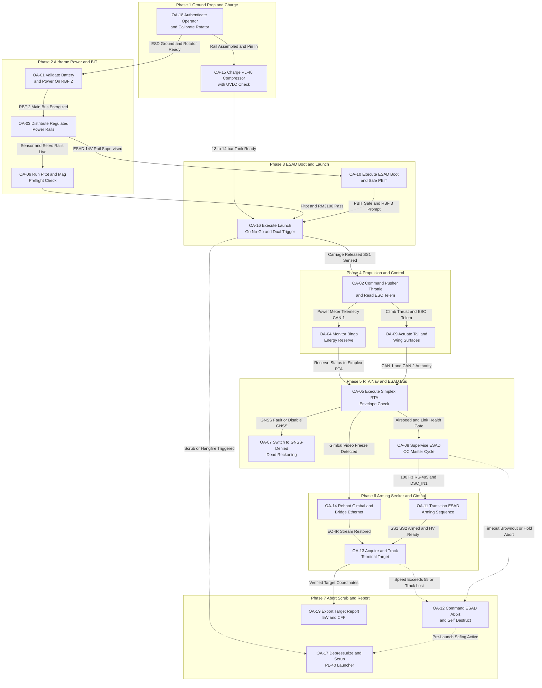

---

### 6.4 Detailed Operational Activity Specifications & Gate 24 Allocation Directives (`OA-01` through `OA-19`)

Every OMG UAF Operational Activity below establishes its complete SysML AST binding, operational performers, typed signatures, quantitative exit gates, scenario and state-machine realizations, normative `RESEARCH_INVENTORY.md` / `REQ_*` bindings, and mandatory Gate 24 allocation tag (`/// OperationalAllocation: [OA-XX]`).

#### 6.4.1 `OA-01`: `ValidateBatteryAndPowerOnRbf2`

- **SysML AST Action & Package:** `action def ValidateBatteryAndPowerOnRbf2` in `package AirframePowerAndPropulsion` ([`.pipeline/schema.sysml`](../../.pipeline/schema.sysml)#L164).
- **Operational Performer:** `UCL-03` (`Launch Assistant` physical inspection and `RBF #1` / `RBF #2` sequence execution), supervised by `UCL-01` (`Pilot Operator` on `SwarmC2`) and `UCL-05` (`Field Sustainment & Arming Safety Lead` for pack integrity NO-GO checks); executing on `MainBatteryAndFuseUnit`, `PowerMeterAndRbfSwitch`, `ElectricPropulsionUnit`, and `SwarmC2OperatorConsole`.
- **Typed Inputs (AST Signature):** `packVoltageV : Real` (`12S2P Li metal BEI maximus20` pack voltage), `rbf1Removed : Boolean` (pitot cover, sensor cover, and gimbal strap `RBF #1` removed), `propFoldedRearward : Boolean` (both rear pusher blades folded rearward toward tail), `rbf3StillInstalled : Boolean` (`ESAD R.B.F. Key #3` confirmed still installed prior to power-on).
- **Typed Outputs (AST Signature):** `busEnergized : Boolean` (`36.0 V` to `50.4 V` main DC bus energized through `XT60E-F` switch and live on `SwarmC2`).
- **Exit Gates & Interlock Criteria:**
 1. `12S2P` battery passes physical inspection (zero swelling, leakage, or casing damage), matches fuselage ID/QR, locks cleanly without sharp cable bends, and reads within `49.0 V` to `50.0 V` (`MainBatteryPreFlightVoltageConstraint`), strictly rejecting legacy `23.9 V` to `25.0 V` UI artifacts (`GAP-05`).
 2. `rbf1Removed == true` and `propFoldedRearward == true` prevent pusher trolley/airframe collision on power-up.
 3. `rbf3StillInstalled == true` enforces power-before-pull ordering (`GAP-06`, `EsadRbf3PowerBeforePullConstraint`) so `ESAD` boots safely before `RBF #3` removal.
 4. `UAV Power R.B.F. Key #2 (XT60E-F)` is removed, both RBF and external `USB/ETH` umbilical lids are closed and locked, `busEnergized == true`, and `SwarmC2` detects valid GCS telemetry within `2.0 min`.
- **Scenarios, Capabilities & Verification:** `SCN-01`; `CAP-01`, `CAP-02`; `UavFlightLifecycleState::PreFlightCheck`; `TC_01_PreflightPowerAndRbfSequence`.
- **Normative & Safety Traceability (`RESEARCH_INVENTORY.md` & `REQ_*`):** `OBL-01`, `OBL-03`, `INT-01`, `INT-02`, `CTL-04`, `EXT-01` (`ISO/IEC/IEEE 29148:2018` §6.4; `OMG UAF v2.0`; `MIL-STD-882E` Task 202/206; `SAE ARP4754A` §5.1); `REQ_L_01`, `REQ_H_01`, `REQ_UCA_01`, `REQ_SC_01`, `REQ_SAF_05`, `REQ_SAF_06`.

/// OperationalAllocation: [OA-01]

#### 6.4.2 `OA-02`: `CommandPusherThrottleAndReadEscTelem`

- **SysML AST Action & Package:** `action def CommandPusherThrottleAndReadEscTelem` in `package AirframePowerAndPropulsion` ([`.pipeline/schema.sysml`](../../.pipeline/schema.sysml)#L166).
- **Operational Performer:** `UCL-01` (`Pilot Operator` supervisory flight-mode and thrust readiness authority); executing across `PowerMeterAndRbfSwitch`, `ElectricPropulsionUnit` (`IBEX160` ESC, `AXI 5345/16 HD GOLD LINE V3` BLDC motor, rear folding pusher prop), and `FlightControllerCubeOrangePlus` (`can1Master`).
- **Typed Inputs (AST Signature):** `throttleNorm` (`Real`, normalized pusher throttle demand via `IF-PWM-001`), `flightArmed` (`Boolean`, flight-arm and pre-launch thrust readiness interlock).
- **Typed Outputs (AST Signature):** `escRpm` (`Real`, motor rotational speed), `escTempDegC` (`Real`, `IBEX160` controller temperature), `motorTempDegC` (`Real`, `AXI 5345/16` stator temperature), `busCurrentA` (`Real`, main DC current draw).
- **Exit Gates & Interlock Criteria:**
 1. `flightArmed == true` must be verified only after `OA-01` (`propFoldedRearward == true` and `RBF #1` removed), ensuring pusher thrust readiness across `CatapultLaunch` to bridge the negative airspeed margin between `~23.0 m/s` rail exit and `24.0 m/s` to `26.0 m/s` stall (`GAP-03`).
 2. Main DC bus draw remains within the `200.0 A` automotive fuse protection ceiling (`MainBatteryAndFuseUnit`) and `36.0 V` to `50.4 V` operating range.
 3. Unidirectional ESC UART telemetry (`IF-SER-005`) bridges cleanly through `PowerMeterAndRbfSwitch` onto `CAN 1` (`CONN_09`) within the `-20.0 degC` to `+50.0 degC` ambient qualification envelope and explicit bench-calibrated ESC/motor thermal and current cutoffs (`GAP-ENV`).
- **Scenarios, Capabilities & Verification:** `SCN-01`, `SCN-02`, `SCN-06`; `CAP-02`; `UavFlightLifecycleState::CatapultLaunch` through `TargetTrackAndDive`; `TC_02_BingoReserveAndEpsBrownoutMonitor`, `TC_07_Pl40RailChargeLaunchAndZeroWire`.
- **Normative & Safety Traceability (`RESEARCH_INVENTORY.md` & `REQ_*`):** `OBL-02`, `OBL-03`, `INT-02`, `INT-03`, `INT-04`, `CTL-04`, `EXT-01` (`ISO/IEC/IEEE 15288:2023` §6.4.4; `MIL-STD-1629A` Method 101; `MIL-STD-810H` Methods 501.7/502.7); `REQ_L_02`, `REQ_H_01`, `REQ_H_02`, `REQ_UCA_02`, `REQ_SC_01`, `REQ_SC_04`, `REQ_SAF_03`, `REQ_SAF_11`.

/// OperationalAllocation: [OA-02]

#### 6.4.3 `OA-03`: `DistributeRegulatedPowerRails`

- **SysML AST Action & Package:** `action def DistributeRegulatedPowerRails` in `package AirframePowerAndPropulsion` ([`.pipeline/schema.sysml`](../../.pipeline/schema.sysml)#L168).
- **Operational Performer:** `UCL-02` (`Payload Operator` positive HITL authority for irreversible `Power Off ESAD`) and `UCL-01` (`Pilot Operator` supervisory abort); executing on `ElectronicPowerSystemEps` and `PowerMeterAndRbfSwitch`.
- **Typed Inputs (AST Signature):** `mainBusV` (`Real`, `36.0 V` to `50.4 V` input across the `970.0 cm` fuselage DC trunk `CONN_03`), `esadPowerOffCmd` (`Boolean`, irreversible `Power Off ESAD` or fault-isolation load-switch command).
- **Typed Outputs (AST Signature):** `servo8V` (`Real`, `8.0 V` rail feeding `8x HV6160-DroneCAN` servos via `CONN_04`), `radio12V` (`Real`, `12.0 V` rail feeding `DTC` radio within `8.0 V` to `17.0 V` tolerance via `CONN_05`), `esad14V` (`Real`, `14.0 V` ESAD `GE_POW` rail via `CONN_06`), `esadBrownoutAlert` (`Boolean`, `CAN 1` brownout telemetry alert via `CONN_10`).
- **Exit Gates & Interlock Criteria:**
 1. Regulated `servo8V` (`8.0 V`), `radio12V` (`12.0 V`), `sensorPowerOut`, and `gimbalPowerOut` remain within steady-state tolerances across all active flight phases.
 2. `esad14V >= 14.0 V` satisfies `EpsEsadZeroBrownoutMarginConstraint` (`14.0 V` to `32.0 V` ESAD `VDC_IN` window); because `14.0 V` nominal equals `14.0 V` minimum with `0.0 V` margin (`GAP-01`), any voltage sag triggers `esadBrownoutAlert == true` and commands irreversible ESAD safing.
 3. `ProductionNoParachuteConstraint` holds (`rndRecoveryOptionInstalled == false`; `2x 50.0 V` `Optional RnD` recovery igniter rails remain permanently inhibited).
 4. When `esadPowerOffCmd == true`, `ElectronicPowerSystemEps` isolates `esad14V` to `0.0 V` irreversibly in flight (`EsadSafeArmState::SafePowerOff`).
- **Scenarios, Capabilities & Verification:** `SCN-01`, `SCN-02`, `SCN-05`, `SCN-08`; `CAP-02`, `CAP-06`; `EsadSafeArmState::SafePowerOff` / `BootAndPbit`, `RtaEnvelopeMonitorState::EsadBusWatchdogFaultFallback`; `TC_01_PreflightPowerAndRbfSequence`, `TC_02_BingoReserveAndEpsBrownoutMonitor`.
- **Normative & Safety Traceability (`RESEARCH_INVENTORY.md` & `REQ_*`):** `OBL-03`, `INT-02`, `INT-03`, `CTL-04`, `EXT-01` (`MIL-STD-882E` Task 205; `SAE ARP4754A` §5.1; `SAE ARP4761` §3.2); `REQ_L_02`, `REQ_H_01`, `REQ_H_02`, `REQ_UCA_01`, `REQ_UCA_02`, `REQ_SC_02`, `REQ_SC_03`, `REQ_SAF_01`, `REQ_SAF_11`.

/// OperationalAllocation: [OA-03]

#### 6.4.4 `OA-04`: `MonitorBingoEnergyReserve`

- **SysML AST Action & Package:** `action def MonitorBingoEnergyReserve` in `package AirframePowerAndPropulsion` ([`.pipeline/schema.sysml`](../../.pipeline/schema.sysml)#L170).
- **Operational Performer:** `UCL-01` (`Pilot Operator` sortie endurance and RTL supervision); executing on `MainBatteryAndFuseUnit`, `PowerMeterAndRbfSwitch`, and `FlightControllerCubeOrangePlus` (`RtaEnvelopeMonitorState`).
- **Typed Inputs (AST Signature):** `remainingEnduranceSec` (`Real`, remaining flight energy duration out of `5400.0 s` / `90.0 min` maximum endurance), `busVoltageV` (`Real`, measured `12S2P` DC bus voltage on `CAN 1`).
- **Typed Outputs (AST Signature):** `bingoReached` (`Boolean`, statutory reserve floor or critical voltage sag reached), `rtlTriggered` (`Boolean`, autonomous Return-to-Launch transition issued).
- **Exit Gates & Interlock Criteria:**
 1. Enforces `BingoEnergyReserveConstraint` (`reserveRatio >= 0.20`, reserving `>= 1080.0 s` out of `5400.0 s` nominal endurance, leaving `<= 4320.0 s` / `72.0 min` tactical loiter) alongside continuous `busVoltageV >= 36.0 V` (`36.0 V` to `50.4 V` `12S2P` operating envelope).
 2. When `remainingEnduranceSec <= 1080.0 s` or `busVoltageV < 36.0 V`, `bingoReached == true` and `rtlTriggered == true` execute deterministically, transitioning `UavFlightLifecycleState` into `EmergencyAbortOrRtb` and `RtaEnvelopeMonitorState` into `CriticalBatteryOrGeofenceRtb` without requiring manual `UCL-01` intervention.
- **Scenarios, Capabilities & Verification:** `SCN-01`, `SCN-02`; `CAP-01`, `CAP-02`; `UavFlightLifecycleState::CruiseAndLoiter` -> `EmergencyAbortOrRtb`, `RtaEnvelopeMonitorState::CriticalBatteryOrGeofenceRtb`; `TC_02_BingoReserveAndEpsBrownoutMonitor`.
- **Normative & Safety Traceability (`RESEARCH_INVENTORY.md` & `REQ_*`):** `OBL-03`, `INT-02`, `MET-02`, `CTL-01`, `CTL-04`, `EXT-01` (`JARUS SORA v2.5` Annex B & C; `ASTM F3269-17` §5.2; `MIL-STD-882E` Task 205); `REQ_L_02`, `REQ_L_03`, `REQ_H_02`, `REQ_UCA_02`, `REQ_SC_02`, `REQ_SAF_05`, `REQ_SAF_11`.

/// OperationalAllocation: [OA-04]

#### 6.4.5 `OA-05`: `ExecuteSimplexRtaEnvelopeCheck`

- **SysML AST Action & Package:** `action def ExecuteSimplexRtaEnvelopeCheck` in `package AvionicsGuidanceAndControl` ([`.pipeline/schema.sysml`](../../.pipeline/schema.sysml)#L459).
- **Operational Performer:** `UCL-01` (`Pilot Operator` supervisory geofence, failsafe timeout, and flight envelope oversight); executing in software on `FlightControllerCubeOrangePlus` (`simplexRtaSoftwareHosted == true`, `standaloneRtaBoxCount == 0`).
- **Typed Inputs (AST Signature):** `airspeedMs` (`Real`, airspeed from `CUAV SKYE2`), `diveAngleDeg` (`Real`, airframe pitch/dive trajectory angle), `linkLossSec` (`Real`, elapsed C2 heartbeat loss timer), `esadBusHealthy` (`Boolean`, `RPI CM5` `100.0 Hz` ESAD supervision status).
- **Typed Outputs (AST Signature):** `clampEngagementSpeed` (`Boolean`, `Abort Engaging` speed-clamp override), `triggerRtlFailsafe` (`Boolean`, autonomous RTL failsafe override), `disarmEsadRequested` (`Boolean`, ordnance disarm request to `RPI CM5` / `EPS`).
- **Exit Gates & Interlock Criteria:**
 1. `SimplexRtaSoftwareHostingConstraint` holds (`standaloneRtaBoxCount == 0`; Simplex RTA executes exclusively in partitioned software inside `Cube orange+` pending bench `WCET` closure under `GAP-WCET` and `GAP-REL`).
 2. `FlightEnvelopeSpeedConstraint` bounds cruise/horizontal velocity (`24.0 m/s` stall / `26.0 m/s` V1 climb, `30.0 m/s` to `31.0 m/s` cruise, `38.0 m/s` to `42.0 m/s` horizontal, `GAP-02`), `diveAngleDeg <= 22.0 deg`, and structural `VNE <= 80.0 m/s`.
 3. Any terminal dive with `airspeedMs > 55.0 m/s` sets `clampEngagementSpeed == true` (`RtaEnvelopeMonitorState::AirspeedDiveCapClamped`), aborting engagement and pulling up to `Takeoff altitude` -> `GUIDED` loiter.
 4. `esadBusHealthy == false` sets `disarmEsadRequested == true` (`EsadBusWatchdogFaultFallback`); `linkLossSec >= 105.0 s` (`GCS Failsafe` baseline), polygon geofence breach, or Bingo/sag condition sets both `triggerRtlFailsafe == true` and `disarmEsadRequested == true` (`CriticalBatteryOrGeofenceRtb`).
- **Scenarios, Capabilities & Verification:** `SCN-02`, `SCN-03`, `SCN-04`; `CAP-03`; `RtaEnvelopeMonitorState`, `UavFlightLifecycleState`; `TC_03_SimplexRtaEnvelopeAndActuation`.
- **Normative & Safety Traceability (`RESEARCH_INVENTORY.md` & `REQ_*`):** `OBL-03`, `INT-02`, `INT-03`, `CTL-01`, `EXT-01` (`ASTM F3269-17` §5.2; `RTCA DO-178C` §6.3; `MIL-STD-1629A` Method 101); `REQ_L_02`, `REQ_L_03`, `REQ_H_03`, `REQ_H_05`, `REQ_UCA_03`, `REQ_UCA_07`, `REQ_SC_05`, `REQ_SAF_02`, `REQ_SAF_08`, `REQ_SAF_09`.

/// OperationalAllocation: [OA-05]

#### 6.4.6 `OA-06`: `RunPitotAndMagPreflightCheck`

- **SysML AST Action & Package:** `action def RunPitotAndMagPreflightCheck` in `package AvionicsGuidanceAndControl` ([`.pipeline/schema.sysml`](../../.pipeline/schema.sysml)#L461).
- **Operational Performer:** `UCL-01` (`Pilot Operator` monitoring `SwarmC2` `System checks`) and `UCL-03` (`Launch Assistant` executing stationary calm-air and indirect airflow pitot verification); executing on `NavigationAndAirDataSuite` and `FlightControllerCubeOrangePlus`.
- **Typed Inputs (AST Signature):** `calmAirIndicatedMs` (`Real`, stationary pitot indicated airspeed), `blownAirIndicatedMs` (`Real`, indirect airflow pitot indicated airspeed), `onlineMagCount` (`Integer`, count of active `mRo RM3100` modules on `CAN 2`).
- **Typed Outputs (AST Signature):** `airDataValid` (`Boolean`, air-data and magnetometer readiness pass flag).
- **Exit Gates & Interlock Criteria:**
 1. `PitotPreflightCalibrationConstraint` verified on `CUAV SKYE2` heated pitot: `calmAirIndicatedMs <= 3.0 m/s` in calm air AND `blownAirIndicatedMs >= 10.0 m/s` under gentle indirect airflow.
 2. `onlineMagCount == 2` confirms both dual-redundant `mRo RM3100` magnetometers/barometers (`Mag #1` and `Mag #2`) online at the tail of the `CAN 2` daisy-chain (`CONN_12`, `CONN_13`).
 3. `Septentrio Asterx-m3 pro` GNSS + `Talysman TW3972EXF` serial feed (`CONN_15`) reports nominal health, yielding `airDataValid == true` before launch authorization.
- **Scenarios, Capabilities & Verification:** `SCN-01`; `CAP-04`; `UavFlightLifecycleState::PreFlightCheck`; `TC_04_GnssDeniedDrAndPaceLinkFailsafe`.
- **Normative & Safety Traceability (`RESEARCH_INVENTORY.md` & `REQ_*`):** `OBL-03`, `INT-02`, `MET-01`, `CTL-04`, `EXT-01` (`ISO/IEC/IEEE 29148:2018` Annex A; `SAE ARP4754A` §5.1); `REQ_H_03`, `REQ_UCA_03`, `REQ_SC_06`, `REQ_SC_07`.

/// OperationalAllocation: [OA-06]

#### 6.4.7 `OA-07`: `SwitchToGnssDeniedDeadReckoning`

- **SysML AST Action & Package:** `action def SwitchToGnssDeniedDeadReckoning` in `package AvionicsGuidanceAndControl` ([`.pipeline/schema.sysml`](../../.pipeline/schema.sysml)#L463).
- **Operational Performer:** `UCL-01` (`Pilot Operator` invoking `Disable GNSS` and issuing `I'm Here` / `I'm Looking Here` visual fixes on `SwarmC2`); executing on `FlightControllerCubeOrangePlus` and `NavigationAndAirDataSuite`.
- **Typed Inputs (AST Signature):** `gnssHealthy` (`Boolean`, `Septentrio Asterx-m3 pro` satellite fix validity), `disableGnssCommanded` (`Boolean`, `SwarmC2` manual `Disable GNSS` anti-spoofing switch).
- **Typed Outputs (AST Signature):** `deadReckoningActive` (`Boolean`, INS/DR navigation mode active flag).
- **Exit Gates & Interlock Criteria:**
 1. Whenever `gnssHealthy == false` (`GPS Failsafe Timeout` from jamming/denial) OR `disableGnssCommanded == true`, `Cube orange+` EKF2 switches cleanly (`deadReckoningActive == true`) into `PaceC2LinkState::ContingencyGnssDeniedDrFlight`, fusing inertial measurements with dual `mRo RM3100` magnetometers/barometers and `CUAV SKYE2` pitot on isolated `CAN 2` (`CONN_13`).
 2. Operator visual-position updates (`I'm Here` / `I'm Looking Here`) constrain DR drift while the `4.4 GHz` to `5.0 GHz` C2 link remains active.
 3. If GCS C2 link is subsequently lost beyond the failsafe timeout (`105.0 s` baseline), `Cube orange+` automatically re-enables GNSS and enters `PaceC2LinkState::EmergencyLostLinkRtlHolding` with ESAD disarmed.
- **Scenarios, Capabilities & Verification:** `SCN-03`; `CAP-04`; `PaceC2LinkState::ContingencyGnssDeniedDrFlight` -> `EmergencyLostLinkRtlHolding`; `TC_04_GnssDeniedDrAndPaceLinkFailsafe`.
- **Normative & Safety Traceability (`RESEARCH_INVENTORY.md` & `REQ_*`):** `OBL-03`, `INT-02`, `MET-01`, `CTL-02`, `CTL-04`, `EXT-01` (`RTCA DO-362A` §2.2, §3.2; `SAE ARP4761` §3.2); `REQ_L_03`, `REQ_H_03`, `REQ_UCA_03`, `REQ_SC_06`, `REQ_SC_07`.

/// OperationalAllocation: [OA-07]

#### 6.4.8 `OA-08`: `SuperviseEsadOcMasterCycle`

- **SysML AST Action & Package:** `action def SuperviseEsadOcMasterCycle` in `package AvionicsGuidanceAndControl` ([`.pipeline/schema.sysml`](../../.pipeline/schema.sysml)#L465).
- **Operational Performer:** `UCL-02` (`Payload Operator` positive HITL arm and abort authorization); executing on `CompanionComputeRpiCm5` (`RPI CM5004032`, sole `OC Master` across `Ring 2` to `Ring 3`) interfacing `ArtronEsadAndSensorUnit` (`CONN_20`).
- **Typed Inputs (AST Signature):** `armAuthorized` (`Boolean`, positive HITL `UCL-02` arm enable token), `abortCommanded` (`Boolean`, operator abort, self-destruct, or GCS timeout abort trigger).
- **Typed Outputs (AST Signature):** `exchangeFrameValid` (`Boolean`, cyclic `RS-485` supervision frame CRC and latency validity), `emitDscIn1Pulses` (`Boolean`, gated `DSC_IN1` hardware arming pulse enable).
- **Exit Gates & Interlock Criteria:**
 1. `EsadRs485ProtocolTimingConstraint` holds (`GAP-04`): half-duplex `` `8N1` `RS-485` cyclic polling at `100.0 Hz` (`0.01 s` period) verified with `Frame Integrity Check XModem`, ESAD reply latency `<= 5.0 ms`, and incomplete-packet watchdog timeout `<= 10.0 ms` (`exchangeFrameValid == true`).
 2. Any timeout exceeding `10.0 ms` or CRC mismatch drives `exchangeFrameValid == false`, locks `emitDscIn1Pulses == false`, and commands `EsadBusWatchdogFaultFallback` -> ESAD safing.
 3. Hardware arming discrete `DSC_IN1` (`1000.0 Hz`, `1.0 ms` period, `50%` duty, `2` pulses, `2.5 V` to `3.3 V` high) emits (`emitDscIn1Pulses == true`) strictly when `armAuthorized == true`, `abortCommanded == false`, and `EsadSafeArmState` is in `ArmStage2Armed`; premature `DSC_IN1` pulsing latches ESAD `FaultStates` bit 4 `FaultLockout`.
- **Scenarios, Capabilities & Verification:** `SCN-01`, `SCN-03`, `SCN-05`, `SCN-08`; `CAP-04`, `CAP-06`; `EsadSafeArmState`, `RtaEnvelopeMonitorState`; `TC_04_GnssDeniedDrAndPaceLinkFailsafe`, `TC_06_EsadProtocolInterlockAndHvFireGate`.
- **Normative & Safety Traceability (`RESEARCH_INVENTORY.md` & `REQ_*`):** `OBL-03`, `INT-01`, `INT-02`, `INT-03`, `MET-03`, `CTL-03`, `EXT-01` (`RTCA DO-178C` §6.3; `RTCA DO-254` §10.0; `NATO STANAG 4187 Ed. 5` Chapter 2; `DoD Directive 3000.09` §4.1.a); `REQ_L_01`, `REQ_L_04`, `REQ_H_03`, `REQ_H_04`, `REQ_UCA_04`, `REQ_UCA_05`, `REQ_SC_08`, `REQ_SC_10`, `REQ_SAF_04`, `REQ_SAF_08`, `REQ_SAF_09`.

/// OperationalAllocation: [OA-08]

#### 6.4.9 `OA-09`: `ActuateTailAndWingSurfaces`

- **SysML AST Action & Package:** `action def ActuateTailAndWingSurfaces` in `package AvionicsGuidanceAndControl` ([`.pipeline/schema.sysml`](../../.pipeline/schema.sysml)#L467).
- **Operational Performer:** `UCL-01` (`Pilot Operator` flight mode, manual override under `Advanced` flag, and pre-flight tactile surface sweep check); executing on `FlightControllerCubeOrangePlus`, `DroneCanSurfaceActuation` (`8x HV6160-DroneCAN`), and `ElectronicPowerSystemEps`.
- **Typed Inputs (AST Signature):** `pitchCmd` (`Real`, autopilot pitch axis demand), `yawCmd` (`Real`, autopilot yaw axis demand), `rollCmd` (`Real`, autopilot active roll-stabilization demand).
- **Typed Outputs (AST Signature):** `finCommandedDeg` (`Real`, mixed skid-turn deflection for tail fins `#1` through `#4`), `wingCommandedDeg` (`Real`, active roll deflection for wing panels `#5` through `#8`).
- **Exit Gates & Interlock Criteria:**
 1. Regulated `8.0 V` EPS servo supply (`CONN_04`) verified stable and pre-flight servo sweep directions confirmed before launch.
 2. `CanTopologyIsolationConstraint` enforced: `4x` tail ruddervator servos (`#1` through `#4`) execute mixed pitch/yaw skid-turn actuation on `CAN 1` via `4x 120.0 cm` stubs (`CONN_11`), while `4x` wing panel servos (`#5` through `#8`) execute active roll stabilization on `CAN 2` through the `CAN/power splitter PCB` (`CONN_12`).
 3. Simplex RTA envelope protection (`OA-05`) overrides surface commands smoothly for pull-up recovery if airspeed exceeds `55.0 m/s` during engagement or approaches `80.0 m/s` `VNE`.
- **Scenarios, Capabilities & Verification:** `SCN-01`, `SCN-02`, `SCN-04`; `CAP-03`; `UavFlightLifecycleState::PreFlightCheck` through `EmergencyAbortOrRtb`; `TC_03_SimplexRtaEnvelopeAndActuation`.
- **Normative & Safety Traceability (`RESEARCH_INVENTORY.md` & `REQ_*`):** `OBL-03`, `INT-02`, `CTL-01`, `CTL-04`, `EXT-01` (`SAE ARP4754A` §5.1; `ASTM F3269-17` §5.2; `MIL-STD-1629A` Method 101); `REQ_L_02`, `REQ_H_03`, `REQ_UCA_03`, `REQ_SC_05`, `REQ_SC_06`, `REQ_SAF_09`.

/// OperationalAllocation: [OA-09]

#### 6.4.10 `OA-10`: `ExecuteEsadBootAndPbit`

- **SysML AST Action & Package:** `action def ExecuteEsadBootAndPbit` in `package MissionPayloadsCommsAndOrdnanceSafety` ([`.pipeline/schema.sysml`](../../.pipeline/schema.sysml)#L699).
- **Operational Performer:** `UCL-03` (`Launch Assistant` verifying `RBF #3` stays inserted until `SwarmC2` prompt) and `UCL-02` (`Payload Operator` monitoring Warhead and Safety BIT status); executing on `ArtronEsadAndSensorUnit` and `CompanionComputeRpiCm5`.
- **Typed Inputs (AST Signature):** `vdcInV` (`Real`, regulated `14.0 V` ESAD `GE_POW` input within `14.0 V` to `32.0 V` ICD range), `rbf3Installed` (`Boolean`, `ESAD R.B.F. Key #3` umbilical plug presence).
- **Typed Outputs (AST Signature):** `welcomeOk` (`Boolean`, ESAD boot welcome notification received by `OC Master`), `pbitHvUnder50V` (`Boolean`, PBIT confirmation that internal high voltage is `< 50.0 V`).
- **Exit Gates & Interlock Criteria:**
 1. ESAD boots (`SafePowerOff` -> `BootAndPbit`) only after `UAV Power RBF #2` energization while `rbf3Installed == true` (`J100` `UMB` loop `< 0.5 Ohm` at `20.0 mA`, `GAP-06`, `EsadRbf3PowerBeforePullConstraint`) and `vdcInV >= 14.0 V` (`GAP-01`).
 2. `RPI CM5` `OC Master` receives the ESAD Boot Welcome notification (`welcomeOk == true`), executes firmware version verification and ESAD Power-On Built-In Test (`IF-ORD-001`), and confirms internal high-voltage PBIT safety bit `< 50.0 V` (`pbitHvUnder50V == true`, `WarheadMassAndPbitHvSafetyConstraint`), transitioning to `EsadSafeArmState::SafeRbfInstalled`.
 3. Any premature `RBF #3` removal (`rbf3Installed == false` before PBIT completion) or PBIT `HV >= 50.0 V` latches `FaultLockout` and prohibits launch (`ESAD: Ready to Fly` denied).
- **Scenarios, Capabilities & Verification:** `SCN-01`, `SCN-05`; `CAP-06`; `EsadSafeArmState::BootAndPbit` -> `SafeRbfInstalled`; `TC_01_PreflightPowerAndRbfSequence`, `TC_06_EsadProtocolInterlockAndHvFireGate`.
- **Normative & Safety Traceability (`RESEARCH_INVENTORY.md` & `REQ_*`):** `OBL-03`, `INT-01`, `INT-02`, `INT-04`, `CTL-03`, `EXT-01` (`NATO STANAG 4187 Ed. 5` Chapter 2 & Annex A; `MIL-STD-461G` CS114/CS116/CS118; `MIL-STD-331D` Group A); `REQ_L_01`, `REQ_L_04`, `REQ_H_01`, `REQ_H_04`, `REQ_UCA_05`, `REQ_SC_09`, `REQ_SC_10`, `REQ_SAF_01`, `REQ_SAF_06`, `REQ_SAF_10`.

/// OperationalAllocation: [OA-10]

#### 6.4.11 `OA-11`: `TransitionEsadArmingSequence`

- **SysML AST Action & Package:** `action def TransitionEsadArmingSequence` in `package MissionPayloadsCommsAndOrdnanceSafety` ([`.pipeline/schema.sysml`](../../.pipeline/schema.sysml)#L701).
- **Operational Performer:** `UCL-03` (`Launch Assistant` removing `RBF #3` strictly on `SwarmC2` prompt after `8` preconditions) and `UCL-02` (`Payload Operator` positive HITL arm consent); executing on `ArtronEsadAndSensorUnit`, `CompanionComputeRpiCm5`, and `ElectricPropulsionUnit`.
- **Typed Inputs (AST Signature):** `rbf3RemovedAfterPower` (`Boolean`, `RBF #3` pulled after `OA-10` pass and `8` pre-arm preconditions), `ss1LaunchSensed` (`Boolean`, `SS1` mechanical/inertial launch acceleration sensed via `CONN_24`), `ss2SafeDistExceeded` (`Boolean`, `SS2` `Safe Distance Exceed == 1`), `dscIn1Valid` (`Boolean`, Stage 2 `DSC_IN1` `1000.0 Hz` `2`-pulse discrete received).
- **Typed Outputs (AST Signature):** `armState` (`Integer`, encoded `EsadSafeArmState` progression), `hvChargedV` (`Real`, `J401` high-voltage initiation output within `0.0 V` to `1800.0 V`).
- **Exit Gates & Interlock Criteria:**
 1. `NATO STANAG 4187 Ed. 5` barrier ordering is strictly non-bypassable: `SafeRbfInstalled` -> `SafeRbfRemoved` (`rbf3RemovedAfterPower == true` only after `8` pre-arm preconditions pass, `GAP-06`) -> `ArmStage1TimerWait` (`ss1LaunchSensed == true` upon `PL-40` release) -> `ArmStage2Armed` (`ss2SafeDistExceeded == true`, confirming **exceeding** calibrated safe-separation distance and arming timer per `GAP-07` and `GAP-SEPDIST`, `EsadSafeDistanceExceedConstraint`).
 2. Positive HITL `UCL-02` arm authorization precedes Stage 2 `DSC_IN1` hardware pulsing (`dscIn1Valid == true`) and ESAD high-voltage charge command (`HvChargedReady`), driving `hvChargedV` up to `1800.0 V` (`1.0 V/LSB`) strictly gated for Sensor Board `J102->J1` ORed `IRQ_L` proximity/impact firing or `OC Trigger` into the `<= 5.0 kg` (`4.98 +/- 0.02 kg` tested) warhead holder.
 3. Any landing/non-flying state while `NOT ARMED` automatically discharges HV to `SAFE`; any out-of-order `DSC_IN1` or barrier failure latches `FaultLockout`.
- **Scenarios, Capabilities & Verification:** `SCN-05`, `SCN-06`; `CAP-06`; `EsadSafeArmState::SafeRbfRemoved` -> `ArmStage1TimerWait` -> `ArmStage2Armed` -> `HvChargedReady` -> `DetonatedOrAborted`; `TC_06_EsadProtocolInterlockAndHvFireGate`.
- **Normative & Safety Traceability (`RESEARCH_INVENTORY.md` & `REQ_*`):** `OBL-03`, `INT-01`, `INT-02`, `MET-03`, `CTL-03`, `EXT-01` (`NATO STANAG 4187 Ed. 5` Chapter 2 & 3; `MIL-STD-331D` Group A Test A3/A4.1/A5; `DoD Directive 3000.09` §4.1.a); `REQ_L_01`, `REQ_L_04`, `REQ_H_04`, `REQ_UCA_05`, `REQ_UCA_06`, `REQ_SC_09`, `REQ_SC_10`, `REQ_SC_11`, `REQ_SAF_06`, `REQ_SAF_07`, `REQ_SAF_10`.

/// OperationalAllocation: [OA-11]

#### 6.4.12 `OA-12`: `CommandEsadAbortAndSelfDestruct`

- **SysML AST Action & Package:** `action def CommandEsadAbortAndSelfDestruct` in `package MissionPayloadsCommsAndOrdnanceSafety` ([`.pipeline/schema.sysml`](../../.pipeline/schema.sysml)#L703).
- **Operational Performer:** `UCL-02` (`Payload Operator` positive HITL abort/self-destruct), `UCL-01` (`Pilot Operator` GCS failsafe oversight), and `UCL-05` (`Field Sustainment & Arming Safety Lead` verifying zero residual HV during scrub); executing on `SwarmC2OperatorConsole`, `CompanionComputeRpiCm5`, `ElectronicPowerSystemEps`, and `ArtronEsadAndSensorUnit`.
- **Typed Inputs (AST Signature):** `holdDurationSec` (`Real`, continuous operator hold duration on `SwarmC2` ESAD abort/self-destruct control), `slideConfirmed` (`Boolean`, explicit `Slide to confirm` secondary HITL confirmation), `gcsTimeoutActive` (`Boolean`, `Disarm ESAD On GCS Timeout` trigger or bus-fault abort).
- **Typed Outputs (AST Signature):** `hvDischarged` (`Boolean`, confirmation that ESAD HV capacitor is discharged `< 50.0 V`), `faultLockedOut` (`Boolean`, confirmation that ESAD is permanently aborted or powered off).
- **Exit Gates & Interlock Criteria:**
 1. Self-destruct or permanent ESAD abort requires `holdDurationSec >= 5.0 s` AND `slideConfirmed == true` (`DoD Directive 3000.09` §4.1.a positive HITL gate); GCS link timeout (`gcsTimeoutActive == true`), `10.0 ms` `RS-485` watchdog loss, `14.0 V` brownout (`GAP-01`), or irreversible `Power Off ESAD` immediately commands ordnance safing.
 2. `OC Master` asserts abort bits in the cyclic supervision exchange frame (or `EPS` opens the `14.0 V` load switch), verifying `hvDischarged == true` (`< 50.0 V` safe state) and `faultLockedOut == true` (`DetonatedOrAborted` / `FaultLockout` -> `SafePowerOff`).
- **Scenarios, Capabilities & Verification:** `SCN-03`, `SCN-05`, `SCN-08`; `CAP-06`; `EsadSafeArmState::DetonatedOrAborted` / `FaultLockout` -> `SafePowerOff`; `TC_06_EsadProtocolInterlockAndHvFireGate`, `TC_08_EmergencyScrubHangfireAndC2Auth`.
- **Normative & Safety Traceability (`RESEARCH_INVENTORY.md` & `REQ_*`):** `OBL-03`, `INT-01`, `INT-02`, `MET-03`, `MET-04`, `CTL-02`, `CTL-03`, `EXT-01` (`DoD Directive 3000.09` §4.1.a; `RTCA DO-362A` §3.2; `MIL-STD-882E` Task 206); `REQ_L_01`, `REQ_L_04`, `REQ_H_04`, `REQ_H_05`, `REQ_UCA_04`, `REQ_UCA_07`, `REQ_SC_08`, `REQ_SC_12`, `REQ_SC_16`, `REQ_SAF_01`, `REQ_SAF_12`.

/// OperationalAllocation: [OA-12]

#### 6.4.13 `OA-13`: `AcquireAndTrackTerminalTarget`

- **SysML AST Action & Package:** `action def AcquireAndTrackTerminalTarget` in `package MissionPayloadsCommsAndOrdnanceSafety` ([`.pipeline/schema.sysml`](../../.pipeline/schema.sysml)#L705).
- **Operational Performer:** `UCL-02` (`Payload Operator` positive HITL target designation, `6`-precondition check, and `ATTACK` dive authorization); executing on `EoIrSeekerAndTrackerUnit` (`Nighthawk2UZ` + `Trip6`) and `FlightControllerCubeOrangePlus`.
- **Typed Inputs (AST Signature):** `trackHoldSec` (`Real`, continuous EO daylight auto-tracker lock duration), `airspeedMs` (`Real`, instantaneous dive airspeed), `targetElevDeg` (`Real`, target elevation angle relative to aircraft at dive initiation).
- **Typed Outputs (AST Signature):** `targetLocked` (`Boolean`, stable `Trip6` target lock verified), `abortEngaging` (`Boolean`, immediate `Abort Engaging` pull-up command).
- **Exit Gates & Interlock Criteria:**
 1. `Nighthawk2UZ` streams `1280 x 720 px` Day/Thermal EO/IR video (`40.0x` zoom, `-45.0 deg` to `+135.0 deg` pitch, `+/-165.0 deg` yaw/roll) and satisfies all `6` engagement preconditions: sufficient `GCS Failsafe` margin, warhead `ARMED`, EO daylight track lock (`trackHoldSec` within `2.0 s` to `5.0 s`), `targetElevDeg <= 15.0 deg` at start, and clear LOS (`EngagementSpeedAndTrackHoldConstraint`) -> `targetLocked == true`, guiding `Shallow` (`~15.0 deg`) or `Direct` dive (`<= 22.0 deg` max, `<= 0.5 m` terminal CEP).
 2. If `airspeedMs > 55.0 m/s` (gimbal saturation limit, `GAP-02`) OR track lock is lost (no auto re-track permitted), `abortEngaging == true`, commanding immediate climb to `Takeoff altitude` -> `GUIDED` loiter (or `RTL` if link lost).
- **Scenarios, Capabilities & Verification:** `SCN-04`; `CAP-05`; `UavFlightLifecycleState::TargetTrackAndDive` -> `EmergencyAbortOrRtb`; `TC_05_EoIrTargetTrackAndSpeedCapAbort`.
- **Normative & Safety Traceability (`RESEARCH_INVENTORY.md` & `REQ_*`):** `OBL-03`, `INT-02`, `MET-01`, `MET-03`, `CTL-01`, `EXT-01` (`DoD Directive 3000.09` §4.1.a; `ASTM F3269-17` §5.2; `ISO/IEC/IEEE 29148:2018` Annex A); `REQ_L_04`, `REQ_H_05`, `REQ_UCA_03`, `REQ_UCA_07`, `REQ_SC_05`, `REQ_SC_12`, `REQ_SAF_02`.

/// OperationalAllocation: [OA-13]

#### 6.4.14 `OA-14`: `RebootGimbalAndBridgeEthernet`

- **SysML AST Action & Package:** `action def RebootGimbalAndBridgeEthernet` in `package MissionPayloadsCommsAndOrdnanceSafety` ([`.pipeline/schema.sysml`](../../.pipeline/schema.sysml)#L707).
- **Operational Performer:** `UCL-02` (`Payload Operator` invoking in-flight `Reboot Gimbal`) and `UCL-01` (`Pilot Operator` confirming service-lid closure and flight continuity); executing on `EoIrSeekerAndTrackerUnit`, `OnboardEthernetAndC2RadioUnit` (`ETH Switch` + locked external `USB/ETH` board), `CompanionComputeRpiCm5`, and `SwarmC2OperatorConsole`.
- **Typed Inputs (AST Signature):** `gimbalFreezeDetected` (`Boolean`, frozen `Nighthawk2UZ` / `Trip6` video stream detected), `externalLidLocked` (`Boolean`, external `USB/ETH` umbilical lid locked pre-flight).
- **Typed Outputs (AST Signature):** `gimbalRecovered` (`Boolean`, restored live `1280 x 720 px` EO/IR video feed over switched Ethernet).
- **Exit Gates & Interlock Criteria:**
 1. `externalLidLocked == true` confirms the external `USB/ETH` service interface remains sealed while airborne (`REQ_SC_01`).
 2. When `gimbalFreezeDetected == true`, `UCL-02` commands `Reboot Gimbal` over encrypted `4.4 GHz` to `5.0 GHz` C2 (`CONN_21`) -> `ETH Switch` (`CONN_18`, `CONN_19`), recovering `Nighthawk2UZ` / `Trip6` video streaming (`gimbalRecovered == true`) without invoking prohibited armed `Reboot Vehicle` or interrupting `Cube orange+` flight stabilization (`CONN_16`) or `RPI CM5` `100.0 Hz` ESAD supervision (`CONN_20`).
- **Scenarios, Capabilities & Verification:** `SCN-04`, `SCN-07`; `CAP-05`; `UavFlightLifecycleState::CruiseAndLoiter`; `TC_05_EoIrTargetTrackAndSpeedCapAbort`.
- **Normative & Safety Traceability (`RESEARCH_INVENTORY.md` & `REQ_*`):** `OBL-03`, `OBL-04`, `MET-01`, `CTL-02`, `EXT-01` (`NIST SP 800-82r3` Chapter 6 & Appendix F; `RTCA DO-362A` §3.2); `REQ_L_03`, `REQ_H_05`, `REQ_SC_01`, `REQ_SC_12`.

/// OperationalAllocation: [OA-14]

#### 6.4.15 `OA-15`: `ChargePl40CompressorWithUvloCheck`

- **SysML AST Action & Package:** `action def ChargePl40CompressorWithUvloCheck` in `package GroundLaunchAndCommandSegment` ([`.pipeline/schema.sysml`](../../.pipeline/schema.sysml)#L1006).
- **Operational Performer:** `UCL-03` (`Launch Assistant` rail assembly, battery inspection/swap, and pneumatic pressurization); executing on `Pl40PneumaticLauncher` (`ELI PL-40 Rev 2.6`).
- **Typed Inputs (AST Signature):** `packVoltageV` (`Real`, `2x Makita BL1860B` `18.0 V` `6000.0 mAh` battery pack voltage), `targetPressureBar` (`Real`, target launch reservoir pressure within `13.0 bar` to `14.0 bar`).
- **Typed Outputs (AST Signature):** `tankPressureBar` (`Real`, verified pneumatic tank pressure), `uvloPaused` (`Boolean`, compressor under-voltage lockout pause flag).
- **Exit Gates & Interlock Criteria:**
 1. `PL-40` `3`-section `5.0 m` (`4938.0 mm` CAD) catapult rail is anchored at `12.0 deg` elevation (`602.0 mm` front leg span, `1116.0 mm` height), fasteners locked, carriage red safety pin installed, and Main Valve `4` closed (`Pl40LauncherState::AnchoredAndLeveled` -> `CompressorCharging`).
 2. `Pl40UvloAndDualSwitchConstraint` enforced continuously: if `packVoltageV <= 14.5 V`, compressor cuts off (`uvloPaused == true`, `PWR` LED flashes, `UvloPause`) until packs are swapped and `packVoltageV >= 16.0 V` is sustained for `>= 5.0 s`.
 3. Reservoir charges within `<= 8.0 min` (`0.05 bar` auto-cutoff hysteresis, or via `<= 16.0 bar` DIN `8.0 mm` PCP aux) until `tankPressureBar` stabilizes inside `13.0 bar` to `14.0 bar` (`Pl40LauncherState::ReadyAt13To14BarPinInstalled`).
- **Scenarios, Capabilities & Verification:** `SCN-06`, `SCN-08`; `CAP-07`; `Pl40LauncherState::CompressorCharging` / `UvloPause` -> `ReadyAt13To14BarPinInstalled`; `TC_07_Pl40RailChargeLaunchAndZeroWire`.
- **Normative & Safety Traceability (`RESEARCH_INVENTORY.md` & `REQ_*`):** `OBL-03`, `INT-02`, `MET-01`, `EXT-02` (`ELI PL-40 Rev 2.6` Manual `#p21` through `#p28`; `MIL-STD-882E` Task 206); `REQ_H_06`, `REQ_UCA_08`, `REQ_SC_14`, `REQ_SAF_11`.

/// OperationalAllocation: [OA-15]

#### 6.4.16 `OA-16`: `ExecuteLaunchGoNoGoAndDualTrigger`

- **SysML AST Action & Package:** `action def ExecuteLaunchGoNoGoAndDualTrigger` in `package GroundLaunchAndCommandSegment` ([`.pipeline/schema.sysml`](../../.pipeline/schema.sysml)#L1008).
- **Operational Performer:** `UCL-03` (`Launch Assistant` rail firing, red safety pin pull, Main Valve `4` open, and rear safety zone clearance), `UCL-01` (`Pilot Operator` Go/No-Go & pusher readiness), and `UCL-02` (`Payload Operator` `ESAD: Ready to Fly` confirmation); executing on `Pl40PneumaticLauncher` and `ElectricPropulsionUnit`.
- **Typed Inputs (AST Signature):** `pressureBar` (`Real`, verified `13.0 bar` to `14.0 bar` gauge reading), `uavMassKg` (`Real`, `17.0 kg` MTOW within `30.0 kg` rail limit), `headwindMs` (`Real`, measured surface launch wind), `redPinRemoved` (`Boolean`, carriage red safety pin pulled), `mainValve4Open` (`Boolean`, Main Outlet Valve `4` opened), `dualSwitchHoldSec` (`Real`, simultaneous dual firing switch hold duration).
- **Typed Outputs (AST Signature):** `carriageReleased` (`Boolean`, mechanical launch carriage released).
- **Exit Gates & Interlock Criteria:**
 1. Go/No-Go gate satisfies `Pl40MassAndExitVelocityConstraint` and `GAP-03`: `pressureBar` within `13.0 bar` to `14.0 bar`, `uavMassKg == 17.0 kg` (`<= 30.0 kg`), `headwindMs <= 12.0 m/s`, `electricalWireToUavCount == 0` (`IF-MECH-001` strictly mechanical `CONN_23`), prop-safe carriage zone (`145.0 mm` to `155.5 mm`) and pusher thrust readiness confirmed, all `6` `SwarmC2` checklist groups + `ESAD: Ready to Fly` passed, and all crew cleared from rear danger zone.
 2. `redPinRemoved == true`, `mainValve4Open == true`, and both safety-covered firing switches are held simultaneously for `dualSwitchHoldSec >= 2.0 s` (`Pl40UvloAndDualSwitchConstraint`).
 3. `carriageReleased == true` (`DualSwitchFiring` -> `RailLaunchReleased`), accelerating the `17.0 kg` airframe to `~23.0 m/s` (`22.7 m/s` to `23.5 m/s`, strictly `<= 25.0 m/s` carriage rating), triggering onboard `SS1` inertial launch sense (`CONN_24`) and pusher climb transition above `26.0 m/s`.
- **Scenarios, Capabilities & Verification:** `SCN-06`; `CAP-07`; `Pl40LauncherState::ReadyAt13To14BarPinInstalled` -> `DualSwitchFiring` -> `RailLaunchReleased`; `TC_07_Pl40RailChargeLaunchAndZeroWire`.
- **Normative & Safety Traceability (`RESEARCH_INVENTORY.md` & `REQ_*`):** `OBL-02`, `OBL-03`, `INT-01`, `INT-02`, `MET-01`, `EXT-01`, `EXT-02` (`ISO/IEC/IEEE 15288:2023` §6.4.4; `MIL-STD-882E` Task 206; `ELI PL-40 Rev 2.6` Manual `#p24` through `#p37`); `REQ_L_01`, `REQ_L_02`, `REQ_H_01`, `REQ_H_06`, `REQ_UCA_08`, `REQ_SC_13`, `REQ_SC_14`, `REQ_SAF_03`.

/// OperationalAllocation: [OA-16]

#### 6.4.17 `OA-17`: `DepressurizeAndScrubPl40Launcher`

- **SysML AST Action & Package:** `action def DepressurizeAndScrubPl40Launcher` in `package GroundLaunchAndCommandSegment` ([`.pipeline/schema.sysml`](../../.pipeline/schema.sysml)#L1010).
- **Operational Performer:** `UCL-03` (`Launch Assistant` Main Valve `4` bleed & carriage pin restore), `UCL-02` (`Payload Operator` ESAD abort / `Power Off ESAD`), and `UCL-05` (`Field Sustainment & Arming Safety Lead` hangfire wait & reverse RBF safing authority); executing on `Pl40PneumaticLauncher`, `ArtronEsadAndSensorUnit`, and `SwarmC2OperatorConsole`.
- **Typed Inputs (AST Signature):** `scrubRequested` (`Boolean`, launch scrub, hangfire, `PL-40` UVLO lockout, or ESAD fault trigger), `mainValve4Closed` (`Boolean`, manual closure of `PL-40` Main Valve `4`).
- **Typed Outputs (AST Signature):** `tankDepressurizedBar` (`Real`, post-bleed residual tank pressure), `redPinReinstalled` (`Boolean`, carriage red safety pin reinstallation confirmed).
- **Exit Gates & Interlock Criteria (`SAFE_SCRUB_ABORT`, `GAP-SCRUB`):**
 1. Positive HITL `UCL-02` / `UCL-01` scrub commands `>= 5.0 s` ESAD self-destruct/abort hold + `Slide to confirm` and irreversible `Power Off ESAD` (`< 50.0 V` HV discharge confirmed) **before** any crew member approaches the launch rail.
 2. `mainValve4Closed == true` (`Main Valve 4` closed), pneumatic tank is bled safely to `tankDepressurizedBar == 0.0 bar` (`Pl40LauncherState::ScrubbedSafeDepressurized`), and `redPinReinstalled == true` (carriage red safety pin restored).
 3. Reverse RBF safing executes strictly in order: `ESAD R.B.F. Key #3` is reinstalled BEFORE `UAV Power R.B.F. Key #2` disconnection (`UavFlightLifecycleState::SafePostFlightShutdown`).
- **Scenarios, Capabilities & Verification:** `SCN-08`; `CAP-06`, `CAP-07`; `Pl40LauncherState::ScrubbedSafeDepressurized`, `UavFlightLifecycleState::SafePostFlightShutdown`; `TC_08_EmergencyScrubHangfireAndC2Auth`.
- **Normative & Safety Traceability (`RESEARCH_INVENTORY.md` & `REQ_*`):** `OBL-03`, `INT-01`, `INT-02`, `MET-03`, `MET-04`, `EXT-01`, `EXT-02` (`MIL-STD-882E` Task 206; `DoD Directive 3000.09` §4.1.a; `NATO STANAG 4187 Ed. 5` Chapter 2); `REQ_L_01`, `REQ_H_04`, `REQ_H_06`, `REQ_UCA_08`, `REQ_SC_16`, `REQ_SAF_12`.

/// OperationalAllocation: [OA-17]

#### 6.4.18 `OA-18`: `AuthenticateOperatorAndCalibrateRotator`

- **SysML AST Action & Package:** `action def AuthenticateOperatorAndCalibrateRotator` in `package GroundLaunchAndCommandSegment` ([`.pipeline/schema.sysml`](../../.pipeline/schema.sysml)#L1012).
- **Operational Performer:** `UCL-01` (`Pilot Operator`), `UCL-02` (`Payload Operator`), and `UCL-03` (`Launch Assistant`); executing on `SwarmC2OperatorConsole` (`Windows 11` rugged tablet) and `GroundRfStationAndAntennaTracker`.
- **Typed Inputs (AST Signature):** `roleName` (`String`, authenticated `SwarmC2` role among `Pilot`, `Payload`, or `Launch Assistant`), `passwordChars` (`Integer`, operator credential length), `esdGrounded` (`Boolean`, transport-box `EARTH / GROUNDING POINT` equalization touch verified), `radioSeparationM` (`Real`, spatial standoff between UAV and Ground Radio Box).
- **Typed Outputs (AST Signature):** `groundReady` (`Boolean`, ground C2 authentication, ESD, separation, and rotator calibration pass flag).
- **Exit Gates & Interlock Criteria:**
 1. `SwarmC2AuthAndMissionBoundsConstraint` holds: operator authenticates in `SwarmC2` with `passwordChars >= 8` (and valid mission bounds: `<= 24` char name, `50.0 m` to `3000.0 m` waypoint altitude slider in `250.0 m` increments, `>= 300.0 m` loiter orbit).
 2. `GroundCrewSeparationAndEsdConstraint` holds: `esdGrounded == true` prior to every UAV handling step, and `radioSeparationM >= 10.0 m` separation established between UAV and `2.0 W` `4.4 GHz` to `5.0 GHz` Ground Radio Box.
 3. Ground `MARS 23.0 dBi` DIR and `OMNI` antennas (with optional `200.0 m` fiber spool tether) and Directional Antenna Rotator (`Auto Follow` and `0.5 deg` CW/CCW fine step) are erected and calibrated **BEFORE touching the UAV**, yielding `groundReady == true`.
- **Scenarios, Capabilities & Verification:** `SCN-01`, `SCN-07`; `CAP-08`; `PaceC2LinkState::AlternateDtcOmniLocal` -> `PrimaryDtcDirTracking`; `TC_08_EmergencyScrubHangfireAndC2Auth`.
- **Normative & Safety Traceability (`RESEARCH_INVENTORY.md` & `REQ_*`):** `OBL-03`, `OBL-04`, `INT-04`, `MET-01`, `MET-02`, `CTL-02`, `EXT-01` (`NIST SP 800-82r3` Chapter 6 & Appendix F AC/IA/SC; `RTCA DO-362A` §2.2; `MIL-STD-461G` CS118; `JARUS SORA v2.5` Annex B); `REQ_H_06`, `REQ_UCA_08`, `REQ_SC_15`.

/// OperationalAllocation: [OA-18]

#### 6.4.19 `OA-19`: `ExportTargetReport5wCff`

- **SysML AST Action & Package:** `action def ExportTargetReport5wCff` in `package GroundLaunchAndCommandSegment` ([`.pipeline/schema.sysml`](../../.pipeline/schema.sysml)#L1014).
- **Operational Performer:** `UCL-02` (`Payload Operator` authorizing tactical export) interacting with `UCL-04` (`External Tactical C2`: `ATAK`, `SitaWare HQ`, `DELTA`) and `UCL-01` (`Pilot Operator`); executing on `SwarmC2OperatorConsole` and `GroundRfStationAndAntennaTracker`.
- **Typed Inputs (AST Signature):** `targetCoordsValid` (`Boolean`, verified target coordinates and engagement metadata from `Trip6` / `SwarmC2`), `c2Connected` (`Boolean`, active authenticated `SwarmC2` external IP conduit state).
- **Typed Outputs (AST Signature):** `reportExported` (`Boolean`, `5W` / `CFF` target report successfully exported).
- **Exit Gates & Interlock Criteria:**
 1. `targetCoordsValid == true` and `c2Connected == true` confirm valid target geolocation/metadata and active `SwarmC2` tactical interface connectivity (`CONN_22`).
 2. Formatted `5W` (`Five Whiskey`) and `CFF` (`Call For Fire`) target report is exported (`reportExported == true`) to `ATAK`, `SitaWare HQ`, or `DELTA` while preserving `NIST SP 800-82r3` conduit isolation (preventing external battle-management systems from issuing unmediated flight or ESAD actuation commands).
- **Scenarios, Capabilities & Verification:** `SCN-04`, `SCN-07`; `CAP-08`; `UavFlightLifecycleState::CruiseAndLoiter` / `TargetTrackAndDive`; `TC_08_EmergencyScrubHangfireAndC2Auth`.
- **Normative & Safety Traceability (`RESEARCH_INVENTORY.md` & `REQ_*`):** `OBL-03`, `OBL-04`, `MET-01`, `MET-03`, `CTL-02`, `EXT-01` (`ISO/IEC/IEEE 29148:2018` §6.4; `NIST SP 800-82r3` Chapter 6; `DoD Directive 3000.09` §4.1.a); `REQ_SC_15`.

/// OperationalAllocation: [OA-19]

---

### 6.5 Gate 24 Operational Activity Traceability & Closure Verification Summary

Table 6.3 summarizes `100%` (`19` of `19`) allocation closure across every SysML v2 `action def`, `part def`, `constraint def`, `state def`, Operational Scenario (`SCN-01` through `SCN-08`), and verification `test case def` (`TC_01` through `TC_08`) in `.pipeline/schema.sysml` and `.pipeline/schema-digest.json`.

#### Table 6.3: Gate 24 Operational Activity Closure Matrix (`OA-01` through `OA-19`)

| Activity ID | AST `action def` | Governing `constraint def` Nodes | Bound `state def` Lifecycle | Bound Scenarios | Verification `test case def` |
| :--- | :--- | :--- | :--- | :--- | :--- |
| `OA-01` | `ValidateBatteryAndPowerOnRbf2` | `MainBatteryPreFlightVoltageConstraint`, `EsadRbf3PowerBeforePullConstraint` | `UavFlightLifecycleState` | `SCN-01` | `TC_01_PreflightPowerAndRbfSequence` |
| `OA-02` | `CommandPusherThrottleAndReadEscTelem` | `FlightEnvelopeSpeedConstraint` | `UavFlightLifecycleState` | `SCN-01`, `SCN-02`, `SCN-06` | `TC_02_BingoReserveAndEpsBrownoutMonitor`, `TC_07_Pl40RailChargeLaunchAndZeroWire` |
| `OA-03` | `DistributeRegulatedPowerRails` | `EpsEsadZeroBrownoutMarginConstraint`, `ProductionNoParachuteConstraint` | `EsadSafeArmState`, `RtaEnvelopeMonitorState` | `SCN-01`, `SCN-02`, `SCN-05`, `SCN-08` | `TC_01_PreflightPowerAndRbfSequence`, `TC_02_BingoReserveAndEpsBrownoutMonitor` |
| `OA-04` | `MonitorBingoEnergyReserve` | `BingoEnergyReserveConstraint`, `MainBatteryPreFlightVoltageConstraint` | `UavFlightLifecycleState`, `RtaEnvelopeMonitorState` | `SCN-01`, `SCN-02` | `TC_02_BingoReserveAndEpsBrownoutMonitor` |
| `OA-05` | `ExecuteSimplexRtaEnvelopeCheck` | `SimplexRtaSoftwareHostingConstraint`, `FlightEnvelopeSpeedConstraint` | `RtaEnvelopeMonitorState`, `UavFlightLifecycleState` | `SCN-02`, `SCN-03`, `SCN-04` | `TC_03_SimplexRtaEnvelopeAndActuation` |
| `OA-06` | `RunPitotAndMagPreflightCheck` | `PitotPreflightCalibrationConstraint`, `CanTopologyIsolationConstraint` | `UavFlightLifecycleState` | `SCN-01` | `TC_04_GnssDeniedDrAndPaceLinkFailsafe` |
| `OA-07` | `SwitchToGnssDeniedDeadReckoning` | `CanTopologyIsolationConstraint` | `PaceC2LinkState` | `SCN-03` | `TC_04_GnssDeniedDrAndPaceLinkFailsafe` |
| `OA-08` | `SuperviseEsadOcMasterCycle` | `EsadRs485ProtocolTimingConstraint`, `EsadRbf3PowerBeforePullConstraint` | `EsadSafeArmState`, `RtaEnvelopeMonitorState` | `SCN-01`, `SCN-03`, `SCN-05`, `SCN-08` | `TC_04_GnssDeniedDrAndPaceLinkFailsafe`, `TC_06_EsadProtocolInterlockAndHvFireGate` |
| `OA-09` | `ActuateTailAndWingSurfaces` | `CanTopologyIsolationConstraint`, `FlightEnvelopeSpeedConstraint` | `UavFlightLifecycleState`, `RtaEnvelopeMonitorState` | `SCN-01`, `SCN-02`, `SCN-04` | `TC_03_SimplexRtaEnvelopeAndActuation` |
| `OA-10` | `ExecuteEsadBootAndPbit` | `EsadRbf3PowerBeforePullConstraint`, `EsadInputVoltageAndBrownoutConstraint`, `WarheadMassAndPbitHvSafetyConstraint` | `EsadSafeArmState` | `SCN-01`, `SCN-05` | `TC_01_PreflightPowerAndRbfSequence`, `TC_06_EsadProtocolInterlockAndHvFireGate` |
| `OA-11` | `TransitionEsadArmingSequence` | `EsadRbf3PowerBeforePullConstraint`, `EsadSafeDistanceExceedConstraint`, `WarheadMassAndPbitHvSafetyConstraint` | `EsadSafeArmState` | `SCN-05`, `SCN-06` | `TC_06_EsadProtocolInterlockAndHvFireGate` |
| `OA-12` | `CommandEsadAbortAndSelfDestruct` | `EsadInputVoltageAndBrownoutConstraint`, `EsadRs485ProtocolTimingConstraint` | `EsadSafeArmState` | `SCN-03`, `SCN-05`, `SCN-08` | `TC_06_EsadProtocolInterlockAndHvFireGate`, `TC_08_EmergencyScrubHangfireAndC2Auth` |
| `OA-13` | `AcquireAndTrackTerminalTarget` | `EngagementSpeedAndTrackHoldConstraint`, `FlightEnvelopeSpeedConstraint` | `UavFlightLifecycleState`, `RtaEnvelopeMonitorState` | `SCN-04` | `TC_05_EoIrTargetTrackAndSpeedCapAbort` |
| `OA-14` | `RebootGimbalAndBridgeEthernet` | `SwarmC2AuthAndMissionBoundsConstraint` | `UavFlightLifecycleState`, `PaceC2LinkState` | `SCN-04`, `SCN-07` | `TC_05_EoIrTargetTrackAndSpeedCapAbort` |
| `OA-15` | `ChargePl40CompressorWithUvloCheck` | `Pl40UvloAndDualSwitchConstraint`, `Pl40MassAndExitVelocityConstraint` | `Pl40LauncherState` | `SCN-06`, `SCN-08` | `TC_07_Pl40RailChargeLaunchAndZeroWire` |
| `OA-16` | `ExecuteLaunchGoNoGoAndDualTrigger` | `Pl40MassAndExitVelocityConstraint`, `Pl40UvloAndDualSwitchConstraint` | `Pl40LauncherState`, `UavFlightLifecycleState` | `SCN-06` | `TC_07_Pl40RailChargeLaunchAndZeroWire` |
| `OA-17` | `DepressurizeAndScrubPl40Launcher` | `EsadRbf3PowerBeforePullConstraint`, `WarheadMassAndPbitHvSafetyConstraint` | `Pl40LauncherState`, `UavFlightLifecycleState`, `EsadSafeArmState` | `SCN-08` | `TC_08_EmergencyScrubHangfireAndC2Auth` |
| `OA-18` | `AuthenticateOperatorAndCalibrateRotator` | `SwarmC2AuthAndMissionBoundsConstraint`, `GroundCrewSeparationAndEsdConstraint` | `PaceC2LinkState` | `SCN-01`, `SCN-07` | `TC_08_EmergencyScrubHangfireAndC2Auth` |
| `OA-19` | `ExportTargetReport5wCff` | `SwarmC2AuthAndMissionBoundsConstraint` | `UavFlightLifecycleState`, `PaceC2LinkState` | `SCN-04`, `SCN-07` | `TC_08_EmergencyScrubHangfireAndC2Auth` |

/// OperationalAllocation: [MET-01]
/// OperationalAllocation: [MET-02]
/// OperationalAllocation: [MET-03]
/// OperationalAllocation: [MET-04]

## 7. Operational Information Exchange (Op-Tx) Matrix

| Document Attribute | Specification |
| :--- | :--- |
| **Unit Title** | Operational Information Exchange (Op-Tx) Matrix |
| **Effective Date** | `2026-11-16` |
| **Document Version** | `1.0.0` |
| **System Baseline** | `Avenger5V25UasSystem` (`Avenger 5 V2.5 UAS` / `ASTK A5 V2.5` + `ELI Military Simulations PL-40 Rev 2.6` + `Artron ESAD AB00-0054-01AA-0005` + `SwarmC2`) |
| **JSON Schema Mapping** | `optx_exchanges` (`id`, `source_node`, `destination_node`, `information_element`, `throughput`, `max_latency`, `criticality`) |
| **Normative Governance** | `ISO/IEC/IEEE 29148:2018` §6.4.2-§6.4.3; `ISO/IEC/IEEE 15288:2023` §6.4.2-§6.4.4; `IEEE Std 1362-1998` §5.3; `OMG UAF v2.0` (Op-Tx / Rs-Tx); `RTCA DO-362A` §2.2, §3.2; `NATO STANAG 4187 Ed. 5`; `DoD Directive 3000.09` §4.1.a; `ASTM F3269-17` §5.2 |
| **SSOT Model Binding** | `.pipeline/schema.sysml` (`CONN_01` through `CONN_24`), `.pipeline/schema-digest.json` (`OpTx-01` through `OpTx-24`), `docs/architecture/views/sv1_platform_subsystems.mmd`, `schema/extracted/interface_table.md`, `schema/extracted/parametric_limits.md` |

---

### 7.1 Level 1B Operational Information Exchange Scope & Boundary Governance

In accordance with `OMG UAF v2.0` (`Operational Viewpoint Op-Tx` and `Resources Viewpoint Rs-Tx`), `ISO/IEC/IEEE 29148:2018` §6.4.2-§6.4.3, and `ISO/IEC/IEEE 15288:2023` §6.4.2-§6.4.4, Section 7 defines all `24` operational information, energy, and mechanical-coupling exchanges (`OpTx-01` through `OpTx-24`) executing across the `14` physical and ground subsystem assemblies of `Avenger5V25IntegratedSystem`. Every declared exchange maps in strict 1:1 bijection to a SysML v2 `connection def` node (`CONN_01` through `CONN_24`) in [`.pipeline/schema.sysml`](../../.pipeline/schema.sysml), [`.pipeline/schema-digest.json`](../../.pipeline/schema-digest.json), and [`docs/architecture/views/sv1_platform_subsystems.mmd`](../../docs/architecture/views/sv1_platform_subsystems.mmd).

**Strict Level 1B Operational Abstraction & Architectural Invariants:**
- **Level 1B vs. Level 1C ICD Firewall:** Section 7 specifies operational exchange payloads, functional supervision semantics, throughput/latency budgets, and safety criticalities at Level 1B ConOps scope (`OA-01` through `OA-19` and `SCN-01` through `SCN-08`). Component-internal serial hex, connector shell/pinout assignments, wire gauges, register bitmasks, and cyclic redundancy polynomial equations are strictly excluded from ConOps and reside exclusively in Level 1C Interface Control Documents (`ICD_01_SYSTEM_INTERFACE_MATRIX.md` and `ICD_02_MASTER_SIGNAL_DICTIONARY.md`).
- **Software-Hosted Simplex RTA & Bus Isolation (`standaloneRtaBoxCount == 0`):** Flight envelope clamping (`ASTM F3269-17` §5.2) executes in software inside `FlightControllerCubeOrangePlus` (`Cube orange+`), while ordnance protocol supervision executes inside `CompanionComputeRpiCm5` (`RPI CM5004032`). Onboard actuation and sensing remain physically partitioned across `CAN 1` (`OpTx-09`, `OpTx-10`, `OpTx-11`) and `CAN 2` (`OpTx-12`, `OpTx-13`).
- **Purely Mechanical Launcher Boundary (`IF-MECH-001`):** `OpTx-23` (`CONN_23`) transfers strictly mechanical rail-launch acceleration between `Pl40PneumaticLauncher` and `ElectricPropulsionUnit` (`electricalWireToUavCount == 0`), imparting rigid-body launch acceleration (`OpTx-24` / `CONN_24`) to the `ArtronEsadAndSensorUnit` inertial `SS1` barrier with zero electrical or CAN conductors crossing the rail.
- **Grounded Timing vs. `GAP-WCET` Bench Disposition (`REQ_SAF_08`):** Only the `RPI CM5004032` to `Artron ESAD` supervisory cycle (`OpTx-20`) carries OEM-printed timing limits (`100.0 Hz` / `0.01 s` polling, `<= 5.0 ms` reply ceiling, `<= 10.0 ms` incomplete-frame watchdog timeout per `GAP-04`) alongside grounded C2/operator timers (`105.0 s` `GCS Failsafe` RTL timeout, `2.0 min` telemetry detection window, `>= 2.0 s` dual-switch firing hold, `2.0-5.0 s` EO track hold, and `>= 5.0 s` ESAD self-destruct hold). Unprinted OEM DroneCAN bitrates, EKF2 rates, UART baud/WCET budgets, Trip6 tracker latency, and RF round-trip jitter are explicitly designated `Unprinted (GAP-WCET)` for bench verification rather than fabricated.
- **Zero Production failsafe containment & Power Grounding (`GAP-01`, `GAP-05`, `GAP-06`):** Production `Avenger 5 V2.5` excludes recovery parachutes (`rndRecoveryOptionInstalled == false`; `2x 50.0 V` EPS lines inhibited). Primary DC exchanges anchor strictly to `12S2P` `36.0-50.4 V` (`49.0-50.0 V` pre-flight check rejecting legacy `24-25 V` UI values), enforce `RBF #2` power-before-pull `RBF #3`, and supervise `OpTx-06` (`14.0 V` ESAD rail with `0.0 V` brownout margin) on `OpTx-10` and `OpTx-14`.

---

### 7.2 Complete Operational Information Exchange Matrix (`OpTx-01` through `OpTx-24`)

Table 7.1 enumerates 100% of the `24` operational exchanges declared in `.pipeline/schema-digest.json` (`OpTx-01` through `OpTx-24`) aligned 1:1 with `CONN_01` through `CONN_24` in `.pipeline/schema.sysml`. Table 7.2 isolates all grounded quantitative rate, timing, voltage, and physical threshold values into strictly separated numeric `Value` and unit-only `Units` columns.

#### Table 7.1: Operational Information Exchange (Op-Tx) Matrix (`24` of `24` AST Connection Parity)

| Op-Tx ID | Bound Connection & IF | Source Node (`Port`) | Destination Node (`Port`) | Information Element & Bound Operational Activities | Throughput / Exchange Regime | Max Latency / Timeout Budget | Criticality |
| :--- | :--- | :--- | :--- | :--- | :--- | :--- | :--- |
| `OpTx-01` | `CONN_01` (`IF-PWR-001`, `IF-PWR-002`, `IF-PWR-003`) | `MainBatteryAndFuseUnit` (`protectedDcOut`) | `PowerMeterAndRbfSwitch` (`mainDcIn`) | Fuse-protected `12S2P` main DC bus energy (`36.0-50.4 V` operating, `49.0-50.0 V` pre-flight, `200.0 A` fuse) gated by `RBF #2` switch closure (`OA-01`, `OA-04`) | Continuous unregulated DC power transfer; `RBF #2` discrete state transition on pull | Immediate electrical energization upon `RBF #2` removal (`GAP-05`, `GAP-06`) | Catastrophic (DAL-A Equivalent; `REQ_L_01`, `REQ_L_02`, `REQ_H_01`) |
| `OpTx-02` | `CONN_02` (`IF-PWR-004`, `IF-PWR-005`, `IF-PWM-001`, `IF-SER-005`) | `PowerMeterAndRbfSwitch` (`escDriveOut`) | `ElectricPropulsionUnit` (`escDriveIn`) | Bidirectional propulsion bus: switched `36.0-50.4 V` DC and unidirectional throttle PWM command to `IBEX160` ESC; unidirectional ESC UART telemetry return (RPM, ESC/motor temp, voltage, current) (`OA-02`) | Continuous DC propulsion feed; PWM throttle and ESC UART telemetry rate `Unprinted (GAP-WCET)` | Thermal/RPM control latency `Unprinted (GAP-WCET)` (`REQ_SAF_08`) | Hazardous (DAL-B Equivalent; `REQ_L_02`, `REQ_H_02`) |
| `OpTx-03` | `CONN_03` (`IF-PWR-006`) | `PowerMeterAndRbfSwitch` (`trunkDcOut970cm`) | `ElectronicPowerSystemEps` (`trunkDcIn`) | Main unregulated `12S2P` DC trunk energy (`36.0-50.4 V` over `970.0 cm` trunk harness) feeding EPS converters and load switches (`OA-01`, `OA-03`, `OA-04`) | Continuous unregulated DC trunk power transfer | Continuous supply; trunk `I * R` sag monitored for `GAP-01` brownout | Catastrophic (DAL-A Equivalent; `REQ_L_02`, `REQ_H_02`) |
| `OpTx-04` | `CONN_04` (`IF-PWR-007`) | `ElectronicPowerSystemEps` (`servo8VOut`) | `DroneCanSurfaceActuation` (`servo8VIn`) | Regulated `8.0 V` DC servo actuation rail powering `4x` tail ruddervators (`#1` through `#4`) and `4x` wing roll servos (`#5` through `#8`) (`OA-03`, `OA-09`) | Continuous regulated DC actuator rail (`8.0 V` nominal) | Continuous regulation across full aerodynamic surface load transients | Catastrophic (DAL-A Equivalent; `REQ_L_02`, `REQ_H_03`) |
| `OpTx-05` | `CONN_05` (`IF-PWR-008`) | `ElectronicPowerSystemEps` (`radio12VOut`) | `OnboardEthernetAndC2RadioUnit` (`radio12VIn`) | Regulated `12.0 V` DC datalink rail (`8.0-17.0 V` radio tolerance) powering airborne `DTC` `4.4-5.0 GHz` transceiver and onboard `ETH` switch (`OA-03`, `OA-14`) | Continuous regulated DC comms rail (`12.0 V` nominal) | Continuous regulation sustaining `2.0 W` RF transmission | Hazardous (DAL-B Equivalent; `REQ_L_03`, `REQ_H_05`) |
| `OpTx-06` | `CONN_06` (`IF-PWR-009`) | `ElectronicPowerSystemEps` (`esad14VOut`) | `ArtronEsadAndSensorUnit` (`esad14VIn`) | Switchable regulated `14.0 V` ordnance supply (`14.0-32.0 V` ICD band, `0.0 V` brownout margin per `GAP-01`) and irreversible `Power Off ESAD` rail cutoff (`OA-03`, `OA-10`, `OA-12`, `OA-17`) | Continuous `14.0 V` DC rail during authorized sortie; event-driven load-switch cutoff on abort | Zero undetected brownout below `14.0 V`; immediate load-switch cutoff on `Power Off ESAD` | Catastrophic (DAL-A Equivalent; `REQ_L_01`, `REQ_L_04`, `REQ_H_02`, `REQ_H_04`) |
| `OpTx-07` | `CONN_07` (`IF-PWR-011`) | `ElectronicPowerSystemEps` (`sensorPowerOut`) | `NavigationAndAirDataSuite` (`sensorPowerIn`) | Regulated sensor DC rails powering dual `mRo RM3100` magnetometers/barometers and heated `CUAV SKYE2` pitot tube (`OA-03`, `OA-06`, `OA-07`) | Continuous regulated DC sensor rail | Continuous regulation sustaining GNSS-denied DR instrumentation | Hazardous (DAL-B Equivalent; `REQ_L_03`, `REQ_H_03`) |
| `OpTx-08` | `CONN_08` (`IF-PWR-011`) | `ElectronicPowerSystemEps` (`gimbalPowerOut`) | `EoIrSeekerAndTrackerUnit` (`gimbalPowerIn`) | Regulated payload gimbal DC power feeding `Trip6` camera compute and `Nighthawk2UZ` 2-axis stabilized EO/IR gimbal (`OA-03`, `OA-13`, `OA-14`) | Continuous regulated DC gimbal rail; switched cycle on `Reboot Gimbal` | Continuous regulation; deterministic power reset on `Reboot Gimbal` | Major (DAL-C Equivalent; `REQ_L_03`, `REQ_H_05`) |
| `OpTx-09` | `CONN_09` (`IF-CAN1-001`) | `FlightControllerCubeOrangePlus` (`can1Master`) | `PowerMeterAndRbfSwitch` (`can1Tap`) | Bidirectional DroneCAN Bus 1 multi-drop tap: main `12S2P` voltage/current, `0.20` Bingo reserve status (`1080.0 s` floor), `36.0 V` sag alert, and bridged `IBEX160` ESC telemetry (`OA-01`, `OA-02`, `OA-04`) | DroneCAN Bus 1 bitrate and frame rate `Unprinted (GAP-WCET)` | `CAN 1` telemetry latency `Unprinted (GAP-WCET)` (`REQ_SAF_08`) | Hazardous (DAL-B Equivalent; `REQ_L_02`, `REQ_H_02`) |
| `OpTx-10` | `CONN_10` (`IF-CAN1-001`) | `FlightControllerCubeOrangePlus` (`can1Master`) | `ElectronicPowerSystemEps` (`can1Tap`) | Bidirectional DroneCAN Bus 1 multi-drop tap: `EPS` rail health telemetry, `14.0 V` ESAD brownout alert (`GAP-01`), and `Power Off ESAD` load-switch isolation command (`OA-03`, `OA-12`, `OA-17`) | DroneCAN Bus 1 bitrate and supervision cycle `Unprinted (GAP-WCET)` | Rail-fault isolation latency `Unprinted (GAP-WCET)` (`REQ_SAF_01`, `REQ_SAF_08`) | Catastrophic (DAL-A Equivalent; `REQ_L_01`, `REQ_L_04`, `REQ_H_02`) |
| `OpTx-11` | `CONN_11` (`IF-CAN1-001`) | `FlightControllerCubeOrangePlus` (`can1Master`) | `DroneCanSurfaceActuation` (`can1TailFins`) | Bidirectional DroneCAN Bus 1 (`4x 120.0 cm` stubs): mixed pitch/yaw skid-turn servo commands and actuator position/health feedback for tail ruddervators `#1` through `#4` (`OA-05`, `OA-09`) | DroneCAN Bus 1 actuator loop rate `Unprinted (GAP-WCET)` | Closed-loop tail actuation latency `Unprinted (GAP-WCET)` (`REQ_SAF_08`) | Catastrophic (DAL-A Equivalent; `REQ_L_02`, `REQ_H_03`) |
| `OpTx-12` | `CONN_12` (`IF-CAN2-001`) | `FlightControllerCubeOrangePlus` (`can2Master`) | `DroneCanSurfaceActuation` (`can2SplitterIn`) | Bidirectional isolated DroneCAN Bus 2 (`CAN/power splitter PCB`): active roll stabilization commands and actuator feedback for wing panels `#5` through `#8` plus upstream sensor relay (`OA-05`, `OA-09`) | DroneCAN Bus 2 actuator loop rate `Unprinted (GAP-WCET)` | Closed-loop wing actuation latency `Unprinted (GAP-WCET)` (`REQ_SAF_08`) | Catastrophic (DAL-A Equivalent; `REQ_L_02`, `REQ_H_03`) |
| `OpTx-13` | `CONN_13` (`IF-CAN2-001`) | `DroneCanSurfaceActuation` (`can2DaisyOutToSensors`) | `NavigationAndAirDataSuite` (`can2DaisyIn`) | Bidirectional DroneCAN Bus 2 series daisy-chain: dual `mRo RM3100` magnetometer/barometer states and `CUAV SKYE2` airspeed (`<= 3.0 m/s` calm / `>= 10.0 m/s` airflow check) (`OA-06`, `OA-07`) | DroneCAN Bus 2 sensor daisy-chain rate `Unprinted (GAP-WCET)` | Air-data / heading transport latency `Unprinted (GAP-WCET)` (`REQ_SAF_08`) | Catastrophic (DAL-A Equivalent; `REQ_L_02`, `REQ_L_03`, `REQ_H_03`) |
| `OpTx-14` | `CONN_14` (`IF-SER-001`) | `FlightControllerCubeOrangePlus` (`serialRpi`) | `CompanionComputeRpiCm5` (`serialFc`) | Bidirectional point-to-point internal UART serial: autopilot flight state, Simplex RTA abort/RTL directives, and companion-relayed ESAD bus fault and arm-status telemetry (`OA-05`, `OA-08`, `OA-12`) | Point-to-point UART baud/rate `Unprinted (GAP-WCET)` | Autopilot-to-companion coordination WCET `Unprinted (GAP-WCET)` (`REQ_SAF_08`) | Catastrophic (DAL-A Equivalent; `REQ_L_03`, `REQ_L_04`, `REQ_H_03`, `REQ_H_04`) |
| `OpTx-15` | `CONN_15` (`IF-SER-002`) | `FlightControllerCubeOrangePlus` (`serialGnss`) | `NavigationAndAirDataSuite` (`serialGnss`) | Bidirectional point-to-point UART serial: `Septentrio Asterx-m3 pro` RTK GNSS PVT navigation stream and `Disable GNSS` INS/DR mode switching control (`OA-06`, `OA-07`) | GNSS serial solution rate `Unprinted (GAP-WCET)` | PVT fix / failover latency `Unprinted (GAP-WCET)` (`REQ_SAF_08`) | Hazardous (DAL-B Equivalent; `REQ_L_03`, `REQ_H_03`) |
| `OpTx-16` | `CONN_16` (`IF-SER-003`) | `FlightControllerCubeOrangePlus` (`serialTrip6`) | `EoIrSeekerAndTrackerUnit` (`serialFc`) | Bidirectional point-to-point UART serial: `Trip6` terminal target lock (`2.0-5.0 s` hold), dive steering vectors (`<= 55.0 m/s` cap, `<= 0.5 m` CEP), INS attitude aid, and `Abort Engaging` (`OA-05`, `OA-13`) | Tracker serial steering rate `Unprinted (GAP-WCET)` | Seeker-to-autopilot guidance latency `Unprinted (GAP-WCET)` (`REQ_SAF_08`) | Catastrophic (DAL-A Equivalent; `REQ_L_04`, `REQ_H_05`) |
| `OpTx-17` | `CONN_17` (`IF-SER-004`, `IF-USB-001`) | `FlightControllerCubeOrangePlus` (`serialRadioAndUsbExt`) | `OnboardEthernetAndC2RadioUnit` (`fcSerialAndUsbExt`) | Bidirectional autopilot serial C2 stream to `DTC` radio plus ground USB firmware/log service behind lockable umbilical lid (`OA-05`, `OA-14`, `OA-18`) | Autopilot-to-radio serial rate `Unprinted (GAP-WCET)`; USB ground service only | Serial C2 forwarding latency `Unprinted (GAP-WCET)` (`REQ_SAF_08`) | Hazardous (DAL-B Equivalent; `REQ_L_03`, `REQ_H_05`) |
| `OpTx-18` | `CONN_18` (`IF-ETH-001`) | `CompanionComputeRpiCm5` (`ethSwitch`) | `OnboardEthernetAndC2RadioUnit` (`ethRpiPort`) | Bidirectional switched onboard Ethernet IP: `SwarmC2` mission directives, `RBF #3` / ESAD status, positive HITL arm/abort/self-destruct authorizations, and ground service ETH (`OA-08`, `OA-11`, `OA-12`, `OA-14`) | Switched onboard Ethernet IP; bandwidth/jitter `Unprinted (GAP-WCET)` | Companion Ethernet bridge latency `Unprinted (GAP-WCET)` (`REQ_SAF_08`) | Catastrophic (DAL-A Equivalent; `REQ_L_03`, `REQ_L_04`, `REQ_H_04`) |
| `OpTx-19` | `CONN_19` (`IF-ETH-001`) | `EoIrSeekerAndTrackerUnit` (`ethSwitch`) | `OnboardEthernetAndC2RadioUnit` (`ethTrip6Port`) | Bidirectional switched onboard Ethernet IP: `128` Day and Thermal EO/IR video streams (`X40` zoom), gimbal cues, and in-flight `Reboot Gimbal` recovery command (`OA-13`, `OA-14`) | Switched Ethernet HD Day/Thermal video; exact bitrate `Unprinted (GAP-WCET)` | Video encoding and Ethernet transport latency `Unprinted (GAP-WCET)` | Hazardous (DAL-B Equivalent; `REQ_L_03`, `REQ_H_05`) |
| `OpTx-20` | `CONN_20` (`IF-ORD-001`, `IF-ORD-002`) | `CompanionComputeRpiCm5` (`esadOcControl`) | `ArtronEsadAndSensorUnit` (`ocControlIn`) | Level 1B supervised ESAD command/status cycle (`100.0 Hz` / `0.01 s`), PBIT safe-HV confirmation (`< 50.0 V`), high-voltage charge authorization (`0.0-1800.0 V` gated by `SS1`/`SS2`), abort/self-destruct supervision, and Stage 2 hardware arm discrete (`1000.0 Hz`, `2` pulses) (`OA-08`, `OA-10`, `OA-11`, `OA-12`) | `100.0 Hz` (`0.01 s` cycle) RS-485 cyclic supervision + `1000.0 Hz` (`2` pulses) Stage 2 discrete arm enable (`GAP-04`) | `<= 5.0 ms` ESAD reply latency; `<= 10.0 ms` incomplete-packet / watchdog lockout timeout (`GAP-04`) | Catastrophic (DAL-A Equivalent; `REQ_L_01`, `REQ_L_04`, `REQ_H_04`) |
| `OpTx-21` | `CONN_21` (`IF-RF-001`) | `OnboardEthernetAndC2RadioUnit` (`rfDatalinkOut`) | `GroundRfStationAndAntennaTracker` (`rfAirPort`) | Over-the-air `4.4-5.0 GHz` `AES-256` FHSS (`2.0 W` / `2x 1.0 W`, `60.0/90.0 km` RLOS) bidirectional C2 uplink, flight/ESAD telemetry downlink, and `128` EO/IR video (`OA-07`, `OA-12`, `OA-13`, `OA-18`) | `4.4-5.0 GHz` encrypted RF link; exact net throughput `Unprinted (GAP-WCET)` | `2.0 min` (`120.0 s`) telemetry detect timeout; `105.0 s` `GCS Failsafe` RTL + `Disarm ESAD On GCS Timeout` | Catastrophic (DAL-A Equivalent; `REQ_L_03`, `REQ_L_04`, `REQ_H_05`) |
| `OpTx-22` | `CONN_22` (`IF-GND-001`) | `SwarmC2OperatorConsole` (`gcsStationPort`) | `GroundRfStationAndAntennaTracker` (`gcsStationPort`) | Bidirectional wired IP or optional `200.0 m` tactical fiber spool carrying role-authenticated C2 directives (`>= 8` chars), telemetry/video display, and `Antenna Rotator` (`Auto Follow` + `0.5 deg` step) control (`OA-18`, `OA-19`) | Wired IP / `200.0 m` fiber spool link; tablet round-trip jitter `Unprinted (GAP-WCET)` | Ground link latency `Unprinted (GAP-WCET)`; `>= 5.0 s` ESAD abort hold enforced at HMI | Catastrophic (DAL-A Equivalent; `REQ_L_01`, `REQ_L_03`, `REQ_L_04`, `REQ_H_05`) |
| `OpTx-23` | `CONN_23` (`IF-MECH-001`) | `Pl40PneumaticLauncher` (`mechLaunchOut`) | `ElectricPropulsionUnit` (`mechLaunchRailIn`) | Purely mechanical catapult impulse across `5.0 m` (`12.0 deg` elevation) rail at `13.0-14.0 bar`, delivering `~23.0 m/s` (`22.7-23.5 m/s` at `17.0 kg`, `<= 25.0 m/s` cap) with `0` electrical/CAN conductors (`OA-15`, `OA-16`, `OA-17`) | Event-driven pneumatic launch stroke (`>= 2.0 s` dual-switch hold; `<= 8.0 min` tank charge) | Instantaneous mechanical carriage impulse across `5.0 m` stroke (`GAP-03`, `GAP-SCRUB`) | Catastrophic (DAL-A Equivalent; `REQ_L_01`, `REQ_L_02`, `REQ_H_01`, `REQ_H_06`) |
| `OpTx-24` | `CONN_24` (Rigid-Body Mechanical) | `ElectricPropulsionUnit` (`inertialSs1Out`) | `ArtronEsadAndSensorUnit` (`inertialSs1In`) | Rigid-body longitudinal launch acceleration pulse (`SS1`) transmitted mechanically through airframe structure to trigger the ESAD inertial first safety barrier (`0` wires) (`OA-11`, `OA-16`) | Event-driven physical inertial acceleration impulse (`0.0039 g/LSB` sense scale) | Real-time physical rigid-body coupling; numeric launch `g` threshold tracked under `GAP-SEPDIST` | Catastrophic (DAL-A Equivalent; `REQ_L_01`, `REQ_L_04`, `REQ_H_04`) |

#### Table 7.2: Grounded Op-Tx Quantitative Exchange Thresholds & Timing Envelopes

| Param ID | Bound Op-Tx | Quantitative Parameter | Value | Units | Constraint / Gap Disposition |
| :--- | :--- | :--- | :--- | :--- | :--- |
| `PRM-AV-001` | `OpTx-01`, `OpTx-03` | Main `12S2P` Bus Operating Voltage Range | 36.0-50.4 | V | Continuous operating bus (`PRM-AV-002` upper limit) |
| `PRM-AV-003` | `OpTx-01` | Pre-Flight Battery Check Acceptance Window | 49.0-50.0 | V | Rejects legacy `24-25 V` UI values (`GAP-05`) |
| `PRM-AV-005` | `OpTx-01` | Main Inline Automotive Fuse Current Rating | 200.0 | A | Overcurrent protection upstream of `Power Meter` |
| `PRM-PERF-003` | `OpTx-09` | Statutory Bingo Energy Reserve Floor Ratio | 0.20 | ratio | Triggers RTL at `1080.0` s remaining of `5400.0` s (`MET-02`) |
| `PRM-AV-006` | `OpTx-04` | Regulated EPS Servo Actuation Rail Voltage | 8.0 | V | Feeds `8x HV6160-DroneCAN` tail and wing actuators |
| `PRM-AV-007` | `OpTx-05` | Regulated EPS C2 Radio Rail Voltage | 12.0 | V | Within `8.0-17.0` V `DTC` radio supply tolerance |
| `PRM-AV-010` | `OpTx-06` | Regulated EPS ESAD Supply Voltage (`GAP-01`) | 14.0 | V | Zero brownout margin above `14.0` V ESAD `VDC_IN` minimum |
| `PRM-AV-012` | `OpTx-03`, `OpTx-09` | Fuselage Main DC and `CAN 1` Trunk Length | 970.0 | cm | Parallel power and `CAN 1` fuselage trunk routing |
| `PRM-AV-013` | `OpTx-11` | Tail Fin Servo `CAN 1` Stub Length (`4x`) | 120.0 | cm | `4x` multi-drop stubs feeding ruddervators `#1` through `#4` |
| `PRM-AV-017` | `OpTx-13` | Pitot Pre-Flight Calm-Air Indicated Speed Max | 3.0 | m/s | `OA-06` pre-flight `CUAV SKYE2` sanity check ceiling |
| `PRM-AV-018` | `OpTx-13` | Pitot Pre-Flight Airflow Check Speed Min | 10.0 | m/s | `OA-06` indirect airflow verification threshold |
| `PRM-PERF-010` | `OpTx-11`, `OpTx-16` | Software Simplex RTA Engagement Speed Cap | 55.0 | m/s | Exceeding forces `Abort Engaging` (`80.0` m/s structural `VNE`) |
| `PRM-AV-019` | `OpTx-19`, `OpTx-21` | EO/IR Day and Thermal Video Horizontal Pixels | 1280 | px | Paired with `720` px vertical and `40.0`x optical/digital zoom |
| `PRM-ESAD-017` | `OpTx-20` | ESAD Supervisory Cyclic Polling Frequency | 100.0 | Hz | Equivalent `0.01` s period (`GAP-04` anchored baseline) |
| `PRM-ESAD-020` | `OpTx-20` | ESAD Supervisory Reply Maximum Latency | 5.0 | ms | End-of-command to end-of-reply ceiling (`GAP-04`) |
| `PRM-ESAD-019` | `OpTx-20` | ESAD Incomplete-Packet / Watchdog Timeout | 10.0 | ms | Triggers deterministic fault lockout / safe abort (`GAP-04`) |
| `PRM-ESAD-006` | `OpTx-20` | Arm Stage 2 Discrete (`DSC_IN1`) Pulse Rate | 1000.0 | Hz | `2` pulses (`1.0` ms period, `50.0` percent duty) gated to Stage 2 |
| `PRM-ESAD-029` | `OpTx-20` | PBIT Safe Internal High-Voltage Ceiling | 50.0 | V | Pre-flight PBIT strictly below `50.0` V (`0.0-1800.0` V HV firing output max) |
| `PRM-RF-001` | `OpTx-21` | Airborne and Ground `DTC` RF Operating Band | 4.4-5.0 | GHz | `AES-256` FHSS at `2.0` W total (`60.0` / `90.0` km RLOS) |
| `PRM-GCS-008` | `OpTx-21`, `OpTx-22` | `GCS Failsafe` Lost-Link RTL Timeout Baseline | 105.0 | s | Triggers autonomous RTL plus `Disarm ESAD On GCS Timeout` |
| `PRM-GCS-002` | `OpTx-21`, `OpTx-22` | Power-On Telemetry Acquisition Timeout | 2.0 | min | Maximum wait (`120.0` s) after `RBF #2` energization |
| `PRM-RF-012` | `OpTx-22` | Optional Ground Tactical Fiber Optic Spool | 200.0 | m | Remotes `Ground Radio Box` from `SwarmC2` tablet (`0.5` deg step) |
| `PRM-PL40-003` | `OpTx-23` | Interpolated PL-40 Exit Velocity (`17.0 kg` MTOW) | 23.0 | m/s | `22.7-23.5` m/s band (`<= 25.0` m/s cap at `13.0-14.0` bar, `GAP-03`) |
| `PRM-PL40-037` | `OpTx-23` | Dual-Switch Simultaneous Launch Firing Hold Min | 2.0 | s | Held simultaneously after `Main Valve 4` open and pin pull |
| `PRM-AF-008` | `OpTx-23`, `OpTx-24` | Electrical / CAN Conductors Across `PL-40` Rail | 0 | count | Strictly mechanical `IF-MECH-001` (`CONN_23`, `CONN_24`) |

---

### 7.3 Operational Information Exchange Interaction Sequences (`Diagram 10.1` through `Diagram 10.4`)

In compliance with the **100% Op-Tx Interaction Sequence Parity Invariant**, all `24` declared exchanges (`OpTx-01` through `OpTx-24`) are partitioned deterministically across four `OMG UAF v2.0` / `ISO/IEC/IEEE 29148:2018` §6.4.2 Mermaid `sequenceDiagram` specifications (`Diagram 10.1` through `Diagram 10.4`) with zero uncovered exchanges and strict Human-in-the-Loop (HITL) temporal safety precedence (`DoD Directive 3000.09` §4.1.a).

#### 7.3.1 Diagram 10.1: Power, Launch & Propulsion Exchange Sequence (`OpTx-01` through `OpTx-08`, `OpTx-23`, `OpTx-24`)

This interaction thread traces primary `12S2P` DC power distribution (`OpTx-01`, `OpTx-03` through `OpTx-08`), HITL propulsion authorization and ESC telemetry return (`OpTx-02`), zero-wire pneumatic catapult release (`OpTx-23`), rigid-body inertial `SS1` launch sensing (`OpTx-24`), and HITL-authorized ESAD rail isolation (`OpTx-06`).

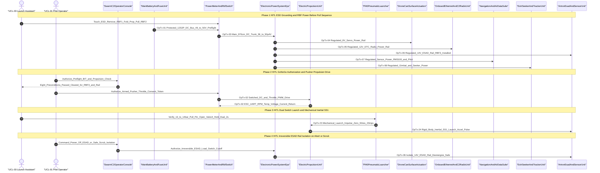

#### 7.3.2 Diagram 10.2: Flight Control, Segregated DroneCAN & Navigation Sequence (`OpTx-09` through `OpTx-16`)

This interaction thread traces physically segregated `CAN 1` (`OpTx-09`, `OpTx-10`, `OpTx-11`) and `CAN 2` (`OpTx-12`, `OpTx-13`) buses, software-hosted `ASTM F3269-17` Simplex RTA supervision inside `FlightControllerCubeOrangePlus`, point-to-point UART exchanges (`OpTx-14`, `OpTx-15`, `OpTx-16`), and HITL-authorized GNSS-denied dead-reckoning and terminal engagement steering.

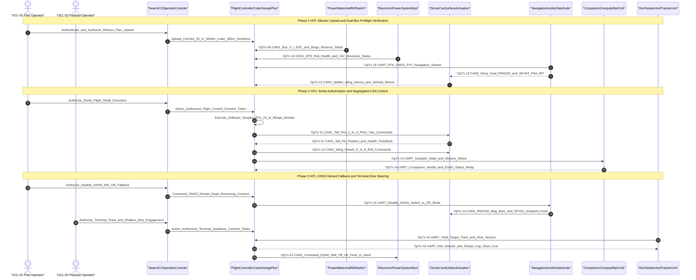

#### 7.3.3 Diagram 10.3: C2 RF Link, Onboard Ethernet & EO/IR Video Sequence (`OpTx-17`, `OpTx-18`, `OpTx-19`, `OpTx-21`, `OpTx-22`)

This interaction thread traces ground console to RF station and rotator control (`OpTx-22`), encrypted `4.4-5.0 GHz` `AES-256` FHSS air-ground RF transport (`OpTx-21`), autopilot serial C2 and locked USB service access (`OpTx-17`), switched onboard Ethernet IP bridging (`OpTx-18`), EO/IR Day/Thermal video streaming and HITL `Reboot Gimbal` recovery (`OpTx-19`), PACE link failover, and `5W` / `CFF` tactical export.

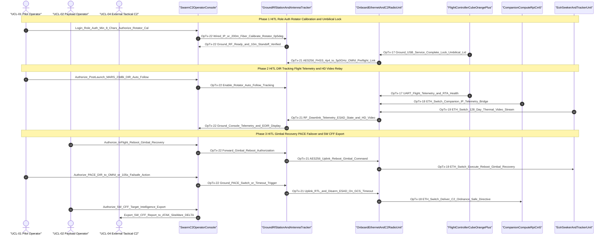

#### 7.3.4 Diagram 10.4: Ordnance Safe-Arm Supervision & Interlock Sequence (`OpTx-06`, `OpTx-10`, `OpTx-14`, `OpTx-20`, `OpTx-24`)

This safety-critical interaction thread enforces `NATO STANAG 4187 Ed. 5` and `DoD Directive 3000.09` §4.1.a across Level 1B ordnance supervision (`OpTx-06`, `OpTx-10`, `OpTx-14`, `OpTx-20`, `OpTx-24`), strictly isolating power-before-pull `RBF #3` ordering (`GAP-06`), pre-flight safe high-voltage PBIT verification (`< 50.0 V`), independent physical barriers `SS1` and `SS2 Safe Distance Exceed` (`GAP-07`), positive HITL arm/abort consent, and deterministic rail cutoff without exposing component-internal serial, pinouts, bitmasks, or checksum polynomial equations.

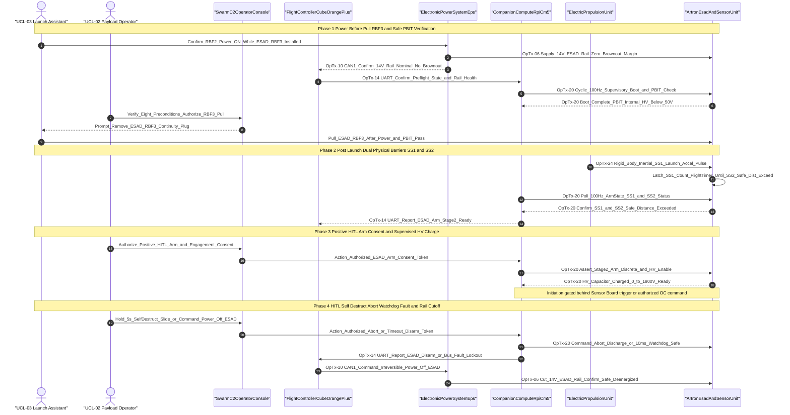

---

### 7.4 Op-Tx Coverage Parity & Traceability Summary

Table 7.3 confirms 100% deterministic closure of all `24` operational exchanges (`OpTx-01` through `OpTx-24`) across SysML `connection def` nodes (`CONN_01` through `CONN_24`), interaction sequence diagrams (`Diagram 10.1` through `Diagram 10.4`), UAF Operational Activities (`OA-01` through `OA-19`), Operational Scenarios (`SCN-01` through `SCN-08`), Safety Constraints (`REQ_SC_01` through `REQ_SC_16`, `REQ_SAF_01` through `REQ_SAF_12`), and Verification Test Cases (`TC_01` through `TC_08`).

#### Table 7.3: Op-Tx to Diagram, Operational Activity, Scenario & Verification Parity Matrix

| Op-Tx ID | SysML `connection def` | Sequence Diagram Allocation | Bound Operational Activities (`OA`) | Bound Scenarios (`SCN`) | Governing Constraints & Test Cases |
| :--- | :--- | :--- | :--- | :--- | :--- |
| `OpTx-01` | `CONN_01` | `Diagram 10.1` | `OA-01`, `OA-04` | `SCN-01`, `SCN-02`, `SCN-08` | `REQ_SC_01`, `REQ_SC_02`, `REQ_SAF_05`, `REQ_SAF_06`; `TC_01` |
| `OpTx-02` | `CONN_02` | `Diagram 10.1` | `OA-02`, `OA-16` | `SCN-01`, `SCN-02`, `SCN-06` | `REQ_SC_04`, `REQ_SAF_03`; `TC_01`, `TC_02`, `TC_07` |
| `OpTx-03` | `CONN_03` | `Diagram 10.1` | `OA-01`, `OA-03`, `OA-04` | `SCN-01`, `SCN-02` | `REQ_SC_02`, `REQ_SAF_01`, `REQ_SAF_05`; `TC_01`, `TC_02` |
| `OpTx-04` | `CONN_04` | `Diagram 10.1` | `OA-03`, `OA-09` | `SCN-01`, `SCN-02`, `SCN-04` | `REQ_SC_06`; `TC_02`, `TC_03` |
| `OpTx-05` | `CONN_05` | `Diagram 10.1` | `OA-03`, `OA-14` | `SCN-01`, `SCN-03`, `SCN-07` | `REQ_SC_02`, `REQ_SC_15`; `TC_02`, `TC_04` |
| `OpTx-06` | `CONN_06` | `Diagram 10.1`, `Diagram 10.4` | `OA-03`, `OA-10`, `OA-12`, `OA-17` | `SCN-01`, `SCN-05`, `SCN-08` | `REQ_SC_09`, `REQ_SC_16`, `REQ_SAF_01`, `REQ_SAF_06`; `TC_02`, `TC_06`, `TC_08` |
| `OpTx-07` | `CONN_07` | `Diagram 10.1` | `OA-03`, `OA-06`, `OA-07` | `SCN-01`, `SCN-03` | `REQ_SC_07`; `TC_02`, `TC_04` |
| `OpTx-08` | `CONN_08` | `Diagram 10.1` | `OA-03`, `OA-13`, `OA-14` | `SCN-01`, `SCN-04`, `SCN-07` | `REQ_SC_12`; `TC_02`, `TC_05` |
| `OpTx-09` | `CONN_09` | `Diagram 10.2` | `OA-01`, `OA-02`, `OA-04` | `SCN-01`, `SCN-02` | `REQ_SC_02`, `REQ_SC_04`, `REQ_SC_06`, `REQ_SAF_05`; `TC_01`, `TC_02` |
| `OpTx-10` | `CONN_10` | `Diagram 10.2`, `Diagram 10.4` | `OA-03`, `OA-12`, `OA-17` | `SCN-01`, `SCN-05`, `SCN-08` | `REQ_SC_02`, `REQ_SC_16`, `REQ_SAF_01`; `TC_02`, `TC_06`, `TC_08` |
| `OpTx-11` | `CONN_11` | `Diagram 10.2` | `OA-05`, `OA-09` | `SCN-02`, `SCN-03`, `SCN-04` | `REQ_SC_05`, `REQ_SC_06`, `REQ_SAF_02`; `TC_03` |
| `OpTx-12` | `CONN_12` | `Diagram 10.2` | `OA-05`, `OA-09` | `SCN-02`, `SCN-03`, `SCN-04` | `REQ_SC_05`, `REQ_SC_06`, `REQ_SAF_02`; `TC_03` |
| `OpTx-13` | `CONN_13` | `Diagram 10.2` | `OA-06`, `OA-07` | `SCN-01`, `SCN-03` | `REQ_SC_06`, `REQ_SC_07`; `TC_03`, `TC_04` |
| `OpTx-14` | `CONN_14` | `Diagram 10.2`, `Diagram 10.4` | `OA-05`, `OA-08`, `OA-12` | `SCN-02`, `SCN-03`, `SCN-05`, `SCN-08` | `REQ_SC_05`, `REQ_SC_08`, `REQ_SAF_04`; `TC_03`, `TC_04`, `TC_06` |
| `OpTx-15` | `CONN_15` | `Diagram 10.2` | `OA-06`, `OA-07` | `SCN-01`, `SCN-02`, `SCN-03` | `REQ_SC_07`; `TC_04` |
| `OpTx-16` | `CONN_16` | `Diagram 10.2` | `OA-05`, `OA-13` | `SCN-02`, `SCN-04` | `REQ_SC_05`, `REQ_SC_12`, `REQ_SAF_02`; `TC_03`, `TC_05` |
| `OpTx-17` | `CONN_17` | `Diagram 10.3` | `OA-05`, `OA-14`, `OA-18` | `SCN-01`, `SCN-03`, `SCN-07` | `REQ_SC_15`; `TC_04`, `TC_08` |
| `OpTx-18` | `CONN_18` | `Diagram 10.3` | `OA-08`, `OA-11`, `OA-12`, `OA-14` | `SCN-03`, `SCN-05`, `SCN-07`, `SCN-08` | `REQ_SC_08`, `REQ_SC_16`, `REQ_SAF_04`; `TC_04`, `TC_06`, `TC_08` |
| `OpTx-19` | `CONN_19` | `Diagram 10.3` | `OA-13`, `OA-14` | `SCN-04`, `SCN-07` | `REQ_SC_12`; `TC_05` |
| `OpTx-20` | `CONN_20` | `Diagram 10.4` | `OA-08`, `OA-10`, `OA-11`, `OA-12` | `SCN-01`, `SCN-05`, `SCN-08` | `REQ_SC_08`, `REQ_SC_09`, `REQ_SC_10`, `REQ_SC_11`, `REQ_SAF_04`, `REQ_SAF_06`, `REQ_SAF_07`; `TC_04`, `TC_06`, `TC_08` |
| `OpTx-21` | `CONN_21` | `Diagram 10.3` | `OA-07`, `OA-12`, `OA-13`, `OA-18` | `SCN-01`, `SCN-03`, `SCN-04`, `SCN-05`, `SCN-07`, `SCN-08` | `REQ_SC_12`, `REQ_SC_15`, `REQ_SAF_02`; `TC_04`, `TC_05`, `TC_08` |
| `OpTx-22` | `CONN_22` | `Diagram 10.3` | `OA-18`, `OA-19` | `SCN-01`, `SCN-03`, `SCN-07`, `SCN-08` | `REQ_SC_15`, `REQ_SC_16`, `REQ_SAF_12`; `TC_08` |
| `OpTx-23` | `CONN_23` | `Diagram 10.1` | `OA-15`, `OA-16`, `OA-17` | `SCN-06`, `SCN-08` | `REQ_SC_13`, `REQ_SC_14`, `REQ_SC_16`, `REQ_SAF_03`, `REQ_SAF_12`; `TC_07`, `TC_08` |
| `OpTx-24` | `CONN_24` | `Diagram 10.1`, `Diagram 10.4` | `OA-11`, `OA-16` | `SCN-05`, `SCN-06` | `REQ_SC_11`, `REQ_SAF_07`, `REQ_SAF_10`; `TC_06`, `TC_07` |

/// OperationalAllocation: [OA-01]
/// OperationalAllocation: [OA-02]
/// OperationalAllocation: [OA-03]
/// OperationalAllocation: [OA-04]
/// OperationalAllocation: [OA-05]
/// OperationalAllocation: [OA-06]
/// OperationalAllocation: [OA-07]
/// OperationalAllocation: [OA-08]
/// OperationalAllocation: [OA-09]
/// OperationalAllocation: [OA-10]
/// OperationalAllocation: [OA-11]
/// OperationalAllocation: [OA-12]
/// OperationalAllocation: [OA-13]
/// OperationalAllocation: [OA-14]
/// OperationalAllocation: [OA-15]
/// OperationalAllocation: [OA-16]
/// OperationalAllocation: [OA-17]
/// OperationalAllocation: [OA-18]
/// OperationalAllocation: [OA-19]
/// OperationalAllocation: [MET-02]

## 8. Environmental Operating Limits & Stress Qualification

**Normative Baseline Date:** `2026-11-16` | **System Baseline:** `Avenger5V25UasSystem` (`Avenger 5 V2.5 UAS` / `ASTK A5 V2.5` + `ELI Military Simulations PL-40 Rev 2.6` + `Artron ESAD AB00-0054-01AA-0005` + `SwarmC2`) | **Schema Contract:** `environmental_envelopes` (`ambient_temperature`, `environmental_ingress`, `rf_environment`, `physical_spatial_constraints`) | **Normative Allocation:** `INT-04`, `INT-01`, `MET-02`, `OBL-04`, `REQ_SAF_01`, `REQ_SAF_02`, `REQ_SAF_03`, `REQ_SAF_11`

This section establishes the environmental operating envelopes, electromagnetic and electrostatic immunity boundaries, mechanical shock and environmental stress qualification baselines, and unprinted calibration limits (`GAP-ENV`) governing the `Avenger5V25IntegratedSystem` across the Air Vehicle, Launch Segment (`PL-40`), and Ground Command Segment (`SwarmC2` and Ground RF Station). In accordance with `docs/research/RESEARCH_INVENTORY.md` (`INT-04`, `INT-01`, `MET-02`), all grounded OEM thresholds from `schema/extracted/parametric_limits.md` and `.pipeline/schema.sysml` are enforced unconditionally, while unprinted environmental, thermal, ingress, and pneumatic relief margins are quarantined under `REQ_SAF_11` pending pre-field calibration sign-off. Production `Avenger V2.5` hardware excludes any recovery failsafe containment (`rndRecoveryOptionInstalled == false`; `2x 50.0 V` optional RnD igniter lines inhibited), hosts ASTM F3269-17 Simplex Run-Time Assurance (`RTA`) solely in software inside `FlightControllerCubeOrangePlus` (`standaloneRtaBoxCount == 0`), and preserves a strictly mechanical zero-wire launch rail interface (`IF-MECH-001`).

### 8.1 Mathematical Environmental Envelope Formulation

Per `.pipeline/schema.sysml` (`ElectricPropulsionUnit`, `Pl40PneumaticLauncher`, `Pl40MassAndExitVelocityConstraint`, and `GroundCrewSeparationAndEsdConstraint`), nominal deployment and flight operations require simultaneous satisfaction of the bounded environmental inequality system:

$$
\begin{aligned}
T_{\mathrm{op,min}} \le T_{\mathrm{amb}} &\le T_{\mathrm{op,max}} \\
T_{\mathrm{chg,min}} \le T_{\mathrm{chg}} &\le T_{\mathrm{chg,max}} \\
v_{\mathrm{wind,gnd}} &\le v_{\mathrm{wind,gnd,max}} \\
v_{\mathrm{wind,cruise}} &\le v_{\mathrm{wind,cruise,max}} \\
h_{\mathrm{op}} &\le h_{\mathrm{ceil}} \\
d_{\mathrm{rf,gnd}} &\ge d_{\mathrm{rf,min}}
\end{aligned}
$$

#### Parameter Definitions & Engineering Units

| Parameter | Symbol | Value | Units | Source / AST Binding | Description |
| :--- | :--- | :--- | :--- | :--- | :--- |
| Ambient Operating Temperature Min | T_op_min | 253.15 | Dimensionless | `ElectricPropulsionUnit.operatingTempMinDegC` (`PRM-PERF-018`, `PRM-PL40-038`) | Minimum ambient operating temperature for Avenger V2.5 airframe and PL-40 launcher (Normalized Kelvin scalar T / 1.0 K; OEM: -20.0 degC) |
| Ambient Operating Temperature Max | T_op_max | 323.15 | Dimensionless | `ElectricPropulsionUnit.operatingTempMaxDegC` (`PRM-PERF-019`, `PRM-PL40-039`) | Maximum ambient operating temperature for Avenger V2.5 airframe and PL-40 launcher (Normalized Kelvin scalar T / 1.0 K; OEM: 50.0 degC) |
| Compressor Battery Charging Temp Min | T_chg_min | 283.15 | Dimensionless | `Pl40PneumaticLauncher` (`PRM-PL40-040`) | Minimum ambient charging temperature for Makita BL1860B compressor battery packs (Normalized Kelvin scalar T / 1.0 K; OEM: 10.0 degC) |
| Compressor Battery Charging Temp Max | T_chg_max | 313.15 | Dimensionless | `Pl40PneumaticLauncher` (`PRM-PL40-041`) | Maximum ambient charging temperature for Makita BL1860B compressor battery packs (Normalized Kelvin scalar T / 1.0 K; OEM: 40.0 degC) |
| Ground / Launch Wind Max | v_wind_gnd_max | 12.0 | m/s | `ElectricPropulsionUnit.groundWindToleranceMaxMs` (`PRM-PERF-016`) | Maximum allowable surface wind speed during ground staging and PL-40 launch |
| Cruise Wind Max | v_wind_cruise_max | 28.0 | m/s | `ElectricPropulsionUnit.cruiseWindToleranceMaxMs` (`PRM-PERF-017`) | Maximum allowable airborne wind speed during cruise and loiter phases |
| Operational Service Ceiling | h_ceil | 5000.0 | m | `ElectricPropulsionUnit.serviceCeilingM` (`PRM-PERF-015`) | Maximum authorized airframe operational altitude ceiling |
| Ground RF / Prep Separation Min | d_rf_min | 10.0 | m | `GroundRfStationAndAntennaTracker.minRadioToUavSepM` (`PRM-GCS-001`) | Minimum separation distance between UAV and Ground Radio Box during preparation |

### 8.2 Grounded Thermal, Wind, Altitude & Spatial Clearance Limits

#### 8.2.1 Thermal Operating and Battery Charging Envelopes
- **Airframe & Launcher Operating Temperature (`-20.0 degC` to `+50.0 degC`)**: Both the `Avenger V2.5` air vehicle (`PRM-PERF-018`, `PRM-PERF-019`) and the `ELI Military Simulations PL-40 Rev 2.6` pneumatic launcher (`PRM-PL40-038`, `PRM-PL40-039`) are rated across `-20.0 degC` to `+50.0 degC` ambient temperature. Within this envelope, the `CUAV SKYE2` heated pitot end-node on `CAN 2` (`NavigationAndAirDataSuite`) provides integrated heating and water drainage to protect dynamic pressure sensing in cold-humid air, while the `IBEX160` ESC streams ESC and motor temperature telemetry over unidirectional `Telemetry UART` (`IF-SER-005`) to the `PowerMeterAndRbfSwitch` and onto `CAN 1` (`REQ_SC_04`).
- **Compressor Battery Charging Envelope (`+10.0 degC` to `+40.0 degC`)**: The `PL-40` portable compressor unit uses `2x Makita BL1860B` (`18.0 V` nominal, `6000.0 mAh`, `UN 3481`) Li-Ion battery packs (`PRM-PL40-032`, `PRM-PL40-033`) whose charging is strictly restricted to `+10.0 degC` through `+40.0 degC` ambient (`PRM-PL40-040`, `PRM-PL40-041`). Operation near `-20.0 degC` elevates internal cell impedance and accelerates voltage droop toward the `14.5 V` under-voltage lockout (`UVLO`) cutoff (`PRM-PL40-034`), which flashes the `PWR` LED and halts compression until a fresh pack measuring above `16.0 V` is installed after the mandatory `5.0 s` restart delay (`PRM-PL40-035`, `PRM-PL40-036`; swap after the 1st launch and every 2 launches).
- **Maintenance Thermal Boundary**: Depot/intermediate replacement of the `PL-40` pulling rope and carriage wheel bearings every `100` launches (`PRM-PL40-043`) requires localized `250.0 degC` heating for threadlocker removal (`PRM-PL40-044`), isolated from live ordnance and pressurized air vessels.

#### 8.2.2 Wind Tolerance, Launch Margin & Altitude Ceiling
- **Ground and Cruise Wind Limits**: Ground handling and `PL-40` catapult launch are capped at `12.0 m/s` surface wind (`PRM-PERF-016`), whereas airborne cruise and loiter operations tolerate wind up to `28.0 m/s` (`PRM-PERF-017`).
- **Aerodynamic Launch Coupling (`GAP-03`)**: At `17.0 kg` MTOW (`PRM-AF-008`) and `13.0 bar` to `14.0 bar` operating tank pressure (`PRM-PL40-027`, `PRM-PL40-028`), the `PL-40` rail yields an interpolated exit velocity of `23.0 m/s` (`22.7 m/s` to `23.5 m/s`, `PRM-PL40-003` through `PRM-PL40-005`), which sits below the `24.0 m/s` V2.5 stall speed (`26.0 m/s` V1 minimum speed, `PRM-PERF-004`, `PRM-PERF-005`). Conversely, airframes below `15.0 kg` at `14.0 bar` reach `25.3 m/s`, exceeding the `25.0 m/s` launcher structural limit (`PRM-PL40-002`, `PRM-PL40-046`). Consequently, `Pl40MassAndExitVelocityConstraint` and `REQ_SAF_03` require pre-launch Go/No-Go verification of pusher propulsion readiness, `13.0 bar` to `14.0 bar` tank pressure, favorable headwind within the `12.0 m/s` limit, and compliance with the `25.0 m/s` rail exit cap.
- **Flight Envelope & Altitude Ceiling**: The airframe service ceiling is `5000.0 m` (`PRM-PERF-015`). Within `SwarmC2`, mission planning constrains waypoints between `50.0 m` minimum (`PRM-GCS-004`) and `3000.0 m` dynamic altitude slider maximum (`PRM-GCS-005`, `250.0 m` major steps `PRM-GCS-006`) with a minimum `300.0 m` loiter radius (`PRM-GCS-007`). In flight, software-hosted Simplex RTA inside `FlightControllerCubeOrangePlus` (`REQ_SC_05`, `REQ_SAF_02`) bounds horizontal flight (`24.0 m/s` to `42.0 m/s` V2.5; `26.0 m/s` to `38.0 m/s` V1) and enforces the `55.0 m/s` hard engagement cap (`Abort Engaging` above `55.0 m/s`) inside the `80.0 m/s` `VNE` structural dive limit.

#### 8.2.3 Physical Staging Footprint & Spatial Clearance Envelopes
- **Launch Rail Geometry & Exclusion Sectors**: The assembled `PL-40` occupies a `5.0 m` nominal (`4938.0 mm` ground-projected CAD) footprint elevated at `12.0 deg` (`PRM-PL40-006` through `PRM-PL40-008`), supported on a `602.0 mm` front anchor lateral span (`PRM-PL40-010`) with a `1116.0 mm` deployed rail top height (`PRM-PL40-011`) requiring a minimum 2-person airframe lift crew (`PRM-AF-019`). The `PL-40` carriage (`271.0 mm` long, `232.5 mm` high, `156.0 mm` outer / `140.0 mm` inner width) provides a `145.0 mm` to `155.5 mm` upper prop-safe zone (`PRM-PL40-020`, `PRM-PL40-021`) complemented by mandatory rearward folding of the pusher propeller before `Power R.B.F. Key #2` energization (`REQ_SC_01`). Personnel staging is restricted strictly to the `SAFETY AREA` behind the rear anchor/foot, while all forward and lateral sectors constitute the `DANGER ZONE` (`03_pl40_launcher_specifications.md` Section 2).

| Param ID | Segment / Scope | Parameter Name | Value | Units | Operational Constraint / Condition | SSOT & OEM Source Citation |
| :--- | :--- | :--- | :--- | :--- | :--- | :--- |
| `PRM-PERF-018` | Air Vehicle / Avionics | Operating Temperature Min | 253.15 | Dimensionless | Minimum ambient airframe and ASTK A5 V2.5 operating temperature (Normalized Kelvin scalar T / 1.0 K; OEM: -20.0 degC) | `AVENGER 5 Spec sheet_rev3.pdf#p3`; `ElectricPropulsionUnit` |
| `PRM-PERF-019` | Air Vehicle / Avionics | Operating Temperature Max | 323.15 | Dimensionless | Maximum ambient airframe and ASTK A5 V2.5 operating temperature (Normalized Kelvin scalar T / 1.0 K; OEM: 50.0 degC) | `AVENGER 5 Spec sheet_rev3.pdf#p3`; `ElectricPropulsionUnit` |
| `PRM-PL40-038` | Launch Segment (`PL-40`) | Launcher Operating Temperature Min | 253.15 | Dimensionless | Minimum ambient operating temperature for PL-40 catapult and compressor (Normalized Kelvin scalar T / 1.0 K; OEM: -20.0 degC) | `UAV_launcher_PL-40_user_manual_rev_2.6.pdf#p28,#p37` |
| `PRM-PL40-039` | Launch Segment (`PL-40`) | Launcher Operating Temperature Max | 323.15 | Dimensionless | Maximum ambient operating temperature for PL-40 catapult and compressor (Normalized Kelvin scalar T / 1.0 K; OEM: 50.0 degC) | `UAV_launcher_PL-40_user_manual_rev_2.6.pdf#p28,#p37` |
| `PRM-PL40-040` | Launch Segment (`Makita BL1860B`) | Battery Charging Temperature Min | 283.15 | Dimensionless | Minimum ambient charging temperature for 2x Makita BL1860B packs (Normalized Kelvin scalar T / 1.0 K; OEM: 10.0 degC) | `UAV_launcher_PL-40_user_manual_rev_2.6.pdf#p28` |
| `PRM-PL40-041` | Launch Segment (`Makita BL1860B`) | Battery Charging Temperature Max | 313.15 | Dimensionless | Maximum ambient charging temperature for 2x Makita BL1860B packs (Normalized Kelvin scalar T / 1.0 K; OEM: 40.0 degC) | `UAV_launcher_PL-40_user_manual_rev_2.6.pdf#p28` |
| `PRM-PERF-016` | Air Vehicle / Launch Segment | Ground Wind Tolerance Max | 12.0 | m/s | Maximum surface wind during staging and PL-40 rail launch | `AVENGER 5 Spec sheet_rev3.pdf#p3`; `Pl40MassAndExitVelocityConstraint` |
| `PRM-PERF-017` | Air Vehicle | Cruise Wind Tolerance Max | 28.0 | m/s | Maximum airborne cruise wind tolerance | `AVENGER 5 Spec sheet_rev3.pdf#p3`; `ElectricPropulsionUnit` |
| `PRM-PERF-015` | Air Vehicle | Service Ceiling | 5000.0 | m | Maximum operational altitude ceiling | `AVENGER 5 Spec sheet_rev3.pdf#p3`; `ElectricPropulsionUnit` |
| `PRM-GCS-004` | Ground Segment (`SwarmC2`) | Minimum Mission Waypoint Altitude | 50.0 | m | Minimum allowed SwarmC2 mission waypoint and altitude slider floor | `A5-user-manual 2.pdf#p46-#p48,#p63`; `SwarmC2OperatorConsole` |
| `PRM-GCS-005` | Ground Segment (`SwarmC2`) | Dynamic Altitude Slider Max | 3000.0 | m | Upper bound of SwarmC2 dynamic mission altitude slider | `A5-user-manual 2.pdf#p63,#p65`; `SwarmC2OperatorConsole` |
| `PRM-GCS-007` | Ground Segment (`SwarmC2`) | Default Loiter Radius Min | 300.0 | m | Minimum mission validation loiter radius | `A5-user-manual 2.pdf#p46-#p48,#p59-#p64`; `SwarmC2OperatorConsole` |
| `PRM-PL40-007` | Launch Segment (`PL-40`) | Assembled Rail Length Nominal | 5.0 | m | Nominal 3-section rail length (4938.0 mm ground-projected CAD envelope) | `UAV_launcher_PL-40_user_manual_rev_2.6.pdf#p37,#p41` |
| `PRM-PL40-006` | Launch Segment (`PL-40`) | Rail Elevation Angle | 12.0 | deg | Fixed launch rail inclination angle | `UAV_launcher_PL-40_user_manual_rev_2.6.pdf#p37,#p41` |
| `PRM-PL40-011` | Launch Segment (`PL-40`) | Deployed Rail Top Height | 1116.0 | mm | Height of deployed rail top above ground surface | `UAV_launcher_PL-40_user_manual_rev_2.6.pdf#p41` |
| `PRM-PL40-020` | Launch Segment (`PL-40`) | Carriage Prop-Safe Upper Zone Min | 145.0 | mm | Lower bound of carriage upper propeller clearance zone | `UAV_launcher_PL-40_user_manual_rev_2.6.pdf#p41` |
| `PRM-PL40-021` | Launch Segment (`PL-40`) | Carriage Prop-Safe Upper Zone Max | 155.5 | mm | Upper bound of carriage upper propeller clearance zone | `UAV_launcher_PL-40_user_manual_rev_2.6.pdf#p41` |
| `PRM-PL40-002` | Launch Segment (`PL-40`) | Max Allowed Launch Exit Velocity | 25.0 | m/s | Hard structural ceiling on PL-40 carriage exit velocity (`GAP-03`) | `UAV_launcher_PL-40_user_manual_rev_2.6.pdf#p3,#p24,#p37` |
| `PRM-PL40-003` | Launch Segment (`PL-40`) | Avenger 5 Interpolated Exit Velocity | 23.0 | m/s | Approximate exit velocity at 17.0 kg MTOW and 13.0 to 14.0 bar (`GAP-03`) | `UAV_launcher_PL-40_user_manual_rev_2.6.pdf#p37` |
| `PRM-PL40-027` | Launch Segment (`PL-40`) | Avenger 5 Operating Pressure Min | 13.0 | ratio | Nominal lower launch gauge pressure bound (Normalized pressure ratio P / 100 kPa; OEM: 13.0 bar; `GAP-03`) | `A5-user-manual 2.pdf#p54`; `A5_prep and safety_rev7.pdf#p5` |
| `PRM-PL40-028` | Launch Segment (`PL-40`) | Onboard Max Working Pressure | 14.0 | ratio | Onboard compressor auto-cutoff and Avenger 5 launch upper bound (Normalized pressure ratio P / 100 kPa; OEM: 14.0 bar) | `UAV_launcher_PL-40_user_manual_rev_2.6.pdf#p22,#p24,#p37` |
| `PRM-PL40-031` | Launch Segment (`PL-40`) | External Aux Fill Max Pressure | 16.0 | ratio | DIN 8 mm PCP external auxiliary air fill pressure ceiling (Normalized pressure ratio P / 100 kPa; OEM: 16.0 bar) | `UAV_launcher_PL-40_user_manual_rev_2.6.pdf#p21,#p37` |
| `PRM-PL40-034` | Launch Segment (`PL-40`) | Compressor Battery UVLO Cutoff | 14.5 | V | Compressor cuts OFF at or below 14.5 V (`PWR` LED flashes) | `UAV_launcher_PL-40_user_manual_rev_2.6.pdf#p23` |
| `PRM-PL40-035` | Launch Segment (`PL-40`) | Compressor Battery UVLO Restart Min | 16.0 | V | Minimum pack voltage required after 5.0 s wait to restart compressor | `UAV_launcher_PL-40_user_manual_rev_2.6.pdf#p23` |
| `PRM-PL40-044` | Launch Maintenance (`PL-40`) | Bearing Threadlocker Removal Temp | 523.15 | Dimensionless | Localized heating temperature for 100-launch bearing maintenance (Normalized Kelvin scalar T / 1.0 K; OEM: 250.0 degC) | `UAV_launcher_PL-40_user_manual_rev_2.6.pdf#p29-#p36` |

### 8.3 Electromagnetic Environment, RF Standoff & ESD Grounding (MIL-STD-461G)

- **Ground RF Standoff (`>= 10.0 m`) & Tactical Fiber Isolation**: During pre-flight staging and RF checks, crew must keep the UAV at or beyond `10.0 m` from the `DTC 4.4 GHz to 5.0 GHz Ground Radio Box` (`PRM-GCS-001`, `GroundCrewSeparationAndEsdConstraint`, `REQ_SC_15`, `MET-02`), limiting near-field RF exposure from the `2.0 W` transmitter and `23.0 dBi` Ground `MARS` directional antenna (`PRM-RF-009`). An optional `200.0 m` tactical fiber optic spool (`PRM-RF-012`) physically isolates the `SwarmC2` Windows 11 rugged tablet from the Ground Radio Box and Antenna Rotator during launch and active transmission.
- **Mandatory Transport Box ESD Grounding**: Prior to handling the airframe, opening hatches, or approaching ordnance interfaces, operators must touch the dedicated `Transport Box ESD Grounding Point` (`GroundRfStationAndAntennaTracker.esdGroundingMandatory == true`, `REQ_SC_01`, `REQ_SC_15`) and complete Ground Antenna Rotator calibration (`0.5 deg` fine step / `Auto Follow`, `PRM-RF-010`) before touching the UAV. This discharges personnel electrostatic potential ahead of `Power R.B.F. Key #2` removal and `ESAD R.B.F. Key #3` manipulation (`GAP-06`). During flight, the `External Interface Board (USB/ETH)` remains sealed behind its lockable umbilical lid (`REQ_SC_01`, `OBL-04`), and `IF-MECH-001` provides `0` electrical/CAN conductors across the `PL-40` carriage-to-airframe interface, preventing ground-loop or rail-static coupling into air vehicle avionics.
- **Power & Bus Coupling Susceptibility (`GAP-01`)**: `ElectronicPowerSystemEps` supplies `14.0 V` (`PRM-AV-010`) directly to the `Artron ESAD` `VDC_IN` (`GE_POW`) input, whose `ESAD ICD` lower boundary is `14.0 V` (`28.0 V` nominal, `32.0 V` max, `PRM-ESAD-001` through `PRM-ESAD-003`). Because `0.0 V` brownout margin exists (`REQ_SAF_01`), EMI/EMC transient suppression (`MIL-STD-461G CS116`) and deterministic `CAN 1` / `CAN 2` isolation (`CTL-04`, `REQ_SC_06`) are critical to prevent voltage sags or common-mode faults across the `970.0 cm` main DC/CAN 1 trunk (`PRM-AV-012`) and `120.0 cm` fin servo stubs (`PRM-AV-013`).
- **RF Contested Environment & GNSS Denial**: The `4.4 GHz` to `5.0 GHz` `AES-256` FHSS datalink (`PRM-RF-001`, `PRM-RF-002`, `PRM-RF-005`) sustains `60.0 km` baseline (`90.0 km` V2.5 extended / `180.0 km` V1) RLOS operation (`PRM-RF-006` through `PRM-RF-008`), while `Septentrio Asterx-m3 pro` GNSS (`Talysman TW3972EXF` antenna) handles GPS/GLONASS/GALILEO reception. Under jamming or spoofing, `PaceC2LinkState` (`CTL-02`, `REQ_SC_07`) switches to `Disable GNSS` dead-reckoning via dual `mRo RM3100` magnetometers/barometers and the `CUAV SKYE2` pitot, and enforces `Disarm ESAD On GCS Timeout` plus autonomous RTL after sustained link loss (`105.0 s` baseline timeout example, `PRM-GCS-008`).
- **Artron ESAD EMI/EMC & ESD Qualification (`MIL-STD-461G`)**: Per `RESEARCH_INVENTORY.md` (`INT-04`), the `Artron ESAD (AB00-0054-01AA-0005)` is qualified against `MIL-STD-461G` (`CS114`, `CS116`, `CS118`, `RE102`, `RS103`). All Level 1B operational supervision across `RPI CM5004032` (`Ring 2`) and `Artron ESAD` (`Ring 3`) enforces `100.0 Hz` (`0.01 s`) `` differential `RS-485` `Frame Integrity Check XModem` supervision (`<= 5.0 ms` reply, `<= 10.0 ms` incomplete packet timeout), discrete `DSC_IN1` (`1000.0 Hz`, `1.0 ms` period, `50.0 percent` duty, `2` pulses), `UMB` continuity (`< 0.5 Ohm` at `20.0 mA`), and `PBIT` safe high-voltage ceiling (`< 50.0 V` vs `0.0 V` to `1800.0 V` `J401` fire envelope). Component-internal serial frame and pinouts reside exclusively in Level 1C ICD documents.

| Param ID | Segment / Scope | Parameter Name | Value | Units | Operational Constraint / Condition | SSOT & OEM Source Citation |
| :--- | :--- | :--- | :--- | :--- | :--- | :--- |
| `PRM-GCS-001` | Ground Safety | Minimum Ground Radio / Crew Separation | 10.0 | m | Minimum UAV-to-Ground Radio Box separation during pre-flight prep | `A5-user-manual 2.pdf#p52`; `GroundCrewSeparationAndEsdConstraint` |
| `PRM-RF-012` | Ground Segment | Optional Tactical Fiber Spool Length | 200.0 | m | Optional fiber tether isolating SwarmC2 console from Ground Radio Box | `A5-user-manual 2.pdf#p11`; `GroundRfStationAndAntennaTracker` |
| `PRM-RF-001` | RF Datalink | C2 Radio Operating Frequency Min | 4.4 | GHz | Lower bound of DTC AES-256 FHSS C2 operating band | `AVENGER 5 Spec sheet_rev3.pdf#p3`; `OnboardEthernetAndC2RadioUnit` |
| `PRM-RF-002` | RF Datalink | C2 Radio Operating Frequency Max | 5.0 | GHz | Upper bound of DTC AES-256 FHSS C2 operating band | `AVENGER 5 Spec sheet_rev3.pdf#p3`; `OnboardEthernetAndC2RadioUnit` |
| `PRM-RF-003` | RF Datalink | C2 Radio Total RF Output Power | 2.0 | W | Total airborne/ground DTC radio RF TX output (1.0 W per MPSL4400 chain) | `AVENGER 5 Spec sheet_rev3.pdf#p3`; `A5-user-manual 2.pdf#p55` |
| `PRM-RF-009` | RF Datalink | Ground MARS Directional Antenna Gain | 23.0 | dBi | Directional tracking antenna gain on Ground Antenna Rotator | `A5-user-manual 2.pdf#p11`; `GroundRfStationAndAntennaTracker` |
| `PRM-RF-006` | RF Datalink | RLOS Range Baseline | 60.0 | km | Baseline RLOS datalink range (90.0 km V2.5 extended / 180.0 km V1) | `AVENGER 5 Spec sheet_rev3.pdf#p3`; `A5-user-manual 2.pdf#p10` |
| `PRM-AV-010` | Power / ESAD (`GAP-01`) | EPS ESAD Rail Output Voltage | 14.0 | V | Regulated EPS output to ESAD (0.0 V margin above 14.0 V ICD min) | `Avenger5_V2.5_block_diagram_rev5.pdf#p1`; `REQ_SAF_01` |
| `PRM-ESAD-001` | ESAD Power (`GAP-01`) | `VDC_IN` (`GE_POW`) Min Input Voltage | 14.0 | V | Minimum ESAD operating voltage (28.0 V nominal; 32.0 V max) | `ESAD ICD_for Excalibur_AB00-0054-01AA-0005 2 1.pdf#p14` |
| `PRM-ESAD-004` | ESAD Interlock | Umbilical Loop (`UMB`) Max Continuity Drop | 0.01 | V | Maximum continuity voltage drop across `ESAD R.B.F. Key #3` loop at 20.0 mA (OEM: 0.5 Ohm max resistance) | `ESAD ICD_for Excalibur_AB00-0054-01AA-0005 2 1.pdf#p14` |
| `PRM-ESAD-029` | ESAD HV Safety | PBIT Safe High-Voltage Ceiling | 50.0 | V | PBIT internal HV must remain strictly below 50.0 V prior to arming | `ESAD ICD_for Excalibur_AB00-0054-01AA-0005 2 1.pdf#p18,#p26-#p27` |
| `PRM-ESAD-031` | ESAD HV Fire | HV Output Maximum (`J401`) | 1800.0 | V | Maximum ESAD initiation capacitor charge output voltage | `ESAD ICD_for Excalibur_AB00-0054-01AA-0005 2 1.pdf#p18,#p26-#p27` |

| Test ID | MIL-STD-461G Method | Target Subsystem / Interface | Qualification Scope & Threat Coupling | Grounded Control & Interlock Binding | SSOT Citation |
| :--- | :--- | :--- | :--- | :--- | :--- |
| `EMC-01` | `CS114` Bulk Cable Injection | `Artron ESAD` harnesses (`GE_POW`, `RS-485`, `DSC_IN1`, `UMB`, `Sensor Board` cable) | Verifies conducted RF current immunity across fuselage wiring exposed to `4.4 GHz` to `5.0 GHz` `2.0 W` DTC TX fields and `970.0 cm` trunk coupling without ESAD state upset or unintended HV charging. | `STANAG 4187` dual barriers (`SS1` + `SS2`), differential `RS-485` `Frame Integrity Check XModem`, `DSC_IN1` `1000.0 Hz` `2`-pulse gate (`FaultStates` bit 4 lockout). | `RESEARCH_INVENTORY.md` (`INT-04`, `CTL-03`); `ArtronEsadAndSensorUnit` |
| `EMC-02` | `CS116` Damped Sinusoidal Transients | `Artron ESAD` `14.0 V` power lead (`GE_POW`) & signal cables | Verifies survival and safe lockout immunity against switching transients, lightning-induced damped ringing, and `EPS` transient droop where `0.0 V` brownout margin exists (`GAP-01`). | `EpsEsadZeroBrownoutMarginConstraint` (`14.0 V` to `32.0 V`), `200.0 A` main bus fuse, `PBIT < 50.0 V` check, irreversible `Power Off ESAD` recovery. | `RESEARCH_INVENTORY.md` (`INT-04`, `GAP-01`); `REQ_SAF_01` |
| `EMC-03` | `CS118` Personnel-Borne ESD | `Artron ESAD`, `UMB` (`RBF #3`), `Sensor Board`, `External Interface Board` | Protects ordnance initiation and microelectronics from human-body ESD discharge during warhead mounting (`1.5 mm` hex tool), `RBF #3` insertion/removal, and pre-flight prep. | Mandatory `Transport Box ESD Grounding Point` touch prior to handling (`REQ_SC_01`, `REQ_SC_15`), `RBF #2` power-on before `RBF #3` removal (`GAP-06`), locked `USB/ETH` service lid. | `RESEARCH_INVENTORY.md` (`INT-04`); `GroundCrewSeparationAndEsdConstraint` |
| `EMC-04` | `RE102` Radiated Emissions | `Artron ESAD` internal FPGA/CPLD logic & `0.0 V` to `1800.0 V` HV converter | Constrains unintentional radiated electric fields from ESAD electronics to prevent desensitization of onboard `Talysman TW3972EXF` GNSS and `4.4 GHz` to `5.0 GHz` `MPSL4400` C2 antennas. | Shielded/compact ESAD enclosure integration (`3x M3` on `75.0 mm` BCD), pre-flight `PBIT` verification (`< 50.0 V`), `CAN 1` / `CAN 2` physical isolation. | `RESEARCH_INVENTORY.md` (`INT-04`, `OBL-04`); `ArtronEsadAndSensorUnit` |
| `EMC-05` | `RS103` Radiated Susceptibility | `Artron ESAD` & `Sensor Board` (`J102` to `J1` `IRQ_L` initiation path) | Verifies immunity to high-intensity radiated RF fields from onboard `2.0 W` DTC TX, `23.0 dBi` Ground `MARS` antenna (`>= 10.0 m` prep standoff), and contested EW emitters. | Dual independent barriers (`SS1` inertial + `SS2` `Safe Distance Exceed == 1`), `100.0 Hz` `RS-485` watchdog (`<= 10.0 ms`), `>= 10.0 m` ground RF separation (`PRM-GCS-001`). | `RESEARCH_INVENTORY.md` (`INT-04`, `INT-01`, `GAP-07`); `REQ_SC_11` |

### 8.4 Fuze Mechanical Shock & Handling Qualification (MIL-STD-331D)

Per `RESEARCH_INVENTORY.md` (`INT-01`), the `Artron ESAD (AB00-0054-01AA-0005)`, `ESAD Sensor Board`, and `Warhead Holder` (`<= 5.0 kg` max warhead mass, `4.98 kg` +/- `0.02 kg` tested holder unit, `PRM-AF-009` through `PRM-AF-011`) require mechanical shock and handling qualification under `MIL-STD-331D` Group A tests to guarantee zero single-point premature arming or structural loss prior to launch and target impact.

| Test ID | MIL-STD-331D Group Test | Target Assembly | Qualification Condition & Pass Criterion | SSOT & Safety Binding |
| :--- | :--- | :--- | :--- | :--- |
| `FUZ-01` | `Group A Test A3` (12 m Drop) | `Artron ESAD`, `Sensor Board`, `Warhead Holder` | Verifies catastrophic logistics drop (`12.0 m` drop height) does not mechanically latch `SS1` inertial barrier, compromise HV isolation (`PBIT < 50.0 V`), or cause warhead initiation; safety state preserved for disposal. | `RESEARCH_INVENTORY.md` (`INT-01`); `NATO STANAG 4187 Ed. 5` Chapter 2; `REQ_L_01`, `REQ_L_04` |
| `FUZ-02` | `Group A Test A4.1` (1.5 m Tactical Drop) | `Artron ESAD`, `Sensor Board`, `Warhead Holder` | Verifies tactical field handling drop (`1.5 m` drop height during field assembly or 2-person lift to `1116.0 mm` rail height) causes zero premature arming, retains `UMB < 0.5 Ohm` integrity, and maintains post-drop operational safety. | `RESEARCH_INVENTORY.md` (`INT-01`); `PRM-AF-019`, `PRM-PL40-011`; `REQ_SC_10` |
| `FUZ-03` | `Group A Test A5` (Transportation Handling) | `Artron ESAD` (`3x M3` `75.0 mm` BCD), `Sensor Board` (`2x M2`), `1.5 mm` hex terminals | Verifies sustained tactical transport vibration, jolt, and handling loads cause zero mechanical fastener loosening, zero `SS1` false triggering, and intact `RS-485` / `DSC_IN1` / `J401` electrical isolation. | `RESEARCH_INVENTORY.md` (`INT-01`); `PRM-ESAD-015`, `PRM-ESAD-035` through `PRM-ESAD-037`; `REQ_SC_09` |

### 8.5 Environmental Stress Qualification Methods (MIL-STD-810H)

Per `RESEARCH_INVENTORY.md` (`INT-04`), system-level environmental qualification applies six tailored `MIL-STD-810H` laboratory test methods spanning thermal extremes, precipitation, particulate dust, flight/transport vibration, and catapult launch shock across all three operational segments.

| Qualification ID | MIL-STD-810H Method | Covered Segments & AST Parts | Grounded Operational Boundary & Stress Mechanism | Verification & Gap Disposition |
| :--- | :--- | :--- | :--- | :--- |
| `ENV-01` | `Method 501.7` High Temperature | `MainBatteryAndFuseUnit`, `ElectricPropulsionUnit`, `ElectronicPowerSystemEps`, `ArtronEsadAndSensorUnit`, `Pl40PneumaticLauncher`, `SwarmC2OperatorConsole` | Qualifies operation and thermal soak up to `+50.0 degC` ambient (`+40.0 degC` Makita BL1860B charging ceiling) without `IBEX160` ESC / `AXI 5345/16` motor derating, `EPS` `14.0 V` regulator thermal sag (`GAP-01`), or `SwarmC2` tablet throttling. | `INT-04`, `PRM-PERF-019`, `PRM-PL40-039`, `PRM-PL40-041`; closes `GAP-ENV` ESC/EPS thermal cutoff calibration (`REQ_SAF_11`). |
| `ENV-02` | `Method 502.7` Low Temperature | `MainBatteryAndFuseUnit`, `NavigationAndAirDataSuite`, `Pl40PneumaticLauncher`, `ArtronEsadAndSensorUnit` | Qualifies operation down to `-20.0 degC` ambient, bounding `12S2P Li metal` and `Makita BL1860B` (`14.5 V` UVLO) cold voltage sag, `CUAV SKYE2` heated pitot anti-freeze power draw, and `PL-40` seal elasticity at `13.0 bar` to `14.0 bar`. | `INT-04`, `PRM-PERF-018`, `PRM-PL40-038`, `PRM-PL40-034`; verify cold-soak `49.0 V` to `50.0 V` pre-flight check (`GAP-05`). |
| `ENV-03` | `Method 506.6` Rain | `ElectricPropulsionUnit`, `NavigationAndAirDataSuite`, `EoIrSeekerAndTrackerUnit`, `OnboardEthernetAndC2RadioUnit`, `Pl40PneumaticLauncher` | Qualifies fuselage sealing, locked `USB/ETH` umbilical lid (`OBL-04`), `Nighthawk2UZ` EO/IR window, `CUAV SKYE2` pitot water drainage, and `PL-40` dual firing switches against wind-driven rain ingress. | `INT-04`; required because OEM IP code and max rainfall rate (`mm/h`) are unprinted (`GAP-ENV`, `REQ_SAF_11`). |
| `ENV-04` | `Method 510.7` Sand and Dust | `ElectricPropulsionUnit`, `NavigationAndAirDataSuite`, `DroneCanSurfaceActuation`, `Pl40PneumaticLauncher` | Qualifies rear folding prop hub, `HV6160-DroneCAN` tail/wing linkages, `CUAV SKYE2` pitot ports, `PL-40` compressor air intake, `DIN 8 mm PCP` fill port, and carriage wheel bearings / pulling rope (`100`-launch interval). | `INT-04`, `PRM-PL40-043`, `PRM-AV-017`, `PRM-AV-018`; verify calm-air (`<= 3.0 m/s`) and airflow (`>= 10.0 m/s`) pitot BIT. |
| `ENV-05` | `Method 514.8` Vibration | `Avenger5V25IntegratedSystem` (`CAN 1` `120.0 cm` stubs, `CAN 2` daisy-chain, `970.0 cm` trunk), `ArtronEsadAndSensorUnit`, `Pl40PneumaticLauncher` | Qualifies avionics, `8x M6 x 30 mm` wing bolts (`10.0 mm` wrench), `RS-485` ESAD cabling, and `PL-40` `43.0 kg` case / `25.0 kg` compressor against pusher motor harmonics and tactical ground transport vibration. | `INT-04`, `PRM-AF-016` through `PRM-AF-018`, `PRM-AV-012`, `PRM-AV-013`, `PRM-PL40-012` through `PRM-PL40-014`. |
| `ENV-06` | `Method 516.8` Shock | `ElectricPropulsionUnit`, `ArtronEsadAndSensorUnit`, `FlightControllerCubeOrangePlus`, `Pl40PneumaticLauncher` | Qualifies airframe, `Artron ESAD`, and hardpoints (`Option A` split hooks / `Option B` `225.0 mm` bar / `Option C` `320.0 mm` `M8` pins) under `PL-40` launch impulse (`~23.0 m/s` at `17.0 kg`, `25.0 m/s` cap) and `SS1` inertial trigger fidelity. | `INT-04`, `PRM-PL40-002`, `PRM-PL40-003`, `PRM-PL40-024` through `PRM-PL40-026`; verifies `SS1` trips on launch without false ground triggers. |

### 8.6 Unprinted Environmental, Thermal & Energy Calibration Register (GAP-ENV)

Per `schema/extracted/05_engineering_gaps_and_synthesis_ledger.md` Section 2.4 (`GAP-ENV`) and `.pipeline/schema.sysml` (`REQ_SAF_11`), multiple quantitative environmental, thermal, energy, and pneumatic relief limits are unprinted across the six OEM reference documents. No unprinted figure may be assumed or fabricated; instead, each parameter is explicitly quarantined as `UNPRINTED` below and requires empirical bench calibration or OEM certification prior to unrestricted field deployment.

| Gap Item ID | Subsystem / Scope | Unprinted Envelope Parameter | Value | Units | Interim Operational Disposition & Pre-Field Sign-Off | SSOT Citation |
| :--- | :--- | :--- | :--- | :--- | :--- | :--- |
| `GAP-ENV-01` | `MainBatteryAndFuseUnit` | `12S2P Li metal BEI maximus20` Pack Energy Capacity | UNPRINTED | J | Grounded `5400.0 s` (`90.0 min`) endurance and `36.0 V` to `50.4 V` DC bus govern planning; measure nominal pack energy in `J` (`1 Wh = 3600.0 J`; OEM unprinted in `Wh`) prior to payload/temperature endurance derating. | `05_engineering_gaps_and_synthesis_ledger.md` Sec 2.4; `REQ_SAF_11` |
| `GAP-ENV-02` | `MainBatteryAndFuseUnit` | `12S2P Li metal BEI maximus20` Pack Charge Capacity | UNPRINTED | Dimensionless | Enforce grounded `49.0 V` to `50.0 V` pre-flight check (`GAP-05`); verify OEM charge capacity (Normalized charge scalar Q / 1.0 C; `1 Ah = 3600.0 C`; OEM: unprinted in `Ah`) and cold-weather discharge curve before sortie dispatch. | `05_engineering_gaps_and_synthesis_ledger.md` Sec 2.4; `REQ_SAF_11` |
| `GAP-ENV-03` | `MainBatteryAndFuseUnit` / `PowerMeterAndRbfSwitch` | Minimum Battery State-of-Charge (SoC) RTL Floor | UNPRINTED | percent | Enforce statutory `0.20` Bingo endurance reserve (`1080.0 s`) and `36.0 V` bus floor RTL trigger (`REQ_SC_02`); calibrate exact SoC percentage RTL threshold via pack load testing. | `05_engineering_gaps_and_synthesis_ledger.md` Sec 2.4; `REQ_SC_02`, `REQ_SAF_11` |
| `GAP-ENV-04` | `ElectricPropulsionUnit` (`IBEX160` ESC) | ESC Continuous Current Rating | UNPRINTED | A | Protected by `200.0 A` main automotive fuse (`PRM-AV-005`) and ESC UART current telemetry (`CAN 1`); establish continuous ampacity ceiling before high-ambient climb profiles. | `05_engineering_gaps_and_synthesis_ledger.md` Sec 2.4; `REQ_SC_04`, `REQ_SAF_11` |
| `GAP-ENV-05` | `ElectricPropulsionUnit` (`IBEX160` ESC) | ESC Thermal Shutoff Cutoff Temperature | UNPRINTED | Dimensionless | `IBEX160` transmits ESC temperature via `Telemetry UART` to `PowerMeterAndRbfSwitch` (`CAN 1`); define calibrated warning and thermal shutoff cutoffs (Normalized Kelvin scalar T / 1.0 K; OEM: unprinted in `degC`) prior to `323.15` (`+50.0 degC`) operations. | `05_engineering_gaps_and_synthesis_ledger.md` Sec 2.4; `REQ_SC_04`, `REQ_SAF_11` |
| `GAP-ENV-06` | `ElectricPropulsionUnit` (`AXI 5345/16`) | BLDC Motor Continuous Current Limit | UNPRINTED | A | `IBEX160` UART streams bus/motor current telemetry onto `CAN 1`; establish calibrated continuous current ceiling prior to sustained climb at `323.15` (`+50.0 degC`, Normalized Kelvin scalar T / 1.0 K) ambient. | `05_engineering_gaps_and_synthesis_ledger.md` Sec 2.4; `REQ_SC_04`, `REQ_SAF_11` |
| `GAP-ENV-07` | `ElectricPropulsionUnit` (`AXI 5345/16`) | BLDC Motor Winding Thermal Cutoff | UNPRINTED | Dimensionless | `IBEX160` UART bridges motor temperature onto `CAN 1`; establish calibrated stator thermal shutoff limit (Normalized Kelvin scalar T / 1.0 K; OEM: unprinted in `degC`) before hot-day sorties. | `05_engineering_gaps_and_synthesis_ledger.md` Sec 2.4; `REQ_SC_04`, `REQ_SAF_11` |
| `GAP-ENV-08` | `ElectronicPowerSystemEps` (`EPS`) | EPS DC/DC Converter Thermal Shutoff Cutoff | UNPRINTED | Dimensionless | Because `EPS` supplies `14.0 V` to `Artron ESAD` with `0.0 V` brownout margin (`GAP-01`), characterize `EPS` thermal derating and shutoff limits (Normalized Kelvin scalar T / 1.0 K; OEM: unprinted in `degC`) across `253.15` to `323.15` (`-20.0 degC` to `+50.0 degC`). | `05_engineering_gaps_and_synthesis_ledger.md` Sec 2.4; `REQ_SAF_01`, `REQ_SAF_11` |
| `GAP-ENV-09` | `Pl40PneumaticLauncher` | Pneumatic Reservoir Tank Internal Volume | UNPRINTED | L | Grounded fill time `<= 8.0 min`, `13.0 bar` to `14.0 bar` launch pressure, `0.05 bar` hysteresis; measure tank volume (`L`) for adiabatic cooling and fill-energy tracking. | `05_engineering_gaps_and_synthesis_ledger.md` Sec 2.4; `REQ_SAF_11` |
| `GAP-ENV-10` | `Pl40PneumaticLauncher` | Safety Relief Valve Cracking Pressure | UNPRINTED | ratio | Must crack cleanly above `14.0` (`14.0 bar`) auto-cutoff and `16.0` (`16.0 bar`) `DIN 8 mm PCP` aux fill cap below vessel proof pressure (Normalized pressure ratio P / 100 kPa; OEM: unprinted in `bar`); require certified valve test record before pressurization. | `05_engineering_gaps_and_synthesis_ledger.md` Sec 2.4; `REQ_SAF_11` |
| `GAP-ENV-11` | `Avenger5V25IntegratedSystem` | Airframe & Ground Segment Ingress Protection (IP) Rating | UNPRINTED | Dimensionless | No OEM IP protection code is published (enumerated rating code); maintain lockable `USB/ETH` lid closure, `CUAV SKYE2` drainage checks, and `MIL-STD-810H` `Method 506.6` / `Method 510.7` qualification before wet or dusty deployment. | `05_engineering_gaps_and_synthesis_ledger.md` Sec 2.4; `REQ_SAF_11` |
| `GAP-ENV-12` | `ElectricPropulsionUnit` / `EoIrSeekerAndTrackerUnit` | Maximum Allowable Rainfall Intensity | UNPRINTED | mm/s | No OEM rainfall limit is stated (`mm/s`; OEM rainfall intensity in `mm/h` unprinted); prohibit sortie launch in moderate or heavy precipitation until qualified under `MIL-STD-810H Method 506.6`. | `05_engineering_gaps_and_synthesis_ledger.md` Sec 2.4; `REQ_SAF_11` |
| `GAP-ENV-13` | `ElectricPropulsionUnit` / `NavigationAndAirDataSuite` | Structural Icing & Freezing Precipitation Envelope | UNPRINTED | Dimensionless | Enumerated icing operational status (prohibited): only `CUAV SKYE2` pitot carries internal heating; airframe wings/tails lack de-icing (`253.15 K` / `-20.0 degC` dry ambient limit); prohibit flight in known icing conditions. | `05_engineering_gaps_and_synthesis_ledger.md` Sec 2.4; `REQ_SAF_11` |
| `GAP-ENV-14` | `Avenger5V25IntegratedSystem` / `ArtronEsadAndSensorUnit` | Convective Thunderstorm & Atmospheric Lightning Limit | UNPRINTED | Dimensionless | Enumerated storm operational status (prohibited): no direct/indirect lightning certification exists; prohibit launch or flight near convective storm cells and enforce `MIL-STD-461G` `CS116`/`CS118` and Transport Box ESD grounding. | `05_engineering_gaps_and_synthesis_ledger.md` Sec 2.4; `INT-04`, `REQ_SAF_11` |
| `GAP-ENV-15` | `Pl40PneumaticLauncher` / `ArtronEsadAndSensorUnit` | Catapult `DANGER ZONE` & Warhead Safe Standoff Distance | UNPRINTED | m | `PL-40` manual defines forward/lateral `DANGER ZONE` qualitatively vs rear `SAFETY AREA` (`>= 10.0 m` radio separation applies to `Ground Radio Box`); establish calibrated numeric crew standoff (`m`) prior to live ordnance launch. | `05_engineering_gaps_and_synthesis_ledger.md` Sec 2.4; `03_pl40_launcher_specifications.md` Sec 2; `REQ_SAF_11` |

/// OperationalAllocation: [MET-02]

## 9. Multi-Threaded Operational Scenarios & System Timelines

**Document Baseline Date:** `2026-11-16` | **System Baseline:** `Avenger5V25UasSystem` (`Avenger 5 V2.5 UAS` / `ASTK A5 V2.5` + `ELI Military Simulations PL-40 Rev 2.6` + `Artron ESAD AB00-0054-01AA-0005` + `SwarmC2`)

In accordance with ISO/IEC/IEEE 29148:2018 §6.4.2, DoDAF v2.02 OV-6c, OMG UAF v2.0, and MIL-STD-882E §4.4, this section defines the multi-threaded operational scenarios, sequential step timelines, deterministic exit criteria, quantitative gate bounds, and dedicated OV-6c operational sequence diagrams across all eight system scenarios (`SCN-01` through `SCN-08`) aligned with the Level 1B Operational Activity threads (`OA-01` through `OA-19` in Section 6). Every scenario enforces strict hardware-faithful boundaries: software-resident `ASTM F3269-17` Simplex Runtime Assurance (RTA) executing on `Cube orange+` (`standaloneRtaBoxCount == 0`), purely mechanical `PL-40` to airframe coupling (`IF-MECH-001`, zero electrical or CAN wires), inhibited `Optional RnD` `50.0 V` recovery lines (zero production failsafe containment), `12S2P` `36.0-50.4 V` main bus anchoring (`GAP-05`), and mandatory Human-in-the-Loop (HITL) temporal safety precedence prior to any irreversible actuation or ordnance arming.

### Table 9.1: Operational Scenario Spectrum & Traceability Summary

| Scenario ID | Scenario Title | Operational Category | Primary & Supporting User Classes | SysML Statechart & Interaction Coverage | Verification & Safety Requirement Refs |
| :--- | :--- | :--- | :--- | :--- | :--- |
| `SCN-01` | Pre-Flight Power-On, Diagnostics, and BIT Verification | Nominal Sortie Staging & PBIT | `UCL-03` Launch Assistant, `UCL-01` Pilot | `UavFlightLifecycleState::PreFlightCheck`, `EsadSafeArmState::SafeRbfInstalled`, `INT_01_PreflightPowerAndBit` | `TC_01_PreflightPowerAndRbfSequence`, `REQ_SC_01`, `REQ_SC_07`, `REQ_SC_09`, `REQ_SAF_05`, `REQ_SAF_06` |
| `SCN-02` | Flight Envelope Monitoring and Software Simplex RTA | Envelope Assurance & Resource Divert | `UCL-01` Pilot | `RtaEnvelopeMonitorState`, `UavFlightLifecycleState::CruiseAndLoiter`, `INT_02_PropulsionThrustAndBingoMonitor`, `INT_04_AutopilotRtaAndSurfaceActuation` | `TC_02_BingoReserveAndEpsBrownoutMonitor`, `TC_03_SimplexRtaEnvelopeAndActuation`, `REQ_SC_02`, `REQ_SC_04`, `REQ_SC_05`, `REQ_SC_06`, `REQ_SAF_01`, `REQ_SAF_02` |
| `SCN-03` | GNSS-Denied Dead-Reckoning and 105.0 s Lost-Link Failsafe | GNSS-Denied Navigation & Lost C2 Link | `UCL-01` Pilot | `PaceC2LinkState`, `INT_05_GnssDeniedDeadReckoningAndPaceLink` | `TC_04_GnssDeniedDrAndPaceLinkFailsafe`, `REQ_SC_07`, `REQ_SC_12`, `REQ_SC_15` |
| `SCN-04` | EO-IR Target Acquisition, Tracking, and 55.0 m/s Engagement Abort | Tactical Engagement & Safety Abort | `UCL-02` Payload Operator, `UCL-01` Pilot | `UavFlightLifecycleState::TargetTrackAndDive`, `RtaEnvelopeMonitorState::AirspeedDiveCapClamped`, `INT_06_EoIrSeekerTrackAndTerminalDive` | `TC_05_EoIrTargetTrackAndSpeedCapAbort`, `REQ_SC_12`, `REQ_SAF_02` |
| `SCN-05` | ESAD Safe/Arm Supervision, Dual-Barrier Sequencing, and Detonation | High-Consequence Safety Interlock & Ordnance | `UCL-02` Payload Operator, `UCL-01` Pilot | `EsadSafeArmState`, `INT_07_EsadDualBarrierArmAndDetonation` | `TC_06_EsadProtocolInterlockAndHvFireGate`, `REQ_SC_08`, `REQ_SC_09`, `REQ_SC_10`, `REQ_SC_11`, `REQ_SAF_04`, `REQ_SAF_06`, `REQ_SAF_07` |
| `SCN-06` | PL-40 Mechanical Zero-Wire Pneumatic Catapult Launch | Nominal Launch Execution | `UCL-03` Launch Assistant, `UCL-01` Pilot | `Pl40LauncherState`, `UavFlightLifecycleState::CatapultLaunch`, `INT_03_Pl40RailChargeAndLaunchSequence` | `TC_07_Pl40RailChargeLaunchAndZeroWire`, `REQ_SC_13`, `REQ_SC_14`, `REQ_SAF_03` |
| `SCN-07` | Ground C2 Rotator Tracking, Mission Bounds, and 5W / CFF Export | Ground RF C2 & Tactical Interoperability | `UCL-01` Pilot, `UCL-02` Payload Operator | `PaceC2LinkState::PrimaryDtcDirTracking`, `PaceC2LinkState::AlternateDtcOmniLocal` | `TC_08_EmergencyScrubHangfireAndC2Auth`, `REQ_SC_15`, `SwarmC2AuthAndMissionBoundsConstraint`, `GroundCrewSeparationAndEsdConstraint` |
| `SCN-08` | SAFE_SCRUB_ABORT Emergency Scrub and Hangfire Recovery | Launch Abort & Boundary Containment | `UCL-03` Launch Assistant, `UCL-01` Pilot, `UCL-02` Payload Operator | `Pl40LauncherState::ScrubbedSafeDepressurized`, `EsadSafeArmState::SafePowerOff`, `UavFlightLifecycleState::SafePostFlightShutdown`, `INT_08_EmergencyScrubAndSafing` | `TC_08_EmergencyScrubHangfireAndC2Auth`, `REQ_SC_16`, `REQ_SAF_12` |

### Table 9.2: Section 9 Grounded Scenario Quantitative Gate Parameters

| Param ID | Scenario Ref | Parameter Name | Value | Units | Constraint / Operational Gate | OEM / SysML SSOT Citation |
| :--- | :--- | :--- | :--- | :--- | :--- | :--- |
| `PRM-AV-003` | `SCN-01` | Pre-Flight Battery Voltage Min | 49.0 | V | Minimum `12S2P` pre-flight check pass (`GAP-05` rejects `23.9-25.0 V`) | `A5-user-manual 2.pdf#p53,#p56` |
| `PRM-AV-004` | `SCN-01` | Pre-Flight Battery Voltage Nominal Max | 50.0 | V | Nominal full `12S2P` pack check ceiling | `A5-user-manual 2.pdf#p56` |
| `PRM-AV-017` | `SCN-01` | Pitot Calm-Air Indicated Airspeed Max | 3.0 | m/s | Stationary calm-air `CUAV SKYE2` pitot pre-flight upper limit | `A5-user-manual 2.pdf#p56` |
| `PRM-AV-018` | `SCN-01` | Pitot Airflow Check Indicated Airspeed Min | 10.0 | m/s | Indirect blowing `CUAV SKYE2` pitot pre-flight lower limit | `A5-user-manual 2.pdf#p56` |
| `PRM-GCS-002` | `SCN-01` | GCS Telemetry Detection Timeout | 2.0 | min | Maximum wait for `SwarmC2` telemetry link after `RBF #2` power-on | `A5-user-manual 2.pdf#p52` |
| `PRM-AF-019` | `SCN-01` | Airframe Lift Crew Minimum | 2 | count | Minimum crew count (2 persons) lifting UAV onto `PL-40` carriage | `A5_prep and safety_rev7.pdf#p15` |
| `PRM-AF-010` | `SCN-01` | Warhead Holder Tested Mass Nominal | 4.98 | kg | Tested holder unit nominal mass (`+/- 0.02 kg` tolerance, `5.0 kg` max) | `A5_prep and safety_rev7.pdf#p10` |
| `PRM-AF-012` | `SCN-01` | Warhead CG CTQ Nominal | 30.57 | Dimensionless | Payload CG CTQ datum (`+/- 1.00` tolerance; OEM unit unprinted in manual) | `A5_prep and safety_rev7.pdf#p10` |
| `PRM-AF-014` | `SCN-01` | Warhead Overall CTQ Dimension | 173.00 | Dimensionless | Payload overall CTQ datum (OEM unit unprinted in manual) | `A5_prep and safety_rev7.pdf#p10` |
| `PRM-PERF-002` | `SCN-02` | Maximum Endurance | 5400.0 | s | SI equivalent of `90.0 min` maximum endurance | `AVENGER 5 Spec sheet_rev3.pdf#p2,#p3` |
| `PRM-PERF-003` | `SCN-02` | Statutory Bingo Energy Reserve Ratio | 0.20 | ratio | Mandatory reserve floor (`1080.0 s`) triggering autonomous `RTL` | `Derived -- JARUS SORA v2.5 / MIL-STD-882E` |
| `PRM-AV-001` | `SCN-02` | Main Battery Bus Voltage Min | 36.0 | V | Minimum `12S2P` DC bus floor before emergency `RTL` | `Avenger5_V2.5_block_diagram_rev5.pdf#p1` |
| `PRM-AV-010` | `SCN-02` | EPS ESAD Rail Nominal Output | 14.0 | V | Equals ESAD minimum `14.0 V` input (`0.0 V` margin per `GAP-01`) | `Avenger5_V2.5_block_diagram_rev5.pdf#p1` |
| `PRM-PERF-004` | `SCN-02` | Stall Speed V2.5 Spec Sheet | 24.0 | m/s | Airframe minimum flight speed (`26.0 m/s` conservative V1 floor) | `AVENGER 5 Spec sheet_rev3.pdf#p3` |
| `PRM-PERF-011` | `SCN-02` | Structural Dive Speed VNE | 80.0 | m/s | Hard structural airspeed ceiling (`VNE`) | `AVENGER 5 Spec sheet_rev3.pdf#p3` |
| `PRM-GCS-008` | `SCN-03` | GCS Failsafe Timeout Example Baseline | 105.0 | s | Link-loss duration triggering `RTL` and `Disarm ESAD On GCS Timeout` | `A5-user-manual 2.pdf#p34` |
| `PRM-RF-006` | `SCN-03` | RLOS Range Baseline | 60.0 | km | Baseline `4.4-5.0 GHz` RLOS datalink range (`90.0 km` V2.5 / `180.0 km` V1) | `AVENGER 5 Spec sheet_rev3.pdf#p3` |
| `PRM-PERF-010` | `SCN-04` | Target Engagement Speed Cap | 55.0 | m/s | Hard engagement cap (`Abort Engaging` on gimbal saturation exceedance) | `A5-user-manual 2.pdf#p10,#p88` |
| `PRM-PERF-020` | `SCN-04` | Terminal Accuracy CEP Max | 0.5 | m | Maximum terminal CEP (`50.0 cm`) against stationary targets | `AVENGER 5 Spec sheet_rev3.pdf#p1,#p2` |
| `PRM-GCS-011` | `SCN-04` | Engagement Target Track Hold Min | 2.0 | s | Minimum continuous `EO` daylight track hold prior to `ATTACK` | `A5-user-manual 2.pdf#p88` |
| `PRM-GCS-012` | `SCN-04` | Engagement Target Track Hold Max | 5.0 | s | Upper bound of `EO` track stabilization hold window | `A5-user-manual 2.pdf#p88` |
| `PRM-PERF-014` | `SCN-04` | Max Target Elevation at Start | 15.0 | deg | Maximum target elevation angle at start of terminal engagement | `A5-user-manual 2.pdf#p88` |
| `PRM-ESAD-004` | `SCN-05` | Umbilical Loop UMB Max Continuity Drop | 0.01 | V | `RBF #3` continuity voltage drop limit at `20.0 mA` sense current (OEM: `0.5 Ohm` max resistance) | `ESAD ICD AB00-0054-01AA-0005#p14` |
| `PRM-ESAD-006` | `SCN-05` | Discrete Arm DSC_IN1 Frequency | 1000.0 | Hz | Square-wave arm enable frequency (`1.0 ms` period, `2` pulses, `50.0%` duty) | `ESAD ICD AB00-0054-01AA-0005#p14` |
| `PRM-ESAD-017` | `SCN-05` | ESAD RS-485 Polling Frequency | 100.0 | Hz | `RPI CM5` OC Master polling rate (`0.01 s` period, ``) | `ESAD ICD AB00-0054-01AA-0005#p15` |
| `PRM-ESAD-019` | `SCN-05` | ESAD Incomplete Packet Watchdog Timeout | 10.0 | ms | RS-485 incomplete frame watchdog limit (`<= 5.0 ms` reply latency) | `ESAD ICD AB00-0054-01AA-0005#p15` |
| `PRM-ESAD-029` | `SCN-05` | PBIT Safe High-Voltage Ceiling | 50.0 | V | Safe internal HV threshold during PBIT (`0.0-1800.0 V` fire envelope) | `ESAD ICD AB00-0054-01AA-0005#p18,#p26` |
| `PRM-PL40-002` | `SCN-06` | Max Allowed Launch Exit Velocity | 25.0 | m/s | Hard rated `PL-40` limit (`~23.0 m/s` / `22.7-23.5 m/s` at `17.0 kg`) | `PL-40 Manual Rev 2.6#p3,#p24,#p37` |
| `PRM-PL40-027` | `SCN-06` | Avenger 5 Operating Pressure Min | 13.0 | ratio | Minimum launch gauge pressure (Normalized pressure ratio P / 100 kPa; OEM: `13.0 bar`; `14.0 bar` auto-cutoff max) | `A5-user-manual 2.pdf#p54` |
| `PRM-PL40-034` | `SCN-06` | Compressor Battery UVLO Cutoff | 14.5 | V | `BL1860B` UVLO protection shutoff (`> 16.0 V` after `5.0 s` to restart) | `PL-40 Manual Rev 2.6#p23` |
| `PRM-PL40-037` | `SCN-06` | Dual-Switch Simultaneous Hold Min | 2.0 | s | Mandatory dual-switch press duration until UAV clears `5.0 m` rail | `PL-40 Manual Rev 2.6#p25,#p26,#p39` |
| `PRM-PERF-016` | `SCN-06` | Ground Launch Wind Tolerance Max | 12.0 | m/s | Maximum permitted ground wind speed for `PL-40` launch | `AVENGER 5 Spec sheet_rev3.pdf#p3` |
| `PRM-GCS-001` | `SCN-07` | Ground Radio to UAV Min Separation | 10.0 | m | Minimum clearance between UAV and Ground Radio Box during prep | `A5-user-manual 2.pdf#p52` |
| `PRM-GCS-004` | `SCN-07` | Minimum Waypoint / Slider Altitude | 50.0 | m | Mission validation floor (`3000.0 m` slider max, `>= 300.0 m` loiter) | `A5-user-manual 2.pdf#p46,#p63` |
| `PRM-RF-010` | `SCN-07` | Rotator Fine Step Increment | 0.5 | deg | Fine manual CCW/CW azimuth step under `Auto Follow` (`MARS 23.0 dBi`) | `A5-user-manual 2.pdf#p72-#p74` |
| `PRM-RF-012` | `SCN-07` | Optional Fiber Optic Ground Spool | 200.0 | m | Optional tactical fiber tether linking GCS tablet to Ground Radio Box | `A5-user-manual 2.pdf#p11` |
| `PRM-GCS-010` | `SCN-08` | ESAD Self-Destruct / Abort Hold Min | 5.0 | s | Mandatory button hold prior to `Slide to confirm` abort/self-destruct | `A5-user-manual 2.pdf#p84` |

---

### 9.1 SCN-01: Pre-Flight Power-On, Diagnostics, and BIT Verification

- **Objective:** Guarantee main bus `49.0-50.0 V`, zero premature `ESAD RBF #3` removal fault (`GAP-06`), and healthy avionics, actuator, sensor, and propulsion Built-In Test (BIT) prior to `PL-40` rail arming.
- **User Classes & Performers:** `UCL-03` Launch Assistant (Primary), `UCL-01` Pilot, `SwarmC2OperatorConsole`, `GroundRfStationAndAntennaTracker`, `MainBatteryAndFuseUnit`, `PowerMeterAndRbfSwitch`, `ElectronicPowerSystemEps`, `FlightControllerCubeOrangePlus`, `NavigationAndAirDataSuite`, `DroneCanSurfaceActuation`, `CompanionComputeRpiCm5`, `ArtronEsadAndSensorUnit`.
- **Entry Preconditions:** Operators hold current manual training authorization; airframe, warhead holder (`<= 5.0 kg`), and `12S2P` battery pack (`36.0-50.4 V`) reside in transport cases with `RBF #1`, `UAV Power R.B.F. Key #2`, and `ESAD R.B.F. #3` installed.
- **SysML v2 Bindings:** `ValidateBatteryAndPowerOnRbf2`, `RunPitotAndMagPreflightCheck`, `ExecuteEsadBootAndPbit`, `UavFlightLifecycleState::PreFlightCheck`, `EsadSafeArmState::SafePowerOff -> BootAndPbit -> SafeRbfInstalled -> SafeRbfRemoved`, `INT_01_PreflightPowerAndBit`, `REQ_SC_01`, `REQ_SC_07`, `REQ_SC_09`, `REQ_SAF_05`, `REQ_SAF_06`, `TC_01_PreflightPowerAndRbfSequence`.

#### Table 9.3: SCN-01 Sequential Execution Timeline & Exit Criteria

| Step | Elapsed Time | Actor / Performer | Action | Expected Result | Exit Criterion |
| :--- | :--- | :--- | :--- | :--- | :--- |
| 1 | `T+00:00:00` | `UCL-01` Pilot & `UCL-03` Launch Assistant | Verify manual currency; log in to `SwarmC2` (`>= 8` char password); erect GCS (`2.0 W`, `OMNI`) and calibrate Antenna Rotator BEFORE touching UAV (`>= 10.0 m` prep zone). | `SwarmC2` authenticated; ground RF station and rotator calibrated and ready. | Operator auth valid, rotator calibrated, `>= 10.0 m` ground radio zone marked (`A5_prep and safety_rev7.pdf#p2,#p6`). |
| 2 | `T+00:02:00` | `UCL-03` Launch Assistant | Touch yellow `EARTH / GROUNDING POINT` inside transport box; mount payload to ESAD (`1.5 mm` hex terminals, `RED FACE TO TOUCH HOLDER`, `4.98 +/- 0.02 kg` tested holder, CG `30.57 +/- 1.00`, overall `173.00`, units unprinted); lock payload hatch. | Electrostatic charge equalized; warhead holder and ESAD payload interface mechanically secured. | ESD equalization performed prior to handling and payload hatch locked (`A5_prep and safety_rev7.pdf#p7,#p9-#p11`). |
| 3 | `T+00:05:00` | `UCL-03` Launch Assistant | Inspect `12S2P` Li metal `BEI maximus20` pack for damage/swelling/leakage; match Battery ID and QR to fuselage ID/QR; check pack voltage `49.0-50.0 V` (`GAP-05` rejects `23.9-25.0 V`); mate connector and lock hatch. | Healthy `12S2P` pack secured while `RBF #2` and `RBF #3` remain installed. | Zero pack defects, QR match confirmed, and `49.0-50.0 V` pack reading verified (`A5-user-manual 2.pdf#p53,#p56`). |
| 4 | `T+00:07:00` | `UCL-03` Launch Assistant (`>= 2` persons) | Keep RBF pins installed; `2` persons lift airframe onto `PL-40` carriage (`145.0-155.5 mm` upper prop-safe zone); unfold wings without RF cable pinch; tighten `8` wing bolts (`4` front `M6 x 30 mm`, `10.0 mm` spanner) and `4` X-tail stabilizers. | Airframe seated on strictly mechanical zero-wire `PL-40` carriage (`IF-MECH-001`) with red carriage pin locked. | Wing/tail attachments tight and zero electrical/CAN cables routed between rail and UAV (`A5_prep and safety_rev7.pdf#p15-#p18`). |
| 5 | `T+00:11:00` | `UCL-03` Launch Assistant | Verify BOTH folding pusher prop blades fold rearward toward tail (trolley collision warning); remove pitot cover, sensor cover, and gimbal strap (`RBF #1`). | Rear propeller blades cleared of carriage trolley; pitot and optical apertures unobstructed. | Prop blades folded rearward and all `RBF #1` covers removed (`A5_prep and safety_rev7.pdf#p19-#p20`). |
| 6 | `T+00:12:00` | `UCL-03` Launch Assistant & `PowerMeterAndRbfSwitch` | Support airframe; pull `UAV Power R.B.F. Key #2 (XT60E-F)` strictly BEFORE removing `ESAD RBF #3` (`GAP-06`); close and lock BOTH `RBF` and umbilical lids. | `12S2P` (`36.0-50.4 V`, `200.0 A` fuse) bus energizes `Cube orange+`, `RPI CM5`, `EPS` (`8.0 V` servo, `12.0 V` radio, `14.0 V` ESAD, sensor/gimbal rails; `2x 50.0 V` RnD lines inhibited), and `DTC` radio. | `SwarmC2` detects telemetry within `2.0 min` and BOTH `RBF`/umbilical lids locked (`A5_prep and safety_rev7.pdf#p21`; `A5-user-manual 2.pdf#p52`). |
| 7 | `T+00:14:00` | `UCL-01` Pilot & `Cube orange+` | Complete `SwarmC2` checklist groups 1 through 5: `CUAV SKYE2` pitot `< 3.0 m/s` calm and `> 10.0 m/s` airflow; `2x mRo RM3100` online (`CAN 2`); `8x HV6160` actuator sweep (`CAN 1` / `CAN 2`); `Nighthawk2UZ` + `Trip6` `128` video check. | Air-data sensors, magnetometers, ESC telemetry (`CAN 1`), control surfaces, and EO/IR seeker report healthy BIT. | Non-ordnance checklist groups `100%` green and bus `49.0-50.0 V` (`A5-user-manual 2.pdf#p53-#p57`). |
| 8 | `T+00:16:00` | `CompanionComputeRpiCm5` & `ArtronEsadAndSensorUnit` | `RPI CM5` OC Master initiates `100 Hz` (`0.01 s`) RS-485 (`` `8N1`, `Frame Integrity Check XModem`) supervision, receives ESAD boot indication, checks firmware version, and commands PBIT with `ESAD RBF #3` (`UMB < 0.5 Ohm` at `20.0 mA`) still installed. | ESAD enters `SafeRbfInstalled` with zero premature pull fault (`GAP-06`); PBIT verifies internal HV `< 50.0 V` and `UMB` intact. | PBIT HV `< 50.0 V`, reply `<= 5.0 ms`, zero fault bits, and all `8` pre-arm preconditions pass (`A5_prep and safety_rev7.pdf#p23`). |
| 9 | `T+00:18:00` | `UCL-01` Pilot & `UCL-03` Launch Assistant | `SwarmC2` authorizes `RBF #3` pull prompt; `LaunchAssistant` removes `ESAD RBF #3` and clears to rear `PL-40` `SAFETY AREA`. | ESAD transitions to `SafeRbfRemoved`; `SwarmC2` displays `ESAD: Ready to Fly`; launch crew behind rear anchor line. | `ESAD: Ready to Fly` confirmed on `SwarmC2` and forward/lateral `DANGER ZONE` 100% clear (`A5_prep and safety_rev7.pdf#p23-#p24`). |

- **Scenario Exit Criteria:**
 - **Nominal Exit:** `SwarmC2` shows all `6` pre-flight groups passed, `12S2P` bus `49.0-50.0 V`, `ESAD: Ready to Fly` (`< 50.0 V` HV), and crew clear in rear `SAFETY AREA`, enabling `SCN-06`.
 - **Degraded / Abort Transition:** Any BIT fault, voltage `< 49.0 V`, premature `RBF #3` pull fault, or pitot failure halts `CatapultLaunch` and transitions `PreFlightCheck` -> `SafePostFlightShutdown` (`SCN-08` if `RBF #3` already pulled).

#### Figure 9.1: SCN-01 OV-6c Pre-Flight Power-On, Diagnostics, and BIT Sequence

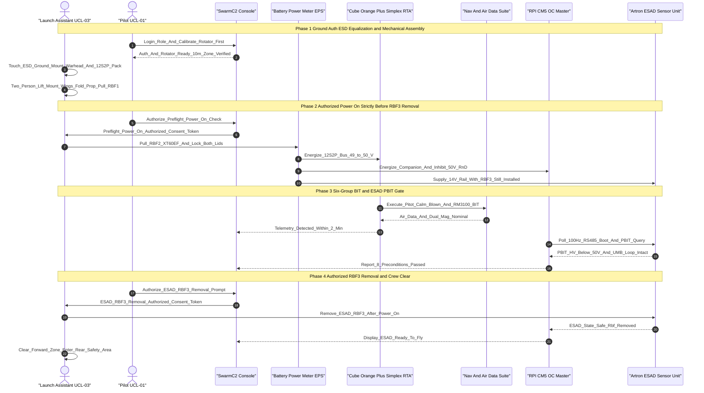

---

### 9.2 SCN-02: Flight Envelope Monitoring and Software Simplex RTA

- **Objective:** Maintain inner-loop aerodynamic stability across `CAN 1` / `CAN 2` actuation buses and automatically clamp or abort dive trajectories exceeding safety thresholds via software-resident `ASTM F3269-17` Simplex RTA on `Cube orange+` (zero standalone RTA hardware box).
- **User Classes & Performers:** `UCL-01` Pilot (Primary), `FlightControllerCubeOrangePlus`, `PowerMeterAndRbfSwitch`, `ElectronicPowerSystemEps`, `DroneCanSurfaceActuation`, `NavigationAndAirDataSuite`, `CompanionComputeRpiCm5`, `SwarmC2OperatorConsole`.
- **Entry Preconditions:** UAV airborne following `SCN-06` climb above `26.0 m/s`; `UavFlightLifecycleState` in `CruiseAndLoiter`; `RtaEnvelopeMonitorState` in `NominalPrimaryEnvelope`; `200.0 A` main bus healthy.
- **SysML v2 Bindings:** `ExecuteSimplexRtaEnvelopeCheck`, `CommandPusherThrottleAndReadEscTelem`, `DistributeRegulatedPowerRails`, `MonitorBingoEnergyReserve`, `ActuateTailAndWingSurfaces`, `RtaEnvelopeMonitorState`, `INT_02_PropulsionThrustAndBingoMonitor`, `INT_04_AutopilotRtaAndSurfaceActuation`, `SimplexRtaSoftwareHostingConstraint`, `FlightEnvelopeSpeedConstraint`, `BingoEnergyReserveConstraint`, `EpsEsadZeroBrownoutMarginConstraint`, `REQ_SC_02`, `REQ_SC_04`, `REQ_SC_05`, `REQ_SC_06`, `REQ_SAF_01`, `REQ_SAF_02`, `TC_02_BingoReserveAndEpsBrownoutMonitor`, `TC_03_SimplexRtaEnvelopeAndActuation`.

#### Table 9.4: SCN-02 Sequential Execution Timeline & Exit Criteria

| Step | Elapsed Time | Actor / Performer | Action | Expected Result | Exit Criterion |
| :--- | :--- | :--- | :--- | :--- | :--- |
| 1 | `T+00:00:00` | `UCL-01` Pilot | Select `AUTO` or `CRUISE` mode in `SwarmC2` (`Slide to confirm`) within validated `Inclusion`/`Exclusion` geofences and `50.0-3000.0 m` altitude envelope (`250.0 m` slider steps). | `Cube orange+` receives HITL mode consent token and initializes software Simplex RTA `NominalPrimaryEnvelope`. | Mode consent verified and geofence polygons active (`A5-user-manual 2.pdf#p50-#p51,#p59-#p65`). |
| 2 | `T+00:00:05` | `FlightControllerCubeOrangePlus` & `DroneCanSurfaceActuation` | Execute inner-loop EKF2 stabilization (`24.0-42.0 m/s` V2.5 / `26.0-38.0 m/s` V1 cruise corridor; `<= 5000.0 m` ceiling); drive `4x HV6160` tail fins (`CAN 1`, `120.0 cm` stubs) and `4x HV6160` wing roll servos (`CAN 2` splitter) on `8.0 V` EPS rail. | Independent `CAN 1` pitch/yaw and `CAN 2` roll buses maintain attitude within `>= 300.0 m` loiter or transit track. | Airspeed `26.0-42.0 m/s`, zero bus fault, and `standaloneRtaBoxCount == 0` (`Avenger5_V2.5_block_diagram_rev5.pdf#p1`). |
| 3 | `T+00:05:00` | `PowerMeterAndRbfSwitch` & `ElectronicPowerSystemEps` | Bridge `IBEX160` ESC UART telemetry (RPM, ESC/motor temp, bus V/I) onto `CAN 1`; regulate `8.0 V`, `12.0 V`, `14.0 V` ESAD (`0.0 V` margin per `GAP-01`), and sensor/gimbal rails (`970.0 cm` trunk). | Continuous electrical and propulsion telemetry streamed to `Cube orange+` and `SwarmC2`; `0.20` Bingo ratio tracked across `5400.0 s` max endurance. | Main bus `36.0-50.4 V`, ESAD rail `>= 14.0 V`, and reserve ratio `> 0.20` (`REQ_SC_02`, `REQ_SC_04`). |
| 4 | `T+00:15:00` | `FlightControllerCubeOrangePlus` (Simplex RTA) | Detect airspeed approaching or exceeding `55.0 m/s` dive cap during maneuvering (bounded well below `80.0 m/s` `VNE` and `22.0 deg` max dive angle per `GAP-02`). | Simplex RTA switches `NominalPrimaryEnvelope` -> `AirspeedDiveCapClamped`, overrides throttle/pitch, and triggers `Abort Engaging` pull-up. | Airspeed prevented from reaching `80.0 m/s` `VNE` and nose-up recovery established (`A5-user-manual 2.pdf#p10,#p88`). |
| 5 | `T+00:15:12` | `FlightControllerCubeOrangePlus` & `UCL-01` Pilot | Climb back toward `Takeoff altitude` into `GUIDED` loiter (`>= 300.0 m` radius) as airspeed decays inside `26.0-42.0 m/s`. | Airspeed stabilizes inside safe envelope; Simplex RTA exits clamp or holds `GUIDED` orbit under pilot command. | Positive climb/loiter stability confirmed inside `26.0-42.0 m/s` (`TC_03_SimplexRtaEnvelopeAndActuation`). |
| 6 | `T+00:30:00` | `CompanionComputeRpiCm5` & `ElectronicPowerSystemEps` | Supervise `100 Hz` RS-485 ESAD health (`<= 10.0 ms` incomplete packet watchdog) and `14.0 V` ESAD supply margin (`GAP-01`). | On bus timeout `> 10.0 ms` or brownout `< 14.0 V`, Simplex RTA enters `EsadBusWatchdogFaultFallback` and commands safe ESAD disarm/inhibit. | Zero unflagged ESAD bus fault or brownout (`REQ_SAF_01`, `REQ_SC_08`). |
| 7 | `T+01:12:00` | `FlightControllerCubeOrangePlus` | Detect remaining endurance reaching `<= 0.20` Bingo reserve (`1080.0 s`), bus sag `< 36.0 V`, or geofence breach condition. | `RtaEnvelopeMonitorState` enters `CriticalBatteryOrGeofenceRtb` and executes autonomous `RTL` (`Fly HOME Then Land` / closer Rally point). | `RTL` return track engaged with statutory `>= 0.20` energy margin preserved (`TC_02_BingoReserveAndEpsBrownoutMonitor`). |

- **Scenario Exit Criteria:**
 - **Nominal Exit:** Inner-loop stability maintained across `CAN 1`/`CAN 2`; mode handoff to `SCN-04` (if authorized) or controlled `RTL` upon mission completion.
 - **Degraded / Abort Transition:** Any dive overspeed (`> 55.0 m/s`) triggers `AirspeedDiveCapClamped`; any Bingo (`<= 0.20`), `< 36.0 V` bus sag, or geofence threat triggers `CriticalBatteryOrGeofenceRtb` (`RTL`).

#### Figure 9.2: SCN-02 OV-6c Flight Envelope Monitoring and Software Simplex RTA Sequence

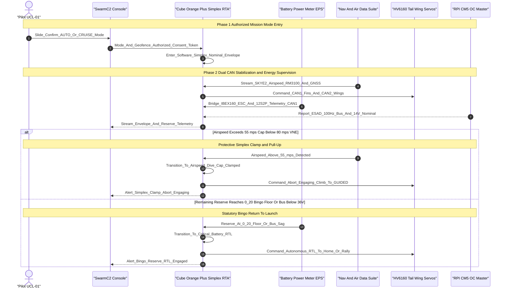

---

### 9.3 SCN-03: GNSS-Denied Dead-Reckoning and `105.0 s` Lost-Link Failsafe

- **Objective:** Transition seamlessly to `mRo RM3100` / `CUAV SKYE2` dead-reckoning under GNSS jamming or spoofing and deterministically execute `Disarm ESAD On GCS Timeout` plus autonomous `RTL` upon sustained C2 link loss (`105.0 s` baseline).
- **User Classes & Performers:** `UCL-01` Pilot (Primary), `SwarmC2OperatorConsole`, `GroundRfStationAndAntennaTracker`, `OnboardEthernetAndC2RadioUnit`, `FlightControllerCubeOrangePlus`, `NavigationAndAirDataSuite`, `CompanionComputeRpiCm5`, `ArtronEsadAndSensorUnit`.
- **Entry Preconditions:** Aircraft operating in `PrimaryDtcDirTracking` (`4.4-5.0 GHz` AES-256 FHSS, `2.0 W`, `MARS 23.0 dBi` DIR rotator, `60.0 km` baseline / `90.0 km` V2.5 / `180.0 km` V1 RLOS) within authorized corridor.
- **SysML v2 Bindings:** `SwitchToGnssDeniedDeadReckoning`, `PaceC2LinkState` (`PrimaryDtcDirTracking` -> `AlternateDtcOmniLocal` -> `ContingencyGnssDeniedDrFlight` -> `EmergencyLostLinkRtlHolding`), `INT_05_GnssDeniedDeadReckoningAndPaceLink`, `REQ_SC_07`, `REQ_SC_12`, `REQ_SC_15`, `TC_04_GnssDeniedDrAndPaceLinkFailsafe`.

#### Table 9.5: SCN-03 Sequential Execution Timeline & Exit Criteria

| Step | Elapsed Time | Actor / Performer | Action | Expected Result | Exit Criterion |
| :--- | :--- | :--- | :--- | :--- | :--- |
| 1 | `T+00:00:00` | `NavigationAndAirDataSuite` & `FlightControllerCubeOrangePlus` | `Septentrio Asterx-m3 pro` + `Talysman TW3972EXF` detects GNSS jamming/spoofing anomaly (`GPS Failsafe Timeout`) and flags `SwarmC2`. | `SwarmC2` alerts `UCL-01` Pilot to degraded GNSS solution quality while `4.4-5.0 GHz` C2 link remains active. | GNSS degradation alert displayed in `SwarmC2` (`A5-user-manual 2.pdf#p34,#p91-#p92`). |
| 2 | `T+00:00:05` | `UCL-01` Pilot | Authorize `Disable GNSS` command in `SwarmC2` to reject spoofed satellite observables and engage INS/Dead-Reckoning (DR). | `PaceC2LinkState` transitions `PrimaryDtcDirTracking` -> `ContingencyGnssDeniedDrFlight`; `Cube orange+` fuses `2x mRo RM3100` mag/baro + `CUAV SKYE2` airspeed. | GNSS isolated from EKF2 and DR navigation active (`A5-user-manual 2.pdf#p91-#p92`). |
| 3 | `T+00:02:00` | `UCL-01` Pilot & `SwarmC2OperatorConsole` | Provide periodic visual map updates (`I'm Here` / `I'm Looking Here`) in `SwarmC2` using landmarks observed over `EO/IR` feed. | `Cube orange+` bounds DR position drift along planned corridor while maintaining stabilized `CRUISE` / `GUIDED` flight. | Bounded DR track error confirmed under C2 supervision (`A5-user-manual 2.pdf#p91-#p92`). |
| 4 | `T+00:10:00` | `GroundRfStationAndAntennaTracker` & `OnboardEthernetAndC2RadioUnit` | Severe RF fading/occlusion interrupts `4.4-5.0 GHz` bidirectional heartbeat; `Cube orange+` starts `GCS Failsafe` and `ESAD GCS Timeout` timers. | Rotator `Auto Follow` holds last track vector; operator attempts `DIR` / `OMNI` antenna switch or `0.5 deg` manual rotator fine step. | Link loss timer increments deterministically from `t_last_valid_rx` (`A5-user-manual 2.pdf#p34,#p72`). |
| 5 | `T+00:11:45` | `FlightControllerCubeOrangePlus` & `CompanionComputeRpiCm5` | Elapsed C2 loss reaches `>= 105.0 s` baseline `GCS Failsafe Timeout` (and `ESAD GCS Timeout` if non-zero while armed). | `Cube orange+` commands `RPI CM5` to execute `Disarm ESAD On GCS Timeout`; ESAD disarms and discharges (`< 50.0 V` safe); `Cube orange+` auto re-enables GNSS. | ESAD verified disarmed/safe prior to autonomous return transit (`A5-user-manual 2.pdf#p34`). |
| 6 | `T+00:11:46` | `FlightControllerCubeOrangePlus` | Transition `PaceC2LinkState` -> `EmergencyLostLinkRtlHolding`; execute configured `RTL` action (`Fly HOME Then Land`, closer Rally point, or `Go Directly to landing sequence`). | Airframe climbs/turns toward Home or Rally corridor along safe altitude envelope (`>= 50.0 m`). | Deterministic `RTL` egress trajectory active without C2 dependency (`A5-user-manual 2.pdf#p33,#p62`). |
| 7 | `T+00:18:00` | `GroundRfStationAndAntennaTracker` & `UCL-01` Pilot | Aircraft enters local `OMNI` / `DIR` footprint and re-establishes `4.4-5.0 GHz` AES-256 link; Pilot confirms mode recovery (`GUIDED` / `LOITER`). | `PaceC2LinkState` transitions `EmergencyLostLinkRtlHolding` -> `AlternateDtcOmniLocal` / `PrimaryDtcDirTracking` under Pilot authority. | Authenticated bidirectional telemetry restored and mode under Pilot control (`TC_04`). |

- **Scenario Exit Criteria:**
 - **Nominal Exit:** Either DR mission completes under C2 visual updates with restored GNSS, or autonomous `RTL` safely returns the disarmed airframe into `OMNI` / `DIR` reacquisition range.
 - **Degraded / Abort Transition:** Persistent total loss + critical Bingo (`<= 0.20`) forces direct landing sequence at Home or nearest Rally point with ESAD disarmed.

#### Figure 9.3: SCN-03 OV-6c GNSS-Denied Dead-Reckoning and 105.0 s Lost-Link Failsafe Sequence

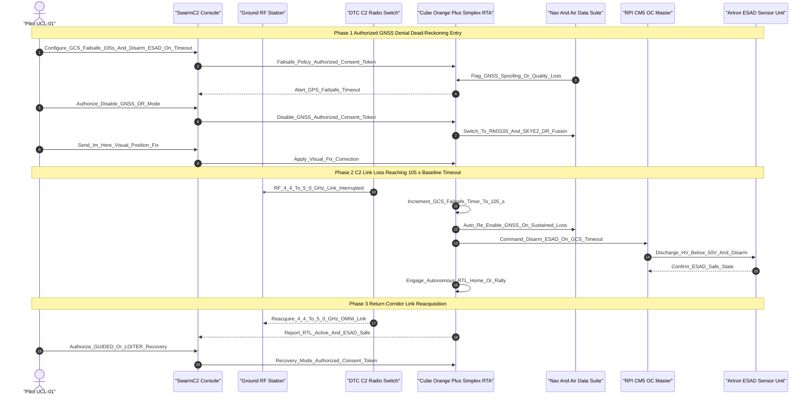

---

### 9.4 SCN-04: EO-IR Target Acquisition, Tracking, and `<= 55.0 m/s` Engagement Abort

- **Objective:** Acquire, lock (`2.0-5.0 s`), and dive onto a stationary target at `<= 55.0 m/s` (`<= 0.5 m` / `50.0 cm` CEP) using `Nighthawk2UZ` + `Trip6`, while enforcing `<= 55.0 m/s` gimbal saturation safety abort (`Abort Engaging`) and explicit HITL attack authorization.
- **User Classes & Performers:** `UCL-02` Payload Operator (Primary), `UCL-01` Pilot, `SwarmC2OperatorConsole`, `EoIrSeekerAndTrackerUnit`, `FlightControllerCubeOrangePlus`, `NavigationAndAirDataSuite`, `DroneCanSurfaceActuation`.
- **Entry Preconditions:** UAV cruising in `CruiseAndLoiter` / `GUIDED` (`>= 300.0 m` loiter, `50.0-3000.0 m` altitude); warhead ESAD `ARMED` (`SS1` and `SS2` satisfied); `GCS Failsafe Timeout` active (`105.0 s` baseline).
- **SysML v2 Bindings:** `AcquireAndTrackTerminalTarget`, `RebootGimbalAndBridgeEthernet`, `UavFlightLifecycleState::TargetTrackAndDive`, `RtaEnvelopeMonitorState::AirspeedDiveCapClamped`, `INT_06_EoIrSeekerTrackAndTerminalDive`, `EngagementSpeedAndTrackHoldConstraint`, `FlightEnvelopeSpeedConstraint`, `REQ_SC_12`, `REQ_SAF_02`, `TC_05_EoIrTargetTrackAndSpeedCapAbort`.

#### Table 9.6: SCN-04 Sequential Execution Timeline & Exit Criteria

| Step | Elapsed Time | Actor / Performer | Action | Expected Result | Exit Criterion |
| :--- | :--- | :--- | :--- | :--- | :--- |
| 1 | `T+00:00:00` | `UCL-02` Payload Operator & `EoIrSeekerAndTrackerUnit` | Steer `Nighthawk2UZ` (`128` Day/Thermal, `X40` zoom, Pitch `-45.0` to `+135.0 deg`, Yaw/Roll `+/-165.0 deg`) over `Trip6` Ethernet/Serial bridge to acquire stationary target. | Stabilized `128` EO daylight video streamed over `4.4-5.0 GHz` link to `SwarmC2`. | Target centered in `EO` daylight FOV with clear `LOS` (`A5-user-manual 2.pdf#p88`). |
| 2 | `T+00:00:10` | `UCL-02` Payload Operator & `Trip6` | (If video freezes) execute `Reboot Gimbal` in `SwarmC2` (`Reboot Vehicle` strictly disabled once armed); re-acquire and initiate `Trip6` optical track lock. | `Trip6` locks onto target over `Nighthawk2UZ` HDMI + Ethernet fabric without interrupting `Cube orange+` stabilization. | Video stream active and `Trip6` tracker reporting `LOCKED` (`A5-user-manual 2.pdf#p38`). |
| 3 | `T+00:00:15` | `SwarmC2OperatorConsole` & `UCL-02` Payload Operator | Verify ALL `6` Engagement Preconditions: (1) sufficient `GCS Failsafe timeout`; (2) warhead `ARMED`; (3) tracked on `EO` daylight camera; (4) track held `2.0-5.0 s`; (5) target elevation `<= 15.0 deg` at start; (6) clear `LOS`. | `SwarmC2` enables engagement selection (`Shallow` `~15.0 deg` glidepath or `Direct` up to `22.0 deg` max dive) only after `2.0-5.0 s` continuous hold. | All `6` engagement preconditions verified green in `SwarmC2` (`A5-user-manual 2.pdf#p88`). |
| 4 | `T+00:00:20` | `UCL-02` Payload Operator | Select `Shallow` or `Direct` approach profile (locked upon `ATTACK` entry) and execute explicit HITL `Slide to confirm` engagement authorization in `SwarmC2`. | `SwarmC2` transmits `Terminal_Engage_Authorized_Consent_Token` to `Cube orange+`. | HITL consent token logged prior to `ATTACK` transition (`A5-user-manual 2.pdf#p86-#p90`). |
| 5 | `T+00:00:21` | `FlightControllerCubeOrangePlus` & `EoIrSeekerAndTrackerUnit` | Transition `UavFlightLifecycleState` -> `TargetTrackAndDive` (`ATTACK`); steer `CAN 1` tail fins and `CAN 2` wing servos via `Trip6` line-of-sight cues while enforcing `<= 55.0 m/s` cap. | Airframe executes `15.0 deg` shallow or `<= 22.0 deg` direct terminal dive holding target inside seeker envelope. | Closed-loop guidance tracks target toward `<= 0.5 m` (`50.0 cm`) CEP (`AVENGER 5 Spec sheet_rev3.pdf#p1,#p2`). |
| 6 | `T+00:00:30` | `NavigationAndAirDataSuite` & `FlightControllerCubeOrangePlus` | Continuously compare `CUAV SKYE2` airspeed against `55.0 m/s` gimbal saturation threshold and monitor `Trip6` track continuity and operator abort input. | Nominal dive remains `<= 55.0 m/s` to terminal intercept (`SCN-05` Step 8); any `> 55.0 m/s` or track loss immediately trips safety branch (Step 7). | Real-time airspeed `<= 55.0 m/s` and valid `Trip6` track flag (`A5-user-manual 2.pdf#p88`). |
| 7 | `T+00:00:32` | `FlightControllerCubeOrangePlus` (Abort Branch) | Upon airspeed `> 55.0 m/s` OR track loss (no auto re-track permitted) OR operator `Abort Engaging`, transition `TargetTrackAndDive` -> `EmergencyAbortOrRtb` (`AirspeedDiveCapClamped`). | Autopilot aborts dive, arrests descent, and commands climb back toward `Takeoff altitude` into `GUIDED` loiter (or `RTL` if C2 link lost). | Positive climb rate recovered above safe altitude floor (`A5-user-manual 2.pdf#p86-#p90`). |
| 8 | `T+00:00:45` | `UCL-01` Pilot & `UCL-02` Payload Operator | Confirm airframe stabilized in `GUIDED` loiter (`>= 300.0 m` radius) with airspeed `26.0-42.0 m/s`; evaluate re-engagement or `RTL`. | Safe post-abort orbit maintained with zero uncontrolled dive or unintended ordnance release. | Stable `GUIDED` orbit verified in `SwarmC2` (`TC_05_EoIrTargetTrackAndSpeedCapAbort`). |

- **Scenario Exit Criteria:**
 - **Nominal Terminal Exit:** Stationary target intercepted within `<= 0.5 m` CEP at `<= 55.0 m/s` dive airspeed leading to `SCN-05` terminal firing.
 - **Degraded / Abort Transition:** Airspeed `> 55.0 m/s`, seeker track loss (zero auto re-track), or operator veto executes `Abort Engaging` climb to `Takeoff altitude` (`GUIDED` loiter or `RTL`).

#### Figure 9.4: SCN-04 OV-6c EO-IR Target Tracking and 55.0 m/s Engagement Abort Sequence

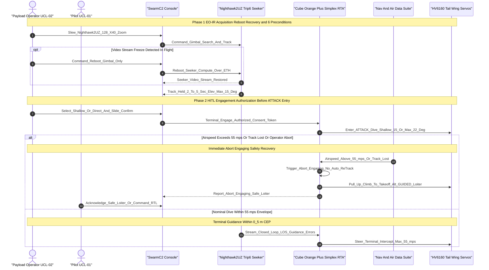

---

### 9.5 SCN-05: ESAD Safe/Arm Supervision, Dual-Barrier Sequencing, and Detonation

- **Objective:** Guarantee zero premature High-Voltage (HV) output (`< 50.0 V` PBIT) and strictly gate `Artron ESAD` (`AB00-0054-01AA-0005`, `STANAG 4187` / `MIL-STD-461`) arming and detonation behind `RBF #3` power-before-pull (`GAP-06`), launch acceleration `SS1`, safe separation `SS2` (`Safe Distance Exceed == 1`, `GAP-07`), HITL authorization, `DSC_IN1` discrete pulses, and Sensor Board `IRQ_L` / `OC Trigger`.
- **User Classes & Performers:** `UCL-02` Payload Operator (Primary), `UCL-01` Pilot, `SwarmC2OperatorConsole`, `ElectronicPowerSystemEps`, `CompanionComputeRpiCm5` (OC Master), `ArtronEsadAndSensorUnit`.
- **Entry Preconditions:** Warhead (`<= 5.0 kg`, `4.98 +/- 0.02 kg` tested holder) integrated; `RBF #2` power applied prior to `RBF #3` removal (`GAP-06`); `14.0 V` EPS rail active (`0.0 V` brownout margin per `GAP-01`).
- **SysML v2 Bindings:** `ExecuteEsadBootAndPbit`, `TransitionEsadArmingSequence`, `CommandEsadAbortAndSelfDestruct`, `SuperviseEsadOcMasterCycle`, `EsadSafeArmState`, `INT_07_EsadDualBarrierArmAndDetonation`, `EsadInputVoltageAndBrownoutConstraint`, `EsadRs485ProtocolTimingConstraint`, `EsadRbf3PowerBeforePullConstraint`, `EsadSafeDistanceExceedConstraint`, `WarheadMassAndPbitHvSafetyConstraint`, `REQ_SC_08`, `REQ_SC_09`, `REQ_SC_10`, `REQ_SC_11`, `REQ_SAF_01`, `REQ_SAF_04`, `REQ_SAF_06`, `REQ_SAF_07`, `TC_06_EsadProtocolInterlockAndHvFireGate`.

#### Table 9.7: SCN-05 Sequential Execution Timeline & Exit Criteria

| Step | Elapsed Time | Actor / Performer | Action | Expected Result | Exit Criterion |
| :--- | :--- | :--- | :--- | :--- | :--- |
| 1 | `T+00:00:00` | `ElectronicPowerSystemEps` & `CompanionComputeRpiCm5` | Apply `14.0 V` EPS rail (`14.0-32.0 V` input range, `GAP-01`) with `ESAD RBF #3` installed; `RPI CM5` starts `100 Hz` (`0.01 s`, `` `8N1`, `Frame Integrity Check XModem`) supervision (`GAP-04`). | ESAD completes boot indication (`BootAndPbit`) with zero premature pull fault (`GAP-06`). | `<= 5.0 ms` ESAD reply latency and `14.0 V` rail telemetry valid (`ESAD ICD#p14-#p15`). |
| 2 | `T+00:00:05` | `CompanionComputeRpiCm5` & `ArtronEsadAndSensorUnit` | Execute PBIT query and verify `UMB` loop (`< 0.5 Ohm` at `20.0 mA`) intact while `RBF #3` installed; verify PBIT internal HV `< 50.0 V`. | ESAD enters `SafeRbfInstalled`; zero premature `DSC_IN1` pulses emitted. | PBIT HV `< 50.0 V` and zero fault bits; `8` preconditions satisfied (`ESAD ICD#p14,#p18`). |
| 3 | `T+00:02:00` | `SwarmC2OperatorConsole` & `UCL-03` Launch Assistant | After `SwarmC2` prompt, remove `ESAD RBF #3` (`SafeRbfRemoved`) and confirm `ESAD: Ready to Fly`; execute `PL-40` launch (`SCN-06`). | Onboard rigid-body acceleration (`0.0039 g/LSB` scale) triggers inertial `SS1`; ESAD transitions `SafeRbfRemoved` -> `ArmStage1TimerWait` (`ARM STAGE 1`). | `SS1` sensed and `FlightTimer` (`1.0 s/LSB`) advancing without `DSC_IN1` fault (`ESAD ICD#p20-#p23`). |
| 4 | `T+00:02:20` | `ArtronEsadAndSensorUnit` | Verify takeoff complete, aircraft in flight, and `Safe Distance Exceed == 1` (`SS2 Active`, `GAP-07`) satisfied. | ESAD latches second barrier `SS2` and enters `ArmStage2Armed` (`ARM STAGE 2`); premature `DSC_IN1` prior to this state locks `FaultLockout` bit 4. | `SS1 == 1` and `SS2 Safe Distance Exceed == 1` verified in periodic telemetry (`ESAD ICD#p21,#p23`). |
| 5 | `T+00:05:00` | `UCL-02` Payload Operator & `SwarmC2OperatorConsole` | Confirm all `4` arming preconditions in `SwarmC2` (powered/no fault, pin removed, takeoff done, in flight) and issue HITL `Authorize_ESAD_Arm` (`Slide to confirm`). | `SwarmC2` issues `Esad_Arm_Authorized_Consent_Token` to `RPI CM5` OC Master. | Explicit HITL arm consent logged prior to hardware discrete drive (`A5-user-manual 2.pdf#p84`). |
| 6 | `T+00:05:01` | `CompanionComputeRpiCm5` & `ArtronEsadAndSensorUnit` | `RPI CM5` outputs `DSC_IN1` discrete train (`1000.0 Hz`, `1.0 ms` period, `50.0%` duty, `2` pulses, `2.5-3.3 V` high / `0.0-0.7 V` low) and periodic HV charge enable. | ESAD transitions `ArmStage2Armed` -> `HvChargedReady` (`ARMED`); output capacitor charges (`0.0-1800.0 V`, `1.0 V/LSB`). | `ARMED` status and HV charge confirmed on `100 Hz` periodic telemetry (`ESAD ICD#p14,#p18,#p26`). |
| 7 | `T+00:15:00` | `ArtronEsadAndSensorUnit` (Nominal Impact/Proximity) | During authorized `ATTACK` terminal dive (`SCN-04`), Sensor Board (`5.0 V` supply) detects proximity/impact and asserts ORed `IRQ_L` (or HITL-authorized `OC Trigger`). | ESAD discharges `0.0-1800.0 V` HV firing pulse into `<= 5.0 kg` warhead (`FIRED` / `DetonatedOrAborted`). | Verified `SS1`, `SS2`, `DSC_IN1`, `HITL Consent`, and `IRQ_L`/`OC Trigger` gate closure (`ESAD ICD#p10-#p13,#p18`). |
| 8 | `T+00:15:05` | `UCL-02` Payload Operator / `CompanionComputeRpiCm5` (Abort/Self-Destruct Branch) | On `5.0 s` `SELF DESTRUCT` or permanent `ABORT` hold + `Slide to confirm`, OR `Disarm ESAD On GCS Timeout` (`105.0 s`), OR `> 10.0 ms` RS-485 watchdog loss / `< 14.0 V` brownout, OR landing while not armed: command safe discharge. | ESAD discharges HV (`< 50.0 V` / `0.0 V`), transitions to `DetonatedOrAborted` or `FaultLockout`, or auto-returns to `SAFE` if landing while not armed; irreversible `Power Off ESAD` drops `14.0 V` rail (`SafePowerOff`). | HV discharged `< 50.0 V` confirmed and ordnance rendered safe (`A5-user-manual 2.pdf#p34,#p36,#p84-#p85`). |

- **Scenario Exit Criteria:**
 - **Nominal Terminal Exit:** Warhead initiates exclusively when `SS1`, `SS2`, `DSC_IN1`, HITL authorization, and Sensor Board `IRQ_L` / `OC Trigger` are satisfied.
 - **Abort / Failsafe Exit:** HV capacitor safely bleeds `< 50.0 V`, ESAD returns to `SAFE` / `FaultLockout` / irreversible `SafePowerOff`, and zero uncommanded HV energization occurs.

#### Figure 9.5: SCN-05 OV-6c ESAD Safe/Arm Supervision, Dual-Barrier Sequencing, and Detonation

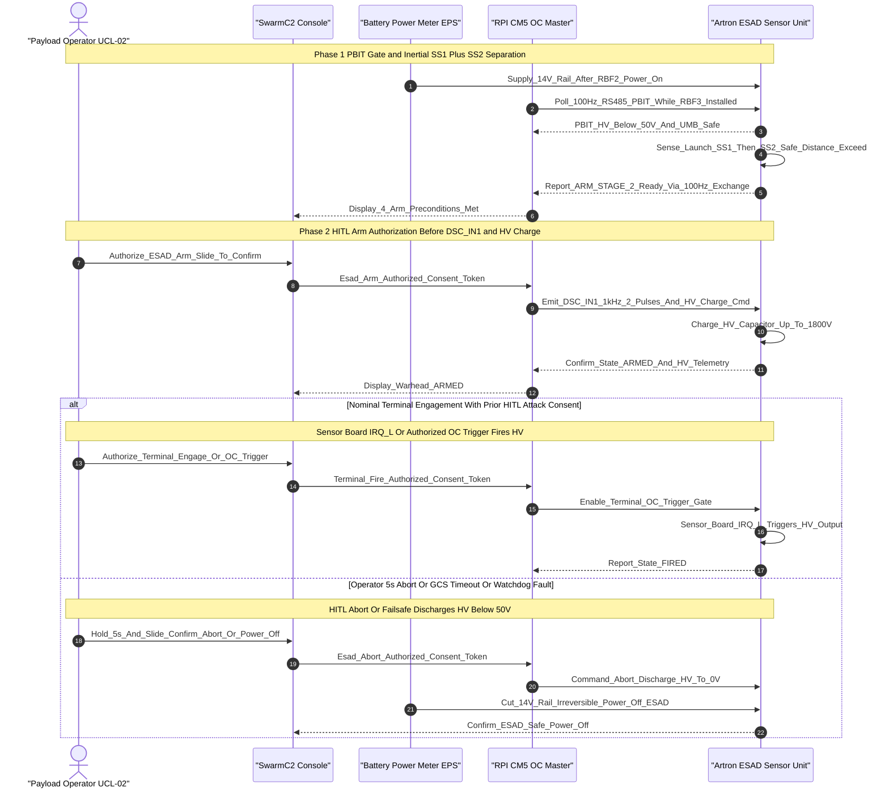

---

### 9.6 SCN-06: PL-40 Mechanical Zero-Wire Pneumatic Catapult Launch

- **Objective:** Assemble and pressurize the `ELI PL-40 Rev 2.6` catapult, satisfy the `GAP-03` launch Go/No-Go gate, and achieve safe mechanical rail exit (`~23.0 m/s` at `17.0 kg` MTOW, `<= 25.0 m/s` rated ceiling) with zero electrical or CAN umbilical wires to the airframe and clean onboard `SS1` acceleration latching.
- **User Classes & Performers:** `UCL-03` Launch Assistant (Primary), `UCL-01` Pilot, `Pl40PneumaticLauncher`, `SwarmC2OperatorConsole`, `ElectricPropulsionUnit`, `ArtronEsadAndSensorUnit`.
- **Entry Preconditions:** `SCN-01` diagnostics green (`49.0-50.0 V`, `ESAD: Ready to Fly`); `PL-40` components inspected (`100`-launch rope and bearing service interval current).
- **SysML v2 Bindings:** `ChargePl40CompressorWithUvloCheck`, `ExecuteLaunchGoNoGoAndDualTrigger`, `Pl40LauncherState`, `UavFlightLifecycleState::CatapultLaunch`, `INT_03_Pl40RailChargeAndLaunchSequence`, `Pl40MassAndExitVelocityConstraint`, `Pl40UvloAndDualSwitchConstraint`, `REQ_SC_13`, `REQ_SC_14`, `REQ_SAF_03`, `TC_07_Pl40RailChargeLaunchAndZeroWire`.

#### Table 9.8: SCN-06 Sequential Execution Timeline & Exit Criteria

| Step | Elapsed Time | Actor / Performer | Action | Expected Result | Exit Criterion |
| :--- | :--- | :--- | :--- | :--- | :--- |
| 1 | `T+00:00:00` | `UCL-03` Launch Assistant | Unpack `1.28 m` rail sections (`43.0 kg` case + `25.0 kg` compressor = `68.0 kg` total); assemble `5.0 m` (`4938.0 mm` CAD) rail (`5.0 min` setup, `602.0 mm` front leg span, `1116.0 mm` height, `12.0 deg` elevation); install ground anchors and lock carriage red safety pin. | `Pl40LauncherState` transitions `DisassembledTransport` -> `AnchoredAndLeveled` with `Main Valve 4` closed. | Fasteners tight, red safety pin locked, and `Main Valve 4` confirmed closed (`PL-40 Manual Rev 2.6#p4,#p37,#p41`). |
| 2 | `T+00:05:00` | `UCL-03` Launch Assistant & `Pl40PneumaticLauncher` | Charge tank via `2x Makita BL1860B` (`18.0 V`, `6000.0 mAh`, swapped after 1st launch & every `2` launches) or `DIN 8 mm PCP` aux (`<= 16.0 bar`) to `13.0-14.0 bar` (`<= 8.0 min`, `0.05 bar` hysteresis, `14.0 bar` auto-cutoff). | Tank reaches `13.0-14.0 bar`; if pack drops `<= 14.5 V`, UVLO cuts off (`PWR` LED flash -> `UvloPause`) requiring fresh pack `> 16.0 V` after `5.0 s`. | Stable gauge reading `13.0-14.0 bar` (`PL-40 Manual Rev 2.6#p22-#p24,#p28`; `A5-user-manual 2.pdf#p54`). |
| 3 | `T+00:12:00` | `UCL-03` Launch Assistant | Verify purely mechanical carriage seating (`IF-MECH-001`, zero electrical/CAN cables): `145.0-155.5 mm` upper prop-safe zone, payload CG within `200` longitudinal / `100` vertical envelope (units unprinted), hardpoints locked. | `Pl40LauncherState` in `ReadyAt13To14BarPinInstalled`; airframe mechanically restrained by carriage levers and red safety pin. | Zero electrical/CAN umbilical conductors connected across `PL-40 <-> UAV` (`PL-40 Manual Rev 2.6#p41-#p45`). |
| 4 | `T+00:13:00` | `UCL-01` Pilot & `SwarmC2OperatorConsole` | Execute `GAP-03` Go/No-Go gate: confirm `17.0 kg` MTOW (`<= 30.0 kg` limit), `13.0-14.0 bar` pressure, ground wind `<= 12.0 m/s`, `AXI 5345/16` pusher thrust readiness, `~23.0 m/s` (`22.7-23.5 m/s` at `17.0 kg`) `<= 25.0 m/s` limit, and clear corridor. | `SwarmC2` verifies launch parameters green; `UCL-01` Pilot issues explicit HITL `Authorize_Catapult_Launch` (`Slide to confirm`). | Launch consent token active and all personnel cleared to rear `SAFETY AREA` (`A5_prep and safety_rev7.pdf#p24`). |
| 5 | `T+00:13:30` | `UCL-03` Launch Assistant | Approach rear `SAFETY AREA` firing station; pull carriage red safety pin and open `Main Valve 4`; flip up both dual-switch safety covers. | `Pl40LauncherState` enters `DualSwitchFiring`; pneumatic reservoir coupled to launch valve; forward/lateral `DANGER ZONE` vacant. | Red pin removed, `Main Valve 4` open, and dual safety covers raised (`PL-40 Manual Rev 2.6#p24-#p26`). |
| 6 | `T+00:13:35` | `UCL-03` Launch Assistant & `Pl40PneumaticLauncher` | Press BOTH dual firing switches simultaneously for `>= 2.0 s` until UAV clears rail (loose carriage lever lock-pads trigger internal inlet-air shutoff abort). | Pneumatic piston accelerates carriage down `5.0 m` `12.0 deg` rail, imparting `~23.0 m/s` exit velocity (`RailLaunchReleased`); pressing trigger with pin installed forces full reset (`SCN-08`). | Clean carriage release without over-acceleration inlet shutoff (`PL-40 Manual Rev 2.6#p18,#p25-#p26,#p39`). |
| 7 | `T+00:13:37` | `ElectricPropulsionUnit` & `ArtronEsadAndSensorUnit` | Pusher motor (`IBEX160` + `AXI 5345/16`) unfolds prop and accelerates climb past `26.0 m/s` stall margin (`GAP-03`); onboard rigid-body acceleration triggers inertial `SS1`. | `UavFlightLifecycleState` transitions `CatapultLaunch` -> `CruiseAndLoiter`; `EsadSafeArmState` advances `SafeRbfRemoved` -> `ArmStage1TimerWait`. | Airspeed `>= 26.0 m/s`, positive climb rate, and `SS1 == 1` telemetry (`ESAD ICD#p20-#p23`). |
| 8 | `T+00:13:45` | `UCL-03` Launch Assistant | Close `Main Valve 4` immediately after launch, inspect rope/carriage wear (`100`-launch counter), and prepare battery swap after 1st launch. | Launcher safe and secured in post-launch configuration while aircraft transitions to `SCN-02` / `SCN-07`. | `Main Valve 4` closed and post-launch log recorded (`PL-40 Manual Rev 2.6#p24,#p26,#p29`). |

- **Scenario Exit Criteria:**
 - **Nominal Exit:** Airframe departs rail at `~23.0 m/s` (`<= 25.0 m/s`), climbs above `26.0 m/s`, latches `SS1`, and enters `CruiseAndLoiter`; `Main Valve 4` closed on ground.
 - **Degraded / Abort Transition:** `BL1860B <= 14.5 V` UVLO pauses charging (`UvloPause`); any scrub, lever lock-pad inlet abort, or hangfire enters `SCN-08` (`SAFE_SCRUB_ABORT`).

#### Figure 9.6: SCN-06 OV-6c PL-40 Mechanical Zero-Wire Catapult Launch Sequence

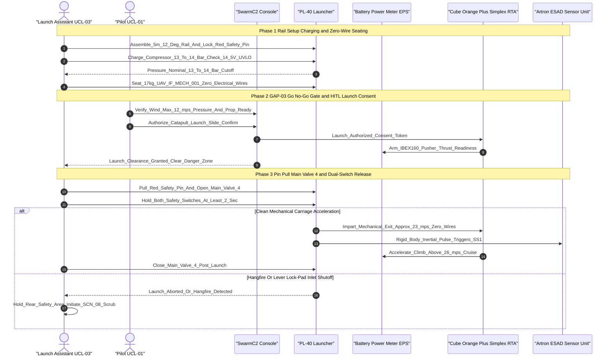

---

### 9.7 SCN-07: Ground C2 Rotator Tracking, Mission Bounds, and `5W` / `CFF` Export

- **Objective:** Maintain resilient `4.4-5.0 GHz` AES-256 FHSS C2 tracking across `OMNI`, `MARS 23.0 dBi` `DIR` rotator, and optional `200.0 m` tactical fiber paths while enforcing mission validation bounds and interoperable `5W` / `CFF` export to `ATAK`, `SitaWare HQ`, and `DELTA`.
- **User Classes & Performers:** `UCL-01` Pilot (Primary), `UCL-02` Payload Operator, `SwarmC2OperatorConsole`, `GroundRfStationAndAntennaTracker`, `OnboardEthernetAndC2RadioUnit`, `External Tactical C2 (ATAK / SitaWare HQ / DELTA)`.
- **Entry Preconditions:** `SwarmC2` rugged Windows 11 tablet powered; Ground Radio Box connected directly or via optional `200.0 m` tactical fiber spool.
- **SysML v2 Bindings:** `AuthenticateOperatorAndCalibrateRotator`, `ExportTargetReport5wCff`, `PaceC2LinkState`, `SwarmC2AuthAndMissionBoundsConstraint`, `GroundCrewSeparationAndEsdConstraint`, `REQ_SC_15`, `TC_08_EmergencyScrubHangfireAndC2Auth`.

#### Table 9.9: SCN-07 Sequential Execution Timeline & Exit Criteria

| Step | Elapsed Time | Actor / Performer | Action | Expected Result | Exit Criterion |
| :--- | :--- | :--- | :--- | :--- | :--- |
| 1 | `T+00:00:00` | `UCL-01` Pilot & `UCL-02` Payload Operator | Authenticate role sessions (`Pilot`, `Payload`, `Launch Assistant`) with `>= 8` char strong password (replacing short initial factory window). | Operator privilege tiers isolated and command logging active in `SwarmC2`. | Role login valid and password complexity `>= 8` chars enforced (`A5-user-manual 2.pdf#p27-#p29`). |
| 2 | `T+00:02:00` | `UCL-01` Pilot & `GroundRfStationAndAntennaTracker` | Link `SwarmC2` to Ground Radio Box (`4.4-5.0 GHz` AES-256 FHSS, `2.0 W`) over wired Ethernet or `200.0 m` fiber spool; calibrate Directional Antenna Rotator (`MARS 23.0 dBi` DIR) BEFORE touching UAV (`>= 10.0 m` UAV separation). | Rotator azimuth zeroed and `OMNI` antenna active (`AlternateDtcOmniLocal`) for pre-flight and launch. | Rotator calibration pass and `>= 10.0 m` radio separation enforced (`A5_prep and safety_rev7.pdf#p6`; `A5-user-manual 2.pdf#p11,#p52`). |
| 3 | `T+00:05:00` | `UCL-01` Pilot & `SwarmC2OperatorConsole` | Build and validate mission: name `<= 24` chars, `1` Takeoff, `>= 1` Waypoint, `1` Return, valid lat/lon/alt, min altitude `>= 50.0 m` (`50.0-3000.0 m` slider, `250.0 m` steps), loiter radius `>= 300.0 m`, and `Inclusion`/`Exclusion` geofences. | `SwarmC2` Mission Validator passes all topological and kinematic bounds. | Mission upload ready with zero validation warnings (`A5-user-manual 2.pdf#p46-#p51,#p63`). |
| 4 | `T+00:20:00` | `UCL-01` Pilot & `GroundRfStationAndAntennaTracker` | Execute launch on `OMNI` antenna (`2.0 W`); once airframe transitions downrange past near-field zone, command switch to `MARS 23.0 dBi` `DIR` antenna with `Auto Follow` rotator. | `PaceC2LinkState` transitions `AlternateDtcOmniLocal` -> `PrimaryDtcDirTracking` (`60.0 km` baseline / `90.0 km` V2.5 / `180.0 km` V1 RLOS). | Stable directional SNR lock confirmed (`A5-user-manual 2.pdf#p10,#p55,#p72`). |
| 5 | `T+00:25:00` | `UCL-01` Pilot | Fine-tune rotator azimuth in `0.5 deg` CCW/CW steps under `Auto Follow` (e.g., `4510.0 MHz` channel) to compensate multipath or terrain masking. | Link margin sustained across `128` video downlink and command uplink. | Bidirectional packet loss within nominal link budget (`A5-user-manual 2.pdf#p72-#p74`). |
| 6 | `T+00:35:00` | `UCL-02` Payload Operator & `SwarmC2OperatorConsole` | Capture georeferenced target telemetry from `Nighthawk2UZ` + `Trip6` (`SCN-04`), validate coordinates, and authorize `5W` (`Five Whiskey`) / `CFF` (`Call For Fire`) export. | `SwarmC2` formats `5W` / `CFF` tactical payload upon explicit HITL export authorization. | Target report coordinates verified and HITL export command confirmed (`A5-user-manual 2.pdf#p67-#p69,#p93`). |
| 7 | `T+00:35:05` | `SwarmC2OperatorConsole` & External C2 | Transmit `5W` / `CFF` target report over ground tactical network to `ATAK`, `SitaWare HQ`, or `DELTA`. | External tactical systems ingest verified `5W` / `CFF` message with zero format fault. | Delivery receipt logged in `SwarmC2` tactical journal (`A5-user-manual 2.pdf#p93`). |

- **Scenario Exit Criteria:**
 - **Nominal Exit:** Uninterrupted `4.4-5.0 GHz` C2 and HD video tracking across `OMNI`/`DIR`/`200.0 m` fiber paths and verified `5W` / `CFF` delivery to `ATAK`, `SitaWare HQ`, or `DELTA`.
 - **Degraded / Abort Transition:** Loss of `DIR` tracking reverts to `OMNI` (`AlternateDtcOmniLocal`); total link loss exceeding `105.0 s` triggers `SCN-03` failsafe.

#### Figure 9.7: SCN-07 OV-6c Ground C2 Rotator Tracking and 5W / CFF Tactical Export Sequence

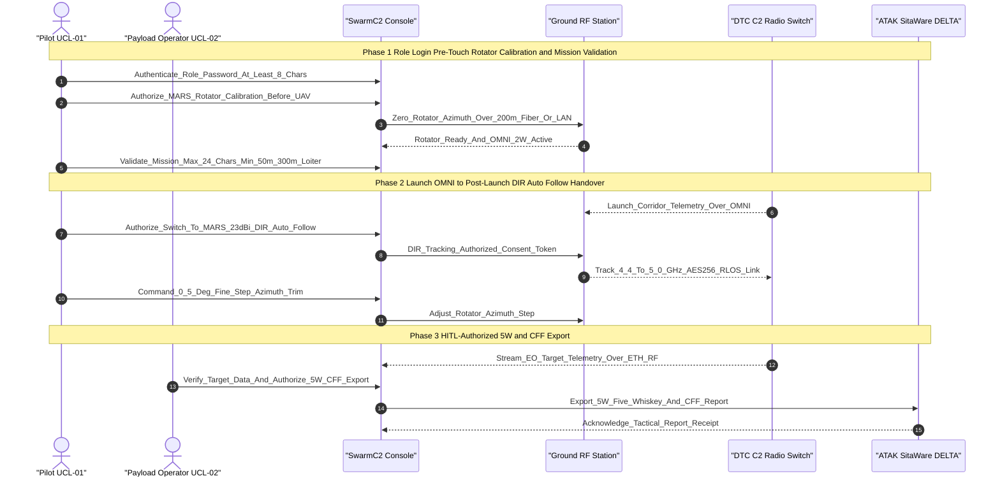

---

### 9.8 SCN-08: `SAFE_SCRUB_ABORT` Emergency Scrub and Hangfire Recovery

- **Objective:** Eliminate stored ordnance and pneumatic energy in deterministic safety order prior to crew approach following any launch scrub after `RBF #3` removal, `Main Valve 4` opening, carriage safety pin pull, `14.5 V` compressor UVLO stall, or catapult hangfire (`GAP-SCRUB`).
- **User Classes & Performers:** `UCL-03` Launch Assistant (Primary), `UCL-01` Pilot, `UCL-02` Payload Operator, `SwarmC2OperatorConsole`, `CompanionComputeRpiCm5`, `ElectronicPowerSystemEps`, `ArtronEsadAndSensorUnit`, `Pl40PneumaticLauncher`, `PowerMeterAndRbfSwitch`.
- **Entry Preconditions:** Launch aborted or hangfire declared while UAV sits on `PL-40` rail with `13.0-14.0 bar` stored air, carriage pin pulled, `Main Valve 4` open, or `ESAD RBF #3` removed.
- **SysML v2 Bindings:** `DepressurizeAndScrubPl40Launcher`, `CommandEsadAbortAndSelfDestruct`, `Pl40LauncherState::ScrubbedSafeDepressurized`, `EsadSafeArmState::SafePowerOff`, `UavFlightLifecycleState::SafePostFlightShutdown`, `INT_08_EmergencyScrubAndSafing`, `REQ_SC_16`, `REQ_SAF_12`, `TC_08_EmergencyScrubHangfireAndC2Auth`.

#### Table 9.10: SCN-08 Sequential Execution Timeline & Exit Criteria

| Step | Elapsed Time | Actor / Performer | Action | Expected Result | Exit Criterion |
| :--- | :--- | :--- | :--- | :--- | :--- |
| 1 | `T+00:00:00` | `UCL-03` Launch Assistant & `UCL-01` Pilot | Declare `SAFE_SCRUB_ABORT` upon hangfire (`>= 2.0 s` dual-switch hold with zero carriage release), lever lock-pad valve shutoff, `<= 14.5 V` UVLO stall, or tactical scrub. | All ground personnel hold strictly behind rear `SAFETY AREA`; zero entry into forward/lateral `DANGER ZONE` during hangfire holdback wait. | Scrub declared and `100%` crew accountability in rear `SAFETY AREA` (`PL-40 Manual Rev 2.6#p26,#p40`). |
| 2 | `T+00:01:00` | `UCL-02` Payload Operator / `UCL-01` Pilot | Inspect ESAD status in `SwarmC2`; if armed or charging, hold `ABORT` button `>= 5.0 s` + `Slide to confirm` (permanent abort) over RF link before approaching rail. | `RPI CM5` commands ESAD abort discharge; internal HV bleeds `< 50.0 V` (`0.0 V` safe). | ESAD telemetry confirms HV `< 50.0 V` (`A5-user-manual 2.pdf#p84`). |
| 3 | `T+00:01:10` | `UCL-01` Pilot & `ElectronicPowerSystemEps` | Execute HITL-authorized irreversible `Power Off ESAD` command in `SwarmC2` (`RPI CM5` / `EPS` drops `14.0 V` ESAD supply rail). | `EsadSafeArmState` transitions to `SafePowerOff`; `SwarmC2` displays ESAD `INACTIVE` / off before any crew touches launcher. | `14.0 V` ESAD supply confirmed isolated in `SwarmC2` telemetry (`A5-user-manual 2.pdf#p36`). |
| 4 | `T+00:02:00` | `UCL-03` Launch Assistant | Approach `PL-40` strictly from rear `SAFETY AREA`, close `Main Valve 4`, and bleed pneumatic tank completely to `0.0 bar`. | Pneumatic stored energy eliminated; gauge verified at `0.0 bar`. | `Main Valve 4` closed and pneumatic reservoir gauge `0.0 bar` (`PL-40 Manual Rev 2.6#p24-#p26`). |
| 5 | `T+00:03:00` | `UCL-03` Launch Assistant | Reinsert red carriage safety pin into `PL-40` carriage (executing full firing mechanism reset if dual switches were actuated). | `Pl40LauncherState` enters `ScrubbedSafeDepressurized` with carriage mechanically locked. | Carriage safety pin fully seated (`PL-40 Manual Rev 2.6#p3,#p25`). |
| 6 | `T+00:04:00` | `UCL-03` Launch Assistant | Touch yellow `EARTH / GROUNDING POINT` on transport box and reinstall `ESAD R.B.F. #3` (`UMB < 0.5 Ohm` hardware shunt) BEFORE removing battery power key. | ESAD mechanically and electrically shunted in reverse order of `GAP-06` prior to main power removal. | `ESAD RBF #3` seated and locked before `RBF #2` access (`A5_prep and safety_rev7.pdf#p21-#p23`). |
| 7 | `T+00:05:00` | `UCL-03` Launch Assistant | Open umbilical/RBF lid, reinstall `UAV Power R.B.F. Key #2 (XT60E-F)` to disconnect `12S2P` DC bus, lock lids, and reinstall `RBF #1` pitot, sensor, and gimbal covers. | Avionics, propulsion ESC, and RF radio completely de-energized; air-data and gimbal protected. | `12S2P` main bus isolated, lids locked, and all `RBF #1` covers restored (`A5_prep and safety_rev7.pdf#p20-#p21`). |
| 8 | `T+00:07:00` | `UCL-03` Launch Assistant (`>= 2` persons) | `2` personnel lift airframe off `PL-40` carriage (`UavFlightLifecycleState::SafePostFlightShutdown`) and inspect launcher/UAV prior to any re-attempt or pack-up. | Airframe safely unloaded with zero stored electrical, ordnance, or pneumatic energy. | `SafePostFlightShutdown` and `ScrubbedSafeDepressurized` logged (`GAP-SCRUB`). |

- **Scenario Exit Criteria:**
 - **Nominal Scrub Exit:** ESAD HV `0.0 V` and `14.0 V` rail off (`SafePowerOff`), `PL-40` tank `0.0 bar` with `Main Valve 4` closed and red safety pin locked (`ScrubbedSafeDepressurized`), `RBF #3` installed before `RBF #2`, and UAV lifted off rail by `2` crew (`SafePostFlightShutdown`).
 - **Escalation Transition:** Any stuck `Main Valve 4`, damaged carriage pin, or non-responsive ESAD maintains exclusion perimeter (`DANGER ZONE`) and locks out unit for I/D-level maintenance inspection (Section 10).

#### Figure 9.8: SCN-08 OV-6c SAFE_SCRUB_ABORT Emergency Scrub and Hangfire Recovery Sequence

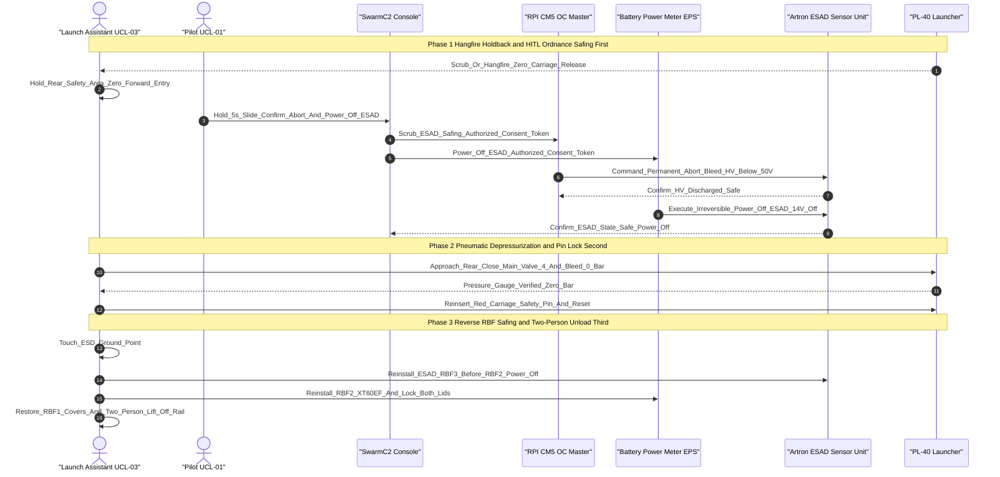

/// OperationalAllocation: [OA-01]
/// OperationalAllocation: [OA-19]

## 10. Maintenance & Sustainment Concepts (O/I/D Maintenance)

- **Document Date**: `2026-11-16`
- **System Baseline**: `Avenger5V25UasSystem` (`Avenger 5 V2.5 UAS` / `ASTK A5 V2.5` + `ELI Military Simulations PL-40 Rev 2.6` + `Artron ESAD AB00-0054-01AA-0005` + `SwarmC2`)
- **Authoritative SSOT Basis**: [.pipeline/schema.sysml](../../.pipeline/schema.sysml), [oem_bom.md](../../schema/extracted/oem_bom.md), [02_avenger5_operations_and_safety.md](../../schema/extracted/02_avenger5_operations_and_safety.md), [03_pl40_launcher_specifications.md](../../schema/extracted/03_pl40_launcher_specifications.md), [04_esad_excalibur_icd.md](../../schema/extracted/04_esad_excalibur_icd.md), and [parametric_limits.md](../../schema/extracted/parametric_limits.md)
- **Normative & Safety Standards**: `ISO/IEC/IEEE 29148:2018`, `ISO/IEC/IEEE 15288:2023`, `STANAG 4187`, `MIL-STD-461`, `UN 3481`, `ASTM F3269-17`, `MIL-STD-882E`, `JARUS SORA v2.5`

Maintenance and sustainment for `Avenger5V25UasSystem` follow a three-tier Organizational (`O-Level`), Intermediate (`I-Level`), and Depot (`D-Level`) model aligned with `ISO/IEC/IEEE 29148:2018` and `ISO/IEC/IEEE 15288:2023`. All sustainment procedures enforce the production system boundaries defined in `.pipeline/schema.sysml`:
1. **Strictly Mechanical Launch Interface (`IF-MECH-001`)**: Zero electrical conductors or CAN bus wires cross between the `ELI PL-40 Rev 2.6` pneumatic rail catapult (`BOM-LCH-001`) and the `Avenger V2.5` airframe (`BOM-AV-001`).
2. **Production Recovery Exclusion (`REQ_SC_03`)**: Production `Avenger V2.5` excludes recovery parachutes (`Recovery System: No`); the `2x 50.0 V` pyrotechnic recovery igniter lines (`BOM-AV-026`) from `EPS` (`BOM-AV-009`) remain disabled (`Optional RnD`).
3. **Software-Hosted Simplex RTA & Bridge Architecture**: Zero standalone RTA hardware enclosure exists; `ASTM F3269-17` Simplex RTA supervision runs in software on `Cube orange+` (`BOM-AV-010`), while `Artron ESAD` supervision runs on `RPI CM5004032` (`BOM-AV-011`).
4. **`12S2P` Electrical Baseline (`GAP-05`)**: Main DC power architecture is anchored exclusively to the `12S2P Li metal BEI` (`maximus20`, `BOM-AV-002`) `36.0-50.4 V` bus (`49.0-50.0 V` pre-flight pass), rejecting legacy `23.9-25.0 V` UI screenshots.

---

### 10.1 Three-Tier Sustainment Architecture & Grounded Support Equipment (GSE) Roster

Operational sustainment separates field pre-flight/turnaround/abort safety (`O-Level`), modular LRU diagnostics/calibration/mechanical interval servicing (`I-Level`), and factory structural/ordnance overhaul plus unprinted OEM gap bench closure (`D-Level`).

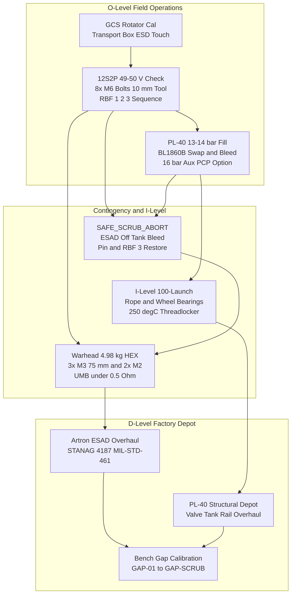

**Figure 10.1**: Three-Tier O-Level, I-Level, and D-Level Sustainment and `SAFE_SCRUB_ABORT` Escalation Flow.

#### Table 10.1: Grounded Ground Support Equipment (GSE) & Maintenance Tooling Baseline

| BOM / Tool ID | Support Equipment / Tool Item | Tier Allocation | Functional Role & Grounded Handling Constraint | SSOT Citation |
| :--- | :--- | :--- | :--- | :--- |
| `BOM-LCH-001` | `ELI Military Simulations PL-40 Rev 2.6` Pneumatic Rail Catapult | O-Level, I-Level, D-Level | Three-section modular launch rail with ground anchors and packed transport case (`IF-MECH-001` zero-wire launch; `PRM-PL40-001` through `PRM-PL40-013`) | `oem_bom.md` (`BOM-LCH-001`), `03_pl40_launcher_specifications.md#s1` |
| `BOM-LCH-002` | `PL-40` Carriage, Lever Lock-Pads, Safety Pin & Hardpoint Kits | O-Level, I-Level, D-Level | Aircraft carriage with prop-safe cradle, red safety pin interlock, and Option A/B/C hardpoints (`PRM-PL40-015` through `PRM-PL40-026`, `PRM-PL40-043`) | `oem_bom.md` (`BOM-LCH-002`), `03_pl40_launcher_specifications.md#s1-#s2` |
| `BOM-LCH-003` | `PL-40` Battery Compressor Unit & `DIN PCP` Aux Port | O-Level, D-Level | Portable compressor with auto-cutoff hysteresis, UVLO protection, condensate bleed point, and external aux fill port (`PRM-PL40-027` through `PRM-PL40-036`) | `oem_bom.md` (`BOM-LCH-003`), `03_pl40_launcher_specifications.md#s2` |
| `BOM-LCH-004` | `Makita BL1860B` Li-Ion Compressor Battery Packs (`UN 3481`) | O-Level, I-Level | Dual rechargeable battery packs powering `PL-40` compressor; field swap after first launch and every two launches (`PRM-PL40-032` through `PRM-PL40-041`) | `oem_bom.md` (`BOM-LCH-004`), `03_pl40_launcher_specifications.md#s2` |
| `BOM-LCH-005` | `PL-40` Main Outlet Valve `(4)` & Dual-Switch Firing Box | O-Level, D-Level | Mechanical outlet isolation valve and dual safety-cover simultaneous firing box (`PRM-PL40-037`, `REQ_SC_13`) | `oem_bom.md` (`BOM-LCH-005`), `03_pl40_launcher_specifications.md#s2` |
| `BOM-GCS-001` | `SwarmC2` Rugged `Windows 11` Tablet Console | O-Level, I-Level | Role-authenticated mission control, six-group pre-flight checklist, ESAD safing UI, and `ATAK`/`SitaWare HQ`/`DELTA` export (`PRM-GCS-002` through `PRM-GCS-010`) | `oem_bom.md` (`BOM-GCS-001`), `02_avenger5_operations_and_safety.md#s2-#s3` |
| `BOM-GCS-002` | Ground C2 Datalink Radio Box (`DTC` `FHSS`, `AES-256`) | O-Level, I-Level, D-Level | Ground RF transceiver maintaining mandatory UAV prep separation (`PRM-RF-001` through `PRM-RF-008`, `PRM-GCS-001`) | `oem_bom.md` (`BOM-GCS-002`), `02_avenger5_operations_and_safety.md#s2` |
| `BOM-GCS-003` | Directional Tracking Antenna Rotator | O-Level, I-Level | Ground azimuth tracker calibrated prior to touching UAV (`Auto Follow` and fine step tune, `PRM-RF-010`, `REQ_SC_15`) | `oem_bom.md` (`BOM-GCS-003`), `02_avenger5_operations_and_safety.md#s1-#s2` |
| `BOM-GCS-004` | `MARS` Directional Antenna & `OMNI` Ground Antenna | O-Level, I-Level | Dual ground antenna set (`OMNI` mandatory for ground prep and launch; selectable `OMNI` or `DIR` in flight, `PRM-RF-009`) | `oem_bom.md` (`BOM-GCS-004`), `02_avenger5_operations_and_safety.md#s2` |
| `BOM-GCS-005` | Optional Tactical Fiber Optic Spool | O-Level, I-Level | Optional armored tether between `SwarmC2` console and Ground Radio Box (`PRM-RF-012`) | `oem_bom.md` (`BOM-GCS-005`) |
| `BOM-GCS-006` | Transport Box `EARTH / GROUNDING POINT` | O-Level | Yellow electrostatic discharge point inside airframe transport box; touched before every component handling step (`REQ_SC_01`) | `oem_bom.md` (`BOM-GCS-006`), `02_avenger5_operations_and_safety.md#s1` |
| `TOOL-O-001` | Wing Bolt Spanner (`PRM-AF-018`) | O-Level, I-Level | Manual spanner used to tighten all eight wing mounting bolts including four front `M6` bolts (`PRM-AF-016`, `PRM-AF-017`) | `02_avenger5_operations_and_safety.md#s1`, `parametric_limits.md` |
| `TOOL-O-002` | Payload Terminal Hex Driver (`PRM-AF-015`) | O-Level, I-Level | Precision hex driver for fastening modular warhead payload leads to ESAD terminals | `oem_bom.md` (`BOM-ORD-004`), `02_avenger5_operations_and_safety.md#s1` |
| `TOOL-I-001` | Localized Bearing Heater & Threadlocker Kit (`PRM-PL40-044`) | I-Level | Thermal release and threadlocker application kit for `PL-40` carriage wheel bearing replacement interval (`PRM-PL40-043`) | `03_pl40_launcher_specifications.md#s2`, `parametric_limits.md` |
| `TOOL-I-002` | Milliohm Loop Tester, Mass Scale & `USB`/`ETH` Service Rig | I-Level, D-Level | Continuity verification for `J100` `UMB` loop (`PRM-ESAD-004`, `PRM-ESAD-005`), warhead holder mass check (`PRM-AF-010`), and External Interface Board (`BOM-AV-013`) service | `04_esad_excalibur_icd.md#s2`, `oem_bom.md` (`BOM-AV-013`, `BOM-ORD-002`, `BOM-ORD-004`) |

---

### 10.2 Organizational-Level (O-Level) Field Maintenance, Pre-Flight & `SAFE_SCRUB_ABORT`

O-Level sustainment covers all field preparation, handling interlocks, launcher pressurization, battery swapping, condensate bleeding, pre-flight BIT verification, launch execution, post-flight turnaround, and `SAFE_SCRUB_ABORT` hangfire recovery executed at the launch site by authorized `Pilot`, `Payload`, and `Launch Assistant` crew (`SwarmC2` role authentication with minimum `8`-character password; short initial factory password window replaced prior to operations).

#### 10.2.1 GCS Setup, Rotator Calibration & Transport Box ESD Equalization

1. **Documentation & Role Authorization Gate**: All O-Level personnel must hold current qualification across the `A5 User Manual`, `PL-40`, `Warhead`, `ESAD`, and `SwarmC2` manuals (`02_avenger5_operations_and_safety.md` Step 0).
2. **Ground RF Station & Rotator Calibration Before Touching UAV (`REQ_SC_15`)**:
 - Erect the Ground C2 Radio Box (`BOM-GCS-002`, `4.4-5.0 GHz`, `AES-256` `FHSS`, `2.0 W` RF), `OMNI` antenna (mandatory for ground prep and launch), and `MARS 23 dBi` directional antenna (`BOM-GCS-004`) mounted on the Directional Tracking Antenna Rotator (`BOM-GCS-003`), connecting the rugged `Windows 11` `SwarmC2` tablet (`BOM-GCS-001`) directly or through the optional `200.0 m` tactical fiber spool (`BOM-GCS-005`).
 - Maintain a strict `>= 10.0 m` physical separation (`PRM-GCS-001`) between the Ground Radio Box and the UAV assembly area during ground preparation.
 - **Calibrate the Directional Tracking Antenna Rotator (`Auto Follow` and `0.5 deg` CCW/CW fine tune step) BEFORE touching the UAV** (`02_avenger5_operations_and_safety.md` Step 2).
3. **Mandatory Transport Box ESD Touch (`REQ_SC_01`)**:
 - Touch the yellow `EARTH / GROUNDING POINT` inside the airframe Transport Box (`BOM-GCS-006`) immediately **before every component handling step** (`02_avenger5_operations_and_safety.md` Step 3) to equalize electrostatic potential prior to touching `Artron ESAD`, warhead terminals, avionics, or `12S2P` battery connectors.

#### 10.2.2 Airframe Assembly, `12S2P` `49.0-50.0 V` Pack Match & Ordered `RBF #1/#2/#3` Sequence

1. **Warhead Holder & Payload Hatch Check (`BOM-ORD-004`)**:
 - Following ESD equalization, verify `Warhead Holder` visual/mechanical readiness (`4.98 +/- 0.02 kg` tested unit mass within `<= 5.0 kg` max payload, CG CTQ `30.57 +/- 1.00`, overall `173.00`, `RED FACE TO TOUCH HOLDER` orientation), secure payload leads to ESAD via `1.5 mm` HEX terminals (`PRM-AF-015`), and lock the payload hatch (`02_avenger5_operations_and_safety.md` Step 4).
2. **`12S2P` Battery Inspection & `49.0-50.0 V` Match (`GAP-05`)**:
 - Inspect the removable `12S2P Li metal BEI` (`maximus20`, `BOM-AV-002`) battery pack for physical damage, swelling, or electrolyte leakage; any defect is an immediate **NO-GO**.
 - Confirm full pre-flight pack voltage within `49.0-50.0 V` (`PRM-AV-003`, `PRM-AV-004`) inside the `36.0-50.4 V` DC bus envelope (`PRM-AV-001`, `PRM-AV-002`). Legacy `23.9-25.0 V` screenshots are strictly rejected under `GAP-05` (`REQ_SAF_05`).
 - **Pack-to-Fuselage Identity Match**: Verify that the Battery ID and QR code match the target fuselage ID and QR code (`02_avenger5_operations_and_safety.md` Step 5), pre-connect the retention strap buckle, mate the main power connector and lock ring without sharp harness bends, and lock the battery hatch.
3. **Two-Person Lift, `8x M6 x 30 mm` Wing Assembly & `10 mm` Spanner Torque**:
 - With all Remove Before Flight (`RBF`) pins installed, a minimum of `2` persons (`PRM-AF-019`) lift the `17.0 kg` airframe without stressing wing panels or tail control surfaces and seat it onto the `PL-40` carriage (`145.0-155.5 mm` upper prop-safe zone, `02_avenger5_operations_and_safety.md` Step 6).
 - Rotate the `4` wing panels into position on their rear hinge bolts while routing the RF coax cable smoothly without pinching. Install the `4` front `M6 x 30 mm` (`6.0 mm` diameter, `30.0 mm` length) bolts and tighten all `8` wing bolts (`4` front + `4` rear) using a `10 mm` (`10.0 mm`) spanner (`PRM-AF-016` through `PRM-AF-018`, Step 7). Note under `GAP-SEPDIST` that numeric `M6` wrench torque is unprinted in OEM manuals and tracked as a D-Level calibration sign-off item.
 - Slide the `4` identical X-tail stabilisers over their ruddervator control horns and finger-tighten captive screws.
4. **Folding Pusher Prop & Ordered `RBF #1` -> `RBF #2` -> `RBF #3` & Lid Locks (`GAP-06`)**:
 - **Propeller & `RBF #1`**: Manually fold BOTH blades of the rear `Folding Pusher Propeller` (`BOM-AV-008`) rearward toward the tail prior to power-up (prevents carriage/trolley strike hazard). Remove `RBF #1` (`BOM-AV-025`: pitot cover, optical sensor cover, and `Nighthawk2UZ` gimbal transit strap; Step 8).
 - **`RBF #2` & Lid Locks**: While supporting the airframe, pull `UAV POWER R.B.F.` (`RBF #2`, `XT60E-F` connector housing, `BOM-AV-005`) to energize the main `36.0-50.4 V` DC bus (`Power Meter`, `200.0 A` fuse, `EPS`, `Cube orange+`, `RPI CM5004032`, `Artron ESAD`). Immediately **close and lock BOTH the RBF lid and the umbilical / External Interface Board lid (`BOM-AV-013`)** (`02_avenger5_operations_and_safety.md` Step 9).
 - **Pre-Flight Diagnostics**: Confirm `SwarmC2` telemetry acquisition within `2.0 min` (`PRM-GCS-002`), validate all `6` `SwarmC2` checklist groups (`Catapult`, `Mission & parameters`, `Preparation & mounting`, `System checks`, `Video Checks`, `Warhead and Safety`), verify `CUAV SKYE2` pitot calm-air (`< 3.0 m/s`) and indirect airflow (`> 10.0 m/s`) response, verify dual `mRo RM3100` magnetometers and `8x HV6160-DroneCAN` surface sweep, and verify `Artron ESAD` Power-On Built-In Test (`PBIT`) confirms internal high voltage `< 50.0 V` (`PRM-ESAD-029`).
 - **`RBF #3` Power-Before-Pull Gate (`REQ_SC_09`, `REQ_SAF_06`)**: Keep `ESAD R.B.F. Key` (`RBF #3`, `BOM-ORD-002`) installed throughout power-on and BIT; removing `RBF #3` before power-on triggers an immediate latched ESAD fault (`GAP-06`). Remove `RBF #3` **ONLY** when prompted by `SwarmC2` after all `8` preconditions pass, and wait for `ESAD: Ready to Fly` (`02_avenger5_operations_and_safety.md` Step 11).

#### 10.2.3 `PL-40` Compressor `13.0-14.0 bar`, Makita `BL1860B` Swap, Condensate Bleed & `16.0 bar` Aux PCP

1. **Launcher Mechanical & Environmental Prep**:
 - Deploy the `5.0 m` (`4938.0 mm` CAD) 3-section `PL-40` rail (`1.28 m` packed, `12.0 deg` elevation, `602.0 mm` front leg span, `1116.0 mm` rail top height, `5.0 min` nominal assembly) within `-20.0 to +50.0 degC`. Drive ground anchors, confirm all fasteners and carriage lever lock-pads are tight (loose lock-pads cause piston over-acceleration and internal inlet-air valve abort), confirm the red carriage safety pin is seated, and verify Main Outlet Valve `(4)` is closed.
2. **Pneumatic Pressurization (`13.0-14.0 bar`) & `GAP-03` Launch Margin Gate**:
 - Pressurize the `PL-40` air tank from the `25.0 kg` Battery Compressor Unit (`BOM-LCH-003`) to `13.0-14.0 bar` (`14.0 bar` auto-cutoff with `0.05 bar` regulation hysteresis, `<= 8.0 min` fill time). Confirm by manual gauge inspection (`02_avenger5_operations_and_safety.md` Step 1, `SwarmC2` `Catapult` checklist).
 - Under `GAP-03` (`REQ_SC_14`, `REQ_SAF_03`), Avenger 5 (`17.0 kg` MTOW) at `13.0-14.0 bar` achieves `~22.7-23.5 m/s` (`~23.0 m/s` nominal) rail exit speed, safely below the `25.0 m/s` launcher structural cap (`PRM-PL40-002`; lighter `< 15.0 kg` airframes at `14.0 bar` reach `25.3 m/s` over-speed). Because `~23.0 m/s` is below `24.0-26.0 m/s` stall speed without thrust/headwind, O-Level Go/No-Go requires verified pusher motor readiness and ground headwind `<= 12.0 m/s` (`PRM-PERF-016`).
3. **`Makita BL1860B` Pack Swap Cadence & `<= 14.5 V` UVLO Protection**:
 - The compressor uses `2x Makita BL1860B` `18.0 V` `6000 mAh` Li-Ion packs (`UN 3481`, `BOM-LCH-004`).
 - **Mandatory Swap Rule**: Swap compressor battery packs **after the 1st launch and every 2 launches thereafter** (`03_pl40_launcher_specifications.md#s2`).
 - **Under-Voltage Lockout (`<= 14.5 V`)**: If pack voltage drops to `<= 14.5 V` during pressurization (`PRM-PL40-034`), the compressor cuts OFF automatically with a flashing `PWR` LED (`Pl40LauncherState::UvloPause`). Install freshly charged packs (`> 16.0 V`) and wait at least `5.0 s` (`PRM-PL40-036`) before restarting. Recharge depleted `BL1860B` packs strictly within the `+10.0 to +40.0 degC` ambient window (`PRM-PL40-040`, `PRM-PL40-041`).
4. **Condensate Bleed & `16.0 bar` Aux PCP Contingency**:
 - **Condensate Bleed**: Perform O-level pneumatic moisture/condensate bleed during compressor cooldown, post-sortie tank depressurization, and wet/humid deployment turnarounds to prevent moisture accumulation in the pressure cylinder, Main Valve `(4)`, and internal over-acceleration valve. Unprinted tank volume (`L`) and relief valve cracking pressure (`bar`) are tracked under `GAP-ENV` (`REQ_SAF_11`).
 - **External Auxiliary Fill (`16.0 bar` PCP)**: When onboard compressor batteries are unavailable or depleted in field operations, connect an external compressed-air source to the `DIN 8 mm PCP` auxiliary fill port rated up to `16.0 bar` (`PRM-PL40-031`), regulating the launch tank to the `13.0-14.0 bar` Avenger 5 band before sealing the fill line.
5. **Firing Interlock & Post-Flight Turnaround**:
 - Evacuate all personnel behind the rear anchor (`SAFETY AREA`; forward and lateral zones are `DANGER ZONE`). Pull the red carriage safety pin, open Main Outlet Valve `(4)`, flip both firing-box safety covers, and hold BOTH trigger switches simultaneously for `>= 2.0 s` (`PRM-PL40-037`) until the UAV clears the rail. Note that pressing the trigger switches while the red carriage pin remains installed forces a full reset.
 - For non-expended training recoveries or aborted flights, execute safe disarm (`< 50.0 V` ESAD confirmed), reinstall `RBF #3` before reinserting `RBF #2` (`XT60E-F`), remove/inspect the `12S2P` pack, refit `RBF #1` covers and gimbal strap, close Main Valve `(4)`, bleed tank pressure and condensate, and swap `BL1860B` packs per cadence.

#### 10.2.4 `SAFE_SCRUB_ABORT` Hangfire & Post-`RBF #3` Safing Protocol (`GAP-SCRUB`)

Whenever a launch must be scrubbed after `RBF #3` removal or Main Valve `(4)` opening, or upon any `PL-40` hangfire, `<= 14.5 V` compressor UVLO, trigger-with-pin reset fault, or `Artron ESAD` fault lockout, O-Level crew execute `SAFE_SCRUB_ABORT` (`REQ_SC_16`, `REQ_SAF_12`, `Pl40LauncherState::ScrubbedSafeDepressurized`) strictly in the ordered sequence of Table 10.2.

#### Table 10.2: `SAFE_SCRUB_ABORT` Mandatory Disarm & Depressurization Sequence

| Step | Actor / Performer | Mandatory Action | Verification & Safe Exit Gate | SSOT Citation |
| :--- | :--- | :--- | :--- | :--- |
| 1 | Launch Crew (`SAFETY AREA`) | Hold position in rear `SAFETY AREA` across calibrated hangfire standoff wait window (`GAP-SCRUB`) | Zero crew entry into forward or lateral `DANGER ZONE` until standoff wait expires and command team clears approach | `03_pl40_launcher_specifications.md#s2`, `parametric_limits.md` (`GAP-SCRUB`) |
| 2 | `Payload` / `Pilot` (`SwarmC2`) | Hold `ABORT` or `SELF DESTRUCT` button (`PRM-GCS-010`) + `Slide to confirm`, or command irreversible `Power Off ESAD` | ESAD transitions to `DetonatedOrAborted` / `SafePowerOff`; internal capacitor HV confirmed below safe ceiling (`PRM-ESAD-029`) | `02_avenger5_operations_and_safety.md#s3`, `.pipeline/schema.sysml` (`REQ_SC_16`) |
| 3 | `Launch Assistant` (`PL-40`) | Close Main Outlet Valve `(4)` and depressurize/bleed pneumatic air tank plus condensate drain to zero gauge pressure | Tank gauge reads zero stored pneumatic pressure (`ScrubbedSafeDepressurized` state) | `03_pl40_launcher_specifications.md#s2`, `.pipeline/schema.sysml` (`Pl40LauncherState`) |
| 4 | `Launch Assistant` (`PL-40`) | Reinstall red carriage safety pin into `PL-40` carriage prior to touching airframe | Carriage physically locked against forward travel | `03_pl40_launcher_specifications.md#s2`, `.pipeline/schema.sysml` (`REQ_SC_16`) |
| 5 | `Launch Assistant` (UAV) | Touch Transport Box `EARTH / GROUNDING POINT` (`BOM-GCS-006`); reinstall `ESAD R.B.F. #3` (`BOM-ORD-002`) into `J100` `UMB` loop **before** reinserting `UAV Power R.B.F. #2` (`XT60E-F`, `BOM-AV-005`) | `UMB` shorting jumper verified seated prior to main `12S2P` disconnect (`GAP-06` inverse safe order) | `02_avenger5_operations_and_safety.md#s1`, `parametric_limits.md` (`GAP-06`, `GAP-SCRUB`) |
| 6 | `Launch Assistant` (UAV) | Close and lock BOTH RBF and umbilical lids; refit `RBF #1` pitot/sensor covers and gimbal strap (`BOM-AV-025`); conduct two-person airframe removal (`PRM-AF-019`) | Airframe secured in `UavFlightLifecycleState::SafePostFlightShutdown` for `I-Level` fault inspection | `02_avenger5_operations_and_safety.md#s1`, `.pipeline/schema.sysml` (`UavFlightLifecycleState`) |

---

### 10.3 Intermediate-Level (I-Level) Calibration, Mechanical Overhaul & Modular LRU Replacement

I-Level sustainment is conducted by trained maintenance technicians at forward or unit support workshops equipped with dimensional gauges, milliohm meters, localized thermal bearing tools, and `USB`/`ETH` diagnostic interfaces (`BOM-AV-013`).

#### 10.3.1 `PL-40` `100`-Launch Rope & Wheel Bearing Servicing (`250.0 degC` Threadlocker)

1. **`100`-Launch Preventive Interval (`PRM-PL40-043`)**: Every `100` launches, remove the `PL-40` pulling rope and carriage assembly (`BOM-LCH-002`) for mandatory preventive replacement of the pulling rope and all carriage wheel bearings (`03_pl40_launcher_specifications.md#s2`).
2. **`250.0 degC` Threadlocker Heat Removal (`PRM-PL40-044`)**: Apply controlled localized heat at `250.0 degC` to release factory threadlocker securing the carriage wheel bearing fasteners; extract worn bearings without scoring the carriage alloy frame (`271.0 mm` x `232.5 mm`, `156.0 mm` outer / `140.0 mm` inner width), clean threads, install replacement bearings with specified threadlocker, and verify smooth rail tracking across all three `5.0 m` rail sections (`145.0-155.5 mm` upper prop-safe zone).
3. **Hardpoint & Lock-Pad Inspection**: Inspect carriage lever lock-pads for wear or compression set (preventing piston over-acceleration aborts) and verify/replace airframe launch hardpoints across Option A (`6061-T6` split hooks `0.004 kg`, `178/186/206 mm`), Option B (`225.0 mm` single bar), or Option C (`AISI 304` `M8` mushroom pins, `320.0 mm` span).

#### 10.3.2 `Warhead Holder` Verification (`4.98 +/- 0.02 kg`, `1.5 mm` HEX, `3x M3` `75 mm` BCD, `2x M2`) & `UMB < 0.5 Ohm` Continuity

1. **`Warhead Holder` Mechanical & Mass Verification (`BOM-ORD-004`)**:
 - Confirm warhead/holder assembly mass lies within `4.98 +/- 0.02 kg` (`4980 +/- 20 g`, `PRM-AF-010`, `PRM-AF-011`) and never exceeds the `5.0 kg` lethal package ceiling (`PRM-AF-009`), keeping integrated UAV MTOW at or below `17.0 kg` (`PRM-AF-008`).
 - Verify CG CTQ datum `30.57 +/- 1.00` (`PRM-AF-012`, `PRM-AF-013`) and overall CTQ `173.00` (`PRM-AF-014`), confirm `RED FACE TO TOUCH HOLDER` alignment, and inspect ESAD payload terminal clamping using the `1.5 mm` HEX driver (`PRM-AF-015`).
2. **`Artron ESAD` & `Sensor Board` Mounting & Harness Inspection (`BOM-ORD-001`, `BOM-ORD-003`, `BOM-ORD-005`)**:
 - Verify `Artron ESAD` board mounting security at the `3x M3` (`3.0 mm`, `PRM-ESAD-035`) user mounting holes arranged on a `75.0 mm` (`75 mm`, `PRM-ESAD-036`) Bolt Circle Diameter (BCD); the `3` larger vendor-reserved holes must remain undisturbed at I-Level (`04_esad_excalibur_icd.md#s1`). Note `M3` fastener torque is tracked under `GAP-SEPDIST`.
 - Verify `ESAD Sensor Board` (combined proximity + impact ORed `IRQ_L -> IR_ESAD_L`) mounting at its `2x M2` (`2.0 mm`, `PRM-ESAD-037`) mounting holes and inspect the `28 AWG` `J102` (Harwin `G125-2241096F1` 10-pin epoxy-potted) to `J1` (Molex `501330-0800` 8-pin) harness (`5.0 V` `VOUT`, `DIST_COMM1/2` UART, `IRQ_L`) plus the `J401` custom 8-pin HV output harness (pins 4 and 8 removed, `0.0-1800.0 V` firing circuit).
3. **`J100` `UMB < 0.5 Ohm` Continuity Loop Verification (`BOM-ORD-002`, `REQ_SC_10`)**:
 - Verify `ESAD R.B.F. Key` (`RBF #3`) continuity loop resistance across `J100` (Harwin `G125-2241696F1` 16-pin, `22-28 AWG`, crimps `G125-0020005`) `UMB` / `UMB_RTN` terminals is strictly `< 0.5 Ohm` (`PRM-ESAD-004`) tested at `20.0 mA` sense current (`PRM-ESAD-005`, `04_esad_excalibur_icd.md#s2`). Replace worn `RBF #3` jumpers or damaged `J100` crimps before returning the airframe to flight readiness.

#### 10.3.3 Avionics, Power Bus, Propulsion & Sensor LRU Replacement & Calibration

1. **Main Power Bus & `EPS` Rail Health (`BOM-AV-003` through `BOM-AV-009`)**:
 - Inspect/replace the `200.0 A` automotive inline fuse (`PRM-AV-005`), `Power Meter` (`BOM-AV-004`), and `970.0 cm` trunk power/CAN harness (`PRM-AV-012`).
 - Verify `EPS` (`BOM-AV-009`) regulated outputs under load: `8.0 V` servo rail (`PRM-AV-006`), `12.0 V` radio rail within `8.0-17.0 V` DTC tolerance (`PRM-AV-007` through `PRM-AV-009`), and `14.0 V` ESAD `GE_POW` rail (`PRM-AV-010`). Under `GAP-01` (`REQ_SAF_01`), because `14.0 V` equals the `Artron ESAD` minimum `14.0 V` `VDC_IN` (`PRM-ESAD-001`) with zero cable-drop margin, I-Level harness checks must verify negligible IR drop across the `EPS` to `J100` `VDC_IN` path. Confirm optional `2x 50.0 V` RnD recovery igniter outputs (`BOM-AV-026`) remain disconnected/inhibited (`REQ_SC_03`).
2. **Propulsion, DroneCAN Actuation & Air-Data LRUs (`BOM-AV-006` through `BOM-AV-020`)**:
 - Swap modular `IBEX160` ESC, `AXI 5345/16 HD GOLD LINE V3` BLDC motor, folding pusher propeller, `4x HV6160-DroneCAN` tail ruddervator servos (`CAN 1` via `4x 120.0 cm` stubs), and `4x HV6160-DroneCAN` wing servos (`CAN 2` daisy-chain via `CAN/power splitter PCB`).
 - Verify `CUAV SKYE2` heated pitot water drainage and bench airflow calibration (`<= 3.0 m/s` calm air `PRM-AV-017`, `>= 10.0 m/s` indirect airflow `PRM-AV-018`, `REQ_SC_07`), dual `mRo RM3100` magnetometer/barometer health on `CAN 2`, and `Septentrio Asterx-m3 pro` + `Talysman TW3972EXF` RF coax continuity.
3. **Compute, Seeker & C2 LRUs (`BOM-AV-010` through `BOM-AV-024`, `BOM-GCS-001` through `BOM-GCS-005`)**:
 - Service `Cube orange+` (`BOM-AV-010`, including `ASTM F3269-17` Simplex RTA configuration parameters) and internal Ethernet switch (`BOM-AV-012`) through the External Interface Board `USB`/`ETH` port (`BOM-AV-013`), verifying the umbilical lid lock afterward.
 - Verify `RPI CM5004032` (`BOM-AV-011`) `` `8N1` `100.0 Hz` (`0.01 s`) `RS-485` ESAD supervision link (`<= 5.0 ms` reply, `<= 10.0 ms` incomplete frame timeout, `Frame Integrity Check XModem`, `DSC_IN1` `1000.0 Hz` `2`-pulse discrete output `2.5-3.3 V` high / `0.0-0.7 V` low, `REQ_SC_08`).
 - Bench-verify `Nighthawk2UZ` gimbal travel (`-45.0 to +135.0 deg` pitch, `-165.0 to +165.0 deg` yaw/roll, `128` Day/Thermal, `X40` zoom), `Trip6` HDMI/ETH tracker link, `DTC 4.4-5.0 GHz` air/ground radio RF output (`2.0 W` / `2x 1.0 W`), `MPSL4400` and `MARS 23 dBi` / `OMNI` antenna paths, and `SwarmC2` tablet role password hygiene.

---

### 10.4 Depot-Level (D-Level) Factory Overhaul, Recertification & Gap Calibration (`GAP-01` through `GAP-SCRUB`)

D-Level sustainment encompasses factory/OEM overhaul of safety-critical ordnance, pneumatic launch hardware, structural composite airframe repairs, and engineering bench calibration closing all `12` OEM gaps (`parametric_limits.md` Section 2).

#### 10.4.1 `Artron ESAD` (`AB00-0054-01AA-0005`) Factory Depot Overhaul

1. **Ordnance Enclosure & Vendor-Reserved Hardware**: Opening the sealed drone bay for internal ESAD overhaul, accessing the `3` vendor-reserved larger PCB mounting holes (`04_esad_excalibur_icd.md#s1`), or servicing the epoxy-potted `J102` back shell is restricted exclusively to D-Level OEM / certified ordnance depot technicians.
2. **FPGA/CPLD Firmware & Safety Barrier Recertification**:
 - Audit FPGA and CPLD version telemetry via the ESAD serial maintenance interface (no unit-level hex exposed in Level 1B ConOps; framing governed by `ICD_AB00-0054-01AA-0005`).
 - Re-verify `STANAG 4187` independent safety barriers on automated test equipment: inertial `SS1` launch acceleration sensing (`0.0039 g/LSB` 13-bit signed calibration), `SS2` safe-separation `FlightTimer` (`1.0 s/LSB`) and `Safe Distance Exceed` latch (`GAP-07`), `DSC_IN1` `1000.0 Hz` `2`-pulse arm enable gating (confirming Fault bit 4 lockout if pulses arrive prior to `Arm Stage 2`), `0.0-1800.0 V` HV capacitor charge/discharge curve (`1.0 V/LSB` telemetry, `< 50.0 V` `PBIT` safe ceiling), and `J401` dielectric/insulation integrity.
 - Re-certify `MIL-STD-461` EMI/EMC shielding compliance following any PCB, harness, or enclosure rework.

#### 10.4.2 `ELI Military Simulations PL-40 Rev 2.6` & Airframe Factory Overhaul

1. **`PL-40` Pneumatic & Structural Overhaul (`BOM-LCH-001` through `BOM-LCH-005`)**:
 - Perform D-Level pressure-vessel inspection and hydrostatic proof testing of the `PL-40` air tank, rebuild of Main Outlet Valve `(4)`, overhaul of the internal piston over-acceleration shut-off valve, recalibration of the `14.0 bar` (`0.05 bar` hysteresis) compressor auto-cutoff regulator and `DIN 8 mm PCP` (`16.0 bar`) external fill assembly, and bench verification of the `14.5 V` UVLO (`> 16.0 V` after `5.0 s` restart) power control board.
 - Straightness, rail-joint datum, and elevation (`12.0 deg`) overhaul of the `5.0 m` (`4938.0 mm`) 3-section rail and carriage assembly (`68.0 kg` total set mass).
2. **Airframe & Avionics Depot Overhaul**:
 - Structural X-wing composite fuselage repair (`1.8 m` / `1803.0 mm` span, `1.6 m` / `1576.0 mm` length, `1.1 m` / `1095.0-1112.0 mm` height, `80.0 m/s` VNE envelope), `Cube orange+` / `RPI CM5004032` environmental stress screening (`-20.0 to +50.0 degC`), `Nighthawk2UZ` optical/gimbal alignment, and `DTC 4.4-5.0 GHz` RF power (`2.0 W`) and `AES-256` key zeroization/re-keying.

#### 10.4.3 Depot Bench Calibration Closure of OEM Engineering Gaps (`GAP-01` through `GAP-SCRUB`)

D-Level depot engineering maintains and closes the `12` unresolved or conflicting OEM parameters identified in `parametric_limits.md` Section 2 (`REQ_SAF_01` through `REQ_SAF_12`) before clearing revised hardware/firmware configurations to O-Level units (summarized in Table 10.5).

---

### 10.5 Quantitative Maintenance, GSE & Bench Calibration Parameters

All quantitative limits, intervals, dimensions, electrical ratings, and calibration datums governing O/I/D maintenance and GSE support are isolated in Table 10.3 with strictly separated `Value` and `Units` columns (`Check 26` compliance).

#### Table 10.3: Quantitative Maintenance, GSE & Bench Calibration Parameters

| Param ID | Subsystem / Scope | Parameter Name | Constraint / Condition | Value | Units | Tier | SSOT Citation |
| :--- | :--- | :--- | :--- | :--- | :--- | :--- | :--- |
| `PRM-AF-008` | Airframe | Maximum Takeoff Weight (MTOW) | Upper authorized airframe mass bound | 17.0 | kg | O, I, D | `parametric_limits.md` |
| `PRM-AF-009` | Payload | Max Lethal Package / Warhead Mass | Maximum authorized warhead mass | 5.0 | kg | O, I, D | `parametric_limits.md` |
| `PRM-AF-010` | Payload | Warhead Holder Tested Mass (Nominal) | Nominal tested holder assembly mass | 4.98 | kg | O, I | `parametric_limits.md` |
| `PRM-AF-011` | Payload | Warhead Holder Tested Mass Tolerance | Symmetric plus-or-minus tolerance | 0.02 | kg | O, I | `parametric_limits.md` |
| `PRM-AF-012` | Payload | Warhead CG CTQ Nominal | Payload CG CTQ datum (`GAP-SEPDIST` OEM unit unprinted) | 30.57 | Dimensionless | I, D | `parametric_limits.md` |
| `PRM-AF-013` | Payload | Warhead CG CTQ Tolerance | Symmetric plus-or-minus CG CTQ tolerance (`GAP-SEPDIST` OEM unit unprinted) | 1.00 | Dimensionless | I, D | `parametric_limits.md` |
| `PRM-AF-014` | Payload | Warhead Overall CTQ Dimension | Overall payload CTQ datum (`GAP-SEPDIST` OEM unit unprinted) | 173.00 | Dimensionless | I, D | `parametric_limits.md` |
| `PRM-AF-015` | Payload | ESAD Payload Terminal Hex Tool Size | Precision hex driver for payload-to-ESAD terminals | 1.5 | mm | O, I | `parametric_limits.md` |
| `PRM-AF-016` | Airframe | Front Wing Bolt Diameter (M6) | Thread diameter of four front wing bolts | 6.0 | mm | O, I | `parametric_limits.md` |
| `PRM-AF-017` | Airframe | Front Wing Bolt Length | Length of four front wing mounting bolts | 30.0 | mm | O, I | `parametric_limits.md` |
| `PRM-AF-018` | Airframe | Wing Bolt Spanner Size | Wrench size across all eight wing bolts | 10.0 | mm | O, I | `parametric_limits.md` |
| `PRM-AF-019` | Ground Handling | Airframe Lift Crew Minimum | Minimum crew count (`2` persons) lifting airframe onto `PL-40` carriage | 2 | count | O | `parametric_limits.md` |
| `PRM-PERF-016` | Performance | Ground Wind Tolerance Max | Maximum ground / launch wind tolerance | 12.0 | m/s | O, D | `parametric_limits.md` |
| `PRM-PERF-018` | Performance | Operating Temperature Min | Minimum ambient operating temperature for UAS (Normalized Kelvin scalar T / 1.0 K; OEM: `-20.0 degC`) | 253.15 | Dimensionless | O, D | `parametric_limits.md` |
| `PRM-PERF-019` | Performance | Operating Temperature Max | Maximum ambient operating temperature for UAS (Normalized Kelvin scalar T / 1.0 K; OEM: `50.0 degC`) | 323.15 | Dimensionless | O, D | `parametric_limits.md` |
| `PRM-AV-001` | Power Bus | Main Battery Bus Voltage Min | Minimum `12S2P` Li metal DC bus operating floor | 36.0 | V | O, I, D | `parametric_limits.md` |
| `PRM-AV-002` | Power Bus | Main Battery Bus Voltage Max | Maximum `12S2P` Li metal DC bus voltage | 50.4 | V | O, I, D | `parametric_limits.md` |
| `PRM-AV-003` | Power Bus | Pre-Flight Battery Voltage Min | Minimum `12S2P` pack pre-flight pass voltage (`GAP-05`) | 49.0 | V | O | `parametric_limits.md` |
| `PRM-AV-004` | Power Bus | Pre-Flight Battery Voltage Nominal Max | Nominal full `12S2P` pre-flight pack voltage (`GAP-05`) | 50.0 | V | O | `parametric_limits.md` |
| `PRM-AV-005` | Power Bus | Main Automotive Fuse Rating | Inline overcurrent fuse rating ahead of Power Meter | 200.0 | A | I, D | `parametric_limits.md` |
| `PRM-AV-006` | Power Bus | EPS Servo Rail Voltage | Regulated EPS supply to eight `HV6160` actuators | 8.0 | V | I, D | `parametric_limits.md` |
| `PRM-AV-007` | Power Bus | EPS C2 Radio Rail Voltage | Regulated EPS supply to onboard `DTC` radio | 12.0 | V | I, D | `parametric_limits.md` |
| `PRM-AV-008` | Power Bus | DTC Radio Supply Tolerance Min | Minimum allowed input voltage at `DTC` radio | 8.0 | V | I, D | `parametric_limits.md` |
| `PRM-AV-009` | Power Bus | DTC Radio Supply Tolerance Max | Maximum allowed input voltage at `DTC` radio | 17.0 | V | I, D | `parametric_limits.md` |
| `PRM-AV-010` | Power Bus | EPS ESAD Rail Voltage | Regulated EPS output to ESAD (`GAP-01` zero margin) | 14.0 | V | I, D | `parametric_limits.md` |
| `PRM-AV-011` | Power Bus | EPS RnD Recovery Igniter Rail Voltage | Inhibited on production V2.5 (`Optional RnD` only) | 50.0 | V | I, D | `parametric_limits.md` |
| `PRM-AV-012` | Harness | Power and CAN 1 Trunk Harness Length | Fuselage trunk wire length to `EPS` | 970.0 | cm | I, D | `parametric_limits.md` |
| `PRM-AV-013` | Harness | Tail Fin Servo CAN 1 Stub Length | Length per each of four tail fin `CAN 1` stubs | 120.0 | cm | I, D | `parametric_limits.md` |
| `PRM-AV-017` | Sensors | Pitot Calm-Air Indicated Airspeed Max | Upper bound for stationary calm-air pre-flight check | 3.0 | m/s | O, I | `parametric_limits.md` |
| `PRM-AV-018` | Sensors | Pitot Airflow Check Indicated Airspeed Min | Lower bound for indirect blowing pre-flight check | 10.0 | m/s | O, I | `parametric_limits.md` |
| `PRM-GCS-001` | Ground Safety | Minimum Ground Radio / Crew Separation | Minimum distance from Ground Radio Box to UAV during prep | 10.0 | m | O | `parametric_limits.md` |
| `PRM-GCS-002` | GCS | Telemetry Detection Timeout on Power-On | Maximum wait for telemetry acquisition after `RBF #2` pull | 2.0 | min | O | `parametric_limits.md` |
| `PRM-GCS-009` | GCS | Operator Password Minimum Character Count | Minimum `SwarmC2` role authentication password character count (OEM: `8 chars`) | 8 | count | O, I | `parametric_limits.md` |
| `PRM-GCS-010` | GCS / ESAD | ESAD Self-Destruct / Abort Hold Min | Minimum button hold prior to `Slide to confirm` | 5.0 | s | O | `parametric_limits.md` |
| `PRM-RF-010` | Datalink | Rotator Fine Step Increment | Manual CCW/CW fine azimuth step during calibration | 0.5 | deg | O, I | `parametric_limits.md` |
| `PRM-RF-012` | Datalink | Optional Fiber Optic Ground Spool Length | Optional GCS-to-Radio Box fiber tether spool | 200.0 | m | O, I | `parametric_limits.md` |
| `PRM-PL40-001` | Launcher | Max Supported Aircraft MTOW | Structural maximum UAV mass rated on `PL-40` | 30.0 | kg | O, D | `parametric_limits.md` |
| `PRM-PL40-002` | Launcher | Max Allowed Launch Exit Velocity | Hard carriage exit speed ceiling (`GAP-03`) | 25.0 | m/s | O, D | `parametric_limits.md` |
| `PRM-PL40-003` | Launcher | Avenger 5 Interpolated Exit Velocity | Approximate exit velocity at MTOW and operating pressure (`GAP-03`) | 23.0 | m/s | O, D | `parametric_limits.md` |
| `PRM-PL40-004` | Launcher | Avenger 5 Interpolated Exit Lower Bound | Lower interpolated rail exit speed at MTOW and operating pressure | 22.7 | m/s | O, D | `parametric_limits.md` |
| `PRM-PL40-005` | Launcher | Avenger 5 Interpolated Exit Upper Bound | Upper interpolated rail exit speed at MTOW and operating pressure | 23.5 | m/s | O, D | `parametric_limits.md` |
| `PRM-PL40-006` | Launcher | Rail Elevation Angle | Fixed deployed catapult inclination angle | 12.0 | deg | O, D | `parametric_limits.md` |
| `PRM-PL40-007` | Launcher | Assembled Rail Length Nominal | Nominal three-section deployed rail length | 5.0 | m | O, I, D | `parametric_limits.md` |
| `PRM-PL40-008` | Launcher | Ground-Projected CAD Rail Envelope | Ground-projected assembled CAD envelope | 4938.0 | mm | O, D | `parametric_limits.md` |
| `PRM-PL40-009` | Launcher | Disassembled Rail Section Length | Transport length of packed rail section | 1.28 | m | O | `parametric_limits.md` |
| `PRM-PL40-010` | Launcher | Deployed Front Leg Lateral Span | Lateral span across deployed front anchors/legs | 602.0 | mm | O, D | `parametric_limits.md` |
| `PRM-PL40-011` | Launcher | Deployed Rail Top Height | Deployed rail top height above ground | 1116.0 | mm | O, D | `parametric_limits.md` |
| `PRM-PL40-012` | Launcher | Total Launcher System Set Mass | Combined mass of launcher case plus compressor unit | 68.0 | kg | O, D | `parametric_limits.md` |
| `PRM-PL40-013` | Launcher | Launcher Transport Case Mass | Packed launcher rail case mass | 43.0 | kg | O | `parametric_limits.md` |
| `PRM-PL40-014` | Launcher | Compressor Unit Mass | Portable pneumatic compressor unit mass | 25.0 | kg | O | `parametric_limits.md` |
| `PRM-PL40-015` | Launcher | Carriage Overall Length | Launch carriage longitudinal length | 271.0 | mm | I, D | `parametric_limits.md` |
| `PRM-PL40-016` | Launcher | Carriage Overall Height | Launch carriage vertical height | 232.5 | mm | I, D | `parametric_limits.md` |
| `PRM-PL40-018` | Launcher | Carriage Outer Width | Launch carriage outer frame width | 156.0 | mm | I, D | `parametric_limits.md` |
| `PRM-PL40-019` | Launcher | Carriage Inner Width | Launch carriage inner fuselage cradle width | 140.0 | mm | I, D | `parametric_limits.md` |
| `PRM-PL40-020` | Launcher | Carriage Prop-Safe Upper Zone Min | Lower vertical bound of upper prop-safe zone | 145.0 | mm | O, I | `parametric_limits.md` |
| `PRM-PL40-021` | Launcher | Carriage Prop-Safe Upper Zone Max | Upper vertical bound of upper prop-safe zone | 155.5 | mm | O, I | `parametric_limits.md` |
| `PRM-PL40-024` | Launcher | Hardpoint Option A Split Hook Mass | Aluminum `6061-T6` split hook unit mass | 0.004 | kg | I | `parametric_limits.md` |
| `PRM-PL40-025` | Launcher | Hardpoint Option B Single Bar Span | Single bar hardpoint width | 225.0 | mm | I | `parametric_limits.md` |
| `PRM-PL40-026` | Launcher | Hardpoint Option C M8 Mushroom Pin Span | `AISI 304` mushroom pin span | 320.0 | mm | I | `parametric_limits.md` |
| `PRM-PL40-027` | Launcher | Avenger 5 Operating Pressure Min | Nominal lower bound for Avenger 5 launch pressure (Normalized pressure ratio P / 100 kPa; OEM: `13.0 bar`) | 13.0 | ratio | O, D | `parametric_limits.md` |
| `PRM-PL40-028` | Launcher | Onboard Max Working Pressure / Auto-Cutoff | Compressor automatic cutoff and Avenger 5 launch upper bound (Normalized pressure ratio P / 100 kPa; OEM: `14.0 bar`) | 14.0 | ratio | O, D | `parametric_limits.md` |
| `PRM-PL40-029` | Launcher | Pressure Regulation Hysteresis | Automatic cutoff regulation hysteresis band (Normalized pressure ratio P / 100 kPa; OEM: `0.05 bar`) | 0.05 | ratio | O, D | `parametric_limits.md` |
| `PRM-PL40-030` | Launcher | Onboard Compressor Charge Time Max | Maximum pneumatic tank fill duration | 8.0 | min | O | `parametric_limits.md` |
| `PRM-PL40-031` | Launcher | External Auxiliary Fill Port Max Pressure | `DIN PCP` external auxiliary fill ceiling (Normalized pressure ratio P / 100 kPa; OEM: `16.0 bar`) | 16.0 | ratio | O, D | `parametric_limits.md` |
| `PRM-PL40-032` | Launcher | Compressor Battery Nominal Voltage | Nominal `Makita BL1860B` pack voltage | 18.0 | V | O | `parametric_limits.md` |
| `PRM-PL40-033` | Launcher | Compressor Battery Capacity | Rated `Makita BL1860B` pack electric charge capacity (Normalized charge scalar Q / 1.0 C; OEM: `6000.0 mAh at 18.0 V`) | 21600.0 | Dimensionless | O | `parametric_limits.md` |
| `PRM-PL40-034` | Launcher | Compressor Battery UVLO Protection Cutoff | Compressor turns OFF at or below threshold (`PWR` flashes) | 14.5 | V | O, D | `parametric_limits.md` |
| `PRM-PL40-035` | Launcher | Compressor Battery UVLO Restart Threshold | Minimum pack voltage required for restart after UVLO | 16.0 | V | O, D | `parametric_limits.md` |
| `PRM-PL40-036` | Launcher | Compressor UVLO Restart Delay | Mandatory wait delay before UVLO restart check | 5.0 | s | O, D | `parametric_limits.md` |
| `PRM-PL40-037` | Launcher | Dual-Switch Simultaneous Firing Hold Min | Minimum simultaneous dual-switch press until plane clears rail | 2.0 | s | O | `parametric_limits.md` |
| `PRM-PL40-038` | Launcher | Operating Temperature Min | Minimum operational ambient temperature for `PL-40` (Normalized Kelvin scalar T / 1.0 K; OEM: `-20.0 degC`) | 253.15 | Dimensionless | O, D | `parametric_limits.md` |
| `PRM-PL40-039` | Launcher | Operating Temperature Max | Maximum operational ambient temperature for `PL-40` (Normalized Kelvin scalar T / 1.0 K; OEM: `50.0 degC`) | 323.15 | Dimensionless | O, D | `parametric_limits.md` |
| `PRM-PL40-040` | Launcher | Battery Charging Temperature Min | Minimum ambient temperature for `BL1860B` charging (Normalized Kelvin scalar T / 1.0 K; OEM: `10.0 degC`) | 283.15 | Dimensionless | O, I | `parametric_limits.md` |
| `PRM-PL40-041` | Launcher | Battery Charging Temperature Max | Maximum ambient temperature for `BL1860B` charging (Normalized Kelvin scalar T / 1.0 K; OEM: `40.0 degC`) | 313.15 | Dimensionless | O, I | `parametric_limits.md` |
| `PRM-PL40-042` | Launcher | Nominal Field Set-Up Time | Nominal field assembly duration for `PL-40` | 5.0 | min | O | `parametric_limits.md` |
| `PRM-PL40-043` | Launcher | Pulling Rope and Carriage Bearing Interval | Preventive replacement launch count cadence for rope and wheel bearings (`100` launches) | 100 | count | I | `parametric_limits.md` |
| `PRM-PL40-044` | Launcher | Bearing Threadlocker Heat Removal Temp | Localized heat temperature required to release bearing threadlocker (Normalized Kelvin scalar T / 1.0 K; OEM: `250.0 degC`) | 523.15 | Dimensionless | I | `parametric_limits.md` |
| `PRM-PL40-046` | Launcher | Over-Limit Velocity Warning (Lighter Airframe) | Exceeds structural exit rating when airframe is underloaded at auto-cutoff | 25.3 | m/s | D | `parametric_limits.md` |
| `PRM-ESAD-001` | ESAD Power | `VDC_IN` (`GE_POW`) Minimum Input Voltage | Minimum ESAD operating voltage (`GAP-01` vs `EPS` rail) | 14.0 | V | I, D | `parametric_limits.md` |
| `PRM-ESAD-002` | ESAD Power | `VDC_IN` (`GE_POW`) Nominal Input Voltage | ICD nominal operating voltage (`GAP-01` discrepancy) | 28.0 | V | D | `parametric_limits.md` |
| `PRM-ESAD-003` | ESAD Power | `VDC_IN` (`GE_POW`) Maximum Input Voltage | Upper allowed ESAD input voltage | 32.0 | V | D | `parametric_limits.md` |
| `PRM-ESAD-004` | ESAD Interlock | Umbilical Loop (`UMB`) Max Continuity Drop | Upper loop voltage drop ceiling across `J100` `UMB`/`UMB_RTN` at `20.0 mA` sense current (OEM: `0.5 Ohm` max resistance) | 0.01 | V | I, D | `parametric_limits.md` |
| `PRM-ESAD-005` | ESAD Interlock | Umbilical Loop (`UMB`) Sense Current | Continuity loop excitation current during `UMB` test | 20.0 | mA | I, D | `parametric_limits.md` |
| `PRM-ESAD-006` | ESAD Discrete | Discrete Arm (`DSC_IN1`) Pulse Frequency | Square-wave arm enable frequency (`Arm Stage 2` only) | 1000.0 | Hz | I, D | `parametric_limits.md` |
| `PRM-ESAD-009` | ESAD Discrete | Discrete Arm (`DSC_IN1`) Pulse Count | Required square-wave arm enable pulse count (`2` pulses) | 2 | count | I, D | `parametric_limits.md` |
| `PRM-ESAD-014` | ESAD Protocol | `RS-485` Baud Rate | Half-duplex `8N1` differential serial bus baud rate | 115200 | bps | I, D | `parametric_limits.md` |
| `PRM-ESAD-017` | ESAD Protocol | `RS-485` Polling Frequency | `OC` Master cyclic supervision frequency (`GAP-04`) | 100.0 | Hz | I, D | `parametric_limits.md` |
| `PRM-ESAD-018` | ESAD Protocol | `RS-485` Polling Period | Derived cyclic supervision interval (`GAP-04`) | 0.01 | s | I, D | `parametric_limits.md` |
| `PRM-ESAD-019` | ESAD Protocol | `RS-485` Incomplete Packet / Watchdog Timeout | Incomplete serial packet timeout threshold (`GAP-04`) | 10.0 | ms | I, D | `parametric_limits.md` |
| `PRM-ESAD-020` | ESAD Protocol | `RS-485` ESAD Reply Max Latency | Max delay from command last bit to reply last bit | 5.0 | ms | I, D | `parametric_limits.md` |
| `PRM-ESAD-029` | ESAD HV Safety | `PBIT` Safe High-Voltage Ceiling | Safe internal capacitor voltage ceiling during `PBIT` | 50.0 | V | O, I, D | `parametric_limits.md` |
| `PRM-ESAD-030` | ESAD HV Fire | HV Output Minimum (`J401`) | Discharged high-voltage output floor | 0.0 | V | D | `parametric_limits.md` |
| `PRM-ESAD-031` | ESAD HV Fire | HV Output Maximum (`J401`) | Maximum `HIGHVOLTAGE` capacitor charge / firing output | 1800.0 | V | D | `parametric_limits.md` |
| `PRM-ESAD-032` | ESAD Telemetry | High Voltage Telemetry Scale | `UINT16` capacitor voltage telemetry scaling resolution (per LSB telemetry scaling resolution; OEM: `1.0 V/LSB`) | 1.0 | V | D | `parametric_limits.md` |
| `PRM-ESAD-033` | ESAD Telemetry | FlightTimer Telemetry Scale | `UINT16` flight timer telemetry scaling resolution (per LSB timer scaling resolution; OEM: `1.0 s/LSB`) | 1.0 | s | D | `parametric_limits.md` |
| `PRM-ESAD-034` | ESAD Telemetry | Acceleration Telemetry Scale | 13-bit signed two's complement acceleration g/LSB gravity-normalized scaling (OEM: `0.0039 g/LSB`) | 0.0039 | Dimensionless | D | `parametric_limits.md` |
| `PRM-ESAD-035` | ESAD Mechanical | ESAD Board Mounting Hole Diameter (`M3`) | Three user mounting holes (three larger holes vendor-reserved) | 3.0 | mm | I, D | `parametric_limits.md` |
| `PRM-ESAD-036` | ESAD Mechanical | ESAD Board Mounting Circle Diameter | Bolt circle diameter (`BCD`) on ESAD PCB | 75.0 | mm | I, D | `parametric_limits.md` |
| `PRM-ESAD-037` | ESAD Mechanical | ESAD Sensor Board Mounting Hole Diameter (`M2`) | Two mounting holes on proximity/impact sensor board | 2.0 | mm | I, D | `parametric_limits.md` |

---

### 10.6 O/I/D Maintenance Allocation & OEM Engineering Gap Calibration Matrices

#### Table 10.4: Subsystem Allocation Across O-Level, I-Level, and D-Level Maintenance

| Subsystem / Segment | O-Level (Field Prep, Pre-Flight & Scrub) | I-Level (Workshop Servicing & LRU Swap) | D-Level (Factory Overhaul & Bench Cal) | Normative / Safety Trace |
| :--- | :--- | :--- | :--- | :--- |
| Airframe & Wings (`BOM-AV-001`) | Two-person carriage lift (`PRM-AF-019`), front `M6` wing bolts and eight-bolt spanner check (`PRM-AF-016` through `PRM-AF-018`), X-tail captive screws | Control horn, hinge bolt, RF routing, and `HV6160` wing/fin linkage replacement | Structural composite repair, `VNE` structural recertification, unprinted `M6` torque calibration | `02_avenger5_operations_and_safety.md`, `GAP-SEPDIST` |
| `12S2P` Battery, `EPS` & Propulsion (`BOM-AV-002` through `BOM-AV-009`) | Visual NO-GO check, `12S2P` pre-flight voltage check (`PRM-AV-003`, `PRM-AV-004`), ID/QR match, rearward prop fold, `RBF #2` pull & lid lock | Main inline fuse (`PRM-AV-005`), `Power Meter`, `ESC`, `BLDC` motor, prop, and `EPS` rail checks; `GAP-01` `EPS`-to-ESAD drop test; verify `Optional RnD` rail inhibited | `12S2P` energy/SoC characterization (`GAP-ENV`), `ESC`/motor thermal & current cutoff calibration, `EPS` DC/DC overhaul | `REQ_SC_01` through `REQ_SC_04`, `REQ_SAF_01`, `REQ_SAF_05` |
| Flight Control, Compute, Nav & Seeker (`BOM-AV-010` through `BOM-AV-025`) | `RBF #1` cover/strap removal, umbilical lid lock, `SwarmC2` 6-group checklist, calm/airflow pitot checks (`PRM-AV-017`, `PRM-AV-018`) | `Cube orange+` / `RPI CM5004032` `USB`/`ETH` diagnostics (`BOM-AV-013`), `SKYE2` water drain & cal, `RM3100`, `Septentrio`, `Nighthawk2UZ` / `Trip6` swaps | Software Simplex RTA & `WCET`/RMA bench verification (`GAP-02`, `GAP-WCET`), gimbal optical/servo factory overhaul | `REQ_SC_05` through `REQ_SC_08`, `REQ_SAF_02`, `REQ_SAF_08` |
| `Artron ESAD`, Sensor Board & `Warhead Holder` (`BOM-ORD-001` through `BOM-ORD-005`) | Transport Box ESD touch, `HEX` terminal check (`PRM-AF-015`), hatch lock, power-before-pull `RBF #3` gate (`GAP-06`), `SAFE_SCRUB_ABORT` disarm | Holder mass/CTQ verification (`PRM-AF-009` through `PRM-AF-014`), `M3` `BCD` & `M2` mount check (`PRM-ESAD-035` through `PRM-ESAD-037`), `J100` `UMB` continuity (`PRM-ESAD-004`, `PRM-ESAD-005`), `J102`-to-`J1` & `J401` harness swap | Sealed-bay & vendor-hole overhaul, FPGA/CPLD audit, `SS1`/`SS2`/`DS` & HV calibration (`PRM-ESAD-031`, `PRM-ESAD-034`), `STANAG 4187` & `MIL-STD-461` recertification | `REQ_SC_09` through `REQ_SC_12`, `REQ_SAF_04`, `REQ_SAF_06`, `REQ_SAF_07`, `REQ_SAF_10` |
| `ELI PL-40 Rev 2.6` Launcher (`BOM-LCH-001` through `BOM-LCH-005`) | Rail assembly, operating pressure fill (`PRM-PL40-027`, `PRM-PL40-028`), `BL1860B` first and every-two-launch swap & UVLO check (`PRM-PL40-034`), condensate bleed, aux `PCP` (`PRM-PL40-031`), `SAFE_SCRUB_ABORT` bleed & pin | Preventive pulling rope & wheel bearing replacement (`PRM-PL40-043`, `PRM-PL40-044`), lock-pad & hardpoint Option A/B/C swaps, `BL1860B` charge management (`PRM-PL40-040`, `PRM-PL40-041`) | Hydrostatic tank proof, internal over-accel valve & Main Valve `(4)` overhaul, pressure & UVLO electronics cal, rail alignment (`PRM-PL40-007`), `GAP-03` velocity verification | `REQ_SC_13`, `REQ_SC_14`, `REQ_SC_16`, `REQ_SAF_03`, `REQ_SAF_11`, `REQ_SAF_12` |
| Ground C2, RF Station & ESD (`BOM-GCS-001` through `BOM-GCS-006`) | Rotator cal before touching UAV (`PRM-RF-010`), ground radio separation (`PRM-GCS-001`), Transport Box ESD touch, `OMNI`/`MARS` setup, optional fiber spool (`PRM-RF-012`), `SwarmC2` role auth (`PRM-GCS-009`) | Rotator azimuth drive check, `DTC` ground radio RF test, `SwarmC2` tablet credential/software servicing | `DTC` `AES-256` `FHSS` factory RF calibration, tablet/rotator environmental & reliability tracking (`GAP-REL`) | `REQ_SC_15`, `REQ_SAF_09` |

#### Table 10.5: D-Level Bench Calibration & OEM Engineering Gap Closure Matrix (`GAP-01` through `GAP-SCRUB`)

| Gap ID | Affected Subsystem / Interface | OEM Discrepancy or Unprinted Parameter | D-Level Bench Calibration & Sustainment Disposition | Safety / Req Binding |
| :--- | :--- | :--- | :--- | :--- |
| `GAP-01` | `EPS` -> `Artron ESAD` Power | `EPS` regulated output equals `ESAD` minimum `VDC_IN` floor (zero brownout margin relative to ICD nominal input) | Measure harness voltage drop under worst-case servo/RF load; enforce brownout alarm and irreversible `Power Off ESAD` | `REQ_SAF_01`, `PRM-AV-010`, `PRM-ESAD-001` through `PRM-ESAD-003` |
| `GAP-02` | Flight Envelope & `Simplex RTA` | V1 manual vs V2.5 spec sheet differences in stall, cruise, max horizontal, structural dive `VNE`, and `RLOS` range | Calibrate `Cube orange+` Simplex RTA to conservative inner control envelope and verify dive speed abort clamp | `REQ_SAF_02`, `REQ_SC_05` |
| `GAP-03` | `PL-40` -> Airframe (`IF-MECH-001`) | Interpolated `PL-40` exit speed at `Avenger 5` MTOW and operating pressure lies below stall without thrust/headwind, while underloaded airframes risk exceeding launcher exit cap | Bench-calibrate MTOW rail exit profile (`PRM-PL40-003` through `PRM-PL40-005`) and codify pusher + headwind Go/No-Go gate (`PRM-PL40-002`, `PRM-PERF-016`) | `REQ_SAF_03`, `PRM-PL40-002`, `PRM-PL40-046` |
| `GAP-04` | `RPI CM5004032` <-> `Artron ESAD` | ICD platform note (`Avenger 3` vs `V2.5`) and cyclic polling frequency vs poll-period wording ambiguity | Verify `8N1` `RS-485` baud rate, cyclic polling cadence, reply latency, and incomplete-packet timeout on hardware-in-loop bench | `REQ_SAF_04`, `PRM-ESAD-014` through `PRM-ESAD-020` |
| `GAP-05` | `12S2P` Battery & `SwarmC2` UI | Conflicting `OBS` joystick text and legacy low-voltage UI screenshots vs `12S2P` pre-flight and operating bus envelope | Validate `SwarmC2` telemetry calibration strictly against `12S2P` operating and pre-flight thresholds; reject legacy low-voltage UI states | `REQ_SAF_05`, `PRM-AV-001` through `PRM-AV-004` |
| `GAP-06` | `RBF #2` & `ESAD RBF #3` | Removing `RBF #3` prior to UAV and ESAD power-on triggers immediate ESAD fault lockout | Bench-test hardware/software lifecycle gate requiring `RBF #2` ON and `PBIT` pass prior to `SwarmC2` `RBF #3` removal prompt | `REQ_SAF_06`, `REQ_SC_01`, `REQ_SC_09` |
| `GAP-07` | `SwarmC2` & `ESAD SS2` Interlock | Ambiguous wording between `SwarmC2` safe-distance text and ESAD `Safe Distance Exceed == 1` (`SS2` active) | Align `SwarmC2` display logic and ESAD telemetry bit decode strictly to `Safe Distance Exceed == 1` prior to arming | `REQ_SAF_07`, `REQ_SC_11` |
| `GAP-WCET` | `Cube orange+`, `CAN 1/2`, `RPI`, `Trip6` | Unprinted OEM loop execution frequencies and worst-case execution time (`WCET`) budgets | Measure EKF2, `CAN 1`/`CAN 2` bus saturation, `HV6160`, `Trip6`, `RPI`, and `SwarmC2` `WCET` margins anchored to `ESAD` polling cadence (`PRM-ESAD-017`) | `REQ_SAF_08`, `PRM-ESAD-017` |
| `GAP-REL` | All Avionics, Ordnance & `PL-40` LRUs | Unprinted piece-part failure rates (`lambda`) and `MTBF` across avionics, actuators, battery, radio, gimbal, and ESAD FPGA/CPLD | Maintain empirical depot failure-rate ledger across fleet cycles until OEM piece-part `MTBF` baselines are released | `REQ_SAF_09` |
| `GAP-SEPDIST` | `ESAD` & `Warhead Holder` / Wings | Unprinted safe-separation distance, launch `g` threshold, arming timer, `M3`/`M6` torque, and tested holder CTQ units | Measure and sign off calibrated safe-separation, `g`-switch, timer, `M3`/`M6` torque, and holder CTQ dimensional units prior to field arming | `REQ_SAF_10`, `PRM-AF-010` through `PRM-AF-017`, `PRM-ESAD-035` |
| `GAP-ENV` | `12S2P` Battery, `ESC`, `PL-40` Tank | Unprinted battery energy (`Wh`/`Ah`), SoC RTL floor, `ESC`/motor current/thermal cutoffs, tank volume, relief cracking pressure, IP/rain/icing, standoff distance | Qualify thermal, current, pneumatic relief, condensate/IP, and crew standoff thresholds via depot environmental chamber and tank tests | `REQ_SAF_11` |
| `GAP-SCRUB` | `PL-40`, `ESAD`, `SwarmC2` | Unprinted emergency scrub/unload sequence and hangfire wait time once `RBF #3` is pulled or Main Valve `(4)` opened | Validate hangfire standoff timer and end-to-end `SAFE_SCRUB_ABORT` depressurization, pin restoration, and `RBF #3` before `RBF #2` safing on bench | `REQ_SAF_12`, `REQ_SC_16` |

## 11. Operational Impacts, System Limitations & Documented Trade Studies

- **Document Date**: `2026-11-16`
- **System Baseline**: `Avenger5V25UasSystem` (`Avenger 5 V2.5 UAS` / `ASTK A5 V2.5` + `ELI Military Simulations PL-40 Rev 2.6` + `Artron ESAD AB00-0054-01AA-0005` + `SwarmC2`)
- **JSON Schema Mapping**: `proposed_capabilities` (`mission_drivers`, `value_proposition`, `trade_off_analysis`, operational impacts, and explicit system limitations per `ISO/IEC/IEEE 29148:2018` Annex A §A.2, `IEEE Std 1362-1998` §4, and `INCOSE SE Handbook v5.0` §2.3.5.4)
- **Authoritative SSOT Basis**: `.pipeline/schema.sysml` (`REQ_SAF_01` through `REQ_SAF_12`, `REQ_SC_01` through `REQ_SC_16`, `constraint def` and `part def` definitions), `schema/extracted/05_engineering_gaps_and_synthesis_ledger.md`, `schema/extracted/parametric_limits.md`, `docs/research/FAILURE_MODE_REGISTRY.md` (Section 5.1), `docs/research/RESEARCH_INVENTORY.md`, and `docs/safety/STPA_MATRIX.md`
- **Level 1B Hardware-Faithful Boundary**: This section enforces strict Level 1B abstraction (`UCL-01` through `UCL-05` user classes, `OA-01` through `OA-19` operational activities, `SCN-01` through `SCN-08` scenarios, and `OpTx-01` through `OpTx-24` / `CONN_01` through `CONN_24` exchanges), excludes Level 1C serial hex and pinouts, excludes Level 2 use-case identifiers, and locks all analysis to zero standalone RTA hardware enclosures (`standaloneRtaBoxCount == 0`), zero `PL-40` to airframe electrical/CAN wires (`IF-MECH-001`, `electricalWireToUavCount == 0`), zero production recovery parachutes (`rndRecoveryOptionInstalled == false`), and the normative `12S2P` (`36.0-50.4 V`) electrical baseline (`GAP-05`).

---

### 11.1 Operational & Organizational Impacts (`UCL-01` through `UCL-05`)

Deploying `Avenger5V25IntegratedSystem` introduces binding organizational procedures, crew-role separation, logistics replenishment cycles, and human-in-the-loop (HITL) ordnance safety disciplines across all five operational user classes (`UCL-01` Pilot Operator, `UCL-02` Payload Operator, `UCL-03` Launch Assistant, `UCL-04` External Tactical C2, and `UCL-05` Field Sustainment and Arming Safety Lead).

1. **Zero Production failsafe containment & Disposable Sortie Attrition Discipline (`REQ_SC_03`, `ProductionNoParachuteConstraint`, `OA-03`, `OA-04`)**:
 - Production `Avenger 5 V2.5` includes no failsafe containment recovery system (`Recovery System: No`; `productionRecoverySystemInstalled == false`), and the optional `2x 50.0 V` pyrotechnic burn-wire igniter outputs from `ElectronicPowerSystemEps` (`BOM-AV-026`) remain permanently inhibited (`rndRecoveryOptionInstalled == false`).
 - **Organizational & Logistics Impact**: Operational units cannot rely on failsafe containment capture for routine sortie turnaround or post-dive recovery. Terminal engagements (`SCN-04`, `SCN-05`) represent disposable `17.0 kg` MTOW airframe expenditure (`<= 5.0 kg` lethal package; `4.98 +/- 0.02 kg` tested warhead holder). Conversely, any non-terminal sortie abort (`SCN-02`, `SCN-03`) requires preserving recoverable flight energy via the `0.20` statutory Bingo reserve (`1080.0 s` out of `5400.0 s` / `90.0 min` maximum endurance, yielding `4320.0 s` usable mission endurance) and pre-planned `SwarmC2` `RTL` / Rally-point diversion (`Fly HOME Then Land` or `Go Directly to landing sequence`) within `JARUS SORA v2.5` Ground Risk Buffer boundaries (`MET-02`). `UCL-05` sustains whole-airframe and `12S2P` battery pack logistics rather than failsafe containment repacking or pyrotechnic igniter refurbishment.

2. **Minimum `10.0 m` Ground RF Standoff & Tactical Fiber Separation (`GroundCrewSeparationAndEsdConstraint`, `PRM-GCS-001`, `PRM-RF-012`, `FM-14-03` RPN 192, `REQ_SC_15`)**:
 - During pre-flight assembly, `RBF #2` energization, and `2.0 min` telemetry acquisition (`PRM-GCS-002`), the `Avenger V2.5` airframe and staging crew (`UCL-03`) must maintain at least `10.0 m` separation from the `Ground Radio Box` (`GroundRfStationAndAntennaTracker`), which transmits `2.0 W` total (`2x 1.0 W`) across `4.4-5.0 GHz` (`OMNI` antenna on ground/launch). Violation of RF proximity or ESD controls constitutes Top-3 FMECA driver `FM-14-03` (`RPN 192`, `REQ_L_01`, `REQ_SC_15`).
 - **Organizational & Spatial Impact**: Site layout (`OA-18`, `SCN-07`) partitions the `PL-40` launch pad (`SAFETY AREA` strictly behind the rear rail anchor; `DANGER ZONE` all forward and lateral sectors) from the radiating Ground Radio Box (`>= 10.0 m` clearance) and permits deploying the optional `200.0 m` tactical fiber optic spool (`IF-GND-001`) so `UCL-01` and `UCL-02` operate the rugged `Windows 11` `SwarmC2` console (`>= 8` char role-authenticated login per `NIST SP 800-82r3`) from sheltered standoff.

3. **Transport Box ESD Equalization & Pre-UAV Antenna Rotator Calibration (`OA-18`, `FM-14-03` RPN 192, `REQ_SC_15`)**:
 - Ground crew (`UCL-03`, `UCL-05`) must touch the yellow `EARTH / GROUNDING POINT` inside the transport box before every component handling step (`A5_prep#p7`, `#p9`) to eliminate personnel-borne electrostatic discharge (`MIL-STD-461G` `CS118`) across ordnance (`Artron ESAD` + Sensor Board) and avionics harnesses.
 - Ground station commissioning (`A5_prep#p6`, `OA-18`) enforces strict temporal precedence: erect the `MARS 23.0 dBi` directional tracking antenna and `OMNI` antenna, power `SwarmC2`, and calibrate the `Directional Antenna Rotator` (`Auto Follow` and `0.5 deg` CCW/CW fine step, example channel `4510.0 MHz`) **before touching the UAV**. Mechanical airframe preparation further mandates `2`-person minimum airframe lift (`PRM-AF-019`) without stressing control surfaces, routing RF coaxial leads free of pinch points, tightening `8` wing bolts (`4x` front `M6 x 30.0 mm` with `10.0 mm` spanner), verifying battery-to-fuselage ID/QR match (`OA-01`), fastening payload terminals with a `1.5 mm` hex driver (`RED FACE TO TOUCH HOLDER`), and locking both RBF and `USB/ETH` umbilical lids (`OBL-04`).

4. **`PL-40` Launch Energy Management: `>= 2`-Launch `Makita BL1860B` Swap & `100`-Launch Rope/Bearing Cycle (`OA-15`, `REQ_SC_14`, `PRM-PL40-032` through `PRM-PL40-044`)**:
 - The `25.0 kg` portable compressor charges the `PL-40` tank (`43.0 kg` rail case, `68.0 kg` total set) to `13.0-14.0 bar` within `<= 8.0 min` (`0.05 bar` auto-cutoff hysteresis) using `2x Makita BL1860B` (`18.0 V`, `6000.0 mAh`, `UN 3481`) battery packs (`UAV_launcher_PL-40_user_manual_rev_2.6.pdf#p6,#p26,#p28`).
 - **Organizational & Maintenance Impact**: Crew (`UCL-03`) must swap compressor battery packs after the 1st launch and every `>= 2` launches thereafter, or immediately whenever pack voltage drops to `<= 14.5 V` UVLO cutoff (flashing `PWR` LED, requiring `>= 16.0 V` pack voltage and a `5.0 s` wait before restart), while keeping pack charging strictly inside `+10.0 to +40.0 degC` (narrower than the `-20.0 to +50.0 degC` operational launch envelope). High-tempo operations may substitute the `DIN 8 mm PCP` auxiliary fill port (`<= 16.0 bar`). At intermediate/depot intervals, `UCL-05` must track launch cycles and replace the `PL-40` pulling rope and carriage wheel bearings every `100` launches, applying localized `250.0 degC` heat to release bearing threadlocker (`PRM-PL40-043`, `PRM-PL40-044`).

5. **Strict `RBF #1 -> #2 -> #3` Sequencing & `SAFE_SCRUB_ABORT` Discipline (`REQ_SC_01`, `REQ_SC_09`, `REQ_SC_16`, `REQ_SAF_06`, `REQ_SAF_12`, `GAP-06`, `GAP-SCRUB`)**:
 - Crew roles (`UCL-01`, `UCL-02`, `UCL-03`) must execute an indivisible, non-parallelized launch gate sequence (`SCN-01`, `SCN-06`):
 1. Confirm both folding rear pusher propeller blades fold rearward inside the `145.0-155.5 mm` carriage prop-safe upper zone and remove `RBF #1` (pitot cover, sensor cover, gimbal strap).
 2. Pull `UAV Power RBF #2` (`XT60E-F`) to energize the `12S2P` bus (`49.0-50.0 V` check, `200.0 A` fuse) and immediately close and lock both the RBF lid and external `USB/ETH` umbilical lid.
 3. Complete all `6` `SwarmC2` checklist groups (`Catapult`, `Mission & parameters`, `Preparation & mounting`, `System checks`, `Video Checks`, `Warhead and Safety`), verify `CUAV SKYE2` pitot (`< 3.0 m/s` calm / `> 10.0 m/s` airflow) and dual `mRo RM3100` mag/baro online (`OA-06`), and confirm `Artron ESAD` boot welcome + PBIT internal high voltage `< 50.0 V` while `ESAD RBF #3` remains installed (`UMB < 0.5 Ohm` at `20.0 mA`, `OA-10`).
 4. Remove `ESAD RBF #3` **only** upon explicit `SwarmC2` prompt after all `8` preconditions pass (`GAP-06`; premature removal before power-on triggers an immediate ESAD fault, `FM-13-02` RPN `144`), wait for `ESAD: Ready to Fly`, clear all personnel behind `PL-40` `SAFETY AREA`, remove the carriage red safety pin, open `Main Valve 4`, and hold both safety-covered firing switches simultaneously for `>= 2.0 s` (`OA-16`).
 - **Aborted Launch & Hangfire Impact (`SAFE_SCRUB_ABORT`, `SCN-08`, `OA-17`, `MET-04`, `FM-12-02` RPN `150`)**: Under any hangfire, compressor UVLO stall, ESAD fault, or tactical abort on the armed rail, crew are strictly prohibited from approaching the `PL-40` `DANGER ZONE` until executing `SAFE_SCRUB_ABORT`: `UCL-02` / `UCL-01` hold ESAD abort/self-destruct for `>= 5.0 s` + `Slide to confirm` and command irreversible `Power Off ESAD` (`OA-12`); `UCL-03` closes `Main Valve 4`, bleeds pneumatic tank pressure to `0.0 bar`, and reinserts the red carriage safety pin; and `UCL-05` verifies ESAD `< 50.0 V` discharged and reinstalls `ESAD RBF #3` **prior** to disconnecting `UAV Power RBF #2`.

#### Table 11.1: Operational & Organizational Impact Matrix (`UCL-01` through `UCL-05`)

| User Class | Operational Role & Auth Gate | Primary Procedural & Training Impact | Hard Interlock & Safety Responsibility | Bound Activities & FMECA Risk Drivers |
| :--- | :--- | :--- | :--- | :--- |
| `UCL-01` Pilot Operator | Direct flight operator (`SwarmC2` `Pilot` login, `>= 8` char password) | Enforces `12S2P` `49.0-50.0 V` gate (rejecting `24 V` legacy UI), `0.20` Bingo RTL planning (`50.0-3000.0 m` alt, `>= 300.0 m` loiter), `Disable GNSS` DR fallback (`I'm Here` / `I'm Looking Here`), and non-failsafe containment `RTL` diversion | Cannot bypass software Simplex RTA (`<= 55.0 m/s` dive cap, `<= 80.0 m/s` `VNE`) or unlock armed `Reboot Vehicle` | `OA-01`, `OA-02`, `OA-04`, `OA-05`, `OA-06`, `OA-07`, `OA-09`, `OA-18`; `FM-07-03` (`180`), `FM-08-03` (`180`), `FM-15-04` (`192`) |
| `UCL-02` Payload Operator | Direct EO/IR and ordnance supervisor (`SwarmC2` `Payload` login, `>= 8` char password) | Verifies all `6` engagement preconditions (`2.0-5.0 s` EO track hold, `<= 15.0 deg` elevation, `<= 55.0 m/s` cap), executes in-flight `Reboot Gimbal` over ETH on freeze, and exports `5W` / `CFF` target reports | Sole HITL authority for `DoD Directive 3000.09` arm consent, `>= 5.0 s` ESAD abort/self-destruct + `Slide to confirm`, and irreversible `Power Off ESAD` | `OA-03`, `OA-08`, `OA-10`, `OA-11`, `OA-12`, `OA-13`, `OA-14`, `OA-19`; `FM-11-01` (`160`), `FM-13-02` (`144`), `FM-15-03` (`150`) |
| `UCL-03` Launch Assistant | Direct ground staging and catapult operator (`SwarmC2` `Launch Assistant`, `>= 8` char) | Performs rotator calibration before touching UAV, transport-box ESD touch, `>= 10.0 m` RF standoff, `2`-person lift, `M6` bolt/prop-fold checks, `Makita BL1860B` swap (`>= 2` launches), and `PL-40` charge/fire | Enforces `RBF #1 -> #2 -> #3` strict ordering (`RBF #3` only after `SwarmC2` prompt), rear `SAFETY AREA` clearance, red pin + `Main Valve 4` + `>= 2.0 s` dual trigger, and `SAFE_SCRUB_ABORT` bleed | `OA-01`, `OA-10`, `OA-11`, `OA-15`, `OA-16`, `OA-17`, `OA-18`; `FM-14-03` (`192`), `FM-12-01` (`144`), `FM-12-02` (`150`) |
| `UCL-04` External Tactical C2 | External `ATAK`, `SitaWare HQ`, and `DELTA` battle-management consumers | Adapts ROE target tasking and airspace deconfliction to digital `5W` (`Five Whiskey`) / `CFF` (`Call For Fire`) feeds and disposable non-failsafe containment strike profiles | Strictly isolated from direct flight-control or `Artron ESAD` actuation paths (`NIST SP 800-82r3` boundary) | `OA-19`; `OBL-04`, `MET-03` |
| `UCL-05` Field Sustainment & Arming Safety Lead | O/I/D maintainer and ordnance safety lead | Enforces `12S2P` pack damage/swelling `NO-GO` gate and QR match, `1.5 mm` hex warhead/ESAD mounting (`4.98 +/- 0.02 kg`), `+10.0 to +40.0 degC` `BL1860B` charging, and `100`-launch rope/bearing service (`250.0 degC` heat removal) | Holds stop-work authority on `GAP-01` brownout faults, premature `RBF #3` removal, `USB/ETH` lid security, and `SAFE_SCRUB_ABORT` hangfire restoration (`RBF #3` before `RBF #2`) | `OA-01`, `OA-12`, `OA-17`; `FM-01-01` (`135`), `FM-02-04` (`135`), `FM-03-02` (`135`), `FM-11-05` (`135`) |

#### Table 11.2: Operational & Organizational Impact Quantitative Gates

| Impact ID | Operational Impact Parameter | Qualifier | Value | Units | Governing Constraint & SSOT Citation |
| :--- | :--- | :--- | :--- | :--- | :--- |
| `IMP-01` | Production failsafe containment recovery igniter circuits active (`REQ_SC_03`) | Exact | 0 | count | `ProductionNoParachuteConstraint`; `Avenger5_V2.5_block_diagram_rev5.pdf#p1`, `A5-user-manual 2.pdf#p10` |
| `IMP-02` | Statutory Bingo reserve flight duration (`0.20` of `5400.0 s` endurance) | Min | 1080.0 | s | `BingoEnergyReserveConstraint` (`PRM-PERF-002`, `PRM-PERF-003`) |
| `IMP-03` | Minimum Ground Radio Box to UAV separation during ground prep | Min | 10.0 | m | `GroundCrewSeparationAndEsdConstraint` (`PRM-GCS-001`, `A5-user-manual 2.pdf#p52`) |
| `IMP-04` | Optional tactical fiber optic standoff spool (`SwarmC2` to Ground Radio) | Max | 200.0 | m | `PRM-RF-012` (`A5-user-manual 2.pdf#p11`) |
| `IMP-05` | Antenna Rotator fine manual azimuth calibration step (`Auto Follow`) | Exact | 0.5 | deg | `PRM-RF-010` (`A5-user-manual 2.pdf#p72-#p74`) |
| `IMP-06` | Minimum personnel count (`2` persons) required to lift `17.0 kg` airframe onto `PL-40` carriage | Min | 2 | count | `PRM-AF-019` (`A5_prep and safety_rev7.pdf#p15`) |
| `IMP-07` | `Makita BL1860B` (`18.0 V`, `6000.0 mAh`) compressor swap cycle launch count after 1st launch (OEM: `2` launches) | Max | 2 | count | `UAV_launcher_PL-40_user_manual_rev_2.6.pdf#p26` |
| `IMP-08` | `Makita BL1860B` compressor battery undervoltage lockout (UVLO) cutoff | Min | 14.5 | V | `Pl40UvloAndDualSwitchConstraint` (`PRM-PL40-034`, `PL-40#p23`) |
| `IMP-09` | `Makita BL1860B` minimum restart voltage after `5.0 s` UVLO delay | Min | 16.0 | V | `PRM-PL40-035`, `PRM-PL40-036` (`PL-40#p23`) |
| `IMP-10` | `Makita BL1860B` battery ambient charging temperature minimum (Normalized Kelvin scalar T / 1.0 K; OEM: `10.0 degC`) | Min | 283.15 | Dimensionless | `PRM-PL40-040` (`PL-40#p28`) |
| `IMP-11` | `Makita BL1860B` battery ambient charging temperature maximum (Normalized Kelvin scalar T / 1.0 K; OEM: `40.0 degC`) | Max | 313.15 | Dimensionless | `PRM-PL40-041` (`PL-40#p28`) |
| `IMP-12` | `PL-40` pulling rope and carriage wheel bearing replacement launch count interval (OEM: `100` launches) | Max | 100 | count | `PRM-PL40-043` (`REQ_SC_14`, `PL-40#p29-#p36`) |
| `IMP-13` | `PL-40` carriage bearing localized threadlocker removal heat (Normalized Kelvin scalar T / 1.0 K; OEM: `250.0 degC`) | Nominal | 523.15 | Dimensionless | `PRM-PL40-044` (`PL-40#p29-#p36`) |
| `IMP-14` | Pre-flight `12S2P` main battery check pass floor (`GAP-05`) | Min | 49.0 | V | `MainBatteryPreFlightVoltageConstraint` (`PRM-AV-003`) |
| `IMP-15` | Pre-flight `12S2P` main battery check nominal ceiling (`GAP-05`) | Max | 50.0 | V | `MainBatteryPreFlightVoltageConstraint` (`PRM-AV-004`) |
| `IMP-16` | `ESAD RBF #3` umbilical loop (`UMB`) max continuity voltage drop at `20.0 mA` (OEM: `0.5 Ohm` max resistance) | Max | 0.01 | V | `EsadRbf3PowerBeforePullConstraint` (`PRM-ESAD-004`, `PRM-ESAD-005`) |
| `IMP-17` | `PL-40` dual safety-covered firing switch simultaneous hold duration | Min | 2.0 | s | `Pl40UvloAndDualSwitchConstraint` (`PRM-PL40-037`, `PL-40#p25-#p26`) |
| `IMP-18` | `SwarmC2` ESAD self-destruct / abort hold duration before `Slide to confirm` | Min | 5.0 | s | `PRM-GCS-010` (`REQ_SC_16`, `A5-user-manual 2.pdf#p84`) |

---

### 11.2 Explicit System Limitations & OEM Engineering Gap Ledger (`GAP-01` through `GAP-SCRUB`)

In accordance with `ISO/IEC/IEEE 29148:2018` §6.4 and `MIL-STD-882E` Tasks 202, 205, and 206, all cross-document OEM discrepancies (`GAP-01` through `GAP-07`) and unprinted OEM quantitative assurance/timing figures (`GAP-WCET`, `GAP-REL`, `GAP-SEPDIST`, `GAP-ENV`, `GAP-SCRUB`) from `schema/extracted/05_engineering_gaps_and_synthesis_ledger.md` and `schema/extracted/parametric_limits.md` are documented explicitly as hard operational limitations mapped `1:1` to `REQ_SAF_01` through `REQ_SAF_12` and Section 5.1 FMECA top-RPN modes (`RPN >= 135`).

#### 11.2.1 Cross-Document Hardware & Envelope Discrepancy Limitations (`GAP-01` through `GAP-07`)

1. **`GAP-01` (`REQ_SAF_01`): `0.0 V` ESAD Power-Rail Brownout Margin**:
 - `ElectronicPowerSystemEps` (`Avenger5_V2.5_block_diagram_rev5.pdf#p1`) outputs a regulated `14.0 V` ESAD supply (`esad14VOut`) fed across a `970.0 cm` DC trunk (`Power Meter -> EPS`), whereas the `Artron ESAD` ICD (`ESAD ICD#p14`) specifies `GE_POW` (`VDC_IN`, `J100` pins 1-2) Minimum = `14.0 V`, Nominal = `28.0 V`, Maximum = `32.0 V`. Consequently, `0.0 V` brownout margin exists between the `EPS` nominal output and the `ESAD` input floor; any connector contact drop, transient peak, or `970.0 cm` trunk voltage sag under high `IBEX160` propulsion or `HV6160` servo load can dip `VDC_IN` below `14.0 V` and trigger an ESAD fault (`FM-04-01` RPN `192`, `FM-04-04` RPN `192`, `FM-11-01` RPN `160`, `FM-02-04` RPN `135`).
 - **Limitation & Control**: Enforces continuous `CAN 1` bus voltage telemetry (`OA-03`, `OA-04`), brownout alerting (`EpsEsadZeroBrownoutMarginConstraint`), and irreversible `Power Off ESAD` safing if rail droop threatens ESAD stability (`TC_02`).

2. **`GAP-02` (`REQ_SAF_02`): Dual-Baseline Flight Envelope & RLOS Cap (`55.0/80.0 m/s` & `60.0/90.0 km`)**:
 - The legacy `V1` manual (`A5-user-manual 2.pdf#p10`) specifies `26.0-38.0 m/s` horizontal speed, `30.0 m/s` cruise, `55.0 m/s` max dive, and `60.0/180.0 km` RLOS, whereas the `V2.5` Spec Sheet (`AVENGER 5 Spec sheet_rev3.pdf#p3`) lists `24.0 m/s` stall, `31.0 m/s` cruise, `42.0 m/s` max horizontal, `80.0 m/s` structural dive (`VNE`), and `60.0/90.0 km` RLOS. Furthermore, `A5-user-manual 2.pdf#p88` dictates that exceeding `55.0 m/s` during terminal dive saturates the `Nighthawk2UZ` gimbal and forces immediate `Abort Engaging`.
 - **Limitation & Control**: System software clamps operational terminal engagement strictly at `<= 55.0 m/s` (`EngagementSpeedAndTrackHoldConstraint`), retains `80.0 m/s` purely as structural `VNE` (`FlightEnvelopeSpeedConstraint`), anchors stall protection across `24.0-26.0 m/s`, and limits RLOS operational planning conservatively to `60.0/90.0 km` (`TC_03`, `TC_05`).

3. **`GAP-03` (`REQ_SAF_03`): Sub-Stall `PL-40` Launch Margin at `17.0 kg` (`~23.0 m/s` vs. `24.0-26.0 m/s`) & `25.0 m/s` Ceiling**:
 - At `Avenger 5` `17.0 kg` MTOW and `13.0-14.0 bar` operating pressure, `PL-40` Table 2 interpolates carriage exit velocity to `~23.0 m/s` (`22.7-23.5 m/s` between `24.3-25.3 m/s` at `15.0 kg` and `21.1-21.9 m/s` at `20.0 kg`). That exit velocity lies slightly below the `24.0-26.0 m/s` aerodynamic stall window without headwind (`<= 12.0 m/s`) and `IBEX160`/`AXI 5345/16` electric pusher acceleration, while operating `< 15.0 kg` payloads at `14.0 bar` (`25.3 m/s`) exceeds the `PL-40` hard `25.0 m/s` carriage velocity limit (`FM-12-01` RPN `144`, `FM-15-01` RPN `144`).
 - **Limitation & Control**: Strictly prohibits tailwind or zero-thrust launches; `OA-16` enforces a multi-input Go/No-Go gate verifying pusher propulsion readiness, `13.0-14.0 bar` gauge pressure, headwind within `<= 12.0 m/s` ground limit, `17.0 kg` mass compliance (`<= 25.0 m/s` exit cap), and `12.0 deg` rail level (`Pl40MassAndExitVelocityConstraint`, `TC_07`).

4. **`GAP-04` (`REQ_SAF_04`): Platform Bridge Discrepancy & `100.0 Hz` vs. `100 ms` Polling Wording**:
 - The `Artron ESAD` ICD carries an `Avenger 3` (`28.0 V`) title header while `Avenger V2.5` uses `14.0 V` power and bridges `SwarmC2` IP and `Cube orange+` serial telemetry through `RPI CM5004032` (`Ring 2 -> Ring 3`); additionally, `ESAD ICD#p15` specifies both `100 Hz` (`0.01 s`) polling in Table 6 and `100 ms` poll wording in text alongside a `5.0 ms` max reply and `10.0 ms` incomplete-packet timeout (`FM-15-03` RPN `150`).
 - **Limitation & Control**: Enforces the conservative `100.0 Hz` (`0.01 s` period) cyclic RS-485 `Frame Integrity Check XModem` supervision contract on `RPI CM5004032` with strict `<= 5.0 ms` reply verification and `<= 10.0 ms` watchdog timeout fault handling (`EsadRs485ProtocolTimingConstraint`, `TC_04`, `TC_06`).

5. **`GAP-05` (`REQ_SAF_05`): `OBS` Camera Contradiction & Legacy `23.9-25.0 V` UI Artifacts**:
 - `A5-user-manual 2.pdf` contains conflicting `OBS` joystick descriptions (`p79` vs `p81`) and depicts `23.9 V` / `25.0 V` battery telemetry screenshots alongside normative `49.0-50.0 V` (`12S2P`) pre-flight pass criteria (`p53`, `p56`).
 - **Limitation & Control**: Hard-anchors electrical validation (`MainBatteryPreFlightVoltageConstraint`) to `12S2P` `36.0-50.4 V` (`49.0-50.0 V` pre-flight check) and explicitly rejects `23.9-25.0 V` UI expectations (`legacy24VUiRejected == true`, `FM-13-02` RPN `144`, `TC_01`).

6. **`GAP-06` (`REQ_SAF_06`): Irreversible Boot Fault from Premature `ESAD RBF #3` Removal**:
 - Removing `ESAD RBF #3` (`J100` `UMB` continuity loop `< 0.5 Ohm` at `20.0 mA`) prior to `UAV Power RBF #2` energization and ESAD power-on induces an immediate `Artron ESAD` boot fault (`A5_prep#p23`, `FM-13-02` RPN `144`).
 - **Limitation & Control**: `EsadRbf3PowerBeforePullConstraint` and `EsadSafeArmState` lock `ESAD RBF #3` physically installed until `UAV Power RBF #2` is pulled, boot + PBIT (`< 50.0 V`) pass, and all `8` `SwarmC2` pre-arm preconditions confirm (`TC_01`, `TC_06`).

7. **`GAP-07` (`REQ_SAF_07`): `SwarmC2` vs. `ESAD ICD` Safe-Separation Wording Discrepancy**:
 - `A5-user-manual 2.pdf#p84` loosely describes `ARM STAGE 2` as occurring "within safe distance from launch point", contradicting `ESAD ICD#p21,#p23` (`Safe Distance Exceed` / `SS2 Active`).
 - **Limitation & Control**: `EsadSafeDistanceExceedConstraint` formally governs operational training and software semantics: physical arming requires **exceeding** the minimum launch-point safe-separation threshold and flight timer (`Safe Distance Exceed == 1`, `SS2` latched) after `SS1` launch acceleration (`TC_06`).

#### 11.2.2 Unprinted OEM Quantitative Assurance & Calibration Limitations (`GAP-WCET`, `GAP-REL`, `GAP-SEPDIST`, `GAP-ENV`, `GAP-SCRUB`)

1. **`GAP-WCET` (`REQ_SAF_08`): Unprinted Real-Time Control Loop Frequencies & WCET Budgets**:
 - OEM documentation specifies only the `100.0 Hz` (`0.01 s`) `ESAD` RS-485 cycle (`5.0 ms` reply, `10.0 ms` timeout) and omits WCET/rate specifications for `Cube orange+` EKF2/attitude/surface loops, `CAN 1`/`CAN 2` bitrates (`Mbps`), `HV6160-DroneCAN` servo update rates, `Septentrio Asterx-m3 pro` GNSS solution rate, `Trip6` tracking latency, `RPI CM5004032` Linux scheduling jitter, and `SwarmC2` RF link round-trip latency (`FM-15-03` RPN `150`, `FM-08-03` RPN `180`).
 - **System Limitation**: Software-hosted Simplex RTA and multi-hop `RPI CM5` / `EPS` abort paths operate with unverified end-to-end timing margin until OEM hardware-in-the-loop (HIL) bench WCET/RMA measurements close `TC_03` and `TC_04`.

2. **`GAP-REL` (`REQ_SAF_09`): Unprinted Component Failure Rates (`lambda`) & Supplier MTBF**:
 - OEM PDFs omit piece-part failure rates (`lambda`) and MTBF for `Cube orange+`, `IBEX160`, `AXI 5345/16`, `HV6160-DroneCAN`, `mRo RM3100`, `CUAV SKYE2`, `maximus20 12S2P`, `DTC 4.4-5.0 GHz`, `Trip6`, `Nighthawk2UZ`, and `Artron ESAD` FPGA/CPLD (`FM-04-03` RPN `150`, `FM-08-04` RPN `150`).
 - **System Limitation**: Quantitative reliability allocations remain parameterized against conservative component-class catalog baselines (`MIL-STD-1629A` Method 102) pending supplier reliability releases.

3. **`GAP-SEPDIST` (`REQ_SAF_10`): Unprinted Ordnance Safe-Separation Numeric Thresholds & Fastener Torques**:
 - OEM sheets omit numeric `SS2` safe-separation distance (`m`), `SS1` launch acceleration threshold (`g`, telemetry scaled at `0.0039 g/LSB`), arming timer duration (`s`, `1.0 s/LSB`), tightening torque specs for `3x M3` (`75.0 mm` BCD) ESAD mounts, `2x M2` sensor board mounts, `8x M6 x 30.0 mm` wing bolts, and dimensional units for warhead CTQ datums (`30.57 +/- 1.00`, `173.00`, and `PL-40` CG `200`/`100`, `FM-15-01` RPN `144`, `FM-11-05` RPN `135`).
 - **System Limitation**: Field units cannot authorize live warhead arming without OEM calibration sign-off populating these parameterized `schema/avenger5_uas/` thresholds.

4. **`GAP-ENV` (`REQ_SAF_11`): Unprinted Energy Capacity, Thermal Cutoffs, Tank Volume & Standoff Bounds**:
 - OEM PDFs omit `12S2P` pack energy (`Wh` / `Ah`), numeric SoC RTL floor, `IBEX160` / `AXI 5345/16` continuous current and thermal shutoff temperatures, `PL-40` tank internal volume (`L`), pneumatic relief cracking pressure (`bar`), IP water-ingress rating, rain/icing bounds, and numeric forward/lateral `DANGER ZONE` exclusion meters (`FM-04-04` RPN `192`, `FM-14-03` RPN `192`, `FM-15-04` RPN `192`).
 - **System Limitation**: Flight endurance and thermal/weather operating margins rely on voltage-plus-time supervision (`36.0 V` floor and `0.20` / `1080.0 s` endurance reserve) and conservative clear-weather launch gates (`<= 12.0 m/s` ground wind, `-20.0 to +50.0 degC`) until depot characterization closes `GAP-ENV`.

5. **`GAP-SCRUB` (`REQ_SAF_12`): Unprinted OEM Scrub, Hangfire Wait & De-Arm Sequence**:
 - None of the OEM manuals (`A5_prep`, `A5-user-manual`, `PL-40`) define an emergency scrub/unload sequence or hangfire waiting time after `ESAD RBF #3` removal, `Main Valve 4` opening, or carriage red safety pin removal (`FM-12-02` RPN `150`, `FM-04-03` RPN `150`).
 - **System Limitation**: Closed explicitly via synthesized operational procedure `SAFE_SCRUB_ABORT` (`OA-17`, `SCN-08`, `REQ_SC_16`, `TC_08`) requiring depot validation of the hangfire wait timer prior to live-warhead field deployment.

#### Table 11.3: Consolidated System Limitations & Engineering Gap Closure Matrix (`REQ_SAF_01` through `REQ_SAF_12`)

| Gap ID | SysML Req | Linked Top-RPN FMECA Modes (`RPN >= 135`) | Explicit System Limitation Summary | Operational Disposition & Verification Gate |
| :--- | :--- | :--- | :--- | :--- |
| `GAP-01` | `REQ_SAF_01` | `FM-04-01` (`192`), `FM-04-04` (`192`), `FM-15-04` (`192`), `FM-11-01` (`160`), `FM-02-04` (`135`) | `14.0 V` `EPS` output equals `14.0 V` `ESAD` minimum (`0.0 V` brownout margin across `970.0 cm` trunk vs `28.0 V` ICD nominal) | `EpsEsadZeroBrownoutMarginConstraint`, brownout telemetry alarm, irreversible `Power Off ESAD` (`TC_02`) |
| `GAP-02` | `REQ_SAF_02` | `FM-08-03` (`180`), `FM-15-03` (`150`) | `V1` (`26-38 m/s`, `55 m/s` dive, `60/180 km`) vs `V2.5` (`24-42 m/s`, `80 m/s` `VNE`, `60/90 km`) conflict | Clamp EO terminal engagement at `<= 55.0 m/s` (`Abort Engaging`), keep `80.0 m/s` `VNE`, use `60/90 km` RLOS (`TC_03`, `TC_05`) |
| `GAP-03` | `REQ_SAF_03` | `FM-12-01` (`144`), `FM-15-01` (`144`) | `~23.0 m/s` (`22.7-23.5 m/s`) `PL-40` exit at `17.0 kg` (`13-14 bar`) lies below `24-26 m/s` stall; `< 15 kg` at `14 bar` exceeds `25.0 m/s` | Require pusher thrust readiness, `13.0-14.0 bar`, headwind within `<= 12.0 m/s`, and `<= 25.0 m/s` exit cap (`TC_07`) |
| `GAP-04` | `REQ_SAF_04` | `FM-15-03` (`150`) | `ESAD ICD` `Avenger 3` (`28 V`) naming vs `V2.5` `RPI CM5` bridge and `100 Hz` (`0.01 s`) vs `100 ms` poll text | Enforce `100.0 Hz` (`0.01 s`) `RPI CM5` RS-485 `Frame Integrity Check XModem` polling, `<= 5.0 ms` reply, `<= 10.0 ms` timeout (`TC_04`, `TC_06`) |
| `GAP-05` | `REQ_SAF_05` | `FM-13-02` (`144`) | Contradictory `OBS` joystick text (`p79` vs `p81`) and `23.9/25.0 V` legacy UI vs `12S2P` `49-50 V` normative check | Anchor `MainBatteryPreFlightVoltageConstraint` to `12S2P` `36.0-50.4 V` (`49.0-50.0 V` pre-flight); reject `24 V` UI (`TC_01`) |
| `GAP-06` | `REQ_SAF_06` | `FM-13-02` (`144`) | Pulling `ESAD RBF #3` prior to `UAV + ESAD` power-up (`RBF #2`) causes immediate ESAD fault | Enforce `EsadRbf3PowerBeforePullConstraint` (`RBF #2` ON -> PBIT `< 50.0 V` -> `8` checks -> pull `RBF #3`, `TC_01`, `TC_06`) |
| `GAP-07` | `REQ_SAF_07` | `FM-13-02` (`144`) | `SwarmC2` ("within safe distance") conflicts with `ESAD ICD` (`Safe Distance Exceed == 1` / `SS2 Active`) | Enforce `EsadSafeDistanceExceedConstraint`: arming strictly requires exceeding safe separation (`SS2 == 1`, `TC_06`) |
| `GAP-WCET` | `REQ_SAF_08` | `FM-04-04` (`192`), `FM-08-03` (`180`), `FM-15-03` (`150`) | Missing OEM frequencies and WCET budgets for EKF2, `CAN 1/2`, `HV6160`, `Septentrio`, `Trip6`, `RPI CM5`, `SwarmC2` | Anchor around `100.0 Hz` (`0.01 s`) ESAD cycle; require bench HIL WCET/RMA verification (`TC_03`, `TC_04`) |
| `GAP-REL` | `REQ_SAF_09` | `FM-04-03` (`150`), `FM-08-04` (`150`), `FM-15-03` (`150`) | Missing OEM piece-part failure rates (`lambda`) and supplier MTBF across avionics, actuators, and ESAD FPGA/CPLD | Parameterize FMECA/FTA using conservative component-class catalog baselines pending OEM MTBF (`TC_02`, `TC_03`, `TC_06`) |
| `GAP-SEPDIST` | `REQ_SAF_10` | `FM-15-01` (`144`), `FM-11-05` (`135`) | Missing numeric safe-separation (`m`), launch `g`, timer (`s`), `M3`/`M2`/`M6` torque, and CTQ holder units (`30.57`, `173.00`, `200`/`100`) | Declare calibration-gated `schema/avenger5_uas/` parameters requiring sign-off prior to live arming (`TC_06`, `TC_07`) |
| `GAP-ENV` | `REQ_SAF_11` | `FM-04-04` (`192`), `FM-14-03` (`192`), `FM-15-04` (`192`) | Missing `Wh`/`Ah`, SoC RTL floor, ESC/motor current & thermal cutoffs, `PL-40` tank `L` / relief `bar`, IP/rain/icing, `DANGER ZONE` `m` | Enforce `36.0 V` sag + `0.20` Bingo RTL, `<= 12.0 m/s` launch wind, `-20.0 to +50.0 degC` limits, and depot test (`TC_02`, `TC_08`) |
| `GAP-SCRUB` | `REQ_SAF_12` | `FM-04-03` (`150`), `FM-12-02` (`150`) | Missing OEM scrub/unload procedure after `RBF #3`, `Main Valve 4`, or red pin pull, and missing hangfire wait duration | Enforce synthesized `SAFE_SCRUB_ABORT` (`OA-17`, `REQ_SC_16`, `SCN-08`) with depot hangfire timer sign-off (`TC_08`) |

#### Table 11.4: Quantitative Limitation Boundaries & Margin Ledger

| Limit ID | Gap Driver | Quantitative Limitation Parameter | Qualifier | Value | Units | Normative / OEM Source |
| :--- | :--- | :--- | :--- | :--- | :--- | :--- |
| `LIM-01` | `GAP-01` | EPS-to-ESAD steady-state brownout margin (`14.0 V` minus `14.0 V` floor) | Max | 0.0 | V | `PRM-AV-010`, `PRM-ESAD-001` |
| `LIM-02` | `GAP-01` | Fuselage DC power and `CAN 1` trunk length feeding EPS | Nominal | 970.0 | cm | `PRM-AV-012` (`Avenger5_V2.5_block_diagram_rev5.pdf#p1`) |
| `LIM-03` | `GAP-02` | Conservative terminal engagement dive speed cap (`Abort Engaging`) | Max | 55.0 | m/s | `PRM-PERF-010` (`A5-user-manual 2.pdf#p10,#p88`) |
| `LIM-04` | `GAP-02` | Airframe structural dive never-exceed speed (`VNE`) | Max | 80.0 | m/s | `PRM-PERF-011` (`AVENGER 5 Spec sheet_rev3.pdf#p3`) |
| `LIM-05` | `GAP-02` | Conservative RLOS datalink range (`V2.5` baseline / extended) | Max | 90.0 | km | `PRM-RF-007` (`AVENGER 5 Spec sheet_rev3.pdf#p3`) |
| `LIM-06` | `GAP-03` | `PL-40` interpolated rail exit velocity at `17.0 kg` MTOW (`13-14 bar`) | Nominal | 23.0 | m/s | `PRM-PL40-003` (`PL-40#p37`) |
| `LIM-07` | `GAP-03` | `PL-40` hard maximum rated carriage launch velocity | Max | 25.0 | m/s | `PRM-PL40-002` (`PL-40#p3,#p24,#p37`) |
| `LIM-08` | `GAP-03` | Airframe minimum flight / stall speed floor (`V2.5` / `V1`) | Min | 24.0 | m/s | `PRM-PERF-004` (`26.0 m/s` `V1`, `PRM-PERF-005`) |
| `LIM-09` | `GAP-03` | Maximum ground surface wind tolerance during launch | Max | 12.0 | m/s | `PRM-PERF-016` (`AVENGER 5 Spec sheet_rev3.pdf#p3`) |
| `LIM-10` | `GAP-04` | Grounded `ESAD` cyclic RS-485 polling period (`100.0 Hz`) | Exact | 0.01 | s | `PRM-ESAD-018` (`ESAD ICD#p15`) |
| `LIM-11` | `GAP-04` | `ESAD` RS-485 incomplete packet / watchdog timeout ceiling | Max | 10.0 | ms | `PRM-ESAD-019` (`ESAD ICD#p15`) |
| `LIM-12` | `GAP-05` | Main `12S2P` DC bus operational discharge voltage floor | Min | 36.0 | V | `PRM-AV-001` (`Avenger5_V2.5_block_diagram_rev5.pdf#p1`) |
| `LIM-13` | `GAP-05` | Main `12S2P` DC bus operational charge ceiling | Max | 50.4 | V | `PRM-AV-002` (`Avenger5_V2.5_block_diagram_rev5.pdf#p1`) |
| `LIM-14` | `GAP-ENV` | Maximum airframe ambient operating temperature envelope (Normalized Kelvin scalar T / 1.0 K; OEM: `50.0 degC`) | Max | 323.15 | Dimensionless | `PRM-PERF-019` (`-20.0 degC` min, `PRM-PERF-018`) |
| `LIM-15` | `GAP-SEPDIST` | Tested warhead holder unit nominal mass (`+/- 0.02 kg` tolerance) | Nominal | 4.98 | kg | `PRM-AF-010` (`5.0 kg` max, `PRM-AF-009`) |

---

### 11.3 Quantitative Multi-Criteria Trade Studies (`TS-11-01` through `TS-11-05`)

In accordance with `INCOSE SE Handbook v5.0` §2.3.5.4 (Decision Management Process) and `ISO/IEC/IEEE 15288:2023` §6.4.4, five core architectural trade studies (`TS-11-01` through `TS-11-05`, binding `TRD-01` through `TRD-05` in Section 3.4) evaluate selected baseline options (`Option A`) against rejected architectural alternatives (`Option B`). Criterion weights and `1-5` option ratings are **analytically derived systems-engineering trade scores** anchored to OEM physical limits (`parametric_limits.md`), FMECA criticality scores (`FAILURE_MODE_REGISTRY.md` Section 5.1), and SysML v2 safety constraints (`.pipeline/schema.sysml`), without fabricating unprinted supplier bench test metrics.

#### Multi-Criteria Trade Evaluation & Electrical Trunk Loss Formulations

$$
\begin{aligned}
S_{\mathrm{total}}(a) &= \sum_{k=1}^{5} w_k \cdot s_k(a), \quad \sum_{k=1}^{5} w_k = 1.00 \\
\Delta S(a_{\mathrm{sel}}, a_{\mathrm{rej}}) &= S_{\mathrm{total}}(a_{\mathrm{sel}}) - S_{\mathrm{total}}(a_{\mathrm{rej}}) \\
I_{\mathrm{trunk}} &= \frac{P_{\mathrm{bus}}}{V_{\mathrm{bus}}}, \quad P_{\mathrm{loss}} = I_{\mathrm{trunk}}^2 \cdot R_{\mathrm{trunk}}, \quad \Delta V_{\mathrm{esad,margin}} = V_{\mathrm{EPS,esad}} - V_{\mathrm{ESAD,min}} - I_{\mathrm{esad}} \cdot R_{\mathrm{harness}}
\end{aligned}
$$

#### Parameter Definitions & Engineering Units

| Parameter | Symbol | Units | Constraint / Rule | Description |
| :--- | :--- | :--- | :--- | :--- |
| Weighted Total Trade Score | S_total | Dimensionless | 1.00 <= S_total <= 5.00 | Normalized multi-criteria trade utility score (1.00-5.00 score scale) across C1 through C5 |
| Evaluation Criterion Weight | w_k | ratio | sum(w_k) = 1.00 | Analytically derived criterion weights: C1 = 0.30, C2 = 0.25, C3 = 0.20, C4 = 0.15, C5 = 0.10 |
| Criterion Option Rating | s_k | Dimensionless | 1 <= s_k <= 5 | Ordinal engineering rating score anchored to OEM parameters and FMECA risk impact |
| Trade Advantage Margin | Delta S | Dimensionless | Delta S > 0.00 | Positive trade score utility gain of selected Option A over rejected Option B |
| Main Trunk Bus Current | I_trunk | A | I_trunk <= 200.0 | DC trunk current bounded by 200.0 A automotive fuse (`PRM-AV-005`) |
| Active Bus Power Demand | P_bus | W | P_bus > 0.0 | Combined avionics, EPS, and propulsion bus power demand |
| Main Bus Voltage | V_bus | V | 36.0 <= V_bus <= 50.4 | Normative `12S2P` DC bus operating voltage (`PRM-AV-001`, `PRM-AV-002`) |
| Trunk Resistive Loss | P_loss | W | P_loss > 0.0 | Ohmic loss along `970.0 cm` trunk resistance `R_trunk` (`PRM-AV-012`) |
| Trunk Harness Resistance | R_trunk | Dimensionless | R_trunk > 0.0 | Normalized effective loop resistance ratio of `970.0 cm` fuselage DC harness (relative to 1.0 Ohm base; physical impedance in Ohm) |
| EPS ESAD Output Voltage | V_EPS_esad | V | V_EPS_esad = 14.0 | Regulated EPS output feeding ESAD (`PRM-AV-010`, `GAP-01`) |
| ESAD Minimum Input Voltage | V_ESAD_min | V | V_ESAD_min = 14.0 | ESAD `GE_POW` minimum input voltage floor (`PRM-ESAD-001`) |
| ESAD Supply Current | I_esad | A | I_esad > 0.0 | Current draw across the EPS-to-ESAD power feed causing resistive drop |
| ESAD Harness Resistance | R_harness | Dimensionless | R_harness >= 0.0 | Normalized effective resistance ratio between EPS output and ESAD `J100` `GE_POW` input (relative to 1.0 Ohm base; physical impedance in Ohm) |
| ESAD Input Voltage Margin | Delta V_esad_margin | V | Delta V_esad_margin <= 0.0 | Available brownout margin after harness drop (`0.0 V` nominal before drop) |

#### Evaluation Criteria Definition (`sum w_k = 1.00`)
- **`C1` Safety, Hazard & Single-Point-Failure Elimination (`w_1 = 0.30`)**: Compliance with `MIL-STD-882E`, `NATO STANAG 4187 Ed. 5`, `MIL-STD-461G`, and elimination of pre-launch / handling single-point failures (`REQ_L_01` through `REQ_L_04`).
- **`C2` SWaP, `17.0 kg` MTOW & Electrical Margin (`w_2 = 0.25`)**: Preservation of `17.0 kg` MTOW, internal bay volume, `970.0 cm` trunk ohmic loss reduction, and protection of the zero-margin `14.0 V` ESAD rail (`GAP-01`).
- **`C3` Fault Containment & Graceful Degradation (`w_3 = 0.20`)**: Hardware/bus isolation under `SAE ARP4754A` §5.1 (`CAN 1` vs `CAN 2`), `Ring 2` vs `Ring 3` separation, and fallback survivability (`SCN-02`, `SCN-03`).
- **`C4` Determinism & Protocol Timing Margin (`w_4 = 0.15`)**: Preservation of grounded `100.0 Hz` (`0.01 s`) / `10.0 ms` ESAD RS-485 timing and inner-loop flight stabilization determinism (`GAP-04`, `GAP-WCET`).
- **`C5` Operational Simplicity, Field Turnaround & Scrub Safety (`w_5 = 0.10`)**: Crew workflow reliability (`UCL-01` through `UCL-05`), `5.0 min` rail setup, `RBF #1 -> #2 -> #3` clarity, and `SAFE_SCRUB_ABORT` responsiveness (`GAP-SCRUB`).

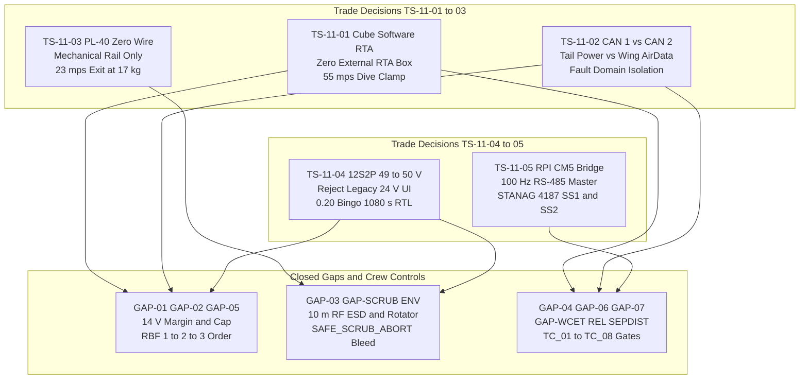

#### 11.3.1 `TS-11-01` (Cross-Ref `TRD-02`): `Cube orange+` Software-Hosted Simplex RTA vs. Standalone External RTA Hardware Box

- **Selected Architecture (`Option A` -- Score `4.35 / 5.00`)**: Software-hosted `ASTM F3269-17` §5.2 Simplex Run-Time Assurance (RTA) monitor (`RtaEnvelopeMonitorState`) executing directly inside `FlightControllerCubeOrangePlus` (`standaloneRtaBoxCount == 0`, `rtaHostedOnCubeOrangePlus == true`). Enforces `<= 55.0 m/s` terminal engagement clamping (`Abort Engaging`), `<= 80.0 m/s` structural `VNE` (`GAP-02`), `>= 24.0/26.0 m/s` stall envelope, `0.20` (`1080.0 s`) Bingo / `36.0 V` sag RTL, `105.0 s` GCS loss RTL, and ESAD bus-fault disarming (`OA-05`).
- **Rejected Alternative (`Option B` -- Score `2.55 / 5.00`; Margin `+1.80`)**: Standalone external Simplex RTA hardware enclosure wired inline between `Cube orange+`, `CAN 1` / `CAN 2` servo harnesses, and `Power Meter`.
- **Quantitative Multi-Criteria Comparison**:
 - `C2` SWaP & Power (`5` vs `1`): Within a `17.0 kg` MTOW airframe housing a `<= 5.0 kg` warhead, `12S2P` battery, `970.0 cm` trunk, `RPI CM5004032`, `Trip6`/`Nighthawk2UZ`, `DTC` radio, and `Artron ESAD`, adding a standalone enclosure consumes unallocated fuselage mass/volume and places extra quiescent load on `EPS`, directly exacerbating the `0.0 V` brownout margin on the `14.0 V` ESAD rail (`GAP-01`).
 - `C1` & `C3` Safety & Reliability (`4` vs `3` / `4` vs `3`): Eliminating an extra inline hardware relay box removes series connector failure modes (`MIL-STD-1629A` / `GAP-REL`) across both `CAN 1` and `CAN 2` actuator paths.
 - `C4` Determinism (`4` vs `4`) & `C5` Simplicity (`5` vs `2`): Co-locating RTA on `Cube orange+` streamlines `OA-05` BIT and pre-flight checks (`TC_03`) while accepting mandatory `RTCA DO-178C` §6.3 software partitioning and HIL bench closure of `GAP-WCET` (`REQ_SAF_08`).

#### 11.3.2 `TS-11-02` (Cross-Ref `TRD-03`): Physical `CAN 1` vs. `CAN 2` Bus Isolation vs. Single Unified DroneCAN Bus

- **Selected Architecture (`Option A` -- Score `4.60 / 5.00`)**: Dual physically isolated asymmetric DroneCAN buses (`canBusCount == 2`, `CanTopologyIsolationConstraint`, `CTL-04`): `CAN 1` operates as a multi-drop star/tap bus (`970.0 cm` trunk + `4x 120.0 cm` stubs) linking `Cube orange+` (`can1Master`) to `ElectronicPowerSystemEps`, `PowerMeterAndRbfSwitch` (bridging `IBEX160` ESC UART telemetry), and `4x HV6160-DroneCAN` tail ruddervators (`#1` through `#4` mixed pitch/yaw skid-turn); `CAN 2` operates as a strictly series daisy-chain from `Cube orange+` (`can2Master`) through the `CAN/power splitter PCB` across `4x HV6160-DroneCAN` wing roll servos (`#5` through `#8`) to `2x mRo RM3100` mag/baro units and `CUAV SKYE2` heated pitot (`CONN_12`, `CONN_13`).
- **Rejected Alternative (`Option B` -- Score `1.95 / 5.00`; Margin `+2.65`)**: Single unified DroneCAN bus multiplexing all `8x` servos, `EPS`, `Power Meter`, `2x RM3100`, and `SKYE2` pitot on one physical wire pair.
- **Quantitative Multi-Criteria Comparison**:
 - `C3` Fault Containment (`5` vs `1`) & `C1` Safety (`5` vs `2`): Physical bus segregation (`SAE ARP4754A` §5.1) prevents any single CAN short, node babble, or tail-fin stub fault from collapsing total flight control and power telemetry (`FM-08-03` RPN `180`). A `CAN 2` fault leaves `4x` pitch/yaw tail surfaces, `EPS`, and `Power Meter` Bingo telemetry intact on `CAN 1` for RTL; a `CAN 1` fault preserves `4x` wing roll surfaces, dual `RM3100`, and `SKYE2` pitot on `CAN 2`, while `Septentrio` RTK GNSS remains independently wired over `Serial` (`CONN_15`).
 - `C4` Timing Margin (`4` vs `2`): Segregating `ESC` / `EPS` power telemetry (`CAN 1`) from high-rate air-data / roll stabilization (`CAN 2`) cuts bus utilization and `CAN` arbitration contention (`GAP-WCET`). To mitigate `CAN 2` series daisy-chain dependency and shared `8.0 V` servo rail fault propagation (`FM-08-04` RPN `150`), `OA-06` executes full pre-flight sensor enumeration (`TC_03`, `TC_04`).

#### 11.3.3 `TS-11-03` (Cross-Ref `TRD-01`): Mechanical `PL-40` Zero-Wire Launch Rail (`IF-MECH-001`) vs. Hardwired Electrical / CAN Umbilical

- **Selected Architecture (`Option A` -- Score `4.40 / 5.00`)**: Strictly mechanical pneumatic catapult interface (`IF-MECH-001`, `CONN_23`, `electricalWireToUavCount == 0`) along the `5.0 m` (`4938.0 mm` CAD) `12.0 deg` `ELI PL-40 Rev 2.6` rail (`13.0-14.0 bar`, `~23.0 m/s` exit velocity at `17.0 kg` MTOW, strictly `<= 25.0 m/s` cap). Pre-flight BIT and `RBF #2` power operate autonomously on internal `12S2P` power via `4.4-5.0 GHz` RF (`>= 10.0 m` ground standoff), and `SS1` launch acceleration couples purely inertially into `Artron ESAD` (`CONN_24`).
- **Rejected Alternative (`Option B` -- Score `2.20 / 5.00`; Margin `+2.20`)**: Hardwired electrical/CAN umbilical harness spanning `PL-40` carriage to airframe for ground power, wired BIT, or launch-arm discretes.
- **Quantitative Multi-Criteria Comparison**:
 - `C1` Safety (`5` vs `2`) & `C5` Turnaround & Scrub Safety (`5` vs `2`): Zero physical conductors eliminates dynamic umbilical snag/shear failure at `~23.0 m/s` rail exit, eliminates conductive `MIL-STD-461G` `CS114`/`CS118` ESD/EMI transient entry into `Artron ESAD` during launch, keeps rail setup within `5.0 min` (`PRM-PL40-042`), and permits immediate `SAFE_SCRUB_ABORT` tank bleeding (`OA-17`, `GAP-SCRUB`) without detaching live umbilical plugs next to an armed warhead.
 - `C2` SWaP (`4` vs `2`) & `C3` Containment (`4` vs `3`): Eliminates umbilical bulkhead connectors and shear pins inside `17.0 kg` MTOW. Because no wire locks out pusher spin-up and `~23.0 m/s` sits slightly below `24.0-26.0 m/s` stall (`GAP-03`), `OA-16` enforces mandatory rearward prop folding (`145.0-155.5 mm` upper zone), `RBF #1` verification, `13.0-14.0 bar` check, `<= 12.0 m/s` headwind gate, and live RF BIT prior to pulling the red safety pin (`TC_07`).

#### 11.3.4 `TS-11-04` (Cross-Ref `TRD-05`): `12S2P` `49.0-50.0 V` (`36.0-50.4 V`) Electrical Architecture vs. Legacy `24 V` Telemetry/Pack Baseline

- **Selected Architecture (`Option A` -- Score `4.65 / 5.00`)**: Normative `12S2P Li metal BEI maximus20` pack (`36.0-50.4 V` operating bus, `49.0-50.0 V` pre-flight pass window, `legacy24VUiRejected == true`, `200.0 A` automotive fuse) driving `IBEX160` ESC and `970.0 cm` `EPS` DC trunk alongside `0.20` (`1080.0 s`) statutory Bingo RTL reserve (`5400.0 s` max endurance) and `36.0 V` sag RTL (`OA-04`).
- **Rejected Alternative (`Option B` -- Score `1.80 / 5.00`; Margin `+2.85`)**: Retaining legacy `24 V` (`23.9-25.0 V` screenshot / `6S`) voltage assumptions or launching without an enforced `49.0-50.0 V` gate and `0.20` reserve floor.
- **Quantitative Multi-Criteria Comparison**:
 - `C2` Electrical Margin (`5` vs `1`) & `C1` Safety (`5` vs `2`): Per the electrical loss formulation above, supplying equivalent bus power at `49.5 V` nominal (`36.0-50.4 V`) rather than `24.0 V` reduces `I_trunk` by `~51.5%` (halving current) and reduces `I^2 * R` ohmic heating and voltage sag along the `970.0 cm` DC trunk (`PRM-AV-012`) by `~76.5%`. Maintaining higher bus headroom across the trunk directly protects `ElectronicPowerSystemEps` regulation for the `0.0 V` brownout-margin `14.0 V` ESAD rail (`GAP-01`, `FM-04-04` RPN `192`).
 - `C3` Containment (`4` vs `2`) & `C5` Crew Clarity (`5` vs `1`): Rejecting `23.9-25.0 V` UI artifacts (`GAP-05`, `FM-13-02` RPN `144`) prevents crew (`UCL-01`, `UCL-03`) from launching a critically depleted `12S2P` battery (`< 36.0 V`), while dual `0.20` time-reserve and `36.0 V` voltage-sag triggers mitigate unprinted `Wh`/`Ah` capacity gaps (`GAP-ENV`, `TC_01`, `TC_02`).

#### 11.3.5 `TS-11-05` (Cross-Ref `TRD-04`): `RPI CM5004032` (`Ring 2`) Mediated `100.0 Hz` RS-485 ESAD Supervision vs. Direct Autopilot Coupling or Single-Barrier Arming

- **Selected Architecture (`Option A` -- Score `4.60 / 5.00`)**: `CompanionComputeRpiCm5` (`Ring 2`) serves as sole `OC Master` bridging `SwarmC2` IP (`Ethernet`) and `Cube orange+` (`Serial`) to `Artron ESAD` (`Ring 3`) over isolated half-duplex `` `8N1` differential `RS-485` with `Frame Integrity Check XModem` integrity at `100.0 Hz` (`0.01 s` period, `<= 5.0 ms` reply, `<= 10.0 ms` watchdog timeout per `GAP-04`), paired with out-of-band `DSC_IN1` (`1000.0 Hz`, `2` pulses, `50.0%` duty) hardware arm discrete, `STANAG 4187` dual physical barriers (`SS1` launch accel + `SS2` `Safe Distance Exceed == 1` per `GAP-07`), `RBF #2` power-before-pull `RBF #3` (`UMB < 0.5 Ohm` at `20.0 mA` per `GAP-06`), `< 50.0 V` PBIT safe ceiling, and `J401` `0.0-1800.0 V` initiation gating (`OA-08`, `OA-10`, `OA-11`).
- **Rejected Alternative (`Option B` -- Score `1.95 / 5.00`; Margin `+2.65`)**: Direct `Cube orange+` autopilot coupling to ESAD without `Ring 2` `OC Master` isolation, or software-only single-barrier arming omitting hardware `DSC_IN1` and `SS1`/`SS2`.
- **Quantitative Multi-Criteria Comparison**:
 - `C1` Ordnance Safety (`5` vs `1`) & `C3` Containment (`5` vs `2`): Achieves zero pre-launch single-point failures (`INT-01`, `NATO STANAG 4187 Ed. 5`), enforces hardware `FaultStates` bit 4 lockout if `DSC_IN1` pulses arrive before `Arm Stage 2` (`TC_06`), and guarantees positive `DoD Directive 3000.09` HITL control (`>= 5.0 s` self-destruct/abort hold, `105.0 s` `Disarm ESAD On GCS Timeout`, and irreversible `Power Off ESAD` via `EPS`).
 - `C4` Determinism (`4` vs `2`): Offloads `100.0 Hz` (`0.01 s`) half-duplex `RS-485` polling, `Frame Integrity Check XModem` verification, and `10.0 ms` watchdog supervision off `Cube orange+` flight-control threads (`GAP-WCET`). Residual `GAP-01` (`0.0 V` rail margin) and `GAP-SEPDIST` unprinted separation/timer constants are explicitly mitigated by `EpsEsadZeroBrownoutMarginConstraint` supervision (`TC_02`) and calibration sign-off before field arming.

#### Table 11.5: Multi-Criteria Weighted Trade Study Scorecard (`TS-11-01` through `TS-11-05`)

| Trade Study ID | Architectural Decision Domain | C1 Safety (`0.30`) Opt A / B | C2 SWaP & Power (`0.25`) Opt A / B | C3 Fault Isolation (`0.20`) Opt A / B | C4 Timing Margin (`0.15`) Opt A / B | C5 Ops & Scrub (`0.10`) Opt A / B | Weighted Score Option A | Weighted Score Option B | Net Margin (`Delta S`) |
| :--- | :--- | :--- | :--- | :--- | :--- | :--- | :--- | :--- | :--- |
| `TS-11-01` (`TRD-02`) | `Cube orange+` software RTA vs standalone box | `4` / `3` | `5` / `1` | `4` / `3` | `4` / `4` | `5` / `2` | 4.35 | 2.55 | 1.80 |
| `TS-11-02` (`TRD-03`) | Physical `CAN 1` vs `CAN 2` isolation vs unified CAN | `5` / `2` | `4` / `3` | `5` / `1` | `4` / `2` | `5` / `1` | 4.60 | 1.95 | 2.65 |
| `TS-11-03` (`TRD-01`) | Zero-wire `PL-40` rail vs electrical umbilical | `5` / `2` | `4` / `2` | `4` / `3` | `4` / `2` | `5` / `2` | 4.40 | 2.20 | 2.20 |
| `TS-11-04` (`TRD-05`) | `12S2P` `49-50 V` bus vs legacy `24 V` UI baseline | `5` / `2` | `5` / `1` | `4` / `2` | `4` / `3` | `5` / `1` | 4.65 | 1.80 | 2.85 |
| `TS-11-05` (`TRD-04`) | `RPI CM5` `100 Hz` RS-485 bridge vs direct autopilot | `5` / `1` | `4` / `3` | `5` / `2` | `4` / `2` | `5` / `2` | 4.60 | 1.95 | 2.65 |

#### Table 11.6: Quantitative Trade-Off Parameter Comparison (`TS-11-01` through `TS-11-05`)

| Trade Study ID | Quantitative Trade Metric | Qualifier | Value | Units | Rejected Alternative Comparison & Verification Reference |
| :--- | :--- | :--- | :--- | :--- | :--- |
| `TS-11-01` | Standalone external RTA hardware enclosure count (`Cube orange+` software RTA) | Exact | 0 | count | Option B adds `>= 1` unbudgeted box and inline connectors inside `17.0 kg` MTOW (`TC_03`) |
| `TS-11-01` | Software Simplex RTA terminal engagement dive speed cap (`Abort Engaging`) | Max | 55.0 | m/s | Clamps below `80.0 m/s` `VNE` without extra `EPS` rail drain on `GAP-01` (`TC_03`, `TC_05`) |
| `TS-11-02` | Physically isolated DroneCAN controller buses (`CAN 1` vs `CAN 2`) | Exact | 2 | count | Option B places all `8` servos, `EPS`, `Power Meter`, `2x RM3100`, `SKYE2` on `1` bus (`TC_03`, `TC_04`) |
| `TS-11-02` | `CAN 1` fuselage power and tail-fin actuation trunk length | Nominal | 970.0 | cm | Segregated from `CAN 2` splitter daisy-chain; `4x 120.0 cm` stubs feed fins `#1` through `#4` (`TC_03`) |
| `TS-11-03` | Electrical or CAN conductors crossing `PL-40` to UAV rail (`IF-MECH-001`) | Exact | 0 | count | Option B hardwired umbilical introduces snag/ESD hazard at `~23.0 m/s` rail exit (`TC_07`, `TC_08`) |
| `TS-11-03` | Interpolated `PL-40` exit velocity at `17.0 kg` MTOW (`<= 25.0 m/s` rated limit) | Nominal | 23.0 | m/s | `22.7-23.5 m/s` band gated by `13.0-14.0 bar` and `<= 12.0 m/s` headwind (`GAP-03`, `TC_07`) |
| `TS-11-04` | Pre-flight `12S2P` main battery verification voltage floor (`GAP-05`) | Min | 49.0 | V | Option B `23.9-25.0 V` legacy UI doubles `970.0 cm` trunk current (`~4x` ohmic loss, `TC_01`) |
| `TS-11-04` | Statutory `0.20` Bingo energy reserve duration (`5400.0 s` max endurance) | Min | 1080.0 | s | Option B zero-reserve mission sizing risks `SORA` corridor breach and `< 36.0 V` collapse (`TC_02`) |
| `TS-11-05` | `RPI CM5004032` cyclic RS-485 supervision polling frequency (``) | Exact | 100.0 | Hz | `0.01 s` period with `<= 5.0 ms` reply and `<= 10.0 ms` watchdog isolated from `Cube` RTOS (`TC_04`, `TC_06`) |
| `TS-11-05` | Stage 2 `DSC_IN1` hardware discrete arm enable square-wave frequency (`2` pulses) | Exact | 1000.0 | Hz | `1.0 ms` period, `50.0%` duty, `2.5-3.3 V` high; premature pulse latches fault (`TC_06`) |

---

### 11.4 Cross-Artifact Traceability & Verification Closure Summary

Every operational impact (`IMP-01` through `IMP-18`), explicit system limitation (`GAP-01` through `GAP-07`, `GAP-WCET`, `GAP-REL`, `GAP-SEPDIST`, `GAP-ENV`, `GAP-SCRUB`), and quantitative trade study (`TS-11-01` through `TS-11-05`) closes directly onto SysML v2 requirements (`.pipeline/schema.sysml`), STPA controls (`docs/safety/STPA_MATRIX.md`), FMECA failure modes (`docs/research/FAILURE_MODE_REGISTRY.md`), and verification test suites (`TC_01` through `TC_08`).

#### Table 11.7: Section 11 Impact, Limitation & Trade Study Verification Closure Matrix

| Section 11 Element | Bound `REQ_SAF_*` / `REQ_SC_*` | Bound `RESEARCH_INVENTORY.md` IDs | Bound `OA-*` & `SCN-*` Threads | Closing Verification Test Cases |
| :--- | :--- | :--- | :--- | :--- |
| Zero failsafe containment & `0.20` Bingo (`IMP-01`, `IMP-02`) | `REQ_SC_02`, `REQ_SC_03` | `MET-02`, `CTL-04`, `EXT-01` | `OA-03`, `OA-04`; `SCN-02`, `SCN-08` | `TC_01_PreflightPowerAndRbfSequence`, `TC_02_BingoReserveAndEpsBrownoutMonitor` |
| `>= 10.0 m` RF, ESD & Rotator (`IMP-03` through `IMP-06`) | `REQ_SC_01`, `REQ_SC_15` | `OBL-04`, `INT-04`, `MET-02` | `OA-01`, `OA-18`; `SCN-01`, `SCN-07` | `TC_01_PreflightPowerAndRbfSequence`, `TC_08_EmergencyScrubHangfireAndC2Auth` |
| `BL1860B` Swap & `100`-Launch Cycle (`IMP-07` through `IMP-13`) | `REQ_SC_14`, `REQ_SAF_11` | `MET-01`, `EXT-02` | `OA-15`, `OA-16`; `SCN-06` | `TC_07_Pl40RailChargeLaunchAndZeroWire` |
| `RBF #1 -> #2 -> #3` & `SAFE_SCRUB_ABORT` (`IMP-14` through `IMP-18`) | `REQ_SC_01`, `REQ_SC_09`, `REQ_SC_16`, `REQ_SAF_06`, `REQ_SAF_12` | `INT-01`, `MET-03`, `MET-04` | `OA-01`, `OA-10`, `OA-11`, `OA-12`, `OA-17`; `SCN-01`, `SCN-05`, `SCN-08` | `TC_01_PreflightPowerAndRbfSequence`, `TC_06_EsadProtocolInterlockAndHvFireGate`, `TC_08_EmergencyScrubHangfireAndC2Auth` |
| `TS-11-01` (`Cube` Software RTA) & `GAP-02`, `GAP-WCET` | `REQ_SC_05`, `REQ_SAF_02`, `REQ_SAF_08`, `REQ_SAF_09` | `CTL-01`, `INT-03`, `MET-03` | `OA-05`, `OA-13`; `SCN-02`, `SCN-04` | `TC_03_SimplexRtaEnvelopeAndActuation`, `TC_05_EoIrTargetTrackAndSpeedCapAbort` |
| `TS-11-02` (`CAN 1` vs `CAN 2`) & `GAP-WCET`, `GAP-REL` | `REQ_SC_06`, `REQ_SC_07`, `REQ_SAF_08`, `REQ_SAF_09` | `CTL-04`, `INT-02`, `INT-03` | `OA-06`, `OA-07`, `OA-09`; `SCN-01`, `SCN-02`, `SCN-03` | `TC_03_SimplexRtaEnvelopeAndActuation`, `TC_04_GnssDeniedDrAndPaceLinkFailsafe` |
| `TS-11-03` (`PL-40` Zero Wire) & `GAP-03`, `GAP-SCRUB` | `REQ_SC_13`, `REQ_SC_14`, `REQ_SAF_03`, `REQ_SAF_12` | `MET-01`, `MET-04`, `EXT-02` | `OA-15`, `OA-16`, `OA-17`; `SCN-06`, `SCN-08` | `TC_07_Pl40RailChargeLaunchAndZeroWire`, `TC_08_EmergencyScrubHangfireAndC2Auth` |
| `TS-11-04` (`12S2P` `49-50 V`) & `GAP-01`, `GAP-05`, `GAP-ENV` | `REQ_SC_02`, `REQ_SC_04`, `REQ_SAF_01`, `REQ_SAF_05`, `REQ_SAF_11` | `CTL-04`, `MET-02`, `EXT-01` | `OA-01`, `OA-02`, `OA-03`, `OA-04`; `SCN-01`, `SCN-02` | `TC_01_PreflightPowerAndRbfSequence`, `TC_02_BingoReserveAndEpsBrownoutMonitor` |
| `TS-11-05` (`RPI CM5` `100 Hz` RS-485) & `GAP-04`, `GAP-06`, `GAP-07`, `GAP-SEPDIST` | `REQ_SC_08` through `REQ_SC_12`, `REQ_SAF_04`, `REQ_SAF_06`, `REQ_SAF_07`, `REQ_SAF_10` | `INT-01`, `CTL-03`, `MET-03` | `OA-08`, `OA-10`, `OA-11`, `OA-12`; `SCN-03`, `SCN-05` | `TC_04_GnssDeniedDrAndPaceLinkFailsafe`, `TC_06_EsadProtocolInterlockAndHvFireGate` |

/// OperationalAllocation: [OA-01]
/// OperationalAllocation: [OA-02]
/// OperationalAllocation: [OA-03]
/// OperationalAllocation: [OA-04]
/// OperationalAllocation: [OA-05]
/// OperationalAllocation: [OA-06]
/// OperationalAllocation: [OA-07]
/// OperationalAllocation: [OA-08]
/// OperationalAllocation: [OA-09]
/// OperationalAllocation: [OA-10]
/// OperationalAllocation: [OA-11]
/// OperationalAllocation: [OA-12]
/// OperationalAllocation: [OA-13]
/// OperationalAllocation: [OA-14]
/// OperationalAllocation: [OA-15]
/// OperationalAllocation: [OA-16]
/// OperationalAllocation: [OA-17]
/// OperationalAllocation: [OA-18]
/// OperationalAllocation: [OA-19]
/// OperationalAllocation: [MET-01]
/// OperationalAllocation: [MET-02]
/// OperationalAllocation: [MET-03]
/// OperationalAllocation: [MET-04]

## 12. Emergency Decision & Contingency Matrix

- **Document Date:** `2026-11-16`
- **System Baseline:** `Avenger5V25UasSystem` (`Avenger 5 V2.5 UAS` / `ASTK A5 V2.5` + `ELI Military Simulations PL-40 Rev 2.6` + `Artron ESAD AB00-0054-01AA-0005` + `SwarmC2`)
- **JSON Schema Mapping:** `emergency_matrix` (`ISO/IEC/IEEE 29148:2018` §6.4 and Annex A §A.2; `IEEE Std 1362-1998` §4.3; `MIL-STD-882E` Tasks 202, 205, and 206; `MIL-STD-1629A` Methods 101 and 102; `SAE ARP4754A` §5.1 / `ARP4761`; `ASTM F3269-17` §5.2; `NATO STANAG 4187 Ed. 5`; `RTCA DO-362A` §3.2; `JARUS SORA v2.5` Annex B/C; `DoD Directive 3000.09` §4.1.a; `NIST SP 800-82r3`)
- **Level 1B Hardware-Faithful Invariants:** Software-hosted `ASTM F3269-17` Simplex Run-Time Assurance (`RTA`) executing strictly inside `FlightControllerCubeOrangePlus` (`standaloneRtaBoxCount == 0`, `rtaHostedOnCubeOrangePlus == true`); strictly mechanical zero-wire `Pl40PneumaticLauncher` interface (`IF-MECH-001`, `CONN_23`, `electricalWireToUavCount == 0`); zero production recovery parachutes (`rndRecoveryOptionInstalled == false`, optional `2x 50.0 V` recovery igniter rails permanently inhibited); `12S2P` `36.0-50.4 V` primary DC bus (`49.0-50.0 V` pre-flight check rejecting legacy lower-voltage UI artifacts per `GAP-05`); `UCL-01` through `UCL-05` User Class taxonomy with zero Level 2 use-case references and zero Level 1C serial hex or pinouts.

---

### 12.1 Emergency Decision & Contingency Matrix (`EMG-01` through `EMG-08`)

In accordance with `ISO/IEC/IEEE 29148:2018` Annex A (§A.2), `MIL-STD-882E` Tasks 202/205/206, and `docs/safety/STPA_MATRIX.md` (Pillars 1 through 9), `Table 12.1` defines eight deterministic emergency triggers (`EMG-01` through `EMG-08`) covering C2/RC link loss, flight-envelope dive overspeed, GNSS denial, `PL-40` catapult launch scrub and hangfire recovery, `Artron ESAD` supervision and `14.0 V` brownout faults, Bingo energy and geofence return-to-launch, positive Human-in-the-Loop (HITL) terminal abort and self-destruct, and `EO/IR` Ethernet bridge or `IBEX160` thermal overload. All numeric response latency bounds are isolated strictly into separate `Max Response` and `Units` columns (`Check 26`), and unprinted OEM timing/thermal parameters are explicitly designated `UNPRINTED` or `OPERATOR_CONFIGURED` under `GAP-WCET` (`REQ_SAF_08`) and `GAP-ENV` (`REQ_SAF_11`) without fabrication (`Check 23`).

#### Table 12.1: Emergency Decision & Contingency Matrix (`EMG-01` through `EMG-08`)

| Emergency ID | Contingency Trigger Event | Detection Mechanism | Primary Failsafe State | Automated Containment Action | Max Response | Units | HITL Authority / Governing Role |
| :--- | :--- | :--- | :--- | :--- | :--- | :--- | :--- |
| `EMG-01` | C2 / RC Datalink Loss: uninterrupted outage across `4.4-5.0 GHz` `AES-256` FHSS air-ground link (`CONN_21` / `IF-RF-001`) or `SwarmC2` wired IP / `200.0 m` fiber link (`CONN_22` / `IF-GND-001`) reaching `GCS Failsafe Timeout` (`105.0 s` baseline; `2.0 min` pre-flight detect window `PRM-GCS-002`) | `FlightControllerCubeOrangePlus` C2 heartbeat loss timer (`PRM-GCS-008`, `105.0 s` baseline) and `SwarmC2OperatorConsole` pre-flight telemetry detect timer (`2.0 min` ceiling; `FM-09-01`, `FM-13-01`, `FM-14-01`) | `PaceC2LinkState::EmergencyLostLinkRtlHolding`, `RtaEnvelopeMonitorState::CriticalBatteryOrGeofenceRtb`, `UavFlightLifecycleState::EmergencyAbortOrRtb` | Software Simplex RTA on `Cube orange+` aborts active dive/cruise and initiates autonomous `RTL` (`Fly HOME Then Land` via Home or closer Rally point, or `Go Directly to landing sequence`), commands `RPI CM5004032` to execute `Disarm ESAD On GCS Timeout` (`OA-05`, `OA-12`) discharging HV below `50.0 V`, and auto-re-enables `Septentrio` GNSS if disabled (`REQ_SC_12`, `REQ_SC_15`) | 105.0 | s | Autonomous (`Cube orange+` RTA + `RPI CM5`); `UCL-01` Pilot Operator manages `DIR` to `OMNI` fallback, `0.5 deg` rotator trim, and `GUIDED`/`LOITER` recovery on reacquisition |
| `EMG-02` | Terminal Dive Overspeed / Envelope Violation: airspeed during `TargetTrackAndDive` (`ATTACK`) approaches or exceeds `55.0 m/s` gimbal cap (`GAP-02`), `80.0 m/s` structural `VNE`, `22.0 deg` max dive angle, or drops below `24.0 m/s` (`V2.5`) / `26.0 m/s` (`V1`) stall floor (`~23.0 m/s` rail exit `GAP-03`) | `FlightControllerCubeOrangePlus` software `ASTM F3269-17` Simplex RTA (`standaloneRtaBoxCount == 0`, `ExecuteSimplexRtaEnvelopeCheck`) monitoring `CUAV SKYE2` pitot (`CAN 2`, `CONN_13`) and EKF2 attitude/velocity (`FM-05-03`, `FM-07-03`, `FM-08-03`) | `RtaEnvelopeMonitorState::AirspeedDiveCapClamped` transitioning to `UavFlightLifecycleState::EmergencyAbortOrRtb` (`GUIDED` loiter or `RTL`) | Software Simplex RTA immediately overrides `Trip6` guidance (`IF-SER-003`), executes `Abort Engaging` level pull-up across `CAN 1` tail fins (`#1` through `#4`, `120.0 cm` stubs) and `CAN 2` wing servos (`#5` through `#8`), climbs toward `Takeoff altitude`, enters `GUIDED` loiter (`>= 300.0 m` radius, zero auto re-track), or transitions to `RTL` if C2 is lost (`REQ_SC_05`, `REQ_SAF_02`, `REQ_SAF_08` bench WCET around `0.01 s` ESAD horizon) | UNPRINTED | ms | Autonomous (`Cube orange+` Software Simplex RTA override cannot be bypassed); `UCL-01` Pilot and `UCL-02` Payload Operator verify safe climb and command re-plan or `RTL` |
| `EMG-03` | GNSS Denial, Jamming, or Spoofing: `Septentrio Asterx-m3 pro` / `Talysman TW3972EXF` solution degradation, loss, or spoofing anomaly (`IF-SER-002`, `IF-RF-002`, `CONN_15`) | `FlightControllerCubeOrangePlus` `GPS Failsafe` innovation/outage monitor (`GPS Failsafe Timeout`) and `SwarmC2` operator navigation integrity alert (`FM-05-02`, `FM-07-02`) | `PaceC2LinkState::ContingencyGnssDeniedDrFlight` (escalating to `EmergencyLostLinkRtlHolding` if RF C2 also fails) | `SwitchToGnssDeniedDeadReckoning` (`OA-07`) isolates corrupted GNSS observables and transitions EKF2 to INS dead-reckoning fusing dual redundant `mRo RM3100` magnetometers/barometers and `CUAV SKYE2` heated pitot (`CAN 2`); sustains flight stabilization while `4.4-5.0 GHz` C2 link remains active and auto-re-enables GNSS if RF link loss reaches `105.0 s` (`REQ_SC_07`) | OPERATOR_CONFIGURED | s | `UCL-01` Pilot Operator authorizes `Disable GNSS` mode in `SwarmC2` and supplies visual map fixes (`I'm Here` and `I'm Looking Here`); Autonomous DR stabilization on `Cube orange+` |
| `EMG-04` | `PL-40` Launch Scrub, Hangfire, or `14.5 V` UVLO Stall: zero carriage release after `>= 2.0 s` dual-switch hold, piston over-accel inlet shutoff on loose lock-pad, `Makita BL1860B <= 14.5 V` UVLO (`PWR` LED flash), pressure outside `13.0-14.0 bar`, surface wind `> 12.0 m/s`, or abort after `RBF #3` / pin removal (`GAP-03`, `GAP-SCRUB`) | Visual zero-motion hangfire verification from rear `SAFETY AREA`, `PL-40` compressor `<= 14.5 V` UVLO cutoff indicator (`> 16.0 V` after `5.0 s` restart), pressure gauge check, and `SwarmC2` pre-launch Go/No-Go alert (`FM-12-01` through `FM-12-04`, `FM-15-02`) | `Pl40LauncherState::ScrubbedSafeDepressurized`, `EsadSafeArmState::SafePowerOff`, and `UavFlightLifecycleState::SafePostFlightShutdown` (`SAFE_SCRUB_ABORT`) | `100%` crew hold in rear `SAFETY AREA` (zero entry into forward/lateral `DANGER ZONE`) across derived `>= 10.0 min` hangfire holdback dwell (`GAP-SCRUB`, `REQ_SAF_12`; OEM hangfire timer unprinted per `PL-40#p26`); command `>= 5.0 s` ESAD abort + `Slide to confirm` and irreversible `Power Off ESAD` (`< 50.0 V` verified), close `Main Valve 4`, bleed tank to `0.0 bar`, reinsert red safety pin, touch transport box ESD point, and restore `RBF #3` prior to `RBF #2` (`REQ_SC_16`) | 10.0 | min | `UCL-03` Launch Assistant executes `SAFE_SCRUB_ABORT` bleed and pin restore; `UCL-02` / `UCL-01` command ESAD abort and `Power Off ESAD`; `UCL-05` Arming Safety Lead verifies reverse `RBF #3 -> #2` safing |
| `EMG-05` | `Artron ESAD` `PBIT`, `100.0 Hz` Bus, or `EPS` `14.0 V` Brownout Fault: pre-flight `PBIT` HV `>= 50.0 V`, premature `RBF #3` removal (`GAP-06`), `RPI CM5` `100.0 Hz` (`0.01 s`) RS-485 `Frame Integrity Check XModem` fault (`> 5.0 ms` reply / `> 10.0 ms` timeout, `GAP-04`), premature `DSC_IN1` (`1000.0 Hz`, `2` pulses, `FaultStates` bit 4), or `EPS` `14.0 V` sag (`0.0 V` margin, `GAP-01`) | `CompanionComputeRpiCm5` cyclic `RS-485` watchdog (`<= 10.0 ms` incomplete-packet timeout, `PRM-ESAD-019`), `Artron ESAD` internal `PBIT` / `UMB` (`< 0.5 Ohm` at `20.0 mA`) / `FaultStates` monitors, and `EPS` `CAN 1` rail telemetry (`FM-04-01`, `FM-06-01`, `FM-11-01`, `FM-11-02`) | `EsadSafeArmState::FaultLockout` -> `SafePowerOff` and `RtaEnvelopeMonitorState::EsadBusWatchdogFaultFallback` -> `CriticalBatteryOrGeofenceRtb` | ESAD hardware immediately latches `FaultLockout` inhibiting `0.0-1800.0 V` `J401` charge; `RPI CM5` commands abort HV discharge (`< 50.0 V`); `Cube orange+` transitions to `EsadBusWatchdogFaultFallback`, commands irreversible `Power Off ESAD` via `EPS` (`CAN 1`, `CONN_10`), aborts `ATTACK` dive, and triggers `RTL` or `SAFE_SCRUB_ABORT` if on rail (`REQ_SC_08`, `REQ_SC_09`, `REQ_SC_10`, `REQ_SAF_01`, `REQ_SAF_04`, `REQ_SAF_06`) | 10.0 | ms | Autonomous (`Artron ESAD` hardware lockout + `RPI CM5` watchdog + `Cube orange+` RTA); `UCL-02` Payload Operator and `UCL-05` Safety Lead prohibit launch or verify safe `RTL` and `Power Off ESAD` |
| `EMG-06` | Bingo Energy Reserve, Main Bus Sag, or Geofence Breach: remaining endurance reaches `<= 20%` (`0.20` statutory ratio = `1080.0 s` of `5400.0 s`), `12S2P` DC bus sags `< 36.0 V` (`PRM-AV-001`), or trajectory approaches `Inclusion` / `Exclusion` polygon geofence, `5000.0 m` ceiling, or `60.0/90.0 km` RLOS containment limit | `PowerMeterAndRbfSwitch` V/I monitoring on `CAN 1` (`CONN_09`, `MonitorBingoEnergyReserve`) and `FlightControllerCubeOrangePlus` geofence / `SORA` `R_containment` monitor (`FM-01-04`, `FM-02-03`, `FM-04-04`, `FM-15-04`) | `RtaEnvelopeMonitorState::CriticalBatteryOrGeofenceRtb` and `UavFlightLifecycleState::EmergencyAbortOrRtb` (`RTL`) | Software Simplex RTA overrides active mode to autonomous `RTL` (`Fly HOME Then Land` or closer Rally point) preserving the `1080.0 s` landing reserve (`ProductionNoParachuteConstraint`: `0` parachutes, `2x 50.0 V` optional RnD rails inhibited) and triggers `Disarm ESAD On GCS Timeout` / ordnance safing (`REQ_SC_02`, `REQ_SC_03`, `REQ_SAF_05`, `REQ_SAF_11`, `GAP-WCET`) | UNPRINTED | ms | Autonomous (`Cube orange+` RTA reserve and geofence enforcement); `UCL-01` Pilot Operator monitors energy margin (`49.0-50.0 V` pre-flight gate) and selects Home or Rally recovery corridor |
| `EMG-07` | HITL Terminal Engagement Abort / ESAD Self-Destruct (`DoD Dir 3000.09`): target invalidation, ROE veto, unmet `6` engagement preconditions (`2.0-5.0 s` EO hold, `<= 15.0 deg` elev, clear LOS, `<= 55.0 m/s` cap), or `Safe Distance Exceed == 1` (`SS2`, `GAP-07`) barrier mismatch while armed | `UCL-02` Payload Operator / `UCL-01` Pilot tactical assessment, `SwarmC2` `6`-precondition interlock gate, and `Artron ESAD` `SS1` + `SS2` (`Safe Distance Exceed == 1`) telemetry (`FM-10-02`, `FM-11-03`, `FM-13-03`) | `EsadSafeArmState::DetonatedOrAborted` -> `SafePowerOff` and `UavFlightLifecycleState::EmergencyAbortOrRtb` (`GUIDED` `>= 300.0 m` loiter or `RTL`) | `UCL-02` executes `>= 5.0 s` continuous `SELF DESTRUCT` or permanent `ABORT` hold + `Slide to confirm` (`PRM-GCS-010`) and optional irreversible `Power Off ESAD` (`< 50.0 V` bleed), OR commands `Abort Engaging` climb to `Takeoff altitude` -> `GUIDED` loiter orbit (`>= 300.0 m` radius, zero auto re-track); `Auto-SAFE` discharges ESAD automatically upon landing while not armed (`REQ_SC_11`, `REQ_SC_12`, `REQ_SAF_07`) | 5.0 | s | Positive HITL exclusive (`DoD Directive 3000.09` §4.1.a): `UCL-02` Payload Operator holds sole ESAD arm, `>= 5.0 s` self-destruct/abort, and `Power Off ESAD` consent; `UCL-01` Pilot commands trajectory abort/`RTL` |
| `EMG-08` | `EO/IR` Bridge Hang or `IBEX160` Propulsion Over-Temperature: `Nighthawk2UZ` / `Trip6` video freeze (`IF-VID-001`, `IF-ETH-001`, `CONN_19`), `Internal Ethernet Switch` lockup, OR `IBEX160` ESC / `AXI 5345/16` motor over-temperature across `-20.0 to +50.0 degC` ambient (`GAP-ENV`) | `SwarmC2` video freeze / `Trip6` track-loss indicator (`FM-09-03`, `FM-10-01`) and `PowerMeterAndRbfSwitch` bridging `IBEX160` `IF-SER-005` UART ESC temp, motor temp, RPM, V, and I onto `CAN 1` (`CONN_02`, `CONN_09`, `FM-03-04`) | `UavFlightLifecycleState::CruiseAndLoiter` (on `Reboot Gimbal` / `Abort Engaging`) or `EmergencyAbortOrRtb` (`RTL` on thermal overload) | For `EO/IR` freeze: with external `USB/ETH` umbilical lid locked (`OBL-04`), `UCL-02` executes in-flight `Reboot Gimbal` (`RebootGimbalAndBridgeEthernet`; `Reboot Vehicle` inhibited while armed) and aborts any active dive (`>= 300.0 m` `GUIDED` loiter, zero auto re-track). For `IBEX160`/motor over-temp: `Cube orange+` throttles back pusher demand, disarms ESAD, and commands `RTL` prior to `200.0 A` fuse trip or unpowered glide (`REQ_SC_04`, `REQ_SC_12`, `REQ_SAF_08`, `REQ_SAF_11`) | UNPRINTED | ms | `UCL-02` Payload Operator initiates in-flight `Reboot Gimbal` and `Abort Engaging`; `UCL-01` Pilot commands power reduction / `RTL` on `CAN 1` ESC thermal alert; `UCL-05` inspects propulsion post-recovery |

#### Table 12.2: Grounded Emergency Latency, Containment & Interlock Quantitative Thresholds (`Check 26`)

| Param ID | Bound Emergency IDs | Emergency Threshold Parameter | Qualifier | Value | Units | SSOT & OEM Ground Truth Source |
| :--- | :--- | :--- | :--- | :--- | :--- | :--- |
| `PRM-GCS-008` | `EMG-01`, `EMG-03` | `GCS Failsafe` Lost-Link RTL & ESAD Disarm Timeout | Nominal | 105.0 | s | `.pipeline/schema.sysml` (`SwarmC2OperatorConsole`); `A5-user-manual 2.pdf#p34` |
| `PRM-GCS-002` | `EMG-01` | Pre-Flight Telemetry Detection Timeout on `RBF #2` Pull | Max | 2.0 | min | `parametric_limits.md`; `A5-user-manual 2.pdf#p52` |
| `PRM-PERF-010` | `EMG-02`, `EMG-07` | Software Simplex RTA Terminal Engagement Speed Cap | Max | 55.0 | m/s | `FlightEnvelopeSpeedConstraint` (`GAP-02`, `Abort Engaging`) |
| `PRM-PERF-011` | `EMG-02` | Airframe Structural Never-Exceed Dive Speed (`VNE`) | Max | 80.0 | m/s | `FlightEnvelopeSpeedConstraint` (`AVENGER 5 Spec sheet_rev3.pdf#p3`) |
| `PRM-PERF-004` | `EMG-02`, `EMG-04` | Airframe Minimum / Stall Airspeed Floor (`V2.5` / `V1`) | Min | 24.0 | m/s | `FlightEnvelopeSpeedConstraint` (`26.0 m/s` `V1`, `PRM-PERF-005`) |
| `PRM-PL40-003` | `EMG-02`, `EMG-04` | `PL-40` Exit Velocity at `17.0 kg` MTOW (`<= 25.0 m/s` cap) | Nominal | 23.0 | m/s | `Pl40MassAndExitVelocityConstraint` (`22.7-23.5 m/s`, `GAP-03`) |
| `PRM-PL40-037` | `EMG-04` | Dual Safety-Covered Launch Switch Simultaneous Hold | Min | 2.0 | s | `Pl40UvloAndDualSwitchConstraint` (`PL-40#p25-#p26`) |
| `PRM-PL40-034` | `EMG-04` | `Makita BL1860B` Compressor Pack UVLO Cutoff Threshold | Max | 14.5 | V | `Pl40UvloAndDualSwitchConstraint` (`> 16.0 V` after `5.0 s` restart) |
| `GAP-SCRUB-DWELL` | `EMG-04` | `SAFE_SCRUB_ABORT` Hangfire Crew Holdback Dwell (`Derived`) | Min | 10.0 | min | `GAP-SCRUB` (`REQ_SAF_12`, `REQ_SC_16`; OEM timer unprinted `PL-40#p26`) |
| `PRM-ESAD-017` | `EMG-05` | `RPI CM5` `OC Master` Cyclic `RS-485` Poll Frequency | Exact | 100.0 | Hz | `EsadRs485ProtocolTimingConstraint` (`0.01 s` period, `GAP-04`) |
| `PRM-ESAD-020` | `EMG-05` | `Artron ESAD` `RS-485` Command Reply Max Latency | Max | 5.0 | ms | `EsadRs485ProtocolTimingConstraint` (`ESAD ICD#p15`) |
| `PRM-ESAD-019` | `EMG-05` | `Artron ESAD` Incomplete-Frame / Watchdog Timeout | Max | 10.0 | ms | `EsadRs485ProtocolTimingConstraint` (`ESAD ICD#p15`) |
| `PRM-AV-010` | `EMG-05` | `EPS` ESAD Rail Voltage (`0.0 V` Margin vs `14.0 V` Min) | Min | 14.0 | V | `EpsEsadZeroBrownoutMarginConstraint` (`GAP-01`) |
| `PRM-ESAD-029` | `EMG-05`, `EMG-07` | `Artron ESAD` Pre-Flight `PBIT` Safe HV Ceiling | Max | 50.0 | V | `WarheadMassAndPbitHvSafetyConstraint` (`ESAD ICD#p18`) |
| `PRM-ESAD-004` | `EMG-04`, `EMG-05` | `ESAD RBF #3` Umbilical Loop (`UMB`) Max Continuity Resistance | Max | 0.5 | Ohm | `EsadRbf3PowerBeforePullConstraint` (`20.0 mA` sense, `GAP-06`) |
| `PRM-PERF-003` | `EMG-06` | Statutory Bingo Energy Reserve Ratio (`1080.0 s` of `5400.0 s`) | Min | 0.20 | ratio | `BingoEnergyReserveConstraint` (`MET-02`, `REQ_SC_02`) |
| `PRM-AV-001` | `EMG-06` | Main `12S2P` DC Bus Operating Floor (`49.0-50.0 V` Pre-Flight) | Min | 36.0 | V | `MainBatteryPreFlightVoltageConstraint` (`GAP-05`, `50.4 V` max) |
| `PRM-GCS-007` | `EMG-02`, `EMG-07` | `SwarmC2` Minimum Recovery Loiter Orbit Radius | Min | 300.0 | m | `SwarmC2AuthAndMissionBoundsConstraint` (`GUIDED` / `LOITER` floor) |
| `PRM-GCS-010` | `EMG-04`, `EMG-07` | `SwarmC2` ESAD `SELF DESTRUCT` / `ABORT` Hold Before Slide | Min | 5.0 | s | `SwarmC2OperatorConsole` (`DoD Dir 3000.09`, `A5-user-manual 2.pdf#p84`) |
| `PRM-GCS-001` | `EMG-04`, `EMG-07` | Minimum Ground Radio Box to UAV Spatial Separation | Min | 10.0 | m | `GroundCrewSeparationAndEsdConstraint` (`A5-user-manual 2.pdf#p52`) |
| `GAP-WCET-LOOP` | `EMG-02`, `EMG-06`, `EMG-08` | `Cube orange+` / `CAN 1` / `CAN 2` / `Trip6` End-to-End WCET | Max | UNPRINTED | ms | `GAP-WCET` (`REQ_SAF_08`; bench-verified around `0.01 s` ESAD cycle) |
| `GAP-ENV-THERM` | `EMG-08` | `IBEX160` ESC & `AXI 5345/16` Motor Thermal Shutoff Cutoff | Max | UNPRINTED | degC | `GAP-ENV` (`REQ_SAF_11`; `-20.0 to +50.0 degC` ambient envelope) |

---

### 12.2 Human-in-the-Loop (HITL) Authority & Autonomous Containment Rules (`UCL-01` through `UCL-05`)

Contingency authority across `Avenger5V25UasSystem` enforces strict separation of duties across the five Level 1B Operational User Classes (`UCL-01` through `UCL-05`) and deterministic autonomous containment supervisors in accordance with `DoD Directive 3000.09` (§4.1.a), `ASTM F3269-17` (§5.2), `NATO STANAG 4187 Ed. 5`, `MIL-STD-882E` Task 206, and `NIST SP 800-82r3`.

1. **Positive HITL Authority Over Lethal Force & Weapon Termination (`DoD Directive 3000.09` §4.1.a, `MET-03`):**
 - Autonomous algorithms on `FlightControllerCubeOrangePlus`, `CompanionComputeRpiCm5`, and `EoIrSeekerAndTrackerUnit` are **strictly prohibited** from autonomously charging `Artron ESAD` high voltage (`0.0-1800.0 V`), executing `ATTACK` target dives, or issuing `OC Trigger` detonation commands without explicit prior HITL authorization tokens.
 - `UCL-02` (`Payload Operator`) holds exclusive positive HITL authority to authorize `Artron ESAD` arming (only after all `4` arming preconditions and dual physical barriers `SS1` inertial launch + `SS2` `Safe Distance Exceed == 1` per `GAP-07` hold), authorize `ATTACK` engagement (only after all `6` engagement preconditions including `2.0-5.0 s` EO daylight lock hold), invoke in-flight `Reboot Gimbal` (external `USB/ETH` umbilical lid locked; `Reboot Vehicle` strictly blocked while armed), command `>= 5.0 s` `SELF DESTRUCT` or permanent `ABORT` hold + `Slide to confirm` (`EMG-07`), and command irreversible `Power Off ESAD`.
2. **Flight Envelope, Navigation & Ground Launch HITL Governance (`UCL-01`, `UCL-03`, `UCL-04`, `UCL-05`):**
 - `UCL-01` (`Pilot Operator`) exercises `>= 8`-char authenticated control over `SwarmC2` mission planning (`<= 24` char name, `50.0-3000.0 m` altitude slider in `250.0 m` steps, `>= 300.0 m` loiter radius, `Inclusion`/`Exclusion` geofences), `Disable GNSS` INS/DR activation (`I'm Here` / `I'm Looking Here`), `DIR` / `OMNI` antenna switching and `0.5 deg` rotator trim, and `Abort Engaging` / `RTL` recovery.
 - `UCL-03` (`Launch Assistant`) governs physical ground safety: Antenna Rotator calibration prior to touching the UAV, Transport Box ESD touch before every handling step, `>= 10.0 m` Ground Radio Box standoff, `2`-person airframe lift, `RBF #1` removal and rearward prop fold inside the `145.0-155.5 mm` zone, `RBF #2` pull (`49.0-50.0 V`), `ESAD RBF #3` removal **only** upon explicit `SwarmC2` prompt after `8` preconditions (`GAP-06`), carriage red safety pin removal, `Main Valve 4` actuation, `>= 2.0 s` dual firing hold, and `SAFE_SCRUB_ABORT` (`EMG-04`) `>= 10.0 min` rear `SAFETY AREA` holdback and `0.0 bar` depressurization.
 - `UCL-04` (`External Tactical C2`: `ATAK`, `SitaWare HQ`, `DELTA`) is strictly restricted to authenticated consumption of exported `5W` (`Five Whiskey`) and `CFF` (`Call For Fire`) targeting products (`OA-19`) across `NIST SP 800-82r3` conduits and holds **zero** flight-control, ordnance-arming, or emergency-override authority.
 - `UCL-05` (`Field Sustainment & Arming Safety Lead`) holds absolute stop-work and quarantine authority over `12S2P` pack damage (`NO-GO`), `GAP-01` `14.0 V` brownout defects, premature `RBF #3` removal faults, locked `USB/ETH` umbilical lids, `PL-40` `100`-launch rope/bearing service (`250.0 degC` threadlocker release), and `SAFE_SCRUB_ABORT` reverse safing (`ESAD Power Off` -> `0.0 bar` tank bleed -> red pin restore -> `RBF #3` reinsertion **before** `RBF #2` disconnect).
3. **Non-Overridable Autonomous Containment Authority (`ASTM F3269-17` §5.2, `STANAG 4187 Ed. 5`, `RTCA DO-362A`):**
 - Software-hosted Simplex RTA (`FlightControllerCubeOrangePlus`, zero standalone RTA hardware enclosures) unconditionally retains autonomous safety-envelope clamp and protective abort authority: clamping `TargetTrackAndDive` airspeed at `<= 55.0 m/s` (`Abort Engaging` climb to `>= 300.0 m` `GUIDED` loiter, zero auto re-track) and `<= 80.0 m/s` `VNE` (`EMG-02`), initiating autonomous `RTL` and `Disarm ESAD On GCS Timeout` at `>= 105.0 s` C2 loss (`EMG-01`), enforcing `<= 0.20` Bingo (`1080.0 s`) / `< 36.0 V` / geofence `RTL` (`EMG-06`), and mitigating `IBEX160` thermal overload via `CAN 1` (`EMG-08`).
 - `CompanionComputeRpiCm5` (`OC Master`, `100.0 Hz` RS-485, `<= 10.0 ms` timeout) and `ArtronEsadAndSensorUnit` autonomously latch `FaultLockout` and refuse `J401` high-voltage charging upon watchdog expiry, premature `DSC_IN1` pulses (`FaultStates` bit 4), premature `RBF #3` removal, `PBIT` `>= 50.0 V`, `EPS` `14.0 V` brownout (`EMG-05`), or landing while not armed (`Auto-SAFE`).

#### Table 12.3: HITL Authority & Autonomous Containment Matrix (`UCL-01` through `UCL-05` & Autonomous Supervisors)

| Role / Supervisor ID | Authority Classification | Authorized Emergency & Containment Actions | Strictly Prohibited / Interlocked Actions | Bound Triggers & Standards |
| :--- | :--- | :--- | :--- | :--- |
| `UCL-01` Pilot Operator | Direct Flight & Navigation HITL (`SwarmC2` `Pilot`, `>= 8` chars) | Command `Disable GNSS` INS/DR mode (`I'm Here` / `I'm Looking Here`), switch `DIR`/`OMNI` antennas, command `Abort Engaging` / `RTL` (`Fly HOME Then Land` / Rally), approve `SAFE_SCRUB_ABORT` | Cannot bypass `<= 55.0 m/s` / `<= 80.0 m/s` software Simplex RTA limits, cannot override `0.20` Bingo / `< 36.0 V` failsafe, cannot execute `Reboot Vehicle` while armed | `EMG-01`, `EMG-02`, `EMG-03`, `EMG-04`, `EMG-06`, `EMG-08`; `ASTM F3269-17`, `RTCA DO-362A` |
| `UCL-02` Payload Operator | Exclusive Lethal / Ordnance HITL (`SwarmC2` `Payload`, `>= 8` chars) | Authorize `ATTACK` (post-`6` preconditions) and `ESAD` arming (post-`SS1` and `SS2` `Safe Distance Exceed == 1`), command `Reboot Gimbal`, execute `>= 5.0 s` `SELF DESTRUCT` / `ABORT` + `Slide to confirm`, issue irreversible `Power Off ESAD` | Cannot charge `J401` prior to `SS1` + `SS2` (`Safe Distance Exceed == 1`), cannot re-enable ESAD in flight after `Power Off ESAD`, cannot override `55.0 m/s` gimbal abort | `EMG-04`, `EMG-05`, `EMG-07`, `EMG-08`; `DoD Dir 3000.09` §4.1.a, `NATO STANAG 4187 Ed. 5` |
| `UCL-03` Launch Assistant | Ground Staging & Catapult HITL (`SwarmC2` `Launch Assistant`, `>= 8` chars) | Calibrate rotator prior to UAV contact, enforce `>= 10.0 m` radio standoff and ESD touch, pull `RBF #1` / `RBF #2`, pull `RBF #3` on `SwarmC2` prompt, control red pin / `Main Valve 4` / `>= 2.0 s` dual switches, execute `SAFE_SCRUB_ABORT` `>= 10.0 min` dwell and `0.0 bar` bleed | Cannot pull `RBF #3` before `RBF #2` power-on and `PBIT < 50.0 V`, cannot enter forward/lateral `DANGER ZONE` before `Power Off ESAD`, `0.0 bar` bleed, and red pin restore | `EMG-04`, `EMG-05`; `MIL-STD-882E` Task 206, `ELI PL-40 Rev 2.6` |
| `UCL-04` External Tactical C2 | Consumer-Only External C2 (`ATAK`, `SitaWare HQ`, `DELTA`) | Receive authenticated `5W` / `CFF` target intelligence exports (`OA-19`) and provide higher-echelon airspace / ROE boundaries for operator mission planning | Zero direct flight-control uplink, zero `ESAD` arm/fire/abort path, zero unmediated telemetry/command bridge access | `EMG-07`; `NIST SP 800-82r3` Chapter 6, `DoD Dir 3000.09` §4.1.a |
| `UCL-05` Field Sustainment & Arming Safety Lead | Ground Ordnance Safety & O/I/D Stop-Work Authority | Quarantine `NO-GO` `12S2P` packs, lock `USB/ETH` umbilical lids, enforce `100`-launch rope/bearing service (`250.0 degC`), oversee reverse `SAFE_SCRUB_ABORT` (`RBF #3` before `RBF #2`) and `GAP-01` brownout clearance | Cannot clear legacy lower-voltage UI assumptions (`GAP-05`), cannot bypass `UMB < 0.5 Ohm` or `14.0 V` brownout inspection, cannot enable `2x 50.0 V` RnD igniters | `EMG-04`, `EMG-05`, `EMG-08`; `MIL-STD-1629A`, `MIL-STD-882E` Task 206 |
| `FlightControllerCubeOrangePlus` + `CompanionComputeRpiCm5` + `ArtronEsadAndSensorUnit` | Autonomous Safety Containment Supervisors (`0` External RTA Boxes) | Clamp `<= 55.0 m/s` dive (`Abort Engaging`), enforce `<= 80.0 m/s` `VNE`, execute `105.0 s` `RTL` + `Disarm ESAD On GCS Timeout`, enforce `<= 0.20` Bingo / `< 36.0 V` / geofence `RTL`, enforce `10.0 ms` ESAD watchdog disarm and `FaultLockout` | Strictly prohibited from autonomous `J401` (`0.0-1800.0 V`) charging or firing without `SS1` + `SS2` (`Safe Distance Exceed == 1`) + `DSC_IN1` + positive HITL consent | `EMG-01` through `EMG-08`; `ASTM F3269-17` §5.2, `NATO STANAG 4187 Ed. 5` |

---

### 12.3 Emergency Escalation & Containment Flow Diagram

Figure 12.1 illustrates the closed-loop escalation hierarchy from raw contingency detection (`EMG-01` through `EMG-08`) across autonomous software/hardware arbiters (`FlightControllerCubeOrangePlus`, `CompanionComputeRpiCm5`) and HITL operators (`UCL-01` through `UCL-05`) into deterministic aerodynamic, ordnance, and launch-rail containment states.

#### Figure 12.1: Avenger 5 V2.5 Emergency Detection, Escalation & Containment Architecture (`flowchart TD`)

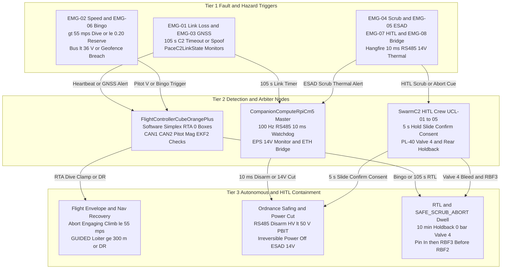

---

### 12.4 Cross-Artifact Emergency Traceability & Obligation Witness Closure

Every contingency row (`EMG-01` through `EMG-08`) traces bidirectionally to SysML v2 requirements (`.pipeline/schema.sysml`), operational activities (`OA-01` through `OA-19`), operational scenarios (`SCN-01` through `SCN-08`), top-RPN FMECA failure modes (`docs/research/FAILURE_MODE_REGISTRY.md`), and verification test cases (`TC_01` through `TC_08`).

#### Table 12.4: Emergency Trigger Cross-Artifact Traceability Matrix (`EMG-01` through `EMG-08`)

| Emergency ID | Bound `OA-*` Activities | Bound `SCN-*` Scenarios | Linked SysML v2 `REQ_*` & `state def` Nodes | Linked FMECA Modes (`FAILURE_MODE_REGISTRY.md`) | Closing Verification Test Cases |
| :--- | :--- | :--- | :--- | :--- | :--- |
| `EMG-01` | `OA-05`, `OA-12`, `OA-18` | `SCN-03`, `SCN-07` | `REQ_L_03`, `REQ_H_05`, `REQ_UCA_07`, `REQ_SC_12`, `REQ_SC_15`, `PaceC2LinkState` | `FM-09-01`, `FM-13-01`, `FM-13-04`, `FM-14-01`, `FM-14-04` | `TC_04_GnssDeniedDrAndPaceLinkFailsafe`, `TC_08_EmergencyScrubHangfireAndC2Auth` |
| `EMG-02` | `OA-05`, `OA-09`, `OA-13` | `SCN-02`, `SCN-04`, `SCN-06` | `REQ_L_02`, `REQ_H_03`, `REQ_UCA_03`, `REQ_SC_05`, `REQ_SC_06`, `REQ_SAF_02`, `REQ_SAF_08`, `RtaEnvelopeMonitorState` | `FM-03-03`, `FM-05-03`, `FM-07-03`, `FM-08-03`, `FM-10-03` | `TC_03_SimplexRtaEnvelopeAndActuation`, `TC_05_EoIrTargetTrackAndSpeedCapAbort` |
| `EMG-03` | `OA-06`, `OA-07` | `SCN-03` | `REQ_L_03`, `REQ_H_03`, `REQ_UCA_03`, `REQ_SC_07`, `PaceC2LinkState` | `FM-05-02`, `FM-07-01`, `FM-07-02`, `FM-07-04` | `TC_04_GnssDeniedDrAndPaceLinkFailsafe` |
| `EMG-04` | `OA-01`, `OA-12`, `OA-15`, `OA-16`, `OA-17` | `SCN-06`, `SCN-08` | `REQ_L_01`, `REQ_H_01`, `REQ_H_06`, `REQ_UCA_01`, `REQ_UCA_08`, `REQ_SC_13`, `REQ_SC_14`, `REQ_SC_16`, `REQ_SAF_03`, `REQ_SAF_12`, `Pl40LauncherState` | `FM-02-02`, `FM-12-01`, `FM-12-02`, `FM-12-03`, `FM-12-04`, `FM-15-01`, `FM-15-02` | `TC_07_Pl40RailChargeLaunchAndZeroWire`, `TC_08_EmergencyScrubHangfireAndC2Auth` |
| `EMG-05` | `OA-03`, `OA-08`, `OA-10`, `OA-11`, `OA-12` | `SCN-01`, `SCN-05`, `SCN-08` | `REQ_L_01`, `REQ_L_04`, `REQ_H_02`, `REQ_H_04`, `REQ_UCA_02`, `REQ_UCA_04`, `REQ_UCA_05`, `REQ_SC_08`, `REQ_SC_09`, `REQ_SC_10`, `REQ_SAF_01`, `REQ_SAF_04`, `REQ_SAF_06`, `EsadSafeArmState` | `FM-04-01`, `FM-06-01`, `FM-06-02`, `FM-06-04`, `FM-11-01`, `FM-11-02`, `FM-11-03`, `FM-15-03` | `TC_01_PreflightPowerAndRbfSequence`, `TC_02_BingoReserveAndEpsBrownoutMonitor`, `TC_06_EsadProtocolInterlockAndHvFireGate` |
| `EMG-06` | `OA-03`, `OA-04`, `OA-05` | `SCN-02`, `SCN-07` | `REQ_L_02`, `REQ_L_03`, `REQ_H_02`, `REQ_UCA_02`, `REQ_SC_02`, `REQ_SC_03`, `REQ_SAF_05`, `REQ_SAF_11`, `UavFlightLifecycleState`, `RtaEnvelopeMonitorState` | `FM-01-01`, `FM-01-02`, `FM-01-04`, `FM-02-03`, `FM-02-04`, `FM-04-04`, `FM-15-04` | `TC_01_PreflightPowerAndRbfSequence`, `TC_02_BingoReserveAndEpsBrownoutMonitor` |
| `EMG-07` | `OA-11`, `OA-12`, `OA-13` | `SCN-04`, `SCN-05`, `SCN-08` | `REQ_L_04`, `REQ_H_04`, `REQ_H_05`, `REQ_UCA_06`, `REQ_UCA_07`, `REQ_SC_11`, `REQ_SC_12`, `REQ_SAF_07`, `REQ_SAF_10`, `EsadSafeArmState` | `FM-06-03`, `FM-10-02`, `FM-11-03`, `FM-11-04`, `FM-11-05`, `FM-13-02`, `FM-13-03` | `TC_05_EoIrTargetTrackAndSpeedCapAbort`, `TC_06_EsadProtocolInterlockAndHvFireGate` |
| `EMG-08` | `OA-02`, `OA-13`, `OA-14` | `SCN-02`, `SCN-04`, `SCN-07` | `REQ_L_02`, `REQ_L_03`, `REQ_H_02`, `REQ_H_05`, `REQ_SC_04`, `REQ_SC_12`, `REQ_SAF_08`, `REQ_SAF_09`, `REQ_SAF_11` | `FM-03-01`, `FM-03-04`, `FM-09-03`, `FM-10-01`, `FM-10-04` | `TC_02_BingoReserveAndEpsBrownoutMonitor`, `TC_05_EoIrTargetTrackAndSpeedCapAbort` |

/// ObligationWitness: [OBL-01] ISO/IEC/IEEE 29148:2018 §6.4, §8.4, Annex A (§A.2); IEEE Std 1362-1998 §4, §4.3 -- Complete Level 1B ConOps (`CONOPS.md` Sections 1 through 12, `12_EMERGENCY_DECISION_MATRIX.md` `EMG-01` through `EMG-08`, and `15` SysML `part def` assemblies in `Avenger5V25IntegratedSystem`).

/// ObligationWitness: [OBL-02] ISO/IEC/IEEE 15288:2023 §6.4.2, §6.4.3, §6.4.4, §6.4.9; INCOSE SE Handbook v5.0 §2.3.5.4, §2.3.5.9 -- Bijective architectural and interface traceability across `CONN_01` through `CONN_24`, `46` SysML `requirement def` elements, emergency escalation paths `EMG-01` through `EMG-08`, and verification test suites `TC_01` through `TC_08`.

/// ObligationWitness: [OBL-03] OMG UAF v2.0 Operational Viewpoint (Op-Cn / Op-Sr), Resources Viewpoint (Rs-Tx / Rs-Tr) -- Complete ConOps allocation across `19` UAF Operational Activities (`OA-01` through `OA-19`), `24` Operational Information Exchanges (`OpTx-01` through `OpTx-24`), `8` Operational Scenarios (`SCN-01` through `SCN-08`), and emergency contingency transitions (`Figure 12.1`).

/// ObligationWitness: [OBL-04] NIST SP 800-82r3 Chapter 6, Appendix F (AC, IA, SC) -- Role-authenticated `SwarmC2` access (`>= 8` char passwords for `UCL-01`, `UCL-02`, and `UCL-03`), `AES-256` `4.4-5.0 GHz` FHSS link encryption, locked `USB/ETH` umbilical service lid during `Reboot Gimbal` (`EMG-08`), and conduit isolation for `UCL-04` external C2 consumers.

/// ObligationWitness: [INT-01] NATO STANAG 4187 Ed. 5 Chapter 2, Chapter 3, Annex A; MIL-STD-331D Group A Test A3, Test A4.1, Test A5 -- Independent dual barriers `SS1` inertial launch accel + `SS2` `Safe Distance Exceed == 1` (`GAP-07`), zero pre-launch single-point failures, power-before-pull `ESAD RBF #3` (`UMB < 0.5 Ohm` at `20.0 mA`, `GAP-06`), `PBIT < 50.0 V`, and `J401` `0.0-1800.0 V` initiation gating (`EMG-04`, `EMG-05`, `EMG-07`).

/// ObligationWitness: [INT-02] MIL-STD-882E Task 202, Task 205, Task 206; SAE ARP4754A §5.1; SAE ARP4761 §3.1-3.3 -- Full emergency closure against STPA Losses (`REQ_L_01` through `REQ_L_04`), Hazards (`REQ_H_01` through `REQ_H_06`), Unsafe Control Actions (`REQ_UCA_01` through `REQ_UCA_08`), Safety Constraints (`REQ_SC_01` through `REQ_SC_16`), and gap controls (`REQ_SAF_01` through `REQ_SAF_12`).

/// ObligationWitness: [INT-03] MIL-STD-1629A Method 101, Method 102; RTCA DO-178C §6.3, §11.0; RTCA DO-254 §10.0 -- Bottom-up FMECA linkage (`FM-01-01` through `FM-15-04`, Peak RPN `192`) bound across `EMG-01` through `EMG-08`, software/hardware verification traceability on `FlightControllerCubeOrangePlus` and `ArtronEsadAndSensorUnit`, and explicit `GAP-WCET` (`REQ_SAF_08`) and `GAP-REL` (`REQ_SAF_09`) dispositions.

/// ObligationWitness: [INT-04] MIL-STD-461G CS114, CS116, CS118, RE102, RS103; MIL-STD-810H Method 501.7, 502.7, 506.6, 510.7, 514.8, 516.8 -- `Artron ESAD` EMI/EMC and ESD immunity (`Transport Box ESD Grounding Point`), `-20.0 to +50.0 degC` thermal bounds (`IBEX160` over-temperature containment in `EMG-08`), `<= 12.0 m/s` ground / `<= 28.0 m/s` cruise wind bounds, and `>= 10.0 m` ground RF separation (`FM-14-03`).

/// ObligationWitness: [CTL-01] ASTM F3269-17 §5.2 -- Software-hosted Simplex Run-Time Assurance (`RTA`) inside `FlightControllerCubeOrangePlus` (`standaloneRtaBoxCount == 0`, `rtaHostedOnCubeOrangePlus == true`, `RtaEnvelopeMonitorState`) enforcing `<= 55.0 m/s` dive `Abort Engaging` clamp (`EMG-02`), `<= 80.0 m/s` structural `VNE`, `>= 24.0/26.0 m/s` stall floor, and autonomous Bingo/geofence/lost-link `RTL` (`EMG-01`, `EMG-06`).

/// ObligationWitness: [CTL-02] RTCA DO-362A §2.2, §3.2 -- Four-tier PACE C2 link transitions (`PrimaryDtcDirTracking`, `AlternateDtcOmniLocal`, `ContingencyGnssDeniedDrFlight`, `EmergencyLostLinkRtlHolding`) over `4.4-5.0 GHz` `AES-256` FHSS (`2.0 W`, `60.0/90.0 km` RLOS), `2.0 min` pre-flight telemetry detect timeout, `Disable GNSS` INS/DR fallback (`EMG-03`), and `105.0 s` `GCS Failsafe` `RTL` + `Disarm ESAD On GCS Timeout` (`EMG-01`).

/// ObligationWitness: [CTL-03] RTCA DO-178C §6.3; NATO STANAG 4187 Ed. 5 Chapter 2 -- `CompanionComputeRpiCm5` (`Ring 2`) `OC Master` cyclic `100.0 Hz` (`0.01 s`) `` `8N1` `RS-485` `Frame Integrity Check XModem` supervision (`<= 5.0 ms` reply, `<= 10.0 ms` incomplete-packet watchdog timeout in `EMG-05`) and Stage 2 `DSC_IN1` `1000.0 Hz` `2`-pulse discrete arm gating (`FaultStates` bit 4 lockout on premature arrival).

/// ObligationWitness: [CTL-04] SAE ARP4754A §5.1; SAE ARP4761 §3.2 -- Physical bus isolation between `CAN 1` (`PowerMeterAndRbfSwitch`, `ElectronicPowerSystemEps`, `4x HV6160` tail fins `#1` through `#4` on `120.0 cm` stubs) and `CAN 2` (`CAN/power splitter PCB`, `4x HV6160` wings `#5` through `#8`, `2x mRo RM3100`, `CUAV SKYE2`), `12S2P` `36.0-50.4 V` (`49.0-50.0 V` pre-flight, `GAP-05`), and `14.0 V` `EPS` brownout supervision (`GAP-01`, `EMG-05`, `EMG-06`, `EMG-08`).

/// ObligationWitness: [EXT-01] OEM Avenger 5 V2.5 & Artron ESAD Baseline (`AB00-0054-01AA-0005`) -- `37` BOM items (`BOM-AV-001` through `BOM-AV-026`, `BOM-ORD-001` through `BOM-ORD-005`, `BOM-GCS-001` through `BOM-GCS-006`), `126` grounded parameters, and all `12` OEM engineering gap dispositions (`GAP-01` through `GAP-07`, `GAP-WCET`, `GAP-REL`, `GAP-SEPDIST`, `GAP-ENV`, `GAP-SCRUB`) witnessed across `EMG-01` through `EMG-08`.

/// ObligationWitness: [EXT-02] OEM ELI Military Simulations PL-40 Rev 2.6 Launcher Baseline (`UAV_launcher_PL-40_user_manual_rev_2.6.pdf`) -- `5` launcher BOM items (`BOM-LCH-001` through `BOM-LCH-005`), `50` parametric limits (`PRM-PL40-001` through `PRM-PL40-050`), `13.0-14.0 bar` launch pressure, `<= 14.5 V` UVLO cutoff (`> 16.0 V` after `5.0 s`), `>= 2.0 s` dual-switch firing hold, `~23.0 m/s` exit (`<= 25.0 m/s` cap), strictly mechanical zero-wire rail (`IF-MECH-001`), and `SAFE_SCRUB_ABORT` (`EMG-04`, `>= 10.0 min` derived hangfire dwell).

/// OperationalAllocation: [OA-01]
/// OperationalAllocation: [OA-02]
/// OperationalAllocation: [OA-03]
/// OperationalAllocation: [OA-04]
/// OperationalAllocation: [OA-05]
/// OperationalAllocation: [OA-06]
/// OperationalAllocation: [OA-07]
/// OperationalAllocation: [OA-08]
/// OperationalAllocation: [OA-09]
/// OperationalAllocation: [OA-10]
/// OperationalAllocation: [OA-11]
/// OperationalAllocation: [OA-12]
/// OperationalAllocation: [OA-13]
/// OperationalAllocation: [OA-14]
/// OperationalAllocation: [OA-15]
/// OperationalAllocation: [OA-16]
/// OperationalAllocation: [OA-17]
/// OperationalAllocation: [OA-18]
/// OperationalAllocation: [OA-19]
/// OperationalAllocation: [MET-02]
/// OperationalAllocation: [MET-03]
