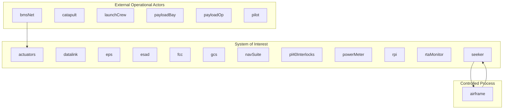
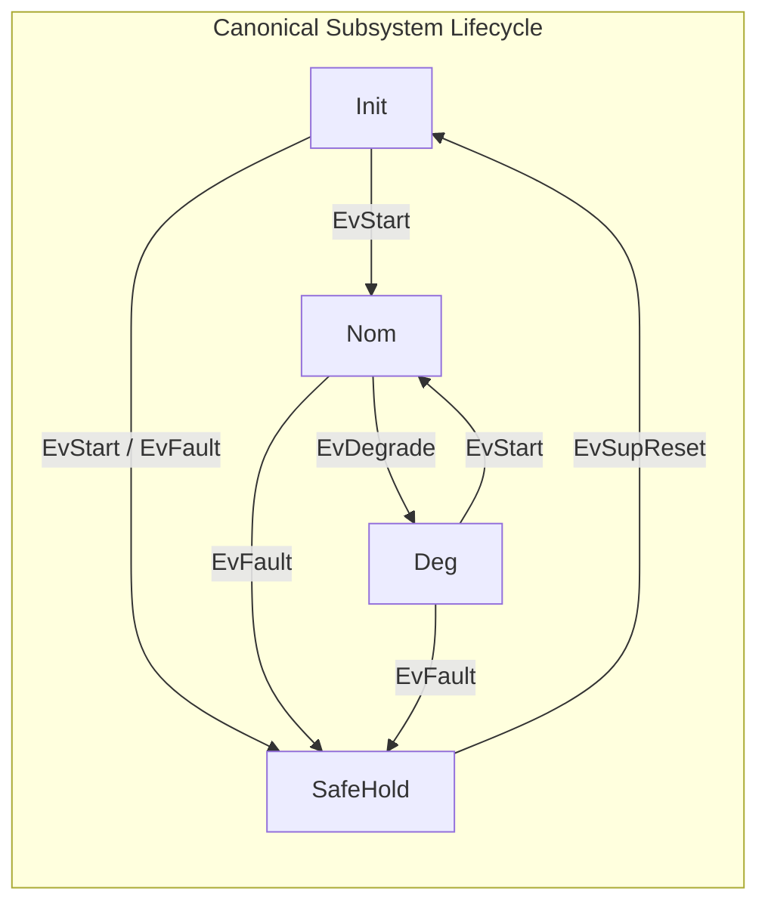

# Concept of Operations (ConOps)

**Operational Slice Digest (0x20 h_ops):** `703e3de6ade2a20c484129acf15c0cfc791e8fc049cc62321f0c89893320f2e5` \| **ICD Digest (0x21 icd_pre_sha256):** `4c7c387ab22bc79c0292e5441b08ee0e21934afc227ba775dd82841646b2356a`

## 1\. System Context and Boundary Framing

Root System-of-Interest: `Avenger5_Architecture::avenger5System`. External actors interact strictly across typed conjugated boundary ports.

|Actor|Role|Ring|Authority rho|Port Boundary|
|:----|:---|:---|:------------|:------------|
|`bmsNet`|ExternalBMS|`Ring3`|`2`|`CLOSED`|
|`catapult`|PL40CatapultPlant|`Ring3`|`5`|`CLOSED`|
|`launchCrew`|LaunchAssistant|`Ring3`|`1.2`|`CLOSED`|
|`payloadBay`|MissionPayloadPlant|`Ring3`|`5`|`CLOSED`|
|`payloadOp`|PayloadOperator|`Ring3`|`1.5`|`CLOSED`|
|`pilot`|PilotOperator|`Ring3`|`1`|`CLOSED`|

## 2\. Internal Subsystem Architecture and Authority Hierarchy

|Subsystem|Role|Ring|TQL|Authority rho|Summary|
|:--------|:---|:---|:--|:------------|:------|
|`actuators`|DroneCanActuation|`Ring2`|`TQL-1`|`4.2`|-|
|`datalink`|C2DatalinkRadio|`Ring3`|`TQL-5`|`2.3`|-|
|`eps`|EpsPowerModule|`Ring2`|`TQL-1`|`3.4`|-|
|`esad`|EsadSafetyUnit|`Ring1`|`TQL-1`|`3.8`|-|
|`fcc`|FlightControllerCube|`Ring2`|`TQL-1`|`3`|-|
|`gcs`|SwarmC2Gcs|`Ring3`|`TQL-5`|`2.1`|-|
|`navSuite`|NavigationAirDataSuite|`Ring2`|`TQL-1`|`2.8`|-|
|`pl40Interlocks`|Pl40InterlockAssembly|`Ring1`|`TQL-1`|`4`|-|
|`powerMeter`|PowerMeterAndRbfSwitch|`Ring1`|`TQL-1`|`3.2`|-|
|`rpi`|CompanionRpiCm5|`Ring3`|`TQL-5`|`2.5`|-|
|`rtaMonitor`|RtaSimplexMonitor|`Ring1`|`TQL-1`|`2`|-|
|`seeker`|EoIrSeeker|`Ring3`|`TQL-5`|`2.7`|-|

|Controlled Process|Qualified Name|Authority rho|Summary|
|:-----------------|:-------------|:------------|:------|
|`airframe`|`Avenger5_Architecture::airframe`|`5`|-|

## 3\. Operational Activities and Phase Transitions

|OA ID|Identifier|Phase|Partition|Allocated Subsystem|
|:----|:---------|:----|:--------|:------------------|
|`OA-01`|`oa01`|PreFlight-SitePrep|`Aux`|`pl40Interlocks`|
|`OA-02`|`oa02`|PreFlight-Integration|`Aux`|`powerMeter`|
|`OA-03`|`oa03`|PreFlight-PowerAndInterlockGate|`Focus`|`esad`|
|`OA-04`|`oa04`|Launch|`Control`|`pl40Interlocks`|
|`OA-05`|`oa05`|EnRoute|`Control`|`fcc`|
|`OA-06`|`oa06`|DegradedOps|`Control`|`navSuite`|
|`OA-07`|`oa07`|Terminal|`Focus`|`seeker`|
|`OA-08`|`oa08`|Contingency-GroundSafeing|`Ops`|`esad`|
|`OA-09`|`oa09`|PreFlight-SensorChecks|`Aux`|`navSuite`|
|`OA-10`|`oa10`|EnRoute-Comms|`Ops`|`datalink`|
|`OA-11`|`oa11`|EnRoute-Safety|`Control`|`rpi`|
|`OA-12`|`oa12`|Emergency-SafeHold|`Control`|`rtaMonitor`|

|OPTX ID|From Phase|To Phase|Gate Predicate|
|:------|:---------|:-------|:-------------|
|`optx01_SwarmC2Uplink`|Unknown|Unknown|`Pass`|
|`optx02_EsadSafetyExchange`|Unknown|Unknown|`Pass`|

## 4\. Operational Scenarios and Emergency Decision Matrix

|Scenario|Class|Actors|Activity Thread|Summary|
|:-------|:----|:-----|:--------------|:------|
|`scn01NominalMission`|`Nominal`|launchCrew, payloadOp, pilot|`step01, step02, step03, step04, step05, step06, step07, step08, step09`|Nominal end-to-end flight scenario: site prep -> RBF sequence -> pneumatic launch -> cruise -> terminal approach.|
|`scn02DegradedGnssAndLinkLoss`|`Degraded`|bmsNet, pilot|`step10, step11, step12`|Degraded mission scenario: GNSS spoofing INS dead-reckoning and C2 link timeout RTL/Rally diversion.|
|`scn03EmergencyAbortAndScrub`|`Emergency`|launchCrew, payloadOp, pilot|`step13, step14, step15`|Emergency mission scenario: approach > 55 m/s waveoff, 5 s irreversible ESAD Abort, and pre-launch scrub safeing \[GAP-05\].|

|EMG ID|Trigger Condition|Target Mode|Max Reaction \[s\]|
|:-----|:----------------|:----------|:---------------|
|`EMG-01`|`ESAD_RBF_REMOVED_UNPOWERED or PBIT_FAULT_BIT0`|`SafeHold`|`0.01`|
|`EMG-02`|`DSC_IN1_RECEIVED_BEFORE_SAFE_SEP_STAGE2`|`SafeHold`|`0.005`|
|`EMG-03`|`APPROACH_AIRSPEED_GT_55_MPS or EO_TRACK_LOST`|`SafeHold`|`0.05`|
|`EMG-04`|`GCS_LINK_LOST_GE_FAILSAFE_TIMEOUT`|`Deg`|`1`|
|`EMG-05`|`GNSS_SPOOF_OR_EKF2_INCONSISTENT`|`Deg`|`0.2`|
|`EMG-06`|`POLYGON_GEOFENCE_BREACH_IMMINENT`|`SafeHold`|`0.02`|
|`EMG-07`|`PL40_CARRIAGE_PIN_IN_ON_TRIGGER or PISTON_OVER_ACCEL`|`SafeHold`|`0.05`|

## 5\. Subsystem Lifecycle State Machines and SafeHold Reachability

|Lifecycle FSM|Allocated Subsystems|States|Transitions|SafeHold BFS|
|:------------|:-------------------|:-----|:----------|:-----------|
|`VehicleAndEsadLifecycle`|`actuators, datalink, eps, esad, fcc, gcs, navSuite, pl40Interlocks, powerMeter, rpi, rtaMonitor, seeker`|`6`|`13`|`PASS`|

## 6\. Boundary Interfaces, Signal Contracts, and Pre-STPA Sufficiency Gate

|Signal ID|Kind|Payload|Unit|Bounds \[min, safe, max\]|Rate \[Hz\]|Latency \[s\]|
|:--------|:---|:------|:---|:----------------------|:--------|:----------|
|`d04_dl_to_gcs`|`IpTelemetryCommandItem`|`-`|`1`|`[-, -, -]`|`-`|`-`|
|`d04_gcs_to_dl`|`IpTelemetryCommandItem`|`-`|`1`|`[-, -, -]`|`-`|`-`|
|`d05_dl_to_rpi`|`IpTelemetryCommandItem`|`-`|`1`|`[-, -, -]`|`-`|`-`|
|`d05_rpi_to_dl`|`IpTelemetryCommandItem`|`-`|`1`|`[-, -, -]`|`-`|`-`|
|`d06_dl_to_fcc`|`IpTelemetryCommandItem`|`-`|`1`|`[-, -, -]`|`-`|`-`|
|`d06_fcc_to_dl`|`IpTelemetryCommandItem`|`-`|`1`|`[-, -, -]`|`-`|`-`|
|`d07_rpi_to_seeker`|`IpTelemetryCommandItem`|`-`|`1`|`[-, -, -]`|`-`|`-`|
|`d07_seeker_to_rpi`|`IpTelemetryCommandItem`|`-`|`1`|`[-, -, -]`|`-`|`-`|
|`d08_fcc_to_seeker`|`IpTelemetryCommandItem`|`-`|`1`|`[-, -, -]`|`-`|`-`|
|`d08_seeker_to_fcc`|`IpTelemetryCommandItem`|`-`|`1`|`[-, -, -]`|`-`|`-`|
|`d09_fcc_to_rpi`|`IpTelemetryCommandItem`|`-`|`1`|`[-, -, -]`|`-`|`-`|
|`d09_rpi_to_fcc`|`IpTelemetryCommandItem`|`-`|`1`|`[-, -, -]`|`-`|`-`|
|`d10_nav_to_fcc`|`IpTelemetryCommandItem`|`-`|`1`|`[-, -, -]`|`-`|`-`|
|`d11_nav_to_fcc`|`DroneCanFrameItem`|`-`|`1`|`[-, -, -]`|`-`|`-`|
|`d12_fcc_to_pm`|`DroneCanFrameItem`|`-`|`1`|`[-, -, -]`|`-`|`-`|
|`d12_pm_to_fcc`|`DroneCanFrameItem`|`-`|`1`|`[-, -, -]`|`-`|`-`|
|`d13_eps_to_fcc`|`DroneCanFrameItem`|`-`|`1`|`[-, -, -]`|`-`|`-`|
|`d13_fcc_to_eps`|`DroneCanFrameItem`|`-`|`1`|`[-, -, -]`|`-`|`-`|
|`SIG-ACT-FCC-CAN1-FBK`|`FeedbackFlow`|`DroneCanFrameItem`|`Hz`|`[0, 0, 250]`|`100`|`0.01`|
|`d14_fcc_to_act`|`DroneCanFrameItem`|`-`|`1`|`[-, -, -]`|`-`|`-`|
|`d15_fcc_to_act`|`DroneCanFrameItem`|`-`|`1`|`[-, -, -]`|`-`|`-`|
|`d15_fcc_to_pl40`|`DroneCanFrameItem`|`-`|`1`|`[-, -, -]`|`-`|`-`|
|`d15_pl40_to_fcc`|`DroneCanFrameItem`|`-`|`1`|`[-, -, -]`|`-`|`-`|
|`d16_fcc_to_rta`|`DroneCanFrameItem`|`-`|`1`|`[-, -, -]`|`-`|`-`|
|`d16_rta_to_esad`|`DiscreteSafetySignalItem`|`-`|`1`|`[-, -, -]`|`-`|`-`|
|`d16_rta_to_fcc`|`DroneCanFrameItem`|`-`|`1`|`[-, -, -]`|`-`|`-`|
|`d17_esad_to_pl40`|`DiscreteSafetySignalItem`|`-`|`1`|`[-, -, -]`|`-`|`-`|
|`SIG-ESAD-RPI-RS485-FBK`|`FeedbackFlow`|`Rs485ControlFrame`|`Hz`|`[0, 0, 100]`|`100`|`0.005`|
|`d17_pl40_to_esad`|`FeedbackFlow`|`DiscreteSafetySignalItem`|`1`|`[-, -, -]`|`-`|`-`|
|`d18_rpi_to_rta`|`FeedbackFlow`|`Rs485ControlFrame`|`1`|`[-, -, -]`|`-`|`-`|
|`d20_eps_to_pm`|`FeedbackFlow`|`DCBusPowerItem`|`1`|`[-, -, -]`|`-`|`-`|
|`d22_act_to_eps`|`FeedbackFlow`|`DCBusPowerItem`|`1`|`[-, -, -]`|`-`|`-`|
|`d22_eps_to_act`|`CommandFlow`|`DCBusPowerItem`|`1`|`[-, -, -]`|`-`|`-`|
|`d27_cat_to_pl40`|`PneumaticImpulseItem`|`-`|`1`|`[-, -, -]`|`-`|`-`|
|`d27_pl40_to_cat_man`|`PneumaticImpulseItem`|`-`|`1`|`[-, -, -]`|`-`|`-`|
|`SIG-ACT-AF-SURFACE-CMD`|`CommandFlow`|`DroneCanFrameItem`|`Hz`|`[0, 0, 250]`|`250`|`0.004`|
|`SIG-AF-ACT-LOAD-FBK`|`FeedbackFlow`|`DroneCanFrameItem`|`Hz`|`[0, 0, 250]`|`250`|`0.004`|
|`SIG-AF-NAV-AIRDATA-FBK`|`FeedbackFlow`|`DroneCanFrameItem`|`m/s`|`[0, 24, 80]`|`50`|`0.02`|
|`SIG-AF-SEEKER-OPTICAL-FBK`|`FeedbackFlow`|`IpTelemetryCommandItem`|`Hz`|`[0, 0, 60]`|`30`|`0.033`|
|`d29_af_to_pl40`|`FeedbackFlow`|`PneumaticImpulseItem`|`1`|`[-, -, -]`|`-`|`-`|
|`d29_pl40_to_af`|`CommandFlow`|`PneumaticImpulseItem`|`1`|`[-, -, -]`|`-`|`-`|
|`d30_esad_to_pay`|`DiscreteSafetySignalItem`|`-`|`1`|`[-, -, -]`|`-`|`-`|
|`d30_pay_to_esad`|`DiscreteSafetySignalItem`|`-`|`1`|`[-, -, -]`|`-`|`-`|
|`SIG-RPI-ESAD-RS485`|`CommandFlow`|`Rs485ControlFrame`|`Hz`|`[0, 0, 100]`|`100`|`0.005`|
|`SIG-EPS-ESAD-PWR`|`CommandFlow`|`DCBusPowerItem`|`V`|`[0, 0, 32]`|`100`|`0.01`|
|`SIG-RPI-ESAD-DSC-IN1`|`CommandFlow`|`DiscreteSafetySignalItem`|`V`|`[0, 0, 3.3]`|`1000`|`0.002`|
|`SIG-BAT-MAIN-BUS-V`|`CommandFlow`|`DCBusPowerItem`|`V`|`[0, 0, 50.4]`|`50`|`0.02`|
|`SIG-FCC-CAN1-FIN`|`CommandFlow`|`DroneCanFrameItem`|`Hz`|`[0, 0, 250]`|`250`|`0.004`|
|`SIG-FCC-CAN2-WING`|`CommandFlow`|`DroneCanFrameItem`|`Hz`|`[0, 0, 250]`|`250`|`0.004`|
|`SIG-PL40-TANK-P`|`CommandFlow`|`PneumaticImpulseItem`|`Pa`|`[0, 0, 1400000]`|`10`|`0.1`|

|Criterion|Diagnostic Code|Invariant Summary|Verdict|
|:--------|:--------------|:----------------|:------|
|`C1`|`DEAP_E0320`|System-of-Interest, >=2 Subsystems, Disjoint Plant, Closed Actor Ports|`PASS`|
|`C2`|`DEAP_E0321`|>=12 Operational Activities, >=1 OPTX, Disjoint Action Partition|`PASS`|
|`C3`|`DEAP_E0322`|>=10 Quantitative MET Items with Finite CanF64 Bounds|`PASS`|
|`C4`|`DEAP_E0323`|Total Unique Surjective Allocation (OA union MET) ->> Subsystems|`PASS`|
|`C5`|`DEAP_E0324`|Nominal/Degraded/Emergency Scenarios and >=7 Emergency Rules|`PASS`|
|`C6`|`DEAP_E0325`|Lifecycle FSM Init->Nom and Universal SafeHold Reachability|`PASS`|
|`C7`|`DEAP_E0326`|Coherent Affine-Free SI and IEC Metrology Units|`PASS`|
|`C8`|`DEAP_E0327`|Conjugated Port Parity, Signal Bounds, Zero Dangling Ports|`PASS`|
|`C9`|`DEAP_E0328`|Authority-Ranked Closed Command and Feedback Control Loops|`PASS`|
