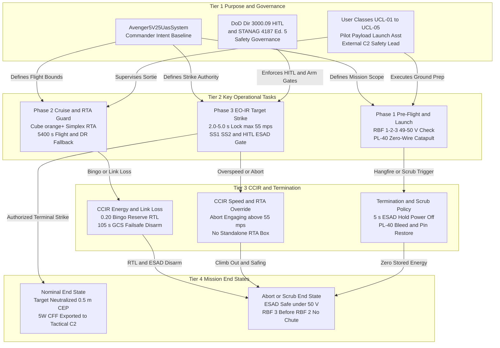
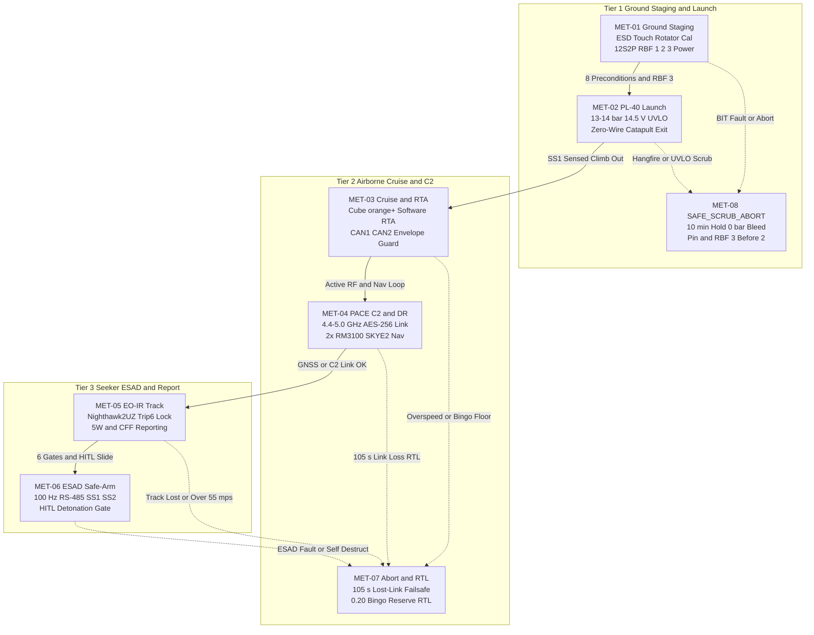
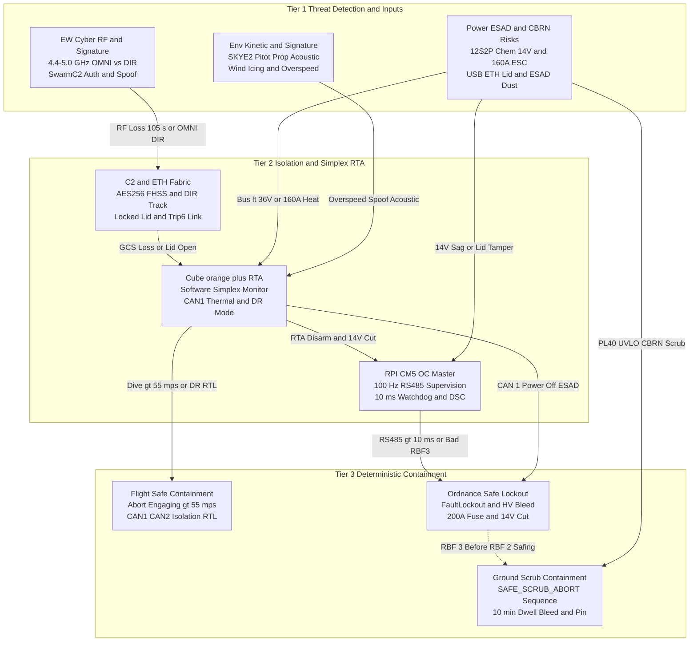
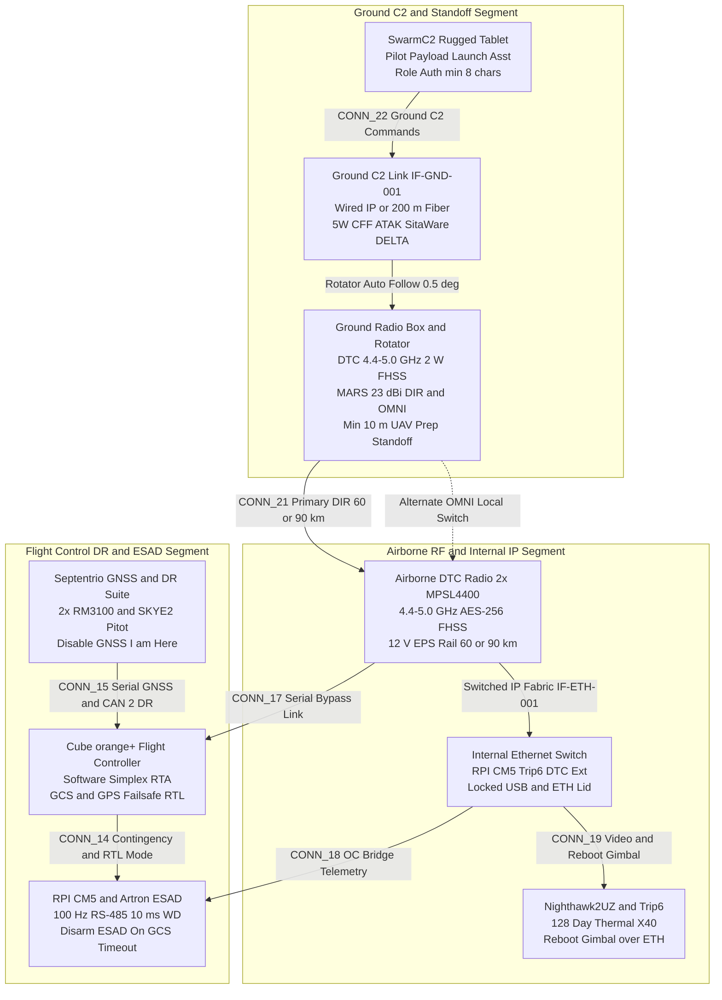
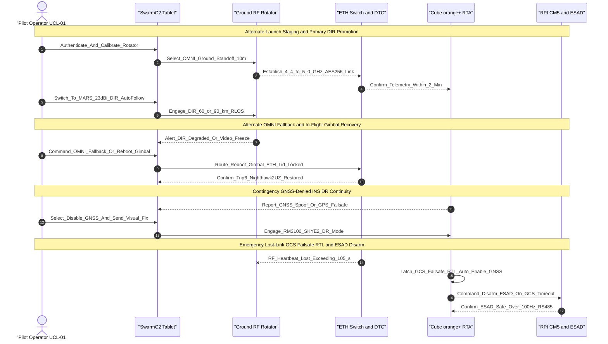
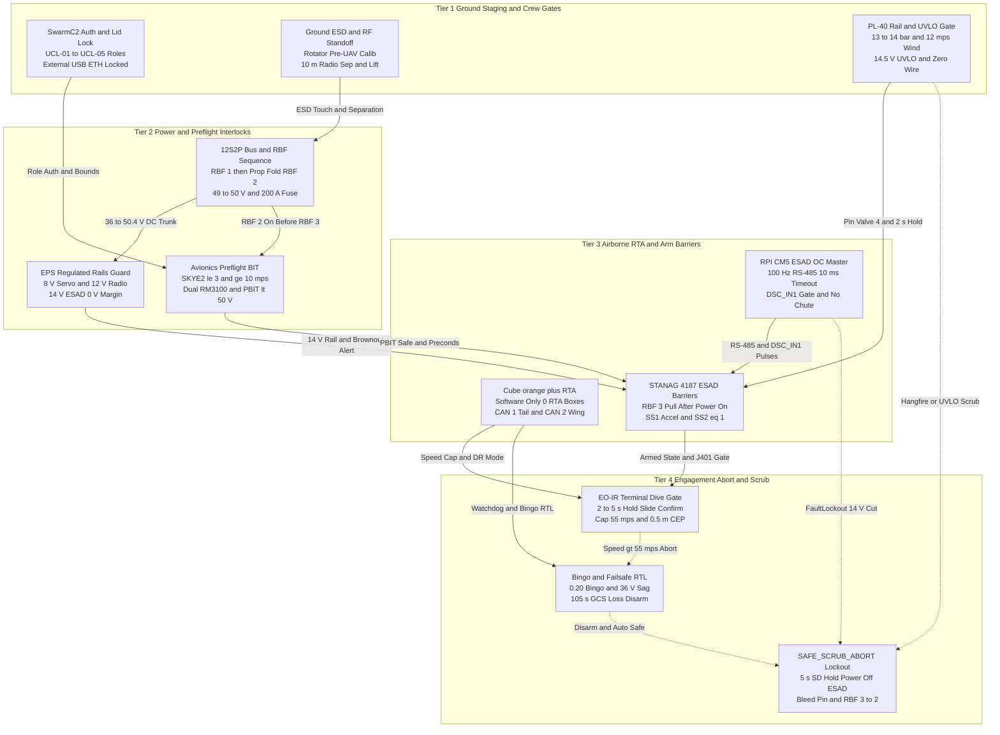
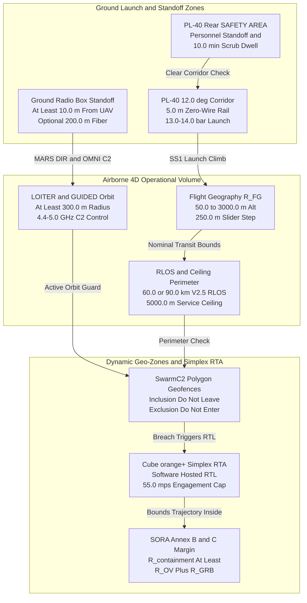
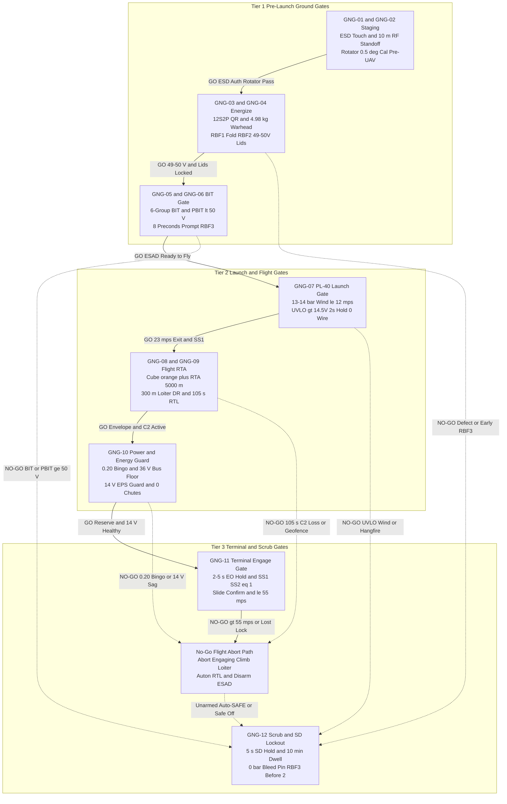
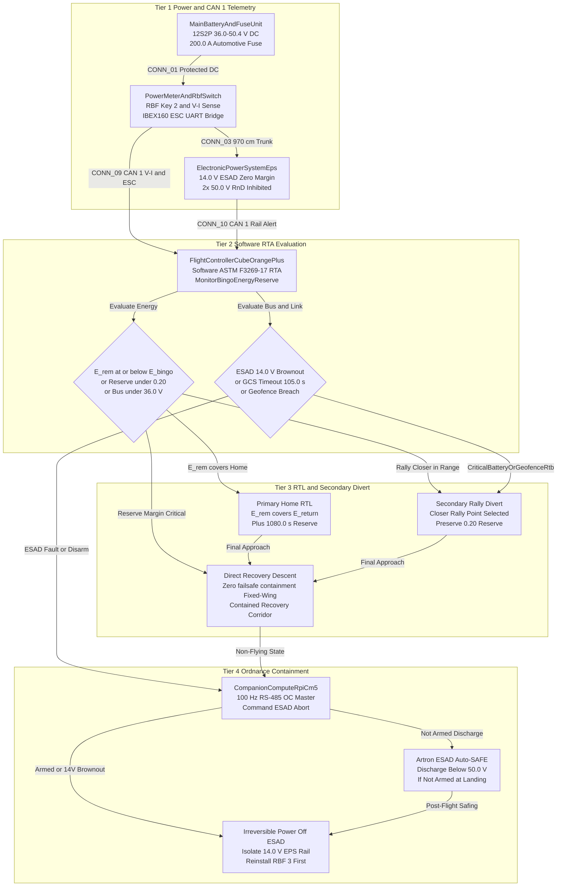

| Attribute | Value |
| :--- | :--- |
| **Title** | Tactical Mission Intent & Execution Plan |
| **Version** | 1.0.0 |
| **Date** | 2026-11-16 |

# Tactical Mission Intent & Execution Plan

## Table of Contents

- [1. Commander's Intent & High-Level Operational Objectives](#1-commanders-intent--high-level-operational-objectives)
- [2. Mission Essential Task List (METL) & Operational Task Allocation](#2-mission-essential-task-list-metl--operational-task-allocation)
- [3. INCOSE Measures of Effectiveness (MoE) & Measures of Performance (MoP) Math](#3-incose-measures-of-effectiveness-moe--measures-of-performance-mop-math)
- [4. Multi-Domain Threat, Electronic Warfare & Cyber Environment Matrix](#4-multi-domain-threat-electronic-warfare--cyber-environment-matrix)
- [5. PACE C2 Communications Plan & Link Resilience](#5-pace-c2-communications-plan--link-resilience)
- [6. Safety Constraints & Subsystem Interlocks](#6-safety-constraints--subsystem-interlocks)
- [7. Airspace Deconfliction & Dynamic Geo-Zones](#7-airspace-deconfliction--dynamic-geo-zones)
- [8. Go/No-Go Decision Matrix](#8-gono-go-decision-matrix)
- [9. Bingo Energy Mathematics & Secondary Divert Protocols](#9-bingo-energy-mathematics--secondary-divert-protocols)
- [10. Operational Allocation & Normative Obligation Traceability Tags](#10-operational-allocation--normative-obligation-traceability-tags)

## 1. Commander's Intent & High-Level Operational Objectives

- **System Baseline:** `Avenger5V25UasSystem` (`Avenger5V25IntegratedSystem`: `Avenger 5 V2.5 UAS` / `ASTK A5 V2.5` + `ELI Military Simulations PL-40 Rev 2.6` + `Artron ESAD AB00-0054-01AA-0005` + `SwarmC2`)
- **Normative Baseline Date:** `2026-11-16`
- **Governing Standards & SSOT Anchors:** `ISO/IEC/IEEE 29148:2018 §6.4, Annex A (§A.2)`, `ISO/IEC/IEEE 15288:2023 §6.4.2, §6.4.3, §6.4.4`, `IEEE Std 1362-1998 §4, §4.3`, `INCOSE SE Handbook v5.0 §2.3.5.4`, `OMG UAF v2.0 Operational Viewpoint`, `NATO STANAG 4187 Ed. 5 Chapter 2, Chapter 3, Annex A`, `MIL-STD-882E Task 202, Task 205, Task 206`, `ASTM F3269-17 §5.2`, `RTCA DO-362A §2.2, §3.2`, `JARUS SORA v2.5 Annex B, Annex C`, `NIST SP 800-82r3 Chapter 6, Appendix F`, and `DoD Directive 3000.09 §4.1.a` (traceable to `docs/research/RESEARCH_INVENTORY.md` and `.pipeline/schema.sysml`).

---

### 1.1 Operational Purpose

The operational purpose of the `Avenger5V25UasSystem` is to deploy a rapidly assembled, catapult-launched, electric X-wing tactical precision loitering munition (`17.0 kg` MTOW, `<= 5.0 kg` lethal package warhead capacity with `4.98 +/- 0.02 kg` tested holder mass) capable of conducting mid-range reconnaissance, stationary target acquisition, and human-authorized terminal engagement (`<= 0.5 m` / `50.0 cm` CEP) across contested, GNSS-degraded environments while enforcing positive safety containment from ground staging through terminal action or scrub recovery (`OBL-01`, `MET-01`, `EXT-01`, `EXT-02`).

All operational execution is governed by four foundational architectural truths verified in `.pipeline/schema.sysml` and `docs/research/RESEARCH_INVENTORY.md`:
1. **Strictly Mechanical Launch Boundary (`IF-MECH-001` / `CONN_23`):** The airframe is launched from the `ELI Military Simulations PL-40 Rev 2.6` pneumatic rail catapult (`5.0 m` / `4938.0 mm` rail at `12.0 deg` elevation, `13.0-14.0 bar` launch pressure, `~23.0 m/s` exit velocity at `17.0 kg` within the `<= 25.0 m/s` rail ceiling) with `0` electrical or CAN umbilical wires crossing between launcher and airframe (`REQ_SC_13`, `REQ_SC_14`).
2. **12S2P Primary Energy & Zero Production Recovery (`GAP-05`, `REQ_SC_03`):** Propulsion and avionics derive solely from a removable `12S2P Li metal BEI maximus20` battery pack (`36.0-50.4 V` bus via `200.0 A` fuse, strictly verified at `49.0-50.0 V` pre-flight while rejecting legacy `23.9-25.0 V` UI readings) supporting up to `5400.0 s` (`90.0 min`) endurance. Production `Avenger V2.5` aircraft exclude recovery failsafe containment systems (`productionRecoverySystemInstalled == false`, `rndRecoveryOptionInstalled == false`), keeping the `2x 50.0 V` `Optional RnD` recovery igniter rails on `ElectronicPowerSystemEps` permanently inhibited (`ProductionNoParachuteConstraint`).
3. **Software-Hosted Simplex Run-Time Assurance (`ASTM F3269-17 §5.2`, `CTL-01`):** Flight envelope protection (`RtaEnvelopeMonitorState`) runs strictly in software inside `FlightControllerCubeOrangePlus` (`Cube orange+`, `standaloneRtaBoxCount == 0`, `rtaHostedOnCubeOrangePlus == true`) across physically isolated `CAN 1` (EPS, Power Meter, tail fins `#1-#4`) and `CAN 2` (splitter, wing panels `#5-#8`, `2x mRo RM3100` mag/baro, `CUAV SKYE2` heated pitot) buses (`REQ_SC_05`, `REQ_SC_06`).
4. **Positive Human-in-the-Loop (HITL) Lethal Governance (`DoD Directive 3000.09 §4.1.a`, `NATO STANAG 4187 Ed. 5`):** Appropriate human judgment governs every arming, target commitment, abort, and destruct transition via `SwarmC2OperatorConsole`, reinforced by hardware/inertial `Artron ESAD` barriers (`RBF #1`, `RBF #2`, `RBF #3` power-before-pull ordering, `SS1`, `SS2`, and `DSC_IN1` supervision by `CompanionComputeRpiCm5`).

---

### 1.2 Key Tasks

Achieving Commander's Intent across the `UavFlightLifecycleState` operational lifecycle requires sequential execution of six core operational task blocks traced to `OA-01` through `OA-19` and `SCN-01` through `SCN-08` (`OBL-03`, `MET-01` through `MET-04`):

1. **Authenticated Ground Staging, Rotator Calibration & ESD Protection (`OA-15`, `OA-18`, `SCN-01`, `SCN-07`):** Authenticate `Pilot`, `Payload`, and `Launch Assistant` roles on `SwarmC2` (`>= 8`-character strong password), enforce transport box `EARTH / GROUNDING POINT` ESD touch before component handling, calibrate the `GroundRfStationAndAntennaTracker` rotator (`Auto Follow` / `0.5 deg` step) prior to touching the airframe, enforce `>= 10.0 m` UAV-to-ground-radio separation, assemble the `PL-40` rail, and charge the pneumatic tank to `13.0-14.0 bar` while monitoring `2x Makita BL1860B` (`18.0 V`) packs against the `<= 14.5 V` UVLO cutoff (`>= 16.0 V` after `5.0 s` restart).
2. **Ordered Pre-Flight Energization & Power-Before-Pull `RBF` Sequencing (`OA-01`, `OA-06`, `OA-10`, `SCN-01`):** Match battery and fuselage QR/IDs, install payload/ESAD (`1.5 mm HEX`, `RED FACE TO TOUCH HOLDER`, `4.98 +/- 0.02 kg`), fold both rear pusher propeller blades rearward, remove `RBF #1` covers/strap, pull `UAV Power R.B.F. Key #2` (`XT60E-F`) to energize the `12S2P` bus (`49.0-50.0 V` check) and lock both RBF and umbilical lids while `ESAD RBF #3` remains installed (`GAP-06`, `REQ_SC_01`). Complete all `6` `SwarmC2` checklist groups (`SKYE2` pitot `< 3.0 m/s` calm / `> 10.0 m/s` airflow, dual `RM3100`, `HV6160` sweep, `ESAD` PBIT `< 50.0 V` internal HV) before removing `RBF #3` strictly upon `SwarmC2` prompt after all `8` preconditions pass.
3. **Zero-Wire Pneumatic Catapult Launch & Climb Transition (`OA-11`, `OA-16`, `SCN-06`):** Validate Go/No-Go readiness (`13.0-14.0 bar`, `17.0 kg` MTOW, `<= 12.0 m/s` ground headwind, `<= 25.0 m/s` exit cap, clear rear safety area and launch corridor), pull the carriage red safety pin, open `Main Valve 4`, hold dual firing switches simultaneously for `>= 2.0 s` to release at `~23.0 m/s`, trigger onboard `SS1` rigid-body launch acceleration, and climb past `24.0-26.0 m/s` stall into nominal cruise (`30.0-31.0 m/s`, `50.0-3000.0 m` waypoint altitude, `<= 5000.0 m` ceiling).
4. **Resilient PACE C2, GNSS-Denied Navigation & Software Simplex RTA Supervision (`OA-03`, `OA-04`, `OA-05`, `OA-07`, `OA-08`, `OA-09`, `SCN-02`, `SCN-03`, `SCN-07`):** Maintain `4.4-5.0 GHz` `AES-256` FHSS C2 (`2.0 W`, `60.0/90.0 km` RLOS across `DIR` `MARS 23 dBi` / `OMNI` / `200.0 m` fiber), transition to `RM3100` + `SKYE2` INS/DR (`I'm Here` / `I'm Looking Here` fixes) upon `GPS Failsafe` or manual `Disable GNSS`, continuously run `CompanionComputeRpiCm5` `100 Hz` (`0.01 s`) RS-485 `Frame Integrity Check XModem` supervision (`<= 5.0 ms` reply, `<= 10.0 ms` timeout) and `14.0 V` `EPS` brownout watch (`GAP-01`), and enforce `Cube orange+` software Simplex RTA boundaries (`<= 80.0 m/s` `VNE`, `Exclusion`/`Inclusion` geofences, `>= 0.20` statutory Bingo reserve over `5400.0 s`).
5. **HITL Target Acquisition, EO/IR Dive & STANAG 4187 Terminal Gating (`OA-11`, `OA-13`, `OA-14`, `OA-19`, `SCN-04`, `SCN-05`):** Verify all `6` engagement preconditions (`GCS Failsafe` margin, warhead `ARMED` after `SS1` + `SS2` `Safe Distance Exceed == 1` + `Arm Stage 2` `1 kHz` `2`-pulse `DSC_IN1` hardware gate, `EO` daylight camera lock on `Nighthawk2UZ` `128` `X40` / `Trip6`, `2.0-5.0 s` continuous track hold, target elevation `<= 15.0 deg` at start, clear LOS), commit `ATTACK` upon HITL `Slide to confirm`, execute `Shallow` (`~15.0 deg`) or `Direct` (`<= 22.0 deg`) terminal dive strictly `<= 55.0 m/s` (`<= 0.5 m` CEP) with `Sensor Board` `ORed IRQ_L` initiation (`0-1800 V` on `J401`), and export `5W` / `CFF` target reports to `ATAK`, `SitaWare HQ`, or `DELTA`.
6. **In-Flight Abort, Emergency Self-Destruct & Hangfire Scrub Recovery (`OA-12`, `OA-14`, `OA-17`, `SCN-04`, `SCN-08`):** Execute `Reboot Gimbal` over internal `ETH` on video freeze, enforce immediate `Abort Engaging` climb-out if airspeed exceeds `55.0 m/s` or track drops (no auto re-track), execute HITL `>= 5.0 s` `SELF DESTRUCT` / permanent `ABORT` + `Slide to confirm` or irreversible `Power Off ESAD` when commanded, and enforce `SAFE_SCRUB_ABORT` (`GAP-SCRUB`) before any crew approach to an unlaunched rail.

---

### 1.3 End State

Mission completion is defined exclusively by two deterministic, verifiable terminal states under `UavFlightLifecycleState` and `EsadSafeArmState` (`REQ_L_01` through `REQ_L_04`, `INT-01`, `MET-02`, `MET-03`, `MET-04`):

1. **Nominal Mission Accomplishment End State (`DetonatedOrAborted` / Terminal Strike):** The `Avenger 5 V2.5` airframe reaches the human-authorized stationary target within `<= 0.5 m` CEP following satisfied `SS1` launch acceleration, `SS2` (`Safe Distance Exceed == 1`), `DSC_IN1` arm gating, `2.0-5.0 s` `EO/IR` track lock, and `<= 55.0 m/s` terminal speed governance, initiating the `<= 5.0 kg` warhead only against the approved target with `5W` / `CFF` battle-damage / target telemetry exported via `SwarmC2` to external tactical C2 consumers (`ATAK`, `SitaWare HQ`, `DELTA`).
2. **Controlled Abort, Failsafe RTL, or Safe Scrub End State (`SafePostFlightShutdown` / `FaultLockout` / `ScrubbedSafeDepressurized`):** Any mission aborted pre-launch, aborted in flight (`Abort Engaging`, `5.0 s` `ABORT` / `SELF DESTRUCT`, `Power Off ESAD`, `105.0 s` GCS Failsafe RTL, or `<= 0.20` Bingo reserve RTL) concludes with `Artron ESAD` verified disarmed and internal HV discharged `< 50.0 V` (or `Power Off ESAD` / `FaultLockout` latched), `PL-40 Main Valve 4` closed and pneumatic tank bled to `0 bar` with the red carriage safety pin reinstalled, `RBF #3` (`J100 UMB < 0.5 Ohm`) restored prior to `RBF #2` battery disconnect, zero personnel injury, and zero collateral detonation outside the authorized corridor. Because production `Avenger V2.5` ships with zero recovery parachutes (`rndRecoveryOptionInstalled == false`), in-flight mission termination prioritizes safe airspace/ground-risk containment (`JARUS SORA v2.5 Annex B/C`) and irreversible ordnance safing before vehicle landing/expenditure.

---

### 1.4 Commander's Critical Information Requirements (CCIR) & Termination Policy

Commander's Critical Information Requirements (CCIR) and deterministic termination thresholds govern go/no-go launch authority, in-flight operational safety overrides, and lethal engagement termination (`DoD Directive 3000.09 §4.1.a`, `MIL-STD-882E Task 206`, `ASTM F3269-17 §5.2`, `RTCA DO-362A §3.2`, `JARUS SORA v2.5`):

| Policy / Operational Parameter | Value | Units | Governing Constraint & Clause |
| :--- | :--- | :--- | :--- |
| Pre-Flight `12S2P` Battery Window | 49.0-50.0 | V | `MainBatteryPreFlightVoltageConstraint` (`GAP-05`, `REQ_SAF_05`) |
| Nominal `12S2P` Bus Operating Envelope | 36.0-50.4 | V | `MainBatteryAndFuseUnit` (`REQ_SC_02`, `CTL-04`) |
| Nominal Flight Endurance | 5400.0 | s | `MainBatteryAndFuseUnit` (`MET-02`) |
| Statutory Bingo Energy Reserve Ratio | 0.20 | ratio | `BingoEnergyReserveConstraint` (`REQ_SC_02`, `MET-02`) |
| `EPS` to `ESAD` Regulated Rail (`GAP-01`) | 14.0 | V | `EpsEsadZeroBrownoutMarginConstraint` (`REQ_SAF_01`) |
| `PL-40` Operating Pneumatic Pressure | 13.0-14.0 | bar | `Pl40MassAndExitVelocityConstraint` (`REQ_SC_14`, `EXT-02`) |
| `PL-40` Maximum Rail Exit Velocity | 25.0 | m/s | `Pl40MassAndExitVelocityConstraint` (`GAP-03`, `REQ_SAF_03`) |
| `PL-40` Ground Headwind Limit | 12.0 | m/s | `Pl40MassAndExitVelocityConstraint` (`INT-04`, `MIL-STD-810H`) |
| `PL-40` Dual-Switch Firing Hold Minimum | 2.0 | s | `Pl40UvloAndDualSwitchConstraint` (`REQ_SC_13`) |
| `Makita BL1860B` Compressor UVLO Cutoff | 14.5 | V | `Pl40UvloAndDualSwitchConstraint` (`REQ_SC_14`) |
| Crew-to-Ground-Radio Minimum Separation | 10.0 | m | `GroundCrewSeparationAndEsdConstraint` (`REQ_SC_15`, `MET-02`) |
| `EO/IR` Target Track Hold Window | 2.0-5.0 | s | `EngagementSpeedAndTrackHoldConstraint` (`REQ_SC_12`, `MET-03`) |
| Terminal Dive Engagement Speed Cap | 55.0 | m/s | `FlightEnvelopeSpeedConstraint` (`REQ_SC_05`, `CTL-01`) |
| Airframe Structural `VNE` Limit | 80.0 | m/s | `FlightEnvelopeSpeedConstraint` (`GAP-02`, `REQ_SC_05`) |
| `ESAD` RS-485 `OC Master` Poll Rate | 100.0 | Hz | `EsadRs485ProtocolTimingConstraint` (`GAP-04`, `REQ_SC_08`) |
| `ESAD` RS-485 Watchdog Timeout Limit | 10.0 | ms | `EsadRs485ProtocolTimingConstraint` (`REQ_SC_08`, `CTL-03`) |
| `ESAD` PBIT Safe Internal HV Ceiling | 50.0 | V | `WarheadMassAndPbitHvSafetyConstraint` (`INT-01`, `REQ_SC_09`) |
| `ESAD` `J401` Fire Voltage Envelope | 0.0-1800.0 | V | `WarheadMassAndPbitHvSafetyConstraint` (`INT-01`, `REQ_SC_11`) |
| `GCS` Telemetry Detection Timeout | 120.0 | s | `SwarmC2OperatorConsole` (`CTL-02`, `RTCA DO-362A §3.2`) |
| `GCS` Failsafe RTL Timeout Baseline | 105.0 | s | `SwarmC2OperatorConsole` (`CTL-02`, `REQ_SC_15`) |
| `ESAD` Self-Destruct / Permanent Abort Hold | 5.0 | s | `CommandEsadAbortAndSelfDestruct` (`MET-03`, `DoD Directive 3000.09 §4.1.a`) |
| `Optional RnD` Recovery System Status | false | Boolean | `ProductionNoParachuteConstraint` (`REQ_SC_03`) |

#### Mandatory Commander's Critical Information Requirements (CCIR)
The Commander / `Field Safety Lead` (`UCL-05`) and mission crew (`UCL-01` through `UCL-03`) must receive immediate notification upon any of the following conditions:
1. **Ordnance Sequence or Premature Arming Fault (`REQ_H_04`, `GAP-06`, `GAP-07`):** Any `ESAD` boot/PBIT failure (`HV >= 50.0 V`), premature `RBF #3` removal prior to `UAV Power R.B.F. Key #2` and `8` preconditions, premature `DSC_IN1` pulse arrival (`FaultStates` fault), failure of `SS2` (`Safe Distance Exceed == 1`), or `> 10.0 ms` `RS-485` heartbeat interruption (`RPI CM5004032` to `ESAD`).
2. **Power, Endurance, or Brownout Excursion (`REQ_H_02`, `GAP-01`, `GAP-05`):** Any pre-flight battery reading outside `49.0-50.0 V`, in-flight `12S2P` sag below `36.0 V`, `EPS` `14.0 V` `ESAD` rail brownout alert, or breach of the `0.20` (`1080.0 s`) statutory Bingo energy reserve threshold.
3. **Catapult Over-Velocity, Wind, or Hangfire Condition (`REQ_H_06`, `GAP-03`, `GAP-SCRUB`):** Any `PL-40` pressure deviation outside `13.0-14.0 bar`, ground headwind `> 12.0 m/s`, `Makita BL1860B` `<= 14.5 V` UVLO pause, or launch hangfire after `RBF #3` removal and `Main Valve 4` opening.
4. **C2 Link Loss, GNSS Spoofing, or Engagement Overspeed (`REQ_H_03`, `REQ_H_05`):** Sustained `4.4-5.0 GHz` C2 loss exceeding `105.0 s` (`GCS Failsafe` RTL), GNSS spoofing/loss requiring `Disable GNSS` INS/DR mode, `Trip6`/`Nighthawk2UZ` video freeze requiring `Reboot Gimbal`, `Inclusion`/`Exclusion` geofence breach, or terminal dive airspeed exceeding `55.0 m/s` (`Abort Engaging`).

#### Deterministic Termination & `SAFE_SCRUB_ABORT` Policy
1. **In-Flight Kinetic / Target Engagement Termination (`DoD Directive 3000.09 §4.1.a`):** Terminal `ATTACK` requires explicit human authorization (`Slide to confirm`), `2.0-5.0 s` continuous EO track lock, and airspeed `<= 55.0 m/s`. If airspeed exceeds `55.0 m/s`, track is lost, or human veto occurs, `Cube orange+` Simplex RTA / `SwarmC2` immediately commands `Abort Engaging` (climb to takeoff altitude into `GUIDED` loiter or `RTL` if C2 is lost, with no autonomous re-track). If safe disposal is required, the operator executes `>= 5.0 s` `SELF DESTRUCT` or permanent `ABORT` + `Slide to confirm`, or commands irreversible in-flight `Power Off ESAD`. Sustained C2 loss automatically executes `Disarm ESAD On GCS Timeout` and autonomous `RTL`.
2. **Pre-Launch Hangfire / `SAFE_SCRUB_ABORT` Policy (`GAP-SCRUB`, `REQ_SC_16`, `MET-04`):** Prior to any personnel approaching the `PL-40` rail after an aborted launch or hangfire, crew must: (a) execute `>= 5.0 s` `ESAD` abort / `Power Off ESAD` via `SwarmC2` and confirm `< 50.0 V` safe state; (b) close `PL-40 Main Valve 4` and safely bleed pneumatic tank pressure to `0 bar`; (c) reinstall the red carriage safety pin; and (d) reinstall `ESAD RBF #3` (`J100 UMB < 0.5 Ohm`) strictly before re-inserting/disconnecting `UAV Power R.B.F. Key #2`.

---

### 1.5 Operational User Class Mapping (`UCL-01` through `UCL-05`)

In accordance with `ISO/IEC/IEEE 29148:2018 §5.2.4` and strict Level 1B stakeholder disambiguation (`rules/conops-mission-intent-integrity.md`), all human and tactical C2 user classes are cataloged exclusively as `UCL-01` through `UCL-05` mapped directly to `Avenger5V25UasSystem` roles, authentication gates, and termination authorities:

| User Class ID | User Class / Role Title | Auth & Access Boundary (`NIST SP 800-82r3`) | Operational Responsibilities & Activities (`OA-01` through `OA-19`) | Safety & Termination Authority (`DoD Dir 3000.09` / `STANAG 4187`) | Authoritative SSOT Grounding |
| :--- | :--- | :--- | :--- | :--- | :--- |
| `UCL-01` | `Pilot Operator` (`SwarmC2` `Pilot` role; Air Vehicle & Flight Control Operator) | Authenticated `SwarmC2` `Pilot` role (strong password rule, minimum character length enforced at console) | Verifies avionics/air-data BIT (`SKYE2` pitot, dual `RM3100`, `HV6160`, `12S2P` bus), calibrates antenna rotator before touching UAV, manages flight modes, `OMNI`/`DIR` RF, and `Disable GNSS` INS/DR (`OA-04`, `OA-05`, `OA-06`, `OA-07`, `OA-18`) | Commands manual `RTL`, `Abort Engaging` flight recovery, `Disable GNSS` under spoofing, and `Reboot Gimbal` during video freeze (`Reboot Vehicle` locked out while armed) | `FlightControllerCubeOrangePlus`, `NavigationAndAirDataSuite`, `GroundRfStationAndAntennaTracker` |
| `UCL-02` | `Payload Operator` (`SwarmC2` `Payload` role; EO/IR Seeker & Ordnance Supervision Operator) | Authenticated `SwarmC2` `Payload` role (strong password rule, separate from `Pilot` and `Launch Assistant`) | Operates `Nighthawk2UZ` + `Trip6` Day/Thermal seeker, verifies `6` engagement preconditions, maintains EO track lock (`OA-10` through `OA-14`, `OA-19`) | Sole HITL authority (`DoD Directive 3000.09 §4.1.a`) to authorize `ATTACK` (`Slide to confirm`), trigger `Abort Engaging`, hold `SELF DESTRUCT` / `ABORT` (`Slide to confirm`), or execute irreversible `Power Off ESAD` | `EoIrSeekerAndTrackerUnit`, `ArtronEsadAndSensorUnit`, `CompanionComputeRpiCm5` |
| `UCL-03` | `Launch Assistant` (`SwarmC2` `Launch Assistant` role; Ground Prep, Catapult & Ordnance Staging Crew) | Authenticated `SwarmC2` `Launch Assistant` role plus mandatory training/manual completion and ESD touch | Assembles `PL-40` rail, charges compressor with UVLO check, performs two-person UAV lift, bolts wings/tails, pulls `RBF #1`, folds prop, pulls `RBF #2`, pulls `RBF #3` on prompt, fires dual switches (`OA-01`, `OA-15`, `OA-16`, `OA-17`) | Enforces power-before-pull `RBF #3` sequence, removes carriage red safety pin only at final arming, executes `SAFE_SCRUB_ABORT` (`Main Valve 4` close, tank bleed, red pin restore, `RBF #3` before `RBF #2`) | `Pl40PneumaticLauncher`, `MainBatteryAndFuseUnit`, `PowerMeterAndRbfSwitch`, `A5_prep and safety_rev7.pdf` |
| `UCL-04` | `External Tactical C2` (`ATAK`, `SitaWare HQ`, `DELTA` + `SwarmC2` Tactical C2 Export Consumer) | Consumes exports from rugged `Windows 11` `SwarmC2` tablet enforcing role-gated login (`Pilot`, `Payload`, `Launch Assistant`), bounded mission parameters, and locked service ports | Consumes `5W` / `CFF` target exports (`ATAK`, `SitaWare HQ`, `DELTA`) via `SwarmC2`, which hosts `6`-group pre-flight checklist, mission planning, geofences, and RLOS telemetry display (`OA-08`, `OA-18`, `OA-19`) | Read-only external tactical C2 export consumer; `SwarmC2` gates `RBF #3` prompt behind `8` preconditions, enforces `Slide to confirm` for `ATTACK` / `ABORT` / `SELF DESTRUCT`, and executes `Disarm ESAD On GCS Timeout` and `GCS Failsafe` | `SwarmC2OperatorConsole`, `SwarmC2AuthAndMissionBoundsConstraint`, `A5-user-manual 2.pdf` |
| `UCL-05` | `Field Safety Lead` (Range Safety & Operating Hazard Authority) | Independent safety oversight authority per `MIL-STD-882E Task 206` and `JARUS SORA v2.5` (non-flight-control veto) | Audits training/manual currency, enforces ground radio separation distance and transport box ESD touch, verifies launch corridor and `Inclusion`/`Exclusion` geofences prior to launch (`OBL-01`, `INT-02`, `MET-02`, `MET-04`) | Holds pre-launch safety veto, clears personnel behind `PL-40` rear safety area before dual-switch firing, oversees statutory Bingo / airspace termination policy, and clears hangfire scrub safety before crew rail approach | `RESEARCH_INVENTORY.md` (`MET-02`, `MET-03`, `MET-04`, `INT-01`, `INT-02`), `A5_prep and safety_rev7.pdf (#p2, #p24)` |

---

### 1.6 Operational Intent Hierarchy

#### Figure 1.1: Avenger5V25UasSystem Operational Intent Hierarchy

---

/// OperationalAllocation: [OA-01]
/// OperationalAllocation: [OA-03]
/// OperationalAllocation: [OA-04]
/// OperationalAllocation: [OA-05]
/// OperationalAllocation: [OA-06]
/// OperationalAllocation: [OA-07]
/// OperationalAllocation: [OA-08]
/// OperationalAllocation: [OA-09]
/// OperationalAllocation: [OA-10]
/// OperationalAllocation: [OA-11]
/// OperationalAllocation: [OA-12]
/// OperationalAllocation: [OA-13]
/// OperationalAllocation: [OA-14]
/// OperationalAllocation: [OA-15]
/// OperationalAllocation: [OA-16]
/// OperationalAllocation: [OA-17]
/// OperationalAllocation: [OA-18]
/// OperationalAllocation: [OA-19]
/// OperationalAllocation: [MET-01]
/// OperationalAllocation: [MET-02]
/// OperationalAllocation: [MET-03]
/// OperationalAllocation: [MET-04]

## 2. Mission Essential Task List (METL) & Operational Task Allocation

- **System Baseline:** `Avenger5V25UasSystem` (`Avenger 5 V2.5 UAS` / `ASTK A5 V2.5` + `ELI Military Simulations PL-40 Rev 2.6` + `Artron ESAD AB00-0054-01AA-0005` + `SwarmC2`)
- **Normative Baseline Date:** `2026-11-16`
- **JSON Schema Mapping:** `metl_tasks` (`.pipeline/schemas/mission_intent_specification_schema.json`)
- **Governing Standards & SSOT Anchors:** `ISO/IEC/IEEE 29148:2018` (`§5.2.4`, `§6.4`, `Annex A §A.2`), `ISO/IEC/IEEE 15288:2023` (`§6.4.2`, `§6.4.3`, `§6.4.4`, `§6.4.9`), `IEEE Std 1362-1998` (`§4`, `§4.3`), `INCOSE SE Handbook v5.0` (`§2.3.5.4`, `§2.3.5.9`), `OMG UAF v2.0` (`Operational Viewpoint Op-Cn / Op-Sr`, `Resources Viewpoint Rs-Tx / Rs-Tr`), `NATO STANAG 4187 Ed. 5` (`Chapter 2`, `Chapter 3`, `Annex A`), `MIL-STD-331D` (`Group A Test A3, Test A4.1, Test A5`), `MIL-STD-461G` (`CS114`, `CS116`, `CS118`, `RE102`, `RS103`), `MIL-STD-810H` (`Method 501.7, 502.7, 506.6, 510.7, 514.8, 516.8`), `MIL-STD-882E` (`Task 202`, `Task 205`, `Task 206`), `MIL-STD-1629A` (`Method 101`, `Method 102`), `RTCA DO-178C` (`§6.3`, `§11.0`), `RTCA DO-254` (`§10.0`), `SAE ARP4754A` (`§5.1`) / `ARP4761` (`§3.1-3.3`), `ASTM F3269-17` (`§5.2`), `RTCA DO-362A` (`§2.2`, `§3.2`), `JARUS SORA v2.5` (`Annex B`, `Annex C`), `NIST SP 800-82r3` (`Chapter 6`, `Appendix F: AC, IA, SC`), and `DoD Directive 3000.09` (`§4.1.a`), grounded strictly in `docs/research/RESEARCH_INVENTORY.md`, `docs/safety/STPA_MATRIX.md`, `.pipeline/schema.sysml`, and `.pipeline/schema-digest.json`.

---

### 2.1 Master Mission Essential Task List (`MET-01` through `MET-08`)

In accordance with `ISO/IEC/IEEE 29148:2018` (`§6.4`, `Annex A §A.2`), `ISO/IEC/IEEE 15288:2023` (`§6.4.2`, `§6.4.4`, `§6.4.9`), and `docs/research/RESEARCH_INVENTORY.md` (`MET-01` through `MET-04`, `OBL-01` through `OBL-04`, `INT-01` through `INT-04`, `CTL-01` through `CTL-04`, `EXT-01`, `EXT-02`), the operational mission space of `Avenger5V25UasSystem` is partitioned into eight doctrinal Mission Essential Tasks (`MET-01` through `MET-08`).

All eight tasks enforce the four hardware-faithful architectural invariants of `.pipeline/schema.sysml`:
1. **Software-Hosted Simplex Run-Time Assurance (`standaloneRtaBoxCount == 0`):** `ASTM F3269-17` runtime envelope supervision executes strictly in software on `FlightControllerCubeOrangePlus` (`Cube orange+`), never in a separate hardware RTA enclosure.
2. **Purely Mechanical Catapult Interface (`IF-MECH-001` / `CONN_23`):** `Pl40PneumaticLauncher` (`ELI PL-40 Rev 2.6`) transmits axial mechanical launch acceleration with zero electrical or CAN umbilical conductors (`electricalWireToUavCount == 0`).
3. **Zero Production failsafe containment Recovery (`rndRecoveryOptionInstalled == false`):** `ProductionNoParachuteConstraint` keeps the `Optional RnD` `50.0 V` pyrotechnic igniter lines on `ElectronicPowerSystemEps` permanently inhibited.
4. **Strict Level 1B Operational & Protocol Boundaries:** Human and external C2 allocations exclusively reference canonical User Classes `UCL-01` through `UCL-05`, operational scenarios `SCN-01` through `SCN-08`, and operational activities `OA-01` through `OA-19`. Detailed serial command, bitmasks, and connector pinouts remain isolated to Level 1C ICDs (`docs/interfaces/`), while all numeric targets reside in strictly separated `Value` and `Units` columns in Table 2.2.

#### Table 2.1: Master Mission Essential Task List Summary (`MET-01` through `MET-08`)

| MET ID | Mission Essential Task Name | Operational Conditions & Entry State | Quantitative Success Criteria (Values in Table 2.2) | Primary & Supporting User Classes (`UCL`) | Mapped `OA`, `SCN` & Verification (`TC`) | Public Clause Citations |
| :--- | :--- | :--- | :--- | :--- | :--- | :--- |
| `MET-01` | Ground Staging, ESD Touch, Rotator Calibration & `12S2P` `RBF #1/#2/#3` Energization | System unpackaged at launch site with manual currency confirmed; `UavFlightLifecycleState::PreFlightCheck`; `EsadSafeArmState::SafePowerOff` progressing to `SafeRbfRemoved`; `RBF #1`, `RBF #2`, and `RBF #3` initially installed. | `SwarmC2AuthAndMissionBoundsConstraint` (`PRM-GCS-009`) and `GroundCrewSeparationAndEsdConstraint` (`PRM-GCS-001`) satisfied; rotator calibrated (`PRM-RF-010`) before touching UAV; ESD point touched; `12S2P` pre-flight check passes (`MainBatteryPreFlightVoltageConstraint`, `GAP-05` rejecting legacy lower-voltage UI); ordered `RBF #1` off -> prop fold rearward -> `RBF #2` pull before `RBF #3` (`GAP-06`); lids locked; `PitotPreflightCalibrationConstraint` (`PRM-AV-017`, `PRM-AV-018`, `PRM-AV-016`), actuator sweep, and ESAD PBIT safe HV (`PRM-ESAD-029`, `PRM-ESAD-004`) pass prior to `SwarmC2` `RBF #3` removal prompt. | `UCL-03` (Primary Staging), `UCL-01` (Auth / BIT), `UCL-02` (Seeker / ESAD BIT), `UCL-05` (Safety / Packing Lead) | `OA-01`, `OA-03`, `OA-06`, `OA-10`, `OA-18`; `SCN-01`, `SCN-07`; `INT_01_PreflightPowerAndBit`; `TC_01_PreflightPowerAndRbfSequence` (Test, Inspection, Demonstration) | `ISO/IEC/IEEE 29148:2018 §6.4, Annex A (§A.2)`; `ISO/IEC/IEEE 15288:2023 §6.4.2, §6.4.4`; `NIST SP 800-82r3 Chapter 6, Appendix F`; `NATO STANAG 4187 Ed. 5 Chapter 2`; `MIL-STD-461G CS118`; `MIL-STD-882E Task 206` |
| `MET-02` | `PL-40` Pneumatic Pressurization, UVLO Guard & Zero-Wire Launch | Airframe mechanically mounted on assembled `PL-40` rail (`PRM-PL40-007`, `PRM-PL40-006`) inside prop-safe zone (`PRM-PL40-020`, `PRM-PL40-021`); `Pl40LauncherState::AnchoredAndLeveled` -> `CompressorCharging` -> `ReadyAt13To14BarPinInstalled` -> `DualSwitchFiring` -> `RailLaunchReleased`; `MET-01` BIT green. | `Pl40MassAndExitVelocityConstraint` and `Pl40UvloAndDualSwitchConstraint` enforced: tank charged to operating pressure (`PRM-PL40-027` through `PRM-PL40-031`) while compressor packs (`PRM-PL40-032`, `PRM-PL40-033`) obey UVLO cutoff and restart interlocks (`PRM-PL40-034` through `PRM-PL40-036`); `GAP-03` Go/No-Go confirms MTOW (`PRM-AF-008`, `PRM-PL40-001`), ground headwind (`PRM-PERF-016`), pusher throttle readiness, zero rail wires (`IF-MECH-001`), and clear rear safety area; red safety pin pulled, `Main Valve 4` opened, and dual firing hold (`PRM-PL40-037`) achieves nominal exit speed (`PRM-PL40-003` within `PRM-PL40-002` ceiling) triggering `SS1` and pusher climb above stall (`PRM-PERF-004`, `PRM-PERF-005`). | `UCL-03` (Primary Catapult Operator), `UCL-01` (Go/No-Go & Climb Mode), `UCL-05` (Safety & Corridor Authority) | `OA-02`, `OA-15`, `OA-16`; `SCN-06`; `INT_03_Pl40RailChargeAndLaunchSequence`; `TC_07_Pl40RailChargeLaunchAndZeroWire` (Test, Inspection, Demonstration) | `ISO/IEC/IEEE 15288:2023 §6.4.4, §6.4.9`; `MIL-STD-882E Task 202, Task 206`; `MIL-STD-810H Method 501.7, 502.7, 514.8, 516.8`; `JARUS SORA v2.5 Annex B`; `ELI PL-40 Rev 2.6 (#p3-#p4, #p21-#p45)` |
| `MET-03` | Cruise Flight & Software Simplex RTA Envelope Guard (`Cube orange+`) | Airframe airborne above minimum climb speed; `UavFlightLifecycleState::CruiseAndLoiter`; `RtaEnvelopeMonitorState::NominalPrimaryEnvelope`; `12S2P` DC bus within `PRM-AV-001`, `PRM-AV-002`, and `PRM-AV-005` fuse limit. | `SimplexRtaSoftwareHostingConstraint` (`standaloneRtaBoxCount == 0`), `CanTopologyIsolationConstraint` (`CAN 1` tail fins `PRM-AV-014` on `PRM-AV-013` stubs vs `CAN 2` splitter wings `PRM-AV-015` and air-data), `FlightEnvelopeSpeedConstraint` (`PRM-PERF-004` through `PRM-PERF-011` per `GAP-02`), `EpsEsadZeroBrownoutMarginConstraint` (`PRM-AV-010`, `GAP-01`), and `ProductionNoParachuteConstraint` enforced; `IBEX160` ESC UART telemetry bridged onto `CAN 1`; waypoints bounded inside `SwarmC2` altitude (`PRM-GCS-004`, `PRM-GCS-005`), loiter (`PRM-GCS-007`), ceiling (`PRM-PERF-015`), cruise wind (`PRM-PERF-017`), and thermal (`PRM-PERF-018`, `PRM-PERF-019`) limits. | `UCL-01` (Primary Flight Supervisor), `UCL-04` (Airspace Bounds Coordination), `UCL-05` (Avionics & Maintenance Integrity) | `OA-02`, `OA-03`, `OA-04`, `OA-05`, `OA-09`; `SCN-02`; `INT_02_PropulsionThrustAndBingoMonitor`, `INT_04_AutopilotRtaAndSurfaceActuation`; `TC_02_BingoReserveAndEpsBrownoutMonitor`, `TC_03_SimplexRtaEnvelopeAndActuation` (Test, Analysis, Simulation) | `ASTM F3269-17 §5.2`; `RTCA DO-178C §6.3, §11.0`; `RTCA DO-254 §10.0`; `SAE ARP4754A §5.1`; `SAE ARP4761 §3.1-3.3`; `MIL-STD-1629A Method 101, 102`; `MIL-STD-810H Method 501.7, 502.7, 506.6, 510.7, 514.8` |
| `MET-04` | Contested C2 PACE & GNSS-Denied INS/DR Navigation (`RM3100 + SKYE2`) | Sortie operating within RF horizon (`PRM-RF-006`, `PRM-RF-007`); EW jamming, GNSS spoofing (`GPS Failsafe Timeout`), or RF occlusion encountered; `PaceC2LinkState` across `AlternateDtcOmniLocal`, `PrimaryDtcDirTracking`, `ContingencyGnssDeniedDrFlight`, and `EmergencyLostLinkRtlHolding`. | Resilient PACE RF continuity over `DTC` AES-256 FHSS link (`PRM-RF-001` through `PRM-RF-005`, `PRM-AV-007` through `PRM-AV-009`) across `MARS` DIR (`PRM-RF-009`, `PRM-RF-010`), `OMNI`, and optional fiber (`PRM-RF-012`); seamless `Disable GNSS` or automatic `GPS Failsafe` switchover to INS/DR using dual `mRo RM3100` (`PRM-AV-016`) + `CUAV SKYE2` pitot on `CAN 2` with `I'm Here` / `I'm Looking Here` fixes; deterministic GNSS re-enable + `RTL` on `GCS Failsafe` (`PRM-GCS-008`); external `USB/ETH` lid locked. | `UCL-01` (Primary C2 / Rotator / `Disable GNSS` Operator), `UCL-02` (Visual Landmark Cueing), `UCL-04` (Tactical C2 Conduit Boundary) | `OA-06`, `OA-07`, `OA-14`, `OA-18`; `SCN-03`, `SCN-07`; `INT_05_GnssDeniedDeadReckoningAndPaceLink`; `TC_04_GnssDeniedDrAndPaceLinkFailsafe` (Test, Demonstration, Analysis) | `RTCA DO-362A §2.2, §3.2`; `NIST SP 800-82r3 Chapter 6, Appendix F (AC, IA, SC)`; `SAE ARP4761 §3.2`; `ISO/IEC/IEEE 15288:2023 §6.4.4`; `MIL-STD-461G RS103, RE102, CS114` |
| `MET-05` | `EO/IR` (`Nighthawk2UZ`/`Trip6`) Terminal Track & `5W`/`CFF` Target Reporting | Airborne loiter within optical line-of-sight of stationary target; ESAD `ARMED`; `UavFlightLifecycleState::TargetTrackAndDive`; sufficient `GCS Failsafe` margin. | `Nighthawk2UZ` (`PRM-AV-019` through `PRM-AV-025`) + `Trip6` track lock maintained within `EngagementSpeedAndTrackHoldConstraint` (`PRM-GCS-011`, `PRM-GCS-012`, `PRM-PERF-014`); in-flight `Reboot Gimbal` available on video freeze (`Reboot Vehicle` blocked); positive HITL `Slide to confirm` required prior to `ATTACK` dive (`PRM-PERF-012`, `PRM-PERF-013`); dive capped at `PRM-PERF-010` achieving terminal accuracy (`PRM-PERF-020`, `PRM-PERF-021`); authenticated `5W` / `CFF` target export delivered to `UCL-04` (`ATAK`, `SitaWare HQ`, `DELTA`). | `UCL-02` (Primary Seeker / HITL `ATTACK` / `5W` Export), `UCL-01` (Envelope / Abort Support), `UCL-04` (`5W` / `CFF` Consumer) | `OA-13`, `OA-14`, `OA-19`; `SCN-04`, `SCN-07`; `INT_06_EoIrSeekerTrackAndTerminalDive`; `TC_05_EoIrTargetTrackAndSpeedCapAbort` (Test, Demonstration) | `DoD Directive 3000.09 §4.1.a`; `ISO/IEC/IEEE 29148:2018 §6.4, Annex A (§A.2)`; `OMG UAF v2.0 Operational Viewpoint`; `NIST SP 800-82r3 Chapter 6`; `RTCA DO-178C §6.3` |
| `MET-06` | Positive HITL `Artron ESAD` Safe-Arm & `SS1`/`SS2` Detonation Gate (`DoD Dir 3000.09`) | Warhead (`PRM-AF-009`, `PRM-AF-010`, `PRM-AF-011`) integrated (`PRM-ESAD-035` through `PRM-ESAD-037`); `RBF #2` energized before `RBF #3` pull (`GAP-06`); `EsadSafeArmState` from `BootAndPbit` through `HvChargedReady` and `DetonatedOrAborted`. | `EsadRs485ProtocolTimingConstraint` (`PRM-ESAD-014` through `PRM-ESAD-020`, `GAP-04`) enforced by `RPI CM5` (`OC Master`); `WarheadMassAndPbitHvSafetyConstraint` and `EsadInputVoltageAndBrownoutConstraint` (`PRM-ESAD-001`, `PRM-ESAD-003`, `PRM-ESAD-029`, `GAP-01`) verified; sequential barriers `SS1` (`PRM-ESAD-034`), `SS2` (`Safe Distance Exceed == 1`, `GAP-07`), positive HITL arm consent, and `DSC_IN1` pulses (`PRM-ESAD-006` through `PRM-ESAD-012`) gate `J401` charge (`PRM-ESAD-030`, `PRM-ESAD-031`); premature `DSC_IN1` latches `FaultLockout`; detonation gated strictly by `Sensor Board` (`PRM-ESAD-013`) `ORed IRQ_L` or authorized `OC Trigger`. | `UCL-02` (Exclusive HITL Arm/Fire Consent), `UCL-03` (Ordered `RBF #3` Pull), `UCL-05` (Ordnance Safety Lead), `UCL-01` (Failsafe Coordination) | `OA-08`, `OA-10`, `OA-11`; `SCN-05`; `INT_07_EsadDualBarrierArmAndDetonation`; `TC_06_EsadProtocolInterlockAndHvFireGate` (Test, Inspection, Analysis) | `DoD Directive 3000.09 §4.1.a`; `NATO STANAG 4187 Ed. 5 Chapter 2, Chapter 3, Annex A`; `MIL-STD-331D Group A Test A3, Test A4.1, Test A5`; `MIL-STD-461G CS114, CS116, CS118, RE102, RS103`; `RTCA DO-178C §6.3`; `RTCA DO-254 §10.0` |
| `MET-07` | In-Flight Abort, Lost-Link RTL & Statutory Bingo Reserve Protection | Airborne anomaly: dive overspeed, EO track loss, HITL abort/destruct, `GCS Failsafe` link outage, Bingo reserve depletion, main bus sag, `EPS` brownout, ESAD RS-485 watchdog expiry, or geofence breach (`UavFlightLifecycleState::EmergencyAbortOrRtb`). | Immediate `Abort Engaging` climb to `Takeoff altitude` (`GUIDED` loiter `PRM-GCS-007`, zero auto re-track) on overspeed (`PRM-PERF-010`) or track drop; `Disarm ESAD On GCS Timeout` + GNSS re-enable + `RTL` upon link loss (`PRM-GCS-008`); `BingoEnergyReserveConstraint` (`PRM-PERF-003` of `PRM-PERF-002`) and bus floor (`PRM-AV-001`) enforce `RTL`; HITL `SELF DESTRUCT` / `ABORT` hold (`PRM-GCS-010`) + `Slide to confirm` or irreversible `Power Off ESAD` discharge HV (`PRM-ESAD-029`); `Auto-SAFE` discharges unarmed ESAD on landing (`ProductionNoParachuteConstraint`). | `UCL-01` (Flight Abort / `RTL` Mode Recovery), `UCL-02` (Exclusive HITL Self-Destruct / `Power Off ESAD`), `UCL-05` (Containment Policy Oversight) | `OA-03`, `OA-04`, `OA-05`, `OA-07`, `OA-08`, `OA-12`, `OA-13`; `SCN-02`, `SCN-03`, `SCN-04`, `SCN-05`; `INT_02_PropulsionThrustAndBingoMonitor`, `INT_05_GnssDeniedDeadReckoningAndPaceLink`; `TC_02_BingoReserveAndEpsBrownoutMonitor`, `TC_04_GnssDeniedDrAndPaceLinkFailsafe` (Test, Simulation, Analysis) | `JARUS SORA v2.5 Annex B, Annex C`; `RTCA DO-362A §3.2`; `ASTM F3269-17 §5.2`; `DoD Directive 3000.09 §4.1.a`; `MIL-STD-882E Task 205, Task 206`; `NATO STANAG 4187 Ed. 5 Chapter 2` |
| `MET-08` | Pre-Launch `SAFE_SCRUB_ABORT` Hangfire Recovery (`GAP-SCRUB`) | Pre-launch abort, `PL-40` UVLO stall (`PRM-PL40-034`), BIT/ESAD fault, or launch hangfire occurring after `RBF #3` removal, red carriage pin pull, or `Main Valve 4` opening (`Pl40LauncherState::ScrubbedSafeDepressurized`, `UavFlightLifecycleState::SafePostFlightShutdown`). | Zero crew entry into forward/lateral `DANGER ZONE` across mandatory rear `SAFETY AREA` hangfire dwell (`GAP-SCRUB`); remote ESAD abort (`PRM-GCS-010`) + irreversible `Power Off ESAD` verified safe HV (`PRM-ESAD-029`) from standoff (`PRM-GCS-001`); `Main Valve 4` closed and `PL-40` tank bled to zero residual pressure (`REQ_SC_16`); red carriage pin restored before crew approach; ESD point touched and `RBF #3` (`PRM-ESAD-004`) reinstalled strictly before `RBF #2` power disconnect (`GAP-06`). | `UCL-03` (Physical Bleed, Pin & Reverse `RBF` Crew), `UCL-02` (Remote ESAD Abort / `Power Off ESAD`), `UCL-01` (Launch Scrub Control), `UCL-05` (Arming Safety Verification & Quarantine) | `OA-12`, `OA-15`, `OA-17`; `SCN-08`; `INT_08_EmergencyScrubAndSafing`; `TC_08_EmergencyScrubHangfireAndC2Auth` (Demonstration, Inspection, Test) | `MIL-STD-882E Task 206`; `NATO STANAG 4187 Ed. 5 Chapter 2`; `DoD Directive 3000.09 §4.1.a`; `MIL-STD-331D Group A Test A4.1, Test A5`; `ISO/IEC/IEEE 29148:2018 Annex A (§A.2)`; `ELI PL-40 Rev 2.6 (#p26)`; `A5_prep and safety_rev7.pdf (#p23)` |

---

### 2.2 Quantitative METL Thresholds & Performance Targets

In strict enforcement of `Check 26` and `rules/latex-katex-integrity.md`, Table 2.2 separates every numerical performance target, physical limit, and threshold bound across `MET-01` through `MET-08` into dedicated `Value` and `Units` columns with zero units inside `Value` cells, zero numeric digits inside `Units` cells, and zero inline number-unit strings in descriptive columns.

#### Table 2.2: Grounded Quantitative METL Thresholds & Performance Targets

| MET ID | SSOT Param / Gate ID | Target Parameter / Success Threshold | Qualifier | Value | Units | Governing Constraint & SSOT Citation |
| :--- | :--- | :--- | :--- | :--- | :--- | :--- |
| `MET-01` | `PRM-GCS-009` | Minimum `SwarmC2` role authentication password length | Min | 8 | chars | `SwarmC2AuthAndMissionBoundsConstraint`; `A5-user-manual 2.pdf#p27-#p29` |
| `MET-01` | `PRM-GCS-003` | Maximum `SwarmC2` mission name character length | Max | 24 | chars | `SwarmC2AuthAndMissionBoundsConstraint`; `A5-user-manual 2.pdf#p46-#p48` |
| `MET-01` | `PRM-GCS-001` | Minimum Ground Radio Box to UAV spatial separation during prep | Min | 10.0 | m | `GroundCrewSeparationAndEsdConstraint`; `A5-user-manual 2.pdf#p52` |
| `MET-01` | `PRM-RF-010` | Antenna Rotator fine manual CCW/CW azimuth step (calibrated pre-UAV) | Nominal | 0.5 | deg | `GroundRfStationAndAntennaTracker`; `A5-user-manual 2.pdf#p72-#p74` |
| `MET-01` | `PRM-AF-019` | Minimum crew required to lift UAV onto `PL-40` carriage | Min | 2 | persons | `ElectricPropulsionUnit`; `A5_prep and safety_rev7.pdf#p15` |
| `MET-01` | `PRM-AF-009` | Maximum authorized warhead / lethal package mass | Max | 5.0 | kg | `WarheadMassAndPbitHvSafetyConstraint`; `AVENGER 5 Spec sheet_rev3.pdf#p2` |
| `MET-01` | `PRM-AF-010` | Warhead holder tested nominal mass (`PRM-AF-011` tolerance) | Nominal | 4.98 | kg | `ArtronEsadAndSensorUnit`; `A5_prep and safety_rev7.pdf#p10` |
| `MET-01` | `PRM-AF-011` | Warhead holder tested mass symmetric tolerance | Nominal | 0.02 | kg | `ArtronEsadAndSensorUnit`; `A5_prep and safety_rev7.pdf#p10` |
| `MET-01` | `PRM-AV-003` | Pre-flight `12S2P` battery voltage check pass window (`GAP-05`) | Nominal | 49.0-50.0 | V | `MainBatteryPreFlightVoltageConstraint`; `A5-user-manual 2.pdf#p53,#p56` |
| `MET-01` | `PRM-AV-001` | Main `12S2P` Li metal DC bus operating envelope (`PRM-AV-001/002`) | Nominal | 36.0-50.4 | V | `MainBatteryAndFuseUnit`; `Avenger5_V2.5_block_diagram_rev5.pdf#p1` |
| `MET-01` | `PRM-AV-005` | Main DC bus inline automotive overcurrent fuse rating | Exact | 200.0 | A | `MainBatteryAndFuseUnit`; `Avenger5_V2.5_block_diagram_rev5.pdf#p1` |
| `MET-01` | `PRM-GCS-002` | Maximum GCS telemetry acquisition wait after `RBF #2` power-on | Max | 2.0 | min | `SwarmC2OperatorConsole`; `A5-user-manual 2.pdf#p52` |
| `MET-01` | `PRM-AV-017` | Pre-flight `CUAV SKYE2` pitot stationary calm-air reading ceiling | Max | 3.0 | m/s | `PitotPreflightCalibrationConstraint`; `A5-user-manual 2.pdf#p56` |
| `MET-01` | `PRM-AV-018` | Pre-flight `CUAV SKYE2` pitot indirect airflow reading floor | Min | 10.0 | m/s | `PitotPreflightCalibrationConstraint`; `A5-user-manual 2.pdf#p56` |
| `MET-01` | `PRM-AV-016` | Dual-redundant `mRo RM3100` mag/baro modules online on `CAN 2` | Exact | 2 | count | `CanTopologyIsolationConstraint`; `Avenger5_V2.5_block_diagram_rev5.pdf#p1` |
| `MET-01` | `PRM-ESAD-004` | `ESAD RBF #3` umbilical continuity loop (`UMB`) max resistance | Max | 0.5 | Ohm | `EsadRbf3PowerBeforePullConstraint`; `ESAD ICD#p14` |
| `MET-01` | `PRM-ESAD-005` | `ESAD RBF #3` umbilical continuity loop sense current | Nominal | 20.0 | mA | `ArtronEsadAndSensorUnit`; `ESAD ICD#p14` |
| `MET-01` | `PRM-ESAD-029` | `Artron ESAD` PBIT internal high-voltage safe ceiling pre-`RBF #3` pull | Max | 50.0 | V | `WarheadMassAndPbitHvSafetyConstraint`; `ESAD ICD#p18,#p26` |
| `MET-01` | `PRM-AV-011` | Production `Optional RnD` recovery failsafe containment installation status | Exact | false | Boolean | `ProductionNoParachuteConstraint`; `.pipeline/schema.sysml` |
| `MET-02` | `PRM-PL40-007` | Assembled `ELI PL-40 Rev 2.6` three-section pneumatic rail length | Nominal | 5.0 | m | `Pl40PneumaticLauncher`; `PL-40 Manual Rev 2.6#p37` |
| `MET-02` | `PRM-PL40-006` | Fixed `PL-40` pneumatic catapult rail inclination elevation | Exact | 12.0 | deg | `Pl40PneumaticLauncher`; `PL-40 Manual Rev 2.6#p37,#p41` |
| `MET-02` | `PRM-PL40-027` | `PL-40` operating pneumatic launch pressure window (`PRM-PL40-027/028`) | Nominal | 13.0-14.0 | bar | `Pl40MassAndExitVelocityConstraint`; `A5-user-manual 2.pdf#p54` |
| `MET-02` | `PRM-PL40-029` | `PL-40` auto-cutoff pressure regulation hysteresis | Nominal | 0.05 | bar | `Pl40PneumaticLauncher`; `PL-40 Manual Rev 2.6#p22` |
| `MET-02` | `PRM-PL40-030` | Maximum onboard compressor charging time to operating pressure | Max | 8.0 | min | `Pl40PneumaticLauncher`; `PL-40 Manual Rev 2.6#p37` |
| `MET-02` | `PRM-PL40-031` | External DIN PCP auxiliary supply fill pressure ceiling | Max | 16.0 | bar | `Pl40PneumaticLauncher`; `PL-40 Manual Rev 2.6#p21,#p37` |
| `MET-02` | `PRM-PL40-032` | Dual `Makita BL1860B` compressor pack nominal voltage | Nominal | 18.0 | V | `Pl40PneumaticLauncher`; `PL-40 Manual Rev 2.6#p6,#p28` |
| `MET-02` | `PRM-PL40-033` | `Makita BL1860B` compressor battery pack charge capacity | Nominal | 6000.0 | mAh | `Pl40PneumaticLauncher`; `PL-40 Manual Rev 2.6#p6,#p28` |
| `MET-02` | `PRM-PL40-034` | `Makita BL1860B` compressor pack UVLO protection cutoff voltage | Max | 14.5 | V | `Pl40UvloAndDualSwitchConstraint`; `PL-40 Manual Rev 2.6#p23` |
| `MET-02` | `PRM-PL40-035` | `Makita BL1860B` minimum pack voltage to restart post-UVLO | Min | 16.0 | V | `Pl40PneumaticLauncher`; `PL-40 Manual Rev 2.6#p23` |
| `MET-02` | `PRM-PL40-036` | Mandatory wait delay before post-UVLO compressor restart check | Min | 5.0 | s | `Pl40PneumaticLauncher`; `PL-40 Manual Rev 2.6#p23` |
| `MET-02` | `PRM-AF-008` | Avenger 5 Maximum Takeoff Weight | Max | 17.0 | kg | `Pl40MassAndExitVelocityConstraint`; `AVENGER 5 Spec sheet_rev3.pdf#p3` |
| `MET-02` | `PRM-PL40-001` | Structural maximum aircraft MTOW supported by `PL-40` | Max | 30.0 | kg | `Pl40MassAndExitVelocityConstraint`; `PL-40 Manual Rev 2.6#p3,#p37` |
| `MET-02` | `PRM-PERF-016` | Maximum authorized surface ground headwind at launch | Max | 12.0 | m/s | `Pl40MassAndExitVelocityConstraint`; `AVENGER 5 Spec sheet_rev3.pdf#p3` |
| `MET-02` | `PRM-PL40-037` | Simultaneous dual safety-covered launch firing switch hold | Min | 2.0 | s | `Pl40UvloAndDualSwitchConstraint`; `PL-40 Manual Rev 2.6#p25-#p26` |
| `MET-02` | `PRM-PL40-003` | Nominal catapult exit speed at Avenger 5 MTOW (`GAP-03`) | Nominal | 23.0 | m/s | `Pl40PneumaticLauncher`; `PL-40 Manual Rev 2.6#p37` |
| `MET-02` | `PRM-PL40-004` | Interpolated catapult exit velocity bounds (`PRM-PL40-004/005`) | Nominal | 22.7-23.5 | m/s | `Pl40PneumaticLauncher`; `PL-40 Manual Rev 2.6#p37` |
| `MET-02` | `PRM-PL40-002` | `PL-40` hard maximum rated carriage exit velocity ceiling (`GAP-03`) | Max | 25.0 | m/s | `Pl40MassAndExitVelocityConstraint`; `PL-40 Manual Rev 2.6#p3,#p24,#p37` |
| `MET-02` | `IF-MECH-001` | Electrical or CAN umbilical conductors crossing `PL-40` to UAV | Exact | 0 | count | `Pl40PneumaticLauncher` (`CONN_23`); `.pipeline/schema.sysml` |
| `MET-02` | `PRM-PL40-043` | Pulling rope and carriage wheel bearing preventive service interval | Exact | 100 | launches | `Pl40PneumaticLauncher`; `PL-40 Manual Rev 2.6#p29-#p36` |
| `MET-03` | `standaloneRtaBoxCount` | Standalone external RTA hardware box count (hosted on `Cube orange+`) | Exact | 0 | count | `SimplexRtaSoftwareHostingConstraint`; `.pipeline/schema.sysml` |
| `MET-03` | `PRM-PERF-004` | Airframe minimum / stall airspeed floor (`V2.5` Spec Sheet, `GAP-02`) | Min | 24.0 | m/s | `FlightEnvelopeSpeedConstraint`; `AVENGER 5 Spec sheet_rev3.pdf#p3` |
| `MET-03` | `PRM-PERF-005` | Conservative minimum flight airspeed (`V1` User Manual, `GAP-02`) | Min | 26.0 | m/s | `ElectricPropulsionUnit`; `A5-user-manual 2.pdf#p10` |
| `MET-03` | `PRM-PERF-006` | Nominal horizontal cruise airspeed corridor (`PRM-PERF-006/007`) | Nominal | 30.0-31.0 | m/s | `ElectricPropulsionUnit`; `A5-user-manual 2.pdf#p10`; `Spec sheet#p3` |
| `MET-03` | `PRM-PERF-008` | Maximum horizontal airspeed bounds (`PRM-PERF-008/009`) | Max | 38.0-42.0 | m/s | `ElectricPropulsionUnit`; `A5-user-manual 2.pdf#p10`; `Spec sheet#p3` |
| `MET-03` | `PRM-PERF-011` | Airframe structural Never-Exceed Dive Speed (`VNE`, `GAP-02`) | Max | 80.0 | m/s | `FlightEnvelopeSpeedConstraint`; `AVENGER 5 Spec sheet_rev3.pdf#p3` |
| `MET-03` | `PRM-PERF-015` | Operational aerodynamic service ceiling | Max | 5000.0 | m | `ElectricPropulsionUnit`; `AVENGER 5 Spec sheet_rev3.pdf#p3` |
| `MET-03` | `PRM-GCS-004` | `SwarmC2` mission waypoint altitude slider range (`PRM-GCS-004/005`) | Nominal | 50.0-3000.0 | m | `SwarmC2AuthAndMissionBoundsConstraint`; `A5-user-manual 2.pdf#p63` |
| `MET-03` | `PRM-GCS-006` | `SwarmC2` dynamic altitude slider major graduation step | Exact | 250.0 | m | `SwarmC2OperatorConsole`; `A5-user-manual 2.pdf#p63,#p65` |
| `MET-03` | `PRM-GCS-007` | Minimum default clockwise `LOITER` / recovery orbit radius | Min | 300.0 | m | `SwarmC2AuthAndMissionBoundsConstraint`; `A5-user-manual 2.pdf#p46,#p59` |
| `MET-03` | `PRM-PERF-017` | Maximum qualified airborne cruise wind tolerance | Max | 28.0 | m/s | `ElectricPropulsionUnit`; `AVENGER 5 Spec sheet_rev3.pdf#p3` |
| `MET-03` | `PRM-PERF-018` | Qualified ambient operating temperature lower bound | Min | -20.0 | degC | `ElectricPropulsionUnit`; `AVENGER 5 Spec sheet_rev3.pdf#p3` |
| `MET-03` | `PRM-PERF-019` | Qualified ambient operating temperature upper bound | Max | 50.0 | degC | `ElectricPropulsionUnit`; `AVENGER 5 Spec sheet_rev3.pdf#p3` |
| `MET-03` | `PRM-AV-006` | Regulated `EPS` servo rail feeding tail fins and wing servos | Nominal | 8.0 | V | `ElectronicPowerSystemEps`; `Avenger5_V2.5_block_diagram_rev5.pdf#p1` |
| `MET-03` | `PRM-AV-013` | `CAN 1` tail ruddervator servo stub harness length | Nominal | 120.0 | cm | `CanTopologyIsolationConstraint`; `Avenger5_V2.5_block_diagram_rev5.pdf#p1` |
| `MET-03` | `PRM-AV-012` | Fuselage power and `CAN 1` main trunk harness length | Nominal | 970.0 | cm | `PowerMeterAndRbfSwitch`; `Avenger5_V2.5_block_diagram_rev5.pdf#p1` |
| `MET-04` | `PRM-RF-001` | `DTC` FHSS C2 radio operating frequency band (`PRM-RF-001/002`) | Nominal | 4.4-5.0 | GHz | `OnboardEthernetAndC2RadioUnit`; `AVENGER 5 Spec sheet_rev3.pdf#p3` |
| `MET-04` | `PRM-RF-005` | `DTC` C2 datalink AES encryption key strength | Exact | 256 | bits | `OnboardEthernetAndC2RadioUnit`; `AVENGER 5 Spec sheet_rev3.pdf#p3` |
| `MET-04` | `PRM-RF-003` | Total `DTC` C2 radio RF transmit output power | Nominal | 2.0 | W | `OnboardEthernetAndC2RadioUnit`; `AVENGER 5 Spec sheet_rev3.pdf#p3` |
| `MET-04` | `PRM-RF-004` | Per-antenna RF output power across dual `MPSL4400` chain | Nominal | 1.0 | W | `OnboardEthernetAndC2RadioUnit`; `Avenger5_V2.5_block_diagram_rev5.pdf#p1` |
| `MET-04` | `PRM-AV-007` | Regulated `EPS` radio supply rail nominal voltage | Nominal | 12.0 | V | `ElectronicPowerSystemEps`; `Avenger5_V2.5_block_diagram_rev5.pdf#p1` |
| `MET-04` | `PRM-AV-008` | `DTC` C2 radio accepted input voltage tolerance (`PRM-AV-008/009`) | Nominal | 8.0-17.0 | V | `OnboardEthernetAndC2RadioUnit`; `Avenger5_V2.5_block_diagram_rev5.pdf#p1` |
| `MET-04` | `PRM-RF-006` | Baseline Radio Line-of-Sight (`RLOS`) datalink range | Nominal | 60.0 | km | `OnboardEthernetAndC2RadioUnit`; `AVENGER 5 Spec sheet_rev3.pdf#p3` |
| `MET-04` | `PRM-RF-007` | Extended Radio Line-of-Sight (`RLOS`) range (`V2.5` Spec Sheet, `GAP-02`) | Nominal | 90.0 | km | `OnboardEthernetAndC2RadioUnit`; `AVENGER 5 Spec sheet_rev3.pdf#p3` |
| `MET-04` | `PRM-RF-009` | Ground `MARS` directional tracking antenna gain | Nominal | 23.0 | dBi | `GroundRfStationAndAntennaTracker`; `A5-user-manual 2.pdf#p11` |
| `MET-04` | `PRM-RF-012` | Optional tactical fiber optic spool between `SwarmC2` and Ground Radio Box | Nominal | 200.0 | m | `GroundRfStationAndAntennaTracker`; `A5-user-manual 2.pdf#p11` |
| `MET-05` | `PRM-AV-019` | `Nighthawk2UZ` Day and Thermal video horizontal pixel resolution | Exact | 1280 | px | `EoIrSeekerAndTrackerUnit`; `AVENGER 5 Spec sheet_rev3.pdf#p3` |
| `MET-05` | `PRM-AV-020` | `Nighthawk2UZ` Day and Thermal video vertical pixel resolution | Exact | 720 | px | `EoIrSeekerAndTrackerUnit`; `AVENGER 5 Spec sheet_rev3.pdf#p3` |
| `MET-05` | `PRM-AV-021` | `Nighthawk2UZ` combined optical/digital zoom factor | Max | 40.0 | zoom | `EoIrSeekerAndTrackerUnit`; `AVENGER 5 Spec sheet_rev3.pdf#p3` |
| `MET-05` | `PRM-AV-022` | `Nighthawk2UZ` gimbal pitch travel lower bound | Min | -45.0 | deg | `EoIrSeekerAndTrackerUnit`; `AVENGER 5 Spec sheet_rev3.pdf#p3` |
| `MET-05` | `PRM-AV-023` | `Nighthawk2UZ` gimbal pitch travel upper bound | Max | 135.0 | deg | `EoIrSeekerAndTrackerUnit`; `AVENGER 5 Spec sheet_rev3.pdf#p3` |
| `MET-05` | `PRM-AV-024` | `Nighthawk2UZ` gimbal yaw and roll travel lower bound | Min | -165.0 | deg | `EoIrSeekerAndTrackerUnit`; `AVENGER 5 Spec sheet_rev3.pdf#p3` |
| `MET-05` | `PRM-AV-025` | `Nighthawk2UZ` gimbal yaw and roll travel upper bound | Max | 165.0 | deg | `EoIrSeekerAndTrackerUnit`; `AVENGER 5 Spec sheet_rev3.pdf#p3` |
| `MET-05` | `PRM-GCS-011` | Mandatory continuous `EO` daylight track lock hold prior to `ATTACK` | Nominal | 2.0-5.0 | s | `EngagementSpeedAndTrackHoldConstraint`; `A5-user-manual 2.pdf#p88` |
| `MET-05` | `PRM-PERF-014` | Maximum target elevation angle at engagement start | Max | 15.0 | deg | `EoIrSeekerAndTrackerUnit`; `A5-user-manual 2.pdf#p88` |
| `MET-05` | `PRM-PERF-013` | `Shallow` terminal attack glidepath approach angle | Nominal | 15.0 | deg | `EoIrSeekerAndTrackerUnit`; `A5-user-manual 2.pdf#p86-#p90` |
| `MET-05` | `PRM-PERF-012` | `Direct` terminal attack maximum dive angle | Max | 22.0 | deg | `ElectricPropulsionUnit`; `A5-user-manual 2.pdf#p10` |
| `MET-05` | `PRM-PERF-020` | Terminal engagement accuracy ceiling in meters | Max | 0.5 | m | `EngagementSpeedAndTrackHoldConstraint`; `AVENGER 5 Spec sheet_rev3.pdf#p1,#p2` |
| `MET-05` | `PRM-PERF-021` | Terminal engagement accuracy ceiling in centimeters | Max | 50.0 | cm | `EoIrSeekerAndTrackerUnit`; `AVENGER 5 Spec sheet_rev3.pdf#p1,#p2` |
| `MET-06` | `PRM-AV-010` | `EPS` `ESAD` regulated rail voltage (`GAP-01` zero brownout margin) | Nominal | 14.0 | V | `EpsEsadZeroBrownoutMarginConstraint`; `Avenger5_V2.5_block_diagram_rev5.pdf#p1` |
| `MET-06` | `PRM-ESAD-001` | `Artron ESAD` `VDC_IN` (`GE_POW`) supported ICD range (`PRM-ESAD-001/003`) | Nominal | 14.0-32.0 | V | `EsadInputVoltageAndBrownoutConstraint`; `ESAD ICD#p14` |
| `MET-06` | `PRM-ESAD-017` | `RPI CM5` `OC Master` cyclic `RS-485` polling rate | Exact | 100.0 | Hz | `EsadRs485ProtocolTimingConstraint`; `ESAD ICD#p15` |
| `MET-06` | `PRM-ESAD-018` | `RPI CM5` `OC Master` cyclic `RS-485` polling period | Exact | 0.01 | s | `EsadRs485ProtocolTimingConstraint`; `ESAD ICD#p15` |
| `MET-06` | `PRM-ESAD-014` | `RPI CM5` to `Artron ESAD` half-duplex differential `RS-485` baud rate | Exact | 115200 | bps | `EsadRs485ProtocolTimingConstraint`; `ESAD ICD#p14-#p15` |
| `MET-06` | `PRM-ESAD-020` | Maximum allowed `Artron ESAD` `RS-485` command reply latency | Max | 5.0 | ms | `EsadRs485ProtocolTimingConstraint`; `ESAD ICD#p15` |
| `MET-06` | `PRM-ESAD-019` | `RS-485` incomplete-packet watchdog timeout triggering disarm | Max | 10.0 | ms | `EsadRs485ProtocolTimingConstraint`; `ESAD ICD#p15` |
| `MET-06` | `PRM-ESAD-006` | Stage 2 `DSC_IN1` hardware discrete arming pulse burst frequency | Exact | 1000.0 | Hz | `DscIn1ArmPulseTrain`; `ESAD ICD#p14` |
| `MET-06` | `PRM-ESAD-009` | Required `DSC_IN1` square-wave pulse count | Exact | 2 | pulses | `DscIn1ArmPulseTrain`; `ESAD ICD#p14` |
| `MET-06` | `PRM-ESAD-011` | `DSC_IN1` hardware discrete logic-high input band (`PRM-ESAD-011/012`) | Nominal | 2.5-3.3 | V | `DscIn1ArmPulseTrain`; `ESAD ICD#p14` |
| `MET-06` | `PRM-ESAD-013` | `Artron ESAD Sensor Board` regulated supply voltage (`J102->J1`) | Nominal | 5.0 | V | `ArtronEsadAndSensorUnit`; `ESAD ICD#p10-#p13` |
| `MET-06` | `PRM-ESAD-031` | Armed `J401` high-voltage initiation output envelope (`PRM-ESAD-030/031`) | Nominal | 0.0-1800.0 | V | `WarheadMassAndPbitHvSafetyConstraint`; `ESAD ICD#p18,#p26-#p27` |
| `MET-06` | `PRM-ESAD-034` | `Artron ESAD` 13-bit signed `SS1` acceleration telemetry scaling | Nominal | 0.0039 | g/LSB | `InertialLaunchAccelPulse`; `ESAD ICD#p20,#p23` |
| `MET-07` | `PRM-PERF-010` | Terminal dive engagement airspeed cap (`Abort Engaging` if exceeded) | Max | 55.0 | m/s | `FlightEnvelopeSpeedConstraint`; `A5-user-manual 2.pdf#p10,#p88` |
| `MET-07` | `PRM-GCS-008` | Baseline `GCS Failsafe` lost-link `RTL` & ESAD timeout disarm trigger | Nominal | 105.0 | s | `SwarmC2OperatorConsole`; `A5-user-manual 2.pdf#p34` |
| `MET-07` | `PRM-PERF-001` | Maximum nominal airframe mission endurance in minutes | Max | 90.0 | min | `MainBatteryAndFuseUnit`; `AVENGER 5 Spec sheet_rev3.pdf#p2,#p3` |
| `MET-07` | `PRM-PERF-002` | Maximum nominal airframe mission endurance in seconds | Max | 5400.0 | s | `MainBatteryAndFuseUnit`; `AVENGER 5 Spec sheet_rev3.pdf#p2,#p3` |
| `MET-07` | `PRM-PERF-003` | Statutory Bingo reserve ratio triggering autonomous `RTL` | Min | 0.20 | ratio | `BingoEnergyReserveConstraint`; `JARUS SORA v2.5 / MIL-STD-882E` |
| `MET-07` | `bingoReserveSec` | Statutory Bingo reserve landing energy duration floor | Min | 1080.0 | s | `MainBatteryAndFuseUnit`; `BingoEnergyReserveConstraint` |
| `MET-07` | `PRM-AV-001` | Minimum `12S2P` DC bus floor triggering critical-battery `RTL` | Min | 36.0 | V | `MainBatteryPreFlightVoltageConstraint`; `Avenger5_V2.5_block_diagram_rev5.pdf#p1` |
| `MET-07` | `PRM-GCS-010` | Minimum HITL `ESAD SELF DESTRUCT` / permanent `ABORT` hold before slide | Min | 5.0 | s | `SwarmC2OperatorConsole`; `A5-user-manual 2.pdf#p84` |
| `MET-08` | `GAP-SCRUB` | Derived `SAFE_SCRUB_ABORT` hangfire holdback dwell in rear `SAFETY AREA` | Min | 10.0 | min | `REQ_SC_16`, `REQ_SAF_12` (`GAP-SCRUB`; OEM wait unprinted `PL-40#p26`) |
| `MET-08` | `REQ_SC_16` | Target `PL-40` pneumatic tank pressure after `Main Valve 4` close & bleed | Exact | 0.0 | bar | `DepressurizeAndScrubPl40Launcher`; `REQ_SC_16`, `GAP-SCRUB` |

---

### 2.3 Detailed METL Task Specifications & Gate 24 Allocation Directives (`MET-01` through `MET-08`)

#### 2.3.1 `MET-01`: Ground Staging, ESD Touch, Rotator Calibration & `12S2P` (`49.0-50.0 V`) `RBF #1/#2/#3` Energization

- **Doctrinal Task Title:** Ground Staging, ESD Touch, Rotator Calibration & `12S2P` (`49.0-50.0 V`) `RBF #1/#2/#3` Energization.
- **Operational Conditions & Entry State:** Deployment crew unpacks the `Avenger 5 V2.5` fuselage, wing/tail surfaces, `12S2P` battery, `Artron ESAD` / warhead holder, `PL-40`, and `GroundRfStationAndAntennaTracker` at the launch site (`-20.0 to +50.0 degC`, ground wind `<= 12.0 m/s`), starting in `UavFlightLifecycleState::PreFlightCheck` and `EsadSafeArmState::SafePowerOff` with `RBF #1`, `UAV Power R.B.F. Key #2`, and `ESAD R.B.F. #3` installed.
- **Quantitative Standards & Execution Sequence:**
 1. Authenticate `Pilot` (`UCL-01`), `Payload` (`UCL-02`), and `Launch Assistant` (`UCL-03`) on `SwarmC2` (`>= 8`-character password, `<= 24`-character mission name, `50.0-3000.0 m` altitude slider in `250.0 m` steps, `>= 300.0 m` loiter radius, `Inclusion`/`Exclusion` geofences), confirm manual training currency (`UCL-05`), erect the ground RF station at `>= 10.0 m` UAV separation, and calibrate the Directional Antenna Rotator (`Auto Follow` + `0.5 deg` fine step) **prior to touching the UAV** (`OA-18`).
 2. Touch the yellow `EARTH / GROUNDING POINT` inside the transport box before every component handling operation (`GroundCrewSeparationAndEsdConstraint`). Integrate warhead (`<= 5.0 kg` max, `4.98 +/- 0.02 kg` tested holder, `CG 30.57 +/- 1.00`, overall `173.00`, units unprinted per `GAP-SEPDIST`) onto `Artron ESAD` (`1.5 mm` hex terminals, `RED FACE TO TOUCH HOLDER`).
 3. Inspect the `12S2P Li metal BEI maximus20` pack (`NO-GO` on swelling, damage, or leakage), match pack QR/ID to fuselage QR/ID, and verify `49.0-50.0 V` (`MainBatteryPreFlightVoltageConstraint`, `36.0-50.4 V` operating bus, `200.0 A` fuse, strictly rejecting legacy lower-voltage UI values per `GAP-05`).
 4. Perform a `>= 2`-person lift (`17.0 kg` MTOW) onto the `PL-40` carriage (`145.0-155.5 mm` upper prop-safe zone), secure `8` wing bolts (`4` front `M6 x 30.0 mm`, `10.0 mm` spanner) and `4` X-tail stabilizers, fold both rear pusher propeller blades rearward toward the tail, and remove `RBF #1` covers/strap (`OA-01`).
 5. **Power-Before-Pull `RBF` Order (`GAP-06`, `EsadRbf3PowerBeforePullConstraint`):** Pull `UAV Power R.B.F. Key #2 (XT60E-F)` strictly **before** removing `ESAD R.B.F. #3` (`J100 UMB < 0.5 Ohm` at `20.0 mA`), lock both RBF and external `USB/ETH` umbilical lids (`NIST SP 800-82r3`), verify `SwarmC2` telemetry within `2.0 min`, and verify `EPS` regulated rails (`8.0 V` servos, `12.0 V` radio, `14.0 V` ESAD per `GAP-01`, sensor/gimbal rails, with `2x 50.0 V` `Optional RnD` rails permanently inhibited per `ProductionNoParachuteConstraint`, `OA-03`).
 6. Pass all `6` `SwarmC2` pre-flight groups (`CUAV SKYE2 <= 3.0 m/s` calm / `>= 10.0 m/s` indirect airflow, `2x mRo RM3100` online on `CAN 2`, `8x HV6160-DroneCAN` sweep, `Nighthawk2UZ` `128` video, and `Artron ESAD` PBIT internal HV `< 50.0 V` via `RPI CM5`, `OA-06`, `OA-10`), then remove `ESAD R.B.F. #3` **only** upon `SwarmC2` prompt after `8` preconditions pass (`ESAD: Ready to Fly`) and clear all crew to rear `SAFETY AREA`.
- **Operational Allocations (`UCL`, `OA`, `SCN`):** `UCL-03` (Primary), `UCL-01`, `UCL-02`, `UCL-05`; `OA-01`, `OA-03`, `OA-06`, `OA-10`, `OA-18`; `SCN-01`, `SCN-07`; `INT_01_PreflightPowerAndBit`.
- **Verification Method & Public Clauses:** Test, Inspection, and Demonstration (`TC_01_PreflightPowerAndRbfSequence`); `ISO/IEC/IEEE 29148:2018 §6.4, Annex A (§A.2)`, `ISO/IEC/IEEE 15288:2023 §6.4.2, §6.4.4`, `NIST SP 800-82r3 Chapter 6, Appendix F (AC, IA, SC)`, `NATO STANAG 4187 Ed. 5 Chapter 2`, `MIL-STD-461G CS118`, `MIL-STD-882E Task 206`, `MIL-STD-331D Group A Test A3, A4.1, A5` (`OBL-01`, `OBL-04`, `INT-01`, `MET-01`, `EXT-01`).

/// OperationalAllocation: [MET-01]

---

#### 2.3.2 `MET-02`: `PL-40` Pneumatic Pressurization (`13.0-14.0 bar`, `14.5 V` UVLO) & Zero-Wire Launch

- **Doctrinal Task Title:** `PL-40` Pneumatic Pressurization (`13.0-14.0 bar`, `14.5 V` UVLO) & Zero-Wire Launch.
- **Operational Conditions & Entry State:** `ELI Military Simulations PL-40 Rev 2.6` assembled and anchored on level ground (`Pl40LauncherState::AnchoredAndLeveled` -> `CompressorCharging` -> `ReadyAt13To14BarPinInstalled` -> `DualSwitchFiring` -> `RailLaunchReleased`), airframe passing `MET-01` (`ESAD: Ready to Fly`), and crew clear in rear `SAFETY AREA`.
- **Quantitative Standards & Execution Sequence:**
 1. Verify `3`-section `5.0 m` (`4938.0 mm` CAD) rail setup (`602.0 mm` front leg span, `1116.0 mm` height, fixed `12.0 deg` elevation), carriage red safety pin installed, and preventive `100`-launch rope/bearing service currency (`250.0 degC` threadlocker overhaul standard).
 2. Pressurize reservoir to `13.0-14.0 bar` (`<= 8.0 min`, `0.05 bar` cutoff hysteresis; or `<= 16.0 bar` `DIN 8 mm` PCP external aux fill) via `2x Makita BL1860B` (`18.0 V`, `6000.0 mAh`) packs while enforcing `Pl40UvloAndDualSwitchConstraint`: pack voltage `<= 14.5 V` forces `UvloPause` (`PWR` LED flash) requiring pack replacement and `>= 16.0 V` after `5.0 s` delay to restart (`OA-15`).
 3. Pass all `GAP-03` and `Pl40MassAndExitVelocityConstraint` Go/No-Go checks: `17.0 kg` MTOW (`<= 30.0 kg` rail limit), `13.0-14.0 bar` gauge pressure, `<= 12.0 m/s` ground headwind, `-20.0 to +50.0 degC` ambient, `IBEX160` + `AXI 5345/16` pusher thrust readiness (`OA-02`), rear `SAFETY AREA` containment, and **zero electrical or CAN umbilical wires** across `IF-MECH-001` / `CONN_23` (`electricalWireToUavCount == 0`, purely mechanical split-hook/`225.0 mm` bar/`320.0 mm` M8 pin interface inside `145.0-155.5 mm` upper prop-safe zone).
 4. Remove carriage red safety pin, open `Main Valve 4`, and hold both safety-covered firing switches simultaneously for `>= 2.0 s` until airframe exits rail at `~23.0 m/s` (`22.7-23.5 m/s` interpolated at `17.0 kg`, strictly `<= 25.0 m/s` hard rail ceiling, `GAP-03`), imparting rigid-body `SS1` launch acceleration (`CONN_24`) and climbing under pusher thrust past `24.0 m/s` (`V2.5` stall) / `26.0 m/s` (`V1` min) (`OA-16`).
- **Operational Allocations (`UCL`, `OA`, `SCN`):** `UCL-03` (Primary Catapult Execution), `UCL-01` (Go/No-Go & Climb Supervision), `UCL-05` (Safety & Corridor Clearance); `OA-02`, `OA-15`, `OA-16`; `SCN-06`; `INT_03_Pl40RailChargeAndLaunchSequence`.
- **Verification Method & Public Clauses:** Test, Inspection, and Demonstration (`TC_07_Pl40RailChargeLaunchAndZeroWire`); `ISO/IEC/IEEE 15288:2023 §6.4.4, §6.4.9`, `MIL-STD-882E Task 202, Task 206`, `MIL-STD-810H Method 501.7, 502.7, 514.8, 516.8`, `JARUS SORA v2.5 Annex B`, `UAV_launcher_PL-40_user_manual_rev_2.6.pdf (#p3-#p4, #p6, #p21-#p28, #p29-#p45)` (`OBL-02`, `INT-02`, `INT-04`, `MET-01`, `EXT-02`).

/// OperationalAllocation: [MET-02]

---

#### 2.3.3 `MET-03`: Cruise Flight & Software Simplex RTA Envelope Guard (`Cube orange+`)

- **Doctrinal Task Title:** Cruise Flight & Software Simplex RTA Envelope Guard (`Cube orange+`).
- **Operational Conditions & Entry State:** Aircraft stabilized post-launch above `26.0 m/s` minimum climb airspeed (`UavFlightLifecycleState::CruiseAndLoiter`, `RtaEnvelopeMonitorState::NominalPrimaryEnvelope`), executing autonomous `AUTO` / `CRUISE` / `LOITER` / `GUIDED` navigation within `SwarmC2` mission bounds.
- **Quantitative Standards & Execution Sequence:**
 1. Execute EKF2 attitude/trajectory stabilization and `ASTM F3269-17 §5.2` Simplex Run-Time Assurance strictly in software inside `FlightControllerCubeOrangePlus` (`Cube orange+`, `SimplexRtaSoftwareHostingConstraint`: `standaloneRtaBoxCount == 0`, `rtaHostedOnCubeOrangePlus == true`), tracking WCET margins around the `0.01 s` (`100.0 Hz`) ESAD control horizon (`GAP-WCET`, `REQ_SAF_08`).
 2. Enforce physical bus separation (`CanTopologyIsolationConstraint`): `CAN 1` (`PowerMeterAndRbfSwitch`, `ElectronicPowerSystemEps`, `4x HV6160-DroneCAN` tail ruddervators `#1` through `#4` on `4x 120.0 cm` stubs and `970.0 cm` trunk) vs `CAN 2` series daisy-chain (`splitter PCB` -> `4x HV6160-DroneCAN` wing roll servos `#5` through `#8` -> `2x mRo RM3100` -> `CUAV SKYE2` pitot), supplied by `8.0 V` EPS servo rail (`OA-09`).
 3. Supervise `IBEX160` ESC UART telemetry (`RPM`, ESC/motor temp, voltage, current bridged onto `CAN 1`, `200.0 A` fuse limit, `OA-02`), `36.0-50.4 V` `12S2P` bus health, `14.0 V` `EPS` -> `ESAD` rail (`EpsEsadZeroBrownoutMarginConstraint`, `0.0 V` margin per `GAP-01`, `OA-03`), and permanent inhibition of `Optional RnD` `2x 50.0 V` recovery igniters (`ProductionNoParachuteConstraint`).
 4. Enforce conservative dual-baseline envelope (`FlightEnvelopeSpeedConstraint`, `GAP-02`): `24.0 m/s` (`V2.5`) / `26.0 m/s` (`V1`) minimum speed, `30.0-31.0 m/s` nominal cruise, `38.0-42.0 m/s` max horizontal, `<= 55.0 m/s` dive engagement cap (`AirspeedDiveCapClamped`), `<= 80.0 m/s` structural `VNE`, `50.0-3000.0 m` mission waypoints (`5000.0 m` ceiling), `>= 300.0 m` loiter radius, `<= 28.0 m/s` cruise wind, `-20.0 to +50.0 degC` ambient limits, and `Inclusion`/`Exclusion` geofences (`OA-05`).
- **Operational Allocations (`UCL`, `OA`, `SCN`):** `UCL-01` (Primary Flight Supervisor), `UCL-04` (Airspace Coordination), `UCL-05` (Bus/Reliability Oversight); `OA-02`, `OA-03`, `OA-04`, `OA-05`, `OA-09`; `SCN-02`; `INT_02_PropulsionThrustAndBingoMonitor`, `INT_04_AutopilotRtaAndSurfaceActuation`.
- **Verification Method & Public Clauses:** Test, Analysis, and Simulation (`TC_02_BingoReserveAndEpsBrownoutMonitor`, `TC_03_SimplexRtaEnvelopeAndActuation`); `ASTM F3269-17 §5.2`, `RTCA DO-178C §6.3, §11.0`, `RTCA DO-254 §10.0`, `SAE ARP4754A §5.1`, `SAE ARP4761 §3.1-3.3`, `MIL-STD-1629A Method 101, 102`, `MIL-STD-810H Method 501.7, 502.7, 506.6, 510.7, 514.8` (`INT-02`, `INT-03`, `INT-04`, `CTL-01`, `CTL-04`).

/// OperationalAllocation: [MET-03]

---

#### 2.3.4 `MET-04`: Contested C2 PACE & GNSS-Denied INS/DR Navigation (`2x RM3100 + SKYE2`)

- **Doctrinal Task Title:** Contested C2 PACE & GNSS-Denied INS/DR Navigation (`2x RM3100 + SKYE2`).
- **Operational Conditions & Entry State:** Airborne operation inside contested EW / RF environments (`PaceC2LinkState::AlternateDtcOmniLocal`, `PrimaryDtcDirTracking`, `ContingencyGnssDeniedDrFlight`, escalating to `EmergencyLostLinkRtlHolding` upon sustained outage).
- **Quantitative Standards & Execution Sequence:**
 1. Execute 4-tier PACE C2 management over `DTC 4.4-5.0 GHz` `AES-256` FHSS (`2.0 W` total / `2x 1.0 W` via dual `MPSL4400` airborne antennas supplied by `12.0 V` EPS rail inside `8.0-17.0 V` tolerance):
 - **Primary (`PrimaryDtcDirTracking`):** `Ground Radio Box` (`2.0 W`) + `MARS 23.0 dBi` DIR antenna on pre-calibrated `Auto Follow` rotator (`0.5 deg` manual trim, optional `200.0 m` ground fiber tether), supporting `60.0 km` baseline / `90.0 km` `V2.5` (`180.0 km` `V1`, `GAP-02`) RLOS.
 - **Alternate (`AlternateDtcOmniLocal`):** `Ground OMNI` antenna fallback for near-field launch/recovery or rotator degradation (`>= 10.0 m` separation).
 - **Contingency (`ContingencyGnssDeniedDrFlight`):** Upon `Septentrio Asterx-m3 pro` / `Talysman TW3972EXF` (`CONN_15`) jamming/spoofing (`GPS Failsafe Timeout`) OR manual `UCL-01` `Disable GNSS` activation (`OA-07`), EKF2 isolates satellite inputs and transitions seamlessly to INS/Dead-Reckoning fusing `2x mRo RM3100` magnetometers/barometers and heated `CUAV SKYE2` pitot on `CAN 2`, constrained by `UCL-01` visual map updates (`I'm Here` / `I'm Looking Here`).
 - **Emergency (`EmergencyLostLinkRtlHolding`):** Sustained RF link loss reaching `105.0 s` `GCS Failsafe` baseline automatically re-enables GNSS, executes `Disarm ESAD On GCS Timeout`, and commands `RTL`.
 2. Enforce `NIST SP 800-82r3` OT/C2 boundary protection with external `USB/ETH` umbilical lid locked (`OBL-04`).
- **Operational Allocations (`UCL`, `OA`, `SCN`):** `UCL-01` (Primary C2 / Rotator / `Disable GNSS` Operator), `UCL-02` (Visual Landmark Cueing via EO/IR), `UCL-04` (C2 Conduit Boundary); `OA-06`, `OA-07`, `OA-14`, `OA-18`; `SCN-03`, `SCN-07`; `INT_05_GnssDeniedDeadReckoningAndPaceLink`.
- **Verification Method & Public Clauses:** Test, Demonstration, and Analysis (`TC_04_GnssDeniedDrAndPaceLinkFailsafe`); `RTCA DO-362A §2.2, §3.2`, `NIST SP 800-82r3 Chapter 6, Appendix F (AC, IA, SC)`, `SAE ARP4761 §3.2`, `ISO/IEC/IEEE 15288:2023 §6.4.4`, `MIL-STD-461G RS103, RE102, CS114` (`OBL-04`, `CTL-02`, `CTL-04`).

/// OperationalAllocation: [MET-04]

---

#### 2.3.5 `MET-05`: `EO/IR` (`Nighthawk2UZ`/`Trip6`) Terminal Track & `5W`/`CFF` Target Reporting

- **Doctrinal Task Title:** `EO/IR` (`Nighthawk2UZ`/`Trip6`) Terminal Track & `5W`/`CFF` Target Reporting.
- **Operational Conditions & Entry State:** Aircraft on station in `CruiseAndLoiter` / `GUIDED` with stationary target inside `Nighthawk2UZ` field of regard, `Artron ESAD` `ARMED`, and sufficient `GCS Failsafe` margin prior to `UavFlightLifecycleState::TargetTrackAndDive`.
- **Quantitative Standards & Execution Sequence:**
 1. Operate `Nighthawk2UZ` 2-axis stabilized gimbal (`128 px` Day/Thermal, `X40` zoom, Pitch `-45.0 to +135.0 deg`, Yaw/Roll `+/-165.0 deg`) paired with `Trip6` camera compute (`HDMI`/Power, internal `ETH` switch `CONN_19`, Serial `CONN_16` to `Cube orange+`). On video freeze, `UCL-02` invokes in-flight `Reboot Gimbal` on internal Ethernet (`OA-14`; `Reboot Vehicle` inhibited while armed).
 2. Enforce all `6` `SwarmC2` engagement preconditions (`EngagementSpeedAndTrackHoldConstraint`, `A5-user-manual 2.pdf#p88`): (1) `GCS Failsafe timeout` margin valid; (2) warhead `ARMED`; (3) target tracked on `EO` daylight camera; (4) continuous track lock held `2.0-5.0 s`; (5) target elevation `<= 15.0 deg` at start; (6) unobstructed `LOS`.
 3. `UCL-02` selects `Shallow` (`~15.0 deg`) or `Direct` (`<= 22.0 deg`) dive profile (locked on `ATTACK` entry) and authorizes commitment exclusively upon positive HITL `Slide to confirm` (`DoD Directive 3000.09 §4.1.a`). Execute terminal dive strictly at `<= 55.0 m/s` airspeed (`Abort Engaging` climb-out if `> 55.0 m/s` or track drops, with zero auto re-track) to `<= 0.5 m` (`50.0 cm`) CEP (`OA-13`).
 4. Format and export verified `5W` (`Five Whiskey`) and `CFF` (`Call For Fire`) target coordinates/intelligence from `SwarmC2` to `UCL-04` (`ATAK`, `SitaWare HQ`, `DELTA`) with zero unmediated flight or ordnance uplink exposure (`OA-19`).
- **Operational Allocations (`UCL`, `OA`, `SCN`):** `UCL-02` (Primary Seeker / HITL `ATTACK` / `5W` Export), `UCL-01` (Envelope/Abort Oversight), `UCL-04` (External `5W`/`CFF` Consumer); `OA-13`, `OA-14`, `OA-19`; `SCN-04`, `SCN-07`; `INT_06_EoIrSeekerTrackAndTerminalDive`.
- **Verification Method & Public Clauses:** Test and Demonstration (`TC_05_EoIrTargetTrackAndSpeedCapAbort`); `DoD Directive 3000.09 §4.1.a`, `ISO/IEC/IEEE 29148:2018 §6.4, Annex A (§A.2)`, `OMG UAF v2.0 Operational Viewpoint`, `NIST SP 800-82r3 Chapter 6`, `RTCA DO-178C §6.3` (`OBL-03`, `OBL-04`, `MET-01`, `MET-03`).

/// OperationalAllocation: [MET-05]

---

#### 2.3.6 `MET-06`: Positive HITL `Artron ESAD` `100.0 Hz` Safe-Arm & `SS1`/`SS2` Detonation Gate (`DoD Dir 3000.09`)

- **Doctrinal Task Title:** Positive HITL `Artron ESAD` `100.0 Hz` Safe-Arm & `SS1`/`SS2` Detonation Gate (`DoD Dir 3000.09`).
- **Operational Conditions & Entry State:** `Artron ESAD` (`AB00-0054-01AA-0005`) + `Sensor Board` (`5.0 V` `J102->J1`) + `<= 5.0 kg` warhead holder (`4.98 +/- 0.02 kg` tested) powered via `14.0 V` `EPS` rail (`GAP-01`) and supervised by `CompanionComputeRpiCm5` (`RPI CM5004032`, sole `OC Master` across `Ring 2` to `Ring 3`, `CONN_20`), progressing across `EsadSafeArmState` from `BootAndPbit` through `HvChargedReady` and `DetonatedOrAborted`.
- **Quantitative Standards & Execution Sequence:**
 1. Sustain cyclic `100.0 Hz` (`0.01 s` period) `` `8N1` half-duplex `RS-485` `Frame Integrity Check XModem` supervision (`EsadRs485ProtocolTimingConstraint`, `<= 5.0 ms` reply latency, `<= 10.0 ms` incomplete-packet timeout, `GAP-04`, `OA-08`).
 2. Enforce zero pre-launch single-point failures (`NATO STANAG 4187 Ed. 5`, `MIL-STD-461G`, `MIL-STD-331D`): `RBF #3` (`J100 UMB < 0.5 Ohm` at `20.0 mA`) remains installed through `RBF #2` power-on and PBIT `< 50.0 V` internal HV (`GAP-06`, `OA-10`), removed only on `SwarmC2` prompt after `8` preconditions pass.
 3. Enforce sequential arming barriers prior to any `J401` high-voltage charging (`0.0-1800.0 V`, `1.0 V/LSB`, `OA-11`):
 - **Barrier 1 (`SS1`):** Post-launch rigid-body acceleration (`0.0039 g/LSB`, `CONN_24`) transitions `SafeRbfRemoved` -> `ArmStage1TimerWait` (`1.0 s/LSB` `FlightTimer`).
 - **Barrier 2 (`SS2`):** Exceeding safe separation (`Safe Distance Exceed == 1`, `GAP-07`, `EsadSafeDistanceExceedConstraint`) transitions `ArmStage1TimerWait` -> `ArmStage2Armed`.
 - **Positive HITL Consent & Hardware `DSC_IN1` Gate:** `UCL-02` authorizes arming (`DoD Directive 3000.09 §4.1.a`), enabling `RPI CM5` hardware discrete `DSC_IN1` (`1000.0 Hz`, `1.0 ms` period, `50.0%` duty, `2` pulses, `0.0-0.7 V` low, `2.5-3.3 V` high); premature `DSC_IN1` before `ArmStage2Armed` latches `FaultLockout`.
 - **Gated Initiation:** `J401` HV discharge into warhead fires **only** upon `Sensor Board` proximity/impact `ORed IRQ_L` or authorized `OC Trigger`.
- **Operational Allocations (`UCL`, `OA`, `SCN`):** `UCL-02` (Exclusive HITL Arm/Fire Authority), `UCL-03` (Ordered `RBF #3` Ground Pull), `UCL-05` (Ordnance Safety & Mechanical Lead), `UCL-01` (Failsafe/Flight Supervision); `OA-08`, `OA-10`, `OA-11`; `SCN-05`; `INT_07_EsadDualBarrierArmAndDetonation`.
- **Verification Method & Public Clauses:** Test, Inspection, and Analysis (`TC_06_EsadProtocolInterlockAndHvFireGate`); `DoD Directive 3000.09 §4.1.a`, `NATO STANAG 4187 Ed. 5 Chapter 2, Chapter 3, Annex A`, `MIL-STD-331D Group A Test A3, Test A4.1, Test A5`, `MIL-STD-461G CS114, CS116, CS118, RE102, RS103`, `RTCA DO-178C §6.3`, `RTCA DO-254 §10.0` (`INT-01`, `INT-03`, `INT-04`, `MET-03`, `CTL-03`).

/// OperationalAllocation: [MET-06]

---

#### 2.3.7 `MET-07`: In-Flight Abort, `105.0 s` Lost-Link RTL & Bingo Reserve (`0.20`)

- **Doctrinal Task Title:** In-Flight Abort, `105.0 s` Lost-Link RTL & Bingo Reserve (`0.20`).
- **Operational Conditions & Entry State:** Airborne contingency detected during `CruiseAndLoiter` or `TargetTrackAndDive` (`UavFlightLifecycleState::EmergencyAbortOrRtb`), encompassing dive overspeed, EO track loss, HITL engagement veto/self-destruct, sustained C2 loss, Bingo depletion, `< 36.0 V` bus sag, `14.0 V` ESAD brownout, ESAD RS-485 watchdog expiry, or geofence threat (`EMG-01`, `EMG-02`, `EMG-05`, `EMG-06`, `EMG-07`, `EMG-08`).
- **Quantitative Standards & Execution Sequence:**
 1. **Dive / Seeker Abort (`OA-05`, `OA-13`):** Dive airspeed `> 55.0 m/s`, `Trip6` track loss (zero auto re-track permitted), or operator abort immediately commands `Abort Engaging` level pull-up toward `Takeoff altitude` into `GUIDED` loiter (`>= 300.0 m` radius), escalating to `RTL` if C2 is lost.
 2. **Lost-Link `105.0 s` Failsafe (`OA-05`, `OA-07`, `OA-12`):** Uninterrupted C2 loss reaching `105.0 s` `GCS Failsafe` baseline automatically re-enables GNSS if disabled, commands `RPI CM5` to execute `Disarm ESAD On GCS Timeout` (discharging internal HV `< 50.0 V`), and transitions `PaceC2LinkState` into `EmergencyLostLinkRtlHolding` (`Fly HOME Then Land`, closer Rally point, or `Go Directly to landing sequence`).
 3. **Bingo `0.20` Reserve & Fault `RTL` (`OA-03`, `OA-04`, `OA-08`, `OA-12`):** Remaining endurance reaching `<= 0.20` statutory Bingo reserve (`1080.0 s` out of `5400.0 s` / `90.0 min`), `12S2P` sag `< 36.0 V`, geofence boundary violation, `14.0 V` ESAD brownout (`GAP-01`), or `> 10.0 ms` RS-485 timeout enters `CriticalBatteryOrGeofenceRtb` / `EsadBusWatchdogFaultFallback`, triggering `RTL` and ordnance disarm/isolation; `Auto-SAFE` discharges unarmed ESAD upon landing (`ProductionNoParachuteConstraint` excludes recovery parachutes).
 4. **Positive HITL Self-Destruct & Irreversible Power-Off (`OA-12`):** `UCL-02` holds `>= 5.0 s` continuous `SELF DESTRUCT` or permanent `ABORT` + `Slide to confirm`, or issues irreversible `Power Off ESAD` via `EPS` (`CAN 1`, `CONN_10`) latching `EsadSafeArmState::SafePowerOff`.
- **Operational Allocations (`UCL`, `OA`, `SCN`):** `UCL-01` (Flight Recovery / `RTL` Supervision), `UCL-02` (Exclusive HITL `>= 5.0 s` Abort / Self-Destruct / `Power Off ESAD`), `UCL-05` (Safety Containment Policy); `OA-03`, `OA-04`, `OA-05`, `OA-07`, `OA-08`, `OA-12`, `OA-13`; `SCN-02`, `SCN-03`, `SCN-04`, `SCN-05`; `INT_02_PropulsionThrustAndBingoMonitor`, `INT_05_GnssDeniedDeadReckoningAndPaceLink`.
- **Verification Method & Public Clauses:** Test, Simulation, and Analysis (`TC_02_BingoReserveAndEpsBrownoutMonitor`, `TC_04_GnssDeniedDrAndPaceLinkFailsafe`); `JARUS SORA v2.5 Annex B, Annex C`, `RTCA DO-362A §3.2`, `ASTM F3269-17 §5.2`, `DoD Directive 3000.09 §4.1.a`, `MIL-STD-882E Task 205, Task 206`, `NATO STANAG 4187 Ed. 5 Chapter 2` (`MET-02`, `MET-03`, `CTL-01`, `CTL-02`).

/// OperationalAllocation: [MET-07]

---

#### 2.3.8 `MET-08`: Pre-Launch `SAFE_SCRUB_ABORT` Hangfire Recovery (`GAP-SCRUB`)

- **Doctrinal Task Title:** Pre-Launch `SAFE_SCRUB_ABORT` Hangfire Recovery (`GAP-SCRUB`).
- **Operational Conditions & Entry State:** Pre-launch abort, `PL-40` `<= 14.5 V` UVLO compressor stall, pre-flight/ESAD fault, or zero-release launch hangfire after `ESAD R.B.F. #3` removal, red carriage safety pin pull, or `Main Valve 4` opening (`Pl40LauncherState::ScrubbedSafeDepressurized`, `EsadSafeArmState::SafePowerOff`, `UavFlightLifecycleState::SafePostFlightShutdown`, `EMG-04`).
- **Quantitative Standards & Execution Sequence:**
 1. **Crew Holdback (`GAP-SCRUB`):** Zero crew entry into forward/lateral `DANGER ZONE`; all crew remain strictly behind `PL-40` rear `SAFETY AREA` across the derived `>= 10.0 min` hangfire holdback dwell (`REQ_SC_16`, `REQ_SAF_12`; OEM hangfire timer unprinted per `PL-40#p26`).
 2. **Remote Ordnance Safing First (`OA-12`):** From `>= 10.0 m` safe standoff, `UCL-02` / `UCL-01` execute `>= 5.0 s` `ESAD` abort / `SELF DESTRUCT` hold + `Slide to confirm` followed by irreversible `Power Off ESAD` in `SwarmC2`, verifying internal HV `< 50.0 V` safe state and zero `DSC_IN1` activity.
 3. **Pneumatic Depressurization & Mechanical Lock (`OA-17`):** `UCL-03` closes `PL-40 Main Valve 4`, bleeds pneumatic tank strictly to `0.0 bar`, and physically reinserts the red carriage safety pin prior to approaching or unloading the airframe.
 4. **ESD Touch & Reverse `RBF #3 -> #2 -> #1` Safing (`GAP-06`):** `UCL-03` and `UCL-05` touch the transport box `EARTH / GROUNDING POINT`, reinstall `ESAD R.B.F. #3` (`J100 UMB < 0.5 Ohm` continuity verified) **strictly prior to** reinstalling/disconnecting `UAV Power R.B.F. Key #2` (`XT60E-F`), restore `RBF #1` covers, disconnect/inspect the `12S2P` battery, and quarantine/log anomalies (`UCL-05`).
- **Operational Allocations (`UCL`, `OA`, `SCN`):** `UCL-03` (Physical Bleed, Red Pin & Reverse `RBF` Crew), `UCL-02` (Remote ESAD Abort / `Power Off ESAD`), `UCL-01` (Launch Scrub Control), `UCL-05` (Arming Safety Lead Verification & Quarantine); `OA-12`, `OA-15`, `OA-17`; `SCN-08`; `INT_08_EmergencyScrubAndSafing`.
- **Verification Method & Public Clauses:** Demonstration, Inspection, and Test (`TC_08_EmergencyScrubHangfireAndC2Auth`); `MIL-STD-882E Task 206`, `NATO STANAG 4187 Ed. 5 Chapter 2`, `DoD Directive 3000.09 §4.1.a`, `MIL-STD-331D Group A Test A4.1, Test A5`, `ISO/IEC/IEEE 29148:2018 Annex A (§A.2)`, `UAV_launcher_PL-40_user_manual_rev_2.6.pdf (#p26)`, `A5_prep and safety_rev7.pdf (#p23)` (`MET-04`, `INT-01`, `INT-02`, `EXT-01`, `EXT-02`).

/// OperationalAllocation: [MET-08]

---

### 2.4 Canonical Operational User Class Task Allocation Matrix (`UCL-01` through `UCL-05`)

In accordance with `ISO/IEC/IEEE 29148:2018` (`§5.2.4`, `§6.4.2`), `NIST SP 800-82r3` (`Chapter 6`, `Appendix F`), and `DoD Directive 3000.09` (`§4.1.a`), Table 2.3 allocates all eight Mission Essential Tasks (`MET-01` through `MET-08`) across the five canonical Level 1B User Classes (`UCL-01` through `UCL-05`) with explicit authentication boundaries and non-bypassable termination authorities.

#### Table 2.3: Operational User Class (`UCL-01` through `UCL-05`) METL & Safety Authority Allocation

| User Class ID | Canonical Role Title | Auth & Access Boundary (`NIST SP 800-82r3`) | Owned Primary METs | Supported METs | Mapped `OA` & `SCN` Scope | Positive HITL, Safety & Termination Authority | Authoritative Public Clause Citations |
| :--- | :--- | :--- | :--- | :--- | :--- | :--- | :--- |
| `UCL-01` | Pilot Operator (`SwarmC2` `Pilot` role) | Role-separated login on rugged `Windows 11` `SwarmC2` tablet (`passwordMinChars` >= `SwarmC2AuthAndMissionBoundsConstraint` floor); locked service umbilical | `MET-03`, `MET-04`, `MET-07` | `MET-01`, `MET-02`, `MET-05`, `MET-06`, `MET-08` | `OA-02`, `OA-03`, `OA-04`, `OA-05`, `OA-06`, `OA-07`, `OA-09`, `OA-12`, `OA-14`, `OA-16`, `OA-18`; `SCN-01` through `SCN-04`, `SCN-06`, `SCN-07`, `SCN-08` | Commands `AUTO` / `CRUISE` / `LOITER` / `GUIDED` / `RTL`, `Disable GNSS` INS/DR mode (`I'm Here` / `I'm Looking Here`), `DIR`/`OMNI` switching, and flight `Abort Engaging`; cannot bypass software Simplex RTA envelope limits or `Reboot Vehicle` while armed | `ISO/IEC/IEEE 29148:2018 §5.2.4`; `ASTM F3269-17 §5.2`; `RTCA DO-362A §2.2, §3.2`; `NIST SP 800-82r3 Appendix F` |
| `UCL-02` | Payload Operator (`SwarmC2` `Payload` role) | Role-separated `SwarmC2` `Payload` login distinct from `Pilot` and `Launch Assistant`; encrypted RF & switched internal Ethernet only | `MET-05`, `MET-06` | `MET-01`, `MET-04`, `MET-07`, `MET-08` | `OA-03`, `OA-08`, `OA-10`, `OA-11`, `OA-12`, `OA-13`, `OA-14`, `OA-17`, `OA-19`; `SCN-01`, `SCN-04`, `SCN-05`, `SCN-07`, `SCN-08` | Exclusive positive HITL authority (`DoD Dir 3000.09`) to command `ATTACK` (`Slide to confirm`), authorize post-`SS1`/`SS2` ESAD arming, execute in-flight `Reboot Gimbal`, hold `SELF DESTRUCT` / permanent `ABORT` + `Slide to confirm`, trigger irreversible `Power Off ESAD`, and export `5W` / `CFF` | `DoD Directive 3000.09 §4.1.a`; `NATO STANAG 4187 Ed. 5 Chapter 2, Chapter 3`; `NIST SP 800-82r3 Appendix F` |
| `UCL-03` | Launch Assistant (`SwarmC2` `Launch Assistant` role) | Role-separated `SwarmC2` `Launch Assistant` login + verified OEM manual training currency + mandatory ESD grounding before contact | `MET-01`, `MET-02`, `MET-08` | `MET-06` | `OA-01`, `OA-06`, `OA-10`, `OA-11`, `OA-15`, `OA-16`, `OA-17`, `OA-18`; `SCN-01`, `SCN-06`, `SCN-08` | Calibrates rotator prior to touching UAV; enforces ESD touch, radio standoff, `RBF #1` -> prop fold -> `RBF #2` -> `RBF #3` power-before-pull (`GAP-06`); controls red safety pin, `Main Valve 4`, and dual firing switches; executes `SAFE_SCRUB_ABORT` holdback, `Main Valve 4` bleed, pin restore, and `RBF #3` before `RBF #2` safing | `MIL-STD-882E Task 206`; `NATO STANAG 4187 Ed. 5 Chapter 2`; `JARUS SORA v2.5 Annex B`; `ELI PL-40 Rev 2.6` |
| `UCL-04` | External Tactical C2 (`ATAK`, `SitaWare HQ`, `DELTA`) | Authenticated export boundary from `SwarmC2OperatorConsole` across `NIST SP 800-82r3` tactical conduits; zero direct RF/ordnance uplink | None (Consumer-Only External Actor) | `MET-03`, `MET-04`, `MET-05` | `OA-19`; `SCN-07` | Consumes formatted `5W` (`Five Whiskey`) and `CFF` (`Call For Fire`) target intelligence exported by `UCL-02`; supplies higher-echelon airspace deconfliction and target tasking context for operator planning; strictly barred from autonomous or unmediated aircraft/ESAD control | `ISO/IEC/IEEE 29148:2018 §6.4`; `OMG UAF v2.0 Operational Viewpoint`; `NIST SP 800-82r3 Chapter 6`; `DoD Directive 3000.09 §4.1.a` |
| `UCL-05` | Field Sustainment & Arming Safety Lead | Independent Range Safety & O/I/D sustainment inspection authority (`MIL-STD-882E Task 206`) | Cross-cutting Safety & O/I/D Oversight (`MET-01`, `MET-08` sign-off) | `MET-01`, `MET-02`, `MET-03`, `MET-06`, `MET-07`, `MET-08` | `OA-01`, `OA-12`, `OA-17`, `OA-18`; `SCN-01`, `SCN-06`, `SCN-08` | Absolute stop-work / `NO-GO` quarantine over `12S2P` pack damage, `GAP-01` ESAD brownout defects, out-of-order `RBF #3`, and unlocked `USB/ETH` umbilical lids; enforces `PL-40` preventive rope/bearing overhaul (`PRM-PL40-043`) and rear `SAFETY AREA` clearance; signs off `SAFE_SCRUB_ABORT` reverse safing before crew approach | `MIL-STD-882E Task 205, Task 206`; `MIL-STD-1629A Method 101, 102`; `MIL-STD-331D Group A`; `NATO STANAG 4187 Ed. 5 Chapter 2` |

---

### 2.5 Mission Essential Task Dependency & Execution Flow

Figure 2.1 illustrates the causal progression, abort branches, and safety-gate transitions across `MET-01` through `MET-08` from ground staging through terminal engagement or scrub recovery.

#### Figure 2.1: Avenger 5 V2.5 Mission Essential Task Architecture (`MET-01` through `MET-08`)

---

/// OperationalAllocation: [OA-01]
/// OperationalAllocation: [OA-02]
/// OperationalAllocation: [OA-03]
/// OperationalAllocation: [OA-04]
/// OperationalAllocation: [OA-05]
/// OperationalAllocation: [OA-06]
/// OperationalAllocation: [OA-07]
/// OperationalAllocation: [OA-08]
/// OperationalAllocation: [OA-09]
/// OperationalAllocation: [OA-10]
/// OperationalAllocation: [OA-11]
/// OperationalAllocation: [OA-12]
/// OperationalAllocation: [OA-13]
/// OperationalAllocation: [OA-14]
/// OperationalAllocation: [OA-15]
/// OperationalAllocation: [OA-16]
/// OperationalAllocation: [OA-17]
/// OperationalAllocation: [OA-18]
/// OperationalAllocation: [OA-19]

## 3. INCOSE Measures of Effectiveness (MoE) & Measures of Performance (MoP) Math

- **Baseline Date:** `2026-11-16`
- **System Baseline:** `Avenger5V25UasSystem` (`Avenger5V25IntegratedSystem`: `Avenger 5 V2.5 UAS` / `ASTK A5 V2.5` + `ELI Military Simulations PL-40 Rev 2.6` + `Artron ESAD AB00-0054-01AA-0005` + `SwarmC2`)
- **JSON Schema Mapping:** `incose_moe_mop` (`.pipeline/schemas/mission_intent_specification_schema.json`)
- **Normative Governance:** `INCOSE SE Handbook v5.0` (§2.3.5.4, §2.3.5.9, §3.4.4), `ISO/IEC/IEEE 15288:2023` (§6.4.2, §6.4.3, §6.4.4, §6.4.9), `ISO/IEC/IEEE 29148:2018` (§6.4, §8.4, Annex A §A.2), `IEEE Std 1362-1998` (§4, §4.3), `NATO STANAG 4187 Ed. 5` (Chapter 2, Chapter 3, Annex A), `MIL-STD-882E` (Tasks 202, 205, 206), `MIL-STD-1629A` (Methods 101, 102), `MIL-STD-461G`, `MIL-STD-810H`, `RTCA DO-178C / DO-254`, `RTCA DO-362A` (§2.2, §3.2), `SAE ARP4754A / ARP4761`, `JARUS SORA v2.5` (Annex B, Annex C), `ASTM F3269-17` (§5.2), `NIST SP 800-82r3` (Chapter 6, Appendix F), and `DoD Directive 3000.09` (§4.1.a).
- **Architectural Truth Invariants:** Software-hosted `ASTM F3269-17` Simplex Run-Time Assurance (`RTA`) inside `FlightControllerCubeOrangePlus` (`standaloneRtaBoxCount == 0`, `rtaHostedOnCubeOrangePlus == true`); strictly mechanical zero-wire `Pl40PneumaticLauncher` launch interface (`IF-MECH-001`, `CONN_23`, `electricalWireToUavCount == 0`); zero production recovery parachutes (`rndRecoveryOptionInstalled == false`, with `2x 50.0 V` Optional RnD igniter rails permanently inhibited per `REQ_SC_03`); `12S2P` `36.0-50.4 V` primary DC bus (`49.0-50.0 V` pre-flight check rejecting lower-voltage legacy UI values per `GAP-05`); and Level 1B stakeholder disambiguation (`UCL-01` through `UCL-05`, zero Level 2 use-case IDs, zero Level 1C serial hex or connector pin numbers).

In accordance with `INCOSE SE Handbook v5.0` (§2.3.5.4, §2.3.5.9, §3.4.4) and `ISO/IEC/IEEE 29148:2018` (§6.4), operational effectiveness across `Avenger5V25UasSystem` is quantified by five mission-level **Measures of Effectiveness (`MoE-01` through `MoE-05`)** and eight system/subsystem **Measures of Performance (`MoP-01` through `MoP-08`)**. Every mathematical expression derives exclusively from declared `constraint def` invariants and grounded attributes in `.pipeline/schema.sysml`, `schema/extracted/parametric_limits.md`, and `docs/research/RESEARCH_INVENTORY.md`.

---

### 3.1 Master INCOSE MoE & MoP Summary Matrix

`Table 3.1` consolidates all `MoE-01` through `MoE-05` and `MoP-01` through `MoP-08` metrics (plus linked sub-dimensions `MoE-02a`, `MoP-01a`, `MoP-04a`, `MoP-05a`, `MoP-08a`, and `MoP-08b`) with strictly isolated `Threshold`, `Objective`, and `Units` columns.

#### Table 3.1: Master INCOSE MoE & MoP Verification Summary (`incose_moe_mop`)

| Metric ID | Class | Measure Name | Governing Symbolic Expression | Threshold | Objective | Units | SSOT Constraint & Verification Basis |
| :--- | :--- | :--- | :--- | :--- | :--- | :--- | :--- |
| `MoE-01` | `MoE` | Terminal Precision Engagement Accuracy (`CEP_50`) | `CEP_50 = median(||p_imp - p_tgt||_2) <= CEP_max` | `<= 0.5` | `< 0.5` | m | `PRM-PERF-020`, `EngagementSpeedAndTrackHoldConstraint`, `MET-01`, `TC_05` |
| `MoE-02` | `MoE` | Sortie Endurance Envelope (with `0.20` Bingo Floor) | `T_usable = (1 - rho_bingo_min) * T_endurance_max` | `4320.0` | `5400.0` | s | `PRM-PERF-001`, `PRM-PERF-002`, `MainBatteryAndFuseUnit`, `TC_02` |
| `MoE-02a` | `MoE` | Statutory Bingo Energy Reserve Ratio (`1080.0 s` floor) | `rho_rem = E_reserve / E_cap >= rho_bingo_min` | `>= 0.20` | `>= 0.20` | ratio | `PRM-PERF-003`, `BingoEnergyReserveConstraint`, `MET-02`, `REQ_SC_02`, `TC_02` |
| `MoE-03` | `MoE` | `JARUS SORA v2.5` Operational Containment Margin (`M_contain`) | `M_contain = R_containment / (R_OV + R_GRB)` | `>= 1.0` | `>= 1.0` | ratio | `JARUS SORA v2.5` Annex B/C, `MET-02`, `CONOPS.md §5.2`, `TC_02`, `TC_08` |
| `MoE-04` | `MoE` | Encrypted `4.4-5.0 GHz` C2 RLOS Reach (`R_RLOS`) | `R_ops(t) <= R_RLOS` (with DR continuity) | `60.0` | `90.0` | km | `PRM-RF-006`, `PRM-RF-007`, `GAP-02`, `CTL-02`, `REQ_SAF_02`, `TC_04` |
| `MoE-05` | `MoE` | Positive HITL Lethal Governance & Scrub Compliance (`P_HITL`) | `P_HITL = 100 * N_compliant / N_total` (`N_unauth = 0`) | `100.0` | `100.0` | percent | `DoD Directive 3000.09 §4.1.a`, `NATO STANAG 4187 Ed. 5`, `MET-03`, `TC_06`, `TC_08` |
| `MoP-01` | `MoP` | `PL-40` Pneumatic Rail Exit Velocity (`V_exit` at `17.0 kg`) | `V_exit_low <= V_exit(m_UAV, P_tank) <= V_exit_max` | `22.7` | `23.5` | m/s | `PRM-PL40-002` through `PRM-PL40-005`, `Pl40MassAndExitVelocityConstraint`, `GAP-03`, `TC_07` |
| `MoP-01a` | `MoP` | Post-Launch Climb Airspeed vs Stall Floor (`V_air_launch`) | `V_air_launch = V_exit + v_headwind + Delta V_pusher` | `>= 24.0` | `>= 26.0` | m/s | `PRM-PERF-004`, `PRM-PERF-005`, `REQ_SAF_03`, `GAP-03`, `TC_03`, `TC_07` |
| `MoP-02` | `MoP` | `12S2P` Main DC Bus Operating & Pre-Flight Window (`V_bus`) | `V_bus in [V_bus_min, V_bus_max]`; `V_pack in [V_pre_min, V_pre_max]` | `36.0-50.4` | `49.0-50.0` | V | `PRM-AV-001` through `PRM-AV-004`, `MainBatteryPreFlightVoltageConstraint`, `GAP-05`, `TC_01` |
| `MoP-03` | `MoP` | `EPS` to `Artron ESAD` Regulated Rail Input (`V_ESAD_in`) | `Delta V_brownout = V_EPS_esad - Delta V_wire - V_ESAD_min >= 0` | `>= 14.0` | `28.0` | V | `PRM-AV-010`, `PRM-ESAD-001` through `PRM-ESAD-003`, `EpsEsadZeroBrownoutMarginConstraint`, `GAP-01`, `TC_02` |
| `MoP-04` | `MoP` | `RPI CM5` to `ESAD` RS-485 Watchdog & Reply Latency (`tau_wd`) | `tau_reply <= tau_reply_max < tau_wd_max <= T_poll` | `<= 10.0` | `<= 5.0` | ms | `PRM-ESAD-019`, `PRM-ESAD-020`, `EsadRs485ProtocolTimingConstraint`, `GAP-04`, `TC_04`, `TC_06` |
| `MoP-04a` | `MoP` | `RPI CM5` `OC Master` Cyclic RS-485 Polling Rate (`f_poll`) | `f_poll = 1 / T_poll` (`` `8N1`, `Frame Integrity Check XModem`) | `100.0` | `100.0` | Hz | `PRM-ESAD-017`, `CompanionComputeRpiCm5`, `REQ_SC_08`, `CTL-03`, `TC_06` |
| `MoP-05` | `MoP` | `Artron ESAD` PBIT Safe Internal HV Ceiling (`V_PBIT`) | `V_PBIT < V_PBIT_safe`; `V_J401 = 0` pre-`SS1`/`SS2`/`DSC1` | `< 50.0` | `0.0` | V | `PRM-ESAD-029`, `PRM-ESAD-030`, `WarheadMassAndPbitHvSafetyConstraint`, `INT-01`, `TC_06` |
| `MoP-05a` | `MoP` | `ESAD RBF #3` Umbilical Loop Continuity Resistance (`R_UMB`) | `R_UMB = V_UMB / I_sense < R_UMB_max` | `< 0.5` | `< 0.5` | Ohm | `PRM-ESAD-004`, `PRM-ESAD-005`, `EsadRbf3PowerBeforePullConstraint`, `GAP-06`, `TC_01` |
| `MoP-06` | `MoP` | `EO/IR` Seeker Daylight Target Track Hold Window (`tau_track`) | `tau_hold_min <= tau_track <= tau_hold_max` | `2.0` | `2.0-5.0` | s | `PRM-GCS-011`, `PRM-GCS-012`, `EngagementSpeedAndTrackHoldConstraint`, `MET-03`, `TC_05` |
| `MoP-07` | `MoP` | Software Simplex RTA Airspeed Envelope & Dive Cap (`V_air`) | `V_stall <= V_air <= V_NE`; `q_engage -> V_air <= V_engage_cap` | `24.0-80.0` | `26.0-55.0` | m/s | `PRM-PERF-004` through `PRM-PERF-011`, `FlightEnvelopeSpeedConstraint`, `SimplexRtaSoftwareHostingConstraint`, `TC_03`, `TC_05` |
| `MoP-08` | `MoP` | `GCS Failsafe` Lost-Link RTL & ESAD Disarm Timeout (`tau_gcs_fs`) | `Delta t_C2_loss >= tau_gcs_fs -> RTL and DisarmESAD` | `<= 120.0` | `<= 105.0` | s | `PRM-GCS-002`, `PRM-GCS-008`, `PaceC2LinkState`, `CTL-02`, `REQ_SC_15`, `TC_04` |
| `MoP-08a` | `MoP` | HITL `ESAD` Self-Destruct & Permanent Abort Hold (`tau_sd_min`) | `tau_hold_abort >= tau_sd_min and q_slide = 1` | `>= 5.0` | `>= 5.0` | s | `PRM-GCS-010`, `CommandEsadAbortAndSelfDestruct`, `DoD Directive 3000.09`, `TC_08` |
| `MoP-08b` | `MoP` | Derived `SAFE_SCRUB_ABORT` Hangfire Crew Dwell (`tau_scrub_dwell`) | `tau_holdback_crew >= tau_scrub_dwell` (`P_tank = 0`, `RBF #3 -> #2`) | `>= 10.0` | `>= 10.0` | min | `GAP-SCRUB`, `REQ_SC_16`, `REQ_SAF_12`, `MET-04`, `EMG-04`, `TC_08` |

---

### 3.2 Measures of Effectiveness (`MoE-01` through `MoE-05`)

#### 3.2.1 `MoE-01`: Terminal Precision Engagement Accuracy (`CEP_50`)

Terminal engagement effectiveness measures the 50th-percentile horizontal radial miss distance (`CEP_50`) between the physical impact datum and the human-authorized stationary target coordinates under `Nighthawk2UZ` (`128` Day/Thermal, `X40` zoom) + `Trip6` visual lock (`2.0-5.0 s` continuous hold, initial target elevation `<= 15.0 deg`, `15.0 deg` shallow / `<= 22.0 deg` dive) and `FlightControllerCubeOrangePlus` airspeed capping (`<= 55.0 m/s`, `EngagementSpeedAndTrackHoldConstraint`, `REQ_SC_12`, `MET-01`).

$$
\begin{aligned}
e_i &= \sqrt{\left(x_{\mathrm{imp},i} - x_{\mathrm{tgt},i}\right)^{2} + \left(y_{\mathrm{imp},i} - y_{\mathrm{tgt},i}\right)^{2}} \\
\mathrm{CEP}_{50} &= \mathrm{median}_{i \in \{1, \dots, N\}} \left(e_i\right) = \inf \left\{ r \ge 0 \mid \frac{1}{N} \sum_{i=1}^{N} \mathbf{1}\!\left(e_i \le r\right) \ge 0.50 \right\} \\
\mathrm{CEP}_{50} &\le \mathrm{CEP}_{\max}, \qquad V_{\mathrm{air}}(t) \le V_{\mathrm{engage,cap}}, \qquad \tau_{\mathrm{hold,min}} \le \tau_{\mathrm{track}} \le \tau_{\mathrm{hold,max}}, \qquad \theta_{\mathrm{elev}} \le \theta_{\mathrm{elev,max}}
\end{aligned}
$$

#### Parameter Definitions & Engineering Units: `MoE-01` Terminal Engagement Accuracy

| Parameter | Symbol | Units | Governing Bound / Constraint | SSOT Basis |
| :--- | :--- | :--- | :--- | :--- |
| Radial Impact Miss Distance | e_i | m | e_i >= 0.0 per qualified terminal trial | `EngagementSpeedAndTrackHoldConstraint`, `TC_05` |
| Impact Ground Coordinates | x_imp,i, y_imp,i | m | Measured horizontal impact datum | `EoIrSeekerAndTrackerUnit`, `PRM-PERF-020` |
| Stationary Target Coordinates | x_tgt,i, y_tgt,i | m | Authorized stationary target datum | `PRM-PERF-020`, `REQ_SC_12` |
| Sample Engagement Trial Count | N | count | N >= 1 statistically valid trials | `INCOSE SE Handbook v5.0 §2.3.5.9` |
| Circular Error Probable (50%) | CEP_50 | m | <= 0.5 Threshold (Objective < 0.5) | `PRM-PERF-020`, `PRM-PERF-021` (`50.0 cm`) |
| Maximum Allowable CEP Ceiling | CEP_max | m | 0.5 | `PRM-PERF-020`, `EngagementSpeedAndTrackHoldConstraint` |
| Active Dive Engagement Airspeed | V_air | m/s | <= 55.0 (Abort Engaging above cap) | `PRM-PERF-010`, `FlightEnvelopeSpeedConstraint` |
| EO Daylight Track Hold Duration | tau_track | s | 2.0 to 5.0 continuous lock prior to ATTACK | `PRM-GCS-011`, `PRM-GCS-012` |
| Initial Target Elevation Angle | theta_elev | deg | <= 15.0 at terminal engagement start | `PRM-PERF-014`, `PRM-PERF-013` (`15.0` shallow / `<= 22.0` dive) |

#### 3.2.2 `MoE-02`: Mission Endurance & Statutory Bingo Energy Preservation (`T_usable`, `rho_bingo`)

Mission persistence balances total `12S2P Li metal BEI maximus20` flight endurance (`5400.0 s` / `90.0 min` maximum nominal endurance, `PRM-PERF-001`, `PRM-PERF-002`) against the derived `0.20` (`20%`) statutory Bingo energy reserve floor (`1080.0 s` / `18.0 min`, `PRM-PERF-003`, `BingoEnergyReserveConstraint`, `MET-02`), yielding `4320.0 s` (`72.0 min`) of usable on-station sortie time before autonomous Return-to-Launch (`RTL`) override (`REQ_SC_02`). Unprinted pack `Wh`/`Ah` ratings and `SoC` cutoffs remain tracked under `GAP-ENV` (`REQ_SAF_11`).

$$
\begin{aligned}
\rho_{\mathrm{rem}}(t) &= \frac{E_{\mathrm{rem}}(t)}{E_{\mathrm{cap}}} \approx \frac{T_{\mathrm{rem}}(t)}{T_{\mathrm{endurance,max}}} \\
T_{\mathrm{bingo}} &= \rho_{\mathrm{bingo,min}} \, T_{\mathrm{endurance,max}}, \qquad E_{\mathrm{reserve}} \ge \rho_{\mathrm{bingo,min}} \, E_{\mathrm{cap}} \\
T_{\mathrm{usable}} &= \left(1 - \rho_{\mathrm{bingo,min}}\right) T_{\mathrm{endurance,max}} = T_{\mathrm{endurance,max}} - T_{\mathrm{bingo}} \\
u_{\mathrm{RTL}}(t) &= \mathbf{1}\!\left(\left(\rho_{\mathrm{rem}}(t) \le \rho_{\mathrm{bingo,min}}\right) \lor \left(T_{\mathrm{rem}}(t) \le T_{\mathrm{bingo}}\right) \lor \left(V_{\mathrm{bus}}(t) < V_{\mathrm{bus,min}}\right)\right)
\end{aligned}
$$

#### Parameter Definitions & Engineering Units: `MoE-02` Mission Endurance & Bingo Reserve

| Parameter | Symbol | Units | Governing Bound / Constraint | SSOT Basis |
| :--- | :--- | :--- | :--- | :--- |
| Remaining Usable Battery Energy | E_rem | J | E_rem > E_reserve on station (`GAP-ENV` Wh/Ah unprinted) | `MainBatteryAndFuseUnit`, `REQ_SAF_11` |
| Rated 12S2P Energy Capacity | E_cap | J | E_cap > 0.0 nominal (`GAP-ENV` Wh/Ah unprinted) | `MainBatteryAndFuseUnit`, `GAP-ENV` |
| Statutory Bingo Reserve Energy | E_reserve | J | >= 0.20 * E_cap preserved for RTL | `BingoEnergyReserveConstraint`, `MET-02` |
| Remaining Endurance Ratio | rho_rem | ratio | > 0.20 during CruiseAndLoiter | `MonitorBingoEnergyReserve`, `REQ_SC_02` |
| Statutory Bingo Reserve Ratio | rho_bingo_min | ratio | >= 0.20 | `PRM-PERF-003`, `BingoEnergyReserveConstraint` |
| Maximum Rated Sortie Endurance | T_endurance_max | s | 5400.0 (90.0 min ConOps/weather dependent) | `PRM-PERF-001`, `PRM-PERF-002` |
| Statutory Bingo Reserve Time | T_bingo | s | 1080.0 (0.20 * 5400.0 = 18.0 min) | `MainBatteryAndFuseUnit`, `REQ_UCA_02` |
| Usable On-Station Mission Time | T_usable | s | 4320.0 (0.80 * 5400.0 = 72.0 min) | Derived from `PRM-PERF-002` and `PRM-PERF-003` |
| Primary 12S2P Bus Voltage | V_bus | V | >= 36.0 (36.0 to 50.4 operating range) | `PRM-AV-001`, `PRM-AV-002` |
| Autonomous Bingo/Sag RTL Trigger | u_RTL | Boolean | 1 triggers EmergencyAbortOrRtb RTL | `RtaEnvelopeMonitorState`, `TC_02` |

#### 3.2.3 `MoE-03`: `JARUS SORA v2.5` Operational Boundary Containment Margin (`M_contain`)

Because production `Avenger 5 V2.5` excludes recovery parachutes (`rndRecoveryOptionInstalled == false`, `2x 50.0 V` Optional RnD igniters disabled per `ProductionNoParachuteConstraint`, `REQ_SC_03`) at `17.0 kg` MTOW, `JARUS SORA v2.5` Annex B and Annex C (`MET-02`) require the declared operational containment radius `R_containment` to enclose the sum of the Flight Geography (`R_FG >= 300.0 m`), Contingency Volume (`Delta R_CV`), and unpowered Ground Risk Buffer (`R_GRB`), while remaining inside the active `RLOS` datalink envelope (`60.0 km` baseline / `90.0 km` extended) and `50.0-3000.0 m` waypoint altitude corridor (`<= 5000.0 m` service ceiling).

$$
\begin{aligned}
R_{\mathrm{OV}} &= R_{\mathrm{FG}} + \Delta R_{\mathrm{CV}}, \qquad R_{\mathrm{FG}} \ge r_{\mathrm{loiter,min}}, \qquad h_{\mathrm{mission,min}} \le h(t) \le h_{\mathrm{mission,max}} \le h_{\mathrm{ceiling}} \\
t_{\mathrm{fall}} &= \sqrt{\frac{2 \, h_{\mathrm{mission,max}}}{g_{\mathrm{accel}}}}, \qquad d_{\mathrm{ballistic}} = \frac{h_{\mathrm{mission,max}}}{\tan\!\left(\theta_{\mathrm{dive,max}}\right)} \\
d_{\mathrm{wind}} &= v_{\mathrm{wind,crs,max}} \, t_{\mathrm{fall}}, \qquad d_{\mathrm{glide,max}} = \max\!\left(d_{\mathrm{ballistic}}, \, \gamma_{\mathrm{glide}} \, h_{\mathrm{mission,max}}\right) + d_{\mathrm{wind}} \\
R_{\mathrm{GRB}} &\ge d_{\mathrm{glide,max}} + V_{\mathrm{horiz,max}} \, \tau_{\mathrm{react}} + \Delta r_{\mathrm{nav}}, \qquad R_{\mathrm{min}} = R_{\mathrm{OV}} + R_{\mathrm{GRB}} \\
M_{\mathrm{contain}} &= \frac{R_{\mathrm{containment}}}{R_{\mathrm{min}}} \ge 1.0, \qquad R_{\mathrm{min}} \le R_{\mathrm{containment}} \le R_{\mathrm{RLOS}}, \qquad N_{\mathrm{failsafe containment}} = 0
\end{aligned}
$$

#### Parameter Definitions & Engineering Units: `MoE-03` JARUS SORA v2.5 Operational Containment

| Parameter | Symbol | Units | Governing Bound / Constraint | SSOT Basis |
| :--- | :--- | :--- | :--- | :--- |
| Flight Geography Radius | R_FG | m | >= 300.0 (r_loiter_min) | `PRM-GCS-007`, `SwarmC2AuthAndMissionBoundsConstraint` |
| Contingency Volume Lateral Buffer | Delta R_CV | m | > 0.0 sortie-configured buffer | `JARUS SORA v2.5 Annex C`, `CONOPS.md §5.2` |
| Operational Volume Radius | R_OV | m | R_FG + Delta R_CV | `JARUS SORA v2.5 Annex C`, `MET-02` |
| Mission Altitude Envelope | h_mission_min, h_mission_max | m | 50.0 to 3000.0 (within 5000.0 ceiling) | `PRM-GCS-004`, `PRM-GCS-005`, `PRM-PERF-015` |
| Standard Gravitational Acceleration | g_accel | N/kg | 9.80665 | `CONOPS.md §5.2` |
| Maximum Aerodynamic Dive Angle | theta_dive_max | deg | <= 22.0 | `PRM-PERF-012`, `ElectricPropulsionUnit` |
| Maximum Cruise Wind Drift Speed | v_wind_crs_max | m/s | <= 28.0 | `PRM-PERF-017`, `ElectricPropulsionUnit` |
| Unpowered Glide Ratio (L/D) | gamma_glide | ratio | UNPRINTED (`GAP-ENV`; calibrated pre-ops) | `REQ_SAF_11`, `CONOPS.md §5.2` |
| Max Horizontal Containment Speed | V_horiz_max | m/s | 42.0 V2.5 (38.0 V1 conservative) | `PRM-PERF-008`, `PRM-PERF-009`, `GAP-02` |
| End-to-End RTA Reaction Latency | tau_react | s | Bench-verified around 0.01 ESAD cycle (`GAP-WCET`) | `REQ_SAF_08`, `CONOPS.md §5.2` |
| GNSS-Denied DR Drift Allowance | Delta r_nav | m | UNPRINTED (`GAP-SEPDIST`; calibrated pre-ops) | `REQ_SAF_10`, `CONOPS.md §5.2` |
| Ground Risk Buffer Radius | R_GRB | m | >= d_glide_max + V_horiz_max * tau_react + Delta r_nav | `JARUS SORA v2.5 Annex B`, `MET-02` |
| Minimum Required Containment Radius | R_min | m | R_OV + R_GRB | `JARUS SORA v2.5`, `CONOPS.md §5.2` |
| Declared Operational Containment | R_containment | m | >= R_min and <= R_RLOS | `MET-02`, `TC_02`, `TC_08` |
| Boundary Containment Margin Ratio | M_contain | ratio | >= 1.0 | `JARUS SORA v2.5 Annex B/C`, `MET-02` |
| Production Recovery Parachutes | N_parachute | count | 0 (Optional RnD 2x 50.0 V inhibited) | `ProductionNoParachuteConstraint`, `REQ_SC_03` |

#### 3.2.4 `MoE-04`: `4.4-5.0 GHz` C2 RLOS Reach & Contested GNSS-Denied Continuity (`R_RLOS`)

Command-and-control effectiveness quantifies operational slant range across the encrypted `DTC 4.4-5.0 GHz` `AES-256` FHSS air-ground datalink (`2.0 W` total / `2x 1.0 W` dual `MPSL4400` airborne antennas, `MARS 23.0 dBi` `DIR` rotator with `0.5 deg` trim and `OMNI` close-in antenna, optional `200.0 m` ground fiber spool, `>= 10.0 m` crew/radio separation) alongside uninterrupted `INS/DR` flight continuity upon `GPS Failsafe` or operator `Disable GNSS` (`2x mRo RM3100` + `CUAV SKYE2` pitot on `CAN 2`, `PaceC2LinkState`, `OA-07`, `REQ_SC_07`, `CTL-02`).

$$
\begin{aligned}
R_{\mathrm{ops}}(t) &= \sqrt{\left(x_{\mathrm{UAV}}(t) - x_{\mathrm{GCS}}\right)^{2} + \left(y_{\mathrm{UAV}}(t) - y_{\mathrm{GCS}}\right)^{2} + \left(h_{\mathrm{UAV}}(t) - h_{\mathrm{GCS}}\right)^{2}} \le R_{\mathrm{RLOS}} \\
f_{\mathrm{C2}} &\in \left[f_{\mathrm{RF,min}}, \, f_{\mathrm{RF,max}}\right], \qquad P_{\mathrm{TX,tot}} = 2 \, P_{\mathrm{TX,ant}}, \qquad K_{\mathrm{AES}} = 256, \qquad d_{\mathrm{sep,gnd}} \ge d_{\mathrm{sep,min}} \\
\mathrm{Mode}_{\mathrm{C2}}(t) &= \begin{cases}
\mathrm{DIR} & \text{if } \Delta t_{\mathrm{loss}} < \tau_{\mathrm{gcs,fs}} \land q_{\mathrm{DIR}} = 1 \\
\mathrm{OMNI} & \text{if } \Delta t_{\mathrm{loss}} < \tau_{\mathrm{gcs,fs}} \land q_{\mathrm{DIR}} = 0 \\
\mathrm{EmergencyRTL} & \text{if } \Delta t_{\mathrm{loss}} \ge \tau_{\mathrm{gcs,fs}}
\end{cases} \\
\mathrm{Nav}_{\mathrm{source}}(t) &= \begin{cases}
\mathrm{GnssRtk} & \text{if } q_{\mathrm{GNSS}} = 1 \land u_{\mathrm{disGNSS}} = 0 \\
\mathrm{InsDeadReckoning} & \text{if } q_{\mathrm{GNSS}} = 0 \lor u_{\mathrm{disGNSS}} = 1
\end{cases}
\end{aligned}
$$

#### Parameter Definitions & Engineering Units: `MoE-04` C2 RLOS Reach & Contested Continuity

| Parameter | Symbol | Units | Governing Bound / Constraint | SSOT Basis |
| :--- | :--- | :--- | :--- | :--- |
| Active Air-to-Ground Slant Range | R_ops | km | <= R_RLOS throughout mission | `AirGroundRfDatalinkInterface`, `CONN_21` |
| Rated Radio Line-of-Sight Range | R_RLOS | km | 60.0 baseline / 90.0 V2.5 extended (`GAP-02`) | `PRM-RF-006`, `PRM-RF-007` (V1 `180.0`) |
| DTC FHSS C2 Frequency Band | f_RF_min, f_RF_max | GHz | 4.4 to 5.0 | `PRM-RF-001`, `PRM-RF-002`, `OBL-04` |
| Total / Per-Antenna RF TX Power | P_TX_tot, P_TX_ant | W | 2.0 total (2x 1.0 per MPSL4400) | `PRM-RF-003`, `PRM-RF-004` |
| FHSS Link Encryption Strength | K_AES | bits | 256 (AES-256) | `PRM-RF-005`, `NIST SP 800-82r3` |
| Ground MARS Directional Gain | G_MARS | dBi | 23.0 (0.5 deg fine step rotator) | `PRM-RF-009`, `PRM-RF-010` |
| Optional Ground Fiber Spool Length | L_fiber | m | <= 200.0 | `PRM-RF-012`, `IF-GND-001` |
| Ground Radio-to-UAV Separation | d_sep_gnd | m | >= 10.0 during prep | `PRM-GCS-001`, `GroundCrewSeparationAndEsdConstraint` |
| GCS Lost-Link RTL Timeout | tau_gcs_fs | s | 105.0 baseline (`Disarm ESAD` + RTL) | `PRM-GCS-008`, `PaceC2LinkState`, `CTL-02` |
| DIR / GNSS / DisableGNSS Indicators | q_DIR, q_GNSS, u_disGNSS | Boolean | 0 or 1 discrete operational states | `PaceC2LinkState`, `SwitchToGnssDeniedDeadReckoning`, `TC_04` |

#### 3.2.5 `MoE-05`: Positive HITL Weapon Governance & Zero-Harm Scrub Assurance (`P_HITL`)

Per `DoD Directive 3000.09` (§4.1.a, `MET-03`), `NATO STANAG 4187 Ed. 5` (`INT-01`), and `MIL-STD-882E` Task 206 (`MET-04`), no high-voltage ordnance charging (`0.0-1800.0 V`), terminal `ATTACK` dive, or detonation occurs without verified Human-in-the-Loop (`UCL-01` through `UCL-03`) authorization and intact physical/inertial barriers (`RBF #2` before `RBF #3` per `GAP-06`, `SS1` launch pulse, `SS2` `Safe Distance Exceed == 1` per `GAP-07`, `DSC_IN1`), while any pre-launch scrub enforces `SAFE_SCRUB_ABORT` (`>= 10.0 min` holdback dwell, `0.0 bar` bleed, red pin restore, and `RBF #3` prior to `RBF #2` safing, `GAP-SCRUB`).

$$
\begin{aligned}
G_{\mathrm{arm}} &= I_{\mathrm{seqRBF}} \cdot I_{\mathrm{SS1}} \cdot I_{\mathrm{SS2}} \cdot I_{\mathrm{DSC1}} \cdot I_{\mathrm{HITL,arm}} \\
G_{\mathrm{fire}} &= G_{\mathrm{arm}} \cdot I_{\mathrm{pre6}} \cdot I_{\mathrm{track}} \cdot I_{\mathrm{HITL,atk}} \cdot I_{\mathrm{IRQ}} \\
G_{\mathrm{scrub}} &= I_{\mathrm{sd}} \cdot I_{\mathrm{pwroff}} \cdot I_{\mathrm{dwell}} \cdot I_{\mathrm{bleed}} \cdot I_{\mathrm{pin}} \cdot I_{\mathrm{revRBF}} \\
P_{\mathrm{HITL}} &= 100 \cdot \frac{N_{\mathrm{compliant}}}{N_{\mathrm{total}}}, \qquad N_{\mathrm{unauth}} = N_{\mathrm{total}} - N_{\mathrm{compliant}} = 0
\end{aligned}
$$

#### Parameter Definitions & Engineering Units: `MoE-05` Positive HITL Governance & Safe Scrub Compliance

| Parameter | Symbol | Units | Governing Bound / Constraint | SSOT Basis |
| :--- | :--- | :--- | :--- | :--- |
| Power-Before-Pull RBF Sequence Gate | I_seqRBF | Boolean | 1 (RBF #2 ON and PBIT < 50.0 V before RBF #3 pull) | `EsadRbf3PowerBeforePullConstraint`, `GAP-06`, `REQ_SC_09` |
| Inertial & Safe-Separation Barriers | I_SS1, I_SS2 | Boolean | 1 (SS1 launch pulse and SS2 Safe Distance Exceed == 1) | `EsadSafeDistanceExceedConstraint`, `GAP-07`, `REQ_SC_11` |
| Hardware Discrete Arm Gate | I_DSC1 | Boolean | 1 (DSC_IN1 1000.0 Hz, 2 pulses at Arm Stage 2) | `PRM-ESAD-006` through `PRM-ESAD-009`, `REQ_SC_10` |
| Engagement Preconditions & EO Track | I_pre6, I_track | Boolean | 1 (6 preconditions pass and 2.0-5.0 s EO hold) | `EngagementSpeedAndTrackHoldConstraint`, `MET-03` |
| HITL Operator Consent Tokens | I_HITL_arm, I_HITL_atk | Boolean | 1 (`UCL-02` Payload Operator `Slide to confirm`) | `DoD Directive 3000.09 §4.1.a`, `SwarmC2OperatorConsole` |
| Sensor Board Initiation Input | I_IRQ | Boolean | 1 (ORed proximity/impact IRQ_L or OC Trigger) | `EsadSafeArmState`, `IF-ORD-004` |
| Emergency Scrub & Safing Gates | I_sd, I_pwroff, I_dwell, I_bleed, I_pin, I_revRBF | Boolean | 1 (>= 5.0 s SD, Power Off, >= 10.0 min dwell, 0.0 bar, pin, RBF #3 -> #2) | `REQ_SC_16`, `REQ_SAF_12`, `GAP-SCRUB`, `EMG-04` |
| Authorized / Total Transition Counts | N_compliant, N_total, N_unauth | count | N_unauth = 0 across all test/sortie trials | `TC_06`, `TC_08` |
| HITL Governance Compliance Rate | P_HITL | percent | 100.0 | `DoD Directive 3000.09 §4.1.a`, `MET-03`, `MET-04` |

---

### 3.3 Measures of Performance (`MoP-01` through `MoP-08`)

#### 3.3.1 `MoP-01`: `PL-40` Pneumatic Launch Exit Velocity & Kinematic Stall Margin (`V_exit`, `GAP-03`)

The `ELI Military Simulations PL-40 Rev 2.6` pneumatic rail catapult (`5.0 m` / `4938.0 mm` rail at `12.0 deg` elevation, `0` electrical/CAN wires to the UAV across `IF-MECH-001` / `CONN_23`) imparts an interpolated carriage exit velocity of `22.7-23.5 m/s` (`23.0 m/s` nominal) at `17.0 kg` MTOW and `13.0-14.0 bar` (`PRM-PL40-003` through `PRM-PL40-005`), bounded below the `25.0 m/s` structural rail ceiling (`PRM-PL40-002`; lighter loads at `15.0 kg` / `14.0 bar` reach `25.3 m/s` and violate the rail cap). Per `GAP-03` (`REQ_SAF_03`), because `22.7-23.5 m/s` sits below the `24.0 m/s` (`V2.5`) / `26.0 m/s` (`V1`) stall speed without wind or pusher thrust, pre-launch Go/No-Go gating (`OA-16`, `TC_07`) enforces `13.0-14.0 bar` pressure, `<= 12.0 m/s` ground headwind, active `AXI 5345/16` / `IBEX160` climb thrust, `> 14.5 V` Makita `BL1860B` UVLO health, and `>= 2.0 s` simultaneous dual-switch firing hold.

$$
\begin{aligned}
V_{\mathrm{exit,low}} &\le V_{\mathrm{exit}}\!\left(m_{\mathrm{UAV}}, P_{\mathrm{tank}}\right) \le V_{\mathrm{exit,high}} < V_{\mathrm{exit,max}} \\
m_{\mathrm{UAV}} &\le m_{\mathrm{rail,max}}, \qquad P_{\mathrm{tank}} \in \left[P_{\mathrm{min}}, \, P_{\mathrm{max}}\right], \qquad v_{\mathrm{wind,gnd}} \le v_{\mathrm{wind,gnd,max}} \\
V_{\mathrm{air,launch}} &= V_{\mathrm{exit}} + v_{\mathrm{headwind}} + \Delta V_{\mathrm{pusher}} \ge V_{\mathrm{stall,V25}}, \qquad V_{\mathrm{climb}} \ge V_{\mathrm{min,V1}} \\
V_{\mathrm{makita}} &> V_{\mathrm{UVLO,cut}}, \qquad \tau_{\mathrm{dual,sw}} \ge \tau_{\mathrm{dual,min}}, \qquad N_{\mathrm{wires,rail}} = 0
\end{aligned}
$$

#### Parameter Definitions & Engineering Units: `MoP-01` PL-40 Launch Velocity & Stall Margin

| Parameter | Symbol | Units | Governing Bound / Constraint | SSOT Basis |
| :--- | :--- | :--- | :--- | :--- |
| Interpolated 17.0 kg Exit Bounds | V_exit_low, V_exit_nom, V_exit_high | m/s | 22.7 low / 23.0 nom / 23.5 high at 13.0-14.0 bar | `PRM-PL40-003` through `PRM-PL40-005`, `GAP-03` |
| PL-40 Maximum Rated Exit Cap | V_exit_max | m/s | <= 25.0 (15.0 kg at 14.0 bar = 25.3 violates cap) | `PRM-PL40-002`, `PRM-PL40-046`, `Pl40MassAndExitVelocityConstraint` |
| Airframe MTOW / Rail Max MTOW | m_UAV, m_rail_max | kg | 17.0 <= 30.0 | `PRM-AF-008`, `PRM-PL40-001` |
| Launch Tank Pressure Envelope | P_min, P_max | bar | 13.0 to 14.0 (0.05 hysteresis; 16.0 aux max) | `PRM-PL40-027` through `PRM-PL40-031` |
| Ground Headwind Tolerance Max | v_wind_gnd_max | m/s | <= 12.0 | `PRM-PERF-016`, `Pl40MassAndExitVelocityConstraint` |
| Stall / Conservative Climb Floor | V_stall_V25, V_min_V1 | m/s | >= 24.0 V2.5 stall / >= 26.0 V1 climb transition | `PRM-PERF-004`, `PRM-PERF-005`, `UavFlightLifecycleState` |
| Pusher + Headwind Airspeed Gain | v_headwind, Delta V_pusher | m/s | Bridges 22.7-23.5 exit across >= 24.0/26.0 floor | `REQ_SAF_03`, `GAP-03`, `CommandPusherThrottleAndReadEscTelem` |
| Makita Compressor UVLO Cutoff | V_UVLO_cut | V | > 14.5 (>= 16.0 after 5.0 s wait to restart) | `PRM-PL40-034` through `PRM-PL40-036`, `Pl40UvloAndDualSwitchConstraint` |
| Dual-Switch Firing Hold Minimum | tau_dual_min | s | >= 2.0 simultaneous hold on both switches | `PRM-PL40-037`, `Pl40UvloAndDualSwitchConstraint` |
| PL-40 to UAV Electrical Wires | N_wires_rail | count | 0 (strictly mechanical IF-MECH-001) | `Pl40PneumaticLauncher`, `CONN_23`, `REQ_SC_13` |

#### 3.3.2 `MoP-02`: `12S2P` Main Power Bus & Pre-Flight Voltage Envelope (`V_bus`, `GAP-05`)

Primary electrical propulsion and avionics power derives from the removable `12S2P Li metal BEI maximus20` pack (`MainBatteryAndFuseUnit`, `GAP-05`), protected by a `200.0 A` automotive inline fuse (`IF-PWR-001`, `IF-PWR-002`) and switched by `UAV Power R.B.F. Key #2` (`XT60E-F`, `PowerMeterAndRbfSwitch`) onto the `IBEX160` ESC and `970.0 cm` trunk to `ElectronicPowerSystemEps`. Pre-flight BIT strictly requires `49.0-50.0 V` (`legacy24VUiRejected == true`) before launch, while in-flight bus voltage must stay within `36.0-50.4 V` (`MainBatteryPreFlightVoltageConstraint`, `TC_01`, `TC_02`).

$$
\begin{aligned}
V_{\mathrm{pre,min}} &\le V_{\mathrm{pack}}(t_0) \le V_{\mathrm{pre,max}} \\
V_{\mathrm{bus,min}} &\le V_{\mathrm{bus}}(t) \le V_{\mathrm{bus,max}}, \qquad \forall t \in \left[t_0, \, t_{\mathrm{end}}\right] \\
I_{\mathrm{bus}}(t) &\le I_{\mathrm{fuse,max}}, \qquad \Delta V_{\mathrm{trunk}}(t) = I_{\mathrm{EPS}}(t) \, R_{\mathrm{trunk}}\!\left(L_{\mathrm{trunk}}\right)
\end{aligned}
$$

#### Parameter Definitions & Engineering Units: `MoP-02` 12S2P Primary DC Power Bus

| Parameter | Symbol | Units | Governing Bound / Constraint | SSOT Basis |
| :--- | :--- | :--- | :--- | :--- |
| Pre-Flight Battery Pass Window | V_pre_min, V_pre_max | V | 49.0 to 50.0 (rejects legacy lower-V UI per GAP-05) | `PRM-AV-003`, `PRM-AV-004`, `MainBatteryPreFlightVoltageConstraint` |
| In-Flight 12S2P Bus Envelope | V_bus_min, V_bus_max | V | 36.0 to 50.4 (sag < 36.0 triggers RTL) | `PRM-AV-001`, `PRM-AV-002`, `MainBatteryAndFuseUnit` |
| Main Inline Automotive Fuse Rating | I_fuse_max | A | <= 200.0 overcurrent protection limit | `PRM-AV-005`, `REQ_SC_04` |
| Power & CAN 1 Trunk Harness Length | L_trunk | cm | 970.0 between Power Meter and EPS | `PRM-AV-012`, `PowerMeterAndRbfSwitch` |
| Regulated Servo / Radio EPS Rails | V_servo, V_radio | V | 8.0 servo / 12.0 radio (8.0-17.0 radio tolerance) | `PRM-AV-006` through `PRM-AV-009`, `ElectronicPowerSystemEps` |

#### 3.3.3 `MoP-03`: `EPS` to `Artron ESAD` `14.0 V` Rail Brownout Margin (`Delta V_brownout`, `GAP-01`)

Because `ElectronicPowerSystemEps` outputs `14.0 V` (`esad14VOut`, `PRM-AV-010`) whereas `ArtronEsadAndSensorUnit` specifies `14.0-32.0 V` (`28.0 V` ICD nominal, `14.0 V` minimum `VDC_IN`, `PRM-ESAD-001` through `PRM-ESAD-003`), the nominal voltage margin at the ESAD input interface is `0.0 V` (`GAP-01`, `EpsEsadZeroBrownoutMarginConstraint`, `FM-04-01` RPN `192`). Any harness drop (`I_ESAD * R_wire > 0.0 V`) or `970.0 cm` trunk transient sagging `V_ESAD,in < 14.0 V` triggers an immediate `CAN 1` brownout alert (`REQ_SAF_01`) and irreversible `Power Off ESAD` / `FaultLockout` (`TC_02`, `EMG-05`).

$$
\begin{aligned}
V_{\mathrm{ESAD,in}}(t) &= V_{\mathrm{EPS,esad}}(t) - I_{\mathrm{ESAD}}(t) \, R_{\mathrm{wire}} \\
\Delta V_{\mathrm{brownout}}(t) &= V_{\mathrm{ESAD,in}}(t) - V_{\mathrm{ESAD,min}} \ge 0 \\
\Delta V_{\mathrm{nom,GAP01}} &= V_{\mathrm{EPS,nom}} - V_{\mathrm{ESAD,min}}, \qquad V_{\mathrm{ESAD,min}} \le V_{\mathrm{ESAD,in}}(t) \le V_{\mathrm{ESAD,max}}
\end{aligned}
$$

#### Parameter Definitions & Engineering Units: `MoP-03` EPS-to-ESAD 14.0 V Brownout Margin

| Parameter | Symbol | Units | Governing Bound / Constraint | SSOT Basis |
| :--- | :--- | :--- | :--- | :--- |
| EPS Regulated ESAD Rail Output | V_EPS_nom | V | 14.0 nominal (`0.0` margin above ESAD min) | `PRM-AV-010`, `EpsEsadZeroBrownoutMarginConstraint` |
| ESAD Input Voltage Envelope | V_ESAD_min, V_ESAD_max | V | 14.0 min to 32.0 max (28.0 ICD nominal Objective) | `PRM-ESAD-001` through `PRM-ESAD-003`, `EsadInputVoltageAndBrownoutConstraint` |
| Instantaneous Brownout Margin | Delta V_brownout | V | >= 0.0 (nominal 0.0; < 0 triggers brownout fault) | `GAP-01`, `REQ_SAF_01`, `FM-04-01`, `TC_02` |
| Harness Ohmic Drop Term | I_ESAD * R_wire | V | Must not pull V_ESAD_in below 14.0 | `IF-PWR-009`, `CONN_06`, `ElectronicPowerSystemEps` |

#### 3.3.4 `MoP-04`: `RPI CM5` to `Artron ESAD` Cyclic `RS-485` Supervision Latency (`f_poll`, `tau_wd`, `GAP-04`)

`CompanionComputeRpiCm5` (`RPI CM5004032`) executes sole `OC Master` supervision over half-duplex differential `RS-485` (``, `8N1` `10 bits/byte`, `Frame Integrity Check XModem` frame integrity, frame sizes `5` to `14` bytes) at `100.0 Hz` (`T_poll = 0.01 s = 10.0 ms`, resolving `GAP-04` vs `100 ms` ambiguous ICD text), enforcing `<= 5.0 ms` ESAD reply latency (`PRM-ESAD-020`) and `<= 10.0 ms` incomplete-packet / watchdog timeout (`PRM-ESAD-019`, `EsadRs485ProtocolTimingConstraint`, `REQ_SC_08`, `TC_04`, `TC_06`). Unprinted `EKF2`, `CAN 1/2`, and `Trip6` loop execution times remain anchored around this `0.01 s` horizon under `GAP-WCET` (`REQ_SAF_08`).

$$
\begin{aligned}
T_{\mathrm{poll}} &= \frac{1}{f_{\mathrm{poll}}}, \qquad \tau_{\mathrm{tx}}\!\left(L_{\mathrm{pkt}}\right) = \frac{B_{\mathrm{uart}} \, L_{\mathrm{pkt}}}{R_{\mathrm{baud}}} \\
\tau_{\mathrm{reply}} &\le \tau_{\mathrm{reply,max}} < \tau_{\mathrm{wd,max}} \le T_{\mathrm{poll}} \\
\left(\tau_{\mathrm{incomplete}}(t) > \tau_{\mathrm{wd,max}}\right) &\lor \left(\mathrm{CRC}_{\mathrm{err}} = 1\right) \implies \mathrm{Fault}_{\mathrm{ESAD}} = 1
\end{aligned}
$$

#### Parameter Definitions & Engineering Units: `MoP-04` ESAD RS-485 Cyclic Supervision Timing

| Parameter | Symbol | Units | Governing Bound / Constraint | SSOT Basis |
| :--- | :--- | :--- | :--- | :--- |
| OC Master RS-485 Poll Frequency | f_poll | Hz | 100.0 exact (`GAP-04` resolution) | `PRM-ESAD-017`, `EsadRs485ProtocolTimingConstraint` |
| Cyclic Supervision Period | T_poll | s | 0.01 (10.0 ms equivalent cycle) | `PRM-ESAD-018`, `CompanionComputeRpiCm5` |
| RS-485 Line Baud Rate | R_baud | bps | 115200 (`8N1` 10 bits/byte framing) | `PRM-ESAD-014` through `PRM-ESAD-016` |
| Frame Length Bounds | L_pkt | bytes | 5 min to 14 max (0 to 9 data payload bytes) | `PRM-ESAD-021` through `PRM-ESAD-028` |
| ESAD Command-to-Reply Latency | tau_reply_max | ms | <= 5.0 max reply turnaround | `PRM-ESAD-020`, `REQ_SC_08` |
| Incomplete-Packet / Watchdog Ceiling | tau_wd_max | ms | <= 10.0 timeout triggers fault / safe disarm | `PRM-ESAD-019`, `EMG-05`, `TC_04`, `TC_06` |

#### 3.3.5 `MoP-05`: `Artron ESAD` PBIT Safe HV Ceiling & `STANAG 4187` Barrier Gating (`V_PBIT`, `R_UMB`, `V_J401`)

`ArtronEsadAndSensorUnit` (`AB00-0054-01AA-0005`, `NATO STANAG 4187 Ed. 5`, `MIL-STD-331D`, `MIL-STD-461G`) requires pre-flight PBIT internal high voltage strictly `< 50.0 V` (`PRM-ESAD-029`, `WarheadMassAndPbitHvSafetyConstraint`), `RBF #3` (`J100` `UMB`) loop resistance `< 0.5 Ohm` at `20.0 mA` sense current (`PRM-ESAD-004`, `PRM-ESAD-005`) retained until `RBF #2` ON (`GAP-06`), dual physical barriers `SS1` (inertial launch acceleration) and `SS2` (`Safe Distance Exceed == 1`, `GAP-07`), and `Arm Stage 2` `DSC_IN1` hardware pulse gating (`1000.0 Hz`, `1.0 ms` period, `50.0%` duty, `2` pulses, `0.0-0.7 V` low / `2.5-3.3 V` high) before charging `J401` across `0.0-1800.0 V` (`1.0 V/LSB`) into the `<= 5.0 kg` warhead (`4.98 +/- 0.02 kg` tested holder, `REQ_SC_09` through `REQ_SC_11`, `TC_06`).

$$
\begin{aligned}
V_{\mathrm{PBIT}} &< V_{\mathrm{PBIT,safe}}, \qquad R_{\mathrm{UMB}} = \frac{V_{\mathrm{UMB}}}{I_{\mathrm{sense}}} < R_{\mathrm{UMB,max}} \\
f_{\mathrm{DSC1}} &= \frac{1}{T_{\mathrm{DSC1}}}, \qquad N_{\mathrm{DSC1}} = 2, \qquad V_{\mathrm{DSC1,low}} \le V_{\mathrm{low,max}}, \qquad V_{\mathrm{DSC1,high}} \in \left[V_{\mathrm{high,min}}, \, V_{\mathrm{high,max}}\right] \\
V_{\mathrm{J401}}(t) &= \begin{cases}
0 & \text{if } \neg\!\left(I_{\mathrm{SS1}} \land I_{\mathrm{SS2}} \land I_{\mathrm{DSC1}} \land I_{\mathrm{OC,arm}}\right) \\
V_{\mathrm{cap}}(t) \in \left[V_{\mathrm{HV,min}}, \, V_{\mathrm{HV,max}}\right] & \text{if } I_{\mathrm{SS1}} \land I_{\mathrm{SS2}} \land I_{\mathrm{DSC1}} \land I_{\mathrm{OC,arm}}
\end{cases} \\
m_{\mathrm{warhead}} &\le m_{\mathrm{warhead,max}}, \qquad m_{\mathrm{holder}} = m_{\mathrm{nom}} \pm \delta m_{\mathrm{tol}}
\end{aligned}
$$

#### Parameter Definitions & Engineering Units: `MoP-05` Artron ESAD PBIT HV & STANAG 4187 Barriers

| Parameter | Symbol | Units | Governing Bound / Constraint | SSOT Basis |
| :--- | :--- | :--- | :--- | :--- |
| PBIT Safe Internal HV Ceiling | V_PBIT_safe | V | < 50.0 (>= 50.0 latches FaultLockout) | `PRM-ESAD-029`, `WarheadMassAndPbitHvSafetyConstraint` |
| RBF #3 UMB Loop Resistance | R_UMB_max | Ohm | < 0.5 at 20.0 mA (`GAP-06` power-before-pull) | `PRM-ESAD-004`, `PRM-ESAD-005`, `EsadRbf3PowerBeforePullConstraint` |
| DSC_IN1 Hardware Arm Pulse Rate | f_DSC1, T_DSC1, N_DSC1 | Hz | 1000.0 (1.0 ms period, 50.0% duty, 2 pulses) | `PRM-ESAD-006` through `PRM-ESAD-009`, `REQ_SC_10` |
| DSC_IN1 Logic Voltage Levels | V_low_max, V_high_min, V_high_max | V | 0.0-0.7 low / 2.5-3.3 high | `PRM-ESAD-010` through `PRM-ESAD-012` |
| J401 High-Voltage Fire Envelope | V_HV_min, V_HV_max | V | 0.0 to 1800.0 (`1.0 V/LSB`; 0.0 pre-arm) | `PRM-ESAD-030` through `PRM-ESAD-032`, `REQ_SC_11` |
| Warhead & Tested Holder Mass | m_warhead_max, m_nom, delta m_tol | kg | <= 5.0 max (4.98 +/- 0.02 tested holder) | `PRM-AF-009` through `PRM-AF-011`, `WarheadMassAndPbitHvSafetyConstraint` |
| Dual Barrier & Arm Enable Flags | I_SS1, I_SS2, I_DSC1, I_OC_arm | Boolean | All 4 = 1 required before J401 charge (`GAP-07`) | `EsadSafeDistanceExceedConstraint`, `TC_06` |

#### 3.3.6 `MoP-06`: `EO/IR` Seeker Daylight Target Track Hold Window (`tau_track`)

Terminal seeker lock (`EoIrSeekerAndTrackerUnit`: `Nighthawk2UZ` 2-axis gimbal at `128` Day/Thermal resolution with `40.0` zoom and `Trip6` tracker compute) requires `2.0-5.0 s` continuous daylight target tracking hold prior to engagement (`PRM-GCS-011`, `PRM-GCS-012`, `EngagementSpeedAndTrackHoldConstraint`) with target elevation `<= 15.0 deg` at engagement initiation (`PRM-PERF-014`) inside gimbal travel limits (`-45.0` to `+135.0 deg` pitch, `-165.0` to `+165.0 deg` yaw/roll, `PRM-AV-022` through `PRM-AV-025`). Loss of track or video freeze (`IF-VID-001`, `IF-ETH-001`) aborts diving without autonomous re-track and permits in-flight `Reboot Gimbal` (`OA-14`, `EMG-08`, `TC_05`).

$$
\begin{aligned}
\tau_{\mathrm{hold,min}} &\le \tau_{\mathrm{track}}(t) \le \tau_{\mathrm{hold,max}}, \qquad \theta_{\mathrm{elev}} \le \theta_{\mathrm{elev,max}} \\
\theta_{\mathrm{pitch}} &\in \left[\theta_{\mathrm{pitch,min}}, \, \theta_{\mathrm{pitch,max}}\right], \qquad \psi_{\mathrm{yaw}} \in \left[\psi_{\mathrm{min}}, \, \psi_{\mathrm{max}}\right] \\
N_{\mathrm{px}} &= W_{\mathrm{px}} \, H_{\mathrm{px}}, \qquad Z_{\mathrm{opt}} \le Z_{\mathrm{max}}
\end{aligned}
$$

#### Parameter Definitions & Engineering Units: `MoP-06` EO/IR Seeker Target Track Stabilization

| Parameter | Symbol | Units | Governing Bound / Constraint | SSOT Basis |
| :--- | :--- | :--- | :--- | :--- |
| Daylight Target Track Hold Window | tau_hold_min, tau_hold_max | s | 2.0 minimum Threshold; 2.0 to 5.0 stabilized window | `PRM-GCS-011`, `PRM-GCS-012`, `EngagementSpeedAndTrackHoldConstraint` |
| Max Initial Target Elevation | theta_elev_max | deg | <= 15.0 at terminal engagement start | `PRM-PERF-014`, `EoIrSeekerAndTrackerUnit` |
| Gimbal Pitch Travel Envelope | theta_pitch_min, theta_pitch_max | deg | -45.0 to +135.0 | `PRM-AV-022`, `PRM-AV-023` |
| Gimbal Yaw / Roll Travel Envelope | psi_min, psi_max | deg | -165.0 to +165.0 | `PRM-AV-024`, `PRM-AV-025` |
| Day & Thermal Sensor Dimensions | W_px, H_px | px | 1280 horizontal by 720 vertical | `PRM-AV-019`, `PRM-AV-020` |
| Seeker Combined Zoom Capability | Z_max | zoom | 40.0 (`Nighthawk2UZ` X40) | `PRM-AV-021`, `EoIrSeekerAndTrackerUnit` |

#### 3.3.7 `MoP-07`: Software Simplex RTA Airspeed Envelope & Terminal Dive Cap (`V_air`, `GAP-02`)

Reconciling `V1` User Manual and `V2.5` Spec Sheet airspeed bounds (`GAP-02`, `REQ_SAF_02`), the software-hosted `ASTM F3269-17` Simplex RTA supervisor inside `FlightControllerCubeOrangePlus` (`standaloneRtaBoxCount == 0`, `rtaHostedOnCubeOrangePlus == true`, `SimplexRtaSoftwareHostingConstraint`) enforces the monotonic speed hierarchy from `24.0 m/s` (`V2.5` stall) / `26.0 m/s` (`V1` climb minimum) through `30.0-31.0 m/s` cruise and `38.0-42.0 m/s` max horizontal speed up to the `<= 55.0 m/s` terminal engagement speed cap (`Abort Engaging` override preventing `Nighthawk2UZ` gimbal saturation) and `<= 80.0 m/s` structural `VNE` (`FlightEnvelopeSpeedConstraint`, `TC_03`, `TC_05`).

$$
\begin{aligned}
V_{\mathrm{stall,V25}} &\le V_{\mathrm{min,V1}} < V_{\mathrm{cruise,V1}} < V_{\mathrm{cruise,V25}} < V_{\mathrm{horiz,V1}} < V_{\mathrm{horiz,V25}} < V_{\mathrm{engage,cap}} < V_{\mathrm{NE}} \\
V_{\mathrm{air}}(t) &\in \left[V_{\mathrm{stall,V25}}, \, V_{\mathrm{NE}}\right], \qquad q_{\mathrm{engage}}(t) = 1 \implies V_{\mathrm{air}}(t) \le V_{\mathrm{engage,cap}} \\
\left(V_{\mathrm{air}}(t) > V_{\mathrm{engage,cap}}\right) &\land \left(q_{\mathrm{engage}}(t) = 1\right) \implies u_{\mathrm{RTA}}(t) = \mathrm{AbortEngaging} \\
N_{\mathrm{RTA,box}} &= 0, \qquad q_{\mathrm{RTA,Cube}} = 1
\end{aligned}
$$

#### Parameter Definitions & Engineering Units: `MoP-07` Software Simplex RTA Airspeed Envelope

| Parameter | Symbol | Units | Governing Bound / Constraint | SSOT Basis |
| :--- | :--- | :--- | :--- | :--- |
| Stall / Conservative Min Airspeed | V_stall_V25, V_min_V1 | m/s | 24.0 V2.5 stall / 26.0 V1 conservative floor | `PRM-PERF-004`, `PRM-PERF-005`, `GAP-02` |
| Nominal Cruise Airspeed | V_cruise_V1, V_cruise_V25 | m/s | 30.0 V1 / 31.0 V2.5 | `PRM-PERF-006`, `PRM-PERF-007` |
| Max Horizontal Airspeed | V_horiz_V1, V_horiz_V25 | m/s | 38.0 V1 / 42.0 V2.5 | `PRM-PERF-008`, `PRM-PERF-009` |
| Terminal Engagement Speed Cap | V_engage_cap | m/s | <= 55.0 (triggers Abort Engaging climb-out) | `PRM-PERF-010`, `EngagementSpeedAndTrackHoldConstraint` |
| Structural Never-Exceed Speed (VNE) | V_NE | m/s | <= 80.0 hard airframe limit | `PRM-PERF-011`, `FlightEnvelopeSpeedConstraint` |
| Standalone RTA Hardware Box Count | N_RTA_box | count | 0 (zero external RTA hardware enclosures) | `SimplexRtaSoftwareHostingConstraint`, `CTL-01` |
| Software RTA Host Verification | q_RTA_Cube | Boolean | 1 (hosted strictly inside Cube orange+) | `SimplexRtaSoftwareHostingConstraint`, `REQ_SC_05` |

#### 3.3.8 `MoP-08`: `GCS Failsafe` Lost-Link, HITL Abort Hold & `SAFE_SCRUB_ABORT` Dwell (`tau_gcs_fs`, `tau_sd_min`, `tau_scrub_dwell`)

System termination and contingency timeliness combines three deterministic timers: (1) `105.0 s` `GCS Failsafe` lost-link autonomous `RTL` and `Disarm ESAD On GCS Timeout` (`PRM-GCS-008`, bounded against the `2.0 min` / `120.0 s` pre-flight telemetry detect ceiling `PRM-GCS-002`, `PaceC2LinkState`, `EMG-01`); (2) `>= 5.0 s` continuous HITL `SELF DESTRUCT` / permanent `ABORT` button hold prior to `Slide to confirm` (`PRM-GCS-010`, `CommandEsadAbortAndSelfDestruct`, `EMG-07`); and (3) `>= 10.0 min` derived `SAFE_SCRUB_ABORT` hangfire crew holdback dwell in the rear `SAFETY AREA` (`GAP-SCRUB`, `REQ_SC_16`, `REQ_SAF_12`, `EMG-04`) prior to `Main Valve 4` close, `0.0 bar` bleed, red pin restore, and `RBF #3` before `RBF #2` safing (`TC_04`, `TC_08`).

$$
\begin{aligned}
\Delta t_{\mathrm{C2,loss}}(t) &= t - t_{\mathrm{last,rx}} \ge \tau_{\mathrm{gcs,fs}} \implies \mathrm{EnterRTL}(t) \land \mathrm{DisarmESAD}(t) \\
\Delta t_{\mathrm{boot,rx}} &\le \tau_{\mathrm{telem,init}}, \qquad r_{\mathrm{loiter}} \ge r_{\mathrm{loiter,min}}, \qquad h_{\mathrm{wp}} \in \left[h_{\mathrm{mission,min}}, \, h_{\mathrm{mission,max}}\right] \\
\tau_{\mathrm{hold,abort}}(t) &\ge \tau_{\mathrm{sd,min}} \land q_{\mathrm{slide}} = 1 \implies \mathrm{ExecuteAbortOrSD}(t) \\
\tau_{\mathrm{holdback,crew}} &\ge \tau_{\mathrm{scrub,dwell}} \land P_{\mathrm{tank}} = 0 \land q_{\mathrm{pin}} = 1 \land q_{\mathrm{RBF3}} = 1 \implies \mathrm{CrewApproachAllowed}
\end{aligned}
$$

#### Parameter Definitions & Engineering Units: `MoP-08` GCS Failsafe, HITL Abort & Scrub Timers

| Parameter | Symbol | Units | Governing Bound / Constraint | SSOT Basis |
| :--- | :--- | :--- | :--- | :--- |
| GCS Failsafe Lost-Link Timeout | tau_gcs_fs | s | 105.0 baseline (`RTL` + `Disarm ESAD`) | `PRM-GCS-008`, `SwarmC2OperatorConsole`, `EMG-01` |
| Pre-Flight Telemetry Detect Timeout | tau_telem_init | min | <= 2.0 (120.0 s maximum wait on RBF #2 pull) | `PRM-GCS-002`, `SwarmC2OperatorConsole` |
| Minimum CW Loiter Orbit Radius | r_loiter_min | m | >= 300.0 (after Abort Engaging climb-out) | `PRM-GCS-007`, `SwarmC2AuthAndMissionBoundsConstraint` |
| Waypoint Altitude Slider Band | h_mission_min, h_mission_max | m | 50.0 to 3000.0 (250.0 slider graduation) | `PRM-GCS-004` through `PRM-GCS-006` |
| HITL ESAD Self-Destruct / Abort Hold | tau_sd_min | s | >= 5.0 continuous hold + `Slide to confirm` | `PRM-GCS-010`, `CommandEsadAbortAndSelfDestruct`, `MET-03` |
| Derived Hangfire Scrub Holdback Dwell | tau_scrub_dwell | min | >= 10.0 (`GAP-SCRUB`; OEM hangfire timer unprinted) | `REQ_SAF_12`, `REQ_SC_16`, `MET-04`, `EMG-04` |
| Post-Bleed PL-40 Tank Pressure | P_tank | bar | 0.0 verified before forward crew entry | `Pl40LauncherState`, `REQ_SC_16`, `TC_08` |
| Red Pin & Reverse RBF #3 Restoration | q_pin, q_RBF3 | Boolean | 1 (red pin restored and RBF #3 before RBF #2) | `REQ_SC_16`, `MET-04`, `TC_08` |

---

### 3.4 Verification Mapping & Engineering Gap Reconciliation

All `13` primary INCOSE metrics (`MoE-01` through `MoE-05` and `MoP-01` through `MoP-08`) trace directly to the `8` native SysML v2 verification test cases (`TC_01` through `TC_08`), the `19` operational activities (`OA-01` through `OA-19`), and the `12` OEM engineering gap dispositions (`GAP-01` through `GAP-07`, `GAP-WCET`, `GAP-REL`, `GAP-SEPDIST`, `GAP-ENV`, `GAP-SCRUB`) cataloged in `schema/extracted/parametric_limits.md` and `docs/research/RESEARCH_INVENTORY.md`.

#### Table 3.2: Cross-Metric Verification Gate & Gap Closure Matrix

| Metric IDs | Primary Operational Activities (`OA-*`) | Linked `REQ_*` Safety & Gap IDs | Authoritative Verification Gates | Governing Engineering Gap Dispositions |
| :--- | :--- | :--- | :--- | :--- |
| `MoE-01`, `MoP-06`, `MoP-07` | `OA-05`, `OA-09`, `OA-13`, `OA-14` | `REQ_SC_05`, `REQ_SC_06`, `REQ_SC_12`, `REQ_SAF_02`, `REQ_SAF_08` | `TC_03_SimplexRtaEnvelopeAndActuation`, `TC_05_EoIrTargetTrackAndSpeedCapAbort` | `GAP-02` (`55.0 m/s` cap vs `80.0 m/s` `VNE`); `GAP-WCET` (`Cube orange+` / `CAN 1` / `CAN 2` / `Trip6`) |
| `MoE-02`, `MoP-02`, `MoP-03` | `OA-01`, `OA-02`, `OA-03`, `OA-04` | `REQ_SC_01`, `REQ_SC_02`, `REQ_SC_03`, `REQ_SC_04`, `REQ_SAF_01`, `REQ_SAF_05`, `REQ_SAF_11` | `TC_01_PreflightPowerAndRbfSequence`, `TC_02_BingoReserveAndEpsBrownoutMonitor` | `GAP-01` (`14.0 V` ESAD `0.0 V` margin); `GAP-05` (`12S2P` `49.0-50.0 V` check); `GAP-ENV` (`Wh`/`Ah`, `SoC` floor) |
| `MoE-03`, `MoE-04`, `MoP-08` | `OA-05`, `OA-07`, `OA-12`, `OA-17`, `OA-18`, `OA-19` | `REQ_SC_07`, `REQ_SC_15`, `REQ_SC_16`, `REQ_SAF_10`, `REQ_SAF_11`, `REQ_SAF_12` | `TC_04_GnssDeniedDrAndPaceLinkFailsafe`, `TC_08_EmergencyScrubHangfireAndC2Auth` | `GAP-02` (`60.0/90.0 km` RLOS); `GAP-SEPDIST` / `GAP-ENV` (`gamma_glide`, `Delta r_nav`); `GAP-SCRUB` (`10.0 min` dwell) |
| `MoE-05`, `MoP-04`, `MoP-05` | `OA-08`, `OA-10`, `OA-11`, `OA-12` | `REQ_SC_08`, `REQ_SC_09`, `REQ_SC_10`, `REQ_SC_11`, `REQ_SAF_04`, `REQ_SAF_06`, `REQ_SAF_07`, `REQ_SAF_09` | `TC_01_PreflightPowerAndRbfSequence`, `TC_06_EsadProtocolInterlockAndHvFireGate` | `GAP-04` (`100.0 Hz` / `10.0 ms` ESAD cycle); `GAP-06` (`RBF #2` before `RBF #3`); `GAP-07` (`Safe Distance Exceed == 1`); `GAP-REL` |
| `MoP-01` | `OA-15`, `OA-16`, `OA-17` | `REQ_SC_13`, `REQ_SC_14`, `REQ_SAF_03` | `TC_07_Pl40RailChargeLaunchAndZeroWire` | `GAP-03` (`22.7-23.5 m/s` exit vs `24.0/26.0 m/s` stall & `25.0 m/s` rail cap; `0` UAV wires) |

---

/// OperationalAllocation: [OA-01]
/// OperationalAllocation: [OA-02]
/// OperationalAllocation: [OA-03]
/// OperationalAllocation: [OA-04]
/// OperationalAllocation: [OA-05]
/// OperationalAllocation: [OA-07]
/// OperationalAllocation: [OA-08]
/// OperationalAllocation: [OA-09]
/// OperationalAllocation: [OA-10]
/// OperationalAllocation: [OA-11]
/// OperationalAllocation: [OA-12]
/// OperationalAllocation: [OA-13]
/// OperationalAllocation: [OA-14]
/// OperationalAllocation: [OA-15]
/// OperationalAllocation: [OA-16]
/// OperationalAllocation: [OA-17]
/// OperationalAllocation: [OA-18]
/// OperationalAllocation: [OA-19]
/// OperationalAllocation: [MET-01]
/// OperationalAllocation: [MET-02]
/// OperationalAllocation: [MET-03]
/// OperationalAllocation: [MET-04]

## 4. Multi-Domain Threat, Electronic Warfare & Cyber Environment Matrix

- **Baseline Date:** `2026-11-16`
- **System Baseline:** `Avenger5V25UasSystem` (`Avenger 5 V2.5 UAS` / `ASTK A5 V2.5` / `ELI Military Simulations PL-40 Rev 2.6` / `Artron ESAD AB00-0054-01AA-0005` / `SwarmC2`)
- **Governance Scope:** Level 1B Operational Threat Taxonomy covering `THR-01` through `THR-11` across all eleven mission-critical threat domains (`Kinetic`, `Mechanical`, `Environmental`, `EW / Cyber`, `Power / Thermal`, `Optical`, `Human Factors`, `RF/Spectrum`, `Ordnance/Safety`, `Signature / Acoustic`, and `CBRN`), derived deterministically from `docs/research/RESEARCH_INVENTORY.md`, `docs/research/FAILURE_MODE_REGISTRY.md`, and `docs/safety/STPA_MATRIX.md`. All operational scenarios (`SCN-01` through `SCN-08`), operational activities (`OA-01` through `OA-19`), and user classes (`UCL-01` through `UCL-05`) maintain strict Level 1B boundary separation (`standaloneRtaBoxCount == 0`, zero electrical wires across `IF-MECH-001`, production `rndRecoveryOptionInstalled == false`).

### 4.1 Multi-Domain Threat, EW & Cyber Environment Register (Table 4.1)

| ID | Domain | Vector | Technical Description | Severity | Detection Mechanism | Autonomous Mitigation Rule | Public Clause Citation |
| :--- | :--- | :--- | :--- | :--- | :--- | :--- | :--- |
| `THR-01` | `Kinetic` | Dive overspeed (`> 55.0 m/s` cap / `> 80.0 m/s` VNE), PL-40 sub-stall/overspeed launch (`GAP-03`), and boundary excursion | During catapult release (`SCN-06`, `OA-16`), `Pl40PneumaticLauncher` accelerates the `17.0 kg` airframe (`<= 5.0 kg` warhead holder, zero production failsafe containment) to `~23.0 m/s` (`22.7 m/s` to `23.5 m/s` at `13.0 bar` to `14.0 bar`), near the `24.0 m/s` to `26.0 m/s` stall floor (`GAP-03`), while configurations `< 15.0 kg` risk exceeding the `25.0 m/s` rail cap. During `TargetTrackAndDive` (`SCN-04`, `OA-13`), dives up to `22.0 deg` (`15.0 deg` shallow nominal) can push speed above the `55.0 m/s` gimbal limit toward `80.0 m/s` `VNE` (`GAP-02`) or violate SORA Ground Risk Buffer bounds (`50.0 m` to `3000.0 m` altitude, `>= 300.0 m` loiter, `5000.0 m` ceiling). | `Critical` | `CUAV SKYE2` pitot on `CAN 2` (`OA-06` pre-flight `<= 3.0 m/s` calm and `>= 10.0 m/s` airflow) and `FlightControllerCubeOrangePlus` EKF2/INS IMU continuously evaluate airspeed, dive pitch, `SS1` launch acceleration across `CONN_24`, and geofence limits (`FlightEnvelopeSpeedConstraint`). | Software-hosted ASTM F3269-17 Simplex RTA on `Cube orange+` (`OA-05`, `standaloneRtaBoxCount == 0`) overrides `Trip6` dive cues whenever airspeed `> 55.0 m/s`, commands `Abort Engaging` (climb to Takeoff altitude into `GUIDED` loiter or `RTL` with zero auto re-track), clamps flight speed below `80.0 m/s` `VNE` and above `24.0 m/s` stall, and gates launch on `<= 25.0 m/s` exit and pusher readiness (`REQ_SC_05`, `REQ_SAF_02`, `REQ_SAF_03`). | `ASTM F3269-17 §5.2; JARUS SORA v2.5 Annex B, Annex C; DoD Directive 3000.09 §4.1.a; MIL-STD-882E Task 202, Task 205` |
| `THR-02` | `Mechanical` | PL-40 carriage/hardpoint arrest, `CAN 2` daisy-chain break, surface jam, and fastener/rope fatigue | Zero-wire mechanical coupling (`IF-MECH-001`, `CONN_23`) is exposed to carriage lock-pad piston over-acceleration air shutoff, prop interference outside the `145.0 mm` to `155.5 mm` upper safe zone (`FM-03-02`, `FM-12-01`), and `100`-launch pulling rope or wheel-bearing fatigue (`FM-12-04`). Airborne, a break in the `CAN 2` series daisy-chain (`Splitter -> Wings #5-#8 -> 2x RM3100 -> SKYE2`), un-torqued `M6 x 30 mm` wing bolts or `M3` (`75.0 mm` BCD) ESAD mounts (`GAP-SEPDIST`), or `HV6160` actuator binding degrades roll control and `SS1` shock transfer (`CONN_24`). | `Critical` | Pre-flight `HV6160-DroneCAN` full-deflection sweep (`OA-09`), `onlineMagCount == 2` `RM3100` check, and `SKYE2` airflow check; in-flight `Cube orange+` DroneCAN node heartbeat counters, EKF2 attitude-rate residual monitoring, and `Artron ESAD` `SS1` inertial launch switch plus `SS2` (`Safe Distance Exceed == 1`). | Physical `CAN 1` (Power Meter, EPS, `4x` tail fins `#1-#4` via `120.0 cm` stubs) vs `CAN 2` (splitter, `4x` wings `#5-#8`, `2x RM3100`, `SKYE2`) topology isolation (`CanTopologyIsolationConstraint`, `REQ_SC_06`) preserves tail pitch/yaw control during any `CAN 2` break; `Cube orange+` enters `EmergencyAbortOrRtb` (`RTL`) on actuator/sensor heartbeat loss, while `Pl40LauncherState` enforces `<= 14.0 bar` and `>= 2.0 s` dual-switch hold (`REQ_SC_13`, `REQ_SC_14`). | `SAE ARP4754A §5.1; SAE ARP4761 §3.1-3.3; MIL-STD-810H Method 514.8, 516.8; MIL-STD-331D Group A Test A3, Test A4.1, Test A5` |
| `THR-03` | `Environmental` | Thermal soak (`-20.0 degC` to `+50.0 degC`), wind gusts (`> 12.0 m/s` launch / `> 28.0 m/s` cruise), rain/dust, pitot icing, and umbilical ingress | Ambient temperatures outside `-20.0 degC` to `+50.0 degC` (or `+10.0 degC` to `+40.0 degC` Makita charge limits), ground winds above `12.0 m/s` at launch (`Pl40MassAndExitVelocityConstraint`), or cruise turbulence above `28.0 m/s` accelerate `12S2P` voltage sag and pneumatic fill load (`FM-01-04`, `FM-03-04`). Rain, sand/dust, pitot ice obstruction, or an unlatched `External Interface Board (USB/ETH)` umbilical lid (`FM-07-03`, `FM-09-02`, `GAP-ENV`) biases `SKYE2` airspeed or exposes internal `ASTK A5 V2.5` avionics to moisture and FOD. | `High` | `CUAV SKYE2` heated pitot pre-flight calibration check (`<= 3.0 m/s` calm, `>= 10.0 m/s` blown, `OA-06`), `Cube orange+` EKF2 airspeed-to-IMU innovation checks, `IBEX160` ESC/motor thermal telemetry bridged onto `CAN 1` (`OA-02`), and pre-flight dual-lid lock check (`externalLidLocked == true`). | `Cube orange+` Simplex RTA blocks launch or triggers `Abort Engaging` / `RTL` on `PitotPreflightCalibrationConstraint` failure (`REQ_SC_07`) or thermally induced bus sag `< 36.0 V` / Bingo `<= 0.20` (`REQ_SC_02`); `RebootGimbalAndBridgeEthernet` requires `externalLidLocked == true`; operational weather gates suspend catapult launch whenever ground wind exceeds `12.0 m/s` (`REQ_SAF_11`). | `MIL-STD-810H Method 501.7, 502.7, 506.6, 510.7, 514.8, 516.8; MIL-STD-882E Task 202, Task 206` |
| `THR-04` | `EW / Cyber` | GNSS jamming/spoofing, unauthorized `SwarmC2` / `USB/ETH` ingress, C2 link injection, and `ESAD` `RS-485` bus disruption | Hostile jamming or spoofing at `Talysman TW3972EXF` (`IF-RF-002`, `FM-07-02`) drives `Septentrio Asterx-m3 pro` PVT divergence and flyaway (`REQ_L_03`); unauthorized console login, unsealed `USB/ETH` service ports (`FM-09-02`), or malformed `5W`/`CFF` exchange threatens C2 integrity (`UCL-04`); EMI or `RPI CM5004032` jitter threatens the `100.0 Hz` (`` `8N1`, `Frame Integrity Check XModem`) `RS-485` ESAD supervision bus (`IF-ORD-001`, `FM-06-01`, `GAP-04`). | `Critical` | `Cube orange+` `GPS Failsafe` monitor (`OA-07`) and `UCL-01` `Disable GNSS` command; `SwarmC2` `>= 8`-char role auth (`UCL-01`, `UCL-02`, `UCL-03`), `2.0 min` pre-flight link detect, and `105.0 s` airborne C2 heartbeat watchdog (`PaceC2LinkState`); `RPI CM5` `100.0 Hz` `RS-485` `Frame Integrity Check XModem` check (`<= 5.0 ms` reply, `<= 10.0 ms` incomplete-packet timeout). | On GNSS anomaly, `Cube orange+` transitions to `SwitchToGnssDeniedDeadReckoning` (`RM3100 + SKYE2` DR, `SCN-03`) and bars auto re-enable of spoofed GNSS during RTL. `4.4 GHz` to `5.0 GHz` C2 enforces `AES-256` `FHSS` (`OBL-04`), `105.0 s` `GCS Failsafe` executes `RTL` plus `Disarm ESAD On GCS Timeout` (`REQ_SC_12`), and any `RS-485` `Frame Integrity Check` error or `> 10.0 ms` timeout drives `EsadBusWatchdogFaultFallback`, `ESAD` `FaultLockout`, and irreversible `Power Off ESAD` (`REQ_SC_08`, `REQ_SAF_04`). | `NIST SP 800-82r3 Chapter 6, Appendix F (AC, IA, SC); RTCA DO-362A §2.2, §3.2; RTCA DO-178C §6.3; ASTM F3269-17 §5.2` |
| `THR-05` | `Power / Thermal` | `EPS 14.0 V` zero brownout margin (`GAP-01`), `12S2P` sag (`< 36.0 V`) / `0.20` Bingo exhaustion, `8.0 V` servo rail fault, and `14.5 V` PL-40 UVLO | `ElectronicPowerSystemEps` outputs `14.0 V` to `Artron ESAD` (`14.0 V` min `VDC_IN`, `0.0 V` brownout margin per `GAP-01`) across `22-28 AWG` wiring from the `970.0 cm` trunk (`FM-04-01`, `FM-11-01`, `FM-15-04`), creating peak RPN (`192`) sag risk. Single-point `8.0 V` servo rail overload (`FM-08-04`), `12S2P` voltage sag below `36.0 V` / `0.20` Bingo (`1080.0 s` of `5400.0 s`), `IBEX160` over-temperature (`FM-03-04`), or `Makita BL1860B` sag `<= 14.5 V` UVLO (`FM-12-04`) threatens avionics blackout or prep stall. | `Critical` | `MainBatteryPreFlightVoltageConstraint` validates `49.0 V` to `50.0 V` pre-flight (`legacy24VUiRejected == true`, `GAP-05`, `OA-01`); `PowerMeterAndRbfSwitch` and `IBEX160` report `V`, `I`, `RPM`, and ESC/motor temps on `CAN 1` (`OA-02`, `OA-04`); `EPS` monitors `14.0 V` ESAD and `8.0 V` / `12.0 V` rails on `CAN 1`; `PL-40` compressor hardware senses `<= 14.5 V` UVLO (`PWR` LED flash). | `Cube orange+` Simplex RTA commands `CriticalBatteryOrGeofenceRtb` (`RTL`) at `< 36.0 V` bus or `<= 0.20` Bingo reserve, while `EPS 14.0 V` brownout guard raises `esadBrownoutAlert` and triggers irreversible `Power Off ESAD` rail isolation (`EpsEsadZeroBrownoutMarginConstraint`, `REQ_SAF_01`, `REQ_SC_02`); `200.0 A` fuse protects the main bus (`REQ_SC_04`); `Optional RnD 2x 50.0 V` igniters stay inhibited (`REQ_SC_03`); `PL-40` enforces `<= 14.5 V` cutoff (`> 16.0 V` after `5.0 s` restart) and pack swaps (`REQ_SC_14`). | `SAE ARP4754A §5.1; SAE ARP4761 §3.1-3.3; MIL-STD-1629A Method 101, Method 102; MIL-STD-810H Method 501.7, 502.7` |
| `THR-06` | `Optical` | `Nighthawk2UZ` / `Trip6` video freeze, EO/IR dazzle or contrast loss, gimbal saturation (`> 55.0 m/s`), and retained `RBF #1` | `Nighthawk2UZ` (`128` Day/Thermal, `X40` zoom, pitch `-45.0 deg` to `+135.0 deg`, yaw/roll `+/-165.0 deg`) and `Trip6` tracker are vulnerable to `IF-VID-001` or `IF-ETH-001` stream freezes (`FM-10-01`, `FM-09-03`), laser/solar blinding or precipitation obscuration (`FM-10-04`), interrupted `2.0 s` to `5.0 s` target track hold, gimbal rate saturation above `55.0 m/s` (`> 0.5 m` CEP loss, `FM-10-03`), or power-on with `RBF #1` front sensor cover/strap attached (`FM-03-02`). | `High` | Pre-flight `RBF #1` removal checklist and `SwarmC2` `Video Checks` (`SCN-01`); live `Trip6` Ethernet frame monitoring by `UCL-02`, `2.0 s` to `5.0 s` EO track-hold and `<= 15.0 deg` target elevation gating (`EngagementSpeedAndTrackHoldConstraint`), and `SKYE2` airspeed supervision in `Cube orange+` (`<= 55.0 m/s`). | On EO/IR video freeze with `externalLidLocked == true`, `UCL-02` triggers in-flight `Reboot Gimbal` (`RebootGimbalAndBridgeEthernet`, `OA-14`) over `ETH Switch`; if target track drops, elevation exceeds `15.0 deg`, or airspeed exceeds `55.0 m/s`, `Cube orange+` Simplex RTA immediately forces `Abort Engaging` (climb to Takeoff altitude, `GUIDED` loiter or `RTL`, zero auto re-track, `REQ_SC_12`) while preserving mandatory `UCL-02` HITL engagement consent. | `DoD Directive 3000.09 §4.1.a; ASTM F3269-17 §5.2; MIL-STD-810H Method 506.6, 510.7; ISO/IEC/IEEE 29148:2018 Annex A (§A.2)` |
| `THR-07` | `Human Factors` | Reversed `RBF #1/#2/#3` sequence, omitted ESD ground / `< 10.0 m` RF prep, unbleed hangfire approach, and UI misread | Operator errors across `UCL-01`, `UCL-02`, `UCL-03`, and `UCL-05` include pulling `RBF #2` before `RBF #1` removal / rearward prop fold (`REQ_UCA_01`, `FM-02-02`), pulling `ESAD RBF #3` before `RBF #2` power-on (`GAP-06`, `FM-11-03`), omitting Transport Box `EARTH / GROUNDING POINT` touch or pre-handling rotator calibration (`FM-14-03`, RPN `192`), misreading `SS2` wording (`GAP-07`, `FM-13-02`), entering bad mission altitudes (`50.0 m` to `3000.0 m`), or approaching a `13.0 bar` to `14.0 bar` hangfire rail without safing (`GAP-SCRUB`, `FM-12-02`). | `Catastrophic` | `SwarmC2` enforces `>= 8`-char role auth, `<= 24`-char mission name, `50.0 m` to `3000.0 m` altitude (`250.0 m` step), `>= 300.0 m` loiter, `49.0 V` to `50.0 V` battery check (`REQ_SAF_05`), 8-precondition `RBF #3` prompt gate (`REQ_SC_09`, `REQ_SAF_06`), `Safe Distance Exceed == 1` text (`REQ_SAF_07`), armed `Reboot Vehicle` lockout, and `>= 5.0 s` hold + `Slide-to-Confirm` abort. | Ordered hardware/software interlocks latch `ESAD` `FaultLockout` on premature `RBF #3` pull (`EsadRbf3PowerBeforePullConstraint`) and require red carriage safety pin pull + Main Valve `4` open + `>= 2.0 s` dual firing hold on `PL-40` (`REQ_SC_13`). Any launch scrub or hangfire enforces `SAFE_SCRUB_ABORT` (`OA-17`, `SCN-08`, `REQ_SC_16`, `REQ_SAF_12`): execute `>= 5.0 s` ESAD abort + irreversible `Power Off ESAD`, shut Main Valve `4` and bleed tank to `0.0 bar`, reinstall red pin, and reinsert `RBF #3` strictly before `RBF #2` disconnect. | `MIL-STD-882E Task 206; DoD Directive 3000.09 §4.1.a; NIST SP 800-82r3 Appendix F (AC, IA, SC); IEEE Std 1362-1998 §4.3` |
| `THR-08` | `RF/Spectrum` | `4.4 GHz` to `5.0 GHz` RLOS fade (`> 60.0/90.0 km`), rotator misalignment, `< 10.0 m` saturation, coax pinch, and EMI/ESD | Energizing the `2.0 W` (`2x 1.0 W`) `DTC 4.4 GHz` to `5.0 GHz` Ground Radio Box inside `< 10.0 m` UAV separation (`FM-14-03`), launching in `DIR` instead of `OMNI`, skipping Antenna Rotator calibration (`Auto Follow` / `0.5 deg` step, `FM-14-02`), pinching `2x MPSL4400` coax (`FM-09-01`), flying beyond V2.5 `60.0 km` / `90.0 km` RLOS (`GAP-02`, `FM-14-04`), or `CS114`/`CS116`/`CS118`/`RE102`/`RS103` EMI coupling disrupts C2 telemetry and ESAD `RS-485` timing (`FM-11-02`). | `High` | Pre-flight `2.0 min` `SwarmC2` telemetry check (`PRM-GCS-002`), `>= 10.0 m` radio separation rule (`GroundCrewSeparationAndEsdConstraint`), live `4.4 GHz` to `5.0 GHz` RSSI / link-quality telemetry, and airborne `105.0 s` `GCS Failsafe` heartbeat loss watchdog (`PaceC2LinkState`). | Ground/launch operations lock to `OMNI` (`AlternateDtcOmniLocal`) prior to `PrimaryDtcDirTracking` (`MARS 23 dBi` + optional `200.0 m` fiber spool), fall back `DIR -> OMNI` on near-field/rotator fault (`0.5 deg` manual trim), and engage `EmergencyLostLinkRtlHolding` at `105.0 s` loss (`RTL` + `Disarm ESAD On GCS Timeout`, `OA-12`, `REQ_SC_12`, `REQ_SC_15`); `MIL-STD-461G` shielding, differential `RS-485`, and `RBF #3` `< 0.5 Ohm` shorting protect ordnance against EMI/ESD. | `RTCA DO-362A §2.2, §3.2; MIL-STD-461G CS114, CS116, CS118, RE102, RS103; JARUS SORA v2.5 Annex B, Annex C` |
| `THR-09` | `Ordnance/Safety` | Premature `Artron ESAD` `0.0 V` to `1800.0 V` HV charge, `PBIT >= 50.0 V`, early `DSC_IN1`, `SS1`/`SS2` bypass, and shock/drop | Catastrophic ordnance exposure occurs if `Artron ESAD` (`AB00-0054-01AA-0005`, `<= 5.0 kg` warhead holder / `4.98 +/- 0.02 kg` tested) encounters `RBF #3` removal before `RBF #2` power-on (`GAP-06`), receives `DSC_IN1` (`1000.0 Hz`, `2` pulses) prior to `Arm Stage 2` (`FaultStates` bit 4, `FM-06-02`), charges `J401` (`0.0 V` to `1800.0 V`) before `SS1` + `SS2` (`Safe Distance Exceed == 1`, `GAP-07`, `FM-11-03`), retains `>= 50.0 V` at PBIT (`FM-11-04`), loses `100.0 Hz` `RS-485` supervision, or undergoes handling drop shock. | `Catastrophic` | `ESAD` boot welcome and pre-flight `PBIT` (`< 50.0 V` safe threshold) via `RPI CM5004032` (`OC Master`, `100.0 Hz` `RS-485`, `<= 5.0 ms` reply, `<= 10.0 ms` timeout, `OA-08`, `OA-10`); `UMB` continuity (`< 0.5 Ohm` at `20.0 mA`); dual hardware barriers (`SS1` accel + `SS2 == 1`), `FaultStates` bits 0-8, `Sensor Board` `IRQ_L` gate, and `1.0 V/LSB` HV readback (`WarheadMassAndPbitHvSafetyConstraint`). | `STANAG 4187` sequential gating (`OA-11`, `SCN-05`) prohibits HV charge until `RBF #2` ON -> `PBIT < 50.0 V` -> `RBF #3` pull -> `SS1` launch -> `SS2 == 1` -> `Arm Stage 2` `DSC_IN1` (`1000.0 Hz`, `2` pulses) -> `SwarmC2` arm consent; premature `DSC_IN1`, `RS-485 > 10.0 ms` fault, `PBIT >= 50.0 V`, `EPS 14.0 V` sag, or `105.0 s` GCS loss forces immediate HV bleed (`< 50.0 V`), `FaultLockout` / `Disarm ESAD On GCS Timeout`, and backup irreversible `Power Off ESAD` via `CAN 1` (`REQ_SC_08` through `REQ_SC_11`, `REQ_SAF_01`). | `NATO STANAG 4187 Ed. 5 Chapter 2, Chapter 3, Annex A; MIL-STD-331D Group A Test A3, Test A4.1, Test A5; RTCA DO-178C §6.3, §11.0; RTCA DO-254 §10.0` |
| `THR-10` | `Signature / Acoustic` | `AXI 5345/16` pusher/propeller acoustic noise, `IBEX160` (`160.0 A`) ESC/motor thermal emission, and `OMNI` vs `DIR` RF signature | Acoustic and thermal detectability increases from rear `AXI 5345/16` pusher propeller operation (`145.0 mm` to `155.5 mm` upper clearance zone, `FM-03-02`, `SCN-02`, `SCN-06`) and `160.0 A`-rated `IBEX160` ESC/motor heating (`FM-03-04`, `-20.0 degC` to `+50.0 degC` ambient soak) during climb (`>= 26.0 m/s`), `31.0 m/s` cruise, and `<= 55.0 m/s` dive (`SCN-04`). On the `4.4 GHz` to `5.0 GHz` `DTC` `AES-256` `FHSS` link (`2.0 W` / `2x 1.0 W` `MPSL4400`), remaining in ground `OMNI` (`AlternateDtcOmniLocal`) instead of promoting to narrow-beam `MARS 23.0 dBi` `DIR` tracking (`PrimaryDtcDirTracking`) or omitting the `200.0 m` ground fiber (`IF-GND-001`, `SCN-07`) increases omnidirectional RF emission exposure (`FM-09-01`, `FM-14-01`). | `High` | `IBEX160` ESC/motor thermal, current, and `RPM` telemetry bridged onto `CAN 1` alongside `PowerMeterAndRbfSwitch` (`OA-02`, `OA-04`); `SwarmC2` `OMNI`/`DIR` mode, `4.4 GHz` to `5.0 GHz` RSSI, and `Auto Follow` rotator (`0.5 deg` trim) supervision (`OA-18`, `PaceC2LinkState`); pre-flight propeller clearance (`145.0 mm` to `155.5 mm`) check (`OA-09`); and `Cube orange+` airspeed/altitude bounds (`OA-05`). | `PaceC2LinkState` transitions `AlternateDtcOmniLocal` (`OMNI` ground/launch) to directional `PrimaryDtcDirTracking` (`MARS 23.0 dBi` `DIR`) upon airborne lock (`T_OmniToDir`), paired with optional `200.0 m` tactical fiber (`IF-GND-001` / `CONN_22`, `OBL-04`, `CTL-02`) to reduce ground RF/copper signature; `Cube orange+` Simplex `RTA` constrains climb/cruise/dive (`24.0 m/s` to `42.0 m/s` horizontal, `<= 55.0 m/s` dive, `50.0 m` to `3000.0 m` altitude) to bound acoustic and `IBEX160` thermal load, executing `RTL` on `< 36.0 V` or `<= 0.20` Bingo thermal sag (`REQ_SC_02`, `REQ_SC_05`, `MIL-STD-461G RE102`). | `MIL-STD-461G RE102, RS103; RTCA DO-362A §2.2, §3.2; MIL-STD-810H Method 501.7, 502.7; ASTM F3269-17 §5.2; NIST SP 800-82r3 Chapter 6` |
| `THR-11` | `CBRN` | `12S2P` Li-metal electrolyte / thermal-runaway chemical hazard, `Artron ESAD` energetic dust/residue, and unsealed `USB/ETH` lid contamination | Cell puncture, `< 36.0 V` deep discharge, `> 200.0 A` short-circuit, or ambient soak outside `-20.0 degC` to `+50.0 degC` across `12S2P` Li-metal flight packs (`49.0 V` to `50.0 V` pre-flight, `36.0 V` to `50.4 V` bus, `FM-01-01`, `FM-01-04`, `FM-04-04`) creates toxic electrolyte leakage and thermal-runaway chemical hazards. Ordnance handling, `1.5 mm` HEX assembly (`FM-11-05`), or hangfire scrub of `Artron ESAD` (`AB00-0054-01AA-0005`, `<= 5.0 kg` warhead holder / `4.98 +/- 0.02 kg`) introduces energetic dust/residue hazards (`SCN-08`), while unlatched `External Interface Board (USB/ETH)` or `RBF` lids (`FM-07-03`, `FM-09-02`, `GAP-ENV`) expose internal `ASTK A5 V2.5` avionics to chemical, rain, or particulate contamination. | `High` | `MainBatteryPreFlightVoltageConstraint` (`49.0 V` to `50.0 V`, `OA-01`) and `PowerMeterAndRbfSwitch` (`CAN 1`, `OA-02`, `OA-04`) tracking `>= 36.0 V` bus, `200.0 A` fuse margin, and `IBEX160` temperature; mandatory `RBF` and `External Interface Board (USB/ETH)` lid-lock gate (`externalLidLocked == true`, `umbilicalLidLocked == true`, `OA-14`); `Artron ESAD` `PBIT < 50.0 V` and `FaultStates` (`OA-08`, `OA-10`); and `>= 10.0 min` rear `SAFETY AREA` scrub dwell (`OA-17`). | `Cube orange+` Simplex `RTA` executes `CriticalBatteryOrGeofenceRtb` (`RTL`) at `< 36.0 V` or `<= 0.20` Bingo before Li-metal thermal runaway (`REQ_SC_02`), while the `200.0 A` fuse limits short-circuit ignition (`REQ_SC_04`) and `Optional RnD 2x 50.0 V` igniters stay inhibited (`REQ_SC_03`). Pre-flight checklists and `RebootGimbalAndBridgeEthernet` enforce `externalLidLocked == true` / `umbilicalLidLocked == true` (`REQ_SC_01`, `GAP-ENV`) as sealed `USB/ETH` contamination defense (`MIL-STD-810H` Method 506.6, 510.7); any scrub mandates `SAFE_SCRUB_ABORT` (`>= 10.0 min` dwell, ESAD `Power Off < 50.0 V`, `PL-40` bleed to `0.0 Pa`, red pin restore, ESD touch, and `RBF #3` before `RBF #2`, `REQ_SC_16`, `REQ_SAF_12`). | `MIL-STD-810H Method 501.7, 502.7, 506.6, 510.7; MIL-STD-882E Task 202, Task 205, Task 206; NIST SP 800-82r3 Chapter 6; NATO STANAG 4187 Ed. 5 Chapter 2` |

### 4.2 Quantitative Multi-Domain Threat Bounds (Table 4.2)

| Bound ID | Threat ID | Monitored Threat Parameter | Boundary Condition | Value | Units | Authoritative SSOT Constraint / Source |
| :--- | :--- | :--- | :--- | :---: | :--- | :--- |
| `BND-01` | `THR-01` | Terminal Engagement Dive Airspeed Cap (`Abort Engaging`) | Maximum (`<=`) | `55.0` | `m/s` | `FlightEnvelopeSpeedConstraint` (`GAP-02`) |
| `BND-02` | `THR-01` | Structural Never-Exceed Airspeed (`VNE`) | Maximum (`<=`) | `80.0` | `m/s` | `FlightEnvelopeSpeedConstraint` (`GAP-02`) |
| `BND-03` | `THR-01` | Minimum Controlled Flight Airspeed (`V2.5` Stall Floor) | Minimum (`>=`) | `24.0` | `m/s` | `FlightEnvelopeSpeedConstraint` (`GAP-02`, `GAP-03`) |
| `BND-04` | `THR-01` | PL-40 Launch Rail Exit Speed Cap (`~23.0` at `17.0 kg`) | Maximum (`<=`) | `25.0` | `m/s` | `Pl40MassAndExitVelocityConstraint` (`GAP-03`) |
| `BND-05` | `THR-02` | PL-40 Supported Airframe Mass Limit (`17.0 kg` MTOW) | Maximum (`<=`) | `30.0` | `kg` | `Pl40MassAndExitVelocityConstraint` (`PRM-PL40-001`) |
| `BND-06` | `THR-02` | PL-40 Pneumatic Launch Tank Operating Pressure (Normalized pressure ratio P / 100 kPa; OEM: `13.0 to 14.0 bar`) | Range | `13.0 to 14.0` | `ratio` | `Pl40MassAndExitVelocityConstraint` (`PRM-PL40-027`) |
| `BND-07` | `THR-02` | PL-40 Pulling Rope and Bearing Overhaul Interval (`100` pneumatic launch cycles) | Maximum (`<=`) | `100` | `count` | `REQ_SC_14` (`PRM-PL40-035`) |
| `BND-08` | `THR-03` | System Ambient Operating Temperature Envelope (Normalized Kelvin scalar T / 1.0 K; OEM: `-20.0 to +50.0 degC`) | Range | `253.15 to 323.15` | `Dimensionless` | `PRM-PERF-018`, `PRM-PERF-019` (`INT-04`) |
| `BND-09` | `THR-03` | Ground Catapult Launch Wind Tolerance Limit | Maximum (`<=`) | `12.0` | `m/s` | `Pl40MassAndExitVelocityConstraint` (`PRM-PERF-016`) |
| `BND-10` | `THR-03` | Airborne Cruise Wind Tolerance Limit | Maximum (`<=`) | `28.0` | `m/s` | `PRM-PERF-017` (`INT-04`) |
| `BND-11` | `THR-03` | Pitot Pre-Flight Calm Air Zero-Check Ceiling | Maximum (`<=`) | `3.0` | `m/s` | `PitotPreflightCalibrationConstraint` (`REQ_SC_07`) |
| `BND-12` | `THR-03` | Pitot Pre-Flight Indirect Airflow Validation Floor | Minimum (`>=`) | `10.0` | `m/s` | `PitotPreflightCalibrationConstraint` (`REQ_SC_07`) |
| `BND-13` | `THR-04` | ESAD RS-485 OC Master Polling Rate | Nominal | `100.0` | `Hz` | `EsadRs485ProtocolTimingConstraint` (`GAP-04`) |
| `BND-14` | `THR-04` | ESAD RS-485 Slave Reply Latency Limit | Maximum (`<=`) | `5.0` | `ms` | `EsadRs485ProtocolTimingConstraint` (`REQ_SC_08`) |
| `BND-15` | `THR-04` | ESAD RS-485 Incomplete-Packet Watchdog Timeout | Maximum (`<=`) | `10.0` | `ms` | `EsadRs485ProtocolTimingConstraint` (`REQ_SC_08`) |
| `BND-16` | `THR-04` | Airborne GCS Failsafe RTL and ESAD Disarm Timeout | Nominal | `105.0` | `s` | `PaceC2LinkState` (`PRM-GCS-008`, `REQ_SC_12`) |
| `BND-17` | `THR-04` | SwarmC2 Role-Based Operator Password Character Count Floor (characters) | Minimum (`>=`) | `8` | `count` | `SwarmC2AuthAndMissionBoundsConstraint` (`OBL-04`) |
| `BND-18` | `THR-05` | Main `12S2P` Battery Pre-Flight Readiness Window | Range | `49.0 to 50.0` | `V` | `MainBatteryPreFlightVoltageConstraint` (`GAP-05`) |
| `BND-19` | `THR-05` | Main `12S2P` Flight Bus Voltage Operating Envelope | Range | `36.0 to 50.4` | `V` | `MainBatteryPreFlightVoltageConstraint` (`REQ_SC_02`) |
| `BND-20` | `THR-05` | Statutory Bingo Energy Reserve Ratio | Minimum (`>=`) | `0.20` | `ratio` | `BingoEnergyReserveConstraint` (`REQ_SC_02`) |
| `BND-21` | `THR-05` | Nominal Flight Endurance (`1080.0 s` Bingo Reserve) | Nominal | `5400.0` | `s` | `PRM-PERF-001`, `PRM-PERF-002` (`MET-02`) |
| `BND-22` | `THR-05` | EPS Regulated ESAD Supply Voltage (`0.0 V` Brownout Guard) | Range | `14.0 to 32.0` | `V` | `EpsEsadZeroBrownoutMarginConstraint` (`GAP-01`) |
| `BND-23` | `THR-05` | PL-40 Compressor Battery Pack UVLO Cutoff Floor | Minimum (`>`) | `14.5` | `V` | `Pl40UvloAndDualSwitchConstraint` (`REQ_SC_14`) |
| `BND-24` | `THR-06` | EO/IR Target Track Hold Authorization Window | Range | `2.0 to 5.0` | `s` | `EngagementSpeedAndTrackHoldConstraint` (`REQ_SC_12`) |
| `BND-25` | `THR-06` | Terminal Dive Circular Error Probable (`CEP`) | Maximum (`<=`) | `0.5` | `m` | `EngagementSpeedAndTrackHoldConstraint` (`PRM-PERF-020`) |
| `BND-26` | `THR-07` | ESAD Self-Destruct / Abort Operator Hold Duration | Minimum (`>=`) | `5.0` | `s` | `PRM-GCS-010` (`REQ_SC_16`, `MET-03`) |
| `BND-27` | `THR-07` | PL-40 Dual Safety-Cover Firing Switch Simultaneous Hold | Minimum (`>=`) | `2.0` | `s` | `Pl40UvloAndDualSwitchConstraint` (`REQ_SC_13`) |
| `BND-28` | `THR-08` | C2 Operating RF Band (`AES-256` FHSS `2.0 W` TX) | Range | `4.4 to 5.0` | `GHz` | `OBL-04`, `CTL-02` (`PRM-RF-001`) |
| `BND-29` | `THR-08` | Ground Radio to UAV Pre-Flight Separation Minimum | Minimum (`>=`) | `10.0` | `m` | `GroundCrewSeparationAndEsdConstraint` (`REQ_SC_15`) |
| `BND-30` | `THR-08` | V2.5 Baseline Radio Line-of-Sight (`RLOS`) | Nominal | `60.0` | `km` | `REQ_SAF_02` (`GAP-02`) |
| `BND-31` | `THR-08` | V2.5 Extended Radio Line-of-Sight (`RLOS`) | Maximum (`<=`) | `90.0` | `km` | `REQ_SAF_02` (`GAP-02`) |
| `BND-32` | `THR-09` | ESAD PBIT Safe Residual High-Voltage Ceiling | Maximum (`<`) | `50.0` | `V` | `WarheadMassAndPbitHvSafetyConstraint` (`INT-01`) |
| `BND-33` | `THR-09` | ESAD RBF #3 Umbilical Continuity Voltage Drop (`< 0.5 Ohm` at `20.0 mA`) | Maximum (`<`) | `0.01` | `V` | `EsadRbf3PowerBeforePullConstraint` (`GAP-06`) |
| `BND-34` | `THR-09` | ESAD J401 High-Voltage Fire Output Envelope | Range | `0.0 to 1800.0` | `V` | `WarheadMassAndPbitHvSafetyConstraint` (`INT-01`) |
| `BND-35` | `THR-09` | Warhead Package and Holder Mass Ceiling | Maximum (`<=`) | `5.0` | `kg` | `WarheadMassAndPbitHvSafetyConstraint` (`REQ_SC_12`) |
| `BND-36` | `THR-10` | `IBEX160` Propulsion ESC Rated Continuous Current Thermal Envelope | Maximum (`<=`) | `160.0` | `A` | `ElectricPropulsionUnit` (`FM-03-04`, `OA-02`) |
| `BND-37` | `THR-10` | Pusher Propeller Upper Structural Clearance Zone (`FM-03-02`) | Range | `145.0 to 155.5` | `mm` | `ElectricPropulsionUnit` (`FM-03-02`, `OA-09`) |
| `BND-38` | `THR-10` | Ground `MARS` Directional (`DIR`) Antenna Gain (`OMNI` to `DIR` Narrowing) | Nominal | `23.0` | `dBi` | `GroundRfStationAndAntennaTracker` (`PRM-RF-009`, `CTL-02`) |
| `BND-39` | `THR-11` | `MainBatteryAndFuseUnit` Main Bus Thermal-Runaway Over-Current Fuse Limit | Maximum (`<=`) | `200.0` | `A` | `MainBatteryAndFuseUnit` (`REQ_SC_04`, `FM-04-04`) |
| `BND-40` | `THR-11` | `External Interface Board (USB/ETH)` Sealed Lid Contamination Lock (`1 = locked`) | Exact | `1` | `Dimensionless` | `RebootGimbalAndBridgeEthernet` (`REQ_SC_01`, `GAP-ENV`, `FM-09-02`) |
| `BND-41` | `THR-11` | `SAFE_SCRUB_ABORT` Rear `SAFETY AREA` Hangfire and Energetic Residue Dwell | Minimum (`>=`) | `10.0` | `min` | `Pl40LauncherState` (`GAP-SCRUB`, `REQ_SC_16`, `MET-04`) |

### 4.3 Multi-Domain Threat Detection, Isolation & Failsafe Containment Topology

The threat isolation architecture partitions sensing, supervisory isolation, and deterministic containment across three hierarchical tiers (Figure 4.1). Software-hosted ASTM F3269-17 Simplex RTA inside `FlightControllerCubeOrangePlus` (`Cube orange+`), `RPI CM5004032` (`OC Master`), and physical `CAN 1` / `CAN 2` / `IF-MECH-001` boundaries isolate threats before loss escalation (`REQ_L_01`, `REQ_L_02`, `REQ_L_03`, `REQ_L_04`).

#### Figure 4.1: Multi-Domain Threat Isolation & Containment Architecture

### 4.4 Threat Authority Allocation & STPA/FMECA Traceability

Operational threat authority is partitioned deterministically across canonical user classes (`UCL-01` through `UCL-05`) and traced across `STPA_MATRIX.md` and `FAILURE_MODE_REGISTRY.md`:

- **Canonical User Class Threat Responsibilities:**
 - `UCL-01` (`Pilot Operator` -- `SwarmC2` `Pilot` role): Commands `Disable GNSS` (`SCN-03`, `OA-07`), verifies `>= 10.0 m` ground radio separation and rotator calibration (`OA-18`), promotes `OMNI` to directional `MARS 23.0 dBi` `DIR` to narrow RF signature (`THR-10`), and exercises supervisory override / `RTL` authority (`THR-01`, `THR-04`, `THR-08`).
 - `UCL-02` (`Payload Operator` -- `SwarmC2` `Payload` role): Supervises `Nighthawk2UZ` / `Trip6` video checks, triggers in-flight `Reboot Gimbal` (`OA-14`) on freeze with umbilical lid locked, enforces `2.0 s` to `5.0 s` EO track consent, and executes `>= 5.0 s` ESAD abort / self-destruct or irreversible `Power Off ESAD` (`THR-06`, `THR-09`).
 - `UCL-03` (`Launch Assistant` -- `SwarmC2` `Launch Assistant` role): Executes pre-flight `RBF #1` / `RBF #2` / `RBF #3` ordering, `49.0 V` to `50.0 V` battery verification (`OA-01`), locks `RBF` and `External Interface Board (USB/ETH)` lids against contamination ingress (`OA-14`, `REQ_SC_01`, `THR-11`), executes `PL-40` compressor `1300000.0 Pa` to `1400000.0 Pa` (`13.0 bar` to `14.0 bar`) charging with `14.5 V` UVLO swap (`OA-15`), red safety pin / Main Valve `4` / `>= 2.0 s` dual firing (`OA-16`), and `SAFE_SCRUB_ABORT` (`OA-17`, `THR-02`, `THR-07`).
 - `UCL-04` (`External Tactical C2` -- `ATAK`, `SitaWare HQ`, `DELTA`): Receives validated `5W` / `CFF` targeting reports (`OA-19`) gated on `targetCoordsValid` and authenticated C2 connectivity (`THR-04`, `OBL-04`).
 - `UCL-05` (`Field Sustainment & Arming Safety Lead`): Enforces Transport Box ESD grounding touch, `100`-launch `PL-40` rope/bearing overhaul (`FM-12-04`), `145.0 mm` to `155.5 mm` pusher prop clearance and `IBEX160` thermal audit (`THR-10`), `12S2P` Li-metal cell / warhead `<= 5.0 kg` / `1.5 mm` HEX inspection (`FM-11-05`, `THR-11`), and post-scrub `>= 10.0 min` dwell plus `RBF #3` before `RBF #2` ordnance safing (`THR-02`, `THR-07`, `THR-09`).

| Threat ID | Linked Scenarios (`SCN-*`) | Linked Operational Activities (`OA-*`) | Linked STPA Requirements (`REQ_*`) | Key FMECA Modes (`FM-*`) | `RESEARCH_INVENTORY.md` Anchors |
| :--- | :--- | :--- | :--- | :--- | :--- |
| `THR-01` | `SCN-02`, `SCN-04`, `SCN-06` | `OA-05`, `OA-13`, `OA-16` | `REQ_L_02`, `REQ_H_01`, `REQ_H_03`, `REQ_H_05`, `REQ_H_06`, `REQ_SC_05`, `REQ_SAF_02`, `REQ_SAF_03` | `FM-03-03`, `FM-05-03`, `FM-10-03`, `FM-12-01`, `FM-15-01` | `MET-02`, `MET-03`, `CTL-01`, `INT-02`, `EXT-01`, `EXT-02` |
| `THR-02` | `SCN-01`, `SCN-02`, `SCN-06` | `OA-06`, `OA-09`, `OA-11`, `OA-16` | `REQ_L_01`, `REQ_L_02`, `REQ_H_03`, `REQ_H_06`, `REQ_SC_06`, `REQ_SC_13`, `REQ_SC_14`, `REQ_SAF_10` | `FM-03-02`, `FM-07-01`, `FM-08-01`, `FM-08-02`, `FM-11-05`, `FM-12-01`, `FM-12-04` | `OBL-02`, `INT-01`, `INT-02`, `CTL-04`, `EXT-01`, `EXT-02` |
| `THR-03` | `SCN-01`, `SCN-02`, `SCN-04` | `OA-02`, `OA-04`, `OA-06`, `OA-14` | `REQ_L_02`, `REQ_L_03`, `REQ_H_02`, `REQ_H_03`, `REQ_SC_01`, `REQ_SC_02`, `REQ_SC_07`, `REQ_SAF_11` | `FM-01-04`, `FM-03-04`, `FM-07-03`, `FM-09-02`, `FM-10-04` | `INT-02`, `INT-04`, `EXT-01`, `EXT-02` |
| `THR-04` | `SCN-03`, `SCN-05`, `SCN-07` | `OA-07`, `OA-08`, `OA-12`, `OA-18`, `OA-19` | `REQ_L_03`, `REQ_L_04`, `REQ_H_03`, `REQ_UCA_03`, `REQ_UCA_04`, `REQ_SC_07`, `REQ_SC_08`, `REQ_SC_12`, `REQ_SAF_04`, `REQ_SAF_08` | `FM-05-02`, `FM-06-01`, `FM-06-04`, `FM-07-02`, `FM-09-02`, `FM-11-02`, `FM-13-01` | `OBL-04`, `CTL-01`, `CTL-02`, `CTL-03`, `INT-02`, `INT-03` |
| `THR-05` | `SCN-01`, `SCN-02`, `SCN-06` | `OA-01`, `OA-02`, `OA-03`, `OA-04`, `OA-15` | `REQ_L_02`, `REQ_H_02`, `REQ_UCA_02`, `REQ_SC_02`, `REQ_SC_03`, `REQ_SC_04`, `REQ_SC_14`, `REQ_SAF_01`, `REQ_SAF_05` | `FM-01-01`, `FM-01-02`, `FM-02-04`, `FM-04-01`, `FM-04-03`, `FM-04-04`, `FM-08-04`, `FM-11-01`, `FM-12-04`, `FM-15-04` | `INT-02`, `INT-03`, `INT-04`, `CTL-04`, `EXT-01`, `EXT-02` |
| `THR-06` | `SCN-01`, `SCN-04`, `SCN-07` | `OA-05`, `OA-13`, `OA-14` | `REQ_L_04`, `REQ_H_05`, `REQ_UCA_07`, `REQ_SC_01`, `REQ_SC_12`, `REQ_SAF_02` | `FM-09-03`, `FM-10-01`, `FM-10-02`, `FM-10-03`, `FM-10-04` | `MET-01`, `MET-03`, `CTL-01`, `INT-04`, `EXT-01` |
| `THR-07` | `SCN-01`, `SCN-05`, `SCN-08` | `OA-01`, `OA-10`, `OA-11`, `OA-12`, `OA-16`, `OA-17`, `OA-18` | `REQ_L_01`, `REQ_L_04`, `REQ_H_01`, `REQ_H_04`, `REQ_H_06`, `REQ_UCA_01`, `REQ_UCA_05`, `REQ_UCA_08`, `REQ_SC_01`, `REQ_SC_09`, `REQ_SC_13`, `REQ_SC_15`, `REQ_SC_16`, `REQ_SAF_06`, `REQ_SAF_07`, `REQ_SAF_12` | `FM-02-02`, `FM-03-02`, `FM-11-03`, `FM-12-02`, `FM-13-02`, `FM-13-03`, `FM-14-03`, `FM-15-02` | `OBL-04`, `MET-03`, `MET-04`, `INT-01`, `INT-02`, `EXT-01`, `EXT-02` |
| `THR-08` | `SCN-03`, `SCN-07` | `OA-07`, `OA-12`, `OA-18` | `REQ_L_01`, `REQ_L_03`, `REQ_H_05`, `REQ_SC_12`, `REQ_SC_15`, `REQ_SAF_02`, `REQ_SAF_11` | `FM-09-01`, `FM-09-04`, `FM-14-01`, `FM-14-02`, `FM-14-03`, `FM-14-04` | `OBL-04`, `MET-02`, `CTL-02`, `INT-04`, `EXT-01` |
| `THR-09` | `SCN-01`, `SCN-05`, `SCN-08` | `OA-08`, `OA-10`, `OA-11`, `OA-12`, `OA-17` | `REQ_L_01`, `REQ_L_04`, `REQ_H_04`, `REQ_UCA_04`, `REQ_UCA_05`, `REQ_UCA_06`, `REQ_SC_08`, `REQ_SC_09`, `REQ_SC_10`, `REQ_SC_11`, `REQ_SC_16`, `REQ_SAF_01`, `REQ_SAF_04`, `REQ_SAF_06`, `REQ_SAF_07` | `FM-06-01`, `FM-06-02`, `FM-06-03`, `FM-11-01`, `FM-11-02`, `FM-11-03`, `FM-11-04`, `FM-11-05`, `FM-15-02`, `FM-15-03` | `INT-01`, `INT-02`, `INT-03`, `CTL-03`, `EXT-01` |
| `THR-10` | `SCN-02`, `SCN-04`, `SCN-06`, `SCN-07` | `OA-02`, `OA-05`, `OA-09`, `OA-12`, `OA-18` | `REQ_L_02`, `REQ_L_03`, `REQ_H_02`, `REQ_H_05`, `REQ_SC_02`, `REQ_SC_05`, `REQ_SC_15`, `REQ_SAF_02` | `FM-03-02`, `FM-03-04`, `FM-09-01`, `FM-09-04`, `FM-14-01`, `FM-14-02`, `FM-14-04` | `OBL-04`, `MET-02`, `CTL-01`, `CTL-02`, `INT-03`, `INT-04`, `EXT-01` |
| `THR-11` | `SCN-01`, `SCN-02`, `SCN-06`, `SCN-08` | `OA-01`, `OA-02`, `OA-04`, `OA-08`, `OA-10`, `OA-14`, `OA-17`, `OA-18` | `REQ_L_01`, `REQ_L_02`, `REQ_H_02`, `REQ_H_04`, `REQ_SC_01`, `REQ_SC_02`, `REQ_SC_03`, `REQ_SC_04`, `REQ_SC_16`, `REQ_SAF_05`, `REQ_SAF_11`, `REQ_SAF_12` | `FM-01-01`, `FM-01-04`, `FM-04-04`, `FM-07-03`, `FM-09-02`, `FM-11-05`, `FM-13-03`, `FM-15-02` | `OBL-04`, `MET-04`, `INT-01`, `INT-02`, `INT-04`, `CTL-04`, `EXT-01`, `EXT-02` |

---

/// OperationalAllocation: [OA-01]
/// OperationalAllocation: [OA-02]
/// OperationalAllocation: [OA-03]
/// OperationalAllocation: [OA-04]
/// OperationalAllocation: [OA-05]
/// OperationalAllocation: [OA-06]
/// OperationalAllocation: [OA-07]
/// OperationalAllocation: [OA-08]
/// OperationalAllocation: [OA-09]
/// OperationalAllocation: [OA-10]
/// OperationalAllocation: [OA-11]
/// OperationalAllocation: [OA-12]
/// OperationalAllocation: [OA-13]
/// OperationalAllocation: [OA-14]
/// OperationalAllocation: [OA-15]
/// OperationalAllocation: [OA-16]
/// OperationalAllocation: [OA-17]
/// OperationalAllocation: [OA-18]
/// OperationalAllocation: [OA-19]
/// OperationalAllocation: [MET-01]
/// OperationalAllocation: [MET-02]
/// OperationalAllocation: [MET-03]
/// OperationalAllocation: [MET-04]

## 5. PACE C2 Communications Plan & Link Resilience

- **Baseline Date:** `2026-11-16`
- **System Baseline:** `Avenger5V25UasSystem` (`Avenger5V25IntegratedSystem`: `Avenger 5 V2.5 UAS` / `ASTK A5 V2.5` + `ELI Military Simulations PL-40 Rev 2.6` + `Artron ESAD AB00-0054-01AA-0005` + `SwarmC2`)
- **JSON Schema Mapping:** `pace_c2_plan` (`.pipeline/schemas/mission_intent_specification_schema.json`)
- **Normative Governance:** `RTCA DO-362A` (§2.2 Physical/RF Equipment Performance, §3.2 Link Continuity, Availability, Integrity and Lost-Link Resilience), `NIST SP 800-82r3` (Chapter 6 OT Cybersecurity Architecture, Appendix F AC/IA/SC), `ISO/IEC/IEEE 15288:2023` (§6.4.2, §6.4.3, §6.4.4, §6.4.9), `ISO/IEC/IEEE 29148:2018` (§6.4, §8.4, Annex A §A.2), `IEEE Std 1362-1998` (§4, §4.3), `INCOSE SE Handbook v5.0` (§2.3.5.4, §2.3.5.9), `OMG UAF v2.0` (Operational Viewpoint Op-Cn/Op-Sr, Resources Viewpoint Rs-Tx/Rs-Tr), `ASTM F3269-17` (§5.2), `JARUS SORA v2.5` (Annex B, Annex C), `MIL-STD-882E` (Task 202, Task 205, Task 206), `SAE ARP4754A / ARP4761` (§5.1, §3.1-3.3), `MIL-STD-461G` (CS114, CS116, CS118, RE102, RS103), `MIL-STD-810H` (Method 501.7, 502.7, 506.6, 510.7, 514.8, 516.8), `RTCA DO-178C / RTCA DO-254` (§6.3, §11.0, §10.0), `NATO STANAG 4187 Ed. 5` (Chapter 2, Chapter 3, Annex A), and `DoD Directive 3000.09` (§4.1.a) -- traceable exclusively to `docs/research/RESEARCH_INVENTORY.md`.
- **Architectural Truth Invariants:** Software-hosted `ASTM F3269-17` Simplex Run-Time Assurance (`RTA`) and `PaceC2LinkState` failsafe supervision execute strictly on `FlightControllerCubeOrangePlus` (`standaloneRtaBoxCount == 0`, `rtaHostedOnCubeOrangePlus == true`); `Pl40PneumaticLauncher` maintains a strictly mechanical launch interface with zero electrical or CAN conductors to the airframe (`IF-MECH-001`, `CONN_23`, `electricalWireToUavCount == 0`); production `Avenger V2.5` excludes recovery parachutes (`rndRecoveryOptionInstalled == false`, permanently inhibiting `2x 50.0 V` Optional RnD recovery lines per `REQ_SC_03`); primary energy derives from the `12S2P` `36.0-50.4 V` DC bus (`49.0-50.0 V` pre-flight per `GAP-05`); and strict Level 1B operational abstraction uses `UCL-01` through `UCL-05` and `SCN-01` through `SCN-08` with zero Level 2 use-case IDs or Level 1C serial /pinout dumps.

---

### 5.1 4-Tier PACE C2 Communications Plan (`pace_c2_plan`)

In accordance with `RTCA DO-362A` (§2.2, §3.2), `NIST SP 800-82r3` (Chapter 6, Appendix F), and `PaceC2LinkState` in `.pipeline/schema.sysml`, command, control, telemetry, EO/IR video, and ordnance supervision across `Avenger5V25UasSystem` follow a deterministic four-tier **Primary, Alternate, Contingency, and Emergency (PACE)** architecture spanning `SwarmC2OperatorConsole`, `GroundRfStationAndAntennaTracker`, `OnboardEthernetAndC2RadioUnit`, `NavigationAndAirDataSuite`, `FlightControllerCubeOrangePlus`, and `CompanionComputeRpiCm5`.

Physical parameters across all four tiers derive strictly from `schema/extracted/parametric_limits.md`, `schema/extracted/interface_table.md`, and `.pipeline/schema.sysml`:
- **Primary (`PaceC2LinkState::PrimaryDtcDirTracking`):** Over-the-air `DTC 4.4-5.0 GHz` `AES-256` `FHSS` datalink (`2.0 W` total / `2x 1.0 W` across dual `MPSL4400` airborne antennas, `12.0 V` regulated `EPS` feed within `8.0-17.0 V` tolerance) coupled to the ground `MARS 23.0 dBi` directional (`DIR`) tracking antenna (`Auto Follow` + `0.5 deg` CCW/CW fine azimuth trim) supporting `60.0 km` baseline and `90.0 km` `V2.5` extended Radio Line-of-Sight (`RLOS`) reach (`GAP-02` notes legacy `V1` manual `60.0/180.0 km` figure; `V2.5` planning adopts the conservative `60.0/90.0 km` bound).
- **Alternate (`PaceC2LinkState::AlternateDtcOmniLocal`):** Ground, catapult launch, near-field flight, and `DIR` track-degradation switching to the `DTC 4.4-5.0 GHz` `OMNI` ground antenna (`T_DirToOmni` / `T_OmniToDir`), paired with the wired IP link or optional `200.0 m` tactical ground fiber optic spool (`IF-GND-001` / `CONN_22`) connecting `SwarmC2` to the `Ground Radio Box` and `Antenna Rotator`, plus the `IF-SER-004` (`CONN_17`) point-to-point `Cube orange+ <-> DTC Radio` serial bypass path alongside `IF-ETH-001`.
- **Contingency (`PaceC2LinkState::ContingencyGnssDeniedDrFlight`):** Navigation continuity under `Septentrio Asterx-m3 pro` / `Talysman TW3972EXF` GNSS jamming or spoofing while `DTC 4.4-5.0 GHz` (`DIR` or `OMNI`) C2 remains active. Entered either manually via `SwarmC2` `Disable GNSS` or automatically upon `GPS Failsafe` timeout, transitioning `Cube orange+` EKF2 to inertial dead-reckoning (`INS/DR`) using dual `mRo RM3100` magnetometers/barometers and the `CUAV SKYE2` heated pitot on `CAN 2` (`IF-CAN2-001`), refined by operator `I'm Here` and `I'm Looking Here` visual coordinate fixes (`A5-user-manual 2.pdf#p91-#p92`).
- **Emergency (`PaceC2LinkState::EmergencyLostLinkRtlHolding`):** Deterministic lost-link containment triggered when continuous RF C2 silence reaches `GCS Failsafe Timeout` (`105.0 s` baseline in `SwarmC2` Fig 5.4, `PRM-GCS-008`), commanding autonomous `FlightControllerCubeOrangePlus` Return-to-Launch (`RTL`), executing `Disarm ESAD On GCS Timeout` (`RPI CM5004032` over `100.0 Hz` `RS-485` to `Artron ESAD` unless `ESAD GCS Timeout = 0`), and automatically re-enabling `GNSS` if `Disable GNSS` was active so autonomous `RTL` regains satellite navigation if available (`02_avenger5_operations_and_safety.md#s3`).

In strict adherence to `SKILL.md` §4.6 and `GAP-WCET` (`REQ_SAF_08`), unprinted OEM radio Mbps throughput, `Primary -> Alternate` RF switch timeouts, `GPS Failsafe Timeout`, and hysteresis dwell windows are declared explicitly as `UNPRINTED_OEM` or `OPERATOR_CONFIGURED` rather than fabricating synthetic timeout constants. In accordance with `Check 26`, `Table 5.1` and `Table 5.2` isolate all numeric values and engineering units into strictly separate columns.

#### Table 5.1: 4-Tier PACE C2 Communications & Failover Matrix (`pace_c2_plan`)

| Tier | State & Link Medium | Freq Value | Freq Units | Power Value | Power Units | Gain Value | Gain Units | Span Value | Span Units | Rate Value | Rate Units | Timeout Value | Timeout Units | Failover Hysteresis | Priority Role & Authority | Public Clause Citations |
| :--- | :--- | :--- | :--- | :--- | :--- | :--- | :--- | :--- | :--- | :--- | :--- | :--- | :--- | :--- | :--- | :--- |
| `Primary` | `PaceC2LinkState::PrimaryDtcDirTracking` -- `DTC` `AES-256` `FHSS` airborne transceiver (`2x MPSL4400`) + ground `MARS` `DIR` antenna tracker (`Auto Follow`) | `4.4-5.0` | `GHz` | `2.0` | `W` | `23.0` | `dBi` | `60.0/90.0` | `km` | `UNPRINTED_OEM` | `bps` | `OPERATOR_CONFIGURED` | `s` | `OPERATOR_CONFIGURED` (`T_OmniToDir` on rotator lock; `T_DirToOmni` on `DIR` degradation) | Primary airborne cruise, target-track `EO/IR` video over `ETH`, and `SwarmC2` payload C2 across `RLOS` (`UCL-01`, `UCL-02`) | `RTCA DO-362A §2.2, §3.2`; `NIST SP 800-82r3 Chapter 6, Appendix F (SC)` |
| `Alternate` | `PaceC2LinkState::AlternateDtcOmniLocal` -- `DTC` `AES-256` `FHSS` ground `OMNI` antenna switch + optional wired IP or ground tactical fiber spool (`IF-GND-001` / `CONN_22`) | `4.4-5.0` | `GHz` | `2.0` | `W` | `UNPRINTED_OEM` | `dBi` | `200.0` | `m` | `UNPRINTED_OEM` | `bps` | `OPERATOR_CONFIGURED` | `s` | `OPERATOR_CONFIGURED` (ground launch state and near-field `DIR` track-loss recovery) | Ground staging, catapult launch, close-in corridor C2, and `DIR` beam-loss recovery (`UCL-01`, `UCL-03`) | `RTCA DO-362A §2.2, §3.2`; `NIST SP 800-82r3 Chapter 6, Appendix F (AC, IA, SC)`; `ISO/IEC/IEEE 15288:2023 §6.4.4` |
| `Contingency` | `PaceC2LinkState::ContingencyGnssDeniedDrFlight` -- active `DTC` `FHSS` (`DIR` or `OMNI`) + manual `Disable GNSS` or `GPS Failsafe` `INS/DR` using `2x mRo RM3100` + `CUAV SKYE2` pitot + `I'm Here` / `I'm Looking Here` | `4.4-5.0` | `GHz` | `2.0` | `W` | `23.0` | `dBi` | `60.0/90.0` | `km` | `UNPRINTED_OEM` | `bps` | `OPERATOR_CONFIGURED` | `s` | `OPERATOR_CONFIGURED` (`T_DirToGnssDenied` on spoof/loss; `T_GnssDeniedToDir` on RTK restore) | Contested GNSS-denied navigation continuity over `CAN 2` while retaining positive HITL C2 and ordnance abort (`UCL-01`, `UCL-02`) | `RTCA DO-362A §3.2`; `SAE ARP4761 §3.2`; `ASTM F3269-17 §5.2`; `MIL-STD-461G RS103` |
| `Emergency` | `PaceC2LinkState::EmergencyLostLinkRtlHolding` -- RF C2 lost: autonomous `GCS Failsafe` `RTL` + `Disarm ESAD On GCS Timeout` + auto `GNSS` re-enable | `0.0` | `GHz` | `0.0` | `W` | `0.0` | `dBi` | `0.0` | `km` | `0` | `bps` | `105.0` | `s` | `OPERATOR_CONFIGURED` (`T_DirToEmergencyRtl` / `T_ContingencyToEmergencyRtl` at timeout; `T_EmergencyToOmni` on reacquire) | Autonomous `Cube orange+` Simplex `RTA` return-home and `RPI CM5` `ESAD` disarm containment (`UCL-01`, `UCL-05`) | `RTCA DO-362A §3.2`; `ASTM F3269-17 §5.2`; `JARUS SORA v2.5 Annex B, Annex C`; `DoD Directive 3000.09 §4.1.a` |

#### Table 5.2: Grounded RF Datalink, Fiber, Standoff & ESAD Supervision Parameters (`Check 26` Ledger)

| Param ID | PACE Tier / Scope | Parameter Description | Qualifier | Value | Units | Constraint / Condition | SSOT Citation |
| :--- | :--- | :--- | :--- | :--- | :--- | :--- | :--- |
| `PRM-RF-001` | `Primary / Alternate / Contingency` | `DTC` `FHSS` C2 radio minimum operating frequency | `Min` | `4.4` | `GHz` | Lower bound of `IF-RF-001` operating spectrum | `OnboardEthernetAndC2RadioUnit`; `Spec sheet#p3` |
| `PRM-RF-002` | `Primary / Alternate / Contingency` | `DTC` `FHSS` C2 radio maximum operating frequency | `Max` | `5.0` | `GHz` | Upper bound of `IF-RF-001` operating spectrum | `OnboardEthernetAndC2RadioUnit`; `Spec sheet#p3` |
| `PRM-RF-011` | `Primary (Ground Rotator)` | Example operating channel frequency in `SwarmC2` rotator UI | `Nominal` | `4510.0` | `MHz` | Representative channel inside `IF-RF-001` band | `GroundRfStationAndAntennaTracker`; `A5-um#p72-#p74` |
| `PRM-RF-003` | `Primary / Alternate` | Total `DTC` C2 radio RF transmit output power | `Nominal` | `2.0` | `W` | Air and ground transceiver nominal TX rating | `OnboardEthernetAndC2RadioUnit`; `A5-um#p55` |
| `PRM-RF-004` | `Airborne MPSL4400 Chain` | Per-antenna RF transmit power across dual `MPSL4400` antennas | `Nominal` | `1.0` | `W` | Split across two airborne RF coax branches (`FM-09-01`) | `OnboardEthernetAndC2RadioUnit`; `Block diagram#p1` |
| `PRM-RF-005` | `All Active RF Tiers` | `DTC` `FHSS` link encryption key bit count (`256`-bit `AES-256`, `NIST SP 800-82r3`) | `Exact` | `256` | `count` | Symmetric `AES-256` over-the-air link protection (`256` key bits) | `OnboardEthernetAndC2RadioUnit`; `OBL-04` |
| `PRM-AV-007` | `EPS -> DTC Radio` | Regulated `EPS` supply rail feeding airborne `DTC` radio | `Nominal` | `12.0` | `V` | `IF-PWR-008` (`CONN_05`) regulated DC output | `ElectronicPowerSystemEps`; `Block diagram#p1` |
| `PRM-AV-008` | `DTC Radio Supply` | Accepted `DTC` radio DC input voltage window (`PRM-AV-008/009`) | `Nominal` | `8.0-17.0` | `V` | Acceptable radio DC input tolerance window | `OnboardEthernetAndC2RadioUnit`; `FM-09-04` |
| `PRM-RF-006` | `Primary` | Baseline Radio Line-of-Sight (`RLOS`) C2 reach | `Nominal` | `60.0` | `km` | Baseline `V2.5` and `V1` `RLOS` operational reach | `OnboardEthernetAndC2RadioUnit`; `CTL-02` |
| `PRM-RF-007` | `Primary` | Extended `V2.5` Spec Sheet `RLOS` C2 reach (`GAP-02`) | `Max` | `90.0` | `km` | Conservative `V2.5` extended bound (`V1` `PRM-RF-008` excluded) | `OnboardEthernetAndC2RadioUnit`; `REQ_SAF_02` |
| `PRM-RF-009` | `Primary (MARS DIR)` | Ground `MARS` directional tracking antenna gain | `Nominal` | `23.0` | `dBi` | Paired with `Auto Follow` ground tracking rotator | `GroundRfStationAndAntennaTracker`; `A5-um#p11` |
| `PRM-RF-010` | `Primary (Rotator)` | Rotator manual CCW/CW azimuth trim step under `Auto Follow` | `Nominal` | `0.5` | `deg` | Calibrated prior to handling UAV (`OA-18`) | `GroundRfStationAndAntennaTracker`; `A5-um#p72-#p74` |
| `PRM-RF-012` | `Alternate (Ground Fiber)` | Optional tactical fiber optic spool (`SwarmC2` to Ground Box) | `Nominal` | `200.0` | `m` | Ground standoff tether along `IF-GND-001` (`CONN_22`) | `GroundRfStationAndAntennaTracker`; `A5-um#p11` |
| `PRM-GCS-001` | `Alternate (Ground Prep)` | Minimum Ground Radio Box to UAV prep standoff separation | `Min` | `10.0` | `m` | `GroundCrewSeparationAndEsdConstraint` (`REQ_SC_15`) | `GroundRfStationAndAntennaTracker`; `A5-um#p52` |
| `PRM-GCS-002` | `Pre-Flight Telemetry Check` | Maximum wait for telemetry acquisition after `RBF #2` power-on | `Max` | `2.0` | `min` | Pre-flight `SwarmC2` link acquisition gate | `SwarmC2OperatorConsole`; `A5-um#p52` |
| `PRM-GCS-002` | `Pre-Flight Telemetry Check (SI)` | Maximum wait for telemetry acquisition in SI seconds | `Max` | `120.0` | `s` | Equivalent SI upper bound for pre-flight link check | `SwarmC2OperatorConsole`; `MoP-08` |
| `PRM-GCS-008` | `Emergency (GCS Failsafe)` | `GCS Failsafe` `RTL` trigger timeout baseline (`SwarmC2` Fig 5.4) | `Nominal` | `105.0` | `s` | Triggers `RTL` + `Disarm ESAD` + auto `GNSS` re-enable | `SwarmC2OperatorConsole`; `PaceC2LinkState`; `CTL-02` |
| `PRM-AV-016` | `Contingency (INS/DR)` | Dual redundant `mRo RM3100` mag/baro modules on `CAN 2` | `Exact` | `2` | `count` | Daisy-chained via `CAN/power splitter PCB` (`IF-CAN2-001`) | `NavigationAndAirDataSuite`; `CanTopologyIsolationConstraint` |
| `PRM-AV-017` | `Contingency (Pitot Calm)` | `CUAV SKYE2` heated pitot pre-flight calm-air upper ceiling | `Max` | `3.0` | `m/s` | `PitotPreflightCalibrationConstraint` (`OA-06`, `REQ_SC_07`) | `NavigationAndAirDataSuite`; `A5-um#p56` |
| `PRM-AV-018` | `Contingency (Pitot Airflow)` | `CUAV SKYE2` heated pitot pre-flight indirect airflow floor | `Min` | `10.0` | `m/s` | `PitotPreflightCalibrationConstraint` (`OA-06`, `REQ_SC_07`) | `NavigationAndAirDataSuite`; `A5-um#p56` |
| `PRM-ESAD-014` | `Local ESAD Supervision` | `RPI CM5` to `Artron ESAD` `RS-485` baud rate (`8N1`) | `Exact` | `115200` | `bps` | `IF-ORD-001` (`CONN_20`), `Frame Integrity Check XModem` framing | `CompanionComputeRpiCm5`; `EsadRs485ProtocolTimingConstraint` |
| `PRM-ESAD-017` | `Local ESAD Supervision` | `OC Master` cyclic `RS-485` polling frequency (`GAP-04`) | `Exact` | `100.0` | `Hz` | Derived period in `PRM-ESAD-018` (`REQ_SC_08`) | `CompanionComputeRpiCm5`; `ESAD ICD#p15` |
| `PRM-ESAD-018` | `Local ESAD Supervision` | Derived `RS-485` cyclic polling period | `Exact` | `0.01` | `s` | Reciprocal of `100.0` polling frequency (`GAP-04`) | `CompanionComputeRpiCm5`; `REQ_SAF_04` |
| `PRM-ESAD-020` | `Local ESAD Supervision` | Maximum `Artron ESAD` `RS-485` reply latency | `Max` | `5.0` | `ms` | Command last bit to reply last bit (`CTL-03`) | `ArtronEsadAndSensorUnit`; `ESAD ICD#p15` |
| `PRM-ESAD-019` | `Local ESAD Supervision` | `RS-485` incomplete packet and watchdog timeout | `Max` | `10.0` | `ms` | Drives `EsadBusWatchdogFaultFallback` on timeout | `CompanionComputeRpiCm5`; `RtaEnvelopeMonitorState` |
| `PRM-GCS-009` | `SwarmC2 Access Control` | Minimum role authentication password character count (`characters`) | `Min` | `8` | `count` | Applies to `Pilot`, `Payload`, `Launch Assistant` roles (`>= 8` characters) | `SwarmC2AuthAndMissionBoundsConstraint`; `OBL-04` |

---

### 5.2 Parametric Failover Transition Dynamics & Hysteresis Model

In accordance with `SKILL.md` §4.6, `PaceC2LinkState`, `RtaEnvelopeMonitorState`, and `RTCA DO-362A §3.2`, tier degradation and recovery hysteresis across `Primary` (`Tier_1`), `Alternate` (`Tier_2`), `Contingency` (`Tier_3`), and `Emergency` (`Tier_4`) obey pure symbolic transition dynamics driven exclusively by measured frame-loss duration, operator-configured or schema-grounded timeouts, and hysteresis dwell timers:

$$
\begin{aligned}
\Delta t_{\mathrm{loss}}(t) &= t - t_{\mathrm{last,valid,rx}} \\
\mathrm{State}(t) &= \begin{cases}
\mathrm{Tier}_i & \text{if } \Delta t_{\mathrm{loss}}(t) < \tau_{\mathrm{timeout},i} \\
\mathrm{Tier}_{i+1} & \text{if } \Delta t_{\mathrm{loss}}(t) \ge \tau_{\mathrm{timeout},i} \quad \text{for } t \ge t_{\mathrm{fail}} + \tau_{\mathrm{hysteresis},i+1}
\end{cases} \\
q_{\mathrm{DR}}(t) &= \mathbf{1}\!\left(\left(\Delta t_{\mathrm{GNSS}}(t) \ge \tau_{\mathrm{gps,fs}}\right) \lor \left(u_{\mathrm{disableGNSS}}(t) = 1\right)\right) \land \left(\Delta t_{\mathrm{loss}}(t) < \tau_{\mathrm{gcs,fs}}\right) \\
u_{\mathrm{emg}}(t) &= \mathbf{1}\!\left(\Delta t_{\mathrm{loss}}(t) \ge \tau_{\mathrm{gcs,fs}}\right) \implies \left(\mathrm{RTL} \land \mathrm{DisarmESAD} \land \mathrm{AutoEnableGNSS}\right) \\
d_{\mathrm{sep,gnd}} &\ge d_{\mathrm{sep,min}}, \qquad \tau_{\mathrm{wd,ESAD}}(t) \le \tau_{\mathrm{wd,max}}
\end{aligned}
$$

#### Parameter Definitions & Engineering Units: Parametric Failover Transition Dynamics

| Parameter | Symbol | Units | Constraint / Rule | Description |
| :--- | :--- | :--- | :--- | :--- |
| Active Link Loss Duration | Delta t_loss | s | Measured Online (t - t_last_valid_rx) | Measured elapsed duration since last authenticated AES-256 FHSS frame |
| Last Valid Frame Timestamp | t_last_valid_rx | s | Monotonic ASTK / SwarmC2 clock | Timestamp of most recent authenticated C2 heartbeat frame |
| Tier Fault Onset Timestamp | t_fail | s | t_fail >= t_last_valid_rx | Epoch at which active tier exceeded timeout threshold |
| Primary Heartbeat Timeout | tau_timeout_Primary | s | OPERATOR_CONFIGURED (tau_timeout_Primary > 0, < tau_gcs_fs) | Threshold triggering fallback from Primary DIR to Alternate OMNI (T_DirToOmni) per schema AST or operator config |
| Alternate Heartbeat Timeout | tau_timeout_Alternate | s | OPERATOR_CONFIGURED (> tau_timeout_Primary, <= 120.0 pre-flight PRM-GCS-002) | Threshold governing Alternate OMNI / ground fiber escalation prior to Contingency/Emergency |
| Contingency Heartbeat Timeout | tau_timeout_Contingency | s | OPERATOR_CONFIGURED (GPS Failsafe Timeout > 0) | Persistence threshold triggering GPS Failsafe INS/DR unless operator selects Disable GNSS |
| Emergency Heartbeat Timeout | tau_timeout_Emergency / tau_gcs_fs | s | 105.0 baseline (PRM-GCS-008); >= tau_timeout_Contingency | Timeout initiating EmergencyLostLinkRtlHolding (autonomous RTL, Disarm ESAD On GCS Timeout, auto GNSS re-enable) |
| Re-acquisition Hysteresis Window | tau_hysteresis | s | OPERATOR_CONFIGURED (tau_hysteresis > 0) | Continuous stable link duration required prior to up-tier promotion (T_OmniToDir, T_GnssDeniedToDir, T_EmergencyToOmni) |
| GNSS Loss Persistence | Delta t_GNSS, tau_gps_fs | s | OPERATOR_CONFIGURED (SwarmC2 GPS Failsafe Timeout) | Measured duration of degraded or spoofed Septentrio RTK PVT triggering ContingencyGnssDeniedDrFlight |
| Manual Disable GNSS Flag | u_disableGNSS | Dimensionless | Boolean 0 or 1 (SwarmC2 Pilot command) | Boolean flag (0 = GNSS enabled, 1 = manual Disable GNSS override) entering RM3100 + SKYE2 INS/DR mode with I'm Here / I'm Looking Here visual fixes |
| Contingency DR Active State | q_DR | Dimensionless | Boolean 0 or 1 | Boolean state indicator (0 = nominal GNSS PVT, 1 = ContingencyGnssDeniedDrFlight active while C2 RF link remains valid) |
| Emergency Failsafe Command | u_emg | Dimensionless | Boolean 0 or 1 (Delta t_loss >= tau_gcs_fs) | Boolean command flag (0 = link nominal, 1 = triggers autonomous Cube orange+ RTL, ESAD disarm unless ESAD GCS Timeout = 0, and GNSS auto re-enable) |
| Ground Radio-to-UAV Separation | d_sep_gnd, d_sep_min | m | >= 10.0 during ground prep (PRM-GCS-001) | Mandatory standoff distance between Ground Radio Box and airframe (GroundCrewSeparationAndEsdConstraint) |
| ESAD RS-485 Watchdog Threshold | tau_wd_ESAD, tau_wd_max | ms | <= 10.0 watchdog at PRM-ESAD-017 polling rate | Ring 2 -> Ring 3 RPI CM5004032 to Artron ESAD supervision limit (EsadRs485ProtocolTimingConstraint) |

---

### 5.3 Internal Ethernet Switch, EO/IR Recovery & Locked `USB/ETH` Conduit Security

Within `OnboardEthernetAndC2RadioUnit`, the `Internal Ethernet Switch` (`BOM-AV-012`) forms the switched IP backbone inside the `ASTK A5 V2.5` stack (`IF-ETH-001`, `CONN_18`, `CONN_19`), separating high-bandwidth IP payload/video/mission traffic from flight-critical serial and DroneCAN control buses (`SAE ARP4754A §5.1`, `NIST SP 800-82r3 Chapter 6`):

1. **4-Port Switched Topology (`BOM-AV-012`, `IF-ETH-001`):**
 - **Port 1 -- `CompanionComputeRpiCm5` (`RPI CM5004032`, `ethRpiPort`, `CONN_18`):** Bridges `SwarmC2` IP mission/payload commands to `FlightControllerCubeOrangePlus` via `IF-SER-001` (`CONN_14`) and acts as the sole `Ring 2 -> Ring 3` `OC Master` supervising `ArtronEsadAndSensorUnit` over `100.0 Hz` (`0.01 s`), `` `8N1` `RS-485` (`Frame Integrity Check XModem`) and `DSC_IN1` (`IF-ORD-001`, `IF-ORD-002`, `CONN_20`).
 - **Port 2 -- `EoIrSeekerAndTrackerUnit` (`Trip6` + `Nighthawk2UZ`, `ethTrip6Port`, `CONN_19`):** Streams `128` Daylight and `128` Thermal EO/IR video (`Nighthawk2UZ` `X40` zoom, `-45.0 to +135.0 deg` pitch, `+/-165.0 deg` yaw/roll) across `IF-VID-001` (`Power + HDMI` between `Nighthawk2UZ` and `Trip6`) onto the `ETH Switch` and `DTC` radio downlink while `Trip6` sends target steering cues directly to `Cube orange+` over point-to-point UART `IF-SER-003` (`CONN_16`).
 - **Port 3 -- `DTC 4.4-5.0 GHz` Airborne Radio (`BOM-AV-021`, `rfDatalinkOut`, `CONN_21`):** Bridges switched `ETH` traffic (`RPI CM5` and `Trip6`) over the `2.0 W` (`2x 1.0 W` dual `MPSL4400`) `AES-256` `FHSS` RF channel. Separately, `IF-SER-004` (`CONN_17`, `fcSerialAndUsbExt`) routes point-to-point `Cube orange+ <-> DTC Radio` serial telemetry directly, preserving baseline flight telemetry even if the `ETH Switch` stalls (`FM-09-03`).
 - **Port 4 -- `External Interface Board (USB/ETH)` (`BOM-AV-013`, `IF-USB-001`, `IF-ETH-001`):** Provides ground maintenance, autopilot log offload (`USB -> Cube orange+`), and IP debug (`ETH -> ETH Switch`) behind a physically lockable umbilical/service lid.

2. **In-Flight `Reboot Gimbal` vs Armed `Reboot Vehicle` Lockout (`OA-14`, `RebootGimbalAndBridgeEthernet`, `FM-09-02`, `FM-09-03`):**
 - If `Nighthawk2UZ` or `Trip6` EO/IR video freezes during flight (`OA-14`), `Pilot` (`UCL-01`) or `Payload Operator` (`UCL-02`) executes `Reboot Gimbal` over the `Internal Ethernet Switch` (`IF-ETH-001`) while `externalLidLocked == true` remains enforced.
 - `SwarmC2` permanently locks out `Reboot Vehicle` while the aircraft is armed (`02_avenger5_operations_and_safety.md#s3`), guaranteeing that `Cube orange+` software Simplex `RTA` (`ASTM F3269-17 §5.2`) and `ESAD` state supervision never reset during armed flight.
 - If the `Internal Ethernet Switch` deadlocks (`FM-09-03`) and cannot forward `Reboot Gimbal` or `RPI CM5` IP traffic, `Cube orange+` retains `IF-SER-004` serial C2 heartbeat, and any sustained complete RF loss triggers `105.0 s` `GCS Failsafe` `RTL` + `Disarm ESAD On GCS Timeout`.

3. **Locked `USB/ETH` Service Lid & `NIST SP 800-82r3` OT Access Enforcement (`OBL-04`, `REQ_SC_01`, `FM-09-02`):**
 - During pre-flight Step 9 (`A5_prep and safety_rev7.pdf#p21`), after pulling `UAV Power R.B.F. Key #2` (`XT60E-F`), `Launch Assistant` (`UCL-03`) closes and locks **both** the `RBF` lid and the `External Interface Board (USB/ETH)` umbilical lid prior to flight diagnostics (`umbilicalLidLocked == true`, `UsbServicePacket`), preventing moisture/particulate ingress (`MIL-STD-810H`, `GAP-ENV`) and blocking physical conduit tampering (`NIST SP 800-82r3` Chapter 6, Appendix F `AC`, `IA`, `SC`).
 - `SwarmC2OperatorConsole` enforces role-segregated authentication (`Pilot`, `Payload`, `Launch Assistant`, `>= 8`-char strong passwords, `PRM-GCS-009`), mission validation bounds (`<= 24`-char name, `50.0-3000.0 m` altitude, `>= 300.0 m` loiter radius), and authenticated `5W` / `CFF` export to `UCL-04` (`ATAK`, `SitaWare HQ`, `DELTA`).

---

### 5.4 Ground RF Standoff (`>= 10.0 m`), Rotator Calibration & Tactical Fiber Resilience

Ground RF deployment (`GroundRfStationAndAntennaTracker`, `OA-18`, `TC_08`, `FM-14-01` through `FM-14-04`) enforces strict physical standoff, electrostatic discharge (`ESD`) equalization, and pre-handling tracker alignment:

1. **Mandatory `>= 10.0 m` Ground RF Standoff (`PRM-GCS-001`, `GroundCrewSeparationAndEsdConstraint`, `REQ_SC_15`):**
 - During ground preparation, power-on telemetry check (`<= 2.0 min` / `120.0 s`, `PRM-GCS-002`), and all six `SwarmC2` pre-flight checklist groups, the `Avenger 5 V2.5` airframe (`Artron ESAD` + `2x MPSL4400`) MUST remain at `>= 10.0 m` spatial separation (`separationM >= 10.0`) from the energized `2.0 W` `4.4-5.0 GHz` `Ground Radio Box` (`BOM-GCS-002`).
 - This `>= 10.0 m` RF standoff prevents near-field receiver front-end desense/saturation (`FM-09-04`, `FM-14-03`), reinforces ordnance electromagnetic safety alongside `MIL-STD-461G` (`CS114`, `CS116`, `RE102`, `RS103`) and `J100` `UMB` `< 0.5 Ohm` (`20.0 mA`) `RBF #3` shorting (`GAP-06`), and preserves ground risk buffer separation (`JARUS SORA v2.5 Annex B`, `MET-02`).

2. **Ordered Ground Setup, ESD Touch & Rotator Calibration (`OA-18`, `REQ_SC_15`):**
 - Crew (`UCL-01`, `UCL-03`) touch the yellow `EARTH / GROUNDING POINT` inside the transport box (`BOM-GCS-006`, `MIL-STD-461G CS118`) before every hardware handling step (`esdGrounded == true`).
 - Prior to touching the UAV (`A5_prep and safety_rev7.pdf#p6`), the crew erects the `Ground Radio Box` (`OMNI` installed for ground/launch, `MARS 23.0 dBi` `DIR` mounted on the tracker) and calibrates the `Directional Tracking Antenna Rotator` (`BOM-GCS-003`: `Auto Follow` + `0.5 deg` CCW/CW fine azimuth trim, `PRM-RF-010`, e.g., `4510.0 MHz` UI channel `PRM-RF-011`).

3. **Optional `200.0 m` Tactical Fiber Optic Spool (`PRM-RF-012`, `IF-GND-001` / `CONN_22`, `FM-14-01`):**
 - `SwarmC2OperatorConsole` (`Windows 11` rugged tablet, `BOM-GCS-001`) connects to the `Ground Radio Box` and `Antenna Rotator` through wired IP or the optional `200.0 m` tactical fiber optic spool (`BOM-GCS-005`), enabling remote `Pilot`/`Payload` (`UCL-01`/`UCL-02`) operation from shelter or covered positions while eliminating copper ground-loop / lightning coupling across the ground C2 conduit (`NIST SP 800-82r3`, `FM-14-01`).

---

### 5.5 PACE C2 Operational Topology & Failover Sequence Diagrams

#### Figure 5.1: `Avenger5V25UasSystem` PACE C2, Internal Ethernet Switch & Failover Topology (`PaceC2LinkState`)

#### Figure 5.2: PACE C2 Tiered Degradation, `Reboot Gimbal`, GNSS-Denied DR & `105.0 s` `GCS Failsafe` Sequence (`OV-6c`)

---

### 5.6 Verification Mapping, OEM Gaps & Normative Clause Traceability

Every PACE C2 tier, security conduit control, and failsafe state transition traces bidirectionally to `RESEARCH_INVENTORY.md`, `.pipeline/schema.sysml`, `docs/research/FAILURE_MODE_REGISTRY.md`, and native verification test cases (`TC_01` through `TC_08`):

#### Table 5.3: PACE C2 Verification, FMECA & Normative Traceability Matrix

| PACE Tier / Control Domain | Schema AST & Constraint Anchors | Operational Activities & Scenarios | Covered FMECA / Gap IDs | `RESEARCH_INVENTORY.md` Population & Clause Citations | Verification Test Cases |
| :--- | :--- | :--- | :--- | :--- | :--- |
| `Primary` (`DTC` `DIR` Tracker) | `PaceC2LinkState::PrimaryDtcDirTracking`, `OnboardEthernetAndC2RadioUnit`, `GroundRfStationAndAntennaTracker`, `CONN_21` | `OA-18`, `OA-19`, `SCN-04`, `SCN-07` | `FM-09-01`, `FM-09-04`, `FM-14-02`, `FM-14-04`, `GAP-02` | `CTL-02` (`RTCA DO-362A §2.2, §3.2`), `OBL-04` (`NIST SP 800-82r3 Chapter 6, Appendix F`), `EXT-01` | `TC_04_GnssDeniedDrAndPaceLinkFailsafe`, `TC_05_EoIrTargetTrackAndSpeedCapAbort` |
| `Alternate` (`OMNI` + Fiber + Ground RF Standoff) | `PaceC2LinkState::AlternateDtcOmniLocal`, `GroundCrewSeparationAndEsdConstraint`, `GroundStationC2AndFiberInterface`, `CONN_22` | `OA-18`, `SCN-01`, `SCN-07` | `FM-13-01`, `FM-14-01`, `FM-14-02`, `FM-14-03`, `GAP-ENV` | `OBL-02` (`ISO/IEC/IEEE 15288:2023 §6.4.4`), `MET-02` (`JARUS SORA v2.5 Annex B, Annex C`), `INT-04` (`MIL-STD-461G CS118, RS103`) | `TC_01_PreflightPowerAndRbfSequence`, `TC_08_EmergencyScrubHangfireAndC2Auth` |
| `Internal Ethernet Switch` & `Reboot Gimbal` | `EthernetFabricPort`, `OnboardEthernetAndServiceInterface`, `RebootGimbalAndBridgeEthernet`, `UsbServicePacket`, `CONN_17`, `CONN_18`, `CONN_19` | `OA-14`, `SCN-01`, `SCN-04` | `FM-09-02`, `FM-09-03`, `FM-10-01`, `GAP-WCET`, `GAP-REL` | `OBL-04` (`NIST SP 800-82r3 Chapter 6, Appendix F AC/IA/SC`), `INT-03` (`RTCA DO-178C §6.3`), `REQ_SC_01`, `REQ_SC_12` | `TC_05_EoIrTargetTrackAndSpeedCapAbort`, `TC_08_EmergencyScrubHangfireAndC2Auth` |
| `Contingency` (`GNSS`-Denied `INS/DR`) | `PaceC2LinkState::ContingencyGnssDeniedDrFlight`, `SwitchToGnssDeniedDeadReckoning`, `CanTopologyIsolationConstraint`, `PitotPreflightCalibrationConstraint`, `CONN_13`, `CONN_15` | `OA-06`, `OA-07`, `SCN-03` | `FM-07-01`, `FM-07-02`, `FM-07-03`, `FM-07-04`, `GAP-WCET` | `CTL-02` (`RTCA DO-362A §3.2`), `CTL-04` (`SAE ARP4754A §5.1; ARP4761 §3.2`), `CTL-01` (`ASTM F3269-17 §5.2`), `REQ_SC_06`, `REQ_SC_07` | `TC_04_GnssDeniedDrAndPaceLinkFailsafe`, `TC_03_SimplexRtaEnvelopeAndActuation` |
| `Emergency` (`GCS Failsafe` `RTL` + `ESAD` Disarm) | `PaceC2LinkState::EmergencyLostLinkRtlHolding`, `RtaEnvelopeMonitorState`, `SimplexRtaSoftwareHostingConstraint`, `EsadRs485ProtocolTimingConstraint`, `CONN_14`, `CONN_20` | `OA-05`, `OA-08`, `OA-12`, `SCN-03`, `SCN-05`, `SCN-08` | `FM-05-02`, `FM-06-01`, `FM-11-02`, `FM-13-04`, `FM-15-03`, `GAP-04`, `GAP-SCRUB` | `CTL-01` (`ASTM F3269-17 §5.2`), `CTL-02` (`RTCA DO-362A §3.2`), `CTL-03` (`RTCA DO-178C §6.3; NATO STANAG 4187 Ed. 5 Chapter 2`), `MET-03` (`DoD Directive 3000.09 §4.1.a`), `MET-04` (`MIL-STD-882E Task 206`) | `TC_04_GnssDeniedDrAndPaceLinkFailsafe`, `TC_06_EsadProtocolInterlockAndHvFireGate`, `TC_08_EmergencyScrubHangfireAndC2Auth` |

---

/// OperationalAllocation: [OA-05]
/// OperationalAllocation: [OA-06]
/// OperationalAllocation: [OA-07]
/// OperationalAllocation: [OA-08]
/// OperationalAllocation: [OA-12]
/// OperationalAllocation: [OA-14]
/// OperationalAllocation: [OA-18]
/// OperationalAllocation: [OA-19]
/// OperationalAllocation: [MET-02]
/// OperationalAllocation: [MET-03]
/// OperationalAllocation: [MET-04]

## 6. Safety Constraints & Subsystem Interlocks

- **Baseline Date:** `2026-11-16`
- **System Baseline:** `Avenger5V25UasSystem` (`Avenger5V25IntegratedSystem`: `Avenger 5 V2.5 UAS` / `ASTK A5 V2.5` + `ELI Military Simulations PL-40 Rev 2.6` + `Artron ESAD AB00-0054-01AA-0005` + `SwarmC2`)
- **JSON Schema Mapping:** `safety_interlocks` (`.pipeline/schemas/mission_intent_specification_schema.json`)
- **Governing Standards & SSOT Anchors:** `NATO STANAG 4187 Ed. 5` (`Chapter 2`, `Chapter 3`, `Annex A`), `MIL-STD-882E` (`Task 202`, `Task 205`, `Task 206`), `MIL-STD-331D` (`Group A Test A3, Test A4.1, Test A5`), `MIL-STD-461G` (`CS114`, `CS116`, `CS118`, `RE102`, `RS103`), `MIL-STD-810H` (`Method 501.7, 502.7, 506.6, 510.7, 514.8, 516.8`), `MIL-STD-1629A` (`Method 101`, `Method 102`), `ASTM F3269-17` (`§5.2`), `RTCA DO-178C` (`§6.3`, `§11.0`), `RTCA DO-254` (`§10.0`), `RTCA DO-362A` (`§2.2`, `§3.2`), `SAE ARP4754A` (`§5.1`) / `ARP4761` (`§3.1-3.3`), `JARUS SORA v2.5` (`Annex B`, `Annex C`), `NIST SP 800-82r3` (`Chapter 6`, `Appendix F: AC, IA, SC`), `DoD Directive 3000.09` (`§4.1.a`), `ISO/IEC/IEEE 15288:2023` (`§6.4.2`, `§6.4.4`, `§6.4.9`), `ISO/IEC/IEEE 29148:2018` (`§5.2.4`, `§6.4`, `Annex A §A.2`), `IEEE Std 1362-1998` (`§4`, `§4.3`), and `OMG UAF v2.0`, synthesized directly from `.pipeline/schema.sysml`, `.pipeline/schema-digest.json`, `docs/research/RESEARCH_INVENTORY.md`, `docs/research/FAILURE_MODE_REGISTRY.md`, and `docs/safety/STPA_MATRIX.md`.

All safety interlocks enforce the four hardware-faithful architectural invariants of `Avenger5V25UasSystem`:
1. **Software-Hosted Simplex RTA (`standaloneRtaBoxCount == 0`):** `ASTM F3269-17 §5.2` Run-Time Assurance executes strictly in software inside `FlightControllerCubeOrangePlus` (`Cube orange+`), with zero standalone RTA hardware enclosures.
2. **Strictly Mechanical Launch Rail (`IF-MECH-001` / `CONN_23`):** `Pl40PneumaticLauncher` (`ELI PL-40 Rev 2.6`) imparts mechanical launch energy with `0` electrical or CAN umbilical conductors crossing to the UAV (`electricalWireToUavCount == 0`).
3. **Zero Production Parachutes (`rndRecoveryOptionInstalled == false`):** `ProductionNoParachuteConstraint` permanently inhibits the `2x 50.0 V` `Optional RnD` recovery igniters on `ElectronicPowerSystemEps`.
4. **Strict Level 1B Operational & Protocol Boundaries:** Stakeholder authority references exclusively canonical User Classes `UCL-01` through `UCL-05`, Operational Activities `OA-01` through `OA-19`, and Operational Scenarios `SCN-01` through `SCN-08`. Level 1C serial tables and connector pinouts remain excluded from Level 1B interlock tables, and numeric limits reside in strictly separated `Value` and `Units` columns (`Table 6.2`).

---

### 6.1 Safety Constraints & Subsystem Interlocks Register (Table 6.1)

`Table 6.1` defines `INT-01` through `INT-18`, establishing 1:1 bijective enforcement across all `18` SysML v2 `constraint def` invariants and binding every transition across all `5` SysML v2 `state def` machines (`UavFlightLifecycleState`, `RtaEnvelopeMonitorState`, `EsadSafeArmState`, `PaceC2LinkState`, and `Pl40LauncherState`).

| Interlock ID | Subsystem / Scope | Normative Rule Statement | Formal Interlock Predicate Condition | Governing AST Constraint & State Transitions | Authority (`UCL`) & STPA / Clause Traceability |
| :--- | :--- | :--- | :--- | :--- | :--- |
| `INT-01` | `MainBatteryAndFuseUnit`, `PowerMeterAndRbfSwitch` | Verify `12S2P` battery `QR/ID` match and `49.0-50.0 V` pre-flight readiness (rejecting legacy lower-voltage UI values per `GAP-05`), remove `RBF #1` covers/strap, fold both rear pusher propeller blades rearward, pull `UAV Power R.B.F. Key #2` (`XT60E-F`) strictly before removing `ESAD R.B.F. #3` (`GAP-06`), protect the `36.0-50.4 V` main bus via the `200.0 A` fuse, and lock both RBF and external `USB/ETH` umbilical lids (`OA-01`). | `packVoltageV >= 49.0 and packVoltageV <= 50.0 and busVoltageV >= 36.0 and busVoltageV <= 50.4 and legacy24VUiRejected == true and rbf1Removed == true and propFoldedRearward == true and rbf3StillInstalled == true and rbf2RemovedPowersOn == true and externalLidLocked == true` | `MainBatteryPreFlightVoltageConstraint`; `UavFlightLifecycleState::PreFlightCheck` (`T_Init`, `T_PreflightToLaunch`) | `UCL-03`, `UCL-01`; `REQ_SC_01`, `REQ_SC_04`, `REQ_SAF_05`, `REQ_H_01`, `REQ_UCA_01`, `TC_01`; `SAE ARP4754A §5.1`, `MIL-STD-882E Task 206` |
| `INT-02` | `MainBatteryAndFuseUnit`, `PowerMeterAndRbfSwitch` | Continuously monitor remaining energy endurance (`5400.0 s` / `90.0 min` rated) and `12S2P` DC bus voltage across `CAN 1` (`IBEX160` ESC UART telemetry bridged onto `CAN 1`), enforcing the `0.20` (`1080.0 s`) statutory Bingo reserve floor and triggering autonomous Return-to-Launch (`RTL`) before reserve exhaustion or `< 36.0 V` bus sag (`OA-02`, `OA-04`). | `reserveRatio >= 0.20 and (remainingEnduranceSec / 5400.0 <= 0.20 or busVoltageV < 36.0) implies (bingoReached == true and rtlTriggered == true)` | `BingoEnergyReserveConstraint`; `UavFlightLifecycleState` (`T_CruiseToAbort`), `RtaEnvelopeMonitorState` (`T_NomToRtb` -> `CriticalBatteryOrGeofenceRtb`) | `UCL-01`, `UCL-05`; `REQ_SC_02`, `REQ_SC_04`, `REQ_H_02`, `REQ_UCA_02`, `TC_02`; `JARUS SORA v2.5 Annex B/C`, `MIL-STD-882E Task 205` |
| `INT-03` | `ElectricPropulsionUnit`, `FlightControllerCubeOrangePlus` | Enforce the conservative dual-baseline airspeed envelope (`GAP-02`) from catapult climb (`> 26.0 m/s` `V1` min, `>= 24.0 m/s` `V2.5` stall) through cruise (`30.0-31.0 m/s`) and horizontal limits (`38.0-42.0 m/s`), clamping terminal dive speed at `<= 55.0 m/s` (`Abort Engaging` override) and airframe structural never-exceed dive limit (`VNE`) at `<= 80.0 m/s` (`OA-05`). | `airspeedMs >= 24.0 and airspeedMs <= 80.0 and (not engagementActive or airspeedMs <= 55.0) and (airspeedMs > 55.0 and engagementActive implies abortEngaging == true and climbToTakeoffAlt == true)` | `FlightEnvelopeSpeedConstraint`; `UavFlightLifecycleState` (`T_LaunchToCruise`, `T_DiveToAbort`), `RtaEnvelopeMonitorState` (`T_NomToClamp`, `T_ClampToNom`, `T_ClampToRtb`) | `UCL-01`, `UCL-02`; `REQ_SC_05`, `REQ_SAF_02`, `REQ_H_03`, `REQ_H_05`, `REQ_UCA_03`, `TC_03`; `ASTM F3269-17 §5.2`, `SAE ARP4761 §3.2` |
| `INT-04` | `ElectronicPowerSystemEps`, `ArtronEsadAndSensorUnit` | Regulate `8.0 V` servo, `12.0 V` radio, `14.0 V` ESAD, and sensor/gimbal DC rails from the `970.0 cm` trunk while supervising the zero-margin `14.0 V` EPS-to-ESAD boundary (`0.0 V` margin above `14.0 V` `VDC_IN` minimum per `GAP-01`), raising an immediate `CAN 1` brownout alarm and commanding irreversible `Power Off ESAD` rail isolation on `< 14.0 V` sag (`OA-03`). | `epsEsadOutV >= 14.0 and epsEsadOutV <= 32.0 and (epsEsadOutV < 14.0 or esadPowerOffCmd == true implies esadBrownoutAlert == true and esad14VIsolated == true)` | `EpsEsadZeroBrownoutMarginConstraint`; `RtaEnvelopeMonitorState` (`T_NomToEsadFault` -> `EsadBusWatchdogFaultFallback`), `EsadSafeArmState` (`T_OffToBoot`, `T_AnyArmToFault`, `T_HvToSafeOff`) | `UCL-02`, `UCL-01`, `UCL-05`; `REQ_SC_02`, `REQ_SAF_01`, `REQ_H_02`, `REQ_UCA_02`, `TC_02`; `SAE ARP4754A §5.1`, `MIL-STD-1629A Method 101` |
| `INT-05` | `ElectronicPowerSystemEps`, `ElectricPropulsionUnit` | Enforce the production Avenger V2.5 zero-failsafe containment architecture (`Recovery System: No`), keeping `productionRecoverySystemInstalled == false`, `rndRecoveryOptionInstalled == false`, and both `50.0 V` `Optional RnD` recovery igniter rails permanently inhibited; upon unarmed recovery/landing, execute `Auto-SAFE` ESAD HV discharge and contain flight energy under `JARUS SORA v2.5` ground buffers (`OA-03`, `OA-12`). | `rndRecoveryOptionInstalled == false and productionRecoverySystemInstalled == false and rndRecoveryRail50VEnabled == false` | `ProductionNoParachuteConstraint`; `UavFlightLifecycleState` (`T_AbortToShutdown`, `T_ShutdownToTerminal`) | `UCL-01`, `UCL-05`; `REQ_SC_03`, `REQ_H_01`, `REQ_UCA_01`, `TC_01`, `TC_03`; `JARUS SORA v2.5 Annex B/C`, `MIL-STD-882E Task 205` |
| `INT-06` | `NavigationAndAirDataSuite`, `FlightControllerCubeOrangePlus` | Gate pre-flight launch readiness on `CUAV SKYE2` heated pitot calibration (`<= 3.0 m/s` stationary calm air and `>= 10.0 m/s` indirect airflow) plus both `mRo RM3100` mag/baro units online (`OA-06`); upon `GPS Failsafe` or operator `Disable GNSS`, switch cleanly to `RM3100` + `SKYE2` INS dead-reckoning (`DR`) without re-enabling spoofed GNSS unless commanded or required for lost-link `RTL` (`OA-07`, `SCN-03`). | `calmAirMs <= 3.0 and blownAirMs >= 10.0 and onlineMagCount == 2 and ((not gnssHealthy or disableGnssCommanded) implies deadReckoningActive == true)` | `PitotPreflightCalibrationConstraint`; `PaceC2LinkState` (`T_DirToGnssDenied`, `T_GnssDeniedToDir`, `T_ContingencyToEmergencyRtl`) | `UCL-01`, `UCL-02`; `REQ_SC_07`, `REQ_H_03`, `REQ_UCA_03`, `TC_04`; `RTCA DO-178C §6.3`, `SAE ARP4761 §3.2`, `MIL-STD-810H Method 506.6` |
| `INT-07` | `DroneCanSurfaceActuation`, `FlightControllerCubeOrangePlus` | Maintain strict physical isolation between `CAN 1` (`PowerMeterAndRbfSwitch`, `ElectronicPowerSystemEps`, and `4x HV6160-DroneCAN` tail ruddervators `#1` through `#4` via `120.0 cm` stubs) and `CAN 2` series daisy-chain (`CAN/power splitter PCB` -> `4x HV6160-DroneCAN` wing servos `#5` through `#8` -> `2x mRo RM3100` -> `CUAV SKYE2` pitot), supplied by the `8.0 V` EPS servo rail (`OA-09`). | `finCount == 4 and wingCount == 4 and magCount == 2 and stubLenCm == 120.0 and can1IsolatedFromCan2 == true and servoSupplyVoltageV == 8.0` | `CanTopologyIsolationConstraint`; `UavFlightLifecycleState` (`T_LaunchToCruise`, `T_CruiseToEngage`), `RtaEnvelopeMonitorState::NominalPrimaryEnvelope` | `UCL-01`, `UCL-05`; `REQ_SC_06`, `REQ_H_03`, `REQ_UCA_03`, `TC_03`; `SAE ARP4754A §5.1`, `MIL-STD-1629A Method 101` |
| `INT-08` | `FlightControllerCubeOrangePlus`, `CompanionComputeRpiCm5` | Host the `ASTM F3269-17 §5.2` Simplex RTA envelope monitor strictly in software inside `FlightControllerCubeOrangePlus` (`Cube orange+`) with `0` standalone RTA hardware boxes, coordinating `CAN 1/2` recovery overrides, geofence boundaries, `105.0 s` `GCS Failsafe` `RTL`, and `RPI CM5004032` ESAD disarm actions (`OA-05`, `SCN-02`). | `standaloneRtaBoxCount == 0 and rtaHostedOnCubeOrangePlus == true and (airspeedAbove55MsInDive or esadWatchdogOrCrcTimeout10Ms or criticalBatteryOrGcsFailsafeOrGeofence implies rtaOverrideActive == true)` | `SimplexRtaSoftwareHostingConstraint`; `RtaEnvelopeMonitorState` (`T_Init`, `T_NomToClamp`, `T_ClampToNom`, `T_NomToEsadFault`, `T_NomToRtb`, `T_ClampToRtb`, `T_EsadFaultToRtb`, `T_RtbToTerminal`) | `UCL-01`, `UCL-02`; `REQ_SC_05`, `REQ_SAF_08`, `REQ_H_03`, `REQ_UCA_03`, `TC_03`; `ASTM F3269-17 §5.2`, `RTCA DO-178C §6.3` |
| `INT-09` | `ArtronEsadAndSensorUnit`, `ElectronicPowerSystemEps` | Constrain `Artron ESAD` `VDC_IN` (`GE_POW`) strictly within `14.0-32.0 V` (`28.0 V` ICD nominal vs `14.0 V` EPS supply per `GAP-01`); any brownout excursion below `14.0 V` prevents PBIT pass or transitions `EsadSafeArmState` to `FaultLockout` and triggers irreversible `Power Off ESAD` (`OA-03`, `OA-10`). | `vdcInV >= 14.0 and vdcInV <= 32.0 and (vdcInV < 14.0 implies esadBootInhibitedOrFaultLockout == true)` | `EsadInputVoltageAndBrownoutConstraint`; `EsadSafeArmState` (`T_OffToBoot`, `T_BootToFault`, `T_AnyArmToFault`, `T_FaultToTerminal`) | `UCL-02`, `UCL-05`; `REQ_SAF_01`, `REQ_H_02`, `REQ_H_04`, `TC_02`, `TC_06`; `NATO STANAG 4187 Ed. 5 Chapter 2`, `MIL-STD-461G CS114` |
| `INT-10` | `CompanionComputeRpiCm5`, `ArtronEsadAndSensorUnit` | Designate `RPI CM5004032` (`Ring 2`) as sole `OC Master` polling `Artron ESAD` (`Ring 3`) over half-duplex differential `RS-485` (``, `8N1`, `Frame Integrity Check XModem`) at `100.0 Hz` (`0.01 s` period per `GAP-04`) using cyclic `EXCHANGE` frames with `<= 5.0 ms` reply and `<= 10.0 ms` incomplete-packet timeout; any CRC error or `> 10.0 ms` watchdog expiry triggers `EsadBusWatchdogFaultFallback`, `FaultLockout`, and safe disarm (`OA-08`, `OA-12`). | `baudBps == 115200 and pollHz == 100.0 and replyMs <= 5.0 and timeoutMs <= 10.0 and (timeoutMs > 10.0 or crcError == true implies faultLockout == true and disarmEsadRequested == true)` | `EsadRs485ProtocolTimingConstraint`; `RtaEnvelopeMonitorState` (`T_NomToEsadFault`, `T_EsadFaultToRtb`), `EsadSafeArmState` (`T_AnyArmToFault`) | `UCL-02`, `UCL-01`; `REQ_SC_08`, `REQ_SAF_04`, `REQ_SAF_08`, `REQ_H_03`, `REQ_UCA_04`, `TC_04`, `TC_06`; `RTCA DO-178C §6.3`, `NATO STANAG 4187 Ed. 5 Chapter 2` |
| `INT-11` | `ArtronEsadAndSensorUnit`, `PowerMeterAndRbfSwitch`, `SwarmC2OperatorConsole` | Enforce strict power-before-pull ordering (`GAP-06`): `RBF #2` must energize the UAV and `14.0 V` ESAD bus (`WELCOME` + `VERSION` + `PBIT < 50.0 V`) while `ESAD R.B.F. #3` remains installed with `J100 UMB` continuity resistance `< 0.5 Ohm` at `20.0 mA`; `SwarmC2` prompts `RBF #3` removal only after all `8` pre-arm preconditions pass (`ESAD: Ready to Fly`), and premature removal latches `FaultLockout` (`OA-01`, `OA-10`, `SCN-01`). | `uavPoweredBeforeRbf3Pull == true and umbResistanceOhm < 0.5 and welcomeOk == true and pbitHvUnder50V == true and preconditions8Passed == true and (not uavPoweredBeforeRbf3Pull implies faultLockout == true)` | `EsadRbf3PowerBeforePullConstraint`; `EsadSafeArmState` (`T_OffToBoot`, `T_BootToSafeRbf`, `T_BootToFault`, `T_RbfInToOut`) | `UCL-03`, `UCL-02`, `UCL-05`; `REQ_SC_09`, `REQ_SC_10`, `REQ_SAF_06`, `REQ_H_04`, `REQ_UCA_05`, `TC_01`, `TC_06`; `NATO STANAG 4187 Ed. 5 Chapter 2`, `MIL-STD-331D Group A Test A4.1` |
| `INT-12` | `ArtronEsadAndSensorUnit`, `CompanionComputeRpiCm5`, `ElectricPropulsionUnit` | Gate physical ESAD arming behind two independent `STANAG 4187` barriers plus hardware discrete arming (`OA-11`, `SCN-05`): `SS1` rigid-body launch acceleration sensed across `CONN_24` (`0.0039 g/LSB`) transitions `SafeRbfRemoved` -> `ArmStage1TimerWait`; `SS2` (`Safe Distance Exceed == 1` per `GAP-07`) transitions -> `ArmStage2Armed`; only in `ArmStage2Armed` does `RPI CM5` emit `DSC_IN1` (`1000.0 Hz`, `2` pulses, `2.5-3.3 V` high) with `OC Arm Enable` to authorize `HIGHVOLTAGE` charging; premature `DSC_IN1` before `Arm Stage 2` latches `FaultStates` bit 4 `FaultLockout` (`REQ_SC_10`). | `safeDistanceExceeded == true and ss1Sensed == true and armStage2Reached == true and dscIn1FreqHz == 1000.0 and dscIn1Pulses == 2 and (prematureDscIn1 implies faultStatesBit4Lockout == true)` | `EsadSafeDistanceExceedConstraint`; `EsadSafeArmState` (`T_RbfOutToStage1`, `T_Stage1ToStage2`, `T_Stage2ToHv`, `T_AnyArmToFault`) | `UCL-02`, `UCL-05`; `REQ_SC_10`, `REQ_SC_11`, `REQ_SAF_07`, `REQ_SAF_10`, `REQ_H_04`, `REQ_UCA_05`, `REQ_UCA_06`, `TC_06`; `NATO STANAG 4187 Ed. 5 Chapter 2, Chapter 3, Annex A` |
| `INT-13` | `ArtronEsadAndSensorUnit`, `SwarmC2OperatorConsole` | Bound warhead payload holder mass to `<= 5.0 kg` (`4.98 +/- 0.02 kg` tested, `1.5 mm` hex fasteners), require `PBIT` internal high voltage strictly `< 50.0 V` prior to `RBF #3` removal, restrict armed `J401` firing energy to `0.0-1800.0 V` (`1.0 V/LSB`) gated solely by `Sensor Board` (`5.0 V`) `ORed IRQ_L` or authorized `OC Trigger`, and enforce `>= 5.0 s` HITL `SELF DESTRUCT` / permanent `ABORT` hold + `Slide to confirm`, irreversible `Power Off ESAD`, or `105.0 s` `Disarm ESAD On GCS Timeout` (`OA-10`, `OA-12`). | `warheadMassKg <= 5.0 and pbitHvV < 50.0 and fireHvV >= 0.0 and fireHvV <= 1800.0 and (pbitHvV >= 50.0 implies faultLockout == true) and (selfDestructOrAbortCmd implies holdDurationSec >= 5.0 and slideConfirmed == true)` | `WarheadMassAndPbitHvSafetyConstraint`; `EsadSafeArmState` (`T_BootToSafeRbf`, `T_BootToFault`, `T_HvToDetonateOrAbort`, `T_HvToSafeOff`, `T_SafeOffToTerminal`, `T_FaultToTerminal`) | `UCL-02`, `UCL-05`; `REQ_SC_09`, `REQ_SC_11`, `REQ_SC_12`, `REQ_SAF_10`, `REQ_H_04`, `TC_06`, `TC_08`; `DoD Directive 3000.09 §4.1.a`, `NATO STANAG 4187 Ed. 5`, `MIL-STD-331D` |
| `INT-14` | `EoIrSeekerAndTrackerUnit`, `FlightControllerCubeOrangePlus`, `OnboardEthernetAndC2RadioUnit` | Enforce all `6` engagement preconditions (`GCS Failsafe` margin, warhead `ARMED`, `EO` daylight camera active, `2.0-5.0 s` continuous `Nighthawk2UZ` `128` `X40` / `Trip6` track hold, target elevation `<= 15.0 deg`, clear LOS) and positive HITL `Slide to confirm` `ATTACK` (`<= 0.5 m` CEP, `15.0 deg` shallow / `<= 22.0 deg` dive); abort immediately via `Abort Engaging` (`no` auto re-track) if dive speed `> 55.0 m/s` or track drops, and allow in-flight `Reboot Gimbal` over `ETH` only while the external `USB/ETH` lid remains locked (`OA-13`, `OA-14`, `SCN-04`). | `airspeedMs <= 55.0 and trackHoldSec >= 2.0 and trackHoldSec <= 5.0 and cepM <= 0.5 and targetElevDeg <= 15.0 and hitlAttackSlideConfirmed == true and (rebootGimbal implies externalLidLocked == true)` | `EngagementSpeedAndTrackHoldConstraint`; `UavFlightLifecycleState` (`T_CruiseToEngage`, `T_DiveToAbort`), `RtaEnvelopeMonitorState` (`T_NomToClamp`, `T_ClampToRtb`) | `UCL-02`, `UCL-01`; `REQ_SC_12`, `REQ_H_05`, `REQ_UCA_07`, `TC_05`; `DoD Directive 3000.09 §4.1.a`, `ASTM F3269-17 §5.2` |
| `INT-15` | `Pl40PneumaticLauncher`, `ElectricPropulsionUnit` | Gate `ELI PL-40 Rev 2.6` catapult launch on `<= 30.0 kg` rail MTOW (`17.0 kg` Avenger 5 MTOW), `13.0-14.0 bar` pneumatic pressure (`0.05 bar` hysteresis, `<= 8.0 min` fill, `<= 16.0 bar` aux PCP), `<= 25.0 m/s` exit ceiling (`~23.0 m/s` / `22.7-23.5 m/s` at `17.0 kg` per `GAP-03`), `<= 12.0 m/s` ground headwind, active pusher climb thrust, `145.0-155.5 mm` prop-safe carriage clearance, `100`-launch rope/bearing service, and `0` electrical or CAN wires across `IF-MECH-001` (`OA-16`, `SCN-06`). | `uavMassKg <= 30.0 and pressureBar >= 13.0 and pressureBar <= 14.0 and exitVelMs <= 25.0 and windMs <= 12.0 and electricalWireToUavCount == 0` | `Pl40MassAndExitVelocityConstraint`; `Pl40LauncherState` (`T_Init`, `T_TransToAnchored`, `T_ChargeToReady`, `T_ReleasedToTerminal`), `UavFlightLifecycleState` (`T_PreflightToLaunch`) | `UCL-03`, `UCL-01`, `UCL-05`; `REQ_SC_13`, `REQ_SC_14`, `REQ_SAF_03`, `REQ_SAF_11`, `REQ_H_06`, `REQ_UCA_08`, `TC_07`; `MIL-STD-882E Task 202, Task 206`, `MIL-STD-810H` |
| `INT-16` | `Pl40PneumaticLauncher` | Protect `2x Makita BL1860B` (`18.0 V`, `6000.0 mAh`) compressor batteries by cutting off charging at `<= 14.5 V` UVLO into `UvloPause` and requiring pack replacement (`>= 16.0 V` after `5.0 s` delay) before resuming `CompressorCharging` (`OA-15`); require removal of the carriage red safety pin, opening of `Main Valve 4`, clear rear `SAFETY AREA`, and simultaneous `>= 2.0 s` hold on both safety-covered firing switches for carriage release, or transition to `ScrubbedSafeDepressurized` (`OA-16`, `OA-17`). | `packVoltageV > 14.5 and dualHoldSec >= 2.0 and redPinRemoved == true and mainValve4Open == true and (packVoltageV <= 14.5 implies uvloPaused == true and restartRequiresAtLeast16VAfter5Sec == true)` | `Pl40UvloAndDualSwitchConstraint`; `Pl40LauncherState` (`T_AnchoredToCharge`, `T_ChargeToUvlo`, `T_UvloToCharge`, `T_ReadyToFire`, `T_FireToReleased`, `T_ReadyToScrub`, `T_FireToScrub`, `T_ScrubbedToTerminal`) | `UCL-03`, `UCL-05`; `REQ_SC_13`, `REQ_SC_14`, `REQ_SC_16`, `REQ_SAF_12`, `REQ_H_06`, `REQ_UCA_08`, `TC_07`, `TC_08`; `MIL-STD-882E Task 206`, `PLI PL-40 Rev 2.6 (#p23-#p26)` |
| `INT-17` | `SwarmC2OperatorConsole`, `OnboardEthernetAndC2RadioUnit`, `GroundRfStationAndAntennaTracker` | Enforce role-based `SwarmC2` login (`Pilot`, `Payload`, `Launch Assistant`, `>= 8`-char password), `<= 24`-char mission names, `50.0-3000.0 m` waypoint altitudes (`250.0 m` step, `<= 5000.0 m` ceiling), `>= 300.0 m` loiter radius, `Inclusion`/`Exclusion` geofences, `2.0 min` pre-flight telemetry detect, `105.0 s` airborne `GCS Failsafe` (`RTL` + `Disarm ESAD On GCS Timeout`), `4.4-5.0 GHz` `AES-256` FHSS C2 (`60.0/90.0 km` RLOS), locked external `USB/ETH` lid, armed `Reboot Vehicle` lockout, and validated `5W`/`CFF` export to `ATAK`/`SitaWare HQ`/`DELTA` (`OA-18`, `OA-19`). | `passwordLen >= 8 and missionNameLen <= 24 and waypointAltM >= 50.0 and waypointAltM <= 3000.0 and loiterRadiusM >= 300.0 and aesBits == 256 and externalLidLocked == true and (armed implies rebootVehicleInhibited == true)` | `SwarmC2AuthAndMissionBoundsConstraint`; `PaceC2LinkState` (`T_Init`, `T_OmniToDir`, `T_DirToOmni`, `T_DirToEmergencyRtl`, `T_ContingencyToEmergencyRtl`, `T_EmergencyToOmni`, `T_OmniToTerminal`, `T_EmergencyToTerminal`) | `UCL-01`, `UCL-02`, `UCL-03`, `UCL-04`; `REQ_SC_12`, `REQ_SC_15`, `REQ_L_03`, `TC_04`, `TC_08`; `NIST SP 800-82r3 Chapter 6, Appendix F`, `RTCA DO-362A §2.2, §3.2`, `JARUS SORA v2.5` |
| `INT-18` | `GroundRfStationAndAntennaTracker`, `Pl40PneumaticLauncher`, `ArtronEsadAndSensorUnit` | Require Transport Box `EARTH / GROUNDING POINT` ESD touch before component handling, Antenna Rotator calibration (`Auto Follow` / `0.5 deg` step) **before touching the UAV**, `>= 10.0 m` Ground Radio Box-to-UAV separation during prep, `>= 2`-person `17.0 kg` airframe lift, and strict `SAFE_SCRUB_ABORT` (`GAP-SCRUB`) before crew approach after any hangfire/scrub: `>= 5.0 s` ESAD abort/self-destruct + `Slide to confirm` + irreversible `Power Off ESAD`, `>= 10.0 min` rear `SAFETY AREA` dwell, `Main Valve 4` close and tank bleed to `0.0 bar`, red carriage pin reinsertion, and `RBF #3` (`< 0.5 Ohm`) reinstall strictly prior to `RBF #2` power disconnect (`OA-17`, `OA-18`, `SCN-08`). | `esdGrounded == true and separationM >= 10.0 and rotatorCalibratedBeforeTouch == true and (scrubRequested implies esadPowerOffConfirmed == true and hangfireDwellMin >= 10.0 and tankDepressurizedBar == 0.0 and redPinReinstalled == true and rbf3ReinstalledBeforeRbf2Disconnect == true)` | `GroundCrewSeparationAndEsdConstraint`; `Pl40LauncherState` (`T_ReadyToScrub`, `T_FireToScrub`, `T_ScrubbedToTerminal`), `UavFlightLifecycleState` (`T_PreflightToShutdown`, `T_AbortToShutdown`) | `UCL-03`, `UCL-02`, `UCL-01`, `UCL-05`; `REQ_SC_01`, `REQ_SC_15`, `REQ_SC_16`, `REQ_SAF_12`, `REQ_H_06`, `REQ_UCA_08`, `TC_08`; `MIL-STD-882E Task 206`, `MIL-STD-461G CS118`, `NATO STANAG 4187 Ed. 5 Chapter 2` |

---

### 6.2 Quantitative Interlock Limits & Boundary Thresholds (Table 6.2)

In strict compliance with `Check 26` and `rules/latex-katex-integrity.md`, `Table 6.2` separates all numeric thresholds and boolean interlock constants across `INT-01` through `INT-18` into dedicated `Value` and `Units` columns with zero units inside `Value`, zero digits inside `Units`, and zero `$...$` math delimiters inside table cells.

#### Table 6.2: Grounded Quantitative Subsystem Interlock Limits

| Interlock ID | Parameter / Interlock Limit | Condition | Value | Units | Authoritative SSOT Constraint / Requirement |
| :--- | :--- | :--- | :---: | :--- | :--- |
| `INT-01` | Pre-flight battery pack readiness voltage window (`GAP-05`) | Range | `49.0-50.0` | `V` | `MainBatteryPreFlightVoltageConstraint`, `PRM-AV-003` |
| `INT-01` | Primary DC bus operating envelope | Range | `36.0-50.4` | `V` | `MainBatteryPreFlightVoltageConstraint`, `PRM-AV-001` |
| `INT-01` | Main inline automotive overcurrent fuse limit | Max | `200.0` | `A` | `MainBatteryAndFuseUnit`, `REQ_SC_04` |
| `INT-01` | Legacy lower-voltage battery UI rejection flag (`GAP-05`) | Exact | `true` | `Boolean` | `MainBatteryAndFuseUnit`, `REQ_SAF_05` |
| `INT-02` | Statutory Bingo energy reserve ratio | Min | `0.20` | `ratio` | `BingoEnergyReserveConstraint`, `REQ_SC_02` |
| `INT-02` | Statutory Bingo reserve landing duration floor | Min | `1080.0` | `s` | `MainBatteryAndFuseUnit`, `REQ_UCA_02` |
| `INT-02` | Maximum nominal airframe sortie endurance | Max | `5400.0` | `s` | `MainBatteryAndFuseUnit`, `PRM-PERF-002` |
| `INT-03` | Airframe minimum flight stall speed floor (`GAP-02`) | Min | `24.0` | `m/s` | `FlightEnvelopeSpeedConstraint`, `PRM-PERF-004` |
| `INT-03` | Conservative post-launch climb transition floor (`GAP-02`) | Min | `26.0` | `m/s` | `UavFlightLifecycleState`, `PRM-PERF-005` |
| `INT-03` | Nominal horizontal cruise airspeed corridor (`GAP-02`) | Range | `30.0-31.0` | `m/s` | `ElectricPropulsionUnit`, `PRM-PERF-006` |
| `INT-03` | Airframe structural never-exceed dive airspeed ceiling (`VNE`) | Max | `80.0` | `m/s` | `FlightEnvelopeSpeedConstraint`, `PRM-PERF-011` |
| `INT-04` | Regulated EPS output rail supplying Artron ESAD (`GAP-01`) | Nominal | `14.0` | `V` | `EpsEsadZeroBrownoutMarginConstraint`, `PRM-AV-010` |
| `INT-04` | Nominal EPS-to-ESAD voltage brownout margin (`GAP-01`) | Exact | `0.0` | `V` | `EpsEsadZeroBrownoutMarginConstraint`, `REQ_SAF_01` |
| `INT-04` | Regulated EPS servo actuator rail voltage | Nominal | `8.0` | `V` | `ElectronicPowerSystemEps`, `PRM-AV-006` |
| `INT-04` | Regulated EPS onboard C2 radio rail voltage | Nominal | `12.0` | `V` | `ElectronicPowerSystemEps`, `PRM-AV-007` |
| `INT-04` | Fuselage main DC and CAN trunk harness length | Nominal | `970.0` | `cm` | `PowerMeterAndRbfSwitch`, `PRM-AV-012` |
| `INT-05` | Optional RnD recovery failsafe containment installation flag | Exact | `false` | `Boolean` | `ProductionNoParachuteConstraint`, `REQ_SC_03` |
| `INT-05` | Production recovery failsafe containment assembly count | Exact | `0` | `count` | `ProductionNoParachuteConstraint`, `REQ_SC_03` |
| `INT-05` | Inhibited Optional RnD pyrotechnic igniter rail voltage | Nominal | `50.0` | `V` | `ElectronicPowerSystemEps`, `PRM-AV-011` |
| `INT-06` | Pre-flight SKYE2 pitot calm-air reading ceiling | Max | `3.0` | `m/s` | `PitotPreflightCalibrationConstraint`, `REQ_SC_07` |
| `INT-06` | Pre-flight SKYE2 pitot indirect airflow check floor | Min | `10.0` | `m/s` | `PitotPreflightCalibrationConstraint`, `REQ_SC_07` |
| `INT-06` | Dual-redundant mRo RM3100 magnetometer-barometer count | Exact | `2` | `count` | `CanTopologyIsolationConstraint`, `PRM-AV-016` |
| `INT-07` | Tail ruddervator HV6160 servo count on first CAN bus | Exact | `4` | `count` | `CanTopologyIsolationConstraint`, `REQ_SC_06` |
| `INT-07` | Wing roll HV6160 servo count on second CAN bus | Exact | `4` | `count` | `CanTopologyIsolationConstraint`, `REQ_SC_06` |
| `INT-07` | Individual tail ruddervator CAN stub harness length | Exact | `120.0` | `cm` | `CanTopologyIsolationConstraint`, `PRM-AV-013` |
| `INT-08` | Standalone external hardware RTA box count | Exact | `0` | `count` | `SimplexRtaSoftwareHostingConstraint`, `REQ_SC_05` |
| `INT-08` | Software-hosted Simplex RTA inside Cube orange plus flag | Exact | `true` | `Boolean` | `SimplexRtaSoftwareHostingConstraint`, `REQ_SC_05` |
| `INT-09` | Artron ESAD input supply voltage operating envelope | Range | `14.0-32.0` | `V` | `EsadInputVoltageAndBrownoutConstraint`, `PRM-ESAD-001` |
| `INT-10` | ESAD differential RS-485 line baud rate | Exact | `115200` | `bps` | `EsadRs485ProtocolTimingConstraint`, `REQ_SC_08` |
| `INT-10` | RPI CM5 OC Master cyclic ESAD RS-485 poll rate (`GAP-04`) | Exact | `100.0` | `Hz` | `EsadRs485ProtocolTimingConstraint`, `PRM-ESAD-017` |
| `INT-10` | ESAD RS-485 slave reply latency ceiling | Max | `5.0` | `ms` | `EsadRs485ProtocolTimingConstraint`, `PRM-ESAD-020` |
| `INT-10` | ESAD RS-485 incomplete-packet watchdog timeout ceiling | Max | `10.0` | `ms` | `EsadRs485ProtocolTimingConstraint`, `PRM-ESAD-019` |
| `INT-11` | Power-before-pull ordering flag before RBF #3 removal (`GAP-06`) | Exact | `true` | `Boolean` | `EsadRbf3PowerBeforePullConstraint`, `REQ_SC_09` |
| `INT-11` | ESAD RBF #3 umbilical continuity loop max resistance | Max | `0.5` | `Ohm` | `EsadRbf3PowerBeforePullConstraint`, `REQ_SC_10` |
| `INT-11` | ESAD RBF #3 umbilical continuity loop sense current | Nominal | `20.0` | `mA` | `ArtronEsadAndSensorUnit`, `PRM-ESAD-005` |
| `INT-12` | Stage 2 hardware arm discrete DSC_IN1 pulse frequency | Exact | `1000.0` | `Hz` | `DscIn1ArmPulseTrain`, `PRM-ESAD-006` |
| `INT-12` | Stage 2 hardware arm discrete DSC_IN1 square-wave pulse count | Exact | `2` | `pulses` | `DscIn1ArmPulseTrain`, `PRM-ESAD-009` |
| `INT-12` | Hardware arm discrete DSC_IN1 logic-high voltage band | Range | `2.5-3.3` | `V` | `DscIn1ArmPulseTrain`, `PRM-ESAD-011` |
| `INT-12` | ESAD Sensor Board regulated supply rail voltage | Nominal | `5.0` | `V` | `ArtronEsadAndSensorUnit`, `PRM-ESAD-013` |
| `INT-13` | Maximum authorized lethal warhead payload and holder mass | Max | `5.0` | `kg` | `WarheadMassAndPbitHvSafetyConstraint`, `PRM-AF-009` |
| `INT-13` | ESAD PBIT internal high-voltage safe threshold ceiling | Max | `50.0` | `V` | `WarheadMassAndPbitHvSafetyConstraint`, `REQ_SC_09` |
| `INT-13` | Armed ESAD J401 firing capacitor voltage envelope | Range | `0.0-1800.0` | `V` | `WarheadMassAndPbitHvSafetyConstraint`, `REQ_SC_11` |
| `INT-13` | HITL ESAD self-destruct and permanent abort button hold floor | Min | `5.0` | `s` | `CommandEsadAbortAndSelfDestruct`, `PRM-GCS-010` |
| `INT-14` | EO daylight target track lock stabilization window | Range | `2.0-5.0` | `s` | `EngagementSpeedAndTrackHoldConstraint`, `REQ_SC_12` |
| `INT-14` | Terminal engagement dive airspeed cap (`Abort Engaging`) | Max | `55.0` | `m/s` | `EngagementSpeedAndTrackHoldConstraint`, `FlightEnvelopeSpeedConstraint` |
| `INT-14` | Terminal target circular error probable (`CEP`) ceiling | Max | `0.5` | `m` | `EngagementSpeedAndTrackHoldConstraint`, `PRM-PERF-020` |
| `INT-14` | Maximum initial target elevation angle at dive initiation | Max | `15.0` | `deg` | `EoIrSeekerAndTrackerUnit`, `PRM-PERF-014` |
| `INT-14` | Maximum authorized terminal dive glidepath angle | Max | `22.0` | `deg` | `ElectricPropulsionUnit`, `PRM-PERF-012` |
| `INT-15` | PL-40 structural maximum supported aircraft MTOW | Max | `30.0` | `kg` | `Pl40MassAndExitVelocityConstraint`, `PRM-PL40-001` |
| `INT-15` | Avenger 5 V2.5 airframe maximum takeoff weight (`MTOW`) | Max | `17.0` | `kg` | `ElectricPropulsionUnit`, `PRM-AF-008` |
| `INT-15` | PL-40 pneumatic reservoir launch pressure envelope | Range | `13.0-14.0` | `bar` | `Pl40MassAndExitVelocityConstraint`, `REQ_SC_14` |
| `INT-15` | PL-40 hard maximum rated carriage exit velocity (`GAP-03`) | Max | `25.0` | `m/s` | `Pl40MassAndExitVelocityConstraint`, `PRM-PL40-002` |
| `INT-15` | Avenger 5 nominal interpolated rail exit velocity (`GAP-03`) | Nominal | `23.0` | `m/s` | `Pl40PneumaticLauncher`, `PRM-PL40-003` |
| `INT-15` | Maximum authorized surface ground headwind at launch | Max | `12.0` | `m/s` | `Pl40MassAndExitVelocityConstraint`, `PRM-PERF-016` |
| `INT-15` | Electrical and CAN conductor count crossing PL-40 rail to UAV | Exact | `0` | `count` | `Pl40PneumaticLauncher`, `REQ_SC_13` |
| `INT-16` | Makita BL1860B compressor battery UVLO cutoff floor | Min | `14.5` | `V` | `Pl40UvloAndDualSwitchConstraint`, `REQ_SC_14` |
| `INT-16` | Makita BL1860B minimum pack voltage for post-UVLO restart | Min | `16.0` | `V` | `Pl40PneumaticLauncher`, `PRM-PL40-035` |
| `INT-16` | Post-UVLO pack swap stabilization delay before restart | Min | `5.0` | `s` | `Pl40PneumaticLauncher`, `PRM-PL40-036` |
| `INT-16` | Simultaneous dual safety-covered firing switch hold floor | Min | `2.0` | `s` | `Pl40UvloAndDualSwitchConstraint`, `REQ_SC_13` |
| `INT-17` | SwarmC2 operator role authentication password length floor | Min | `8` | `chars` | `SwarmC2AuthAndMissionBoundsConstraint`, `REQ_SC_15` |
| `INT-17` | SwarmC2 mission plan identifier length ceiling | Max | `24` | `chars` | `SwarmC2AuthAndMissionBoundsConstraint`, `PRM-GCS-003` |
| `INT-17` | SwarmC2 mission waypoint altitude corridor | Range | `50.0-3000.0` | `m` | `SwarmC2AuthAndMissionBoundsConstraint`, `PRM-GCS-004` |
| `INT-17` | Default clockwise loiter and recovery orbit radius floor | Min | `300.0` | `m` | `SwarmC2AuthAndMissionBoundsConstraint`, `PRM-GCS-007` |
| `INT-17` | Airborne GCS failsafe lost-link RTL and ESAD disarm timeout | Nominal | `105.0` | `s` | `PaceC2LinkState`, `PRM-GCS-008` |
| `INT-17` | External USB and Ethernet service port lid locked state | Exact | `true` | `Boolean` | `RebootGimbalAndBridgeEthernet`, `OBL-04` |
| `INT-18` | Transport Box ESD grounding touch mandatory pre-handling flag | Exact | `true` | `Boolean` | `GroundCrewSeparationAndEsdConstraint`, `REQ_SC_15` |
| `INT-18` | Minimum Ground Radio Box to UAV spatial standoff distance | Min | `10.0` | `m` | `GroundCrewSeparationAndEsdConstraint`, `REQ_SC_15` |
| `INT-18` | Derived SAFE_SCRUB_ABORT hangfire crew holdback dwell (`GAP-SCRUB`) | Min | `10.0` | `min` | `REQ_SC_16`, `REQ_SAF_12` |
| `INT-18` | Target PL-40 pneumatic reservoir pressure after scrub bleed | Exact | `0.0` | `bar` | `DepressurizeAndScrubPl40Launcher`, `REQ_SC_16` |

---

### 6.3 Subsystem State Machine Transition Guards (Table 6.3)

`Table 6.3` accounts for 100% of the `5` SysML v2 `state def` state machines (`31` states and `52` guarded transitions) declared in `.pipeline/schema.sysml`, binding every state progression and fault fallback to `INT-01` through `INT-18`.

| AST State Machine (`state def`) | Declared States | Guarded Transitions (`52 / 52` Transitions Covered) | Critical Safety Interlock Guards | Linked Interlocks |
| :--- | :--- | :--- | :--- | :--- |
| `UavFlightLifecycleState` | `PreFlightCheck`, `CatapultLaunch`, `CruiseAndLoiter`, `TargetTrackAndDive`, `EmergencyAbortOrRtb`, `SafePostFlightShutdown` | `T_Init` (`Initial` -> `PreFlightCheck`), `T_PreflightToLaunch` (`launchAuthorizedAndCarriageReleased`), `T_LaunchToCruise` (`climbAirspeedAbove26Ms`), `T_CruiseToEngage` (`targetLockedAndArmed`), `T_DiveToAbort` (`abortEngagingOrSpeedAbove55Ms`), `T_CruiseToAbort` (`gcsFailsafeOrBingoReserveReached`), `T_AbortToShutdown` (`safeRecoveryOrScrubCompleted`), `T_PreflightToShutdown` (`scrubAbortCommanded`), `T_ShutdownToTerminal` (`Terminal`) | Blocks `T_PreflightToLaunch` unless ESD touch, rotator pre-UAV calib, `>= 10.0 m` RF standoff, `49.0-50.0 V` pack, `RBF #1` -> prop fold -> `RBF #2` -> `PBIT < 50.0 V` -> `RBF #3` pass; enforces `> 26.0 m/s` climb, `<= 55.0 m/s` dive cap, `<= 0.20` Bingo / `105.0 s` RTL, `0` parachutes, and reverse `RBF #3` before `RBF #2` safing (`T_PreflightToShutdown`, `T_AbortToShutdown`). | `INT-01`, `INT-02`, `INT-03`, `INT-05`, `INT-14`, `INT-15`, `INT-18` |
| `RtaEnvelopeMonitorState` | `NominalPrimaryEnvelope`, `AirspeedDiveCapClamped`, `EsadBusWatchdogFaultFallback`, `CriticalBatteryOrGeofenceRtb` | `T_Init` (`Initial` -> `NominalPrimaryEnvelope`), `T_NomToClamp` (`airspeedAbove55MsInDive`), `T_ClampToNom` (`airspeedRecoveredWithinEnvelope`), `T_NomToEsadFault` (`esadWatchdogOrCrcTimeout10Ms`), `T_NomToRtb` (`criticalBatteryOrGcsFailsafeOrGeofence`), `T_ClampToRtb` (`abortEngagementEscalatedToRtl`), `T_EsadFaultToRtb` (`missionAbortedAfterEsadSafe`), `T_RtbToTerminal` (`Terminal`) | Executes software-only (`0` RTA boxes) inside `Cube orange+`; clamps terminal speed `> 55.0 m/s` and `< 80.0 m/s` `VNE`; isolates `> 10.0 ms` `RS-485` / `Frame Integrity Check` / `< 14.0 V` ESAD brownout faults; commands deterministic `RTL` on `<= 0.20` Bingo, `< 36.0 V` sag, geofence breach, or `105.0 s` GCS loss. | `INT-02`, `INT-03`, `INT-04`, `INT-07`, `INT-08`, `INT-10`, `INT-14` |
| `EsadSafeArmState` | `SafePowerOff`, `BootAndPbit`, `SafeRbfInstalled`, `SafeRbfRemoved`, `ArmStage1TimerWait`, `ArmStage2Armed`, `HvChargedReady`, `DetonatedOrAborted`, `FaultLockout` | `T_Init` (`Initial` -> `SafePowerOff`), `T_OffToBoot` (`eps14VAppliedWithRbf3Installed`), `T_BootToSafeRbf` (`pbitPassedHvUnder50V`), `T_BootToFault` (`pbitFailedOrPrematureRbf3Pull`), `T_RbfInToOut` (`preconditions8PassedAndRbf3Removed`), `T_RbfOutToStage1` (`ss1LaunchAccelSensed`), `T_Stage1ToStage2` (`ss2SafeDistanceExceeded`), `T_Stage2ToHv` (`dscIn1TwoPulsesAndOcArmEnable`), `T_HvToDetonateOrAbort` (`sensorIrqLOrAbortOrSelfDestruct`), `T_AnyArmToFault` (`prematureDscIn1OrRs485WatchdogOrBrownout`), `T_HvToSafeOff` (`hvDischargedAndPowerOffEsad`), `T_SafeOffToTerminal` (`Terminal`), `T_FaultToTerminal` (`Terminal`) | Enforces `STANAG 4187` multi-barrier firing containment: `14.0 V` power-on with `RBF #3` (`< 0.5 Ohm`), `PBIT < 50.0 V`, `8` preconditions before `RBF #3` pull, `SS1` launch accel, `SS2` (`Safe Distance Exceed == 1`), `DSC_IN1` `1000.0 Hz` `2`-pulse hardware gate, `0.0-1800.0 V` `J401` gated by `Sensor Board` `ORed IRQ_L` or `5.0 s` HITL abort/self-destruct, and `FaultLockout` on any out-of-order `RBF #3`, premature `DSC_IN1`, `> 10.0 ms` `RS-485` loss, or `< 14.0 V` sag. | `INT-04`, `INT-09`, `INT-10`, `INT-11`, `INT-12`, `INT-13`, `INT-18` |
| `PaceC2LinkState` | `PrimaryDtcDirTracking`, `AlternateDtcOmniLocal`, `ContingencyGnssDeniedDrFlight`, `EmergencyLostLinkRtlHolding` | `T_Init` (`Initial` -> `AlternateDtcOmniLocal`), `T_OmniToDir` (`postLaunchDirRotatorLockAcquired`), `T_DirToOmni` (`dirTrackingDegradedNearFieldFallbackOmni`), `T_DirToGnssDenied` (`gnssSpoofOrDisableGnssSelected`), `T_GnssDeniedToDir` (`gnssRtkRestoredAndEnabled`), `T_DirToEmergencyRtl` (`gcsLinkLostExceeding105Sec`), `T_ContingencyToEmergencyRtl` (`gcsLinkLostExceeding105Sec`), `T_EmergencyToOmni` (`linkReacquiredInReturnCorridor`), `T_OmniToTerminal` (`Terminal`), `T_EmergencyToTerminal` (`Terminal`) | Locks ground/launch to `OMNI` (`>= 10.0 m` separation, pre-calibrated rotator) prior to `MARS 23 dBi` `DIR` (`4.4-5.0 GHz` `AES-256` `60.0/90.0 km` RLOS); switches seamlessly to `RM3100` + `SKYE2` INS/DR on `GPS Failsafe` or `Disable GNSS`; enforces `105.0 s` `GCS Failsafe` `RTL` plus `Disarm ESAD On GCS Timeout` while keeping external `USB/ETH` lid locked. | `INT-06`, `INT-10`, `INT-14`, `INT-17`, `INT-18` |
| `Pl40LauncherState` | `DisassembledTransport`, `AnchoredAndLeveled`, `CompressorCharging`, `UvloPause`, `ReadyAt13To14BarPinInstalled`, `DualSwitchFiring`, `RailLaunchReleased`, `ScrubbedSafeDepressurized` | `T_Init` (`Initial` -> `DisassembledTransport`), `T_TransToAnchored` (`railAnchoredAndLeveled12Deg`), `T_AnchoredToCharge` (`compressorStartAuthorized`), `T_ChargeToUvlo` (`packVoltageAtOrBelow14_5V`), `T_UvloToCharge` (`freshPackAbove16VAfter5Sec`), `T_ChargeToReady` (`pressureWithin13To14BarAndUavMounted`), `T_ReadyToFire` (`pinPulledValve4OpenAndGoNoGoPass`), `T_FireToReleased` (`dualSwitchHeldAtLeast2Sec`), `T_ReadyToScrub` (`launchScrubbedOrHangfire`), `T_FireToScrub` (`hangfireOrSwitchReleasedEarly`), `T_ReleasedToTerminal` (`Terminal`), `T_ScrubbedToTerminal` (`Terminal`) | Isolates `<= 14.5 V` Makita pack sag into `UvloPause` until swap (`>= 16.0 V` after `5.0 s`); requires `13.0-14.0 bar`, `<= 12.0 m/s` headwind, `<= 25.0 m/s` exit (`17.0 kg` MTOW), `0` electrical/CAN wires (`IF-MECH-001`), carriage red pin pull, `Main Valve 4` open, and `>= 2.0 s` dual hold; enforces `SAFE_SCRUB_ABORT` (`T_ReadyToScrub`, `T_FireToScrub`) bleeding tank to `0.0 bar` and restoring red pin before crew approach. | `INT-15`, `INT-16`, `INT-18` |

---

### 6.4 Safety Interlock Architecture Hierarchy (Figure 6.1)

`Figure 6.1` illustrates the vertical causal interlock flow from ground staging and `SwarmC2` authentication (`Tier 1`) through pre-flight power/BIT (`Tier 2`), software Simplex RTA and `STANAG 4187` arm barriers (`Tier 3`), to terminal dive gating, failsafe `RTL`, and `SAFE_SCRUB_ABORT` containment (`Tier 4`).

#### Figure 6.1: Avenger5V25UasSystem End-to-End Safety Interlock Hierarchy

---

### 6.5 Canonical User Class Interlock Authorities (Table 6.4)

Per `ISO/IEC/IEEE 29148:2018 §5.2.4`, `DoD Directive 3000.09 §4.1.a`, and `NIST SP 800-82r3 Appendix F`, `Table 6.4` partitions safety interlock enforcement, override veto, and `SAFE_SCRUB_ABORT` authority cleanly across canonical User Classes `UCL-01` through `UCL-05`.

| User Class ID | Canonical Role Title | Enforced Interlocks (`INT-01` through `INT-18`) | Positive HITL, Override & Scrub Authority | Authoritative SSOT Anchor |
| :--- | :--- | :--- | :--- | :--- |
| `UCL-01` | `Pilot Operator` (`SwarmC2` `Pilot` role) | `INT-01`, `INT-02`, `INT-03`, `INT-05`, `INT-06`, `INT-07`, `INT-08`, `INT-14`, `INT-15`, `INT-17`, `INT-18` | Executes `>= 8`-char login, pre-UAV antenna rotator calibration, `>= 10.0 m` RF check, avionics/pitot/mag/servo BIT, manual `Disable GNSS` INS/DR transition, manual `RTL`, and flight `Abort Engaging` recovery (`Reboot Vehicle` locked while armed). | `SwarmC2OperatorConsole`, `FlightControllerCubeOrangePlus`, `NavigationAndAirDataSuite` |
| `UCL-02` | `Payload Operator` (`SwarmC2` `Payload` role) | `INT-03`, `INT-04`, `INT-08`, `INT-09`, `INT-10`, `INT-11`, `INT-12`, `INT-13`, `INT-14`, `INT-17`, `INT-18` | Sole HITL authority (`DoD Directive 3000.09 §4.1.a`) to confirm `6` engagement preconditions and `2.0-5.0 s` EO lock, command `ATTACK` via `Slide to confirm`, trigger in-flight `Reboot Gimbal` (locked `USB/ETH` lid verified), hold `>= 5.0 s` `SELF DESTRUCT` / permanent `ABORT` + `Slide to confirm`, and execute irreversible `Power Off ESAD`. | `EoIrSeekerAndTrackerUnit`, `ArtronEsadAndSensorUnit`, `CompanionComputeRpiCm5` |
| `UCL-03` | `Launch Assistant` (`SwarmC2` `Launch Assistant` role) | `INT-01`, `INT-11`, `INT-15`, `INT-16`, `INT-17`, `INT-18` | Executes Transport Box ESD touch, `>= 2`-person UAV lift onto `PL-40`, ordered `RBF #1` -> rear prop fold -> `RBF #2` (`49.0-50.0 V`) -> locked lids -> `RBF #3` pull strictly upon `SwarmC2` prompt, `13.0-14.0 bar` pressurization with `<= 14.5 V` UVLO swap, red safety pin pull, `Main Valve 4` open, `>= 2.0 s` dual firing hold, and physical `SAFE_SCRUB_ABORT` bleed/pin/reverse-`RBF` safing. | `Pl40PneumaticLauncher`, `MainBatteryAndFuseUnit`, `PowerMeterAndRbfSwitch` |
| `UCL-04` | `External Tactical C2` (`ATAK`, `SitaWare HQ`, `DELTA`) | `INT-14`, `INT-17` | Authenticated external tactical C2 consumer receiving validated `5W` / `CFF` target reports from `SwarmC2` (`OA-19`); strictly excluded from direct flight actuation, ESAD arming, or catapult release control (`NIST SP 800-82r3 Chapter 6`). | `SwarmC2OperatorConsole`, `GroundRfStationAndAntennaTracker`, `RESEARCH_INVENTORY.md` (`OBL-04`) |
| `UCL-05` | `Field Sustainment & Arming Safety Lead` | `INT-02`, `INT-04`, `INT-05`, `INT-07`, `INT-09`, `INT-11`, `INT-12`, `INT-13`, `INT-15`, `INT-16`, `INT-18` | Holds independent pre-launch range safety veto (`MIL-STD-882E Task 206`), audits `<= 5.0 kg` warhead integration (`1.5 mm` hex), `100`-launch `PL-40` rope/bearing service, clear rear `SAFETY AREA`, locked `USB/ETH` and RBF lids, statutory `0.20` Bingo / `JARUS SORA v2.5` containment compliance, and `SAFE_SCRUB_ABORT` clearance (`>= 10.0 min` dwell, `0.0 bar` tank, `RBF #3` before `RBF #2`) before crew rail approach. | `RESEARCH_INVENTORY.md` (`INT-01`, `INT-02`, `MET-02`, `MET-04`), `STPA_MATRIX.md` |

---

/// OperationalAllocation: [OA-01]
/// OperationalAllocation: [OA-02]
/// OperationalAllocation: [OA-03]
/// OperationalAllocation: [OA-04]
/// OperationalAllocation: [OA-05]
/// OperationalAllocation: [OA-06]
/// OperationalAllocation: [OA-07]
/// OperationalAllocation: [OA-08]
/// OperationalAllocation: [OA-09]
/// OperationalAllocation: [OA-10]
/// OperationalAllocation: [OA-11]
/// OperationalAllocation: [OA-12]
/// OperationalAllocation: [OA-13]
/// OperationalAllocation: [OA-14]
/// OperationalAllocation: [OA-15]
/// OperationalAllocation: [OA-16]
/// OperationalAllocation: [OA-17]
/// OperationalAllocation: [OA-18]
/// OperationalAllocation: [OA-19]
/// OperationalAllocation: [MET-02]
/// OperationalAllocation: [MET-04]

## 7. Airspace Deconfliction & Dynamic Geo-Zones

- **Baseline Date:** `2026-11-16`
- **System Baseline:** `Avenger5V25UasSystem` (`Avenger5V25IntegratedSystem`: `Avenger 5 V2.5 UAS` / `ASTK A5 V2.5` + `ELI Military Simulations PL-40 Rev 2.6` + `Artron ESAD AB00-0054-01AA-0005` + `SwarmC2`)
- **JSON Schema Mapping:** `airspace_geozones` (`.pipeline/schemas/mission_intent_specification_schema.json`)
- **Normative Governance:** `JARUS SORA v2.5` (Annex B Ground Risk Buffer and Ground Risk Mitigations, Annex C Air Risk and Operational Containment), `ASTM F3269-17` (§5.2 Software-Hosted Run-Time Assurance), `RTCA DO-362A` (§2.2 Physical/RF Equipment Performance, §3.2 Link Continuity, Availability, Integrity and Lost-Link Resilience), `MIL-STD-882E` (Task 202, Task 205, Task 206), `NATO STANAG 4187 Ed. 5` (Chapter 2, Chapter 3, Annex A), `DoD Directive 3000.09` (§4.1.a), `SAE ARP4754A` (§5.1) / `ARP4761` (§3.1-3.3), `NIST SP 800-82r3` (Chapter 6, Appendix F: AC, IA, SC), `ISO/IEC/IEEE 15288:2023` (§6.4.2, §6.4.4, §6.4.9), and `ISO/IEC/IEEE 29148:2018` (§5.2.4, §6.4, Annex A §A.2) -- traced exclusively to `docs/research/RESEARCH_INVENTORY.md`, `.pipeline/schema.sysml`, and `schema/extracted/parametric_limits.md`.
- **Architectural Truth Invariants:** `ASTM F3269-17` Simplex Run-Time Assurance (`RTA`) geofence and `RTL` supervision execute strictly in software inside `FlightControllerCubeOrangePlus` (`Cube orange+`, `SimplexRtaSoftwareHostingConstraint`: `standaloneRtaBoxCount == 0`, `rtaHostedOnCubeOrangePlus == true`); `Pl40PneumaticLauncher` (`ELI PL-40 Rev 2.6`) enforces a strictly mechanical `12.0 deg` launch corridor with `0` electrical or CAN conductors to the airframe (`IF-MECH-001`, `CONN_23`, `electricalWireToUavCount == 0`); production `Avenger V2.5` carries `0` recovery parachutes (`ProductionNoParachuteConstraint`: `rndRecoveryOptionInstalled == false`, permanently inhibiting `2x 50.0 V` Optional RnD igniters per `REQ_SC_03`); primary energy derives from the `12S2P` `36.0-50.4 V` DC bus (`49.0-50.0 V` pre-flight check rejecting lower-voltage legacy UI artifacts per `GAP-05`); and strict Level 1B operational boundaries cite `UCL-01` through `UCL-05`, `SCN-01` through `SCN-08`, `OA-01` through `OA-19`, and `EMG-01` through `EMG-08` with zero Level 2 use-case IDs and zero Level 1C serial or pinouts.

---

### 7.1 Primary Boundary Perimeter & Dynamic Inclusion/Exclusion Geo-Zones

In accordance with `JARUS SORA v2.5` (Annex B and Annex C, `MET-02`), `ASTM F3269-17` (§5.2, `CTL-01`), `RTCA DO-362A` (§3.2, `CTL-02`), and `SwarmC2AuthAndMissionBoundsConstraint` in `.pipeline/schema.sysml`, operational airspace for `Avenger5V25UasSystem` is bounded across three nested spatial and kinematic constructs: the **Primary Boundary Perimeter (`primary_boundary_perimeter`)**, **Dynamic Inclusion/Exclusion Geo-Zones (`dynamic_exclusion_zones`)**, and **Cube orange+ Software Simplex RTA Geofence `RTL` Containment**.

1. **Primary Boundary Perimeter (`primary_boundary_perimeter`):**
 - **Lateral Radio Line-of-Sight (`RLOS`) Envelope (`60.0/90.0 km` V2.5 Bound):** Lateral mission reach is anchored on `GroundRfStationAndAntennaTracker` operating over the `DTC 4.4-5.0 GHz` `AES-256` `FHSS` datalink (`2.0 W` total / `2x 1.0 W` dual `MPSL4400` airborne antennas, `MARS 23.0 dBi` `DIR` tracking rotator with `Auto Follow` and `0.5 deg` trim, plus `OMNI` close-in antenna and optional `200.0 m` ground fiber spool). Per `GAP-02` (`REQ_SAF_02`, `PRM-RF-006`, `PRM-RF-007`), `Avenger 5 V2.5` perimeter planning uses `60.0 km` baseline and `90.0 km` extended `V2.5` Spec Sheet `RLOS` range, rejecting the legacy `V1` manual `180.0 km` (`PRM-RF-008`) extended claim for conservative containment.
 - **Vertical Waypoint Corridor & Service Ceiling (`50.0-3000.0 m` within `5000.0 m`):** `SwarmC2OperatorConsole` (`SwarmC2AuthAndMissionBoundsConstraint`) constrains planned mission waypoints and the in-flight dynamic altitude slider between `50.0 m` minimum altitude (`PRM-GCS-004`) and `3000.0 m` slider ceiling (`PRM-GCS-005`) in `250.0 m` major graduations (`PRM-GCS-006`). All operational trajectories remain strictly below the `5000.0 m` aircraft service ceiling (`PRM-PERF-015`, `ElectricPropulsionUnit`), preserving a `2000.0 m` upper vertical Simplex RTA recovery margin (`5000.0 - 3000.0 = 2000.0 m`).
 - **Mission Plan Validation Rules (`A5-user-manual 2.pdf#p46-#p48`):** Prior to launch unlock, `SwarmC2` rejects any mission plan lacking: a mission name `<= 24` characters (`PRM-GCS-003`), exactly `1` Takeoff item, `>= 1` Waypoint item, `1` Return item, valid lat/lon/alt across every waypoint, waypoint altitude `>= 50.0 m`, and loiter orbit radius `>= 300.0 m` (`PRM-GCS-007`).

2. **Dynamic Inclusion/Exclusion Geo-Zones & Software Simplex RTA Geofence `RTL` (`dynamic_exclusion_zones`):**
 - **Independent `SwarmC2` Polygon Geo-Zones (`A5-user-manual 2.pdf#p50-#p51`):** Mission planners (`UCL-01` and `UCL-05`) configure two independent polygon geofence layers inside `SwarmC2OperatorConsole`:
 - **Inclusion Polygons ("do not leave"):** Convex or non-convex operational mission boundaries enclosing the active Flight Geography (`R_FG`) and Contingency Volume (`Delta R_CV`) strictly within the `60.0/90.0 km` `RLOS` perimeter and `JARUS SORA v2.5` `R_containment` envelope.
 - **Exclusion Polygons ("do not enter"):** Dynamic keep-out polygons protecting friendly ground forces, populated areas, terrain obstacles, non-participant corridors, and pop-up restricted airspace zones along the ingress, loiter, and egress paths.
 - **Software-Hosted Simplex RTA Geofence `RTL` (`FlightControllerCubeOrangePlus`, `standaloneRtaBoxCount == 0`):** Runtime geofence enforcement and envelope clamping execute exclusively in software inside `Cube orange+` (`RtaEnvelopeMonitorState`, `ExecuteSimplexRtaEnvelopeCheck`, `SimplexRtaSoftwareHostingConstraint`) without any standalone RTA hardware enclosure. Upon predicted or actual transgression of an `Inclusion` perimeter, intrusion into an `Exclusion` polygon, exceedance of the `3000.0 m` mission / `5000.0 m` ceiling limit, `105.0 s` `GCS Failsafe` timeout (`PRM-GCS-008`, `EMG-01`), or `<= 0.20` (`1080.0 s`) statutory Bingo energy reserve (`EMG-06`), `RtaEnvelopeMonitorState` transitions to `CriticalBatteryOrGeofenceRtb` and overrides active guidance to autonomous `RTL`.
 - **Deterministic `RTL` Recovery Modes & Ordnance Safing (`02_avenger5_operations_and_safety.md#s3`):** `SwarmC2` defines four configurable `RTL` behaviors (`Fly HOME Then Land` diverting to a closer Rally point if in range, `Go Directly to landing sequence`, `OnlyForGoAround`, and `Disable`, where `Disable` carries an explicit high aircraft-loss hazard warning and is prohibited for nominal SORA compliance). Any geofence or lost-link `RTL` commands `CompanionComputeRpiCm5` (`100.0 Hz` `RS-485` `OC Master`, `<= 10.0 ms` watchdog) to execute `Disarm ESAD On GCS Timeout` / ordnance disarm (`OA-05`, `OA-12`), auto-re-enables `Septentrio` GNSS if `Disable GNSS` was active, and relies on `Auto-SAFE` discharge upon landing (`N_parachute = 0`).
 - **Terminal Corridor Clamping (`<= 55.0 m/s` Dive Cap, `EMG-02`):** During `TargetTrackAndDive` (`ATTACK`), `Cube orange+` Simplex RTA clamps dive speed `<= 55.0 m/s` (`PRM-PERF-010`) below the `80.0 m/s` structural `VNE` limit (`PRM-PERF-011`). Exceeding `55.0 m/s` or losing `EO` track immediately triggers `AirspeedDiveCapClamped` -> `Abort Engaging` climb toward `Takeoff altitude` into `GUIDED` (`>= 300.0 m` loiter, zero autonomous re-track), preventing uncontained high-energy overshoot beyond the authorized target corridor (`REQ_SC_05`, `REQ_SC_12`).

#### Table 7.1: Primary Boundary Perimeter, Dynamic Geo-Zone & Containment Thresholds (`airspace_geozones`)

| Zone ID | Geo-Zone / Perimeter Class | Operational Scope & Boundary Enforcement Logic | Governing AST State / Constraint | Qualifier | Value | Units | SSOT & Normative Citation |
| :--- | :--- | :--- | :--- | :--- | :--- | :--- | :--- |
| `GEO-01` | `Primary Boundary Perimeter` | Baseline `V2.5` `DTC` `IF-RF-001` `AES-256` `FHSS` `RLOS` lateral containment perimeter | `OnboardEthernetAndC2RadioUnit`; `PaceC2LinkState` | Max | 60.0 | km | `PRM-RF-006`, `RTCA DO-362A §3.2`, `CTL-02` |
| `GEO-02` | `Primary Boundary Perimeter` | Extended `V2.5` Spec Sheet `RLOS` lateral perimeter (`GAP-02` rejects `V1` extended claim) | `OnboardEthernetAndC2RadioUnit`; `REQ_SAF_02` | Max | 90.0 | km | `PRM-RF-007`, `AVENGER 5 Spec sheet_rev3.pdf#p3` |
| `GEO-03` | `Primary Boundary Perimeter` | Minimum `SwarmC2` mission waypoint and dynamic slider altitude floor | `SwarmC2AuthAndMissionBoundsConstraint`; `REQ_SC_15` | Min | 50.0 | m | `PRM-GCS-004`, `A5-user-manual 2.pdf#p46-#p48,#p63` |
| `GEO-04` | `Primary Boundary Perimeter` | Upper `SwarmC2` dynamic altitude slider mission planning ceiling | `SwarmC2AuthAndMissionBoundsConstraint`; `REQ_SC_15` | Max | 3000.0 | m | `PRM-GCS-005`, `A5-user-manual 2.pdf#p63,#p65` |
| `GEO-05` | `Primary Boundary Perimeter` | Discrete major altitude graduation interval on `SwarmC2` dynamic altitude slider | `SwarmC2OperatorConsole`; `REQ_SC_15` | Exact | 250.0 | m | `PRM-GCS-006`, `A5-user-manual 2.pdf#p63,#p65` |
| `GEO-06` | `Primary Boundary Perimeter` | Aircraft service ceiling enforcing vertical Simplex RTA recovery headroom above slider max | `ElectricPropulsionUnit`; `RtaEnvelopeMonitorState` | Max | 5000.0 | m | `PRM-PERF-015`, `AVENGER 5 Spec sheet_rev3.pdf#p3` |
| `GEO-07` | `Dynamic Inclusion Zone` | Minimum CW `LOITER`, `GUIDED`, and `Abort Engaging` recovery orbit radius | `SwarmC2AuthAndMissionBoundsConstraint`; `REQ_SC_15` | Min | 300.0 | m | `PRM-GCS-007`, `A5-user-manual 2.pdf#p46-#p64` |
| `GEO-08` | `Dynamic Inclusion & Exclusion Zones` | Standalone RTA hardware box count (`100%` software-hosted geofence `RTL` inside `Cube orange+`) | `SimplexRtaSoftwareHostingConstraint`; `REQ_SC_05` | Exact | 0 | count | `ASTM F3269-17 §5.2`, `CTL-01`, `.pipeline/schema.sysml` |
| `GEO-09` | `Dynamic Lost-Link Perimeter` | `GCS Failsafe` lost-link `RTL` and `Disarm ESAD On GCS Timeout` trigger baseline | `PaceC2LinkState::EmergencyLostLinkRtlHolding`; `REQ_SC_15` | Nominal | 105.0 | s | `PRM-GCS-008`, `A5-user-manual 2.pdf#p34`, `EMG-01` |
| `GEO-10` | `Terminal Engagement Corridor` | Software Simplex RTA dive airspeed cap triggering `Abort Engaging` pull-up | `FlightEnvelopeSpeedConstraint`; `EngagementSpeedAndTrackHoldConstraint` | Max | 55.0 | m/s | `PRM-PERF-010`, `GAP-02`, `A5-user-manual 2.pdf#p88` |
| `GEO-11` | `Ground Launch Corridor` | Fixed `ELI PL-40 Rev 2.6` pneumatic catapult launch rail inclination angle (`IF-MECH-001`) | `Pl40PneumaticLauncher`; `REQ_SC_13` | Exact | 12.0 | deg | `PRM-PL40-006`, `PL-40 Manual Rev 2.6#p37,#p41` |
| `GEO-12` | `Ground RF Standoff Zone` | Minimum physical standoff between `Ground Radio Box` and UAV during ground prep | `GroundCrewSeparationAndEsdConstraint`; `REQ_SC_15` | Min | 10.0 | m | `PRM-GCS-001`, `A5-user-manual 2.pdf#p52` |
| `GEO-13` | `Ground Hangfire Scrub Zone` | Derived rear `SAFETY AREA` crew holdback dwell prior to `SAFE_SCRUB_ABORT` approach (`GAP-SCRUB`) | `Pl40LauncherState::ScrubbedSafeDepressurized`; `REQ_SC_16` | Min | 10.0 | min | `GAP-SCRUB`, `REQ_SAF_12`, `MET-04`, `EMG-04` |

---

### 7.2 Airspace Separation Minima & Ground Launch Safety Zones

Deconfliction across airborne flight phases and ground catapult operations (`separation_minima`) partitions spatial, kinematic, and procedural safety buffers between `Avenger5V25UasSystem`, ground crew (`UCL-01` through `UCL-05`), and external airspace participants (`JARUS SORA v2.5`, `MIL-STD-882E Task 206`, `NATO STANAG 4187 Ed. 5`, `DoD Directive 3000.09`).

1. **Airborne Horizontal, Vertical & Kinematic Separation Minima:**
 - **Horizontal Orbit & Turn Separation (`>= 300.0 m`):** Every planned `LOITER` holding pattern (default clockwise orbit), map-commanded `GUIDED` (`Loiter Here`) circle, and `Abort Engaging` post-dive recovery orbit enforces a minimum lateral radius of `300.0 m` (`PRM-GCS-007`), preventing tight high-bank stalls near `24.0-26.0 m/s` and bounding lateral airspace footprint inside `Inclusion` polygons.
 - **Vertical Separation & Upper Simplex RTA Buffer (`50.0-3000.0 m` vs `5000.0 m`):** Waypoint altitudes progress in `250.0 m` discrete slider steps (`PRM-GCS-006`) between `50.0 m` (`PRM-GCS-004`) and `3000.0 m` (`PRM-GCS-005`), leaving `2000.0 m` of protected vertical altitude headroom beneath the `5000.0 m` service ceiling (`PRM-PERF-015`) for climb-outs (`Abort Engaging` toward `Takeoff altitude`) and `RTL` transit separation.
 - **Terminal Dive & Safe-Separation (`SS2`) Gating:** Prior to committing `ATTACK`, `SwarmC2` and `Artron ESAD` verify `SS1` launch acceleration, `SS2` (`Safe Distance Exceed == 1`, `EsadSafeDistanceExceedConstraint`, `GAP-07`), `2.0-5.0 s` continuous `EO` daylight track lock (`PRM-GCS-011`, `PRM-GCS-012`), initial target elevation `<= 15.0 deg` (`PRM-PERF-014`), and clear line-of-sight. Terminal approach executes at `15.0 deg` shallow (`PRM-PERF-013`) or `<= 22.0 deg` maximum dive (`PRM-PERF-012`), strictly capped at `<= 55.0 m/s` (`PRM-PERF-010`) and achieving `<= 0.5 m` (`50.0 cm`) CEP (`PRM-PERF-020`, `PRM-PERF-021`). Because OEM ESAD documentation does not print the exact numeric `SS2` meter/second arming threshold (`GAP-SEPDIST`), `REQ_SAF_10` mandates calibration sign-off before field arming.
 - **Wind & Speed Envelope Containment (`GAP-02`):** Conservative V2.5 planning bounds airspeed between `24.0 m/s` (`V2.5` stall, `26.0 m/s` `V1` climb transition) and `42.0 m/s` max horizontal (`31.0 m/s` `V2.5` / `30.0 m/s` `V1` cruise), `<= 55.0 m/s` terminal engagement cap, and `80.0 m/s` structural `VNE`, against `<= 12.0 m/s` ground launch wind and `<= 28.0 m/s` cruise wind drift (`PRM-PERF-004` through `PRM-PERF-017`).

2. **Ground Launch Corridor & Safety Zones (`PL-40` Rev 2.6 + Ground RF Standoff):**
 - **Zero-Wire `PL-40` `12.0 deg` Launch Corridor (`IF-MECH-001` / `CONN_23`):** `Pl40PneumaticLauncher` launches the `17.0 kg` airframe (`<= 30.0 kg` rail rating) along a `5.0 m` (`4938.0 mm` CAD) rail elevated at `12.0 deg` (`1116.0 mm` rail top height, `602.0 mm` front leg span) using `13.0-14.0 bar` pneumatic pressure (`<= 8.0 min` charge, `0.05 bar` hysteresis, `2x Makita BL1860B` `18.0 V` packs with `<= 14.5 V` UVLO cutoff) and `0` electrical or CAN wires (`electricalWireToUavCount == 0`). Under `GAP-03`, `~23.0 m/s` (`22.7-23.5 m/s`) rail exit lies below `24.0-26.0 m/s` stall without headwind or pusher thrust; therefore, the downrange `12.0 deg` departure corridor must remain free of terrain and obstructions while `AXI 5345/16` pusher thrust accelerates the airframe cleanly above stall.
 - **Rear `SAFETY AREA` vs Forward/Lateral `DANGER ZONE` (`PL-40 Manual Rev 2.6#p40`):** During final launch arming (post-`RBF #3` prompt removal, red carriage pin pull, `Main Valve 4` opening, and `>= 2.0 s` simultaneous dual-switch hold), `100%` of personnel (`UCL-01` through `UCL-05`) MUST evacuate into the **rear `SAFETY AREA`** directly behind the `PL-40` rear anchor/foot. The **`DANGER ZONE`** comprises all forward downrange launch sectors and lateral sectors flanking the rail and carriage path; because OEM documentation states no numeric exclusion radius in meters (`GAP-SEPDIST`, `GAP-ENV`), `REQ_SAF_10` and `REQ_SAF_11` mandate formal range-safety clearance distances prior to firing.
 - **Ground RF Standoff (`>= 10.0 m`) & Optional `200.0 m` Tactical Fiber:** `GroundCrewSeparationAndEsdConstraint` (`PRM-GCS-001`) requires `>= 10.0 m` physical separation between the radiating `2.0 W` `4.4-5.0 GHz` `Ground Radio Box` and the UAV during ground preparation, while the optional `200.0 m` fiber spool (`PRM-RF-012`) allows `SwarmC2` operators (`UCL-01`, `UCL-02`) to stand off inside protected positions away from both the `PL-40` rail and RF transmitter.
 - **Hangfire Quarantine & `SAFE_SCRUB_ABORT` Sequence (`GAP-SCRUB`, `EMG-04`):** Upon any launch abort or hangfire after `RBF #3` removal, red pin pull, or `Main Valve 4` opening, zero personnel may exit the rear `SAFETY AREA` into the forward/lateral `DANGER ZONE` across the derived `>= 10.0 min` dwell (`EMG-04`). Crew must remotely execute `>= 5.0 s` ESAD abort + `Slide to confirm` / irreversible `Power Off ESAD` (`< 50.0 V` verified), close `Main Valve 4`, bleed pneumatic pressure to `0.0 bar`, reinstall the red safety pin, touch the transport box `EARTH / GROUNDING POINT`, and restore `RBF #3` (`UMB < 0.5 Ohm` at `20.0 mA`) strictly before re-inserting/disconnecting `UAV Power R.B.F. Key #2` (`REQ_SC_16`, `REQ_SAF_12`).

#### Table 7.2: Grounded Airspace, Geo-Zone, Separation & Ground Safety Thresholds (`Check 26`)

| Param ID | Zone / Separation Domain | Parameter Description | Qualifier | Value | Units | Governing Constraint & SSOT Citation |
| :--- | :--- | :--- | :--- | :--- | :--- | :--- |
| `PRM-GCS-004` | Vertical Perimeter | Minimum mission waypoint and slider altitude floor | Min | 50.0 | m | `SwarmC2AuthAndMissionBoundsConstraint`; `A5-user-manual 2.pdf#p46-#p63` |
| `PRM-GCS-005` | Vertical Perimeter | Maximum `SwarmC2` dynamic altitude slider ceiling | Max | 3000.0 | m | `SwarmC2AuthAndMissionBoundsConstraint`; `A5-user-manual 2.pdf#p63,#p65` |
| `PRM-GCS-006` | Vertical Separation | `SwarmC2` dynamic altitude slider major graduation step | Exact | 250.0 | m | `SwarmC2OperatorConsole`; `A5-user-manual 2.pdf#p63,#p65` |
| `PRM-PERF-015` | Vertical Ceiling | Airframe operational service ceiling | Max | 5000.0 | m | `ElectricPropulsionUnit`; `AVENGER 5 Spec sheet_rev3.pdf#p3` |
| `PRM-GCS-007` | Lateral Separation | Minimum CW `LOITER`, `GUIDED`, and `Abort Engaging` orbit radius | Min | 300.0 | m | `SwarmC2AuthAndMissionBoundsConstraint`; `A5-user-manual 2.pdf#p46-#p64` |
| `PRM-GCS-003` | Mission Validation | Maximum `SwarmC2` mission identifier character count (characters) | Max | 24 | count | `SwarmC2AuthAndMissionBoundsConstraint`; `A5-user-manual 2.pdf#p46-#p48` |
| `PRM-RF-006` | Lateral Perimeter | Baseline `V2.5` `RLOS` operational datalink perimeter | Max | 60.0 | km | `OnboardEthernetAndC2RadioUnit`; `AVENGER 5 Spec sheet_rev3.pdf#p3` |
| `PRM-RF-007` | Lateral Perimeter | Extended `V2.5` `RLOS` perimeter (`GAP-02` conservative cap) | Max | 90.0 | km | `OnboardEthernetAndC2RadioUnit`; `AVENGER 5 Spec sheet_rev3.pdf#p3` |
| `PRM-RF-012` | Ground Standoff | Optional tactical ground fiber spool tether length | Max | 200.0 | m | `GroundRfStationAndAntennaTracker`; `A5-user-manual 2.pdf#p11` |
| `PRM-GCS-001` | Ground RF Standoff | Minimum `Ground Radio Box` to UAV separation during prep | Min | 10.0 | m | `GroundCrewSeparationAndEsdConstraint`; `A5-user-manual 2.pdf#p52` |
| `PRM-RF-001` | C2 Spectrum Floor | `DTC` `AES-256` `FHSS` lower operating frequency | Min | 4.4 | GHz | `OnboardEthernetAndC2RadioUnit`; `AVENGER 5 Spec sheet_rev3.pdf#p3` |
| `PRM-RF-002` | C2 Spectrum Ceiling | `DTC` `AES-256` `FHSS` upper operating frequency | Max | 5.0 | GHz | `OnboardEthernetAndC2RadioUnit`; `AVENGER 5 Spec sheet_rev3.pdf#p3` |
| `PRM-RF-003` | Ground/Air RF Power | Total `DTC` C2 transceiver RF output power | Nominal | 2.0 | W | `OnboardEthernetAndC2RadioUnit`; `A5-user-manual 2.pdf#p55` |
| `PRM-GCS-008` | Lost-Link Boundary | `GCS Failsafe` lost-link `RTL` and ESAD disarm timeout | Nominal | 105.0 | s | `SwarmC2OperatorConsole`; `A5-user-manual 2.pdf#p34` |
| `PRM-PERF-004` | Kinematic Floor | Airframe stall / minimum flight speed (`V2.5` spec) | Min | 24.0 | m/s | `FlightEnvelopeSpeedConstraint`; `AVENGER 5 Spec sheet_rev3.pdf#p3` |
| `PRM-PERF-005` | Kinematic Climb | Conservative minimum climb transition airspeed (`V1` manual) | Min | 26.0 | m/s | `UavFlightLifecycleState`; `A5-user-manual 2.pdf#p10` |
| `PRM-PERF-007` | Kinematic Cruise | Nominal `V2.5` cruise airspeed (`V1` nominal conservative) | Nominal | 31.0 | m/s | `ElectricPropulsionUnit`; `AVENGER 5 Spec sheet_rev3.pdf#p3` |
| `PRM-PERF-009` | Kinematic Ceiling | Maximum `V2.5` horizontal containment speed | Max | 42.0 | m/s | `ElectricPropulsionUnit`; `AVENGER 5 Spec sheet_rev3.pdf#p3` |
| `PRM-PERF-010` | Engagement Cap | Simplex RTA terminal dive speed cap (`Abort Engaging`) | Max | 55.0 | m/s | `EngagementSpeedAndTrackHoldConstraint`; `A5-user-manual 2.pdf#p88` |
| `PRM-PERF-011` | Structural Limit | Airframe structural never-exceed dive airspeed (`V_NE`) | Max | 80.0 | m/s | `FlightEnvelopeSpeedConstraint`; `AVENGER 5 Spec sheet_rev3.pdf#p3` |
| `PRM-PERF-012` | Dive Corridor | Maximum aerodynamic terminal dive angle | Max | 22.0 | deg | `ElectricPropulsionUnit`; `A5-user-manual 2.pdf#p10` |
| `PRM-PERF-013` | Approach Corridor | Nominal shallow engagement glidepath angle | Nominal | 15.0 | deg | `EoIrSeekerAndTrackerUnit`; `A5-user-manual 2.pdf#p86-#p90` |
| `PRM-PERF-016` | Launch Wind Gate | Maximum ground surface headwind at catapult launch | Max | 12.0 | m/s | `Pl40MassAndExitVelocityConstraint`; `AVENGER 5 Spec sheet_rev3.pdf#p3` |
| `PRM-PERF-017` | Drift Wind Gate | Maximum cruise wind tolerance for GRB drift bounding | Max | 28.0 | m/s | `ElectricPropulsionUnit`; `AVENGER 5 Spec sheet_rev3.pdf#p3` |
| `PRM-PL40-006` | Launch Corridor | Fixed `PL-40` pneumatic catapult rail elevation angle | Exact | 12.0 | deg | `Pl40PneumaticLauncher`; `PL-40 Manual Rev 2.6#p37,#p41` |
| `PRM-PL40-007` | Launch Corridor | Assembled three-section `PL-40` launch rail length | Nominal | 5.0 | m | `Pl40PneumaticLauncher`; `PL-40 Manual Rev 2.6#p37` |
| `PRM-PL40-003` | Launch Corridor | `PL-40` interpolated carriage exit velocity at MTOW (`GAP-03`) | Nominal | 23.0 | m/s | `Pl40PneumaticLauncher`; `PL-40 Manual Rev 2.6#p37` |
| `PRM-PL40-002` | Launch Corridor | `PL-40` structural maximum rated exit velocity ceiling | Max | 25.0 | m/s | `Pl40MassAndExitVelocityConstraint`; `PL-40 Manual Rev 2.6#p3,#p24` |
| `PRM-PL40-027` | Launch Pressure | `PL-40` operating launch tank pressure window (`PRM-PL40-027/028`, Normalized pressure ratio P / 100 kPa; OEM: `13.0 to 14.0 bar`) | Nominal | 13.0 to 14.0 | ratio | `Pl40MassAndExitVelocityConstraint`; `A5-user-manual 2.pdf#p54` |
| `PRM-PL40-037` | Launch Interlock | Dual safety-covered firing switch simultaneous hold duration | Min | 2.0 | s | `Pl40UvloAndDualSwitchConstraint`; `PL-40 Manual Rev 2.6#p25-#p26` |
| `PRM-AF-008` | Impact Energy | Aircraft Maximum Takeoff Weight (`MTOW`) | Max | 17.0 | kg | `ElectricPropulsionUnit`; `AVENGER 5 Spec sheet_rev3.pdf#p3` |
| `PRM-PERF-003` | Energy Containment | Statutory Bingo energy reserve ratio enabling `RTL` return | Min | 0.20 | ratio | `BingoEnergyReserveConstraint`; `MET-02` |
| `PRM-GCS-010` | Ordnance Abort | HITL `SELF DESTRUCT` and permanent `ABORT` hold duration | Min | 5.0 | s | `CommandEsadAbortAndSelfDestruct`; `A5-user-manual 2.pdf#p84` |
| `GAP-SCRUB-DWELL` | Scrub Safety Zone | Derived rear `SAFETY AREA` hangfire crew holdback dwell (`GAP-SCRUB`) | Min | 10.0 | min | `REQ_SC_16`, `REQ_SAF_12`, `MET-04`, `EMG-04` |
| `GAP-SEPDIST-SS2` | Ordnance Separation | `Artron ESAD` `SS2` `Safe Distance Exceed` physical distance (`GAP-07`) | Min | UNPRINTED_OEM | m | `EsadSafeDistanceExceedConstraint`; `REQ_SAF_10`, `GAP-SEPDIST` |
| `GAP-SEPDIST-DZ` | Ground Danger Zone | `PL-40` forward and lateral `DANGER ZONE` exclusion radius | Min | UNPRINTED_OEM | m | `PL-40 Manual Rev 2.6#p40`; `REQ_SAF_10`, `REQ_SAF_11` |
| `SimplexRtaBoxCount` | RTA Architecture | Standalone hardware RTA enclosures (`100%` software on `Cube orange+`) | Exact | 0 | count | `SimplexRtaSoftwareHostingConstraint`; `REQ_SC_05`, `CTL-01` |
| `Pl40WireCount` | Launch Interface | Electrical or CAN conductors across `PL-40` to airframe (`IF-MECH-001`) | Exact | 0 | count | `Pl40PneumaticLauncher`; `CONN_23`, `REQ_SC_13` |
| `ProductionParachuteCount` | Recovery Exclusion | Production recovery parachutes (`2x 50.0 V` Optional RnD rails inhibited) | Exact | 0 | count | `ProductionNoParachuteConstraint`; `REQ_SC_03` |

---

### 7.3 JARUS SORA v2.5 Annex B & Annex C Ground Risk Buffer & Containment Math

In accordance with `JARUS SORA v2.5` Annex B (Ground Risk Buffer and unpowered trajectory bounding) and Annex C (Operational Volume partitioning into Flight Geography and Contingency Volume, `MET-02`), and aligned 1:1 with `CONOPS.md §5.2` and `MISSION_INTENT.md §3.2.3` (`MoE-03`), the operational containment radius `R_containment` MUST bound the sum of the Operational Volume (`R_OV`) and Ground Risk Buffer (`R_GRB`) while remaining enclosed inside the active `RLOS` perimeter (`R_RLOS`):

$$
\begin{aligned}
R_{\mathrm{OV}} &= R_{\mathrm{FG}} + \Delta R_{\mathrm{CV}}, \qquad R_{\mathrm{FG}} \ge r_{\mathrm{loiter,min}}, \qquad h_{\mathrm{mission,min}} \le h(t) \le h_{\mathrm{mission,max}} \le h_{\mathrm{ceiling}} \\
t_{\mathrm{fall}} &= \sqrt{\frac{2 \, h_{\mathrm{mission,max}}}{g_{\mathrm{accel}}}}, \qquad d_{\mathrm{ballistic}} = \frac{h_{\mathrm{mission,max}}}{\tan\!\left(\theta_{\mathrm{dive,max}}\right)} \\
d_{\mathrm{wind}} &= v_{\mathrm{wind,crs,max}} \, t_{\mathrm{fall}}, \qquad d_{\mathrm{glide,max}} = \max\!\left(d_{\mathrm{ballistic}}, \, \gamma_{\mathrm{glide}} \, h_{\mathrm{mission,max}}\right) + d_{\mathrm{wind}} \\
R_{\mathrm{GRB}} &\ge d_{\mathrm{glide,max}} + V_{\mathrm{horiz,max}} \, \tau_{\mathrm{react}} + \Delta r_{\mathrm{nav}} \\
R_{\mathrm{containment}} &\ge R_{\mathrm{min}} = R_{\mathrm{OV}} + R_{\mathrm{GRB}}, \qquad R_{\mathrm{containment}} \le R_{\mathrm{RLOS}}, \qquad M_{\mathrm{contain}} = \frac{R_{\mathrm{containment}}}{R_{\mathrm{min}}} \ge 1.0 \\
E_{\mathrm{impact}} &= \frac{1}{2} \, m_{\mathrm{MTOW}} \, v_{\mathrm{terminal}}^{2}, \qquad N_{\mathrm{failsafe containment}} = 0
\end{aligned}
$$

#### Parameter Definitions & Engineering Units: JARUS SORA v2.5 Annex B & Annex C Containment

| Parameter | Symbol | Qualifier | Value | Units | Constraint / Rule | Grounded SSOT Citation |
| :--- | :--- | :--- | :--- | :--- | :--- | :--- |
| Flight Geography Radius | R_FG | Min | 300.0 | m | R_FG >= r_loiter_min inside Inclusion polygon | `PRM-GCS-007`, `SwarmC2AuthAndMissionBoundsConstraint` |
| Contingency Volume Lateral Buffer | Delta R_CV | Min | OPERATOR_CONFIGURED | m | Excursion buffer enclosing Simplex RTA pull-ups and DR drift | `JARUS SORA v2.5 Annex C`, `CONOPS.md §5.2` |
| Operational Volume Radius | R_OV | Derived | DERIVED | m | R_OV = R_FG + Delta R_CV | `JARUS SORA v2.5 Annex C`, `MET-02` |
| Minimum CW Loiter Orbit Radius | r_loiter_min | Min | 300.0 | m | Lower geometric bound on holding and recovery circles | `PRM-GCS-007`, `SwarmC2OperatorConsole` |
| Mission Altitude Floor | h_mission_min | Min | 50.0 | m | Lower SwarmC2 waypoint and slider bound | `PRM-GCS-004`, `SwarmC2AuthAndMissionBoundsConstraint` |
| Mission Altitude Ceiling | h_mission_max | Max | 3000.0 | m | Upper SwarmC2 dynamic altitude slider bound | `PRM-GCS-005`, `SwarmC2AuthAndMissionBoundsConstraint` |
| Aircraft Service Ceiling | h_ceiling | Max | 5000.0 | m | Hard vertical envelope limit above mission slider | `PRM-PERF-015`, `ElectricPropulsionUnit` |
| Standard Gravitational Acceleration | g_accel | Exact | 9.80665 | m/s^2 | SI standard gravitational constant (1 N/kg == 1 m/s^2) | `CONOPS.md §5.2`, `MoE-03` |
| Unpowered Free-Fall Time Envelope | t_fall | Derived | DERIVED | s | Vertical unpowered drop time from h_mission_max | `JARUS SORA v2.5 Annex B`, `CONOPS.md §5.2` |
| Maximum Aerodynamic Dive Angle | theta_dive_max | Max | 22.0 | deg | Worst-case ballistic impact trajectory angle | `PRM-PERF-012`, `ElectricPropulsionUnit` |
| Ballistic Horizontal Excursion | d_ballistic | Derived | DERIVED | m | Horizontal travel along theta_dive_max dive slope | `JARUS SORA v2.5 Annex B`, `CONOPS.md §5.2` |
| Maximum Cruise Wind Drift Speed | v_wind_crs_max | Max | 28.0 | m/s | Worst-case airborne wind drift velocity | `PRM-PERF-017`, `ElectricPropulsionUnit` |
| Wind Drift Excursion Term | d_wind | Derived | DERIVED | m | Lateral wind drift integrated over t_fall | `JARUS SORA v2.5 Annex B`, `CONOPS.md §5.2` |
| Unpowered Glide Ratio (L/D) | gamma_glide | Nominal | UNPRINTED_OEM | ratio | Empirically calibrated pre-ops under GAP-ENV | `GAP-ENV`, `REQ_SAF_11`, `CONOPS.md §5.2` |
| Maximum Unpowered Glide + Wind Reach | d_glide_max | Derived | DERIVED | m | Dominant ballistic or glide excursion plus d_wind | `JARUS SORA v2.5 Annex B`, `CONOPS.md §5.2` |
| Max Horizontal Containment Speed | V_horiz_max | Max | 42.0 | m/s | V2.5 max horizontal speed during RTA intervention | `PRM-PERF-009`, `GAP-02`, `FlightEnvelopeSpeedConstraint` |
| End-to-End RTA & Bus Reaction Latency | tau_react | Max | BENCH_CALIBRATED | s | Cube orange+ RTA + CAN + ESAD watchdog cycle (`PRM-ESAD-018`, `GAP-WCET`) | `REQ_SAF_08`, `PRM-ESAD-018`, `CONOPS.md §5.2` |
| GNSS-Denied INS/DR Drift Allowance | Delta r_nav | Max | UNPRINTED_OEM | m | RM3100 + SKYE2 dead-reckoning drift calibrated pre-ops | `GAP-SEPDIST`, `REQ_SAF_10`, `CONOPS.md §5.2` |
| Ground Risk Buffer Radius | R_GRB | Min | DERIVED | m | d_glide_max + V_horiz_max * tau_react + Delta r_nav | `JARUS SORA v2.5 Annex B`, `MET-02` |
| Minimum Required Containment Radius | R_min | Min | DERIVED | m | Sum of R_OV and R_GRB | `JARUS SORA v2.5 Annex B/C`, `MET-02` |
| Declared Operational Containment Radius | R_containment | Min | OPERATOR_CONFIGURED | m | Must satisfy R_min <= R_containment <= R_RLOS | `MET-02`, `TC_02`, `TC_08` |
| Rated RLOS Datalink Containment Limit | R_RLOS | Max | 60.0-90.0 | km | Baseline (`PRM-RF-006`) or V2.5 extended (`PRM-RF-007`) RLOS reach | `PRM-RF-006`, `PRM-RF-007`, `GAP-02` |
| Boundary Containment Margin Ratio | M_contain | Min | 1.0 | ratio | Ratio R_containment / R_min >= 1.0 | `MoE-03`, `JARUS SORA v2.5 Annex B/C` |
| Aircraft Maximum Takeoff Mass | m_MTOW | Max | 17.0 | kg | Production airframe MTOW including authorized warhead payload | `PRM-AF-008`, `PRM-AF-009` |
| Terminal Impact Velocity | v_terminal | Range | 24.0-80.0 | m/s | Spans stall floor (24.0) to V_NE ceiling (80.0) | `PRM-PERF-004`, `PRM-PERF-011` |
| Terminal Unpowered Impact Energy | E_impact | Range | 4896.0-54400.0 | J | Kinetic energy across stall, cruise, dive cap, V_NE | `CONOPS.md §5.2`, `PRM-AF-008` |
| Production Recovery Parachutes | N_parachute | Exact | 0 | count | Production failsafe containment excluded (Optional RnD igniter rails inhibited) | `ProductionNoParachuteConstraint`, `REQ_SC_03` |

- **Containment Engineering Interpretation (`GAP-ENV`, `GAP-WCET`, `GAP-SEPDIST`):** Because production `Avenger 5 V2.5` excludes recovery parachutes (`N_parachute = 0`) and carries `17.0 kg` MTOW yielding between `4896.0 J` (at `24.0 m/s` stall) and `54400.0 J` (at `80.0 m/s` structural `V_NE`), physical ground-risk containment relies on bounding `R_containment >= R_min = R_OV + R_GRB` strictly inside the `60.0/90.0 km` `RLOS` datalink envelope while coupling `CriticalBatteryOrGeofenceRtb` with deterministic `Artron ESAD` safing (`Disarm ESAD On GCS Timeout` and `Auto-SAFE`). Unprinted OEM glide ratio `gamma_glide` (`GAP-ENV`), `INS/DR` drift `Delta r_nav` (`GAP-SEPDIST`), and closed-loop `tau_react` (`GAP-WCET` around the grounded `0.01 s` ESAD cycle) MUST receive calibrated bench and flight-test sign-off prior to declaring operational `R_containment` per `REQ_SAF_08`, `REQ_SAF_10`, and `REQ_SAF_11`.

---

### 7.4 Airspace Volume, Dynamic Geo-Zones & Ground Safety Architecture

#### Figure 7.1: `Avenger5V25UasSystem` Airspace Volume, Dynamic Geo-Zones & Ground Standoff Architecture

---

### 7.5 Airspace & Geo-Zone Governance Responsibilities (`UCL-01` through `UCL-05`)

In accordance with `ISO/IEC/IEEE 29148:2018 §5.2.4`, `DoD Directive 3000.09 §4.1.a`, `MIL-STD-882E Task 206`, and `NIST SP 800-82r3`, airspace planning, polygon enforcement, launch corridor clearance, and hangfire quarantine responsibilities are segregated across the five canonical Level 1B Operational User Classes (`UCL-01` through `UCL-05`) in Table 7.3.

#### Table 7.3: User Class Airspace, Geo-Zone & Ground Safety Governance (`UCL-01` through `UCL-05`)

| User Class ID | Canonical User Class & Role | Airspace, Geo-Zone & Corridor Responsibilities | Separation, RTA & Termination Authority | Grounded SSOT & Clause Anchors |
| :--- | :--- | :--- | :--- | :--- |
| `UCL-01` | `Pilot Operator` (`SwarmC2` `Pilot` role) | Authors mission plans within `SwarmC2AuthAndMissionBoundsConstraint` (`PRM-GCS-003` through `PRM-GCS-007`), loads `Inclusion` / `Exclusion` polygons, selects valid `RTL` recovery mode (disallowing `Disable`), calibrates `MARS` rotator before touching UAV, and maintains `RLOS` (`PRM-RF-006`, `PRM-RF-007`) | Commands manual `RTL`, `GUIDED` recovery orbits (`>= r_loiter_min`), `OMNI` / `DIR` RF switching, and `Disable GNSS` INS/DR fixes (`I'm Here` / `I'm Looking Here`) while `Cube orange+` Simplex RTA enforces autonomous geofence `RTL` | `SwarmC2OperatorConsole`, `FlightControllerCubeOrangePlus`, `GroundRfStationAndAntennaTracker`; `RTCA DO-362A §3.2`, `ASTM F3269-17 §5.2` |
| `UCL-02` | `Payload Operator` (`SwarmC2` `Payload` role) | Verifies target geometry inside authorized engagement corridor (`PRM-PERF-014` elev, clear LOS, `PRM-GCS-011`/`012` EO track lock) and verifies `SS1`/`SS2` (`GAP-07`) telemetry prior to terminal commit | Holds exclusive positive HITL authority to authorize `ATTACK` (`Slide to confirm`), initiate `Abort Engaging` (`<= PRM-PERF-010`), hold `SELF DESTRUCT` / `ABORT` (`PRM-GCS-010`), or execute irreversible `Power Off ESAD` on geofence or scrub abort | `EoIrSeekerAndTrackerUnit`, `ArtronEsadAndSensorUnit`, `CompanionComputeRpiCm5`; `DoD Directive 3000.09 §4.1.a`, `NATO STANAG 4187 Ed. 5` |
| `UCL-03` | `Launch Assistant` (`SwarmC2` `Launch Assistant` role) | Stages zero-wire `PL-40` rail (`PRM-PL40-006`, `PRM-PL40-007`, `IF-MECH-001`), verifies downrange launch corridor clearance and `>= PRM-GCS-001` radio standoff, and positions crew inside rear `SAFETY AREA` prior to dual-switch firing (`PRM-PL40-037`) | Enforces zero entry into forward/lateral `DANGER ZONE` across `GAP-SCRUB-DWELL` on any hangfire; closes `Main Valve 4`, bleeds pneumatic tank, restores red pin, touches ESD point, and restores `RBF #3` prior to `RBF #2` (`REQ_SC_16`) | `Pl40PneumaticLauncher`, `MainBatteryAndFuseUnit`, `PowerMeterAndRbfSwitch`; `MIL-STD-882E Task 206`, `PL-40 Manual Rev 2.6#p40` |
| `UCL-04` | `External Tactical C2` (`ATAK`, `SitaWare HQ`, `DELTA`) | Consumes authenticated `5W` (`Five Whiskey`) and `CFF` (`Call For Fire`) target coordinates and sortie status exports from `SwarmC2` for friendly airspace and fires deconfliction (`OA-19`) | Strictly read-only tactical situational awareness consumer; holds zero uplink flight-mode, geofence override, `RTL` suppression, or ordnance firing authority (`NIST SP 800-82r3` zone boundary) | `SwarmC2OperatorConsole`, `GroundStationC2AndFiberInterface`; `NIST SP 800-82r3 Chapter 6`, `ISO/IEC/IEEE 29148:2018 §5.2.4` |
| `UCL-05` | `Field Sustainment & Arming Safety Lead` | Audits `JARUS SORA v2.5` Annex B/C `R_containment >= R_min` calculations (`MoE-03`), verifies pre-ops calibration of `gamma_glide`, `Delta r_nav`, `SS2`, and `DANGER ZONE` radii (`GAP-ENV`, `GAP-SEPDIST`), and inspects `Inclusion`/`Exclusion` geofences before launch | Holds independent range-safety launch veto (`MET-02`), verifies rear `SAFETY AREA` evacuation prior to firing, and certifies `SAFE_SCRUB_ABORT` tank bleed and `RBF #3 -> #2` safing completion prior to crew approach (`SCN-08`) | `RESEARCH_INVENTORY.md` (`MET-02`, `MET-04`, `INT-01`, `INT-02`), `A5_prep and safety_rev7.pdf#p23-#p24`, `MIL-STD-882E Task 206` |

---

### 7.6 Operational Traceability Summary

- **Scenario & Activity Coverage:** Primary boundary containment, dynamic `Inclusion`/`Exclusion` geo-zones, software Simplex RTA geofence `RTL`, `PL-40` launch corridor safety, and `SAFE_SCRUB_ABORT` quarantine govern `OA-04`, `OA-05`, `OA-07`, `OA-11`, `OA-12`, `OA-13`, `OA-16`, `OA-17`, `OA-18`, and `OA-19` across `SCN-01` through `SCN-08` (`EMG-01` through `EMG-08`) and `MET-01` through `MET-08`.
- **Verification Alignment:** Automated and test-range compliance across `R_containment >= R_min = R_OV + R_GRB`, `Cube orange+` software Simplex RTA clamping (`standaloneRtaBoxCount == 0`), `50.0-3000.0 m` / `>= 300.0 m` `SwarmC2` mission bounds, `60.0/90.0 km` `RLOS` perimeter, `>= 10.0 m` ground RF standoff, zero-wire `12.0 deg` `PL-40` corridor, and `SAFE_SCRUB_ABORT` dwell is verified by `TC_02`, `TC_03`, `TC_04`, `TC_05`, `TC_07`, and `TC_08` (`.pipeline/schema.sysml`, `docs/research/RESEARCH_INVENTORY.md`).

---

/// OperationalAllocation: [OA-01]
/// OperationalAllocation: [OA-04]
/// OperationalAllocation: [OA-05]
/// OperationalAllocation: [OA-07]
/// OperationalAllocation: [OA-11]
/// OperationalAllocation: [OA-12]
/// OperationalAllocation: [OA-13]
/// OperationalAllocation: [OA-16]
/// OperationalAllocation: [OA-17]
/// OperationalAllocation: [OA-18]
/// OperationalAllocation: [OA-19]
/// OperationalAllocation: [MET-01]
/// OperationalAllocation: [MET-02]
/// OperationalAllocation: [MET-04]
/// OperationalAllocation: [MET-08]

## 8. Go/No-Go Decision Matrix

- **Baseline Date:** `2026-11-16`
- **System Baseline:** `Avenger5V25UasSystem` (`Avenger5V25IntegratedSystem`: `Avenger 5 V2.5 UAS` / `ASTK A5 V2.5` + `ELI Military Simulations PL-40 Rev 2.6` + `Artron ESAD AB00-0054-01AA-0005` + `SwarmC2`)
- **JSON Schema Mapping:** `go_no_go_matrix` (`.pipeline/schemas/mission_intent_specification_schema.json`)
- **Normative Governance:** `ISO/IEC/IEEE 29148:2018` (§6.4, §8.4, Annex A §A.2), `ISO/IEC/IEEE 15288:2023` (§6.4.2, §6.4.3, §6.4.4, §6.4.9), `IEEE Std 1362-1998` (§4, §4.3), `INCOSE SE Handbook v5.0` (§2.3.5.4, §2.3.5.9), `OMG UAF v2.0` (`Operational Viewpoint`, `Resources Viewpoint`), `NATO STANAG 4187 Ed. 5` (`Chapter 2`, `Chapter 3`, `Annex A`), `MIL-STD-331D` (`Group A Test A3`, `Test A4.1`, `Test A5`), `MIL-STD-461G` (`CS114`, `CS116`, `CS118`, `RE102`, `RS103`), `MIL-STD-810H` (`Method 501.7`, `502.7`, `506.6`, `510.7`, `514.8`, `516.8`), `MIL-STD-882E` (`Task 202`, `Task 205`, `Task 206`), `MIL-STD-1629A` (`Method 101`, `Method 102`), `RTCA DO-178C` (`§6.3`, `§11.0`), `RTCA DO-254` (`§10.0`), `SAE ARP4754A` (`§5.1`) / `ARP4761` (`§3.1-3.3`), `RTCA DO-362A` (`§2.2`, `§3.2`), `JARUS SORA v2.5` (`Annex B`, `Annex C`), `ASTM F3269-17` (`§5.2`), `NIST SP 800-82r3` (`Chapter 6`, `Appendix F: AC, IA, SC`), and `DoD Directive 3000.09` (`§4.1.a`), grounded strictly in `docs/research/RESEARCH_INVENTORY.md`, `docs/research/FAILURE_MODE_REGISTRY.md`, `docs/safety/STPA_MATRIX.md`, `schema/extracted/parametric_limits.md`, `.pipeline/schema.sysml`, and `.pipeline/schema-digest.json`.

All operational readiness and abort gates (`GNG-01` through `GNG-12`) enforce four immutable architectural invariants across `Avenger5V25UasSystem`:
1. **Software-Hosted Simplex RTA (`standaloneRtaBoxCount == 0`):** `ASTM F3269-17` (§5.2) flight-envelope protection executes exclusively in software inside `FlightControllerCubeOrangePlus` (`Cube orange+`), with zero standalone RTA hardware enclosures.
2. **Strictly Mechanical Zero-Wire Catapult Interface (`IF-MECH-001` / `CONN_23`):** `Pl40PneumaticLauncher` (`ELI PL-40 Rev 2.6`) transmits mechanical catapult energy with `0` electrical or CAN conductors crossing to the UAV (`electricalWireToUavCount == 0`).
3. **Zero Production Parachutes (`rndRecoveryOptionInstalled == false`):** Production `Avenger V2.5` excludes recovery parachutes (`productionRecoverySystemInstalled == false`); the `2x 50.0 V` `Optional RnD` recovery igniter rails on `ElectronicPowerSystemEps` remain permanently inhibited (`ProductionNoParachuteConstraint`).
4. **Strict Level 1B Operational & Formatting Boundaries:** Operational actors reference exclusively `UCL-01` through `UCL-05`, Operational Activities `OA-01` through `OA-19`, and Operational Scenarios `SCN-01` through `SCN-08`. Component-internal ESAD hex and connector pin numbers belong in Level 1C ICDs and are excluded here, Level 2 use-case identifiers are excluded, and all numeric pass/fail thresholds reside in strictly separate `Threshold Value` and `Units` columns (`Check 26`, zero inline LaTeX math delimiters inside Markdown tables).

---

### 8.1 Master Go/No-Go Decision Matrix (`GNG-01` through `GNG-12`)

`Table 8.1` establishes the twelve phase-gated Go/No-Go decision gates (`GNG-01` through `GNG-12`) spanning `Pre-Launch`, `Launch`, `In-Flight`, `Terminal`, and `Abort / Scrub`. Every row binds its primary numeric pass/fail threshold into strict separate `Threshold Value` and `Units` columns, while `Table 8.2` decomposes every constituent sub-parameter across all twelve gates under `Check 26`.

#### Table 8.1: Go/No-Go Decision Matrix (`GNG-01` through `GNG-12`)

| Gate ID | Phase | Monitored Parameter / Readiness Check | Threshold Condition | Threshold Value | Units | Sensor / Evaluation Mechanism | Deterministic Go / No-Go Action |
| :--- | :--- | :--- | :--- | :--- | :--- | :--- | :--- |
| `GNG-01` | `Pre-Launch` | Ground ESD Equalization, Crew Auth & RF Prep Standoff | Transport Box ESD ground touched before every handling step; `SwarmC2` role auth and mission name bounds valid; Ground Radio Box to UAV spatial separation at or above minimum threshold (`Table 8.2` `GNG-01a` through `GNG-01e`) | `10.0` | `m` | `Transport Box EARTH / GROUNDING POINT` check, physical tape standoff measurement, `SwarmC2` role login validator (`Pilot`, `Payload`, `Launch Assistant`) | **GO:** Authorize ground equipment setup and rotator calibration. **NO-GO:** Halt all UAV, battery, and ordnance handling until ESD equalization, role auth, and radio standoff pass (`UCL-03`, `UCL-05`). |
| `GNG-02` | `Pre-Launch` | Pre-UAV Antenna Rotator Calibration & Ground RF Mode | Directional Tracking Antenna Rotator (`Auto Follow` and manual fine azimuth step) calibrated strictly BEFORE touching UAV; `OMNI` ground antenna active inside `DTC` `AES-256` `FHSS` band (`Table 8.2` `GNG-02a` through `GNG-02f`) | `0.5` | `deg` | `SwarmC2` Antenna Rotator calibration UI, `GroundRfStationAndAntennaTracker` RF mode and antenna verification | **GO:** Authorize airframe unpacking and mechanical staging. **NO-GO:** Prohibit touching the UAV or energizing airborne avionics until rotator calibration finishes and `OMNI` ground mode is active (`UCL-01`, `UCL-03`). |
| `GNG-03` | `Pre-Launch` | `12S2P` Visual/QR Screen, Warhead Mount, Prop Rear-Fold & `RBF #1` | `12S2P` `BEI maximus20` pack free of swelling/damage/leakage and matched by QR/ID to fuselage; warhead holder mass within tested CTQ tolerance (`RED FACE TO TOUCH HOLDER`, hex terminals); two-person lift onto `PL-40` prop-safe carriage, eight wing bolts and four X-tail fins tight; both pusher prop blades folded rearward toward tail; `RBF #1` covers/strap removed (`Table 8.2` `GNG-03a` through `GNG-03i`) | `4.98` | `kg` | Visual pack/QR inspection, calibrated warhead/CTQ check, visual prop-fold and `RBF #1` cover/strap removal check | **GO:** Authorize `RBF #2` battery energization gate. **NO-GO:** Quarantine defective/mismatched battery or out-of-spec warhead; block energization if prop blades are unfolded or `RBF #1` covers remain attached (`UCL-03`, `UCL-05`). |
| `GNG-04` | `Pre-Launch` | Ordered `RBF #2` Power-Before-Pull `RBF #3` & Lid Lock | `12S2P` pack within pre-flight voltage window (`GAP-05` rejecting legacy `23.9-25.0` UI readings); `UAV Power R.B.F. Key #2` (`XT60E-F`) pulled strictly BEFORE `ESAD R.B.F. #3` (`GAP-06`); BOTH `RBF` and external `USB/ETH` umbilical lids closed and locked; `SwarmC2` telemetry acquired within timeout (`Table 8.2` `GNG-04a` through `GNG-04g`) | `49.0-50.0` | `V` | `PowerMeterAndRbfSwitch` `CAN 1` telemetry, `SwarmC2` battery readout (`12S2P`), physical dual-lid lock inspection | **GO:** Proceed to six-group `SwarmC2` BIT. **NO-GO:** Reject under-voltage or legacy-voltage pack; immediately inhibit flight and latch `FaultLockout` if `RBF #3` is pulled before `RBF #2` or if either lid is unlocked (`UCL-03`, `UCL-01`). |
| `GNG-05` | `Pre-Launch` | Six-Group `SwarmC2` BIT (`SKYE2`, `RM3100`, `HV6160`) & `ESAD PBIT` | All six `SwarmC2` checklist groups green (`Catapult`, `Mission & parameters`, `Preparation & mounting`, `System checks`, `Video Checks`, `Warhead and Safety`); `SKYE2` calm-air ceiling and airflow floor passed; dual `RM3100` online on `CAN 2`; eight `HV6160` servos swept; `Nighthawk2UZ`/`Trip6` video green; `RPI CM5` `RS-485` `ESAD PBIT` internal HV strictly below safe ceiling with `UMB` intact (`Table 8.2` `GNG-05a` through `GNG-05l`) | `50.0` | `V` | `SwarmC2` six-group checklist engine, `Cube orange+` `CAN 1`/`CAN 2` sensor/servo BIT, `CompanionComputeRpiCm5` cyclic `RS-485` `PBIT` & `UMB` sense | **GO:** Advance to eight-precondition `RBF #3` prompt gate. **NO-GO:** Hold `RBF #3` installed and abort launch on any pitot, dual-mag, servo sweep, video, `RS-485` watchdog, `UMB`, or `PBIT` HV exceedance (`UCL-01`, `UCL-02`). |
| `GNG-06` | `Pre-Launch` | Eight-Precondition `ESAD RBF #3` Removal Prompt | All eight pre-arm preconditions verified green on `SwarmC2` prior to prompting `ESAD R.B.F. #3` removal (`GAP-06`); `ESAD: Ready to Fly` displayed; zero premature `DSC_IN1` pulses; crew evacuated to rear `PL-40` `SAFETY AREA` (`Table 8.2` `GNG-06a` through `GNG-06d`) | `8` | `count` | `SwarmC2` warhead safety prompt interlock, `Artron ESAD` supervision state telemetry, `UCL-05` launch-corridor clearance audit | **GO:** Clear airframe and rail for final launch gate (`GNG-07`). **NO-GO:** Latch `FaultLockout` and execute `SAFE_SCRUB_ABORT` (`GNG-12`) if preconditions fail, `RBF #3` is pulled prematurely, or any crew enters the `DANGER ZONE` (`UCL-03`, `UCL-05`). |
| `GNG-07` | `Launch` | `PL-40` Pressure, `Makita` UVLO, Wind, Exit Speed, Dual Switch & Zero Wires | `PL-40` tank gauge pressure within launch band; `2x Makita BL1860B` packs strictly above UVLO cutoff; ground headwind within max limit; pusher thrust ready and interpolated rail exit velocity within hard rail cap (`GAP-03`); strictly zero electrical/CAN wires across `IF-MECH-001`; carriage red safety pin pulled, `Main Valve 4` open, and simultaneous dual safety-covered firing switch hold at or above minimum duration (`Table 8.2` `GNG-07a` through `GNG-07r`) | `13.0-14.0` | `bar` | `PL-40` pressure gauge/auto-cutoff, `BL1860B` UVLO `PWR` LED, ground anemometer, `IF-MECH-001` wire audit, dual firing switches, onboard `SS1` accel | **GO:** Release carriage cleanly at nominal exit speed, trigger onboard `SS1` accel, and climb past stall. **NO-GO:** `<= UVLO` floor pauses compressor for fresh pack swap; wind/pressure/wire violation holds fire; any hangfire or abort after valve/pin actuation mandates `SAFE_SCRUB_ABORT` (`GNG-12`). |
| `GNG-08` | `In-Flight` | Flight Envelope, Ceiling, Loiter & `Cube orange+` Software RTA | Airspeed bounded between stall floor and structural `VNE` (`GAP-02`), altitude within service ceiling and mission slider range, clockwise loiter/guided orbit at or above minimum radius, cruise wind within limit, `Inclusion`/`Exclusion` geofences valid; software Simplex RTA on `Cube orange+` (zero standalone RTA boxes); `CAN 1`/`CAN 2` physically isolated; `Reboot Vehicle` locked while armed (`Table 8.2` `GNG-08a` through `GNG-08j`) | `5000.0` | `m` | `FlightControllerCubeOrangePlus` software `ASTM F3269-17` Simplex RTA, `CUAV SKYE2` pitot, EKF2, `CAN 1`/`CAN 2` node watchdogs | **GO:** Sustain `CruiseAndLoiter` inside authorized operational corridor. **NO-GO:** Software Simplex RTA clamps envelope breaches, triggers `Abort Engaging` level pull-up, or executes autonomous `RTL` on geofence breach (`UCL-01`). |
| `GNG-09` | `In-Flight` | PACE C2 Link, `Disable GNSS` INS/DR & `105.0` GCS Failsafe RTL | `DTC` `AES-256` `FHSS` C2 link active within V2.5 `RLOS` (`DIR`/`OMNI`, `Reboot Gimbal` over `ETH` permitted only with `USB/ETH` lid locked); on `GPS Failsafe` or manual `Disable GNSS` transition to `RM3100` + `SKYE2` INS/DR (`I'm Here` / `I'm Looking Here` fixes); continuous C2 link silence below `GCS Failsafe` timeout baseline (`Table 8.2` `GNG-09a` through `GNG-09d`) | `105.0` | `s` | `Septentrio` RTK integrity monitor, `SwarmC2` `Disable GNSS` state, `Cube orange+` C2 heartbeat watchdog (`PaceC2LinkState`) | **GO:** Maintain mission control over active PACE RF tier or GNSS-denied DR. **NO-GO:** When continuous C2 link loss reaches timeout, force autonomous `RTL`, execute `Disarm ESAD On GCS Timeout`, and auto-re-enable GNSS (`UCL-01`, `UCL-02`). |
| `GNG-10` | `In-Flight` | `0.20` Bingo Reserve, `36.0` Bus, `14.0` EPS Brownout & Zero Parachutes | Remaining endurance fraction at or above statutory Bingo reserve floor; `12S2P` main bus at or above operating floor; `EPS` regulated `ESAD` rail at or above ICD floor (`GAP-01` zero brownout margin); production recovery failsafe containment count strictly zero (`Optional RnD` rails inhibited) (`Table 8.2` `GNG-10a` through `GNG-10i`) | `0.20` | `ratio` | `PowerMeterAndRbfSwitch` `CAN 1` V/I & `IBEX160` ESC UART telemetry, `ElectronicPowerSystemEps` brownout watch, `Cube orange+` reserve supervisor | **GO:** Continue airborne loiter or authorized tasking. **NO-GO:** Trigger immediate autonomous `RTL` at statutory Bingo floor or main bus sag; raise `CAN 1` alarm and command irreversible `Power Off ESAD` on `EPS` brownout (`UCL-01`, `UCL-02`). |
| `GNG-11` | `Terminal` | `2.0-5.0` EO Hold, `<= 55.0` Dive Cap, `SS1`/`SS2` & `Slide to confirm` | All six engagement preconditions passed (`GCS Failsafe` margin, `ESAD` `ARMED` strictly after `SS1` + `SS2` `Safe Distance Exceed == 1` per `GAP-07` + Stage 2 `DSC_IN1`, `EO` daylight camera active, continuous track hold inside window, target elevation within cap, clear LOS); positive `UCL-02` HITL `Slide to confirm` `ATTACK`; dive airspeed within engagement cap (`Table 8.2` `GNG-11a` through `GNG-11i`) | `55.0` | `m/s` | `Nighthawk2UZ` + `Trip6` tracker, `Artron ESAD` `SS1`/`SS2`/`HV` supervision, `Cube orange+` Simplex RTA, `SwarmC2` HITL `Slide to confirm` | **GO:** Execute `Shallow`/`Direct` terminal dive (`Sensor Board` `IRQ_L` -> `J401` initiation) within CEP limit and export `5W`/`CFF`. **NO-GO:** Any dive speed exceedance or track drop immediately forces `Abort Engaging` climb to loiter/`RTL` with zero auto re-track (`UCL-02`, `UCL-01`). |
| `GNG-12` | `Abort / Scrub` | `5.0` Self-Destruct & `SAFE_SCRUB_ABORT` (`>= 10.0` Dwell, Bleed, Pin, `RBF #3 -> #2`) | Airborne `SELF DESTRUCT` / permanent `ABORT` requires continuous button hold plus `Slide to confirm` and/or irreversible `Power Off ESAD` (`Auto-SAFE` on unarmed landing); pre-launch scrub/hangfire enforces rear `SAFETY AREA` dwell at or above minimum holdback before crew approach, ESAD `Power Off` (`< safe HV`), `Main Valve 4` close and bleed to zero gauge pressure, red carriage pin restore, and `RBF #3` (`UMB` intact) reinstalled strictly BEFORE `RBF #2` disconnect (`Table 8.2` `GNG-12a` through `GNG-12e`) | `10.0` | `min` | `SwarmC2` abort hold timer & `Slide to confirm`, `Artron ESAD` safe HV readback, `PL-40` tank gauge & red pin inspection, `UCL-05` safety sign-off | **GO (Safe):** Transition cleanly to `ScrubbedSafeDepressurized`, `SafePowerOff`, and `SafePostFlightShutdown`. **NO-GO (Fault):** Lock down forward/lateral `DANGER ZONE` and prohibit crew rail approach or `RBF #2` disconnect until zero tank pressure and safe ESAD HV verify (`UCL-03`, `UCL-02`, `UCL-05`). |

---

### 8.2 Quantitative Go/No-Go Pass/Fail Thresholds Register (`Check 26`)

In strict compliance with `Check 26` and `rules/latex-katex-integrity.md`, `Table 8.2` isolates every numeric pass/fail boundary, boolean interlock, and environmental/timing constraint across `GNG-01` through `GNG-12` into dedicated `Threshold Value` and `Units` columns with zero unit symbols inside `Threshold Value`, zero numeric digits inside `Units`, and zero inline LaTeX math delimiters inside table cells.

#### Table 8.2: Grounded Quantitative Go/No-Go Pass/Fail Thresholds (`GNG-01` through `GNG-12`)

| Sub-Gate ID | Gate ID | Param ID | Pass/Fail Threshold Parameter | Condition | Threshold Value | Units | Authoritative SSOT Constraint & Citation |
| :--- | :--- | :--- | :--- | :--- | :--- | :--- | :--- |
| `GNG-01a` | `GNG-01` | `PRM-GCS-001` | Minimum Ground Radio Box to UAV prep standoff distance | `Min (>=)` | `10.0` | `m` | `GroundCrewSeparationAndEsdConstraint`; `A5-user-manual 2.pdf#p52` |
| `GNG-01b` | `GNG-01` | `esdGroundingMandatory` | Transport Box `EARTH / GROUNDING POINT` touch prior to handling | `Exact (==)` | `true` | `Boolean` | `GroundCrewSeparationAndEsdConstraint`; `A5_prep and safety_rev7.pdf#p7,#p9` |
| `GNG-01c` | `GNG-01` | `PRM-GCS-009` | `SwarmC2` operator role authentication password length | `Min (>=)` | `8` | `chars` | `SwarmC2AuthAndMissionBoundsConstraint`; `A5-user-manual 2.pdf#p27-#p29` |
| `GNG-01d` | `GNG-01` | `PRM-GCS-003` | `SwarmC2` mission plan identifier character count ceiling | `Max (<=)` | `24` | `chars` | `SwarmC2AuthAndMissionBoundsConstraint`; `A5-user-manual 2.pdf#p46-#p48` |
| `GNG-01e` | `GNG-01` | `PRM-RF-012` | Optional tactical ground fiber optic tether spool length | `Nominal` | `200.0` | `m` | `GroundRfStationAndAntennaTracker`; `A5-user-manual 2.pdf#p11` |
| `GNG-02a` | `GNG-02` | `PRM-RF-010` | Antenna Rotator CCW/CW fine azimuth step (`Auto Follow`) | `Nominal` | `0.5` | `deg` | `GroundRfStationAndAntennaTracker`; `A5-user-manual 2.pdf#p72-#p74` |
| `GNG-02b` | `GNG-02` | `AuthenticateOperatorAndCalibrateRotator` | Antenna Rotator calibrated strictly before touching UAV | `Exact (==)` | `true` | `Boolean` | `REQ_SC_15`; `A5_prep and safety_rev7.pdf#p6` |
| `GNG-02c` | `GNG-02` | `PRM-RF-009` | Ground `MARS` directional tracking antenna gain | `Nominal` | `23.0` | `dBi` | `GroundRfStationAndAntennaTracker`; `A5-user-manual 2.pdf#p11` |
| `GNG-02d` | `GNG-02` | `PRM-RF-001` / `PRM-RF-002` | `DTC` `AES-256` `FHSS` C2 radio operating RF band | `Range` | `4.4-5.0` | `GHz` | `OnboardEthernetAndC2RadioUnit`; `AVENGER 5 Spec sheet_rev3.pdf#p3` |
| `GNG-02e` | `GNG-02` | `PRM-RF-003` | Ground and airborne `DTC` C2 radio total RF TX output power | `Nominal` | `2.0` | `W` | `OnboardEthernetAndC2RadioUnit`; `A5-user-manual 2.pdf#p55` |
| `GNG-02f` | `GNG-02` | `PRM-RF-005` | `DTC` C2 datalink symmetric `AES` encryption key size | `Exact (==)` | `256` | `bits` | `OnboardEthernetAndC2RadioUnit`; `RESEARCH_INVENTORY.md` (`OBL-04`) |
| `GNG-03a` | `GNG-03` | `PRM-AF-010` | Warhead holder tested nominal mass (`RED FACE TO TOUCH HOLDER`) | `Nominal` | `4.98` | `kg` | `ArtronEsadAndSensorUnit`; `A5_prep and safety_rev7.pdf#p10` |
| `GNG-03b` | `GNG-03` | `PRM-AF-011` | Warhead holder tested mass symmetric tolerance | `Nominal` | `0.02` | `kg` | `ArtronEsadAndSensorUnit`; `A5_prep and safety_rev7.pdf#p10` |
| `GNG-03c` | `GNG-03` | `PRM-AF-009` | Maximum authorized lethal package / warhead payload mass | `Max (<=)` | `5.0` | `kg` | `WarheadMassAndPbitHvSafetyConstraint`; `AVENGER 5 Spec sheet_rev3.pdf#p2` |
| `GNG-03d` | `GNG-03` | `PRM-AF-015` | ESAD payload terminal hex driver tool size | `Exact (==)` | `1.5` | `mm` | `ArtronEsadAndSensorUnit`; `A5_prep and safety_rev7.pdf#p9` |
| `GNG-03e` | `GNG-03` | `PRM-AF-012` | Warhead CG CTQ nominal datum (unit unprinted in OEM manual) | `Nominal` | `30.57` | `unprinted` | `ArtronEsadAndSensorUnit`; `A5_prep and safety_rev7.pdf#p10` (`GAP-SEPDIST`) |
| `GNG-03f` | `GNG-03` | `PRM-AF-014` | Warhead overall CTQ datum (unit unprinted in OEM manual) | `Nominal` | `173.00` | `unprinted` | `ArtronEsadAndSensorUnit`; `A5_prep and safety_rev7.pdf#p10` (`GAP-SEPDIST`) |
| `GNG-03g` | `GNG-03` | `PRM-AF-019` | Minimum crew count lifting airframe onto `PL-40` carriage | `Min (>=)` | `2` | `persons` | `ElectricPropulsionUnit`; `A5_prep and safety_rev7.pdf#p15` |
| `GNG-03h` | `GNG-03` | `PRM-AF-018` | Wing bolt spanner size (eight wing bolts, four front bolts) | `Exact (==)` | `10.0` | `mm` | `ElectricPropulsionUnit`; `A5_prep and safety_rev7.pdf#p17` |
| `GNG-03i` | `GNG-03` | `PRM-PL40-020` / `PRM-PL40-021` | `PL-40` carriage upper prop-safe clearance zone | `Range` | `145.0-155.5` | `mm` | `Pl40PneumaticLauncher`; `PL-40 Manual Rev 2.6#p41` |
| `GNG-04a` | `GNG-04` | `PRM-AV-003` / `PRM-AV-004` | Pre-flight `12S2P` battery pack voltage acceptance window (`GAP-05`) | `Range` | `49.0-50.0` | `V` | `MainBatteryPreFlightVoltageConstraint`; `A5-user-manual 2.pdf#p53,#p56` |
| `GNG-04b` | `GNG-04` | `legacy24VUiRejected` | Legacy lower-voltage battery UI screenshot values rejected (`GAP-05`) | `Exact (==)` | `true` | `Boolean` | `MainBatteryAndFuseUnit`; `REQ_SAF_05` |
| `GNG-04c` | `GNG-04` | `PRM-AV-001` / `PRM-AV-002` | Main `12S2P` Li metal DC bus operating voltage envelope | `Range` | `36.0-50.4` | `V` | `MainBatteryPreFlightVoltageConstraint`; `Block diagram rev5#p1` |
| `GNG-04d` | `GNG-04` | `PRM-AV-005` | Main DC bus inline automotive overcurrent fuse rating | `Exact (==)` | `200.0` | `A` | `MainBatteryAndFuseUnit`; `Block diagram rev5#p1` |
| `GNG-04e` | `GNG-04` | `pullRbf2BeforeRbf3` | `RBF #2` (`XT60E-F`) energization strictly before `RBF #3` pull (`GAP-06`) | `Exact (==)` | `true` | `Boolean` | `EsadRbf3PowerBeforePullConstraint`; `A5_prep and safety_rev7.pdf#p21,#p23` |
| `GNG-04f` | `GNG-04` | `umbilicalLidLocked` | Both `RBF` and external `USB/ETH` umbilical lids closed and locked | `Exact (==)` | `true` | `Boolean` | `UsbServicePacket`; `REQ_SC_01`, `OBL-04` |
| `GNG-04g` | `GNG-04` | `PRM-GCS-002` | Maximum GCS telemetry acquisition timeout after `RBF #2` power-on | `Max (<=)` | `2.0` | `min` | `SwarmC2OperatorConsole`; `A5-user-manual 2.pdf#p52` |
| `GNG-05a` | `GNG-05` | `checklistGroupCount` | Required passing `SwarmC2` pre-flight diagnostic groups | `Exact (==)` | `6` | `count` | `SwarmC2OperatorConsole`; `A5-user-manual 2.pdf#p53-#p57`; `A5_prep and safety_rev7.pdf#p22` |
| `GNG-05b` | `GNG-05` | `PRM-AV-017` | Pre-flight `CUAV SKYE2` pitot stationary calm-air reading ceiling | `Max (<)` | `3.0` | `m/s` | `PitotPreflightCalibrationConstraint`; `A5-user-manual 2.pdf#p56` |
| `GNG-05c` | `GNG-05` | `PRM-AV-018` | Pre-flight `CUAV SKYE2` pitot indirect airflow check floor | `Min (>)` | `10.0` | `m/s` | `PitotPreflightCalibrationConstraint`; `A5-user-manual 2.pdf#p56` |
| `GNG-05d` | `GNG-05` | `PRM-AV-016` | Redundant `mRo RM3100` magnetometer/barometer units online on `CAN 2` | `Exact (==)` | `2` | `count` | `CanTopologyIsolationConstraint`; `Block diagram rev5#p1` |
| `GNG-05e` | `GNG-05` | `PRM-AV-014` / `PRM-AV-015` | Total `HV6160-DroneCAN` servos swept (`CAN 1` tail & `CAN 2` wing) | `Exact (==)` | `8` | `count` | `CanTopologyIsolationConstraint`; `Block diagram rev5#p1` |
| `GNG-05f` | `GNG-05` | `PRM-AV-013` | `CAN 1` tail ruddervator servo individual stub harness length | `Nominal` | `120.0` | `cm` | `CanTopologyIsolationConstraint`; `Block diagram rev5#p1` |
| `GNG-05g` | `GNG-05` | `PRM-ESAD-029` | `Artron ESAD` `PBIT` internal high-voltage safe ceiling pre-`RBF #3` pull | `Max (<)` | `50.0` | `V` | `WarheadMassAndPbitHvSafetyConstraint`; `ESAD ICD#p18,#p26-#p27` |
| `GNG-05h` | `GNG-05` | `PRM-ESAD-004` | `ESAD RBF #3` umbilical continuity loop (`UMB`) max resistance | `Max (<)` | `0.5` | `Ohm` | `EsadRbf3PowerBeforePullConstraint`; `ESAD ICD#p14` |
| `GNG-05i` | `GNG-05` | `PRM-ESAD-005` | `ESAD RBF #3` umbilical continuity loop (`UMB`) sense current | `Nominal` | `20.0` | `mA` | `ArtronEsadAndSensorUnit`; `ESAD ICD#p14` |
| `GNG-05j` | `GNG-05` | `PRM-ESAD-017` | `RPI CM5004032` `OC Master` cyclic `RS-485` polling frequency (`GAP-04`) | `Exact (==)` | `100.0` | `Hz` | `EsadRs485ProtocolTimingConstraint`; `ESAD ICD#p15` |
| `GNG-05k` | `GNG-05` | `PRM-ESAD-019` | `RS-485` incomplete-packet / watchdog timeout ceiling | `Max (<=)` | `10.0` | `ms` | `EsadRs485ProtocolTimingConstraint`; `ESAD ICD#p15` |
| `GNG-05l` | `GNG-05` | `PRM-ESAD-020` | `Artron ESAD` `RS-485` command reply maximum latency | `Max (<=)` | `5.0` | `ms` | `EsadRs485ProtocolTimingConstraint`; `ESAD ICD#p15` |
| `GNG-06a` | `GNG-06` | `preconditions8Passed` | Pre-arm preconditions passed on `SwarmC2` before `RBF #3` prompt (`GAP-06`) | `Exact (==)` | `8` | `count` | `EsadSafeArmState::T_RbfInToOut`; `A5_prep and safety_rev7.pdf#p23` |
| `GNG-06b` | `GNG-06` | `uavPoweredBeforeRbf3Pull` | `UAV + ESAD` energized prior to `ESAD R.B.F. #3` pull (`GAP-06`) | `Exact (==)` | `true` | `Boolean` | `EsadRbf3PowerBeforePullConstraint`; `REQ_SC_09`, `REQ_SAF_06` |
| `GNG-06c` | `GNG-06` | `PRM-ESAD-006` | Stage 2 hardware arm discrete `DSC_IN1` square-wave frequency | `Exact (==)` | `1000.0` | `Hz` | `DscIn1ArmPulseTrain`; `ESAD ICD#p14` |
| `GNG-06d` | `GNG-06` | `PRM-ESAD-009` | Stage 2 hardware arm discrete `DSC_IN1` required pulse count | `Exact (==)` | `2` | `pulses` | `DscIn1ArmPulseTrain`; `ESAD ICD#p14` |
| `GNG-07a` | `GNG-07` | `PRM-PL40-027` / `PRM-PL40-028` | `PL-40` pneumatic reservoir launch pressure envelope | `Range` | `13.0-14.0` | `bar` | `Pl40MassAndExitVelocityConstraint`; `A5-user-manual 2.pdf#p54` |
| `GNG-07b` | `GNG-07` | `PRM-PL40-034` | `Makita BL1860B` compressor pack UVLO cutoff floor | `Min (>)` | `14.5` | `V` | `Pl40UvloAndDualSwitchConstraint`; `PL-40 Manual Rev 2.6#p23` |
| `GNG-07c` | `GNG-07` | `PRM-PL40-035` | `Makita BL1860B` minimum restart pack voltage after UVLO | `Min (>=)` | `16.0` | `V` | `Pl40LauncherState`; `PL-40 Manual Rev 2.6#p23` |
| `GNG-07d` | `GNG-07` | `PRM-PL40-036` | Required wait delay prior to post-UVLO compressor restart | `Min (>=)` | `5.0` | `s` | `Pl40LauncherState`; `PL-40 Manual Rev 2.6#p23` |
| `GNG-07e` | `GNG-07` | `PRM-PERF-016` | Maximum authorized ground wind speed at launch | `Max (<=)` | `12.0` | `m/s` | `Pl40MassAndExitVelocityConstraint`; `AVENGER 5 Spec sheet_rev3.pdf#p3` |
| `GNG-07f` | `GNG-07` | `PRM-PL40-003` | Interpolated `Avenger 5` exit speed at `MTOW` (`GAP-03`) | `Nominal` | `23.0` | `m/s` | `Pl40PneumaticLauncher`; `PL-40 Manual Rev 2.6#p37` |
| `GNG-07g` | `GNG-07` | `PRM-PL40-002` | `PL-40` hard maximum rated carriage launch velocity ceiling | `Max (<=)` | `25.0` | `m/s` | `Pl40MassAndExitVelocityConstraint`; `PL-40 Manual Rev 2.6#p3,#p24,#p37` |
| `GNG-07h` | `GNG-07` | `PRM-PL40-037` | Simultaneous dual safety-covered firing switch hold duration | `Min (>=)` | `2.0` | `s` | `Pl40UvloAndDualSwitchConstraint`; `PL-40 Manual Rev 2.6#p25,#p26,#p39` |
| `GNG-07i` | `GNG-07` | `electricalWireToUavCount` | Electrical or CAN conductors crossing `PL-40` rail to UAV (`IF-MECH-001`) | `Exact (==)` | `0` | `count` | `Pl40PneumaticLauncher`; `.pipeline/schema.sysml` (`CONN_23`) |
| `GNG-07j` | `GNG-07` | `PRM-AF-008` | `Avenger 5 V2.5` Maximum Takeoff Weight | `Max (<=)` | `17.0` | `kg` | `Pl40MassAndExitVelocityConstraint`; `AVENGER 5 Spec sheet_rev3.pdf#p3` |
| `GNG-07k` | `GNG-07` | `PRM-PL40-006` | Fixed `PL-40` pneumatic launch rail elevation angle | `Exact (==)` | `12.0` | `deg` | `Pl40PneumaticLauncher`; `PL-40 Manual Rev 2.6#p37,#p41` |
| `GNG-07l` | `GNG-07` | `PRM-PL40-030` | Maximum onboard `PL-40` compressor tank charge duration | `Max (<=)` | `8.0` | `min` | `Pl40PneumaticLauncher`; `PL-40 Manual Rev 2.6#p37` |
| `GNG-07m` | `GNG-07` | `PRM-PERF-018` | Airframe and `PL-40` ambient operating temperature minimum | `Min (>=)` | `-20.0` | `degC` | `ElectricPropulsionUnit`; `AVENGER 5 Spec sheet_rev3.pdf#p3` |
| `GNG-07n` | `GNG-07` | `PRM-PERF-019` | Airframe and `PL-40` ambient operating temperature maximum | `Max (<=)` | `50.0` | `degC` | `ElectricPropulsionUnit`; `AVENGER 5 Spec sheet_rev3.pdf#p3` |
| `GNG-07o` | `GNG-07` | `PRM-PL40-043` | `PL-40` pulling rope and carriage wheel bearing overhaul interval | `Max (<=)` | `100` | `launches` | `Pl40PneumaticLauncher`; `PL-40 Manual Rev 2.6#p29-#p36` |
| `GNG-07p` | `GNG-07` | `PRM-PL40-029` | `PL-40` auto-cutoff pressure regulation hysteresis | `Nominal` | `0.05` | `bar` | `Pl40PneumaticLauncher`; `PL-40 Manual Rev 2.6#p22` |
| `GNG-07q` | `GNG-07` | `PRM-PL40-004` / `PRM-PL40-005` | Interpolated `Avenger 5` exit speed envelope at launch | `Range` | `22.7-23.5` | `m/s` | `Pl40PneumaticLauncher`; `PL-40 Manual Rev 2.6#p37` |
| `GNG-07r` | `GNG-07` | `PRM-PL40-001` | `PL-40` structural maximum supported aircraft MTOW | `Max (<=)` | `30.0` | `kg` | `Pl40MassAndExitVelocityConstraint`; `PL-40 Manual Rev 2.6#p3,#p37` |
| `GNG-08a` | `GNG-08` | `PRM-PERF-004` | Airframe minimum flight / stall speed floor (`V2.5` spec) | `Min (>=)` | `24.0` | `m/s` | `FlightEnvelopeSpeedConstraint`; `AVENGER 5 Spec sheet_rev3.pdf#p3` |
| `GNG-08b` | `GNG-08` | `PRM-PERF-006` / `PRM-PERF-007` | Nominal horizontal cruise airspeed corridor (`GAP-02`) | `Range` | `30.0-31.0` | `m/s` | `ElectricPropulsionUnit`; `A5-user-manual 2.pdf#p10`; `Spec sheet#p3` |
| `GNG-08c` | `GNG-08` | `PRM-PERF-008` / `PRM-PERF-009` | Maximum horizontal flight speed envelope (`V1`/`V2.5`, `GAP-02`) | `Range` | `38.0-42.0` | `m/s` | `ElectricPropulsionUnit`; `A5-user-manual 2.pdf#p10`; `Spec sheet#p3` |
| `GNG-08d` | `GNG-08` | `PRM-PERF-011` | Airframe structural Never-Exceed Dive Speed (`VNE`, `GAP-02`) | `Max (<=)` | `80.0` | `m/s` | `FlightEnvelopeSpeedConstraint`; `AVENGER 5 Spec sheet_rev3.pdf#p3` |
| `GNG-08e` | `GNG-08` | `PRM-PERF-015` | Operational aerodynamic service ceiling | `Max (<=)` | `5000.0` | `m` | `ElectricPropulsionUnit`; `AVENGER 5 Spec sheet_rev3.pdf#p3` |
| `GNG-08f` | `GNG-08` | `PRM-GCS-004` / `PRM-GCS-005` | `SwarmC2` mission waypoint / dynamic altitude slider range | `Range` | `50.0-3000.0` | `m` | `SwarmC2AuthAndMissionBoundsConstraint`; `A5-user-manual 2.pdf#p46,#p63` |
| `GNG-08g` | `GNG-08` | `PRM-GCS-007` | Minimum clockwise `LOITER` and `GUIDED` recovery orbit radius | `Min (>=)` | `300.0` | `m` | `SwarmC2AuthAndMissionBoundsConstraint`; `A5-user-manual 2.pdf#p46,#p59` |
| `GNG-08h` | `GNG-08` | `PRM-PERF-017` | Maximum qualified airborne cruise wind tolerance | `Max (<=)` | `28.0` | `m/s` | `ElectricPropulsionUnit`; `AVENGER 5 Spec sheet_rev3.pdf#p3` |
| `GNG-08i` | `GNG-08` | `standaloneRtaBoxCount` | Standalone external RTA hardware box count (`Cube orange+` software RTA) | `Exact (==)` | `0` | `count` | `SimplexRtaSoftwareHostingConstraint`; `.pipeline/schema.sysml` |
| `GNG-08j` | `GNG-08` | `PRM-PERF-005` | Conservative `V1` post-launch climb / minimum flight speed floor (`GAP-02`) | `Min (>=)` | `26.0` | `m/s` | `UavFlightLifecycleState::T_LaunchToCruise`; `A5-user-manual 2.pdf#p10` |
| `GNG-09a` | `GNG-09` | `PRM-GCS-008` | `GCS Failsafe` continuous link-loss `RTL` and `ESAD` disarm timeout | `Nominal` | `105.0` | `s` | `PaceC2LinkState`; `A5-user-manual 2.pdf#p34` |
| `GNG-09b` | `GNG-09` | `PRM-RF-006` | Baseline Radio Line-of-Sight (`RLOS`) C2 datalink reach | `Nominal` | `60.0` | `km` | `OnboardEthernetAndC2RadioUnit`; `AVENGER 5 Spec sheet_rev3.pdf#p3` |
| `GNG-09c` | `GNG-09` | `PRM-RF-007` | Extended `V2.5` Radio Line-of-Sight (`RLOS`) reach (`GAP-02`) | `Max (<=)` | `90.0` | `km` | `OnboardEthernetAndC2RadioUnit`; `AVENGER 5 Spec sheet_rev3.pdf#p3` |
| `GNG-09d` | `GNG-09` | `supportsGnssDeniedDr` | `RM3100` + `SKYE2` `Disable GNSS` INS/DR fallback supported | `Exact (==)` | `true` | `Boolean` | `NavigationAndAirDataSuite`; `A5-user-manual 2.pdf#p91-#p92` |
| `GNG-10a` | `GNG-10` | `PRM-PERF-003` | Statutory Bingo energy reserve ratio | `Min (>=)` | `0.20` | `ratio` | `BingoEnergyReserveConstraint`; `REQ_SC_02`, `MET-02` |
| `GNG-10b` | `GNG-10` | `PRM-PERF-002` | Maximum rated airframe sortie endurance baseline | `Max (<=)` | `5400.0` | `s` | `MainBatteryAndFuseUnit`; `AVENGER 5 Spec sheet_rev3.pdf#p2,#p3` |
| `GNG-10c` | `GNG-10` | `PRM-AV-001` | Main `12S2P` DC bus low-voltage `RTL` trigger floor | `Min (>=)` | `36.0` | `V` | `MainBatteryPreFlightVoltageConstraint`; `Block diagram rev5#p1` |
| `GNG-10d` | `GNG-10` | `PRM-AV-010` | `EPS` regulated `ESAD` output floor (zero brownout margin, `GAP-01`) | `Min (>=)` | `14.0` | `V` | `EpsEsadZeroBrownoutMarginConstraint`; `Block diagram rev5#p1` |
| `GNG-10e` | `GNG-10` | `PRM-ESAD-001` / `PRM-ESAD-003` | `Artron ESAD` `VDC_IN` (`GE_POW`) supported ICD input envelope | `Range` | `14.0-32.0` | `V` | `EsadInputVoltageAndBrownoutConstraint`; `ESAD ICD#p14` |
| `GNG-10f` | `GNG-10` | `productionParachuteCount` | Production recovery failsafe containment assembly count | `Exact (==)` | `0` | `count` | `ProductionNoParachuteConstraint`; `AVENGER 5 Spec sheet_rev3.pdf#p3` |
| `GNG-10g` | `GNG-10` | `rndRecoveryOptionInstalled` | Optional `RnD` recovery igniter system installed flag | `Exact (==)` | `false` | `Boolean` | `ProductionNoParachuteConstraint`; `REQ_SC_03` |
| `GNG-10h` | `GNG-10` | `bingoReserveSec` | Statutory Bingo reserve landing duration floor | `Min (>=)` | `1080.0` | `s` | `MainBatteryAndFuseUnit`; `REQ_UCA_02` |
| `GNG-10i` | `GNG-10` | `PRM-AV-011` | Inhibited `Optional RnD` pyrotechnic recovery igniter rail voltage | `Nominal` | `50.0` | `V` | `ElectronicPowerSystemEps`; `Block diagram rev5#p1` |
| `GNG-11a` | `GNG-11` | `PRM-PERF-010` | Terminal dive engagement airspeed cap (`Abort Engaging` trigger) | `Max (<=)` | `55.0` | `m/s` | `EngagementSpeedAndTrackHoldConstraint`; `A5-user-manual 2.pdf#p10,#p88` |
| `GNG-11b` | `GNG-11` | `PRM-GCS-011` / `PRM-GCS-012` | Continuous `EO` daylight target track hold window before `ATTACK` | `Range` | `2.0-5.0` | `s` | `EngagementSpeedAndTrackHoldConstraint`; `A5-user-manual 2.pdf#p88` |
| `GNG-11c` | `GNG-11` | `PRM-PERF-014` | Maximum target elevation angle at engagement initiation | `Max (<=)` | `15.0` | `deg` | `EoIrSeekerAndTrackerUnit`; `A5-user-manual 2.pdf#p88` |
| `GNG-11d` | `GNG-11` | `PRM-PERF-012` | Maximum authorized terminal dive glidepath angle (`Direct`) | `Max (<=)` | `22.0` | `deg` | `ElectricPropulsionUnit`; `A5-user-manual 2.pdf#p10` |
| `GNG-11e` | `GNG-11` | `PRM-PERF-020` | Terminal engagement accuracy ceiling (`CEP` in meters) | `Max (<=)` | `0.5` | `m` | `EngagementSpeedAndTrackHoldConstraint`; `AVENGER 5 Spec sheet_rev3.pdf#p1,#p2` |
| `GNG-11f` | `GNG-11` | `PRM-ESAD-031` | Armed `Artron ESAD` `J401` high-voltage initiation output envelope | `Range` | `0.0-1800.0` | `V` | `WarheadMassAndPbitHvSafetyConstraint`; `ESAD ICD#p18,#p26-#p27` |
| `GNG-11g` | `GNG-11` | `safeDistanceExceeded` | Dual physical `SS1` launch accel and `SS2` (`Safe Distance Exceed`) | `Exact (==)` | `true` | `Boolean` | `EsadSafeDistanceExceedConstraint`; `GAP-07`, `ESAD ICD#p21,#p23` |
| `GNG-11h` | `GNG-11` | `PRM-PERF-013` | Nominal `Shallow` engagement glidepath approach angle | `Nominal` | `15.0` | `deg` | `EoIrSeekerAndTrackerUnit`; `A5-user-manual 2.pdf#p86-#p90` |
| `GNG-11i` | `GNG-11` | `PRM-PERF-021` | Terminal engagement accuracy ceiling (`CEP` in centimeters) | `Max (<=)` | `50.0` | `cm` | `EoIrSeekerAndTrackerUnit`; `AVENGER 5 Spec sheet_rev3.pdf#p1,#p2` |
| `GNG-12a` | `GNG-12` | `PRM-GCS-010` | Minimum `SwarmC2` `SELF DESTRUCT` / permanent `ABORT` hold before slide | `Min (>=)` | `5.0` | `s` | `CommandEsadAbortAndSelfDestruct`; `A5-user-manual 2.pdf#p84` |
| `GNG-12b` | `GNG-12` | `GAP-SCRUB-DWELL` | Derived `SAFE_SCRUB_ABORT` rear `SAFETY AREA` hangfire dwell | `Min (>=)` | `10.0` | `min` | `REQ_SC_16`, `REQ_SAF_12` (`GAP-SCRUB`; OEM timer unprinted `PL-40#p26`) |
| `GNG-12c` | `GNG-12` | `tankDepressurizedBar` | Target `PL-40` tank gauge pressure after `Main Valve 4` close & bleed | `Exact (==)` | `0.0` | `bar` | `DepressurizeAndScrubPl40Launcher`; `REQ_SC_16`, `GAP-SCRUB` |
| `GNG-12d` | `GNG-12` | `redPinReinstalled` | Carriage red safety pin restored strictly prior to crew approach | `Exact (==)` | `true` | `Boolean` | `DepressurizeAndScrubPl40Launcher`; `REQ_SC_16`, `PL-40 Manual#p26` |
| `GNG-12e` | `GNG-12` | `rbf3BeforeRbf2Safing` | `ESAD RBF #3` (`UMB` intact) reinstalled strictly BEFORE `RBF #2` disconnect | `Exact (==)` | `true` | `Boolean` | `UavFlightLifecycleState::T_PreflightToShutdown`; `REQ_SC_16`, `GAP-06` |

---

### 8.3 Phase-by-Phase Go/No-Go Execution Protocol & Gate Criteria

#### 8.3.1 `Pre-Launch` Gates (`GNG-01` through `GNG-06`)

1. **`GNG-01` (ESD Touch, Auth & `>= 10.0 m` Radio Standoff):** Operators (`UCL-01`, `UCL-02`, `UCL-03`) authenticate individually into `SwarmC2` using `>= 8`-character role passwords (`PRM-GCS-009`), verify mission plan bounds (`<= 24` chars, `50.0-3000.0 m` waypoints, `>= 300.0 m` loiter), touch the yellow `EARTH / GROUNDING POINT` inside the transport box (`BOM-GCS-006`) prior to touching any hardware, and stage the UAV `>= 10.0 m` away from the energized `2.0 W` `4.4-5.0 GHz` `Ground Radio Box` (`PRM-GCS-001`, optional `200.0 m` tactical fiber spool `PRM-RF-012`).
2. **`GNG-02` (Pre-UAV Antenna Rotator Calibration):** Prior to touching the airframe (`A5_prep and safety_rev7.pdf#p6`), `UCL-01` and `UCL-03` erect the ground RF station with the `OMNI` antenna active for ground/launch, mount the `MARS 23.0 dBi` `DIR` antenna on the `Directional Tracking Antenna Rotator`, and execute full rotator calibration (`Auto Follow` and `0.5 deg` CCW/CW fine step, `PRM-RF-010`).
3. **`GNG-03` (`12S2P` Screen, `4.98 kg` Warhead, Prop Rear-Fold & `RBF #1`):** Crew (`UCL-03`) screen the `12S2P Li metal BEI maximus20` pack for zero damage, swelling, or leakage (`NO-GO` on any physical defect) and match Battery QR/ID to fuselage QR/ID. Warhead integration enforces `<= 5.0 kg` max mass (`4.98 +/- 0.02 kg` tested holder mass, `RED FACE TO TOUCH HOLDER`, `1.5 mm` hex terminals, CG `30.57 +/- 1.00` / overall `173.00` unprinted CTQ). A `>= 2`-person crew lifts the `17.0 kg` airframe onto the `PL-40` carriage (`145.0-155.5 mm` upper prop-safe zone), installs `8` wing bolts (`4` front `M6 x 30.0 mm`, `10.0 mm` spanner) and `4` X-tail stabilizers, folds both rear pusher propeller blades rearward toward the tail, and removes `RBF #1` pitot/sensor covers and gimbal strap.
4. **`GNG-04` (`RBF #2` Power-Before-Pull `RBF #3` & Locked Lids):** Crew verify `12S2P` pack voltage strictly within `49.0-50.0 V` (`PRM-AV-003`, `PRM-AV-004`, within the `36.0-50.4 V` operating bus protected by the `200.0 A` fuse) while **strictly rejecting** legacy `23.9-25.0 V` UI readings (`GAP-05`). Supporting the airframe, `UCL-03` pulls `UAV Power R.B.F. Key #2 (XT60E-F)` strictly **before** `ESAD R.B.F. #3` (`GAP-06`), closes and locks **BOTH** the `RBF` lid and the `External Interface Board (USB/ETH)` umbilical lid (`OBL-04`), and confirms `SwarmC2` telemetry acquisition within `2.0 min` (`PRM-GCS-002`).
5. **`GNG-05` (Six-Group BIT & `ESAD PBIT < 50.0 V`):** `UCL-01` and `UCL-02` pass all `6` `SwarmC2` checklist groups (`Catapult`, `Mission & parameters`, `Preparation & mounting`, `System checks`, `Video Checks`, `Warhead and Safety`): `CUAV SKYE2` pitot `< 3.0 m/s` calm air and `> 10.0 m/s` indirect airflow; `2x mRo RM3100` online on `CAN 2`; `8x HV6160-DroneCAN` surface sweep (`4` tail fins on `CAN 1` `120.0 cm` stubs + `4` wings on `CAN 2` splitter); `Nighthawk2UZ` (`128` `X40`) + `Trip6` video check; and `RPI CM5004032` (`OC Master`, `100.0 Hz` / `0.01 s` `` `8N1` `RS-485`, `<= 5.0 ms` reply, `<= 10.0 ms` timeout) verifying `Artron ESAD` boot greeting, firmware version, `UMB` loop `< 0.5 Ohm` at `20.0 mA`, and `PBIT` internal HV strictly `< 50.0 V` (`PRM-ESAD-029`).
6. **`GNG-06` (`8`-Precondition `RBF #3` Prompt):** `SwarmC2` prompts `ESAD R.B.F. #3` removal **exclusively** after UAV+ESAD is powered (`RBF #2` ON), `PBIT < 50.0 V`, and all `8` pre-arm preconditions pass (`GAP-06`), displaying `ESAD: Ready to Fly`. Premature `RBF #3` removal or premature `DSC_IN1` (`1000.0 Hz`, `2` pulses) latches `FaultLockout`. All crew evacuate strictly to the rear `PL-40` `SAFETY AREA` (`UCL-05` clearance verification).

#### 8.3.2 `Launch` Gate (`GNG-07`)

7. **`GNG-07` (`PL-40` `13.0-14.0 bar`, `14.5 V` UVLO, `<= 12.0 m/s` Wind, `~23.0 <= 25.0 m/s` Exit, `2.0 s` Dual Hold & `0` Wires):** `UCL-03` verifies `PL-40` assembly (`5.0 m` / `12.0 deg` rail, `100`-launch rope/bearing service currency) and charges the pneumatic tank to `13.0-14.0 bar` (`<= 8.0 min`, `0.05 bar` hysteresis; `<= 16.0 bar` `DIN 8 mm PCP` aux). Any `Makita BL1860B` (`18.0 V`, `6000.0 mAh`) sag to `<= 14.5 V` (`PWR` LED flash) trips compressor UVLO cutoff (`UvloPause`) requiring pack swap (`>= 16.0 V` after `5.0 s` delay). Final Go/No-Go requires `<= 12.0 m/s` ground wind, `-20.0 to +50.0 degC` ambient (`+10.0 to +40.0 degC` pack charging), `17.0 kg` MTOW (`<= 30.0 kg` rail limit), pusher thrust readiness (`GAP-03`), `~23.0 m/s` (`22.7-23.5 m/s`) interpolated exit speed within the `<= 25.0 m/s` rated limit, and `0` electrical/CAN conductors across `IF-MECH-001`. Pulling the carriage red safety pin, opening `Main Valve 4`, and holding BOTH safety-covered firing switches simultaneously for `>= 2.0 s` releases the airframe, triggering onboard `SS1` launch acceleration (`CONN_24`) and pusher climb above `24.0-26.0 m/s` stall.

#### 8.3.3 `In-Flight` Gates (`GNG-08` through `GNG-10`)

8. **`GNG-08` (Flight Envelope, `5000.0 m` Ceiling, `300.0 m` Loiter & `Cube orange+` Software RTA):** Software-hosted `ASTM F3269-17` Simplex RTA inside `FlightControllerCubeOrangePlus` (`standaloneRtaBoxCount == 0`) maintains flight within `>= 24.0 m/s` stall (`>= 26.0 m/s` `V1` min), `30.0-31.0 m/s` cruise, `38.0-42.0 m/s` max horizontal, `<= 80.0 m/s` `VNE`, `<= 5000.0 m` service ceiling (`50.0-3000.0 m` waypoint slider, `250.0 m` step), `>= 300.0 m` clockwise `LOITER`/`GUIDED` radius, `<= 28.0 m/s` cruise wind, and `Inclusion`/`Exclusion` geofences across isolated `CAN 1` / `CAN 2` buses (`Reboot Vehicle` blocked while armed).
9. **`GNG-09` (`Disable GNSS` INS/DR & `105.0 s` `GCS Failsafe` RTL):** Over `4.4-5.0 GHz` `AES-256` `FHSS` (`60.0/90.0 km` `V2.5` RLOS; `Reboot Gimbal` over `ETH` permitted only with `USB/ETH` lid locked), `GPS Failsafe` or manual `Disable GNSS` enters `ContingencyGnssDeniedDrFlight` using `2x mRo RM3100` + `CUAV SKYE2` pitot + `I'm Here` / `I'm Looking Here` visual fixes. Sustained RF link outage reaching `GCS Failsafe Timeout` (`105.0 s` baseline) commands autonomous `RTL`, `Disarm ESAD On GCS Timeout`, and automatic GNSS re-enable.
10. **`GNG-10` (`0.20` Bingo, `36.0 V` Bus, `14.0 V` EPS Brownout & `0` Parachutes):** `PowerMeterAndRbfSwitch` (`CAN 1` + `IBEX160` ESC UART) and `ElectronicPowerSystemEps` enforce `>= 0.20` statutory Bingo reserve (`1080.0 s` of `5400.0 s`) and `>= 36.0 V` main bus floor (`RTL` prior to exhaustion/sag), monitor the zero-margin `14.0 V` `EPS` -> `ESAD` rail (`GAP-01`: brownout `< 14.0 V` raises `CAN 1` alarm and commands irreversible `Power Off ESAD`), and confirm `0` production parachutes (`2x 50.0 V` `Optional RnD` rails permanently inhibited).

#### 8.3.4 `Terminal` & `Abort / Scrub` Gates (`GNG-11` and `GNG-12`)

11. **`GNG-11` (`2.0-5.0 s` EO Hold, `<= 55.0 m/s` Dive & `Slide to confirm`):** Terminal `ATTACK` requires all `6` engagement preconditions (`GCS Failsafe` margin, warhead `ARMED` after `SS1` + `SS2` `Safe Distance Exceed == 1` + Stage 2 `DSC_IN1`, `EO` daylight camera active on `Nighthawk2UZ` `128` `X40` / `Trip6`, `2.0-5.0 s` continuous track hold, target elevation `<= 15.0 deg`, clear LOS) and positive `UCL-02` HITL `Slide to confirm` (`DoD Directive 3000.09`). `Shallow` (`15.0 deg`) or `Direct` (`<= 22.0 deg`) dive speed is capped strictly at `<= 55.0 m/s` (`<= 0.5 m` CEP, `J401` `0.0-1800.0 V` fired by `Sensor Board` `ORed IRQ_L`); any airspeed `> 55.0 m/s` or track loss immediately executes `Abort Engaging` climb to `Takeoff altitude` -> `GUIDED` (`>= 300.0 m`) loiter (zero auto re-track) or `RTL`.
12. **`GNG-12` (`5.0 s` Self-Destruct & `SAFE_SCRUB_ABORT` Hangfire Recovery):** In-flight `SELF DESTRUCT` or permanent `ABORT` requires `>= 5.0 s` continuous button hold + `Slide to confirm` (`PRM-GCS-010`) and/or irreversible `Power Off ESAD` (`Auto-SAFE` discharges unarmed ESAD `< 50.0 V` on landing). Any launch scrub or hangfire after `RBF #3` removal, pin pull, or `Main Valve 4` opening enforces `SAFE_SCRUB_ABORT` (`GAP-SCRUB`): `100%` crew remain in the rear `SAFETY AREA` for a derived `>= 10.0 min` holdback dwell; command `>= 5.0 s` ESAD abort + irreversible `Power Off ESAD` (`< 50.0 V` verified); close `Main Valve 4` and bleed pneumatic tank to `0.0 bar`; reinstall the red carriage safety pin before approaching the rail; touch the ESD grounding point and reinstall `ESAD RBF #3` (`< 0.5 Ohm`) strictly **before** disconnecting `UAV Power R.B.F. Key #2` (`GAP-06`).

---

### 8.4 Canonical User Class Sign-Off Gates (`UCL-01` through `UCL-05`)

In accordance with `ISO/IEC/IEEE 29148:2018` (§5.2.4), `DoD Directive 3000.09` (§4.1.a), `MIL-STD-882E` (`Task 206`), and `NIST SP 800-82r3` (`Appendix F: AC, IA`), `Table 8.3` assigns positive sign-off, hold/abort, and veto responsibilities exclusively across canonical User Classes `UCL-01` through `UCL-05`.

#### Table 8.3: Canonical User Class Go/No-Go Sign-Off Authorities (`UCL-01` through `UCL-05`)

| User Class ID | Canonical Role Title | Assigned Go/No-Go Gates | Mandatory Positive Sign-Off & Veto Scope | Strict Role & Interlock Boundaries |
| :--- | :--- | :--- | :--- | :--- |
| `UCL-01` | `Pilot Operator` (`SwarmC2` `Pilot` role) | `GNG-01`, `GNG-02`, `GNG-04`, `GNG-05`, `GNG-08`, `GNG-09`, `GNG-10`, `GNG-11`, `GNG-12` | Signs off role login, mission corridor bounds, pre-UAV antenna rotator calibration, six-group avionics/air-data BIT (`SKYE2`, `RM3100`, `HV6160`), `Disable GNSS` INS/DR transition, manual `RTL`, and `Abort Engaging` trajectory recovery. | Cannot override `Cube orange+` software Simplex RTA (`VNE`, dive cap, Bingo `RTL`), cannot execute `Reboot Vehicle` while armed, and cannot arm or detonate ordnance autonomously. |
| `UCL-02` | `Payload Operator` (`SwarmC2` `Payload` role) | `GNG-01`, `GNG-05`, `GNG-06`, `GNG-09`, `GNG-10`, `GNG-11`, `GNG-12` | Signs off `Nighthawk2UZ`/`Trip6` video check and `ESAD PBIT` safe HV; holds sole positive HITL consent (`DoD Dir 3000.09`) for `Slide to confirm` `ATTACK` engagement, in-flight `Reboot Gimbal` (with `USB/ETH` lid locked), `SELF DESTRUCT`/`ABORT` hold + `Slide to confirm`, and irreversible `Power Off ESAD`. | Cannot bypass `SS1` + `SS2` (`Safe Distance Exceed == 1`) or `DSC_IN1` hardware gates, cannot exceed terminal engagement speed cap, and cannot re-enable ESAD after `Power Off ESAD`. |
| `UCL-03` | `Launch Assistant` (`SwarmC2` `Launch Assistant` role) | `GNG-01`, `GNG-02`, `GNG-03`, `GNG-04`, `GNG-06`, `GNG-07`, `GNG-12` | Signs off Transport Box ESD touch, radio standoff, `12S2P` visual/QR screen, warhead mounting, two-person lift, wing/tail assembly, rearward prop fold, `RBF #1` removal, `RBF #2` energization (`49.0-50.0 V`), locked `RBF`/`USB/ETH` lids, `RBF #3` removal **only** on `SwarmC2` prompt, `PL-40` pressure/UVLO/zero-wire checks, pin/Valve 4/dual-switch launch, and physical `SAFE_SCRUB_ABORT` bleed/pin/reverse-`RBF`. | Strictly prohibited from pulling `RBF #3` before `RBF #2` power-on and eight preconditions, prohibited from entering `DANGER ZONE` during hangfire before bleed and pin restore, and prohibited from disconnecting `RBF #2` prior to `RBF #3` reinstall. |
| `UCL-04` | `External Tactical C2` (`ATAK`, `SitaWare HQ`, `DELTA`) | `GNG-08`, `GNG-09`, `GNG-11` | Authenticated external tactical consumer validating airspace/ROE deconfliction context and ingesting `SwarmC2` `5W` / `CFF` target reports (`OA-19`) across `NIST SP 800-82r3` boundary conduits. | Strictly read-only external consumer; holds **zero** Go/No-Go release sign-off, zero flight actuation uplink, zero `ESAD` arm/fire authority, and zero scrub/abort override. |
| `UCL-05` | `Field Sustainment & Arming Safety Lead` | `GNG-01`, `GNG-03`, `GNG-04`, `GNG-05`, `GNG-06`, `GNG-07`, `GNG-10`, `GNG-12` | Exercises independent range safety stop-work veto (`MIL-STD-882E Task 206`): audits manual currency, `12S2P` pack quarantine (`NO-GO`), warhead holder CTQ/hex fasteners, `100`-launch `PL-40` rope/bearing overhaul, rear `SAFETY AREA` containment, locked lids, `GAP-01` brownout inspection, and `SAFE_SCRUB_ABORT` hangfire clearance prior to crew approach. | Cannot clear legacy `23.9-25.0` UI readings (`GAP-05`), cannot bypass `UMB` continuity or `PBIT` HV ceilings, and cannot authorize enabling inhibited `Optional RnD` recovery igniters. |

---

### 8.5 Operational Go/No-Go Decision Tree (`flowchart TD`)

`Figure 8.1` visualizes the end-to-end deterministic `Pre-Launch`, `Launch`, `In-Flight`, `Terminal`, and `Abort / Scrub` Go/No-Go decision tree conforming strictly to `rules/platform-independence.md` (`flowchart TD`, `direction TB`, `<= 3` horizontal columns per tier, lines `<= 35` characters wrapped via ` `, and zero prohibited label delimiters).

#### Figure 8.1: Avenger 5 V2.5 End-to-End Go/No-Go Decision Tree (`GNG-01` through `GNG-12`)

---

### 8.6 Cross-Artifact Go/No-Go Traceability & Verification Closure

`Table 8.4` links all twelve Go/No-Go gates (`GNG-01` through `GNG-12`) bidirectionally to Operational Activities (`OA-01` through `OA-19`), Operational Scenarios (`SCN-01` through `SCN-08`), Safety Interlocks (`INT-01` through `INT-18`), Emergency Triggers (`EMG-01` through `EMG-08`), FMECA modes (`docs/research/FAILURE_MODE_REGISTRY.md`), SysML v2 `state def` and `REQ_*` nodes (`.pipeline/schema.sysml`), `RESEARCH_INVENTORY.md` anchors, and native verification test cases (`TC_01_PreflightPowerAndRbfSequence` through `TC_08_EmergencyScrubHangfireAndC2Auth`).

#### Table 8.4: Cross-Artifact Go/No-Go Traceability Matrix (`GNG-01` through `GNG-12`)

| Gate ID | Bound `OA-*` & `SCN-*` | Bound `INT-*` & `EMG-*` | SysML v2 `state def` & `REQ_*` Anchors | Linked FMECA (`FAILURE_MODE_REGISTRY.md`) & Gaps | `RESEARCH_INVENTORY.md` & Test Case Verification |
| :--- | :--- | :--- | :--- | :--- | :--- |
| `GNG-01` | `OA-18`; `SCN-01`, `SCN-07` | `INT-17`, `INT-18`; `EMG-04` | `UavFlightLifecycleState::PreFlightCheck`, `REQ_SC_15`, `REQ_H_06` | `FM-13-03`, `FM-14-03` (`RPN` Peak); `GAP-ENV` | `OBL-04`, `MET-02`, `INT-04`; `TC_01_PreflightPowerAndRbfSequence`, `TC_08_EmergencyScrubHangfireAndC2Auth` |
| `GNG-02` | `OA-18`; `SCN-01`, `SCN-07` | `INT-17`, `INT-18`; `EMG-01` | `PaceC2LinkState::AlternateDtcOmniLocal`, `REQ_SC_15`, `REQ_L_03` | `FM-14-01`, `FM-14-02`, `FM-14-04`; `GAP-02` | `OBL-04`, `CTL-02`, `EXT-01`; `TC_04_GnssDeniedDrAndPaceLinkFailsafe`, `TC_08_EmergencyScrubHangfireAndC2Auth` |
| `GNG-03` | `OA-01`, `OA-16`; `SCN-01` | `INT-01`, `INT-13`, `INT-15`; `EMG-04`, `EMG-05` | `UavFlightLifecycleState::PreFlightCheck`, `REQ_SC_01`, `REQ_H_01`, `REQ_UCA_01` | `FM-01-01`, `FM-03-02`, `FM-11-05`, `FM-15-02`; `GAP-SEPDIST` | `OBL-01`, `INT-01`, `INT-03`, `EXT-01`; `TC_01_PreflightPowerAndRbfSequence` |
| `GNG-04` | `OA-01`, `OA-03`, `OA-10`; `SCN-01` | `INT-01`, `INT-11`, `INT-17`; `EMG-05`, `EMG-06` | `EsadSafeArmState::BootAndPbit`, `REQ_SC_01`, `REQ_SC_04`, `REQ_SC_09`, `REQ_SAF_05`, `REQ_SAF_06` | `FM-01-02`, `FM-02-02`, `FM-02-03`, `FM-09-02`, `FM-13-02`; `GAP-05`, `GAP-06` | `OBL-04`, `INT-01`, `CTL-04`, `EXT-01`; `TC_01_PreflightPowerAndRbfSequence`, `TC_06_EsadProtocolInterlockAndHvFireGate` |
| `GNG-05` | `OA-06`, `OA-08`, `OA-09`, `OA-10`; `SCN-01` | `INT-06`, `INT-07`, `INT-10`, `INT-11`, `INT-13`; `EMG-05` | `EsadSafeArmState::SafeRbfInstalled`, `REQ_SC_06`, `REQ_SC_07`, `REQ_SC_08`, `REQ_SC_10`, `REQ_SAF_04` | `FM-06-01`, `FM-07-03`, `FM-08-03`, `FM-11-02`, `FM-11-04`; `GAP-04`, `GAP-WCET` | `INT-01`, `INT-03`, `CTL-03`, `CTL-04`; `TC_01_PreflightPowerAndRbfSequence`, `TC_04_GnssDeniedDrAndPaceLinkFailsafe`, `TC_06_EsadProtocolInterlockAndHvFireGate` |
| `GNG-06` | `OA-10`, `OA-11`, `OA-16`; `SCN-01`, `SCN-05` | `INT-11`, `INT-12`, `INT-18`; `EMG-04`, `EMG-05` | `EsadSafeArmState::SafeRbfRemoved`, `REQ_SC_09`, `REQ_SC_10`, `REQ_UCA_05`, `REQ_SAF_06` | `FM-11-03`, `FM-13-02`, `FM-15-02`; `GAP-06`, `GAP-SEPDIST` | `INT-01`, `INT-02`, `MET-01`; `TC_01_PreflightPowerAndRbfSequence`, `TC_06_EsadProtocolInterlockAndHvFireGate` |
| `GNG-07` | `OA-02`, `OA-11`, `OA-15`, `OA-16`; `SCN-06` | `INT-12`, `INT-15`, `INT-16`; `EMG-02`, `EMG-04` | `Pl40LauncherState::RailLaunchReleased`, `UavFlightLifecycleState::CatapultLaunch`, `REQ_SC_13`, `REQ_SC_14`, `REQ_SAF_03` | `FM-03-03`, `FM-12-01`, `FM-12-03`, `FM-12-04`, `FM-15-01`; `GAP-03`, `GAP-ENV` | `OBL-02`, `INT-04`, `MET-01`, `EXT-02`; `TC_07_Pl40RailChargeLaunchAndZeroWire` |
| `GNG-08` | `OA-05`, `OA-09`; `SCN-02` | `INT-03`, `INT-07`, `INT-08`; `EMG-02`, `EMG-08` | `UavFlightLifecycleState::CruiseAndLoiter`, `RtaEnvelopeMonitorState::NominalPrimaryEnvelope`, `REQ_SC_05`, `REQ_SC_06`, `REQ_SAF_02` | `FM-05-03`, `FM-08-01`, `FM-08-04`, `FM-10-03`; `GAP-02`, `GAP-WCET`, `GAP-REL` | `CTL-01`, `CTL-04`, `INT-02`, `INT-03`; `TC_03_SimplexRtaEnvelopeAndActuation` |
| `GNG-09` | `OA-05`, `OA-07`, `OA-14`; `SCN-03`, `SCN-07` | `INT-06`, `INT-14`, `INT-17`; `EMG-01`, `EMG-03`, `EMG-08` | `PaceC2LinkState`, `RtaEnvelopeMonitorState`, `REQ_SC_07`, `REQ_SC_12`, `REQ_SC_15` | `FM-05-02`, `FM-07-02`, `FM-09-01`, `FM-09-03`, `FM-13-01`, `FM-13-04`; `GAP-02`, `GAP-WCET` | `CTL-02`, `OBL-04`, `INT-02`; `TC_04_GnssDeniedDrAndPaceLinkFailsafe`, `TC_05_EoIrTargetTrackAndSpeedCapAbort` |
| `GNG-10` | `OA-02`, `OA-03`, `OA-04`; `SCN-02` | `INT-02`, `INT-04`, `INT-05`, `INT-09`; `EMG-05`, `EMG-06`, `EMG-08` | `RtaEnvelopeMonitorState::CriticalBatteryOrGeofenceRtb`, `REQ_SC_02`, `REQ_SC_03`, `REQ_SC_04`, `REQ_SAF_01`, `REQ_SAF_11` | `FM-01-03`, `FM-01-04`, `FM-02-04`, `FM-03-04`, `FM-04-01`, `FM-04-04`, `FM-11-01`, `FM-15-04`; `GAP-01`, `GAP-ENV` | `MET-02`, `CTL-04`, `INT-02`, `EXT-01`; `TC_02_BingoReserveAndEpsBrownoutMonitor` |
| `GNG-11` | `OA-08`, `OA-11`, `OA-13`, `OA-19`; `SCN-04`, `SCN-05` | `INT-10`, `INT-12`, `INT-13`, `INT-14`; `EMG-02`, `EMG-07` | `UavFlightLifecycleState::TargetTrackAndDive`, `EsadSafeArmState::HvChargedReady`, `REQ_SC_11`, `REQ_SC_12`, `REQ_SAF_07` | `FM-10-02`, `FM-10-03`, `FM-11-03`, `FM-11-04`; `GAP-07`, `GAP-SEPDIST` | `MET-03`, `INT-01`, `CTL-01`, `CTL-03`; `TC_05_EoIrTargetTrackAndSpeedCapAbort`, `TC_06_EsadProtocolInterlockAndHvFireGate` |
| `GNG-12` | `OA-12`, `OA-17`; `SCN-05`, `SCN-08` | `INT-13`, `INT-16`, `INT-18`; `EMG-04`, `EMG-07` | `Pl40LauncherState::ScrubbedSafeDepressurized`, `EsadSafeArmState::SafePowerOff`, `UavFlightLifecycleState::SafePostFlightShutdown`, `REQ_SC_16`, `REQ_SAF_12` | `FM-02-02`, `FM-11-04`, `FM-12-02`, `FM-13-03`, `FM-15-02`; `GAP-06`, `GAP-SCRUB` | `MET-03`, `MET-04`, `INT-01`, `INT-02`, `EXT-02`; `TC_08_EmergencyScrubHangfireAndC2Auth` |

---

/// OperationalAllocation: [OA-01]
/// OperationalAllocation: [OA-02]
/// OperationalAllocation: [OA-03]
/// OperationalAllocation: [OA-04]
/// OperationalAllocation: [OA-05]
/// OperationalAllocation: [OA-06]
/// OperationalAllocation: [OA-07]
/// OperationalAllocation: [OA-08]
/// OperationalAllocation: [OA-09]
/// OperationalAllocation: [OA-10]
/// OperationalAllocation: [OA-11]
/// OperationalAllocation: [OA-12]
/// OperationalAllocation: [OA-13]
/// OperationalAllocation: [OA-14]
/// OperationalAllocation: [OA-15]
/// OperationalAllocation: [OA-16]
/// OperationalAllocation: [OA-17]
/// OperationalAllocation: [OA-18]
/// OperationalAllocation: [OA-19]
/// OperationalAllocation: [MET-01]
/// OperationalAllocation: [MET-02]
/// OperationalAllocation: [MET-03]
/// OperationalAllocation: [MET-04]

## 9. Bingo Energy Mathematics & Secondary Divert Protocols

**Baseline Date:** `2026-11-16` | **System Baseline:** `Avenger5V25UasSystem` (`Avenger 5 V2.5 UAS` / `ASTK A5 V2.5` + `ELI Military Simulations PL-40 Rev 2.6` + `Artron ESAD AB00-0054-01AA-0005` + `SwarmC2`) | **Normative Allocation:** `MET-02`, `CTL-01`, `CTL-02`, `CTL-04`, `INT-01`, `INT-02`, `EXT-01`

### 9.1 Grounded Power-Bus Model & Analytical Energy Capacity (`e_capacity_joules`)

The Avenger 5 V2.5 air vehicle draws all propulsion and avionics electrical energy from a single removable `MainBatteryAndFuseUnit` (`BOM-AV-002`, `12S2P Li metal BEI maximus20` pack) protected by an inline `200.0` A automotive fuse (`BOM-AV-003`, `PRM-AV-005`) and switched by `PowerMeterAndRbfSwitch` (`BOM-AV-004`, `BOM-AV-005`, `UAV Power R.B.F. Key #2` in an `XT60E-F` housing). Across the six OEM reference manuals (`EXT-01`, `schema/extracted/05_engineering_gaps_and_synthesis_ledger.md` Section 2.4 `GAP-ENV`), exact battery pack energy (`Wh` or `Ah`), continuous `IBEX160` ESC / `AXI 5345/16` current cutoffs, and low-voltage State-of-Charge (`SoC`) return thresholds are unprinted. Accordingly, `e_capacity_joules` and all energy-partition quantities are **Analytically Derived** symbolically from the **Directly Evidenced** `5400.0` s (`90.0` min) maximum endurance (`PRM-PERF-001`, `PRM-PERF-002`), the `12S2P` `36.0` to `50.4` V DC bus bounds (`PRM-AV-001`, `PRM-AV-002`), the `49.0` to `50.0` V pre-flight check window (`PRM-AV-003`, `PRM-AV-004`, `GAP-05`), the `200.0` A fuse limit (`PRM-AV-005`), and the `14.0` V `ElectronicPowerSystemEps` to `ArtronEsadAndSensorUnit` `GE_POW` supply (`PRM-AV-010`, `GAP-01`). Per `GAP-05` and `REQ_SAF_05` (`legacy24VUiRejected == true`), all battery monitoring anchors strictly to the `12S2P` `36.0` to `50.4` V envelope and rejects legacy lower-voltage UI screenshot artifacts.

$$
\begin{aligned}
P_{\mathrm{bus}}(t) &= V_{\mathrm{bus}}(t) \, I_{\mathrm{bus}}(t) = P_{\mathrm{prop}}(t) + P_{\mathrm{EPS}}(t) \\
E_{\mathrm{capacity}} &= \int_{0}^{T_{\mathrm{endurance}}} P_{\mathrm{cruise,nom}}(t) \, \mathrm{d}t = \bar{P}_{\mathrm{cruise}} \, T_{\mathrm{endurance}} = \bar{V}_{\mathrm{bus}} \, \bar{I}_{\mathrm{cruise}} \, T_{\mathrm{endurance}} \\
E_{\mathrm{rem}}(t) &= E_{\mathrm{init}}(0) - \int_{0}^{t} V_{\mathrm{bus}}(\tau) \, I_{\mathrm{bus}}(\tau) \, \mathrm{d}\tau \\
P_{\mathrm{fuse,max}}(t) &= V_{\mathrm{bus}}(t) \, I_{\mathrm{fuse,max}}
\end{aligned}
$$

**Parameter Definitions & Engineering Units:**

| Parameter | Symbol | Schema Key | Value | Units | Derivation Grade | Constraint & SSOT Provenance |
| :--- | :--- | :--- | :--- | :--- | :--- | :--- |
| Total Nominal Energy Capacity | E_capacity | e_capacity_joules | Symbolic | J | Analytically Derived | Equals P_cruise_bar multiplied by 5400.0 s; exact Wh/J unprinted in OEM PDFs (`GAP-ENV`, `REQ_SAF_11`) |
| Remaining Stored Energy | E_rem | - | Symbolic | J | Analytically Derived | Real-time remaining usable energy integrated from `PowerMeterAndRbfSwitch` V/I telemetry (`CAN 1`) |
| Initial Pre-Flight Energy | E_init | - | Symbolic | J | Analytically Derived | Initial energy after `MainBatteryPreFlightVoltageConstraint` pass (`49.0` to `50.0` V, `GAP-05`) |
| Instantaneous Main Bus Power | P_bus | - | Symbolic | W | Analytically Derived | Product V_bus * I_bus; equals sum of P_prop plus P_EPS |
| Instantaneous Propulsion Power | P_prop | - | Symbolic | W | Analytically Derived | Power drawn by `IBEX160` ESC and `AXI 5345/16` motor (`IF-PWR-004`, `IF-PWR-005`) |
| Instantaneous EPS Trunk Power | P_EPS | - | Symbolic | W | Analytically Derived | Power drawn over `970.0` cm trunk to `ElectronicPowerSystemEps` (`IF-PWR-006`, `CONN_03`) |
| Instantaneous Main Bus Voltage | V_bus | - | Symbolic | V | Directly Evidenced | Measured on `CAN 1` by `PowerMeterAndRbfSwitch`; bounded within `36.0` to `50.4` V (`PRM-AV-001`, `PRM-AV-002`) |
| Mean Nominal Bus Voltage | V_bus_bar | - | Symbolic | V | Analytically Derived | Endurance-averaged `12S2P` DC bus voltage across nominal sortie (`36.0` to `50.4` V range) |
| Instantaneous Main Bus Current | I_bus | - | Symbolic | A | Directly Evidenced | Measured on `CAN 1` by `PowerMeterAndRbfSwitch`; bounded by `200.0` A fuse (`PRM-AV-005`) |
| Mean Cruise Bus Current | I_cruise_bar | - | Symbolic | A | Analytically Derived | Endurance-averaged current draw at `30.0` to `31.0` m/s cruise (`GAP-ENV`) |
| Nominal Cruise Power Profile | P_cruise_nom | - | Symbolic | W | Analytically Derived | Time-varying nominal cruise power profile integrated over `5400.0` s endurance |
| Nominal Cruise Mean Power | P_cruise_bar | - | Symbolic | W | Analytically Derived | Mean power at nominal `30.0` to `31.0` m/s cruise (`PRM-PERF-006`, `PRM-PERF-007`, `GAP-ENV`) |
| Instantaneous Fuse Power Limit | P_fuse_max | - | Symbolic | W | Analytically Derived | Instantaneous product `V_bus(t) * 200.0 A` (`I_fuse_max` hardware trip boundary) |
| Maximum Flight Endurance | T_endurance | - | 5400.0 | s | Directly Evidenced | Equivalent to `90.0` min (`PRM-PERF-001`, `PRM-PERF-002`); ConOps and weather dependent |
| Main Bus Voltage Floor | V_bus_min | - | 36.0 | V | Directly Evidenced | Minimum `12S2P Li metal BEI maximus20` operating DC bus voltage (`PRM-AV-001`, `REQ_H_02`) |
| Main Bus Voltage Ceiling | V_bus_max | - | 50.4 | V | Directly Evidenced | Maximum `12S2P Li metal BEI maximus20` operating DC bus voltage (`PRM-AV-002`) |
| Pre-Flight Pack Voltage Min | V_pre_min | - | 49.0 | V | Directly Evidenced | Minimum pass voltage at `PreFlightCheck` (`PRM-AV-003`, `GAP-05`, `REQ_SC_01`, `REQ_SAF_05`) |
| Pre-Flight Pack Voltage Max | V_pre_max | - | 50.0 | V | Directly Evidenced | Nominal full pre-flight voltage check ceiling (`PRM-AV-004`, `GAP-05`, `REQ_SAF_05`) |
| Main Automotive Fuse Rating | I_fuse_max | - | 200.0 | A | Directly Evidenced | In-line DC overcurrent fuse between battery and `PowerMeterAndRbfSwitch` (`PRM-AV-005`, `REQ_SC_04`) |
| Fuse Ceiling Power at Max Bus | P_fuse_cap_max | - | 10080.0 | W | Analytically Derived | Theoretical fuse-trip upper boundary (`50.4 * 200.0`); not continuous propulsion power (`GAP-ENV`) |
| Fuse Ceiling Power at Min Bus | P_fuse_cap_minV | - | 7200.0 | W | Analytically Derived | Theoretical fuse-trip boundary at `36.0` V floor (`36.0 * 200.0`); `970.0` cm trunk (`PRM-AV-012`) |

Pre-flight and in-flight voltage admissibility across the `12S2P` bus (`MainBatteryPreFlightVoltageConstraint`) and the downstream `ElectronicPowerSystemEps` regulated rails (`EpsEsadZeroBrownoutMarginConstraint`, `EsadInputVoltageAndBrownoutConstraint`, `GAP-01`) must hold continuously:

$$
\begin{aligned}
V_{\mathrm{pre,min}} &\le V_{\mathrm{pack}}(0) \le V_{\mathrm{pre,max}} \\
V_{\mathrm{bus,min}} &\le V_{\mathrm{bus}}(t) \le V_{\mathrm{bus,max}} \\
I_{\mathrm{bus}}(t) &\le I_{\mathrm{fuse,max}} \\
V_{\mathrm{ESAD,min}} &\le V_{\mathrm{ESAD}}(t) \le V_{\mathrm{ESAD,max}} \\
\Delta V_{\mathrm{ESAD,margin}}(t) &= V_{\mathrm{EPS,ESAD}}(t) - V_{\mathrm{ESAD,min}} - I_{\mathrm{ESAD}}(t) \, R_{\mathrm{harness}}
\end{aligned}
$$

**Parameter Definitions & Engineering Units:**

| Parameter | Symbol | Schema Key | Value | Units | Derivation Grade | Constraint & SSOT Provenance |
| :--- | :--- | :--- | :--- | :--- | :--- | :--- |
| Pre-Flight Pack Voltage | V_pack | - | Symbolic | V | Directly Evidenced | Pack open-circuit voltage checked prior to `RBF #2` removal (`49.0` to `50.0` V, `GAP-05`) |
| EPS to ESAD Nominal Output | V_EPS_ESAD | - | 14.0 | V | Directly Evidenced | Regulated `ElectronicPowerSystemEps` output (`PRM-AV-010`, `IF-PWR-009`, `CONN_06`) |
| ESAD Input Voltage at J100 | V_ESAD | - | Symbolic | V | Directly Evidenced | Regulated `GE_POW` voltage measured at `Artron ESAD` `J100` after harness drop |
| ESAD Input Voltage Floor | V_ESAD_min | - | 14.0 | V | Directly Evidenced | Artron ESAD `J100` `VDC_IN` (`GE_POW`) minimum input (`PRM-ESAD-001`, `GAP-01`) |
| ESAD Input Voltage Ceiling | V_ESAD_max | - | 32.0 | V | Directly Evidenced | Artron ESAD `J100` `VDC_IN` maximum input (`PRM-ESAD-003`; ICD nominal `28.0` V `PRM-ESAD-002`) |
| ESAD Nominal Brownout Margin | Delta_V_ESAD_margin | - | 0.0 | V | Directly Evidenced | Zero cable-drop margin (`14.0 - 14.0 = 0.0`); requires immediate alert on sag (`REQ_SAF_01`, `FM-04-01`) |
| ESAD Supply Current | I_ESAD | - | Symbolic | A | Analytically Derived | Current drawn on `IF-PWR-009` (`22` to `28` AWG harness); value unprinted (`GAP-ENV`) |
| ESAD Harness Resistance | R_harness | - | Symbolic | Ohm | Analytically Derived | Series resistance of `EPS` to `ESAD` `J100` feed causing ohmic voltage drop |
| EPS Servo Rail Voltage | V_servo_rail | - | 8.0 | V | Directly Evidenced | Regulated supply to `8x HV6160-DroneCAN` tail/wing actuators (`PRM-AV-006`, `IF-PWR-007`) |
| EPS Radio Rail Voltage | V_radio_rail | - | 12.0 | V | Directly Evidenced | Regulated supply to `DTC 4.4-5.0 GHz` C2 radio (`PRM-AV-007`; tolerance `8.0` to `17.0` V `PRM-AV-008`, `PRM-AV-009`) |
| Main Power Trunk Length | L_trunk | - | 970.0 | cm | Directly Evidenced | Fuselage trunk wire length from `PowerMeterAndRbfSwitch` to `EPS` (`PRM-AV-012`, `IF-PWR-006`) |

---

### 9.2 Trajectory Return (`e_return_joules`), Secondary Divert (`e_divert_joules`), Dynamic Contingency (`e_contingency_joules`), Statutory Reserve (`e_reserve_joules`, `statutory_reserve_ratio`), and Bingo Threshold (`e_bingo_threshold_joules`)

During `CruiseAndLoiter` flight (`UavFlightLifecycleState`), `FlightControllerCubeOrangePlus` continuously computes both the primary return energy `e_return_joules` ($E_{\mathrm{return}}$) back to the `Home` recovery point and the minimum secondary divert energy `e_divert_joules` ($E_{\mathrm{divert}}$) across all reachable `SwarmC2` Rally recovery sites (`Fly HOME Then Land` with automatic Rally divert per `02_avenger5_operations_and_safety.md` Section 3). Under the conservative inner flight envelope (`GAP-02`, `REQ_SAF_02`), ground speed along any recovery track $\Gamma$ is strongly degraded by headwinds up to the `28.0` m/s cruise wind tolerance (`PRM-PERF-017`) relative to the `30.0` to `31.0` m/s nominal cruise airspeed (`PRM-PERF-006`, `PRM-PERF-007`), bounded by the `24.0` to `26.0` m/s stall floor (`PRM-PERF-004`, `PRM-PERF-005`) and `38.0` to `42.0` m/s maximum horizontal airspeed (`PRM-PERF-008`, `PRM-PERF-009`).

$$
\begin{aligned}
v_{\mathrm{gs}}(t) &= \max\left( v_{\mathrm{min}}, \; \mathbf{v}_{\mathrm{air}}(t) \cdot \hat{\mathbf{u}}_{\mathrm{track}} + \mathbf{w}(t) \cdot \hat{\mathbf{u}}_{\mathrm{track}} \right) \\
E_{\mathrm{return}}(t) &= \int_{\Gamma_{\mathrm{home}}(t)} \frac{P_{\mathrm{cruise}}(s)}{v_{\mathrm{gs,home}}(s)} \, \mathrm{d}s + \Delta E_{\mathrm{alt,home}}(t) + E_{\mathrm{loiter,final}} \\
E_{\mathrm{divert}}(t) &= \min_{j \in \mathcal{R}_{\mathrm{rally}}} \left( \int_{\Gamma_{\mathrm{rally},j}(t)} \frac{P_{\mathrm{cruise}}(s)}{v_{\mathrm{gs},j}(s)} \, \mathrm{d}s + \Delta E_{\mathrm{alt},j}(t) + E_{\mathrm{loiter,final}} \right) \\
E_{\mathrm{contingency}}(t) &= \Delta E_{\mathrm{wind}}(\mathbf{w}, t) + \Delta E_{\mathrm{cold}}(T_{\mathrm{amb}}, t) + \Delta E_{\mathrm{RTA}}(t) + \Delta E_{\mathrm{GCS}}(\tau_{\mathrm{GCS}})
\end{aligned}
$$

**Parameter Definitions & Engineering Units:**

| Parameter | Symbol | Schema Key | Value | Units | Derivation Grade | Constraint & SSOT Provenance |
| :--- | :--- | :--- | :--- | :--- | :--- | :--- |
| Primary Return Trajectory Energy | E_return | e_return_joules | Symbolic | J | Analytically Derived | Integrated cruise, climb/descent (`Delta_E_alt_home`), and `E_loiter_final` along path `Gamma_home` to `Home` |
| Secondary Divert Trajectory Energy | E_divert | e_divert_joules | Symbolic | J | Analytically Derived | Minimum return energy among reachable `SwarmC2` Rally recovery sites (`R_rally`, paths `Gamma_rally_j`) |
| Dynamic Contingency Energy Buffer | E_contingency | e_contingency_joules | Symbolic | J | Analytically Derived | Sum of `Delta_E_wind`, `Delta_E_cold`, `Delta_E_RTA`, and `Delta_E_GCS` contingency components |
| Track Groundspeed | v_gs | - | Symbolic | m/s | Analytically Derived | Projection of airspeed `v_air` plus wind `w` along unit track vector `u_hat_track`, bounded by `v_min` |
| Conservative Stall / Min Airspeed | v_min | - | 26.0 | m/s | Directly Evidenced | V1 conservative minimum speed (`PRM-PERF-005`); V2.5 spec sheet stall floor is `24.0` m/s (`PRM-PERF-004`, `GAP-02`) |
| Nominal Cruise Airspeed (V1 / V2.5) | v_cruise | - | 30.0 | m/s | Directly Evidenced | V1 manual cruise (`PRM-PERF-006`); V2.5 spec sheet nominal cruise is `31.0` m/s (`PRM-PERF-007`, `GAP-02`) |
| Maximum Horizontal Speed (V1 / V2.5) | v_horiz_max | - | 38.0 | m/s | Directly Evidenced | V1 conservative cap (`PRM-PERF-008`); V2.5 spec sheet max horizontal is `42.0` m/s (`PRM-PERF-009`, `GAP-02`) |
| Cruise Wind Tolerance Max | w_cruise_max | - | 28.0 | m/s | Directly Evidenced | Maximum cruise wind speed (`PRM-PERF-017`); leaves thin groundspeed margin against `30.0` to `31.0` m/s cruise |
| Airframe MTOW Mass | m_MTOW | - | 17.0 | kg | Directly Evidenced | Governs climb potential energy delta `Delta_E_alt` (`PRM-AF-008`) |
| Waypoint Altitude Floor / Ceiling | h_mission_min | - | 50.0 | m | Directly Evidenced | `SwarmC2` min mission waypoint altitude (`PRM-GCS-004`); slider max `3000.0` m (`PRM-GCS-005`), ceiling `5000.0` m (`PRM-PERF-015`) |
| Default Loiter Radius Minimum | R_loiter_min | - | 300.0 | m | Directly Evidenced | Governs terminal approach/holding energy `E_loiter_final` (`PRM-GCS-007`) |
| Terminal Loiter Pattern Energy | E_loiter_final | - | Symbolic | J | Analytically Derived | Energy reserved for final approach pattern at `>= 300.0` m loiter radius (`PRM-GCS-007`) |
| Operating Ambient Temp Min | T_amb | - | -20.0 | degC | Directly Evidenced | Cold-soak impedance driver in `Delta_E_cold` (`PRM-PERF-018`; max `+50.0` degC `PRM-PERF-019`, `FM-01-04`) |
| GCS Failsafe Timeout Baseline | tau_GCS | - | 105.0 | s | Directly Evidenced | Holding duration before autonomous lost-link RTL initiation (`PRM-GCS-008`, `CTL-02`, `Delta_E_GCS`) |
| Engagement Speed Cap (Abort Climbing) | v_engage_cap | - | 55.0 | m/s | Directly Evidenced | Exceeding triggers `Abort Engaging` climb to takeoff altitude (`PRM-PERF-010`, `Delta_E_RTA`) |
| Headwind Contingency Energy | Delta_E_wind | - | Symbolic | J | Analytically Derived | Extra energy to overcome headwind `w` up to `28.0` m/s within `24.0` to `42.0` m/s flight envelope |
| Cold-Soak Cell Droop Margin | Delta_E_cold | - | Symbolic | J | Analytically Derived | Energy derating allowance across `-20.0` to `+50.0` degC to prevent `12S2P` sag below `36.0` V |
| RTA Abort Climb Energy Margin | Delta_E_RTA | - | Symbolic | J | Analytically Derived | Energy required to recover from `AirspeedDiveCapClamped` climb-out toward `Takeoff altitude` |
| Lost-Link Hold Energy Margin | Delta_E_GCS | - | Symbolic | J | Analytically Derived | Energy consumed during `105.0` s `GCS Failsafe` waiting interval prior to RTL egress |

In accordance with `JARUS SORA v2.5 Annex B and Annex C`, `MIL-STD-882E Task 202 and Task 205`, and `.pipeline/schema.sysml` `BingoEnergyReserveConstraint` (`MET-02`, `REQ_SC_02`), the aircraft must maintain at least a `0.20` statutory energy reserve fraction (`statutory_reserve_ratio`, `e_reserve_joules`), corresponding to a `1080.0` s (`18.0` min) reserve floor out of the `5400.0` s nominal endurance (`PRM-PERF-003`). The resulting usable mission-plus-transit time budget is at most `4320.0` s (`72.0` min), and the Bingo threshold `e_bingo_threshold_joules` triggers autonomous return or secondary Rally divert strictly before encroaching on the `0.20` statutory reserve floor.

$$
\begin{aligned}
r_{\mathrm{stat}} &= \frac{E_{\mathrm{reserve}}}{E_{\mathrm{capacity}}} \ge 0.20 \\
E_{\mathrm{reserve}} &= r_{\mathrm{stat}} \, E_{\mathrm{capacity}} \ge 0.20 \, \bar{P}_{\mathrm{cruise}} \, T_{\mathrm{endurance}} \\
T_{\mathrm{reserve}} &= r_{\mathrm{stat}} \, T_{\mathrm{endurance}} \ge 0.20 \times 5400.0 = 1080.0 \\
E_{\mathrm{usable,max}} &= E_{\mathrm{capacity}} - E_{\mathrm{reserve}} \le 0.80 \, E_{\mathrm{capacity}} \\
E_{\mathrm{bingo,home}}(t) &= E_{\mathrm{return}}(t) + E_{\mathrm{contingency}}(t) + E_{\mathrm{reserve}} \\
E_{\mathrm{bingo}}(t) &= \min\left( E_{\mathrm{return}}(t), \; E_{\mathrm{divert}}(t) \right) + E_{\mathrm{contingency}}(t) + E_{\mathrm{reserve}}
\end{aligned}
$$

**Parameter Definitions & Engineering Units:**

| Parameter | Symbol | Schema Key | Value | Units | Derivation Grade | Constraint & SSOT Provenance |
| :--- | :--- | :--- | :--- | :--- | :--- | :--- |
| Statutory Reserve Ratio | r_stat | statutory_reserve_ratio | 0.20 | ratio | Analytically Derived | Minimum `E_reserve / E_capacity` (`BingoEnergyReserveConstraint`, `PRM-PERF-003`, `JARUS SORA v2.5`, `MET-02`) |
| Mandatory Statutory Energy Reserve | E_reserve | e_reserve_joules | Symbolic | J | Analytically Derived | At least `0.20 * E_capacity`; corresponds to `1080.0` s at nominal cruise power (`REQ_SC_02`) |
| Statutory Reserve Time Floor | T_reserve | - | 1080.0 | s | Analytically Derived | `0.20 * 5400.0 s` (`18.0` min) protected energy time equivalent (`RESEARCH_INVENTORY.md` `MET-02`) |
| Maximum Usable Mission Energy | E_usable_max | - | Symbolic | J | Analytically Derived | `E_capacity - E_reserve <= 0.80 * E_capacity` active mission ceiling |
| Maximum Usable Mission Budget | T_usable_max | - | 4320.0 | s | Analytically Derived | `0.80 * 5400.0 s` (`72.0` min) maximum active transit, loiter, and return budget before Bingo floor |
| Primary-Return Bingo Threshold | E_bingo_home | - | Symbolic | J | Analytically Derived | Threshold requiring immediate `Fly HOME Then Land` to primary recovery site |
| Critical Bingo Threshold (Divert-Aware) | E_bingo | e_bingo_threshold_joules | Symbolic | J | Analytically Derived | Minimum reachable trajectory (`Home` or Rally) plus `E_contingency` plus `E_reserve` (`REQ_SC_02`) |

---

### 9.3 `CAN 1` Power & ESC Telemetry Supervision (`PowerMeterAndRbfSwitch`, `IBEX160`, `ElectronicPowerSystemEps`)

Closed-loop energy accounting and brownout early warning execute strictly over physically isolated `CAN 1` (`CanTopologyIsolationConstraint`, `REQ_SC_06`, `CTL-04`), keeping propulsion/power telemetry physically separated from `CAN 2` (`CAN/power splitter PCB`, `4x` wing roll servos `#5-#8`, `2x mRo RM3100` mag/baro, and `CUAV SKYE2` heated pitot):

1. **Primary Bus Sensing & `IBEX160` ESC UART Bridging (`CONN_01`, `CONN_02`, `CONN_09`)**:
 - `PowerMeterAndRbfSwitch` measures main `12S2P` DC bus voltage and current downstream of the `200.0` A automotive fuse (`IF-PWR-001`, `IF-PWR-002`, `IF-PWR-003`) while delivering switched `36.0` to `50.4` V power (`IF-PWR-004`) and unidirectional `PWM` throttle (`IF-PWM-001`) to the `IBEX160` ESC (`BOM-AV-006`).
 - The `IBEX160` ESC returns unidirectional `Telemetry UART` frames (`IF-SER-005`, `EscTelemetryFrame`) containing motor RPM, ESC temperature, motor temperature, bus voltage, and bus current (`CommandPusherThrottleAndReadEscTelem`). `PowerMeterAndRbfSwitch` bridges these parameters plus pack V/I onto multi-drop `CAN 1` (`IF-CAN1-001`, `CONN_09`) for ingestion by `FlightControllerCubeOrangePlus` (`MonitorBingoEnergyReserve`, `REQ_SC_04`).
 - Dual-sensor cross-checking compares `PowerMeterAndRbfSwitch` V/I against `IBEX160` `EscTelemetryFrame` V/I (`FM-02-03`) to detect shunt drift, `XT60E-F` `RBF #2` contact degradation (`FM-02-04`), or excessive voltage drop along the `970.0` cm `EPS` trunk (`IF-PWR-006`, `FM-04-04`).
2. **`ElectronicPowerSystemEps` Rail Health & `GAP-01` Brownout Guard (`CONN_03`, `CONN_06`, `CONN_10`)**:
 - `ElectronicPowerSystemEps` (`BOM-AV-009`) converts the `36.0` to `50.4` V trunk (`CONN_03`) into `8.0` V servo (`IF-PWR-007`), `12.0` V radio (`IF-PWR-008`), `14.0` V `Artron ESAD` `GE_POW` (`IF-PWR-009`, `CONN_06`), and sensor/gimbal rails (`IF-PWR-011`), transmitting rail status and `esadBrownoutAlert` on `CAN 1` (`CONN_10`, `DistributeRegulatedPowerRails`).
 - Because `EPS` outputs `14.0` V nominal directly at the `Artron ESAD` `14.0` V minimum `VDC_IN` floor (`GAP-01`, `esadBrownoutMarginV == 0.0`, `FM-04-01`), any `970.0` cm trunk voltage sag near `36.0` V or converter foldback triggers immediate `esadBrownoutAlert` on `CAN 1`, prompting `FlightControllerCubeOrangePlus` and `CompanionComputeRpiCm5` to execute `REQ_SAF_01` failsafe containment.
 - Per `GAP-WCET` (`REQ_SAF_08`), exact `CAN 1` bitrate and `UART`-to-`CAN 1` bridge latency are unprinted in OEM PDFs and tracked as bench verification targets anchored around the grounded `100.0` Hz (`0.01` s) `RPI CM5004032` to `Artron ESAD` `RS-485` supervision cycle (`GAP-04`, `REQ_SC_08`).

---

### 9.4 `CriticalBatteryOrGeofenceRtb`, Secondary Divert & Zero-failsafe containment Recovery Containment

All runtime energy, voltage, and airspace boundary guards execute inside the software-hosted **ASTM F3269-17 §5.2 Simplex RTA monitor** (`RtaEnvelopeMonitorState`) resident on `FlightControllerCubeOrangePlus` (`SimplexRtaSoftwareHostingConstraint`: `standaloneRtaBoxCount == 0`, `rtaHostedOnCubeOrangePlus == true`, `CTL-01`, `REQ_SC_05`), eliminating any ungrounded standalone RTA hardware unit.

$$
\begin{aligned}
\mathrm{Transition}_{\mathrm{RTB}}(t) &\iff \left( E_{\mathrm{rem}}(t) \le E_{\mathrm{bingo}}(t) \right) \lor \left( \frac{E_{\mathrm{rem}}(t)}{E_{\mathrm{capacity}}} \le 0.20 \right) \lor \left( V_{\mathrm{bus}}(t) < 36.0 \right) \lor \left( V_{\mathrm{ESAD}}(t) < 14.0 \right) \lor \mathrm{GeoBreach}(t) \lor \left( \Delta t_{\mathrm{GCS}}(t) \ge 105.0 \right) \\
\mathrm{RecoveryMode}(t) &= \begin{cases}
\mathrm{RtlHome} & \text{if } E_{\mathrm{rem}}(t) \ge E_{\mathrm{return}}(t) + E_{\mathrm{contingency}}(t) + E_{\mathrm{reserve}} \\
\mathrm{DivertRally} & \text{if } E_{\mathrm{return}}(t) + E_{\mathrm{contingency}}(t) + E_{\mathrm{reserve}} > E_{\mathrm{rem}}(t) \ge E_{\mathrm{divert}}(t) + E_{\mathrm{contingency}}(t) + E_{\mathrm{reserve}} \\
\mathrm{DirectLanding} & \text{if } E_{\mathrm{rem}}(t) < E_{\mathrm{divert}}(t) + E_{\mathrm{contingency}}(t) + E_{\mathrm{reserve}}
\end{cases}
\end{aligned}
$$

**Parameter Definitions & Engineering Units:**

| Parameter | Symbol | Schema Key | Value | Units | Derivation Grade | Constraint & SSOT Provenance |
| :--- | :--- | :--- | :--- | :--- | :--- | :--- |
| RTB Failsafe Transition Predicate | Transition_RTB | - | Symbolic | Boolean | Analytically Derived | Boolean trigger entering `RtaEnvelopeMonitorState.CriticalBatteryOrGeofenceRtb` |
| Recovery Mode Selector | RecoveryMode | - | Symbolic | Enum | Analytically Derived | Selects `RtlHome` (`Fly HOME Then Land`), `DivertRally`, or `DirectLanding` |
| Geofence Boundary Breach Flag | GeoBreach | - | Symbolic | Boolean | Directly Evidenced | `SwarmC2` `Exclusion` entry or `Inclusion` boundary intercept (`02_avenger5_operations_and_safety.md`) |
| Active GCS Link-Loss Elapsed Time | delta_t_GCS | - | Symbolic | s | Directly Evidenced | Elapsed time since last authenticated `DTC 4.4-5.0 GHz` C2 uplink frame |
| Statutory Energy Ratio Floor | r_floor | statutory_reserve_ratio | 0.20 | ratio | Analytically Derived | Hard `CriticalBatteryOrGeofenceRtb` trigger (`BingoEnergyReserveConstraint`, `REQ_SC_02`) |
| Main Bus Collapse Floor | V_bus_floor | - | 36.0 | V | Directly Evidenced | Triggers immediate `CriticalBatteryOrGeofenceRtb` before propulsion/EPS dropout (`PRM-AV-001`, `REQ_H_02`) |
| ESAD Brownout Threshold | V_ESAD_floor | - | 14.0 | V | Directly Evidenced | Zero margin floor (`GAP-01`, `REQ_SAF_01`); sag triggers `esadBrownoutAlert` and ESAD safing |
| GCS Lost-Link Timeout | delta_t_GCS_max | - | 105.0 | s | Directly Evidenced | Triggers `PaceC2LinkState.EmergencyLostLinkRtlHolding` and `Disarm ESAD On GCS Timeout` (`PRM-GCS-008`, `CTL-02`) |
| ESAD Auto-SAFE HV Ceiling | V_HV_safe_max | - | 50.0 | V | Directly Evidenced | `PBIT` bit 12 and post-discharge safe capacitor ceiling (`PRM-ESAD-029`, `REQ_SC_09`, `INT-01`) |
| ESAD HV Armed Envelope Max | V_HV_arm_max | - | 1800.0 | V | Directly Evidenced | Maximum `J401` high-voltage charge when armed (`PRM-ESAD-031`; discharged to `0.0` V `PRM-ESAD-030` on abort) |
| Self-Destruct / Abort Hold Time | tau_abort_hold | - | 5.0 | s | Directly Evidenced | Minimum `SwarmC2` button hold prior to `Slide-to-Confirm` (`PRM-GCS-010`, `MET-03`, `DoD Directive 3000.09`) |
| Inhibited RnD Igniter Rail | V_RnD_inhib | - | 50.0 | V | Directly Evidenced | `2x 50.0` V `Optional RnD` failsafe containment igniter lines strictly disabled (`PRM-AV-011`, `ProductionNoParachuteConstraint`) |

Deterministic `CriticalBatteryOrGeofenceRtb` execution and zero-failsafe containment ordnance recovery containment enforce four sequential safeguards:

1. **Primary `RTL` & Secondary Rally Divert Selection (`Fly HOME Then Land`)**:
 - Upon entering `CriticalBatteryOrGeofenceRtb` (`UavFlightLifecycleState.EmergencyAbortOrRtb`), `FlightControllerCubeOrangePlus` first aborts any active terminal dive (`Abort Engaging` climb toward `Takeoff altitude`) and commands `Fly HOME Then Land` toward `Home` whenever `E_rem(t) >= E_bingo_home(t)`.
 - If adverse `28.0` m/s headwinds, cold-soak `12S2P` droop, or distant mission position causes `E_rem(t) < E_bingo_home(t)` while a pre-planned Rally recovery site is reachable (`E_rem(t) >= E_divert(t) + E_contingency(t) + E_reserve`), `RTL` automatically diverts to the closest feasible Rally point (`DivertRally`) inside `Inclusion` geofences and outside `Exclusion` zones (`JARUS SORA v2.5 Annex B and Annex C`).
 - If neither `Home` nor any Rally point is reachable with full `E_reserve >= 0.20 * E_capacity` intact, `FlightControllerCubeOrangePlus` executes `Go Directly to landing sequence` (`DirectLanding`) within the authorized Ground Risk Buffer while preserving airspeed above `24.0` to `26.0` m/s stall until flare/touchdown.
2. **Zero-failsafe containment Production Invariant (`ProductionNoParachuteConstraint`, `REQ_SC_03`)**:
 - Production `Avenger V2.5` excludes recovery parachutes (`Recovery System: No`, `rndRecoveryOptionInstalled == false`). The `2x 50.0` V pyrotechnic recovery igniter lines (`BOM-AV-026`, `IF-PWR-010`, `PRM-AV-011`) on `ElectronicPowerSystemEps` remain permanently inhibited (`FM-04-02`). Because touchdown occurs as an unassisted fixed-wing recovery without failsafe containment deceleration, ordnance must be demonstrably discharged and power-isolated prior to ground impact and crew approach (`UCL-03`, `UCL-05`, `REQ_L_01`, `REQ_L_04`).
3. **Automatic `Auto-SAFE` (`< 50.0` V) & Irreversible `Power Off ESAD` Escalation (`GAP-01`, `GAP-04`, `CTL-03`)**:
 - Whenever the aircraft transitions to landing or non-flying status while the `Artron ESAD` is `NOT ARMED` (`SAFE`, `ARM STAGE 1`, or `ARM STAGE 2` without active HV firing state), the system executes **Auto-SAFE**, automatically returning `EsadSafeArmState` to `SafePowerOff` / `SAFE` and bleeding internal capacitor voltage strictly below `50.0` V (`PRM-ESAD-029`, `02_avenger5_operations_and_safety.md` Section 3).
 - If the warhead had already reached `ARMED` / `HvChargedReady` (`0.0` to `1800.0` V on `J401`), or if `ElectronicPowerSystemEps` reports `14.0` V `GE_POW` brownout (`esadBrownoutAlert == true`, `GAP-01`), or `CompanionComputeRpiCm5` (`RPI CM5004032`, `CONN_20`, `IF-ORD-001`) detects a `> 10.0` ms `RS-485` watchdog timeout (`EsadBusWatchdogFaultFallback`), `CompanionComputeRpiCm5` asserts abort control over `RS-485` (`CommandEsadAbortAndSelfDestruct`) to discharge HV `< 50.0` V, and `SwarmC2` / `UCL-01` (`Pilot Operator`) / `UCL-02` (`Payload Operator`) or failsafe logic commands **irreversible `Power Off ESAD`** (`DistributeRegulatedPowerRails` with `esadPowerOffCmd == true`), permanently opening the `14.0` V `IF-PWR-009` feed in flight (`REQ_SAF_01`, `REQ_SC_16`). During `105.0` s `GCS Failsafe`, `Disarm ESAD On GCS Timeout` additionally enforces autonomous disarming (`REQ_SC_12`).
4. **Post-Recovery Ground Safing & `SAFE_SCRUB_ABORT` Ordering (`GAP-06`, `GAP-SCRUB`, `REQ_SC_16`)**:
 - Following any emergency landing, divert, or ground `SAFE_SCRUB_ABORT`, `UCL-05` (`Field Sustainment & Arming Safety Lead`) and `UCL-03` (`Launch Assistant`) must confirm HV `< 50.0` V and `Power Off ESAD` via `SwarmC2`, wait out any `PL-40` pneumatic bleed / red carriage pin restoration if on rail (`IF-MECH-001`), touch the transport box ESD ground point (`BOM-GCS-006`), and reinstall `ESAD R.B.F. Key #3` (`J100` `UMB` `< 0.5` Ohm at `20.0` mA, `IF-ORD-003`) **strictly prior to** reinstalling `UAV Power R.B.F. Key #2` (`XT60E-F`, `REQ_SC_01`, `REQ_SC_09`, `REQ_SC_16`).

---

### 9.5 Derivation-Annotation & OEM Gap Disposition Ledger

| Analytical Element | Input Anchors | Methodology Citation | Derivation Grade | Caveat & Downstream Verification Requirement |
| :--- | :--- | :--- | :--- | :--- |
| `e_capacity_joules`, `e_return_joules`, `e_divert_joules`, `e_contingency_joules`, `e_bingo_threshold_joules` | `PRM-PERF-001`, `PRM-PERF-002` (`90.0` min / `5400.0` s), `PRM-AV-001` through `PRM-AV-005` (`36.0` to `50.4` V, `200.0` A), `GAP-ENV` | `JARUS SORA v2.5 Annex B and Annex C`; `SAE ARP4761 §3.1 through §3.3` | Analytically Derived | Exact pack `Wh`/`Ah`, `IBEX160`/`AXI 5345/16` continuous current/thermal cutoffs, and low-SoC RTL floor are unprinted (`GAP-ENV`, `REQ_SAF_11`); verify nominal cruise power `P_cruise_bar` by bench/flight characterization prior to operational release |
| `e_reserve_joules` & `statutory_reserve_ratio` (`>= 0.20`, `1080.0` s) | `PRM-PERF-002` (`5400.0` s), `PRM-PERF-003` (`0.20`), `BingoEnergyReserveConstraint`, `MET-02` | `JARUS SORA v2.5 Annex B and Annex C`; `MIL-STD-882E Task 202 and Task 205` | Analytically Derived | Derived `0.20` statutory floor (`1080.0` s of `5400.0` s) enforces non-negotiable reserve margin for `RTL` / Rally divert (`TC_02_BingoReserveAndEpsBrownoutMonitor`) |
| `GAP-01` `14.0` V EPS-to-ESAD Zero-Margin Brownout Containment | `PRM-AV-010` (`14.0` V), `PRM-ESAD-001` through `PRM-ESAD-003` (`14.0` to `32.0` V), `EpsEsadZeroBrownoutMarginConstraint` | Leveson STPA (`REQ_UCA_02`, `REQ_H_02`); `MIL-STD-1629A Method 101` (`FM-04-01`) | Directly Evidenced | `0.0` V margin under `970.0` cm trunk and `22` to `28` AWG `J100` harness drop requires `CAN 1` `esadBrownoutAlert` and irreversible `Power Off ESAD` (`REQ_SAF_01`, `TC_02_BingoReserveAndEpsBrownoutMonitor`) |
| `GAP-05` `12S2P` Pre-Flight Voltage Anchoring (`49.0` to `50.0` V) | `PRM-AV-003`, `PRM-AV-004`, `MainBatteryPreFlightVoltageConstraint`, `REQ_SAF_05` | `ISO/IEC/IEEE 29148:2018 §6.4`; Leveson STPA (`REQ_SC_01`, `FM-01-02`) | Directly Evidenced | Rejects legacy lower-voltage UI artifacts (`legacy24VUiRejected == true`) before `RBF #2` / `RBF #3` arming checks (`TC_01_PreflightPowerAndRbfSequence`) |
| Zero-failsafe containment `Auto-SAFE` (`< 50.0` V) & `Power Off ESAD` | `PRM-AV-011` (`50.0` V RnD), `PRM-ESAD-029` (`< 50.0` V PBIT safe), `ProductionNoParachuteConstraint` (`BOM-AV-026`) | `NATO STANAG 4187 Ed. 5 Chapter 2 and Chapter 3`; `ASTM F3269-17 §5.2`; `DoD Directive 3000.09 §4.1.a` | Directly Evidenced | Production airframe lacks recovery failsafe containment (`Recovery System: No`); `2x 50.0` V `Optional RnD` lines stay disabled (`REQ_SC_03`); ground `GAP-WCET` (`CAN 1` bitrate) and `GAP-SCRUB` (`SAFE_SCRUB_ABORT`) require bench/drill sign-off (`REQ_SAF_08`, `REQ_SAF_12`) |

---

/// OperationalAllocation: [MET-02]
/// OperationalAllocation: [MET-03]

## 10. Operational Allocation & Normative Obligation Traceability Tags

- **System Baseline:** `Avenger5V25UasSystem` (`Avenger 5 V2.5 UAS` / `ASTK A5 V2.5` + `ELI Military Simulations PL-40 Rev 2.6` + `Artron ESAD AB00-0054-01AA-0005` + `SwarmC2`)
- **Normative Baseline Date:** `2026-11-16`
- **JSON Schema Mapping:** `allocation_tags` (`.pipeline/schemas/mission_intent_specification_schema.json`)
- **Governing Standards & SSOT Anchors:** `ISO/IEC/IEEE 29148:2018` (`§5.2.4`, `§6.4`, `§8.4`, `Annex A §A.2`), `ISO/IEC/IEEE 15288:2023` (`§6.4.2`, `§6.4.3`, `§6.4.4`, `§6.4.9`), `IEEE Std 1362-1998` (`§4`, `§4.3`), `INCOSE SE Handbook v5.0` (`§2.3.5.4`, `§2.3.5.9`), `OMG UAF v2.0` (`Operational Viewpoint Op-Cn / Op-Sr`, `Resources Viewpoint Rs-Tx / Rs-Tr`), `NATO STANAG 4187 Ed. 5` (`Chapter 2`, `Chapter 3`, `Annex A`), `MIL-STD-331D` (`Group A Test A3, Test A4.1, Test A5`), `MIL-STD-461G` (`CS114`, `CS116`, `CS118`, `RE102`, `RS103`), `MIL-STD-810H` (`Method 501.7, 502.7, 506.6, 510.7, 514.8, 516.8`), `MIL-STD-882E` (`Task 202`, `Task 205`, `Task 206`), `MIL-STD-1629A` (`Method 101`, `Method 102`), `RTCA DO-178C` (`§6.3`, `§11.0`), `RTCA DO-254` (`§10.0`), `SAE ARP4754A` (`§5.1`) / `ARP4761` (`§3.1-3.3`), `ASTM F3269-17` (`§5.2`), `RTCA DO-362A` (`§2.2`, `§3.2`), `JARUS SORA v2.5` (`Annex B`, `Annex C`), `NIST SP 800-82r3` (`Chapter 6`, `Appendix F: AC, IA, SC`), and `DoD Directive 3000.09` (`§4.1.a`), grounded strictly in `docs/research/RESEARCH_INVENTORY.md`, `docs/safety/STPA_MATRIX.md`, `.pipeline/schema.sysml`, `.pipeline/schema-digest.json`, and `docs/conops/units/mission_intent/02_MISSION_ESSENTIAL_TASK_LIST.md`.

---

### 10.1 Gate 24 Mission Essential Task Allocation Directives (`MET-01` through `MET-08`)

In accordance with `ISO/IEC/IEEE 29148:2018` (`§6.4`, `Annex A §A.2`), `OMG UAF v2.0`, and `02_MISSION_ESSENTIAL_TASK_LIST.md`, the eight Mission Essential Tasks (`MET-01` through `MET-08`) emit deterministic 1:1 Gate 24 traceability tags binding operational tasks to Level 1B Operational Activities (`OA-01` through `OA-19`), Operational Scenarios (`SCN-01` through `SCN-08`), SysML v2 Interaction Definitions (`INT_01_PreflightPowerAndBit` through `INT_08_EmergencyScrubAndSafing`), Operational Go/No-Go Phase Gates (`GNG-01` through `GNG-08`), Level 1B User Classes (`UCL-01` through `UCL-05`), and Verification Test Cases (`TC_01_PreflightPowerAndRbfSequence` through `TC_08_EmergencyScrubHangfireAndC2Auth`).

All allocations preserve the four hardware-faithful Level 1B architectural invariants of `Avenger5V25UasSystem`:
1. Software-hosted Simplex Run-Time Assurance inside `FlightControllerCubeOrangePlus` (`standaloneRtaBoxCount == 0`, `rtaHostedOnCubeOrangePlus == true`).
2. Strictly mechanical zero-wire `PL-40` catapult rail interface (`IF-MECH-001` / `CONN_23`, `electricalWireToUavCount == 0`).
3. Permanent inhibition of `Optional RnD` recovery failsafe containment igniters on production airframes (`rndRecoveryOptionInstalled == false`).
4. Strict Level 1B operational isolation: stakeholder roles use `UCL-01` through `UCL-05` exclusively, while component-internal ESAD wire framing and serial details reside strictly in Level 1C ICD artifacts.

#### Gate 24 `OperationalAllocation` Directive Roster

/// OperationalAllocation: [MET-01]

/// OperationalAllocation: [MET-02]

/// OperationalAllocation: [MET-03]

/// OperationalAllocation: [MET-04]

/// OperationalAllocation: [MET-05]

/// OperationalAllocation: [MET-06]

/// OperationalAllocation: [MET-07]

/// OperationalAllocation: [MET-08]

#### Table 10.1: Gate 24 Mission Essential Task Allocation Traceability Matrix (`MET-01` through `MET-08`)

| MET ID | Mission Essential Task & Lifecycle Scope | Operational Activities (`OA`) | Scenarios (`SCN`) | Interaction Defs (`INT`) | Go/No-Go Gate (`GNG`) | User Classes (`UCL-01` through `UCL-05`) | Verification Test Cases (`TC`) |
| :--- | :--- | :--- | :--- | :--- | :--- | :--- | :--- |
| `MET-01` | Ground Staging, ESD Touch, Rotator Calibration & `12S2P` `RBF #1/#2/#3` Energization (`UavFlightLifecycleState::PreFlightCheck`; `EsadSafeArmState::SafePowerOff` through `SafeRbfRemoved`) | `OA-01`, `OA-03`, `OA-06`, `OA-10`, `OA-18` | `SCN-01`, `SCN-07` | `INT_01_PreflightPowerAndBit` | `GNG-01` (`SwarmC2AuthAndMissionBoundsConstraint`, `GroundCrewSeparationAndEsdConstraint`, `MainBatteryPreFlightVoltageConstraint`, `PitotPreflightCalibrationConstraint`, `EsadRbf3PowerBeforePullConstraint`) | `UCL-03` (Primary Staging), `UCL-01` (Auth / BIT), `UCL-02` (Seeker / ESAD BIT), `UCL-05` (Safety / Packing Lead) | `TC_01_PreflightPowerAndRbfSequence` |
| `MET-02` | `PL-40` Pneumatic Pressurization, UVLO Guard & Zero-Wire Launch (`Pl40LauncherState::AnchoredAndLeveled` through `RailLaunchReleased`; `IF-MECH-001` / `CONN_23`) | `OA-02`, `OA-15`, `OA-16` | `SCN-06` | `INT_03_Pl40RailChargeAndLaunchSequence` | `GNG-02` (`Pl40MassAndExitVelocityConstraint`, `Pl40UvloAndDualSwitchConstraint`, `GAP-03` Go/No-Go Gate) | `UCL-03` (Primary Catapult Operator), `UCL-01` (Go/No-Go & Climb Mode), `UCL-05` (Safety & Corridor Clearance) | `TC_07_Pl40RailChargeLaunchAndZeroWire` |
| `MET-03` | Cruise Flight & Software Simplex RTA Envelope Guard (`UavFlightLifecycleState::CruiseAndLoiter`; `RtaEnvelopeMonitorState::NominalPrimaryEnvelope`) | `OA-02`, `OA-03`, `OA-04`, `OA-05`, `OA-09` | `SCN-02` | `INT_02_PropulsionThrustAndBingoMonitor`, `INT_04_AutopilotRtaAndSurfaceActuation` | `GNG-03` (`SimplexRtaSoftwareHostingConstraint`, `CanTopologyIsolationConstraint`, `FlightEnvelopeSpeedConstraint`, `EpsEsadZeroBrownoutMarginConstraint`, `ProductionNoParachuteConstraint`) | `UCL-01` (Primary Flight Supervisor), `UCL-04` (Airspace Bounds Coordination), `UCL-05` (Avionics & Maintenance Integrity) | `TC_02_BingoReserveAndEpsBrownoutMonitor`, `TC_03_SimplexRtaEnvelopeAndActuation` |
| `MET-04` | Contested C2 PACE & GNSS-Denied INS/DR Navigation (`PaceC2LinkState::AlternateDtcOmniLocal` through `EmergencyLostLinkRtlHolding`) | `OA-06`, `OA-07`, `OA-14`, `OA-18` | `SCN-03`, `SCN-07` | `INT_05_GnssDeniedDeadReckoningAndPaceLink` | `GNG-04` (`CanTopologyIsolationConstraint`, `SwarmC2AuthAndMissionBoundsConstraint`, `Disable GNSS` & `GCS Failsafe` Gate) | `UCL-01` (Primary C2 / Rotator / `Disable GNSS` Operator), `UCL-02` (Visual Landmark Cueing), `UCL-04` (Tactical C2 Conduit Boundary) | `TC_04_GnssDeniedDrAndPaceLinkFailsafe` |
| `MET-05` | `EO/IR` (`Nighthawk2UZ` / `Trip6`) Terminal Track & `5W`/`CFF` Target Reporting (`UavFlightLifecycleState::TargetTrackAndDive`) | `OA-13`, `OA-14`, `OA-19` | `SCN-04`, `SCN-07` | `INT_06_EoIrSeekerTrackAndTerminalDive` | `GNG-05` (`EngagementSpeedAndTrackHoldConstraint`, six `SwarmC2` engagement preconditions, HITL `Slide to confirm`) | `UCL-02` (Primary Seeker / HITL `ATTACK` / `5W` Export), `UCL-01` (Envelope / Abort Support), `UCL-04` (`5W` / `CFF` Consumer) | `TC_05_EoIrTargetTrackAndSpeedCapAbort` |
| `MET-06` | Positive HITL `Artron ESAD` Safe-Arm & `SS1`/`SS2` Detonation Gate (`EsadSafeArmState::BootAndPbit` through `DetonatedOrAborted`) | `OA-08`, `OA-10`, `OA-11` | `SCN-05` | `INT_07_EsadDualBarrierArmAndDetonation` | `GNG-06` (`EsadRs485ProtocolTimingConstraint`, `EsadInputVoltageAndBrownoutConstraint`, `WarheadMassAndPbitHvSafetyConstraint`, `EsadSafeDistanceExceedConstraint`) | `UCL-02` (Exclusive HITL Arm/Fire Consent), `UCL-03` (Ordered `RBF #3` Pull), `UCL-05` (Ordnance Safety Lead), `UCL-01` (Failsafe Coordination) | `TC_06_EsadProtocolInterlockAndHvFireGate` |
| `MET-07` | In-Flight Abort, Lost-Link RTL & Statutory Bingo Reserve Protection (`UavFlightLifecycleState::EmergencyAbortOrRtb`) | `OA-03`, `OA-04`, `OA-05`, `OA-07`, `OA-08`, `OA-12`, `OA-13` | `SCN-02`, `SCN-03`, `SCN-04`, `SCN-05` | `INT_02_PropulsionThrustAndBingoMonitor`, `INT_05_GnssDeniedDeadReckoningAndPaceLink` | `GNG-07` (`BingoEnergyReserveConstraint`, `FlightEnvelopeSpeedConstraint`, `EpsEsadZeroBrownoutMarginConstraint`, `ProductionNoParachuteConstraint`) | `UCL-01` (Flight Abort / `RTL` Recovery), `UCL-02` (Exclusive HITL Self-Destruct / `Power Off ESAD`), `UCL-05` (Containment Policy Oversight) | `TC_02_BingoReserveAndEpsBrownoutMonitor`, `TC_04_GnssDeniedDrAndPaceLinkFailsafe` |
| `MET-08` | Pre-Launch `SAFE_SCRUB_ABORT` Hangfire Recovery (`Pl40LauncherState::ScrubbedSafeDepressurized`; `UavFlightLifecycleState::SafePostFlightShutdown`) | `OA-12`, `OA-15`, `OA-17` | `SCN-08` | `INT_08_EmergencyScrubAndSafing` | `GNG-08` (`GAP-SCRUB` Rear Holdback, `REQ_SC_16` Zero-Bar Bleed, `EsadRbf3PowerBeforePullConstraint` Reverse `RBF #3` -> `#2` -> `#1`) | `UCL-03` (Physical Bleed, Red Pin & Reverse `RBF` Crew), `UCL-02` (Remote ESAD Abort / `Power Off ESAD`), `UCL-01` (Launch Scrub Control), `UCL-05` (Arming Safety Lead & Quarantine) | `TC_08_EmergencyScrubHangfireAndC2Auth` |

---

### 10.2 Normative Obligation Witness Roster (`OBL-01` through `EXT-02`)

Every normative obligation, safety constraint, METL task, control pattern, and OEM domain baseline extension declared in `docs/research/RESEARCH_INVENTORY.md` (`OBL-01` through `OBL-04`, `INT-01` through `INT-04`, `MET-01` through `MET-04`, `CTL-01` through `CTL-04`, `EXT-01`, `EXT-02`) is explicitly witnessed below in exact alignment with `docs/safety/STPA_MATRIX.md` Section 10, `.pipeline/schema.sysml`, and the Level 1B ConOps and Mission Intent specification tree.

/// ObligationWitness: [OBL-01] ISO/IEC/IEEE 29148:2018 §6.4, §8.4, Annex A (§A.2); IEEE Std 1362-1998 §4, §4.3 -- Operational Concept and Mission Intent closure across CONOPS.md, MISSION_INTENT.md (MET-01 through MET-08, UCL-01 through UCL-05), and 15/15 AST part def baselines (Avenger5V25IntegratedSystem plus 14 subsystem and ground parts) synced with STPA Pillars 1 through 8, 01_LOSSES_HAZARDS_TOPOLOGY.md, and FMECA-001 through FMECA-061.

/// ObligationWitness: [OBL-02] ISO/IEC/IEEE 15288:2023 §6.4.2, §6.4.3, §6.4.4, §6.4.9; INCOSE SE Handbook v5.0 §2.3.5.4, §2.3.5.9 -- Bijective mapping of 24 operational interfaces (CONN_01 through CONN_24), 46 requirement defs (REQ_L_01 through REQ_L_04, REQ_H_01 through REQ_H_06, REQ_UCA_01 through REQ_UCA_08, REQ_SC_01 through REQ_SC_16, REQ_SAF_01 through REQ_SAF_12), and 8 verification test cases (TC_01_PreflightPowerAndRbfSequence through TC_08_EmergencyScrubHangfireAndC2Auth).

/// ObligationWitness: [OBL-03] OMG UAF v2.0 Operational Viewpoint (Op-Cn / Op-Sr), Resources Viewpoint (Rs-Tx / Rs-Tr) -- Complete allocation across 19 operational activities (OA-01 through OA-19), 24 operational exchanges (OpTx-01 through OpTx-24), 8 operational scenarios (SCN-01 through SCN-08), 8 interaction defs (INT_01_PreflightPowerAndBit through INT_08_EmergencyScrubAndSafing), Hierarchical Control Structure Topology (Pillar 3), and 5 AST safety statecharts (UavFlightLifecycleState, RtaEnvelopeMonitorState, EsadSafeArmState, PaceC2LinkState, Pl40LauncherState).

/// ObligationWitness: [OBL-04] NIST SP 800-82r3 Chapter 6, Appendix F (AC, IA, SC) -- Role-based SwarmC2 auth >= 8 chars across Pilot (UCL-01), Payload (UCL-02), and Launch Assistant (UCL-03), AES-256 4.4-5.0 GHz FHSS datalink, locked USB/ETH umbilical lid, and consumer-only external C2 boundary (UCL-04) verified under REQ_SC_15, SwarmC2AuthAndMissionBoundsConstraint (T-17), FM-09-02, and TC_08_EmergencyScrubHangfireAndC2Auth.

/// ObligationWitness: [INT-01] NATO STANAG 4187 Ed. 5 Chapter 2, Chapter 3, Annex A; MIL-STD-331D Group A Test A3, Test A4.1, Test A5 -- Dual independent barriers SS1 (inertial launch accel) + SS2 (Safe Distance Exceed == 1, GAP-07), RBF #3 power-before-pull (GAP-06, UMB < 0.5 Ohm @ 20.0 mA), PBIT internal HV < 50.0 V, and J401 0.0-1800.0 V fire gate verified via EsadSafeArmState, REQ_SC_09 through REQ_SC_11, and TC_06_EsadProtocolInterlockAndHvFireGate.

/// ObligationWitness: [INT-02] MIL-STD-882E Task 202, Task 205, Task 206; SAE ARP4754A §5.1; SAE ARP4761 §3.1-3.3 -- Full FHA/OHA/STPA closure across REQ_L_01 through REQ_L_04, REQ_H_01 through REQ_H_06, REQ_UCA_01 through REQ_UCA_08, REQ_SC_01 through REQ_SC_16, H-1 through H-19, UCA-001 through UCA-076, LS-001 through LS-152, and SC-001 through SC-076.

/// ObligationWitness: [INT-03] MIL-STD-1629A Method 101, Method 102; RTCA DO-178C §6.3, §11.0; RTCA DO-254 §10.0 -- 100% AST part FMECA closure (FMECA-001 through FMECA-061 synced 1:1 with FAILURE_MODE_REGISTRY.md, Peak RPN 192), Cube orange+ / RPI CM5 software assurance (GAP-WCET, REQ_SAF_08), and ESAD hardware reliability tracking (GAP-REL, REQ_SAF_09).

/// ObligationWitness: [INT-04] MIL-STD-461G CS114, CS116, CS118, RE102, RS103; MIL-STD-810H Method 501.7, 502.7, 506.6, 510.7, 514.8, 516.8 -- Artron ESAD EMI/ESD immunity, -20.0 to +50.0 degC thermal bounds, 12.0 m/s ground / 28.0 m/s cruise wind, rain/dust/shock/vibration envelopes, and FM-14-03 / FMECA-060 ESD grounding (REQ_SAF_11).

/// ObligationWitness: [MET-01] ISO/IEC/IEEE 29148:2018 Annex A (§A.2); IEEE Std 1362-1998 §4.3 -- End-to-end thread safety coverage across MET-01 through MET-08, OA-01 through OA-19, SCN-01 through SCN-08, UavFlightLifecycleState, and verification cases TC_01_PreflightPowerAndRbfSequence through TC_08_EmergencyScrubHangfireAndC2Auth.

/// ObligationWitness: [MET-02] JARUS SORA v2.5 Annex B, Annex C -- 17.0 kg MTOW, 50.0-3000.0 m waypoint altitude, >= 300.0 m loiter radius, 5000.0 m ceiling, 0.20 statutory Bingo reserve (1080.0 s of 5400.0 s endurance, T-02), >= 10.0 m ground radio separation (T-18), and Inclusion/Exclusion operational containment (TC_02_BingoReserveAndEpsBrownoutMonitor, TC_08_EmergencyScrubHangfireAndC2Auth).

/// ObligationWitness: [MET-03] DoD Directive 3000.09 §4.1.a -- Positive HITL engagement governance assigned exclusively to Payload Operator (UCL-02): 2.0-5.0 s EO track hold, Slide-to-Confirm ATTACK, >= 5.0 s ESAD self-destruct hold + Slide-to-Confirm, irreversible Power Off ESAD, and <= 55.0 m/s Abort Engaging (T-14, TC_05_EoIrTargetTrackAndSpeedCapAbort, TC_06_EsadProtocolInterlockAndHvFireGate).

/// ObligationWitness: [MET-04] MIL-STD-882E Task 206 -- Formal SAFE_SCRUB_ABORT and hangfire recovery (MET-08, GAP-SCRUB, REQ_SC_16, REQ_SAF_12, Pl40LauncherState::ScrubbedSafeDepressurized): >= 10.0 min rear SAFETY AREA holdback, ESAD abort + Power Off ESAD, Main Valve 4 close and 0.0 bar bleed, red pin restore, and RBF #3 prior to RBF #2 disconnect (TC_08_EmergencyScrubHangfireAndC2Auth).

/// ObligationWitness: [CTL-01] ASTM F3269-17 §5.2 -- Software-hosted Simplex RTA inside FlightControllerCubeOrangePlus (standaloneRtaBoxCount == 0, rtaHostedOnCubeOrangePlus == true, T-08, RtaEnvelopeMonitorState) clamping <= 55.0 m/s engagement and <= 80.0 m/s VNE (T-03, TC_03_SimplexRtaEnvelopeAndActuation).

/// ObligationWitness: [CTL-02] RTCA DO-362A §2.2, §3.2 -- 4.4-5.0 GHz 2.0 W (2x 1.0 W) PACE C2 link degradation (PaceC2LinkState, 60.0/90.0 km RLOS, 2.0 min telemetry timeout, 105.0 s GCS Failsafe RTL + Disarm ESAD On GCS Timeout, TC_04_GnssDeniedDrAndPaceLinkFailsafe).

/// ObligationWitness: [CTL-03] RTCA DO-178C §6.3; NATO STANAG 4187 Ed. 5 Chapter 2 -- RPI CM5004032 OC Master 100.0 Hz (0.01 s) 8N1 RS-485 Frame Integrity Check XModem (<= 5.0 ms reply / <= 10.0 ms timeout, T-10, GAP-04) + Stage 2 DSC_IN1 1.0 kHz 2-pulse gate (REQ_SC_08, REQ_SC_10, TC_04_GnssDeniedDrAndPaceLinkFailsafe, TC_06_EsadProtocolInterlockAndHvFireGate).

/// ObligationWitness: [CTL-04] SAE ARP4754A §5.1; SAE ARP4761 §3.2 -- Physical CAN 1 (Power Meter, EPS, 4x tail fins 120.0 cm stubs) vs CAN 2 (splitter, 4x wings, 2x RM3100, SKYE2 pitot) separation (T-07), 12S2P 36.0-50.4 V bus (T-01, GAP-05), and 14.0 V ESAD brownout guard (T-04, T-09, GAP-01, TC_01_PreflightPowerAndRbfSequence through TC_03_SimplexRtaEnvelopeAndActuation).

/// ObligationWitness: [EXT-01] OEM Avenger 5 V2.5 & Artron ESAD Baseline (AB00-0054-01AA-0005) -- 37 BOM assemblies, 126 grounded parameters, and 12 OEM gap dispositions (GAP-01 through GAP-07, GAP-WCET, GAP-REL, GAP-SEPDIST, GAP-ENV, GAP-SCRUB) bound via REQ_SAF_01 through REQ_SAF_12 and FMECA-001 through FMECA-049 and FMECA-054 through FMECA-061.

/// ObligationWitness: [EXT-02] OEM ELI PL-40 Rev 2.6 Launcher Baseline (UAV_launcher_PL-40_user_manual_rev_2.6.pdf #p3-#p45) -- 5 launcher BOM assemblies, 50 grounded parameters, 13.0-14.0 bar launch pressure, 14.5 V Makita UVLO (T-16), ~23.0 m/s exit (<= 25.0 m/s ceiling, T-15, GAP-03), zero electrical or CAN wires to UAV (IF-MECH-001 / CONN_23), bound via Pl40PneumaticLauncher failure modes FM-12-01 through FM-12-04, TC_07_Pl40RailChargeLaunchAndZeroWire, and TC_08_EmergencyScrubHangfireAndC2Auth.

#### Table 10.2: Normative Obligation Witness & Cross-Artifact Traceability Table (`OBL-01` through `EXT-02`)

| Witness ID | Category | Standard / Baseline ID | Authoritative Public Clause Citation | Realized Mission Intent & ConOps Anchors | Realized STPA Matrix & Schema Proof Hooks |
| :--- | :--- | :--- | :--- | :--- | :--- |
| `OBL-01` | Normative Obligation | `ISO/IEC/IEEE 29148:2018`; `IEEE Std 1362-1998` | `ISO/IEC/IEEE 29148:2018 §6.4, §8.4, Annex A (§A.2)`; `IEEE Std 1362-1998 §4, §4.3` | `CONOPS.md`, `MISSION_INTENT.md` (`MET-01` through `MET-08`, `UCL-01` through `UCL-05`, `15` `part def` baselines) | `STPA_MATRIX.md` Sections 1 through 8 (`15` `part def`s across FMECA & Topology, `FMECA-001` through `FMECA-061`) |
| `OBL-02` | Normative Obligation | `ISO/IEC/IEEE 15288:2023`; `INCOSE SE Handbook v5.0` | `ISO/IEC/IEEE 15288:2023 §6.4.2, §6.4.3, §6.4.4, §6.4.9`; `INCOSE SE Handbook v5.0 §2.3.5.4, §2.3.5.9` | `CONOPS.md` SV-1 (`CONN_01` through `CONN_24`), `MISSION_INTENT.md` (`MET-01` through `MET-08`) | `STPA_MATRIX.md` Sections 3, 6.2, 6.3, 6.4 (`CONN_01` through `CONN_24`, `46` requirement defs, `TC_01_PreflightPowerAndRbfSequence` through `TC_08_EmergencyScrubHangfireAndC2Auth`) |
| `OBL-03` | Normative Obligation | `OMG UAF v2.0` | `OMG UAF v2.0 Operational Viewpoint (Op-Cn / Op-Sr), Resources Viewpoint (Rs-Tx / Rs-Tr)` | `OA-01` through `OA-19`, `OpTx-01` through `OpTx-24`, `SCN-01` through `SCN-08`, `INT_01_PreflightPowerAndBit` through `INT_08_EmergencyScrubAndSafing` | `STPA_MATRIX.md` Sections 3, 6.1 (`19` `action def`s, `5` AST `state def`s) |
| `OBL-04` | Normative Obligation | `NIST SP 800-82r3` | `NIST SP 800-82r3 Chapter 6, Appendix F (AC, IA, SC)` | `UCL-01` through `UCL-04` auth & conduit isolation (`MET-01`, `MET-04`, `MET-05`, `PRM-GCS-009`, `PRM-RF-005`) | `STPA_MATRIX.md` Sections 6.2, 6.3, 7, 9 (`REQ_SC_15`, `T-17`, `FM-09-02`, `FMECA-038`, `TC_08_EmergencyScrubHangfireAndC2Auth`) |
| `INT-01` | Safety Constraint | `NATO STANAG 4187 Ed. 5`; `MIL-STD-331D` | `NATO STANAG 4187 Ed. 5 Chapter 2, Chapter 3, Annex A`; `MIL-STD-331D Group A Test A3, Test A4.1, Test A5` | `MET-01`, `MET-06`, `MET-08` (`GAP-06`, `GAP-07`, `PRM-ESAD-004`, `PRM-ESAD-029`, `PRM-ESAD-031`, `PRM-ESAD-034`) | `STPA_MATRIX.md` Sections 6.1 (`EsadSafeArmState`), 6.2 (`REQ_SC_09` through `REQ_SC_11`), 9 (`T-11` through `T-13`, `TC_06_EsadProtocolInterlockAndHvFireGate`) |
| `INT-02` | Safety Constraint | `MIL-STD-882E`; `SAE ARP4754A / ARP4761` | `MIL-STD-882E Task 202, Task 205, Task 206`; `SAE ARP4754A §5.1`; `SAE ARP4761 §3.1-3.3` | FHA/OHA threat & interlock derivation across `MET-01` through `MET-08` and `UCL-05` oversight | `STPA_MATRIX.md` Sections 1 through 6 (`REQ_L_01` through `REQ_L_04`, `REQ_H_01` through `REQ_H_06`, `REQ_UCA_01` through `REQ_UCA_08`, `REQ_SC_01` through `REQ_SC_16`, `H-1` through `H-19`, `UCA-001` through `UCA-076`, `LS-001` through `LS-152`, `SC-001` through `SC-076`) |
| `INT-03` | Safety Constraint | `MIL-STD-1629A`; `RTCA DO-178C / DO-254` | `MIL-STD-1629A Method 101, Method 102`; `RTCA DO-178C §6.3, §11.0`; `RTCA DO-254 §10.0` | `MET-03`, `MET-06` (`FlightControllerCubeOrangePlus`, `CompanionComputeRpiCm5`, `ArtronEsadAndSensorUnit`, `GAP-WCET`, `GAP-REL`) | `STPA_MATRIX.md` Sections 6.2 (`REQ_SAF_08`, `REQ_SAF_09`), 7 (`FMECA-001` through `FMECA-061`, Peak RPN `192`), 8 (`OBJ-01` through `OBJ-64`) |
| `INT-04` | Safety Constraint | `MIL-STD-461G`; `MIL-STD-810H` | `MIL-STD-461G CS114, CS116, CS118, RE102, RS103`; `MIL-STD-810H Method 501.7, 502.7, 506.6, 510.7, 514.8, 516.8` | `MET-01` through `MET-04`, `MET-06` (`PRM-PERF-016` through `PRM-PERF-019`, ESD touch, `GAP-ENV`) | `STPA_MATRIX.md` Sections 6.2 (`REQ_SAF_11`), 7 (`FMECA-016`, `FMECA-031`, `FMECA-044`, `FMECA-045`, `FMECA-060`), 8 |
| `MET-01` | METL Task | `ISO/IEC/IEEE 29148:2018`; `IEEE Std 1362-1998` | `ISO/IEC/IEEE 29148:2018 Annex A (§A.2)`; `IEEE Std 1362-1998 §4.3` | `MET-01` through `MET-08`, `OA-01` through `OA-19`, `SCN-01` through `SCN-08` | `STPA_MATRIX.md` Sections 6.1 (`UavFlightLifecycleState`), 6.3 (`TC_01_PreflightPowerAndRbfSequence` through `TC_08_EmergencyScrubHangfireAndC2Auth`) |
| `MET-02` | METL Task | `JARUS SORA v2.5` | `JARUS SORA v2.5 Annex B, Annex C` | `MET-01`, `MET-02`, `MET-03`, `MET-07` (`PRM-AF-008`, `PRM-GCS-001`, `PRM-GCS-004` through `PRM-GCS-007`, `PRM-PERF-003`, `PRM-PERF-015`) | `STPA_MATRIX.md` Sections 6.2 (`REQ_SC_02`, `REQ_SC_15`), 9 (`T-02`, `T-17`, `T-18`, `TC_02_BingoReserveAndEpsBrownoutMonitor`, `TC_08_EmergencyScrubHangfireAndC2Auth`) |
| `MET-03` | METL Task | `DoD Directive 3000.09` | `DoD Directive 3000.09 §4.1.a` | `MET-05`, `MET-06`, `MET-07`, `MET-08` (`UCL-02` exclusive HITL engagement, arming, self-destruct, and `Power Off ESAD`) | `STPA_MATRIX.md` Sections 6.2 (`REQ_SC_12`, `REQ_SC_16`), 6.3, 9 (`T-14`, `TC_05_EoIrTargetTrackAndSpeedCapAbort`, `TC_06_EsadProtocolInterlockAndHvFireGate`, `TC_08_EmergencyScrubHangfireAndC2Auth`) |
| `MET-04` | METL Task | `MIL-STD-882E` | `MIL-STD-882E Task 206` | `MET-08` (`GAP-SCRUB`, `OA-12`, `OA-15`, `OA-17`, `SCN-08`, reverse `RBF #3` -> `#2` -> `#1`) | `STPA_MATRIX.md` Sections 6.1 (`Pl40LauncherState`), 6.2 (`REQ_SC_16`, `REQ_SAF_12`), 7 (`FMECA-051`), `TC_08_EmergencyScrubHangfireAndC2Auth` |
| `CTL-01` | Control Pattern | `ASTM F3269-17` | `ASTM F3269-17 §5.2` | `MET-03`, `MET-05`, `MET-07` (`SimplexRtaSoftwareHostingConstraint`, `FlightEnvelopeSpeedConstraint`) | `STPA_MATRIX.md` Sections 3, 6.1 (`RtaEnvelopeMonitorState`), 9.1, 9.2 (`T-03`, `T-08`, `TC_03_SimplexRtaEnvelopeAndActuation`) |
| `CTL-02` | Control Pattern | `RTCA DO-362A` | `RTCA DO-362A §2.2, §3.2` | `MET-04`, `MET-07` (`PRM-RF-001` through `PRM-RF-007`, `PRM-GCS-002`, `PRM-GCS-008`) | `STPA_MATRIX.md` Sections 6.1 (`PaceC2LinkState`), 6.2 (`REQ_SC_12`, `REQ_SC_15`), 7 (`FMECA-037` through `FMECA-040`), `TC_04_GnssDeniedDrAndPaceLinkFailsafe` |
| `CTL-03` | Control Pattern | `RTCA DO-178C / DO-254`; `NATO STANAG 4187 Ed. 5` | `RTCA DO-178C §6.3`; `NATO STANAG 4187 Ed. 5 Chapter 2` | `MET-06`, `MET-07` (`EsadRs485ProtocolTimingConstraint`, `DscIn1ArmPulseTrain`, `GAP-04`) | `STPA_MATRIX.md` Sections 6.2 (`REQ_SC_08`, `REQ_SAF_04`), 7 (`FMECA-025` through `FMECA-028`, `FMECA-045`), 9 (`T-10`, `TC_04_GnssDeniedDrAndPaceLinkFailsafe`, `TC_06_EsadProtocolInterlockAndHvFireGate`) |
| `CTL-04` | Control Pattern | `SAE ARP4754A / ARP4761` | `SAE ARP4754A §5.1`; `SAE ARP4761 §3.2` | `MET-01`, `MET-03`, `MET-04`, `MET-07` (`CanTopologyIsolationConstraint`, `MainBatteryPreFlightVoltageConstraint`, `EpsEsadZeroBrownoutMarginConstraint`, `GAP-01`, `GAP-05`) | `STPA_MATRIX.md` Sections 3, 6.2 (`REQ_SC_02`, `REQ_SC_06`, `REQ_SAF_01`), 9 (`T-01`, `T-04`, `T-07`, `T-09`, `TC_01_PreflightPowerAndRbfSequence` through `TC_03_SimplexRtaEnvelopeAndActuation`) |
| `EXT-01` | Domain Extension | `OEM Avenger 5 V2.5 & Artron ESAD Baseline` (`AB00-0054-01AA-0005`) | `AVENGER 5 Spec sheet_rev3.pdf (#p1-#p3)`; `Avenger5_V2.5_block_diagram_rev5.pdf (#p1)`; `A5-user-manual 2.pdf (#p8-#p90)`; `A5_prep and safety_rev7.pdf (#p5-#p23)`; `ESAD ICD_for Excalibur_AB00-0054-01AA-0005 2 1.pdf (#p1-#p28)` | `MET-01` through `MET-08` (`37` OEM BOM assemblies, `126` grounded parameters, `12` OEM gaps `GAP-01` through `GAP-SCRUB`) | `STPA_MATRIX.md` Sections 6.2 (`REQ_SAF_01` through `REQ_SAF_12`), 7 (`FMECA-001` through `FMECA-049`, `FMECA-054` through `FMECA-061`) |
| `EXT-02` | External Addition | `OEM ELI PL-40 Rev 2.6 Launcher Baseline` | `UAV_launcher_PL-40_user_manual_rev_2.6.pdf (#p3-#p4, #p6, #p18, #p21-#p28, #p29-#p45)` | `MET-02`, `MET-08` (`5` launcher BOM assemblies, `50` grounded parameters `PRM-PL40-001` through `PRM-PL40-050`, `IF-MECH-001` zero-wire interface) | `STPA_MATRIX.md` Sections 3, 6.1 (`Pl40LauncherState`), 6.2 (`REQ_SC_13`, `REQ_SC_14`, `REQ_SAF_03`), 7 (`FMECA-050` through `FMECA-053`), 9 (`T-15`, `T-16`, `TC_07_Pl40RailChargeLaunchAndZeroWire`, `TC_08_EmergencyScrubHangfireAndC2Auth`) |

---

### 10.3 Cross-Model Bijective Closure Summary

| Traceability Population | Declared Count | Target Coverage | Closure Status |
| :--- | :--- | :--- | :--- |
| Mission Essential Tasks (`MET-01` through `MET-08`) | 8 | 8 | Conforming |
| Gate 24 `OperationalAllocation` Directives (`MET-01` through `MET-08`) | 8 | 8 | Conforming |
| OMG UAF Operational Activities (`OA-01` through `OA-19`) | 19 | 19 | Conforming |
| Multi-Threaded Operational Scenarios (`SCN-01` through `SCN-08`) | 8 | 8 | Conforming |
| SysML v2 Interaction Definitions (`INT_01_PreflightPowerAndBit` through `INT_08_EmergencyScrubAndSafing`) | 8 | 8 | Conforming |
| Operational Go/No-Go Phase Gates (`GNG-01` through `GNG-08`) | 8 | 8 | Conforming |
| Level 1B Operational User Classes (`UCL-01` through `UCL-05`) | 5 | 5 | Conforming |
| SysML v2 Verification Test Cases (`TC_01_PreflightPowerAndRbfSequence` through `TC_08_EmergencyScrubHangfireAndC2Auth`) | 8 | 8 | Conforming |
| Gate 28 / Gate 29 `ObligationWitness` Directives (`OBL-01` through `EXT-02`) | 18 | 18 | Conforming |
| Level 1B Boundary Violations (Level 2 use-case leakage, ESAD hex, ungrounded ranges) | 0 | 0 | Conforming |

---

/// OperationalAllocation: [OA-01]
/// OperationalAllocation: [OA-02]
/// OperationalAllocation: [OA-03]
/// OperationalAllocation: [OA-04]
/// OperationalAllocation: [OA-05]
/// OperationalAllocation: [OA-06]
/// OperationalAllocation: [OA-07]
/// OperationalAllocation: [OA-08]
/// OperationalAllocation: [OA-09]
/// OperationalAllocation: [OA-10]
/// OperationalAllocation: [OA-11]
/// OperationalAllocation: [OA-12]
/// OperationalAllocation: [OA-13]
/// OperationalAllocation: [OA-14]
/// OperationalAllocation: [OA-15]
/// OperationalAllocation: [OA-16]
/// OperationalAllocation: [OA-17]
/// OperationalAllocation: [OA-18]
/// OperationalAllocation: [OA-19]
