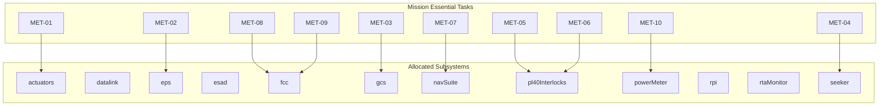

# Mission Intent and Mission Essential Task List (METL)

**Operational Slice Digest (0x20 h_ops):** `604b31026adcba4c5ba400775a1f98625958518bdb0eb84b4a26734697b84cb0` \| **Stratum:** `PreStpaOps (pi_op)`

## 1\. Stakeholder Concerns Traceability

Pre-STPA stakeholder concerns framing operational authority, determinism, and air-gap boundaries prior to RAAML safety synthesis.

|Concern ID|Qualified Name|Stakeholders|
|:---------|:-------------|:-----------|
|`scAirworthinessContainment`|`Avenger5_Architecture::scAirworthinessContainment`|pilot|
|`scLaunchCrewZeroInadvertentEnable`|`Avenger5_Architecture::scLaunchCrewZeroInadvertentEnable`|launchCrew|
|`scPayloadContinuityAssurance`|`Avenger5_Architecture::scPayloadContinuityAssurance`|payloadOp|

## 2\. Quantitative Mission Essential Task List (METL)

Every Mission Essential Task binds finite IEEE 754 binary64 threshold and objective scalars in coherent ISQ Z^7 or IEC information units.

|MET ID|Metric Name|Threshold|Objective|Unit|Allocated Subsystem|Provenance|
|:-----|:----------|:--------|:--------|:---|:------------------|:---------|
|`MET-01`|`MaximumTakeoffWeightKg`|`17`|`16.5`|`kg`|`actuators`|`schema/avenger5_uas/03_conops_and_operations.sysml`|
|`MET-02`|`FlightEnduranceS`|`4320`|`5400`|`s`|`eps`|`schema/avenger5_uas/03_conops_and_operations.sysml`|
|`MET-03`|`RlosCommandRangeM`|`60000`|`90000`|`m`|`gcs`|`schema/avenger5_uas/03_conops_and_operations.sysml`|
|`MET-04`|`StationaryTerminalCepM`|`0.5`|`0.3`|`m`|`seeker`|`schema/avenger5_uas/03_conops_and_operations.sysml`|
|`MET-05`|`Pl40NominalPressurePa`|`1300000`|`1400000`|`Pa`|`pl40Interlocks`|`schema/avenger5_uas/03_conops_and_operations.sysml`|
|`MET-06`|`Pl40ExitVelocityMps`|`23`|`24.5`|`m/s`|`pl40Interlocks`|`schema/avenger5_uas/03_conops_and_operations.sysml`|
|`MET-07`|`ServiceCeilingM`|`3000`|`5000`|`m`|`navSuite`|`schema/avenger5_uas/03_conops_and_operations.sysml`|
|`MET-08`|`GroundWindToleranceMps`|`10`|`12`|`m/s`|`fcc`|`schema/avenger5_uas/03_conops_and_operations.sysml`|
|`MET-09`|`NominalCruiseSpeedMps`|`30`|`31`|`m/s`|`fcc`|`schema/avenger5_uas/03_conops_and_operations.sysml`|
|`MET-10`|`BingoEnergyReserveRatio`|`0.2`|`0.25`|`1`|`powerMeter`|`schema/avenger5_uas/03_conops_and_operations.sysml`|

## 3\. Surjective Subsystem Allocation Matrix

|Subsystem|Authority rho|Allocated OAs|Allocated METs|Total|
|:--------|:------------|:------------|:-------------|:----|
|`actuators`|`4.2`|-|MET-01|`1`|
|`datalink`|`2.3`|OA-10|-|`1`|
|`eps`|`3.4`|-|MET-02|`1`|
|`esad`|`3.8`|OA-03, OA-08|-|`2`|
|`fcc`|`3`|OA-05|MET-08, MET-09|`3`|
|`gcs`|`2.1`|-|MET-03|`1`|
|`navSuite`|`2.8`|OA-06, OA-09|MET-07|`3`|
|`pl40Interlocks`|`4`|OA-01, OA-04|MET-05, MET-06|`4`|
|`powerMeter`|`3.2`|OA-02|MET-10|`2`|
|`rpi`|`2.5`|OA-11|-|`1`|
|`rtaMonitor`|`2`|OA-12|-|`1`|
|`seeker`|`2.7`|OA-07|MET-04|`2`|

## 4\. Operational Metrology and Interlock Constraints

- `envOperatingEnvelope` (`Avenger5_ConOps::envOperatingEnvelope`)
