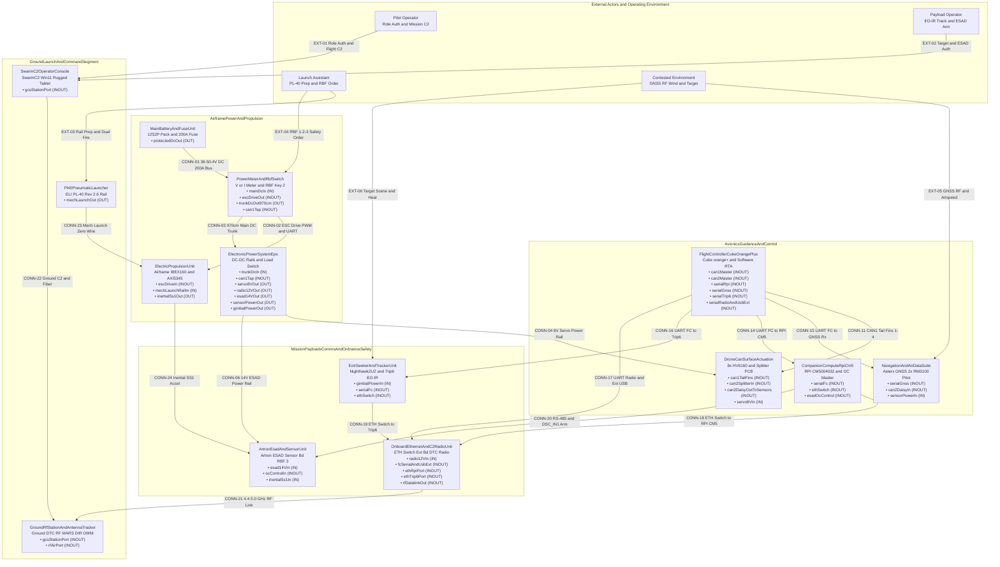
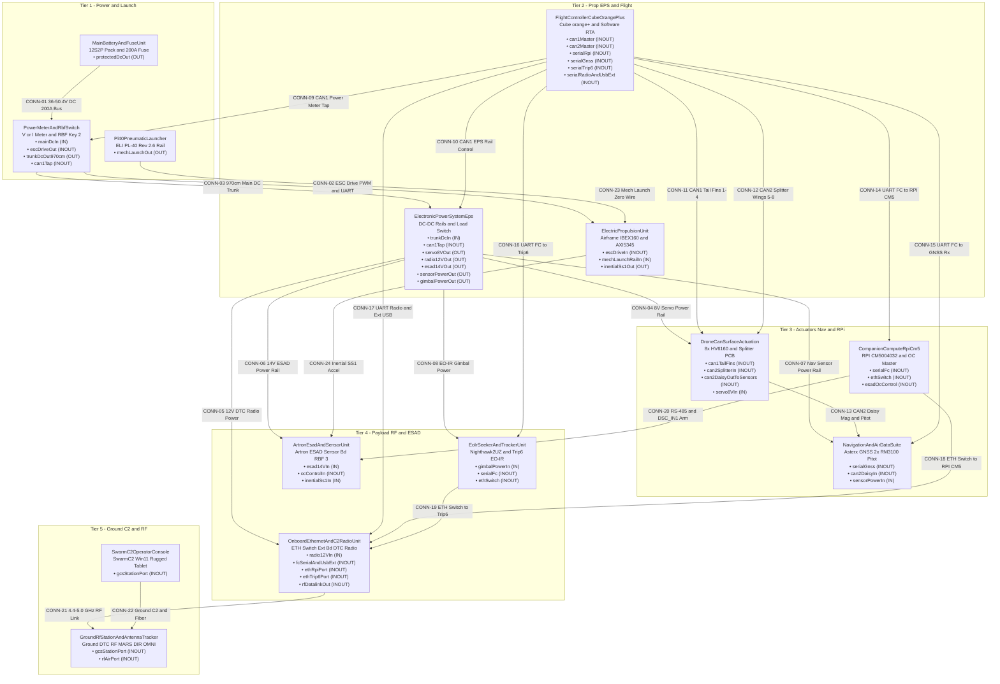

## 4. System Operational Architecture & Physical Subsystem Decomposition

**System Baseline:** `Avenger5V25UasSystem` (`Avenger 5 V2.5 UAS` / `ASTK A5 V2.5` + `ELI Military Simulations PL-40 Rev 2.6` + `Artron ESAD AB00-0054-01AA-0005` + `SwarmC2`) | **Document Date:** `2026-11-16` | **Governing Standards:** IEEE Std 1362-1998 §5.1 and §5.3, DoDAF v2.02 SV-1, ISO/IEC/IEEE 29148:2018 §6.4.2 and §6.4.3, ISO/IEC/IEEE 15288:2023 §6.4.2 and §6.4.3, INCOSE SE Handbook v5.0 §3.4.4, OMG UAF v2.0, ASTM F3269-17, STANAG 4187, MIL-STD-461, and MIL-STD-882E.

---

### 4.1 Super-System Operational Context & Platform Architecture (DoDAF SV-1)

In accordance with IEEE Std 1362-1998 §5.1 and §5.3, DoDAF v2.02 SV-1, and ISO/IEC/IEEE 29148:2018 §6.4.2 through §6.4.3, the `Avenger5V25IntegratedSystem` architecture partitions physical subsystems and Line Replaceable Units (LRUs) across four operational packages derived directly from the SysML v2 Single Source of Truth (SSOT) model in [`.pipeline/schema.sysml`](../../.pipeline/schema.sysml):
1. `GroundLaunchAndCommandSegment`: `SwarmC2OperatorConsole`, `GroundRfStationAndAntennaTracker`, and `Pl40PneumaticLauncher`.
2. `AirframePowerAndPropulsion`: `MainBatteryAndFuseUnit`, `PowerMeterAndRbfSwitch`, `ElectricPropulsionUnit`, and `ElectronicPowerSystemEps`.
3. `AvionicsGuidanceAndControl`: `FlightControllerCubeOrangePlus`, `DroneCanSurfaceActuation`, `NavigationAndAirDataSuite`, and `CompanionComputeRpiCm5`.
4. `MissionPayloadsCommsAndOrdnanceSafety`: `OnboardEthernetAndC2RadioUnit`, `EoIrSeekerAndTrackerUnit`, and `ArtronEsadAndSensorUnit`.

**Architectural Boundary & Hardware-Faithful Invariants:**
- **Software-Hosted Simplex RTA (Zero Standalone RTA Box):** The ASTM F3269-17 Simplex Run-Time Assurance (RTA) envelope monitor executes strictly in software on `FlightControllerCubeOrangePlus` (`Cube orange+`), coordinated with ordnance supervision on `CompanionComputeRpiCm5` (`RPI CM5004032`); zero standalone RTA hardware box exists in the physical architecture (`standaloneRtaBoxCount == 0`).
- **Purely Mechanical Launcher Interface (`IF-MECH-001`):** `Pl40PneumaticLauncher` (`ELI PL-40 Rev 2.6`) imparts mechanical catapult acceleration (`CONN-23`) with zero electrical, CAN, or discrete umbilical cables connected to the airframe (`electricalWireToUavCount == 0`). Launch acceleration (`SS1`) is sensed onboard by `ArtronEsadAndSensorUnit` and `Cube orange+` IMU (`CONN-24`).
- **Production Recovery Exclusion:** Production `Avenger V2.5` excludes recovery parachutes (`Recovery System: No`; `productionRecoverySystemInstalled == false`). The `2x 50.0 V` pyrotechnic parachute cover igniter outputs on `ElectronicPowerSystemEps` remain inhibited as `Optional RnD` (`rndRecoveryOptionInstalled == false`).
- **Level 1B Operational Boundary:** Section 4 captures logical port interfaces, subsystem envelopes, and operational connection flows (`CONN-01` through `CONN-24` and `EXT-01` through `EXT-06`). Detailed wire-level connector pinouts, wire gauges, register bitmasks, and RS-485 serial opcodes/framing belong strictly in Level 1C Interface Control Documents (`ICD_01_SYSTEM_INTERFACE_MATRIX.md` and `ICD_02_MASTER_SIGNAL_DICTIONARY.md`).

#### Figure 4.1: Super-System Operational Context (DoDAF SV-1 | SSOT: `docs/architecture/views/sv1_super_system.mmd`)

#### Figure 4.2: Platform Subsystems Tier Breakdown (DoDAF SV-1 | SSOT: `docs/architecture/views/sv1_platform_subsystems.mmd`)

---

### 4.2 Super-System Segment Allocation Matrix

Table 4.2 allocates 100% of the 15 SysML v2 `part def` declarations present in [`.pipeline/schema.sysml`](../../.pipeline/schema.sysml) and [`.pipeline/schema-digest.json`](../../.pipeline/schema-digest.json) across operational segments with direct machine-resolvable Level 0 SSOT citations.

#### Table 4.2: Super-System Segment Allocation Matrix (100% AST `part def` Coverage)

| Subsystem Part | Operational Segment | SSOT Ground Truth Source & Citation | Primary Functional Role |
| :--- | :--- | :--- | :--- |
| `Avenger5V25IntegratedSystem` | Root Integrated Super-System (`Avenger5V25UasSystem`) | [schema/extracted/01_avenger5_platform_and_architecture.md](../../schema/extracted/01_avenger5_platform_and_architecture.md) (`AVENGER 5 Spec sheet_rev3.pdf#p1` through `#p4`, `Avenger5_V2.5_block_diagram_rev5.pdf#p1`) \| SysML v2: `part def Avenger5V25IntegratedSystem` | Top-level super-system composition instantiating all 14 physical/ground subsystems and all 24 operational interconnects (`CONN-01` through `CONN-24`) with zero standalone RTA box, zero launcher electrical wires, and no production parachute. |
| `MainBatteryAndFuseUnit` | `AirframePowerAndPropulsion` | [schema/extracted/oem_bom.md](../../schema/extracted/oem_bom.md) (`BOM-AV-002`, `BOM-AV-003`; `Avenger5_V2.5_block_diagram_rev5.pdf#p1`, `A5-user-manual 2.pdf#p56`, `A5_prep and safety_rev7.pdf#p12` through `#p14`) \| SysML v2: `part def MainBatteryAndFuseUnit` | Removable 12S2P Li-metal primary propulsion and avionics battery pack paired with an inline automotive overcurrent protection fuse feeding the main unregulated DC bus. |
| `PowerMeterAndRbfSwitch` | `AirframePowerAndPropulsion` | [schema/extracted/oem_bom.md](../../schema/extracted/oem_bom.md) (`BOM-AV-004`, `BOM-AV-005`; `Avenger5_V2.5_block_diagram_rev5.pdf#p1`, `A5_prep and safety_rev7.pdf#p21`) \| SysML v2: `part def PowerMeterAndRbfSwitch` | Integrated voltage/current power meter and main bus switch gated by UAV Power Remove Before Flight Key #2; feeds ESC power/PWM throttle, bridges ESC UART telemetry onto DroneCAN Bus 1, and drives the main DC trunk to EPS. |
| `ElectricPropulsionUnit` | `AirframePowerAndPropulsion` | [schema/extracted/01_avenger5_platform_and_architecture.md](../../schema/extracted/01_avenger5_platform_and_architecture.md) (`BOM-AV-001`, `BOM-AV-006`, `BOM-AV-007`, `BOM-AV-008`, `BOM-AV-025`; `AVENGER 5 Spec sheet_rev3.pdf#p1` through `#p3`, `Avenger5_V2.5_block_diagram_rev5.pdf#p1`, `A5-user-manual 2.pdf#p8` through `#p10`) \| SysML v2: `part def ElectricPropulsionUnit` | X-wing pusher airframe structural envelope, brushless electronic speed controller, BLDC pusher motor, rear folding propeller, and pre-flight protective covers/strap receiving mechanical catapult thrust and transmitting rigid-body launch acceleration. |
| `ElectronicPowerSystemEps` | `AirframePowerAndPropulsion` | [schema/extracted/interface_table.md](../../schema/extracted/interface_table.md) (`BOM-AV-009`, `BOM-AV-026`, `IF-PWR-006` through `IF-PWR-011`; `Avenger5_V2.5_block_diagram_rev5.pdf#p1`, `A5-user-manual 2.pdf#p10`, `#p36`) \| SysML v2: `part def ElectronicPowerSystemEps` | DC/DC power regulation and load-switching unit converting main trunk power into dedicated servo, C2 radio, ordnance ESAD, navigation sensor, and EO/IR gimbal rails under DroneCAN Bus 1 supervision, while keeping optional RnD recovery rails disabled. |
| `FlightControllerCubeOrangePlus` | `AvionicsGuidanceAndControl` | [schema/extracted/oem_bom.md](../../schema/extracted/oem_bom.md) (`BOM-AV-010`; `Avenger5_V2.5_block_diagram_rev5.pdf#p1`, `A5-user-manual 2.pdf#p88`) \| SysML v2: `part def FlightControllerCubeOrangePlus` | Primary autopilot, INS/EKF2 state estimator, dual-bus DroneCAN master, multi-port UART coordinator, and software-hosted ASTM F3269-17 Simplex RTA envelope monitor enforcing speed caps and failsafe RTL statecharts. |
| `CompanionComputeRpiCm5` | `AvionicsGuidanceAndControl` | [schema/extracted/interface_table.md](../../schema/extracted/interface_table.md) (`BOM-AV-011`, `IF-SER-001`, `IF-ETH-001`, `IF-ORD-001`, `IF-ORD-002`; `Avenger5_V2.5_block_diagram_rev5.pdf#p1`, `ESAD ICD_for Excalibur_AB00-0054-01AA-0005 2 1.pdf#p15`) \| SysML v2: `part def CompanionComputeRpiCm5` | Companion mission computer functioning as SwarmC2 IP bridge and sole Ordnance Computer (OC) Master supervising the Artron ESAD via high-rate RS-485 polling and hardware arming discrete signaling. |
| `NavigationAndAirDataSuite` | `AvionicsGuidanceAndControl` | [schema/extracted/oem_bom.md](../../schema/extracted/oem_bom.md) (`BOM-AV-014` through `BOM-AV-017`; `AVENGER 5 Spec sheet_rev3.pdf#p3`, `Avenger5_V2.5_block_diagram_rev5.pdf#p1`) \| SysML v2: `part def NavigationAndAirDataSuite` | RTK-capable multi-constellation GNSS receiver and antenna paired with dual redundant magnetometer/barometer modules and a heated airspeed pitot sensor on DroneCAN Bus 2 supporting GNSS-denied dead-reckoning fallback. |
| `DroneCanSurfaceActuation` | `AvionicsGuidanceAndControl` | [schema/extracted/01_avenger5_platform_and_architecture.md](../../schema/extracted/01_avenger5_platform_and_architecture.md) (`BOM-AV-018` through `BOM-AV-020`; `Avenger5_V2.5_block_diagram_rev5.pdf#p1`) \| SysML v2: `part def DroneCanSurfaceActuation` | Eight DroneCAN servo actuators partitioned into four mixed pitch/yaw tail ruddervator servos on DroneCAN Bus 1 and four active roll wing panel servos behind a CAN/power splitter PCB on DroneCAN Bus 2. |
| `OnboardEthernetAndC2RadioUnit` | `MissionPayloadsCommsAndOrdnanceSafety` | [schema/extracted/oem_bom.md](../../schema/extracted/oem_bom.md) (`BOM-AV-012`, `BOM-AV-013`, `BOM-AV-021`, `BOM-AV-022`; `AVENGER 5 Spec sheet_rev3.pdf#p3`, `Avenger5_V2.5_block_diagram_rev5.pdf#p1`, `A5_prep and safety_rev7.pdf#p21`) \| SysML v2: `part def OnboardEthernetAndC2RadioUnit` | Internal switched Ethernet fabric, lockable external USB/ETH service board, AES-256 FHSS C-band C2/video datalink transceiver, and dual airborne RF antennas connecting onboard compute and seeker streams to the ground station. |
| `EoIrSeekerAndTrackerUnit` | `MissionPayloadsCommsAndOrdnanceSafety` | [schema/extracted/01_avenger5_platform_and_architecture.md](../../schema/extracted/01_avenger5_platform_and_architecture.md) (`BOM-AV-023`, `BOM-AV-024`; `AVENGER 5 Spec sheet_rev3.pdf#p1` through `#p3`, `Avenger5_V2.5_block_diagram_rev5.pdf#p1`, `A5-user-manual 2.pdf#p38`, `#p86` through `#p90`) \| SysML v2: `part def EoIrSeekerAndTrackerUnit` | Two-axis stabilized Day/Thermal EO/IR gimbal and dedicated camera auto-tracker compute module performing target lock acquisition, terminal dive guidance steering, and in-flight gimbal reboot recovery. |
| `ArtronEsadAndSensorUnit` | `MissionPayloadsCommsAndOrdnanceSafety` | [schema/extracted/oem_bom.md](../../schema/extracted/oem_bom.md) (`BOM-ORD-001` through `BOM-ORD-005`; `Avenger5_V2.5_block_diagram_rev5.pdf#p1`, `ESAD ICD_for Excalibur_AB00-0054-01AA-0005 2 1.pdf#p1` through `#p28`, `A5_prep and safety_rev7.pdf#p9` through `#p23`) \| SysML v2: `part def ArtronEsadAndSensorUnit` | STANAG 4187 all-electronic Safe and Arm Device, proximity/impact sensor board, ESAD Remove Before Flight Key #3 umbilical interlock, and modular warhead holder enforcing multi-barrier inertial, safe-separation, and command-gated detonation safety. |
| `Pl40PneumaticLauncher` | `GroundLaunchAndCommandSegment` | [schema/extracted/oem_bom.md](../../schema/extracted/oem_bom.md) (`BOM-LCH-001` through `BOM-LCH-005`; `UAV_launcher_PL-40_user_manual_rev_2.6.pdf#p3` through `#p45`) \| SysML v2: `part def Pl40PneumaticLauncher` | Portable three-section pneumatic rail catapult, battery-powered compressor with UVLO cutoff, carriage/safety pin, manual main outlet valve, and dual-switch firing box providing purely mechanical airframe acceleration. |
| `SwarmC2OperatorConsole` | `GroundLaunchAndCommandSegment` | [schema/extracted/oem_bom.md](../../schema/extracted/oem_bom.md) (`BOM-GCS-001`; `AVENGER 5 Spec sheet_rev3.pdf#p3`, `A5-user-manual 2.pdf#p11`, `#p27` through `#p29`, `A5_prep and safety_rev7.pdf#p6`) \| SysML v2: `part def SwarmC2OperatorConsole` | Rugged Windows 11 tactical C2 tablet hosting SwarmC2 software for role-authenticated mission planning, flight/seeker/ordnance HITL authorization, failsafe supervision, and 5W/CFF tactical target export. |
| `GroundRfStationAndAntennaTracker` | `GroundLaunchAndCommandSegment` | [schema/extracted/oem_bom.md](../../schema/extracted/oem_bom.md) (`BOM-GCS-002` through `BOM-GCS-006`; `AVENGER 5 Spec sheet_rev3.pdf#p3`, `A5-user-manual 2.pdf#p11`, `#p52`, `#p55`, `#p72` through `#p74`, `A5_prep and safety_rev7.pdf#p6` through `#p9`) \| SysML v2: `part def GroundRfStationAndAntennaTracker` | Ground C-band RF transceiver box, directional azimuth antenna rotator, high-gain directional and omnidirectional antennas, optional tactical fiber spool tether, and mandatory transport-box ESD grounding point. |

---

### 4.3 Subsystem Architecture (100% AST Part Coverage)

Every declared SysML v2 `part def` node in [`.pipeline/schema.sysml`](../../.pipeline/schema.sysml) (`15` of `15` nodes, `100%` bijection) is decomposed below with exact port parity, operational envelopes, lifecycle state bindings, safety interlocks, and SSOT provenance.

#### 4.3.1 `Avenger5V25IntegratedSystem` Subsystem Architecture

- **Functional Purpose & Scope:** Root super-system composition (`package Avenger5V25UasSystem`) unifying all 14 ground, launch, power, propulsion, avionics, datalink, EO/IR seeker, and ordnance safety subsystems to deliver precision mid-range strike missions across Operational Activities `OA-01` through `OA-19` and Operational Scenarios `SCN-01` through `SCN-08`. Enforces zero standalone RTA hardware box (`standaloneRtaBoxCount == 0`), purely mechanical rail launch (`electricalWireToUavCount == 0`), and production exclusion of recovery parachutes (`productionRecoverySystemInstalled == false`).
- **Physical & Logical Interface / Port Allocations:** Declares and binds all 24 internal and air-ground connection topologies (`CONN-01` through `CONN-24`; SysML `CONN_01` through `CONN_24`) across its 14 instantiated subsystem parts (`batteryAndFuse`, `powerMeter`, `propulsionAndAirframe`, `eps`, `flightController`, `companionComputer`, `navAirData`, `surfaceActuators`, `commsUnit`, `seekerUnit`, `esadUnit`, `pl40Launcher`, `swarmC2Console`, `groundRfStation`), plus external actor/environment boundaries (`EXT-01` through `EXT-06`) shown in Figure 4.1.
- **Power, Mass & Resource Envelopes:** Air vehicle MTOW `17.0 kg` (within `30.0 kg` PL-40 rail capacity) with `1.8 m` (`1803.0 mm` CAD) wingspan, `1.6 m` (`1576.0 mm` CAD) length, `1.1 m` (`1095.0-1112.0 mm` CAD) assembled height, and up to `5.0 kg` warhead mass; primary `36.0-50.4 V` DC main bus yielding up to `90.0 min` (`5400.0 s`) endurance across `-20.0 to +50.0 degC`; ground PL-40 system mass `68.0 kg` (`43.0 kg` rail case + `25.0 kg` compressor). Unprinted component-level mass/energy budgets are governed as calibration targets under `REQ_SAF_11` (`GAP-ENV`).
- **Operational Role & Statechart Integration:** Integrates all five system `state def` state machines (`UavFlightLifecycleState`, `RtaEnvelopeMonitorState`, `EsadSafeArmState`, `PaceC2LinkState`, and `Pl40LauncherState`) across pre-flight checkout, catapult launch, cruise/loiter, terminal engagement, abort/RTB, and safe shutdown (`Phi_lifecycle`).
- **Safety Invariants, Containment Interlocks & FMECA Linkage:** Enforces system-level loss and hazard barriers (`REQ_L_01` through `REQ_L_04`, `REQ_H_01` through `REQ_H_06`, `REQ_UCA_01` through `REQ_UCA_08`, `REQ_SC_01` through `REQ_SC_16`) alongside gap dispositions (`REQ_SAF_01` through `REQ_SAF_12`), ASTM F3269-17 software Simplex RTA (`SimplexRtaSoftwareHostingConstraint`), STANAG 4187 ESAD barriers, and Section 12 emergency triggers (`EMG-01` through `EMG-07`).
- **SSOT Ground Truth Mapping:** [schema/extracted/01_avenger5_platform_and_architecture.md](../../schema/extracted/01_avenger5_platform_and_architecture.md) (System Identification and Bus Topologies; `AVENGER 5 Spec sheet_rev3.pdf#p1` through `#p4`, `Avenger5_V2.5_block_diagram_rev5.pdf#p1`) | SysML v2: `part def Avenger5V25IntegratedSystem`

#### 4.3.2 `MainBatteryAndFuseUnit` Subsystem Architecture

- **Functional Purpose & Scope:** Supplies primary onboard electrical energy storage and main-bus overcurrent protection via a removable `12S2P Li metal BEI maximus20` pack (`BOM-AV-002`, matched by ID/QR to the fuselage) and an inline `200.0 A` automotive fuse (`BOM-AV-003`). Supports `OA-01` (`ValidateBatteryAndPowerOnRbf2`) and `OA-04` (`MonitorBingoEnergyReserve`) within `AirframePowerAndPropulsion`.
- **Physical & Logical Interface / Port Allocations:** Exposes `protectedDcOut (OUT)` (`MainBatteryDcOutPort`, `IF-PWR-001` and `IF-PWR-002`) carrying `MainDcBusPower` on `CONN-01` to `PowerMeterAndRbfSwitch.mainDcIn`.
- **Power, Mass & Resource Envelopes:** Operating DC voltage `36.0-50.4 V`, mandatory pre-flight voltage window `49.0-50.0 V` (strictly rejecting legacy `23.9-25.0 V` UI screenshots per `GAP-05`), `200.0 A` fuse rating, `90.0 min` (`5400.0 s`) maximum endurance, `0.20` (`1080.0 s`) statutory Bingo energy reserve floor, and `-20.0 to +50.0 degC` airframe thermal envelope. Individual pack mass and Wh/Ah cell capacity are unprinted in OEM documents and tracked under `REQ_SAF_11` (`GAP-ENV`) within the `17.0 kg` MTOW budget.
- **Operational Role & Statechart Integration:** Anchors `UavFlightLifecycleState::PreFlightCheck` (`49.0-50.0 V` verification before RBF #2 removal), sustains `CatapultLaunch`, `CruiseAndLoiter`, and `TargetTrackAndDive`, triggers `EmergencyAbortOrRtb` and `RtaEnvelopeMonitorState::CriticalBatteryOrGeofenceRtb` upon Bingo depletion or bus sag below `36.0 V`, and disconnects only in `SafePostFlightShutdown` after RBF #3 reinstallation.
- **Safety Invariants, Containment Interlocks & FMECA Linkage:** Enforces `MainBatteryPreFlightVoltageConstraint` (`GAP-05`), `BingoEnergyReserveConstraint`, `REQ_SC_01`, `REQ_SC_02`, `REQ_SC_04`, `REQ_SAF_05`, `REQ_SAF_11`, `REQ_H_01`, `REQ_H_02`, `REQ_UCA_01`, and `REQ_UCA_02`; bound to Section 12 critical battery reserve and main-bus sag emergency triggers (`EMG-01` through `EMG-07`).
- **SSOT Ground Truth Mapping:** [schema/extracted/oem_bom.md](../../schema/extracted/oem_bom.md) (`BOM-AV-002`, `BOM-AV-003`; `Avenger5_V2.5_block_diagram_rev5.pdf#p1`, `A5-user-manual 2.pdf#p56`, `A5_prep and safety_rev7.pdf#p12` through `#p14`) | SysML v2: `part def MainBatteryAndFuseUnit`

#### 4.3.3 `PowerMeterAndRbfSwitch` Subsystem Architecture

- **Functional Purpose & Scope:** Gates main DC bus energization through `UAV Power R.B.F. Key #2 (XT60E-F)` (`BOM-AV-005`), measures bus voltage and current (`BOM-AV-004`), issues PWM throttle commands to the propulsion ESC, bridges unidirectional ESC UART telemetry onto DroneCAN Bus 1, and drives the `970.0 cm` main DC trunk to EPS. Executes `OA-01` (`ValidateBatteryAndPowerOnRbf2`), `OA-02` (`CommandPusherThrottleAndReadEscTelem`), and `OA-04` (`MonitorBingoEnergyReserve`).
- **Physical & Logical Interface / Port Allocations:** Declares four SV-1 ports: `mainDcIn (IN)` (`MainBatteryDcInPort`, `IF-PWR-003`) receiving `CONN-01`; `escDriveOut (INOUT)` (`EscDriveHarnessOutPort`, `IF-PWR-004`, `IF-PWM-001`, `IF-SER-005`) driving `CONN-02`; `trunkDcOut970cm (OUT)` (`TrunkDcPowerOutPort`, `IF-PWR-006`) feeding `CONN-03`; and `can1Tap (INOUT)` (`Can1PowerTapPort`, `IF-CAN1-001`) interfacing `CONN-09`. Also receives external operator physical safety action `EXT-04` (`RBF 1-2-3 Safety Order`).
- **Power, Mass & Resource Envelopes:** Switched `36.0-50.4 V` DC main bus rated up to the `200.0 A` upstream fuse across a `970.0 cm` trunk harness and `-20.0 to +50.0 degC` airframe thermal envelope. Individual PCB mass and shunt dissipation are unprinted in OEM documents and allocated within the `17.0 kg` MTOW budget.
- **Operational Role & Statechart Integration:** Controls the `PreFlightCheck` power-on transition (`rbf2RemovedPowersOn == true`, `pullRbf2BeforeRbf3 == true`), streams real-time current/voltage/ESC health throughout flight modes, and remains energized through `SafePostFlightShutdown` until `RBF #3` is reinstalled before `RBF #2` disconnection.
- **Safety Invariants, Containment Interlocks & FMECA Linkage:** Enforces `REQ_SC_01`, `REQ_SC_02`, `REQ_SC_04`, `REQ_SAF_06` (`GAP-06` power-before-pull sequencing), `REQ_H_01`, `REQ_H_02`, `REQ_UCA_01`, and `REQ_UCA_02`; bound to Section 12 power-bus fault and scrub-safing triggers (`EMG-01` through `EMG-07`).
- **SSOT Ground Truth Mapping:** [schema/extracted/oem_bom.md](../../schema/extracted/oem_bom.md) (`BOM-AV-004`, `BOM-AV-005`; `Avenger5_V2.5_block_diagram_rev5.pdf#p1`, `A5_prep and safety_rev7.pdf#p21`) | SysML v2: `part def PowerMeterAndRbfSwitch`

#### 4.3.4 `ElectricPropulsionUnit` Subsystem Architecture

- **Functional Purpose & Scope:** Encompasses the `Avenger V2.5` (`ASTK A5 V2.5`) X-wing pusher airframe (`BOM-AV-001`), `IBEX160` brushless ESC (`BOM-AV-006`), `AXI 5345/16 HD GOLD LINE V3` BLDC motor (`BOM-AV-007`), rear 2-blade folding pusher propeller (`BOM-AV-008`), and `RBF #1` front protective covers/gimbal strap (`BOM-AV-025`). Converts electrical DC power into aerodynamic thrust and transmits rigid-body catapult launch acceleration to the ESAD inertial sensor (`OA-02`).
- **Physical & Logical Interface / Port Allocations:** Declares three SV-1 ports: `escDriveIn (INOUT)` (`EscDriveHarnessInPort`, `IF-PWR-004`, `IF-PWR-005`, `IF-PWM-001`, `IF-SER-005`) on `CONN-02`; `mechLaunchRailIn (IN)` (`MechanicalLaunchRailInPort`, `IF-MECH-001`, zero electrical conductors) receiving `CONN-23` from `Pl40PneumaticLauncher`; and `inertialSs1Out (OUT)` (`InertialSs1AccelOutPort`, rigid-body mechanical impulse) driving `CONN-24` to `ArtronEsadAndSensorUnit`.
- **Power, Mass & Resource Envelopes:** Total MTOW `17.0 kg` (`2`-crew lift minimum, `M6 x 30 mm` wing bolts with `10.0 mm` spanner, `145.0-155.5 mm` PL-40 carriage prop-safe zone); `36.0-50.4 V` DC ESC drive; airspeed envelope spanning `24.0 m/s` stall (`26.0 m/s` V1 min), `31.0 m/s` V2.5 (`30.0 m/s` V1) cruise, `42.0 m/s` V2.5 (`38.0 m/s` V1) max horizontal, `55.0 m/s` engagement cap, `80.0 m/s` VNE structural ceiling, `15.0 deg` shallow / `22.0 deg` max dive, `5000.0 m` service ceiling, `12.0 m/s` ground / `28.0 m/s` cruise wind tolerance, and `-20.0 to +50.0 degC` operating temp. ESC/motor thermal and current cutoffs are tracked under `REQ_SAF_11` (`GAP-ENV`).
- **Operational Role & Statechart Integration:** Transitions from `PreFlightCheck` (`RBF #1` removed, rear prop folded rearward) into `CatapultLaunch` (`~23.0 m/s` rail exit, climb transition above `26.0 m/s`), `CruiseAndLoiter`, `TargetTrackAndDive`, `EmergencyAbortOrRtb`, and `SafePostFlightShutdown` (`UavFlightLifecycleState`).
- **Safety Invariants, Containment Interlocks & FMECA Linkage:** Enforces `FlightEnvelopeSpeedConstraint` (`GAP-02`), `REQ_SC_01`, `REQ_SC_04`, `REQ_SAF_02`, `REQ_SAF_11`, `REQ_H_01`, `REQ_H_02`, and `REQ_L_02`; bound to Section 12 propulsion loss, airspeed limit, and launch transition emergency triggers (`EMG-01` through `EMG-07`).
- **SSOT Ground Truth Mapping:** [schema/extracted/01_avenger5_platform_and_architecture.md](../../schema/extracted/01_avenger5_platform_and_architecture.md) (System Identification and Airframe Performance Envelope; `AVENGER 5 Spec sheet_rev3.pdf#p1` through `#p3`, `Avenger5_V2.5_block_diagram_rev5.pdf#p1`, `A5-user-manual 2.pdf#p8` through `#p10`) | SysML v2: `part def ElectricPropulsionUnit`

#### 4.3.5 `ElectronicPowerSystemEps` Subsystem Architecture

- **Functional Purpose & Scope:** Regulates and switches secondary DC distribution rails from the `970.0 cm` main DC trunk using internal DC/DC converters, load switches, and a DroneCAN Bus 1 MCU (`BOM-AV-009`), executing `OA-03` (`DistributeRegulatedPowerRails`). On production `Avenger V2.5`, the `2x 50.0 V` pyrotechnic parachute igniter outputs (`BOM-AV-026`, `Optional RnD`) remain permanently disabled (`Recovery System: No`).
- **Physical & Logical Interface / Port Allocations:** Declares seven SV-1 ports: `trunkDcIn (IN)` (`TrunkDcPowerInPort`, `IF-PWR-006`) on `CONN-03`; `can1Tap (INOUT)` (`Can1PowerTapPort`, `IF-CAN1-001`) on `CONN-10`; `servo8VOut (OUT)` (`RegulatedRailOutPort`, `IF-PWR-007`) on `CONN-04`; `radio12VOut (OUT)` (`RegulatedRailOutPort`, `IF-PWR-008`) on `CONN-05`; `esad14VOut (OUT)` (`RegulatedRailOutPort`, `IF-PWR-009`) on `CONN-06`; `sensorPowerOut (OUT)` (`RegulatedRailOutPort`, `IF-PWR-011`) on `CONN-07`; and `gimbalPowerOut (OUT)` (`RegulatedRailOutPort`, `IF-PWR-011`) on `CONN-08`.
- **Power, Mass & Resource Envelopes:** Accepts `36.0-50.4 V` DC trunk input and regulates `8.0 V` servo power, `12.0 V` DTC radio power, `14.0 V` ESAD power (`0.0 V` brownout margin against the ESAD `14.0-32.0 V` ICD range per `GAP-01`), Pitot/Mag/Gimbal rails, and inhibited `50.0 V` RnD lines across `-20.0 to +50.0 degC`. Individual EPS module mass and per-rail current limits are unprinted in OEM documents and tracked within the `17.0 kg` MTOW and `REQ_SAF_11` (`GAP-ENV`).
- **Operational Role & Statechart Integration:** Energized across `UavFlightLifecycleState` (`PreFlightCheck` through `SafePostFlightShutdown`); controls `EsadSafeArmState` transition between `SafePowerOff` and `BootAndPbit` via the `14.0 V` load switch and executes irreversible `Power Off ESAD` rail isolation during abort, scrub, or fault safing.
- **Safety Invariants, Containment Interlocks & FMECA Linkage:** Enforces `EpsEsadZeroBrownoutMarginConstraint` (`GAP-01`), `ProductionNoParachuteConstraint`, `REQ_SC_02`, `REQ_SC_03`, `REQ_SAF_01`, `REQ_H_01`, `REQ_H_02`, and `REQ_UCA_02`; bound to Section 12 EPS brownout and ordnance power-off triggers (`EMG-01` through `EMG-07`).
- **SSOT Ground Truth Mapping:** [schema/extracted/interface_table.md](../../schema/extracted/interface_table.md) (`IF-PWR-006` through `IF-PWR-011`, `BOM-AV-009`, `BOM-AV-026`; `Avenger5_V2.5_block_diagram_rev5.pdf#p1`, `A5-user-manual 2.pdf#p10`, `#p36`) | SysML v2: `part def ElectronicPowerSystemEps`

#### 4.3.6 `FlightControllerCubeOrangePlus` Subsystem Architecture

- **Functional Purpose & Scope:** Serves as the primary flight controller, INS/EKF2 state estimator, and autonomous flight manager (`Cube orange+`, `BOM-AV-010`) inside the `ASTK A5 V2.5` stack. Hosts the software-resident ASTM F3269-17 Simplex RTA supervisor (`simplexRtaSoftwareHosted == true`, `standaloneRtaBoxCount == 0`), executing `OA-05` (`ExecuteSimplexRtaEnvelopeCheck`), `OA-07` (`SwitchToGnssDeniedDeadReckoning`), and inner-loop guidance across `OA-09`.
- **Physical & Logical Interface / Port Allocations:** Declares six SV-1 ports: `can1Master (INOUT)` (`DroneCanBusPort`, `IF-CAN1-001`) on `CONN-09`, `CONN-10`, and `CONN-11`; `can2Master (INOUT)` (`DroneCanBusPort`, `IF-CAN2-001`) on `CONN-12`; `serialRpi (INOUT)` (`UartSerialPort`, `IF-SER-001`) on `CONN-14`; `serialGnss (INOUT)` (`UartSerialPort`, `IF-SER-002`) on `CONN-15`; `serialTrip6 (INOUT)` (`UartSerialPort`, `IF-SER-003`) on `CONN-16`; and `serialRadioAndUsbExt (INOUT)` (`SerialAndUsbServicePort`, `IF-SER-004`, `IF-USB-001`) on `CONN-17`.
- **Power, Mass & Resource Envelopes:** Integrates `2` independent DroneCAN buses, `4` point-to-point UART serial ports, and `1` ground USB maintenance interface behind the lockable umbilical/service lid; enforces `<= 55.0 m/s` engagement speed cap, `<= 80.0 m/s` structural `VNE`, and `105.0 s` baseline GCS failsafe timeout across `-20.0 to +50.0 degC`. Individual module mass/power and EKF2/CAN WCET bounds are unprinted in OEM documents and tracked under `REQ_SAF_08` (`GAP-WCET`) and `17.0 kg` MTOW.
- **Operational Role & Statechart Integration:** Governs `UavFlightLifecycleState` mode transitions, directly implements `RtaEnvelopeMonitorState` (`NominalPrimaryEnvelope`, `AirspeedDiveCapClamped`, `EsadBusWatchdogFaultFallback`, `CriticalBatteryOrGeofenceRtb`), and executes `PaceC2LinkState::EmergencyLostLinkRtlHolding` on sustained GCS link loss.
- **Safety Invariants, Containment Interlocks & FMECA Linkage:** Enforces `SimplexRtaSoftwareHostingConstraint`, `FlightEnvelopeSpeedConstraint`, `CanTopologyIsolationConstraint`, `REQ_SC_05`, `REQ_SC_06`, `REQ_SC_07`, `REQ_SAF_02`, `REQ_SAF_08`, `REQ_H_03`, `REQ_L_02`, `REQ_L_03`, and `REQ_UCA_03`; bound to Section 12 overspeed clamp, lost-link RTL, and critical battery triggers (`EMG-01` through `EMG-07`).
- **SSOT Ground Truth Mapping:** [schema/extracted/oem_bom.md](../../schema/extracted/oem_bom.md) (`BOM-AV-010`; `Avenger5_V2.5_block_diagram_rev5.pdf#p1`, `A5-user-manual 2.pdf#p88`) | SysML v2: `part def FlightControllerCubeOrangePlus`

#### 4.3.7 `CompanionComputeRpiCm5` Subsystem Architecture

- **Functional Purpose & Scope:** Provides companion mission computing (`RPI CM5004032`, `BOM-AV-011`) inside `ASTK A5 V2.5`, bridging SwarmC2 IP payloads/commands over switched Ethernet (`IF-ETH-001`) with `Cube orange+` (`IF-SER-001`) and acting as the sole Ordnance Computer (OC) Master supervising the Artron ESAD (`OA-08`, `OA-10`, `OA-11`, `OA-12`).
- **Physical & Logical Interface / Port Allocations:** Declares three SV-1 ports: `serialFc (INOUT)` (`UartSerialPort`, `IF-SER-001`) on `CONN-14`; `ethSwitch (INOUT)` (`EthernetFabricPort`, `IF-ETH-001`) on `CONN-18`; and `esadOcControl (INOUT)` (`EsadOcControlBundlePort`, `IF-ORD-001` RS-485 bus and `IF-ORD-002` `DSC_IN1` discrete arm enable) on `CONN-20` (detailed wire framing and opcodes deferred to Level 1C ICD).
- **Power, Mass & Resource Envelopes:** Polls Artron ESAD at `100.0 Hz` (`0.01 s` period) with `<= 5.0 ms` reply latency and `<= 10.0 ms` incomplete-packet watchdog timeout (`GAP-04`); drives `DSC_IN1` hardware arm pulse burst (`2.5-3.3 V` high, `0.0-0.7 V` low, `2` pulses gated strictly to Arm Stage 2) across `-20.0 to +50.0 degC`. Individual compute board mass/wattage are unprinted in OEM documents and tracked under `17.0 kg` MTOW and `REQ_SAF_08`.
- **Operational Role & Statechart Integration:** Orchestrates `EsadSafeArmState` supervision (`BootAndPbit`, `SafeRbfInstalled`, `SafeRbfRemoved`, `ArmStage1TimerWait`, `ArmStage2Armed`, `HvChargedReady`, `DetonatedOrAborted`, `FaultLockout`) and triggers `RtaEnvelopeMonitorState::EsadBusWatchdogFaultFallback` on ESAD bus timeout, CRC error, or `14.0 V` brownout.
- **Safety Invariants, Containment Interlocks & FMECA Linkage:** Enforces `EsadRs485ProtocolTimingConstraint` (`GAP-04`), `REQ_SC_08`, `REQ_SC_09`, `REQ_SC_10`, `REQ_SC_11`, `REQ_SAF_04`, `REQ_SAF_08`, `REQ_H_03`, `REQ_H_04`, `REQ_UCA_04`, `REQ_UCA_05`, and `REQ_UCA_06`; bound to Section 12 ESAD bus watchdog and command abort triggers (`EMG-01` through `EMG-07`).
- **SSOT Ground Truth Mapping:** [schema/extracted/interface_table.md](../../schema/extracted/interface_table.md) (`IF-SER-001`, `IF-ETH-001`, `IF-ORD-001`, `IF-ORD-002`, `BOM-AV-011`; `Avenger5_V2.5_block_diagram_rev5.pdf#p1`, `ESAD ICD_for Excalibur_AB00-0054-01AA-0005 2 1.pdf#p15`) | SysML v2: `part def CompanionComputeRpiCm5`

#### 4.3.8 `NavigationAndAirDataSuite` Subsystem Architecture

- **Functional Purpose & Scope:** Integrates `Septentrio Asterx-m3 pro` RTK-capable multi-constellation GNSS (`BOM-AV-014`), `Talysman TW3972EXF` antenna (`BOM-AV-015`), `2x mRo RM3100` dual redundant Magnetometers with integrated barometer (`BOM-AV-016`), and `CUAV SKYE2` Heated Pitot airspeed sensor with water drainage (`BOM-AV-017`). Executes `OA-06` (`RunPitotAndMagPreflightCheck`) and supports `OA-07` (`SwitchToGnssDeniedDeadReckoning`).
- **Physical & Logical Interface / Port Allocations:** Declares three SV-1 ports: `serialGnss (INOUT)` (`UartSerialPort`, `IF-SER-002`) on `CONN-15`; `can2DaisyIn (INOUT)` (`DroneCanBusPort`, `IF-CAN2-001` series end-chain `Mag #2 -> Mag #1 -> Pitot`) on `CONN-13`; and `sensorPowerIn (IN)` (`RegulatedRailInPort`, `IF-PWR-011` Mag and Pitot rails) on `CONN-07`. Receives external RF and airflow inputs on `EXT-05` (`IF-RF-002` GNSS coax RF and ambient airspeed/pressure).
- **Power, Mass & Resource Envelopes:** Enforces calm-air pitot pre-flight bound `<= 3.0 m/s` and indirect airflow check `>= 10.0 m/s` (`PitotPreflightCalibrationConstraint`) across `-20.0 to +50.0 degC` up to `5000.0 m` ceiling. Sensor rail voltages/currents and individual sensor weights are unprinted in OEM documents and tracked under `REQ_SAF_11` (`GAP-ENV`) and `17.0 kg` MTOW.
- **Operational Role & Statechart Integration:** Validates sensor health in `UavFlightLifecycleState::PreFlightCheck`, delivers primary navigation/air-data across `CatapultLaunch` through `TargetTrackAndDive`, and sustains `PaceC2LinkState::ContingencyGnssDeniedDrFlight` via dual `RM3100` + `SKYE2` dead-reckoning upon `GPS Failsafe` or operator `Disable GNSS`.
- **Safety Invariants, Containment Interlocks & FMECA Linkage:** Enforces `PitotPreflightCalibrationConstraint`, `CanTopologyIsolationConstraint`, `REQ_SC_06`, `REQ_SC_07`, `REQ_H_03`, `REQ_L_03`, and `REQ_UCA_03`; bound to Section 12 GNSS-denial and pitot/sensor failure triggers (`EMG-01` through `EMG-07`).
- **SSOT Ground Truth Mapping:** [schema/extracted/oem_bom.md](../../schema/extracted/oem_bom.md) (`BOM-AV-014` through `BOM-AV-017`; `AVENGER 5 Spec sheet_rev3.pdf#p3`, `Avenger5_V2.5_block_diagram_rev5.pdf#p1`) | SysML v2: `part def NavigationAndAirDataSuite`

#### 4.3.9 `DroneCanSurfaceActuation` Subsystem Architecture

- **Functional Purpose & Scope:** Implements aerodynamic flight surface actuation across `8x HV6160-DroneCAN` servos (`4` tail ruddervators `#1` through `#4` on `CAN 1` for mixed pitch/yaw skid-turn control, `BOM-AV-018`; and `4` wing panel servos `#5` through `#8` on `CAN 2` for active roll stabilization, `BOM-AV-019`) routed through a wing `CAN/power splitter PCB` (`BOM-AV-020`), executing `OA-09` (`ActuateTailAndWingSurfaces`).
- **Physical & Logical Interface / Port Allocations:** Declares four SV-1 ports: `can1TailFins (INOUT)` (`DroneCanBusPort`, `IF-CAN1-001`) on `CONN-11`; `can2SplitterIn (INOUT)` (`DroneCanBusPort`, `IF-CAN2-001`) on `CONN-12`; `can2DaisyOutToSensors (INOUT)` (`DroneCanBusPort`, `IF-CAN2-001` series continuation) on `CONN-13`; and `servo8VIn (IN)` (`RegulatedRailInPort`, `IF-PWR-007`) on `CONN-04`.
- **Power, Mass & Resource Envelopes:** Powered by the regulated `8.0 V` EPS servo rail; `4x 120.0 cm` star/tap stubs on `CAN 1` for tail fins `#1` through `#4` and series daisy-chain through `CAN/power splitter PCB` on `CAN 2` for wing panels `#5` through `#8`; operating envelope `-20.0 to +50.0 degC`. Servo peak current draw and individual unit mass are unprinted in OEM documents and tracked within the `17.0 kg` MTOW budget.
- **Operational Role & Statechart Integration:** Executes pre-flight surface sweep in `UavFlightLifecycleState::PreFlightCheck`, stabilizes post-launch climb, executes skid-turn cruise/loiter and `15.0 deg` (`<= 22.0 deg` max) terminal dive control, and commands pull-up/leveling under `RtaEnvelopeMonitorState::AirspeedDiveCapClamped` or `EmergencyAbortOrRtb`.
- **Safety Invariants, Containment Interlocks & FMECA Linkage:** Enforces `CanTopologyIsolationConstraint`, `REQ_SC_06`, `REQ_H_03`, and `REQ_UCA_03` by isolating pitch/yaw (`CAN 1`) from roll (`CAN 2`) buses so single-bus loss does not remove all control authority; bound to Section 12 control/envelope triggers (`EMG-01` through `EMG-07`).
- **SSOT Ground Truth Mapping:** [schema/extracted/01_avenger5_platform_and_architecture.md](../../schema/extracted/01_avenger5_platform_and_architecture.md) (Avionics and Bus Topologies; `Avenger5_V2.5_block_diagram_rev5.pdf#p1`) | SysML v2: `part def DroneCanSurfaceActuation`

#### 4.3.10 `OnboardEthernetAndC2RadioUnit` Subsystem Architecture

- **Functional Purpose & Scope:** Combines the internal `ETH Switch` (`BOM-AV-012`), `External Interface Board (USB/ETH)` behind a lockable umbilical/service lid (`BOM-AV-013`), `DTC 4.4-5.0 GHz` AES-256 FHSS airborne datalink radio (`BOM-AV-021`), and `2x MPSL4400` antennas (`BOM-AV-022`). Bridges ground C2, HD EO/IR video, flight telemetry, and ground service access.
- **Physical & Logical Interface / Port Allocations:** Declares five SV-1 ports: `radio12VIn (IN)` (`RegulatedRailInPort`, `IF-PWR-008`) on `CONN-05`; `fcSerialAndUsbExt (INOUT)` (`SerialAndUsbServicePort`, `IF-SER-004`, `IF-USB-001`) on `CONN-17`; `ethRpiPort (INOUT)` (`EthernetFabricPort`, `IF-ETH-001`) on `CONN-18`; `ethTrip6Port (INOUT)` (`EthernetFabricPort`, `IF-ETH-001`) on `CONN-19`; and `rfDatalinkOut (INOUT)` (`RfDatalinkAirPort`, `IF-RF-001`) on `CONN-21` to `GroundRfStationAndAntennaTracker.rfAirPort`.
- **Power, Mass & Resource Envelopes:** `4.4-5.0 GHz` AES-256 FHSS RF transceiver delivering `2.0 W` total (`2x 1.0 W` per antenna) over `8.0-17.0 V` input tolerance from the `12.0 V` EPS rail; `60.0 km` baseline RLOS (`90.0 km` V2.5 extended / `180.0 km` V1 extended); `-20.0 to +50.0 degC` airframe thermal envelope. Individual module mass and DC draw are unprinted in OEM documents and tracked under `17.0 kg` MTOW.
- **Operational Role & Statechart Integration:** Supports ground service configuration during `PreFlightCheck` prior to locking the external service lid, maintains encrypted air-ground telemetry/video across `PaceC2LinkState::AlternateDtcOmniLocal` and `PrimaryDtcDirTracking`, and signals link loss leading to `EmergencyLostLinkRtlHolding` after `105.0 s` (`OA-05`, `OA-13`, `OA-14`, `OA-19`).
- **Safety Invariants, Containment Interlocks & FMECA Linkage:** Enforces `REQ_SC_01` (umbilical/service lid locked before flight checks), `REQ_SC_12`, `REQ_SC_15`, `REQ_SAF_02` (`GAP-02`), `REQ_H_05`, `REQ_L_03`, and `REQ_UCA_07`; bound to Section 12 C2 link-loss and RF degradation triggers (`EMG-01` through `EMG-07`).
- **SSOT Ground Truth Mapping:** [schema/extracted/oem_bom.md](../../schema/extracted/oem_bom.md) (`BOM-AV-012`, `BOM-AV-013`, `BOM-AV-021`, `BOM-AV-022`; `AVENGER 5 Spec sheet_rev3.pdf#p3`, `Avenger5_V2.5_block_diagram_rev5.pdf#p1`, `A5_prep and safety_rev7.pdf#p21`) | SysML v2: `part def OnboardEthernetAndC2RadioUnit`

#### 4.3.11 `EoIrSeekerAndTrackerUnit` Subsystem Architecture

- **Functional Purpose & Scope:** Integrates the `Nighthawk2UZ` 2-axis stabilized Day/Thermal EO/IR seeker gimbal (`BOM-AV-023`) and `Trip6` camera compute/auto-tracker (`BOM-AV-024`) to provide ISR surveillance, target acquisition (`2.0-5.0 s` hold), terminal dive guidance cues (`<= 0.5 m` CEP), and in-flight `Reboot Gimbal` video recovery (`OA-13`, `OA-14`).
- **Physical & Logical Interface / Port Allocations:** Declares three SV-1 ports: `gimbalPowerIn (IN)` (`RegulatedRailInPort`, `IF-PWR-011` Gimbal power) on `CONN-08`; `serialFc (INOUT)` (`UartSerialPort`, `IF-SER-003`) on `CONN-16`; and `ethSwitch (INOUT)` (`EthernetFabricPort`, `IF-ETH-001`) on `CONN-19`. Receives external target scene energy on `EXT-06` and internally bridges `Power + HDMI` (`IF-VID-001`) between `Trip6` and `Nighthawk2UZ`.
- **Power, Mass & Resource Envelopes:** Dual `1280x720` Day and Thermal streams with `X40` optical/digital zoom, gimbal articulation limits of `-45.0 to +135.0 deg` pitch and `+/-165.0 deg` yaw/roll; `2.0-5.0 s` auto-track hold, `<= 15.0 deg` target elevation at start / shallow approach, `<= 55.0 m/s` hard engagement speed cap, `<= 0.5 m` (`50.0 cm`) terminal CEP, and `-20.0 to +50.0 degC` airframe thermal envelope. Individual module mass/power and Trip6 tracker WCET are unprinted in OEM documents and tracked under `REQ_SAF_08` (`GAP-WCET`) and `17.0 kg` MTOW.
- **Operational Role & Statechart Integration:** Executes `UavFlightLifecycleState::CruiseAndLoiter` search and `TargetTrackAndDive` terminal guidance, transitions to `EmergencyAbortOrRtb` and `RtaEnvelopeMonitorState::AirspeedDiveCapClamped` via `Abort Engaging` whenever dive speed exceeds `55.0 m/s`, and performs `Reboot Gimbal` without opening the locked external service lid.
- **Safety Invariants, Containment Interlocks & FMECA Linkage:** Enforces `EngagementSpeedAndTrackHoldConstraint`, `REQ_SC_12`, `REQ_H_05`, and `REQ_UCA_07` (preventing gimbal saturation above `55.0 m/s` or unguided impact); bound to Section 12 overspeed-abort and video-freeze triggers (`EMG-01` through `EMG-07`).
- **SSOT Ground Truth Mapping:** [schema/extracted/01_avenger5_platform_and_architecture.md](../../schema/extracted/01_avenger5_platform_and_architecture.md) (Avionics and Seeker Subsystems; `AVENGER 5 Spec sheet_rev3.pdf#p1` through `#p3`, `Avenger5_V2.5_block_diagram_rev5.pdf#p1`, `A5-user-manual 2.pdf#p38`, `#p86` through `#p90`) | SysML v2: `part def EoIrSeekerAndTrackerUnit`

#### 4.3.12 `ArtronEsadAndSensorUnit` Subsystem Architecture

- **Functional Purpose & Scope:** Integrates the `Artron ESAD` (`AB00-0054-01AA-0005`, `BOM-ORD-001`), `ESAD Sensor Board` with proximity and impact detection (`BOM-ORD-003`), `ESAD R.B.F. Key #3` umbilical interlock (`BOM-ORD-002`), ordnance harnesses (`BOM-ORD-005`), and modular warhead holder (`BOM-ORD-004`). Enforces STANAG 4187 multi-barrier safe-arm gating (`OA-10`, `OA-11`, `OA-12`) prior to lethal package initiation.
- **Physical & Logical Interface / Port Allocations:** Declares three SV-1 ports: `esad14VIn (IN)` (`RegulatedRailInPort`, `IF-PWR-009` GE_POW rail) on `CONN-06`; `ocControlIn (INOUT)` (`EsadJ100SlavePort`, `IF-ORD-001` RS-485 bus and `IF-ORD-002` `DSC_IN1` discrete arm enable) on `CONN-20`; and `inertialSs1In (IN)` (`InertialSs1AccelInPort`, rigid-body launch acceleration) on `CONN-24`. Internally encapsulates the `RBF #3` umbilical continuity loop (`IF-ORD-003`), `5.0 V` sensor board UART/ORed interrupt trigger path (`IF-ORD-004`), and Custom `J401` high-voltage firing output (`IF-ORD-005`); detailed pinouts, wire gauges, bitmasks, and serial opcodes are deferred to Level 1C ICD.
- **Power, Mass & Resource Envelopes:** `14.0-32.0 V` ICD input (`28.0 V` nominal vs `14.0 V` EPS supply yielding `0.0 V` brownout margin per `GAP-01`); `RBF #3` umbilical loop `< 0.5 Ohm` at `20.0 mA`; `< 50.0 V` PBIT safe internal HV threshold; `0.0-1800.0 V` (`1.0 V/LSB`) HV charge/fire envelope; `0.0039 g/LSB` acceleration scale and `1.0 s/LSB` flight timer scale; `3x M3` (`75.0 mm` BCD) ESAD mount and `2x M2` sensor board mount; warhead holder `<= 5.0 kg` (`4.98 +/- 0.02 kg` tested unit, CG CTQ `30.57 +/- 1.00`, overall `173.00`, `1.5 mm` HEX terminals); `-20.0 to +50.0 degC` envelope. Unprinted safe-separation distance, launch g threshold, arming timer, and fastener torque values are parameterized under `REQ_SAF_10` (`GAP-SEPDIST`).
- **Operational Role & Statechart Integration:** Directly realizes the 9-state `EsadSafeArmState` FSM (`SafePowerOff`, `BootAndPbit`, `SafeRbfInstalled`, `SafeRbfRemoved`, `ArmStage1TimerWait`, `ArmStage2Armed`, `HvChargedReady`, `DetonatedOrAborted`, `FaultLockout`), enforcing power-before-pull `RBF #3` removal (`GAP-06`), `SS1` inertial launch sense, `SS2 Safe Distance Exceed == 1` (`GAP-07`), `DSC_IN1` Stage 2 arm enable, and `Disarm ESAD On GCS Timeout`.
- **Safety Invariants, Containment Interlocks & FMECA Linkage:** Enforces `EsadInputVoltageAndBrownoutConstraint` (`GAP-01`), `EsadRs485ProtocolTimingConstraint` (`GAP-04`), `EsadRbf3PowerBeforePullConstraint` (`GAP-06`), `EsadSafeDistanceExceedConstraint` (`GAP-07`), `WarheadMassAndPbitHvSafetyConstraint`, `REQ_SC_09` through `REQ_SC_12`, `REQ_SAF_01`, `REQ_SAF_04`, `REQ_SAF_06`, `REQ_SAF_07`, `REQ_SAF_10`, `REQ_L_01`, `REQ_L_04`, `REQ_H_04`, `REQ_UCA_05`, `REQ_UCA_06`, and `REQ_UCA_07`; requires explicit HITL consent (`>= 5.0 s` hold + Slide-to-Confirm, `Power Off ESAD`) and binds to Section 12 ordnance safety triggers (`EMG-01` through `EMG-07`).
- **SSOT Ground Truth Mapping:** [schema/extracted/oem_bom.md](../../schema/extracted/oem_bom.md) (`BOM-ORD-001` through `BOM-ORD-005`; `Avenger5_V2.5_block_diagram_rev5.pdf#p1`, `ESAD ICD_for Excalibur_AB00-0054-01AA-0005 2 1.pdf#p1` through `#p28`, `A5_prep and safety_rev7.pdf#p9` through `#p23`) | SysML v2: `part def ArtronEsadAndSensorUnit`

#### 4.3.13 `Pl40PneumaticLauncher` Subsystem Architecture

- **Functional Purpose & Scope:** Comprises the `ELI Military Simulations PL-40 Rev 2.6` 3-section Deployment pneumatic rail catapult (`BOM-LCH-001`), launch carriage, red safety pin, and hardpoints (`BOM-LCH-002`), portable battery compressor (`BOM-LCH-003`), `2x Makita BL1860B` packs (`BOM-LCH-004`), and manual Main Valve `4` + dual-switch firing box (`BOM-LCH-005`). Executes `OA-15` (`ChargePl40CompressorWithUvloCheck`), `OA-16` (`ExecuteLaunchGoNoGoAndDualTrigger`), and `OA-17` (`DepressurizeAndScrubPl40Launcher`).
- **Physical & Logical Interface / Port Allocations:** Declares one SV-1 port: `mechLaunchOut (OUT)` (`MechLaunchRailOutputPort`, `IF-MECH-001`, strictly mechanical hardpoint engagement with zero electrical/CAN cables to UAV) driving `CONN-23` to `ElectricPropulsionUnit.mechLaunchRailIn`. Receives Launch Assistant external control `EXT-03` (`Rail Prep and Dual Fire`) and internal pneumatic fill interface `IF-MECH-002`.
- **Power, Mass & Resource Envelopes:** `5.0 m` (`4938.0 mm` CAD) rail (`1.28 m` packed), `12.0 deg` elevation, `602.0 mm` front leg span, `1116.0 mm` deployed height; `68.0 kg` system mass (`43.0 kg` rail case + `25.0 kg` compressor; `0.004 kg` 6061-T6 hooks / `225.0 mm` bar / AISI 304 `M8` pins); `30.0 kg` max MTOW (`17.0 kg` Avenger V2.5), `145.0-155.5 mm` prop-safe carriage zone; `<= 25.0 m/s` max exit velocity (`22.7-23.5 m/s` / `~23.0 m/s` at `17.0 kg`); `13.0-14.0 bar` operating pressure (`14.0 bar` auto-cutoff, `0.05 bar` hysteresis, `<= 8.0 min` fill, `16.0 bar` DIN `8 mm` PCP aux); `2x Makita BL1860B` (`UN 3481`, `18.0 V` DC, `6000 mAh`, `<= 14.5 V` UVLO cutoff, `>= 16.0 V` after `5.0 s` restart); `>= 2.0 s` dual firing hold; `100`-launch rope/bearing service interval. Tank volume (L) and relief pressure (bar) are tracked under `REQ_SAF_11` (`GAP-ENV`).
- **Operational Role & Statechart Integration:** Directly implements the 8-state `Pl40LauncherState` FSM (`DisassembledTransport`, `AnchoredAndLeveled`, `CompressorCharging`, `UvloPause`, `ReadyAt13To14BarPinInstalled`, `DualSwitchFiring`, `RailLaunchReleased`, `ScrubbedSafeDepressurized`), enforcing `SAFE_SCRUB_ABORT` depressurization before crew approach.
- **Safety Invariants, Containment Interlocks & FMECA Linkage:** Enforces `Pl40MassAndExitVelocityConstraint` (`GAP-03`), `Pl40UvloAndDualSwitchConstraint`, `REQ_SC_13`, `REQ_SC_14`, `REQ_SC_16`, `REQ_SAF_03`, `REQ_SAF_12` (`GAP-SCRUB`), `REQ_L_01`, `REQ_H_06`, and `REQ_UCA_08`; bound to Section 12 launcher UVLO, over-velocity, and hangfire scrub triggers (`EMG-01` through `EMG-07`).
- **SSOT Ground Truth Mapping:** [schema/extracted/oem_bom.md](../../schema/extracted/oem_bom.md) (`BOM-LCH-001` through `BOM-LCH-005`; `UAV_launcher_PL-40_user_manual_rev_2.6.pdf#p3` through `#p45`) | SysML v2: `part def Pl40PneumaticLauncher`

#### 4.3.14 `SwarmC2OperatorConsole` Subsystem Architecture

- **Functional Purpose & Scope:** Runs `SwarmC2` C2 software on a rugged `Windows 11` tablet (`BOM-GCS-001`), providing role-based operator authentication, mission planning, real-time telemetry/EO/IR display, human-in-the-loop ESAD arm/self-destruct gating, in-flight `Disable GNSS` and `Reboot Gimbal` controls, and tactical `5W` / `CFF` target export to `ATAK`, `SitaWare HQ`, and `DELTA` (`OA-18`, `OA-19`).
- **Physical & Logical Interface / Port Allocations:** Declares one SV-1 port: `gcsStationPort (INOUT)` (`GcsStationControlPort`, `IF-GND-001`) connected on `CONN-22` (wired IP or optional `200.0 m` fiber spool) to `GroundRfStationAndAntennaTracker.gcsStationPort`. Accepts external human operator interfaces `EXT-01` (`Pilot`) and `EXT-02` (`PayloadOperator`).
- **Power, Mass & Resource Envelopes:** Enforces `>= 8` char password role auth (`Pilot`, `Payload`, `Launch Assistant`), `<= 24` char mission name, `50.0-3000.0 m` altitude slider (`250.0 m` step), `>= 300.0 m` minimum loiter radius, `2.0 min` telemetry detect timeout, `105.0 s` baseline GCS failsafe timeout, and `>= 5.0 s` ESAD self-destruct hold. Tablet mass and battery runtime are unprinted in OEM documents (ground segment external to airframe `17.0 kg` MTOW).
- **Operational Role & Statechart Integration:** Authorizes `UavFlightLifecycleState` mission transitions, commands `PaceC2LinkState::ContingencyGnssDeniedDrFlight` (`Disable GNSS`) and `EmergencyLostLinkRtlHolding` timeout thresholds, gates `EsadSafeArmState` (`RBF #3` prompt after 8 preconditions, `Power Off ESAD`), and initiates `SAFE_SCRUB_ABORT`.
- **Safety Invariants, Containment Interlocks & FMECA Linkage:** Enforces `SwarmC2AuthAndMissionBoundsConstraint`, `MainBatteryPreFlightVoltageConstraint` (`GAP-05` UI alignment), `REQ_SC_09`, `REQ_SC_12`, `REQ_SC_15`, `REQ_SC_16`, `REQ_SAF_05`, `REQ_SAF_07` (`GAP-07` Safe Distance Exceed alignment), `REQ_UCA_06`, `REQ_UCA_07`, and `REQ_UCA_08`; bound to Section 12 HITL abort and GCS timeout triggers (`EMG-01` through `EMG-07`).
- **SSOT Ground Truth Mapping:** [schema/extracted/oem_bom.md](../../schema/extracted/oem_bom.md) (`BOM-GCS-001`; `AVENGER 5 Spec sheet_rev3.pdf#p3`, `A5-user-manual 2.pdf#p11`, `#p27` through `#p29`, `A5_prep and safety_rev7.pdf#p6`) | SysML v2: `part def SwarmC2OperatorConsole`

#### 4.3.15 `GroundRfStationAndAntennaTracker` Subsystem Architecture

- **Functional Purpose & Scope:** Integrates the `DTC 4.4-5.0 GHz Ground Radio Box` (`BOM-GCS-002`), Directional Tracking Antenna Rotator (`BOM-GCS-003`), `MARS 23 dBi` directional and `OMNI` ground antennas (`BOM-GCS-004`), optional `200.0 m` tactical fiber optic spool (`BOM-GCS-005`), and mandatory yellow `EARTH / GROUNDING POINT` inside the transport box (`BOM-GCS-006`). Executes `OA-18` (`AuthenticateOperatorAndCalibrateRotator`).
- **Physical & Logical Interface / Port Allocations:** Declares two SV-1 ports: `gcsStationPort (INOUT)` (`GcsStationControlPort`, `IF-GND-001`) on `CONN-22` to `SwarmC2OperatorConsole`; and `rfAirPort (INOUT)` (`GroundRfAirPort`, `IF-RF-001`) on `CONN-21` to `OnboardEthernetAndC2RadioUnit.rfDatalinkOut`.
- **Power, Mass & Resource Envelopes:** `4.4-5.0 GHz` AES-256 FHSS transceiver (`2.0 W` RF, `4510.0 MHz` example channel), `23.0 dBi` `MARS` directional antenna + `OMNI` antenna (`60.0 km` baseline / `90.0 km` V2.5 / `180.0 km` V1 RLOS), `Auto Follow` rotator with `0.5 deg` CCW/CW fine step, optional `200.0 m` fiber spool tether, and `>= 10.0 m` mandatory radio-to-UAV separation during prep. Ground RF equipment weights and generator/battery runtime are unprinted in OEM documents (ground segment external to airframe `17.0 kg` MTOW).
- **Operational Role & Statechart Integration:** Implements `PaceC2LinkState::AlternateDtcOmniLocal` (ground checkout and launch corridor via `OMNI`) and `PrimaryDtcDirTracking` (long-range flight via `MARS 23 dBi` `DIR` + `Auto Follow` rotator calibrated BEFORE touching UAV), triggering `EmergencyLostLinkRtlHolding` upon sustained link degradation.
- **Safety Invariants, Containment Interlocks & FMECA Linkage:** Enforces `GroundCrewSeparationAndEsdConstraint` (mandatory ESD touch and `>= 10.0 m` separation), `REQ_SC_01`, `REQ_SC_15`, `REQ_SAF_02` (`GAP-02`), `REQ_L_03`, and `REQ_H_05`; bound to Section 12 RF link-loss triggers (`EMG-01` through `EMG-07`).
- **SSOT Ground Truth Mapping:** [schema/extracted/oem_bom.md](../../schema/extracted/oem_bom.md) (`BOM-GCS-002` through `BOM-GCS-006`; `AVENGER 5 Spec sheet_rev3.pdf#p3`, `A5-user-manual 2.pdf#p11`, `#p52`, `#p55`, `#p72` through `#p74`, `A5_prep and safety_rev7.pdf#p6` through `#p9`) | SysML v2: `part def GroundRfStationAndAntennaTracker`

---

### 4.4 Port Taxonomy, Connection Topology & SSOT Model Binding

#### 4.4.1 Logical Port Taxonomy Overview (`PORT_*` to SysML v2 `port def` Mapping)

All `24` SysML v2 `port def` types declared in [`.pipeline/schema.sysml`](../../.pipeline/schema.sysml) map into ten canonical Level 1B logical port families (`PORT_*`), preserving black-box functional abstraction across ConOps SV-1 diagrams while maintaining deterministic 1:1 traceability into Level 1C ICDs (`ICD_01_SYSTEM_INTERFACE_MATRIX.md` and `ICD_02_MASTER_SIGNAL_DICTIONARY.md`):

#### Table 4.3: Logical Port Taxonomy Classification (`PORT_*` to SysML v2 `port def`)

| Logical Port Family | SysML v2 `port def` Declarations | Directionality | SV-1 Port Instances | Governing Interface Contract |
| :--- | :--- | :--- | :--- | :--- |
| `PORT_PWR_MAIN_DC` | `MainBatteryDcOutPort`, `MainBatteryDcInPort`, `TrunkDcPowerOutPort`, `TrunkDcPowerInPort` | `OUT`, `IN` | `protectedDcOut`, `mainDcIn`, `trunkDcOut970cm`, `trunkDcIn` | Main unregulated 12S2P DC power bus and fuse protection (`IF-PWR-001`, `IF-PWR-002`, `IF-PWR-003`, `IF-PWR-006`) |
| `PORT_PWR_PROP_DRIVE` | `EscDriveHarnessOutPort`, `EscDriveHarnessInPort` | `INOUT` | `escDriveOut`, `escDriveIn` | Switched propulsion DC power, PWM throttle, and ESC UART telemetry (`IF-PWR-004`, `IF-PWR-005`, `IF-PWM-001`, `IF-SER-005`) |
| `PORT_PWR_REG_RAIL` | `RegulatedRailOutPort`, `RegulatedRailInPort` | `OUT`, `IN` | `servo8VOut`, `radio12VOut`, `esad14VOut`, `sensorPowerOut`, `gimbalPowerOut`, `servo8VIn`, `radio12VIn`, `esad14VIn`, `sensorPowerIn`, `gimbalPowerIn` | Regulated DC rails for servos, radio, ESAD, sensors, and gimbal (`IF-PWR-007`, `IF-PWR-008`, `IF-PWR-009`, `IF-PWR-011`) |
| `PORT_BUS_DRONECAN` | `Can1PowerTapPort`, `DroneCanBusPort` | `INOUT` | `can1Tap`, `can1Master`, `can2Master`, `can1TailFins`, `can2SplitterIn`, `can2DaisyOutToSensors`, `can2DaisyIn` | Physically segregated DroneCAN Bus 1 star/tap and DroneCAN Bus 2 series daisy-chain (`IF-CAN1-001`, `IF-CAN2-001`) |
| `PORT_SER_UART_USB` | `UartSerialPort`, `UsbExternalServicePort`, `SerialAndUsbServicePort` | `INOUT` | `serialRpi`, `serialGnss`, `serialTrip6`, `serialRadioAndUsbExt`, `serialFc`, `fcSerialAndUsbExt` | Point-to-point internal UART serial streams and lockable ground USB service access (`IF-SER-001` through `IF-SER-004`, `IF-USB-001`) |
| `PORT_ETH_FABRIC` | `EthernetFabricPort` | `INOUT` | `ethSwitch`, `ethRpiPort`, `ethTrip6Port` | Switched onboard IP Ethernet fabric bridging companion compute, tracker, radio, and service port (`IF-ETH-001`) |
| `PORT_RF_DATALINK` | `RfDatalinkAirPort`, `GroundRfAirPort`, `GnssCoaxRfPort` | `INOUT`, `IN` | `rfDatalinkOut`, `rfAirPort` (plus `EXT-05` GNSS coax RF) | C-band AES-256 FHSS air-ground RF datalink and multi-constellation GNSS RF input (`IF-RF-001`, `IF-RF-002`) |
| `PORT_ORD_INTERLOCK` | `EsadOcControlBundlePort`, `EsadJ100SlavePort`, `InertialSs1AccelOutPort`, `InertialSs1AccelInPort` | `INOUT`, `OUT`, `IN` | `esadOcControl`, `ocControlIn`, `inertialSs1Out`, `inertialSs1In` | Supervised ESAD RS-485 command/status loop, `DSC_IN1` arm discrete, and rigid-body launch inertial coupling (`IF-ORD-001`, `IF-ORD-002`) |
| `PORT_MECH_LAUNCH` | `MechLaunchRailOutputPort`, `MechanicalLaunchRailInPort` | `OUT`, `IN` | `mechLaunchOut`, `mechLaunchRailIn` | Purely mechanical pneumatic rail catapult interface with zero electrical conductors (`IF-MECH-001`) |
| `PORT_GND_C2_FIBER` | `GcsStationControlPort` | `INOUT` | `gcsStationPort` | Ground C2 console to RF radio box and antenna rotator IP/fiber tether (`IF-GND-001`) |

#### 4.4.2 Traceable Connection Matrix (`CONN-01` through `CONN-24` and `EXT-01` through `EXT-06`)

All `24` internal/air-ground system connections (`CONN-01` through `CONN-24`) in Figure 4.1 and Figure 4.2 map 1:1 with SysML `connection def` nodes (`CONN_01` through `CONN_24`) and Level 1C interface matrix contracts (`ICD_01_SYSTEM_INTERFACE_MATRIX.md`).

#### Table 4.4: Complete System Connection Matrix (`CONN-01` through `CONN-24` and `EXT-01` through `EXT-06`)

| Connection ID | Source Subsystem (Port) | Target Subsystem (Port) | Logical Port Taxonomy | Interface ID & Medium | Operational Exchange Role |
| :--- | :--- | :--- | :--- | :--- | :--- |
| `CONN-01` | `MainBatteryAndFuseUnit` (`protectedDcOut`) | `PowerMeterAndRbfSwitch` (`mainDcIn`) | `PORT_PWR_MAIN_DC` | `IF-PWR-001`, `IF-PWR-002`, `IF-PWR-003` (Main DC harness & inline fuse) | Delivers fuse-protected main 12S2P DC bus power into the RBF #2 switched Power Meter. |
| `CONN-02` | `PowerMeterAndRbfSwitch` (`escDriveOut`) | `ElectricPropulsionUnit` (`escDriveIn`) | `PORT_PWR_PROP_DRIVE` | `IF-PWR-004`, `IF-PWR-005`, `IF-PWM-001`, `IF-SER-005` (Switched DC, PWM, UART) | Supplies propulsion DC power and throttle PWM to ESC and returns ESC RPM/thermal/V/I telemetry. |
| `CONN-03` | `PowerMeterAndRbfSwitch` (`trunkDcOut970cm`) | `ElectronicPowerSystemEps` (`trunkDcIn`) | `PORT_PWR_MAIN_DC` | `IF-PWR-006` (Main DC trunk harness) | Feeds main unregulated 12S2P DC bus power to EPS DC/DC converters and load switches. |
| `CONN-04` | `ElectronicPowerSystemEps` (`servo8VOut`) | `DroneCanSurfaceActuation` (`servo8VIn`) | `PORT_PWR_REG_RAIL` | `IF-PWR-007` (Regulated servo power bus) | Supplies regulated servo actuation power to tail ruddervators and wing roll panels. |
| `CONN-05` | `ElectronicPowerSystemEps` (`radio12VOut`) | `OnboardEthernetAndC2RadioUnit` (`radio12VIn`) | `PORT_PWR_REG_RAIL` | `IF-PWR-008` (Regulated radio power harness) | Supplies regulated radio power to the airborne C2 and video datalink transceiver. |
| `CONN-06` | `ElectronicPowerSystemEps` (`esad14VOut`) | `ArtronEsadAndSensorUnit` (`esad14VIn`) | `PORT_PWR_REG_RAIL` | `IF-PWR-009` (Regulated ordnance power rail) | Supplies switchable EPS ordnance power to Artron ESAD with brownout supervision (`GAP-01`). |
| `CONN-07` | `ElectronicPowerSystemEps` (`sensorPowerOut`) | `NavigationAndAirDataSuite` (`sensorPowerIn`) | `PORT_PWR_REG_RAIL` | `IF-PWR-011` (Regulated sensor power rails) | Supplies regulated Mag and Pitot power to dual magnetometers/barometers and heated airspeed sensor. |
| `CONN-08` | `ElectronicPowerSystemEps` (`gimbalPowerOut`) | `EoIrSeekerAndTrackerUnit` (`gimbalPowerIn`) | `PORT_PWR_REG_RAIL` | `IF-PWR-011` (Regulated gimbal power rail) | Supplies regulated payload power for Nighthawk2UZ gimbal and Trip6 seeker compute. |
| `CONN-09` | `FlightControllerCubeOrangePlus` (`can1Master`) | `PowerMeterAndRbfSwitch` (`can1Tap`) | `PORT_BUS_DRONECAN` | `IF-CAN1-001` (DroneCAN Bus 1 multi-drop tap) | Exchanges bus voltage/current and bridged ESC UART telemetry between Power Meter and autopilot. |
| `CONN-10` | `FlightControllerCubeOrangePlus` (`can1Master`) | `ElectronicPowerSystemEps` (`can1Tap`) | `PORT_BUS_DRONECAN` | `IF-CAN1-001` (DroneCAN Bus 1 multi-drop tap) | Communicates EPS rail health, brownout alerts, and irreversible `Power Off ESAD` load-switch commands. |
| `CONN-11` | `FlightControllerCubeOrangePlus` (`can1Master`) | `DroneCanSurfaceActuation` (`can1TailFins`) | `PORT_BUS_DRONECAN` | `IF-CAN1-001` (DroneCAN Bus 1 star/tap stubs) | Commands mixed pitch/yaw skid-turn actuation on tail ruddervators #1 through #4 and collects actuator feedback. |
| `CONN-12` | `FlightControllerCubeOrangePlus` (`can2Master`) | `DroneCanSurfaceActuation` (`can2SplitterIn`) | `PORT_BUS_DRONECAN` | `IF-CAN2-001` (DroneCAN Bus 2 via splitter PCB) | Commands active roll stabilization across wing panel servos #5 through #8 over isolated Bus 2. |
| `CONN-13` | `DroneCanSurfaceActuation` (`can2DaisyOutToSensors`) | `NavigationAndAirDataSuite` (`can2DaisyIn`) | `PORT_BUS_DRONECAN` | `IF-CAN2-001` (DroneCAN Bus 2 series daisy-chain) | Continues Bus 2 series chain through dual magnetometers/barometers to the heated pitot end-node. |
| `CONN-14` | `FlightControllerCubeOrangePlus` (`serialRpi`) | `CompanionComputeRpiCm5` (`serialFc`) | `PORT_SER_UART_USB` | `IF-SER-001` (Point-to-point UART serial) | Exchanges autopilot state telemetry, mission directives, and ESAD bus fault/abort status. |
| `CONN-15` | `FlightControllerCubeOrangePlus` (`serialGnss`) | `NavigationAndAirDataSuite` (`serialGnss`) | `PORT_SER_UART_USB` | `IF-SER-002` (Point-to-point UART serial) | Streams RTK-capable GNSS PVT navigation and `Disable GNSS` control between autopilot and receiver. |
| `CONN-16` | `FlightControllerCubeOrangePlus` (`serialTrip6`) | `EoIrSeekerAndTrackerUnit` (`serialFc`) | `PORT_SER_UART_USB` | `IF-SER-003` (Point-to-point UART serial) | Exchanges seeker tracking cues, INS attitude aid, and terminal engagement guidance vectors. |
| `CONN-17` | `FlightControllerCubeOrangePlus` (`serialRadioAndUsbExt`) | `OnboardEthernetAndC2RadioUnit` (`fcSerialAndUsbExt`) | `PORT_SER_UART_USB` | `IF-SER-004`, `IF-USB-001` (UART serial and lockable USB Ext) | Routes autopilot C2 serial telemetry to the radio and provides lockable ground debug USB access. |
| `CONN-18` | `CompanionComputeRpiCm5` (`ethSwitch`) | `OnboardEthernetAndC2RadioUnit` (`ethRpiPort`) | `PORT_ETH_FABRIC` | `IF-ETH-001` (Switched onboard Ethernet IP) | Bridges SwarmC2 mission/ordnance IP control traffic between companion computer and Ethernet switch. |
| `CONN-19` | `EoIrSeekerAndTrackerUnit` (`ethSwitch`) | `OnboardEthernetAndC2RadioUnit` (`ethTrip6Port`) | `PORT_ETH_FABRIC` | `IF-ETH-001` (Switched onboard Ethernet IP) | Transports Day/Thermal EO/IR video streams and `Reboot Gimbal` recovery commands over Ethernet. |
| `CONN-20` | `CompanionComputeRpiCm5` (`esadOcControl`) | `ArtronEsadAndSensorUnit` (`ocControlIn`) | `PORT_ORD_INTERLOCK` | `IF-ORD-001`, `IF-ORD-002` (RS-485 bus and `DSC_IN1` discrete) | Executes periodic supervised ESAD command/PBIT/HV exchange and Stage 2 hardware arm discrete gating. |
| `CONN-21` | `OnboardEthernetAndC2RadioUnit` (`rfDatalinkOut`) | `GroundRfStationAndAntennaTracker` (`rfAirPort`) | `PORT_RF_DATALINK` | `IF-RF-001` (C-band AES-256 FHSS RF datalink) | Carries bidirectional encrypted C2, flight/ESAD telemetry, and HD EO/IR video across the air-ground link. |
| `CONN-22` | `SwarmC2OperatorConsole` (`gcsStationPort`) | `GroundRfStationAndAntennaTracker` (`gcsStationPort`) | `PORT_GND_C2_FIBER` | `IF-GND-001` (Wired IP or optional tactical fiber spool) | Connects SwarmC2 console with Ground Radio Box and directional antenna azimuth rotator. |
| `CONN-23` | `Pl40PneumaticLauncher` (`mechLaunchOut`) | `ElectricPropulsionUnit` (`mechLaunchRailIn`) | `PORT_MECH_LAUNCH` | `IF-MECH-001` (Purely mechanical rail carriage; zero wires) | Imparts pneumatic rail launch acceleration to airframe hardpoints with complete electrical isolation. |
| `CONN-24` | `ElectricPropulsionUnit` (`inertialSs1Out`) | `ArtronEsadAndSensorUnit` (`inertialSs1In`) | `PORT_ORD_INTERLOCK` | Rigid-body airframe inertial acceleration coupling | Transmits rail launch longitudinal acceleration pulse (`SS1`) mechanically to ESAD inertial switch. |
| `EXT-01` | `Pilot` (External Actor) | `SwarmC2OperatorConsole` | External HITL Boundary | Role authentication and supervisory flight C2 | Provides role-authenticated mission planning, flight mode, and RTL/abort supervisory commands. |
| `EXT-02` | `PayloadOperator` (External Actor) | `SwarmC2OperatorConsole` | External HITL Boundary | Target track and ESAD authorization | Provides EO/IR target selection, arm authorization, `Power Off ESAD`, and sustained-hold self-destruct consent. |
| `EXT-03` | `LaunchAssistant` (External Actor) | `Pl40PneumaticLauncher` | External HITL Boundary | Mechanical rail prep and dual firing switches | Executes rail anchoring, pressure verification, red pin removal, Main Valve `4`, and dual-switch launch. |
| `EXT-04` | `LaunchAssistant` (External Actor) | `PowerMeterAndRbfSwitch` | External HITL Boundary | Physical RBF #1, #2, #3 safety ordering | Executes ordered pre-flight RBF #1 cover removal, prop folding, and RBF #2 power-on before RBF #3 pull. |
| `EXT-05` | `ContestedEnv` (External Environment) | `NavigationAndAirDataSuite` | External RF/Air Boundary | `IF-RF-002` (GNSS RF, freestream airspeed, barometric pressure) | Supplies multi-constellation GNSS RF (subject to jamming/spoofing) and aerodynamic air-data pressure inputs. |
| `EXT-06` | `ContestedEnv` (External Environment) | `EoIrSeekerAndTrackerUnit` | External Optical Boundary | Optical/thermal target scene energy | Supplies Day and Thermal target scene radiance for Nighthawk2UZ gimbal stabilization and Trip6 tracking. |

#### 4.4.3 SSOT Model Binding Statement

This architectural specification (`04_SYSTEM_ARCHITECTURE.md`) is bound deterministically to [`.pipeline/schema.sysml`](../../.pipeline/schema.sysml) (`package Avenger5V25UasSystem`, `15` of `15` `part def` declarations, `24` `port def` declarations, `24` `connection def` declarations), [`.pipeline/schema-digest.json`](../../.pipeline/schema-digest.json), and the canonical Mermaid views [`docs/architecture/views/sv1_super_system.mmd`](../../docs/architecture/views/sv1_super_system.mmd) and [`docs/architecture/views/sv1_platform_subsystems.mmd`](../../docs/architecture/views/sv1_platform_subsystems.mmd). No subsystem block, port, or operational interconnect in Section 4 is unanchored from the Level 0 OEM ground-truth documents in `schema/extracted/` or the SysML v2 AST.

/// OperationalAllocation: [OA-01]
/// OperationalAllocation: [OA-02]
/// OperationalAllocation: [OA-03]
/// OperationalAllocation: [OA-04]
/// OperationalAllocation: [OA-05]
/// OperationalAllocation: [OA-06]
/// OperationalAllocation: [OA-07]
/// OperationalAllocation: [OA-08]
/// OperationalAllocation: [OA-09]
/// OperationalAllocation: [OA-10]
/// OperationalAllocation: [OA-11]
/// OperationalAllocation: [OA-12]
/// OperationalAllocation: [OA-13]
/// OperationalAllocation: [OA-14]
/// OperationalAllocation: [OA-15]
/// OperationalAllocation: [OA-16]
/// OperationalAllocation: [OA-17]
/// OperationalAllocation: [OA-18]
/// OperationalAllocation: [OA-19]
