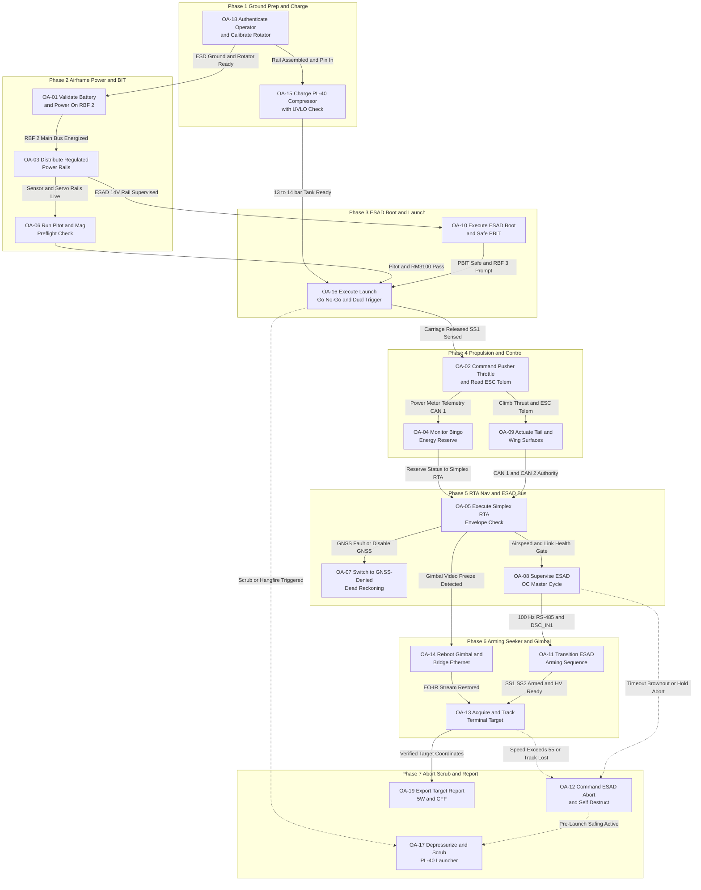

## 6. OMG UAF Operational Activity Taxonomy

**System Baseline:** `Avenger5V25UasSystem` (`Avenger 5 V2.5 UAS` / `ASTK A5 V2.5` + `ELI Military Simulations PL-40 Rev 2.6` + `Artron ESAD AB00-0054-01AA-0005` + `SwarmC2`) | **Document Date:** `2026-11-16` | **Governing Standards:** `OMG UAF v2.0` (`Operational Viewpoint Op-Pr / OV-5b` and `Resources Viewpoint`), `ISO/IEC/IEEE 29148:2018` (`§6.4`, `Annex A §A.2`), `IEEE Std 1362-1998` (`§4`, `§4.3`), `ISO/IEC/IEEE 15288:2023` (`§6.4.2` through `§6.4.4`, `§6.4.9`), `INCOSE SE Handbook v5.0` (`§2.3.5.4`, `§2.3.5.9`), `NATO STANAG 4187 Ed. 5`, `ASTM F3269-17` (`§5.2`), `MIL-STD-882E`, `RTCA DO-178C` / `DO-362A`, `JARUS SORA v2.5`, `NIST SP 800-82r3`, and `DoD Directive 3000.09` (`§4.1.a`).

---

### 6.1 Operational Activity Partitioning & Level 1B Governance

In accordance with `OMG UAF v2.0` (`Operational Viewpoint`), `ISO/IEC/IEEE 29148:2018` (`§6.4`, `Annex A §A.2`), and `OBL-03` in [`docs/research/RESEARCH_INVENTORY.md`](../../docs/research/RESEARCH_INVENTORY.md), the operational behavior of `Avenger5V25IntegratedSystem` is decomposed into nineteen (`19`) atomic Operational Activities (`OA-01` through `OA-19`) mapped `1:1` to the nineteen `action def` declarations in [`.pipeline/schema.sysml`](../../.pipeline/schema.sysml) and [`.pipeline/schema-digest.json`](../../.pipeline/schema-digest.json).

These activities partition cleanly across the four architectural packages of the SysML v2 Single Source of Truth (SSOT) model:

1. **Airframe Power, Propulsion & Energy Supervision (`AirframePowerAndPropulsion`):** `OA-01` (`ValidateBatteryAndPowerOnRbf2`), `OA-02` (`CommandPusherThrottleAndReadEscTelem`), `OA-03` (`DistributeRegulatedPowerRails`), and `OA-04` (`MonitorBingoEnergyReserve`).
2. **Avionics, Software Simplex RTA, Navigation & Ordnance Supervision (`AvionicsGuidanceAndControl`):** `OA-05` (`ExecuteSimplexRtaEnvelopeCheck`), `OA-06` (`RunPitotAndMagPreflightCheck`), `OA-07` (`SwitchToGnssDeniedDeadReckoning`), `OA-08` (`SuperviseEsadOcMasterCycle`), and `OA-09` (`ActuateTailAndWingSurfaces`).
3. **Ordnance Safe-Arm Sequencing, EO/IR Guidance & Payload Networking (`MissionPayloadsCommsAndOrdnanceSafety`):** `OA-10` (`ExecuteEsadBootAndPbit`), `OA-11` (`TransitionEsadArmingSequence`), `OA-12` (`CommandEsadAbortAndSelfDestruct`), `OA-13` (`AcquireAndTrackTerminalTarget`), and `OA-14` (`RebootGimbalAndBridgeEthernet`).
4. **Pneumatic Rail Launch, Scrub Recovery & Ground Tactical C2 (`GroundLaunchAndCommandSegment`):** `OA-15` (`ChargePl40CompressorWithUvloCheck`), `OA-16` (`ExecuteLaunchGoNoGoAndDualTrigger`), `OA-17` (`DepressurizeAndScrubPl40Launcher`), `OA-18` (`AuthenticateOperatorAndCalibrateRotator`), and `OA-19` (`ExportTargetReport5wCff`).

**Mandatory Level 1B Operational & Hardware-Faithful Invariants:**
- **User Class Attribution (`UCL-01` through `UCL-05`):** Every human-supervised or external-system action binds explicitly to Section 1 User Classes (`UCL-01` Pilot Operator, `UCL-02` Payload Operator, `UCL-03` Launch Assistant, `UCL-04` External Tactical C2, and `UCL-05` Field Sustainment and Arming Safety Lead) alongside physical and software AST `part def` performers.
- **Level 1B vs. Level 1C / Level 2 Abstraction Boundary:** Operational Activities capture functional supervision, typed inputs and outputs, state transitions, and exit gates at Level 1B. Wire-level connector pinouts, register bitmasks, and component-internal serial frame opcode numbers reside strictly in Level 1C Interface Control Documents (`docs/interfaces/`), and downstream Level 2 functional use cases reside strictly in `docs/use-cases/`.
- **Hardware-Faithful Architectural Exclusions:** `OA-05` executes `ASTM F3269-17` Simplex Run-Time Assurance strictly in software on `FlightControllerCubeOrangePlus` (`standaloneRtaBoxCount == 0`); `OA-16` executes mechanical catapult release across `IF-MECH-001` with zero electrical or CAN umbilical wires to the airframe (`electricalWireToUavCount == 0`); and `OA-03` permanently inhibits the `2x 50.0 V` `Optional RnD` recovery igniter rails (`rndRecoveryOptionInstalled == false`, `productionRecoverySystemInstalled == false`).

---

### 6.2 OMG UAF Operational Activity Master Taxonomy (`OA-01` through `OA-19`)

Table 6.1 establishes the complete `1:1` taxonomy mapping every `action def` from `.pipeline/schema-digest.json` to its operational performers, exact typed parameters, exit gates, and normative/safety traceability. Table 6.2 isolates all quantitative exit-gate thresholds in strict Check 26 `Value` and `Units` columns.

#### Table 6.1: OMG UAF Operational Activity Master Taxonomy (`OA-01` through `OA-19`)

| Activity ID | SysML `action def` Name | Operational Performer (`UCL` and AST `part def`) | Typed Inputs | Typed Outputs | Primary Exit Gate Criteria | `RESEARCH_INVENTORY.md` and `REQ_*` Bindings |
| :--- | :--- | :--- | :--- | :--- | :--- | :--- |
| `OA-01` | `ValidateBatteryAndPowerOnRbf2` | `UCL-03`, `UCL-01`, `UCL-05`; `MainBatteryAndFuseUnit`, `PowerMeterAndRbfSwitch`, `ElectricPropulsionUnit`, `SwarmC2OperatorConsole` | `packVoltageV` (`Real`), `rbf1Removed` (`Boolean`), `propFoldedRearward` (`Boolean`), `rbf3StillInstalled` (`Boolean`) | `busEnergized` (`Boolean`) | `MainBatteryPreFlightVoltageConstraint` pass; legacy UI voltage rejected (`GAP-05`); `RBF #1` off, rear prop folded rearward, `ESAD RBF #3` kept installed (`GAP-06`); `RBF #2` pulled, lids locked, telemetry live | `OBL-01`, `OBL-03`, `SAF-01`, `SAF-02`, `CTL-04`, `EXT-01`; `REQ_L_01`, `REQ_H_01`, `REQ_UCA_01`, `REQ_SC_01`, `REQ_SAF_05`, `REQ_SAF_06` |
| `OA-02` | `CommandPusherThrottleAndReadEscTelem` | `UCL-01`; `PowerMeterAndRbfSwitch`, `ElectricPropulsionUnit`, `FlightControllerCubeOrangePlus` | `throttleNorm` (`Real`), `flightArmed` (`Boolean`) | `escRpm` (`Real`), `escTempDegC` (`Real`), `motorTempDegC` (`Real`), `busCurrentA` (`Real`) | `flightArmed` verified for climb transition above stall floor (`GAP-03`); PWM throttle delivered to `IBEX160`; ESC UART RPM, ESC/motor temp, voltage, and current bridged onto `CAN 1` within automotive fuse and thermal limits | `OBL-02`, `OBL-03`, `SAF-02`, `SAF-03`, `SAF-04`, `CTL-04`, `EXT-01`; `REQ_L_02`, `REQ_H_01`, `REQ_H_02`, `REQ_UCA_02`, `REQ_SC_01`, `REQ_SC_04`, `REQ_SAF_03`, `REQ_SAF_11` |
| `OA-03` | `DistributeRegulatedPowerRails` | `UCL-02`, `UCL-01`; `ElectronicPowerSystemEps`, `PowerMeterAndRbfSwitch` | `mainBusV` (`Real`), `esadPowerOffCmd` (`Boolean`) | `servo8V` (`Real`), `radio12V` (`Real`), `esad14V` (`Real`), `esadBrownoutAlert` (`Boolean`) | Main DC trunk regulated into servo, radio, sensor/gimbal, and ESAD rails; `EpsEsadZeroBrownoutMarginConstraint` supervised (`GAP-01`); `ProductionNoParachuteConstraint` enforced; `esadPowerOffCmd` isolates ESAD rail irreversibly | `OBL-03`, `SAF-02`, `SAF-03`, `CTL-04`, `EXT-01`; `REQ_L_02`, `REQ_H_01`, `REQ_H_02`, `REQ_UCA_01`, `REQ_UCA_02`, `REQ_SC_02`, `REQ_SC_03`, `REQ_SAF_01`, `REQ_SAF_11` |
| `OA-04` | `MonitorBingoEnergyReserve` | `UCL-01`; `MainBatteryAndFuseUnit`, `PowerMeterAndRbfSwitch`, `FlightControllerCubeOrangePlus` | `remainingEnduranceSec` (`Real`), `busVoltageV` (`Real`) | `bingoReached` (`Boolean`), `rtlTriggered` (`Boolean`) | `BingoEnergyReserveConstraint` enforced continuously on `CAN 1`; depletion to statutory reserve ratio floor or bus sag below low-voltage floor sets `bingoReached` and `rtlTriggered`, entering `CriticalBatteryOrGeofenceRtb` | `OBL-03`, `SAF-02`, `MET-02`, `CTL-01`, `CTL-04`, `EXT-01`; `REQ_L_02`, `REQ_L_03`, `REQ_H_02`, `REQ_UCA_02`, `REQ_SC_02`, `REQ_SAF_05`, `REQ_SAF_11` |
| `OA-05` | `ExecuteSimplexRtaEnvelopeCheck` | `UCL-01`; `FlightControllerCubeOrangePlus` (software ASTM F3269-17 RTA) | `airspeedMs` (`Real`), `diveAngleDeg` (`Real`), `linkLossSec` (`Real`), `esadBusHealthy` (`Boolean`) | `clampEngagementSpeed` (`Boolean`), `triggerRtlFailsafe` (`Boolean`), `disarmEsadRequested` (`Boolean`) | `SimplexRtaSoftwareHostingConstraint` (`0` external RTA boxes) and `FlightEnvelopeSpeedConstraint` enforced (`GAP-02`); dive overspeed asserts `clampEngagementSpeed`; ESAD bus fault asserts `disarmEsadRequested`; GCS timeout or geofence/Bingo triggers RTL | `OBL-03`, `SAF-02`, `SAF-03`, `CTL-01`, `EXT-01`; `REQ_L_02`, `REQ_L_03`, `REQ_H_03`, `REQ_H_05`, `REQ_UCA_03`, `REQ_UCA_07`, `REQ_SC_05`, `REQ_SAF_02`, `REQ_SAF_08`, `REQ_SAF_09` |
| `OA-06` | `RunPitotAndMagPreflightCheck` | `UCL-01`, `UCL-03`; `NavigationAndAirDataSuite`, `FlightControllerCubeOrangePlus` | `calmAirIndicatedMs` (`Real`), `blownAirIndicatedMs` (`Real`), `onlineMagCount` (`Integer`) | `airDataValid` (`Boolean`) | `PitotPreflightCalibrationConstraint` passed on `CUAV SKYE2` calm-air and indirect-airflow checks; both `mRo RM3100` modules verified online on `CAN 2`; `Septentrio` GNSS healthy, outputting `airDataValid` | `OBL-03`, `SAF-02`, `MET-01`, `CTL-04`, `EXT-01`; `REQ_H_03`, `REQ_UCA_03`, `REQ_SC_06`, `REQ_SC_07` |
| `OA-07` | `SwitchToGnssDeniedDeadReckoning` | `UCL-01`; `FlightControllerCubeOrangePlus`, `NavigationAndAirDataSuite` | `gnssHealthy` (`Boolean`), `disableGnssCommanded` (`Boolean`) | `deadReckoningActive` (`Boolean`) | `GPS Failsafe` or operator `Disable GNSS` transitions EKF2 cleanly to `PaceC2LinkState::ContingencyGnssDeniedDrFlight` using dual `RM3100` + `SKYE2` pitot on `CAN 2` and visual fixes; auto-re-enables GNSS on sustained link loss | `OBL-03`, `SAF-02`, `MET-01`, `CTL-02`, `CTL-04`, `EXT-01`; `REQ_L_03`, `REQ_H_03`, `REQ_UCA_03`, `REQ_SC_06`, `REQ_SC_07` |
| `OA-08` | `SuperviseEsadOcMasterCycle` | `UCL-02`; `CompanionComputeRpiCm5` (`OC Master`), `ArtronEsadAndSensorUnit` | `armAuthorized` (`Boolean`), `abortCommanded` (`Boolean`) | `exchangeFrameValid` (`Boolean`), `emitDscIn1Pulses` (`Boolean`) | `EsadRs485ProtocolTimingConstraint` met at cyclic polling rate with `CRC-16 XModem` verification (`GAP-04`); `DSC_IN1` hardware arm pulses gated strictly to `ArmStage2Armed` with `armAuthorized` true and zero abort/watchdog faults | `OBL-03`, `SAF-01`, `SAF-02`, `SAF-03`, `MET-03`, `CTL-03`, `EXT-01`; `REQ_L_01`, `REQ_L_04`, `REQ_H_03`, `REQ_H_04`, `REQ_UCA_04`, `REQ_UCA_05`, `REQ_SC_08`, `REQ_SC_10`, `REQ_SAF_04`, `REQ_SAF_08`, `REQ_SAF_09` |
| `OA-09` | `ActuateTailAndWingSurfaces` | `UCL-01`; `FlightControllerCubeOrangePlus`, `DroneCanSurfaceActuation`, `ElectronicPowerSystemEps` | `pitchCmd` (`Real`), `yawCmd` (`Real`), `rollCmd` (`Real`) | `finCommandedDeg` (`Real`), `wingCommandedDeg` (`Real`) | `CanTopologyIsolationConstraint` enforced: pitch/yaw skid-turn routed to tail fins on `CAN 1` stubs and roll routed to wings on `CAN 2` via splitter PCB under regulated servo power and pre-flight sweep pass | `OBL-03`, `SAF-02`, `CTL-01`, `CTL-04`, `EXT-01`; `REQ_L_02`, `REQ_H_03`, `REQ_UCA_03`, `REQ_SC_05`, `REQ_SC_06`, `REQ_SAF_09` |
| `OA-10` | `ExecuteEsadBootAndPbit` | `UCL-03`, `UCL-02`; `ArtronEsadAndSensorUnit`, `CompanionComputeRpiCm5` | `vdcInV` (`Real`), `rbf3Installed` (`Boolean`) | `welcomeOk` (`Boolean`), `pbitHvUnder50V` (`Boolean`) | ESAD powered with `RBF #3` installed (`UMB` continuity within limit, `GAP-06`); ESAD boot welcome received, firmware version and PBIT completed, and internal HV confirmed safely below PBIT ceiling (`WarheadMassAndPbitHvSafetyConstraint`) | `OBL-03`, `SAF-01`, `SAF-02`, `SAF-04`, `CTL-03`, `EXT-01`; `REQ_L_01`, `REQ_L_04`, `REQ_H_01`, `REQ_H_04`, `REQ_UCA_05`, `REQ_SC_09`, `REQ_SC_10`, `REQ_SAF_01`, `REQ_SAF_06`, `REQ_SAF_10` |
| `OA-11` | `TransitionEsadArmingSequence` | `UCL-03`, `UCL-02`; `ArtronEsadAndSensorUnit`, `CompanionComputeRpiCm5`, `ElectricPropulsionUnit` | `rbf3RemovedAfterPower` (`Boolean`), `ss1LaunchSensed` (`Boolean`), `ss2SafeDistExceeded` (`Boolean`), `dscIn1Valid` (`Boolean`) | `armState` (`Integer`), `hvChargedV` (`Real`) | Sequential `STANAG 4187` barriers enforced: `RBF #3` removed only after `8` preconditions (`GAP-06`), `SS1` launch accel sensed, `SS2 Safe Distance Exceed == 1` (`GAP-07`), HITL consent + Stage 2 `DSC_IN1` pulses, and regulated HV capacitor charge | `OBL-03`, `SAF-01`, `SAF-02`, `MET-03`, `CTL-03`, `EXT-01`; `REQ_L_01`, `REQ_L_04`, `REQ_H_04`, `REQ_UCA_05`, `REQ_UCA_06`, `REQ_SC_09`, `REQ_SC_10`, `REQ_SC_11`, `REQ_SAF_06`, `REQ_SAF_07`, `REQ_SAF_10` |
| `OA-12` | `CommandEsadAbortAndSelfDestruct` | `UCL-02`, `UCL-01`, `UCL-05`; `SwarmC2OperatorConsole`, `CompanionComputeRpiCm5`, `ElectronicPowerSystemEps`, `ArtronEsadAndSensorUnit` | `holdDurationSec` (`Real`), `slideConfirmed` (`Boolean`), `gcsTimeoutActive` (`Boolean`) | `hvDischarged` (`Boolean`), `faultLockedOut` (`Boolean`) | Self-destruct hold + Slide-to-Confirm, `Disarm ESAD On GCS Timeout`, or irreversible `Power Off ESAD` issues abort/power isolation and confirms `hvDischarged` below safe threshold with `faultLockedOut` / `SafePowerOff` latched | `OBL-03`, `SAF-01`, `SAF-02`, `MET-03`, `MET-04`, `CTL-02`, `CTL-03`, `EXT-01`; `REQ_L_01`, `REQ_L_04`, `REQ_H_04`, `REQ_H_05`, `REQ_UCA_04`, `REQ_UCA_07`, `REQ_SC_08`, `REQ_SC_12`, `REQ_SC_16`, `REQ_SAF_01`, `REQ_SAF_12` |
| `OA-13` | `AcquireAndTrackTerminalTarget` | `UCL-02`; `EoIrSeekerAndTrackerUnit`, `FlightControllerCubeOrangePlus` | `trackHoldSec` (`Real`), `airspeedMs` (`Real`), `targetElevDeg` (`Real`) | `targetLocked` (`Boolean`), `abortEngaging` (`Boolean`) | All `6` engagement preconditions verified (`EngagementSpeedAndTrackHoldConstraint`, EO daylight track hold, target elevation, clear LOS, armed warhead, GCS failsafe margin); overspeed or lost lock triggers immediate `Abort Engaging` climb to loiter/RTL | `OBL-03`, `SAF-02`, `MET-01`, `MET-03`, `CTL-01`, `EXT-01`; `REQ_L_04`, `REQ_H_05`, `REQ_UCA_03`, `REQ_UCA_07`, `REQ_SC_05`, `REQ_SC_12`, `REQ_SAF_02` |
| `OA-14` | `RebootGimbalAndBridgeEthernet` | `UCL-02`, `UCL-01`; `EoIrSeekerAndTrackerUnit`, `OnboardEthernetAndC2RadioUnit`, `CompanionComputeRpiCm5`, `SwarmC2OperatorConsole` | `gimbalFreezeDetected` (`Boolean`), `externalLidLocked` (`Boolean`) | `gimbalRecovered` (`Boolean`) | External `USB/ETH` service lid confirmed locked; in-flight `Reboot Gimbal` routed across switched Ethernet fabric restores `Nighthawk2UZ` / `Trip6` video stream (`gimbalRecovered`) without rebooting armed vehicle or dropping C2 | `OBL-03`, `OBL-04`, `MET-01`, `CTL-02`, `EXT-01`; `REQ_L_03`, `REQ_H_05`, `REQ_SC_01`, `REQ_SC_12` |
| `OA-15` | `ChargePl40CompressorWithUvloCheck` | `UCL-03`; `Pl40PneumaticLauncher` | `packVoltageV` (`Real`), `targetPressureBar` (`Real`) | `tankPressureBar` (`Real`), `uvloPaused` (`Boolean`) | `Pl40UvloAndDualSwitchConstraint` enforced during `Makita BL1860B` charging (`UVLO` pause/swap/restart hysteresis); tank stabilized within operating pressure window with red safety pin installed and Main Valve `4` closed | `OBL-03`, `SAF-02`, `MET-01`, `EXT-02`; `REQ_H_06`, `REQ_UCA_08`, `REQ_SC_14`, `REQ_SAF_11` |
| `OA-16` | `ExecuteLaunchGoNoGoAndDualTrigger` | `UCL-03`, `UCL-01`, `UCL-02`; `Pl40PneumaticLauncher`, `ElectricPropulsionUnit` | `pressureBar` (`Real`), `uavMassKg` (`Real`), `headwindMs` (`Real`), `redPinRemoved` (`Boolean`), `mainValve4Open` (`Boolean`), `dualSwitchHoldSec` (`Real`) | `carriageReleased` (`Boolean`) | `Pl40MassAndExitVelocityConstraint` & `GAP-03` Go/No-Go pass (tank pressure, MTOW, wind, pusher readiness, prop-safe carriage, zero electrical wires `IF-MECH-001`, rear clear); red pin out, Main Valve `4` open, simultaneous dual switch hold releases carriage cleanly | `OBL-02`, `OBL-03`, `SAF-01`, `SAF-02`, `MET-01`, `EXT-01`, `EXT-02`; `REQ_L_01`, `REQ_L_02`, `REQ_H_01`, `REQ_H_06`, `REQ_UCA_08`, `REQ_SC_13`, `REQ_SC_14`, `REQ_SAF_03` |
| `OA-17` | `DepressurizeAndScrubPl40Launcher` | `UCL-03`, `UCL-02`, `UCL-05`; `Pl40PneumaticLauncher`, `ArtronEsadAndSensorUnit`, `SwarmC2OperatorConsole` | `scrubRequested` (`Boolean`), `mainValve4Closed` (`Boolean`) | `tankDepressurizedBar` (`Real`), `redPinReinstalled` (`Boolean`) | `SAFE_SCRUB_ABORT` (`GAP-SCRUB`) closes Main Valve `4`, bleeds tank to zero residual pressure, restores carriage red safety pin prior to crew approach, executes ESAD abort / irreversible `Power Off ESAD`, and reinstalls `RBF #3` prior to `RBF #2` disconnect | `OBL-03`, `SAF-01`, `SAF-02`, `MET-03`, `MET-04`, `EXT-01`, `EXT-02`; `REQ_L_01`, `REQ_H_04`, `REQ_H_06`, `REQ_UCA_08`, `REQ_SC_16`, `REQ_SAF_12` |
| `OA-18` | `AuthenticateOperatorAndCalibrateRotator` | `UCL-01`, `UCL-02`, `UCL-03`; `SwarmC2OperatorConsole`, `GroundRfStationAndAntennaTracker` | `roleName` (`String`), `passwordChars` (`Integer`), `esdGrounded` (`Boolean`), `radioSeparationM` (`Real`) | `groundReady` (`Boolean`) | `SwarmC2AuthAndMissionBoundsConstraint` and `GroundCrewSeparationAndEsdConstraint` passed: role login (`Pilot`, `Payload`, `Launch Assistant`), transport-box ESD touch, ground radio separation, and Antenna Rotator calibration BEFORE touching UAV | `OBL-03`, `OBL-04`, `SAF-04`, `MET-01`, `MET-02`, `CTL-02`, `EXT-01`; `REQ_H_06`, `REQ_UCA_08`, `REQ_SC_15` |
| `OA-19` | `ExportTargetReport5wCff` | `UCL-02`, `UCL-04`, `UCL-01`; `SwarmC2OperatorConsole`, `GroundRfStationAndAntennaTracker` | `targetCoordsValid` (`Boolean`), `c2Connected` (`Boolean`) | `reportExported` (`Boolean`) | Validated target geolocation and authenticated tactical C2 connectivity permit formatted `5W` / `CFF` target intelligence export to `ATAK`, `SitaWare HQ`, or `DELTA` without exposing direct control conduits | `OBL-03`, `OBL-04`, `MET-01`, `MET-03`, `CTL-02`, `EXT-01`; `REQ_SC_15` |

#### Table 6.2: Operational Activity Quantitative Exit Gate Thresholds

| Activity ID | Parameter / Gate ID | Gate Threshold Description | Qualifier | Value | Units |
| :--- | :--- | :--- | :--- | :--- | :--- |
| `OA-01` | `PRM-AV-003` | Pre-flight `12S2P` pack voltage pass floor (`GAP-05`) | Min | 49.0 | V |
| `OA-01` | `PRM-AV-004` | Pre-flight `12S2P` pack voltage nominal ceiling (`GAP-05`) | Max | 50.0 | V |
| `OA-01` | `PRM-GCS-002` | Maximum GCS telemetry detection timeout after `RBF #2` power-on | Max | 2.0 | min |
| `OA-02` | `PRM-AV-005` | Main DC bus inline automotive overcurrent fuse rating | Exact | 200.0 | A |
| `OA-03` | `PRM-AV-006` | Regulated EPS servo rail voltage (`HV6160-DroneCAN` actuators) | Nominal | 8.0 | V |
| `OA-03` | `PRM-AV-007` | Regulated EPS C2 radio rail voltage (`DTC` radio supply) | Nominal | 12.0 | V |
| `OA-03` | `PRM-AV-008` | `DTC` C2 radio minimum accepted input voltage | Min | 8.0 | V |
| `OA-03` | `PRM-AV-009` | `DTC` C2 radio maximum accepted input voltage | Max | 17.0 | V |
| `OA-03` | `PRM-AV-010` | Regulated EPS output rail feeding `Artron ESAD` (`GAP-01`) | Nominal | 14.0 | V |
| `OA-03` | `PRM-ESAD-001` | Minimum `Artron ESAD` `VDC_IN` floor (zero brownout margin, `GAP-01`) | Min | 14.0 | V |
| `OA-04` | `PRM-AV-001` | Main `12S2P` DC bus low-voltage RTL trigger floor | Min | 36.0 | V |
| `OA-04` | `PRM-PERF-002` | Maximum airframe mission endurance baseline | Max | 5400.0 | s |
| `OA-04` | `PRM-PERF-003` | Statutory Bingo reserve fraction triggering RTL (`OA-04`) | Min | 0.20 | ratio |
| `OA-05` | `PRM-PERF-010` | Software Simplex RTA terminal engagement airspeed cap (`Abort Engaging`) | Max | 55.0 | m/s |
| `OA-05` | `PRM-PERF-011` | Airframe structural dive speed limit (`VNE`, `GAP-02`) | Max | 80.0 | m/s |
| `OA-05` | `PRM-GCS-008` | Baseline GCS lost-link timeout triggering RTL and ESAD timeout disarm | Nominal | 105.0 | s |
| `OA-06` | `PRM-AV-017` | Pre-flight `CUAV SKYE2` calm-air pitot upper reading limit | Max | 3.0 | m/s |
| `OA-06` | `PRM-AV-018` | Pre-flight `CUAV SKYE2` indirect airflow pitot lower reading limit | Min | 10.0 | m/s |
| `OA-06` | `PRM-AV-016` | Minimum online `mRo RM3100` magnetometer/barometer count on `CAN 2` | Exact | 2 | count |
| `OA-08` | `PRM-ESAD-017` | `RPI CM5` `OC Master` cyclic `RS-485` ESAD polling frequency (`GAP-04`) | Exact | 100.0 | Hz |
| `OA-08` | `PRM-ESAD-020` | `RS-485` maximum allowed ESAD command reply latency | Max | 5.0 | ms |
| `OA-08` | `PRM-ESAD-019` | `RS-485` incomplete frame / watchdog timeout triggering ESAD disarm | Max | 10.0 | ms |
| `OA-08` | `PRM-ESAD-006` | Stage 2 `DSC_IN1` hardware arm pulse burst frequency | Exact | 1000.0 | Hz |
| `OA-08` | `PRM-ESAD-009` | Stage 2 `DSC_IN1` required discrete arm pulse count | Exact | 2 | pulses |
| `OA-09` | `PRM-AV-013` | `CAN 1` tail ruddervator servo stub harness length | Nominal | 120.0 | cm |
| `OA-10` | `PRM-ESAD-004` | `ESAD RBF #3` umbilical continuity loop (`UMB`) max resistance | Max | 0.5 | Ohm |
| `OA-10` | `PRM-ESAD-005` | `ESAD RBF #3` umbilical continuity loop sense current | Nominal | 20.0 | mA |
| `OA-10` | `PRM-ESAD-029` | ESAD PBIT internal high-voltage safe ceiling prior to `RBF #3` removal | Max | 50.0 | V |
| `OA-11` | `PRM-AF-009` | Maximum authorized lethal package / warhead mass | Max | 5.0 | kg |
| `OA-11` | `PRM-ESAD-031` | Armed `J401` high-voltage initiation charge upper bound | Max | 1800.0 | V |
| `OA-12` | `PRM-GCS-010` | Minimum operator hold duration before Slide-to-Confirm ESAD abort | Min | 5.0 | s |
| `OA-13` | `PRM-GCS-011` | Minimum EO daylight target auto-tracker lock hold prior to dive | Min | 2.0 | s |
| `OA-13` | `PRM-GCS-012` | Upper bound of EO daylight target track stabilization hold window | Max | 5.0 | s |
| `OA-13` | `PRM-PERF-020` | Terminal circular error probable (CEP) accuracy ceiling | Max | 0.5 | m |
| `OA-15` | `PRM-PL40-032` | `Makita BL1860B` dual compressor battery pack nominal voltage | Nominal | 18.0 | V |
| `OA-15` | `PRM-PL40-034` | `Makita BL1860B` compressor UVLO protection cutoff threshold | Min | 14.5 | V |
| `OA-15` | `PRM-PL40-035` | `Makita BL1860B` post-UVLO restart minimum pack voltage | Min | 16.0 | V |
| `OA-15` | `PRM-PL40-036` | Required wait delay before post-UVLO compressor restart check | Min | 5.0 | s |
| `OA-15` | `PRM-PL40-030` | Maximum onboard `PL-40` compressor tank charging duration | Max | 8.0 | min |
| `OA-16` | `PRM-AF-008` | Avenger 5 Maximum Takeoff Weight (`MTOW`) | Max | 17.0 | kg |
| `OA-16` | `PRM-PL40-001` | `PL-40` structural maximum supported aircraft MTOW | Max | 30.0 | kg |
| `OA-16` | `PRM-PL40-027` | `PL-40` launch pneumatic reservoir minimum operating pressure | Min | 13.0 | bar |
| `OA-16` | `PRM-PL40-028` | `PL-40` launch pneumatic reservoir maximum operating pressure | Max | 14.0 | bar |
| `OA-16` | `PRM-PL40-003` | Nominal catapult exit velocity at Avenger 5 MTOW (`GAP-03`) | Nominal | 23.0 | m/s |
| `OA-16` | `PRM-PL40-002` | `PL-40` hard maximum rated carriage exit velocity (`GAP-03`) | Max | 25.0 | m/s |
| `OA-16` | `PRM-PERF-016` | Maximum authorized ground launch headwind | Max | 12.0 | m/s |
| `OA-16` | `PRM-PL40-020` | Carriage prop-safe upper zone minimum vertical clearance | Min | 145.0 | mm |
| `OA-16` | `PRM-PL40-021` | Carriage prop-safe upper zone maximum vertical clearance | Max | 155.5 | mm |
| `OA-16` | `PRM-PL40-037` | Simultaneous dual safety-covered launch switch hold duration | Min | 2.0 | s |
| `OA-16` | `IF-MECH-001` | Electrical or CAN conductors crossing `PL-40` to UAV launch rail | Exact | 0 | count |
| `OA-17` | `REQ_SC_16` | Residual `PL-40` pneumatic reservoir pressure after `SAFE_SCRUB_ABORT` bleed | Exact | 0.0 | bar |
| `OA-18` | `PRM-GCS-009` | Minimum `SwarmC2` operator role password length | Min | 8 | chars |
| `OA-18` | `PRM-GCS-001` | Minimum UAV-to-Ground Radio Box spatial standoff during prep | Min | 10.0 | m |

---

### 6.3 End-to-End Operational Activity Flow (`OV-5b`)

Figure 6.1 illustrates the causal progression, interlock barriers, contingency branches, and abort paths across all `19` OMG UAF Operational Activities (`OA-01` through `OA-19`) in accordance with `OMG UAF v2.0` (`OV-5b`).

#### Figure 6.1: OMG UAF `OV-5b` Operational Activity Taxonomy & Interlock Flow (`OA-01` through `OA-19`)

---

### 6.4 Detailed Operational Activity Specifications & Gate 24 Allocation Directives (`OA-01` through `OA-19`)

Every OMG UAF Operational Activity below establishes its complete SysML AST binding, operational performers, typed signatures, quantitative exit gates, scenario and state-machine realizations, normative `RESEARCH_INVENTORY.md` / `REQ_*` bindings, and mandatory Gate 24 allocation tag (`/// OperationalAllocation: [OA-XX]`).

#### 6.4.1 `OA-01`: `ValidateBatteryAndPowerOnRbf2`

- **SysML AST Action & Package:** `action def ValidateBatteryAndPowerOnRbf2` in `package AirframePowerAndPropulsion` ([`.pipeline/schema.sysml`](../../.pipeline/schema.sysml)#L164).
- **Operational Performer:** `UCL-03` (`Launch Assistant` physical inspection and `RBF #1` / `RBF #2` sequence execution), supervised by `UCL-01` (`Pilot Operator` on `SwarmC2`) and `UCL-05` (`Field Sustainment & Arming Safety Lead` for pack integrity NO-GO checks); executing on `MainBatteryAndFuseUnit`, `PowerMeterAndRbfSwitch`, `ElectricPropulsionUnit`, and `SwarmC2OperatorConsole`.
- **Typed Inputs (AST Signature):** `packVoltageV : Real` (`12S2P Li metal BEI maximus20` pack voltage), `rbf1Removed : Boolean` (pitot cover, sensor cover, and gimbal strap `RBF #1` removed), `propFoldedRearward : Boolean` (both rear pusher blades folded rearward toward tail), `rbf3StillInstalled : Boolean` (`ESAD R.B.F. Key #3` confirmed still installed prior to power-on).
- **Typed Outputs (AST Signature):** `busEnergized : Boolean` (`36.0 V` to `50.4 V` main DC bus energized through `XT60E-F` switch and live on `SwarmC2`).
- **Exit Gates & Interlock Criteria:**
  1. `12S2P` battery passes physical inspection (zero swelling, leakage, or casing damage), matches fuselage ID/QR, locks cleanly without sharp cable bends, and reads within `49.0 V` to `50.0 V` (`MainBatteryPreFlightVoltageConstraint`), strictly rejecting legacy `23.9 V` to `25.0 V` UI artifacts (`GAP-05`).
  2. `rbf1Removed == true` and `propFoldedRearward == true` prevent pusher trolley/airframe collision on power-up.
  3. `rbf3StillInstalled == true` enforces power-before-pull ordering (`GAP-06`, `EsadRbf3PowerBeforePullConstraint`) so `ESAD` boots safely before `RBF #3` removal.
  4. `UAV Power R.B.F. Key #2 (XT60E-F)` is removed, both RBF and external `USB/ETH` umbilical lids are closed and locked, `busEnergized == true`, and `SwarmC2` detects valid GCS telemetry within `2.0 min`.
- **Scenarios, Capabilities & Verification:** `SCN-01`; `CAP-01`, `CAP-02`; `UavFlightLifecycleState::PreFlightCheck`; `TC_01_PreflightPowerAndRbfSequence`.
- **Normative & Safety Traceability (`RESEARCH_INVENTORY.md` & `REQ_*`):** `OBL-01`, `OBL-03`, `SAF-01`, `SAF-02`, `CTL-04`, `EXT-01` (`ISO/IEC/IEEE 29148:2018` §6.4; `OMG UAF v2.0`; `MIL-STD-882E` Task 202/206; `SAE ARP4754A` §5.1); `REQ_L_01`, `REQ_H_01`, `REQ_UCA_01`, `REQ_SC_01`, `REQ_SAF_05`, `REQ_SAF_06`.

/// OperationalAllocation: [OA-01]

#### 6.4.2 `OA-02`: `CommandPusherThrottleAndReadEscTelem`

- **SysML AST Action & Package:** `action def CommandPusherThrottleAndReadEscTelem` in `package AirframePowerAndPropulsion` ([`.pipeline/schema.sysml`](../../.pipeline/schema.sysml)#L166).
- **Operational Performer:** `UCL-01` (`Pilot Operator` supervisory flight-mode and thrust readiness authority); executing across `PowerMeterAndRbfSwitch`, `ElectricPropulsionUnit` (`IBEX160` ESC, `AXI 5345/16 HD GOLD LINE V3` BLDC motor, rear folding pusher prop), and `FlightControllerCubeOrangePlus` (`can1Master`).
- **Typed Inputs (AST Signature):** `throttleNorm` (`Real`, normalized pusher throttle demand via `IF-PWM-001`), `flightArmed` (`Boolean`, flight-arm and pre-launch thrust readiness interlock).
- **Typed Outputs (AST Signature):** `escRpm` (`Real`, motor rotational speed), `escTempDegC` (`Real`, `IBEX160` controller temperature), `motorTempDegC` (`Real`, `AXI 5345/16` stator temperature), `busCurrentA` (`Real`, main DC current draw).
- **Exit Gates & Interlock Criteria:**
  1. `flightArmed == true` must be verified only after `OA-01` (`propFoldedRearward == true` and `RBF #1` removed), ensuring pusher thrust readiness across `CatapultLaunch` to bridge the negative airspeed margin between `~23.0 m/s` rail exit and `24.0 m/s` to `26.0 m/s` stall (`GAP-03`).
  2. Main DC bus draw remains within the `200.0 A` automotive fuse protection ceiling (`MainBatteryAndFuseUnit`) and `36.0 V` to `50.4 V` operating range.
  3. Unidirectional ESC UART telemetry (`IF-SER-005`) bridges cleanly through `PowerMeterAndRbfSwitch` onto `CAN 1` (`CONN_09`) within the `-20.0 degC` to `+50.0 degC` ambient qualification envelope and explicit bench-calibrated ESC/motor thermal and current cutoffs (`GAP-ENV`).
- **Scenarios, Capabilities & Verification:** `SCN-01`, `SCN-02`, `SCN-06`; `CAP-02`; `UavFlightLifecycleState::CatapultLaunch` through `TargetTrackAndDive`; `TC_02_BingoReserveAndEpsBrownoutMonitor`, `TC_07_Pl40RailChargeLaunchAndZeroWire`.
- **Normative & Safety Traceability (`RESEARCH_INVENTORY.md` & `REQ_*`):** `OBL-02`, `OBL-03`, `SAF-02`, `SAF-03`, `SAF-04`, `CTL-04`, `EXT-01` (`ISO/IEC/IEEE 15288:2023` §6.4.4; `MIL-STD-1629A` Method 101; `MIL-STD-810H` Methods 501.7/502.7); `REQ_L_02`, `REQ_H_01`, `REQ_H_02`, `REQ_UCA_02`, `REQ_SC_01`, `REQ_SC_04`, `REQ_SAF_03`, `REQ_SAF_11`.

/// OperationalAllocation: [OA-02]

#### 6.4.3 `OA-03`: `DistributeRegulatedPowerRails`

- **SysML AST Action & Package:** `action def DistributeRegulatedPowerRails` in `package AirframePowerAndPropulsion` ([`.pipeline/schema.sysml`](../../.pipeline/schema.sysml)#L168).
- **Operational Performer:** `UCL-02` (`Payload Operator` positive HITL authority for irreversible `Power Off ESAD`) and `UCL-01` (`Pilot Operator` supervisory abort); executing on `ElectronicPowerSystemEps` and `PowerMeterAndRbfSwitch`.
- **Typed Inputs (AST Signature):** `mainBusV` (`Real`, `36.0 V` to `50.4 V` input across the `970.0 cm` fuselage DC trunk `CONN_03`), `esadPowerOffCmd` (`Boolean`, irreversible `Power Off ESAD` or fault-isolation load-switch command).
- **Typed Outputs (AST Signature):** `servo8V` (`Real`, `8.0 V` rail feeding `8x HV6160-DroneCAN` servos via `CONN_04`), `radio12V` (`Real`, `12.0 V` rail feeding `DTC` radio within `8.0 V` to `17.0 V` tolerance via `CONN_05`), `esad14V` (`Real`, `14.0 V` ESAD `GE_POW` rail via `CONN_06`), `esadBrownoutAlert` (`Boolean`, `CAN 1` brownout telemetry alert via `CONN_10`).
- **Exit Gates & Interlock Criteria:**
  1. Regulated `servo8V` (`8.0 V`), `radio12V` (`12.0 V`), `sensorPowerOut`, and `gimbalPowerOut` remain within steady-state tolerances across all active flight phases.
  2. `esad14V >= 14.0 V` satisfies `EpsEsadZeroBrownoutMarginConstraint` (`14.0 V` to `32.0 V` ESAD `VDC_IN` window); because `14.0 V` nominal equals `14.0 V` minimum with `0.0 V` margin (`GAP-01`), any voltage sag triggers `esadBrownoutAlert == true` and commands irreversible ESAD safing.
  3. `ProductionNoParachuteConstraint` holds (`rndRecoveryOptionInstalled == false`; `2x 50.0 V` `Optional RnD` recovery igniter rails remain permanently inhibited).
  4. When `esadPowerOffCmd == true`, `ElectronicPowerSystemEps` isolates `esad14V` to `0.0 V` irreversibly in flight (`EsadSafeArmState::SafePowerOff`).
- **Scenarios, Capabilities & Verification:** `SCN-01`, `SCN-02`, `SCN-05`, `SCN-08`; `CAP-02`, `CAP-06`; `EsadSafeArmState::SafePowerOff` / `BootAndPbit`, `RtaEnvelopeMonitorState::EsadBusWatchdogFaultFallback`; `TC_01_PreflightPowerAndRbfSequence`, `TC_02_BingoReserveAndEpsBrownoutMonitor`.
- **Normative & Safety Traceability (`RESEARCH_INVENTORY.md` & `REQ_*`):** `OBL-03`, `SAF-02`, `SAF-03`, `CTL-04`, `EXT-01` (`MIL-STD-882E` Task 205; `SAE ARP4754A` §5.1; `SAE ARP4761` §3.2); `REQ_L_02`, `REQ_H_01`, `REQ_H_02`, `REQ_UCA_01`, `REQ_UCA_02`, `REQ_SC_02`, `REQ_SC_03`, `REQ_SAF_01`, `REQ_SAF_11`.

/// OperationalAllocation: [OA-03]

#### 6.4.4 `OA-04`: `MonitorBingoEnergyReserve`

- **SysML AST Action & Package:** `action def MonitorBingoEnergyReserve` in `package AirframePowerAndPropulsion` ([`.pipeline/schema.sysml`](../../.pipeline/schema.sysml)#L170).
- **Operational Performer:** `UCL-01` (`Pilot Operator` sortie endurance and RTL supervision); executing on `MainBatteryAndFuseUnit`, `PowerMeterAndRbfSwitch`, and `FlightControllerCubeOrangePlus` (`RtaEnvelopeMonitorState`).
- **Typed Inputs (AST Signature):** `remainingEnduranceSec` (`Real`, remaining flight energy duration out of `5400.0 s` / `90.0 min` maximum endurance), `busVoltageV` (`Real`, measured `12S2P` DC bus voltage on `CAN 1`).
- **Typed Outputs (AST Signature):** `bingoReached` (`Boolean`, statutory reserve floor or critical voltage sag reached), `rtlTriggered` (`Boolean`, autonomous Return-to-Launch transition issued).
- **Exit Gates & Interlock Criteria:**
  1. Enforces `BingoEnergyReserveConstraint` (`reserveRatio >= 0.20`, reserving `>= 1080.0 s` out of `5400.0 s` nominal endurance, leaving `<= 4320.0 s` / `72.0 min` tactical loiter) alongside continuous `busVoltageV >= 36.0 V` (`36.0 V` to `50.4 V` `12S2P` operating envelope).
  2. When `remainingEnduranceSec <= 1080.0 s` or `busVoltageV < 36.0 V`, `bingoReached == true` and `rtlTriggered == true` execute deterministically, transitioning `UavFlightLifecycleState` into `EmergencyAbortOrRtb` and `RtaEnvelopeMonitorState` into `CriticalBatteryOrGeofenceRtb` without requiring manual `UCL-01` intervention.
- **Scenarios, Capabilities & Verification:** `SCN-01`, `SCN-02`; `CAP-01`, `CAP-02`; `UavFlightLifecycleState::CruiseAndLoiter` -> `EmergencyAbortOrRtb`, `RtaEnvelopeMonitorState::CriticalBatteryOrGeofenceRtb`; `TC_02_BingoReserveAndEpsBrownoutMonitor`.
- **Normative & Safety Traceability (`RESEARCH_INVENTORY.md` & `REQ_*`):** `OBL-03`, `SAF-02`, `MET-02`, `CTL-01`, `CTL-04`, `EXT-01` (`JARUS SORA v2.5` Annex B & C; `ASTM F3269-17` §5.2; `MIL-STD-882E` Task 205); `REQ_L_02`, `REQ_L_03`, `REQ_H_02`, `REQ_UCA_02`, `REQ_SC_02`, `REQ_SAF_05`, `REQ_SAF_11`.

/// OperationalAllocation: [OA-04]

#### 6.4.5 `OA-05`: `ExecuteSimplexRtaEnvelopeCheck`

- **SysML AST Action & Package:** `action def ExecuteSimplexRtaEnvelopeCheck` in `package AvionicsGuidanceAndControl` ([`.pipeline/schema.sysml`](../../.pipeline/schema.sysml)#L459).
- **Operational Performer:** `UCL-01` (`Pilot Operator` supervisory geofence, failsafe timeout, and flight envelope oversight); executing in software on `FlightControllerCubeOrangePlus` (`simplexRtaSoftwareHosted == true`, `standaloneRtaBoxCount == 0`).
- **Typed Inputs (AST Signature):** `airspeedMs` (`Real`, airspeed from `CUAV SKYE2`), `diveAngleDeg` (`Real`, airframe pitch/dive trajectory angle), `linkLossSec` (`Real`, elapsed C2 heartbeat loss timer), `esadBusHealthy` (`Boolean`, `RPI CM5` `100.0 Hz` ESAD supervision status).
- **Typed Outputs (AST Signature):** `clampEngagementSpeed` (`Boolean`, `Abort Engaging` speed-clamp override), `triggerRtlFailsafe` (`Boolean`, autonomous RTL failsafe override), `disarmEsadRequested` (`Boolean`, ordnance disarm request to `RPI CM5` / `EPS`).
- **Exit Gates & Interlock Criteria:**
  1. `SimplexRtaSoftwareHostingConstraint` holds (`standaloneRtaBoxCount == 0`; Simplex RTA executes exclusively in partitioned software inside `Cube orange+` pending bench `WCET` closure under `GAP-WCET` and `GAP-REL`).
  2. `FlightEnvelopeSpeedConstraint` bounds cruise/horizontal velocity (`24.0 m/s` stall / `26.0 m/s` V1 climb, `30.0 m/s` to `31.0 m/s` cruise, `38.0 m/s` to `42.0 m/s` horizontal, `GAP-02`), `diveAngleDeg <= 22.0 deg`, and structural `VNE <= 80.0 m/s`.
  3. Any terminal dive with `airspeedMs > 55.0 m/s` sets `clampEngagementSpeed == true` (`RtaEnvelopeMonitorState::AirspeedDiveCapClamped`), aborting engagement and pulling up to `Takeoff altitude` -> `GUIDED` loiter.
  4. `esadBusHealthy == false` sets `disarmEsadRequested == true` (`EsadBusWatchdogFaultFallback`); `linkLossSec >= 105.0 s` (`GCS Failsafe` baseline), polygon geofence breach, or Bingo/sag condition sets both `triggerRtlFailsafe == true` and `disarmEsadRequested == true` (`CriticalBatteryOrGeofenceRtb`).
- **Scenarios, Capabilities & Verification:** `SCN-02`, `SCN-03`, `SCN-04`; `CAP-03`; `RtaEnvelopeMonitorState`, `UavFlightLifecycleState`; `TC_03_SimplexRtaEnvelopeAndActuation`.
- **Normative & Safety Traceability (`RESEARCH_INVENTORY.md` & `REQ_*`):** `OBL-03`, `SAF-02`, `SAF-03`, `CTL-01`, `EXT-01` (`ASTM F3269-17` §5.2; `RTCA DO-178C` §6.3; `MIL-STD-1629A` Method 101); `REQ_L_02`, `REQ_L_03`, `REQ_H_03`, `REQ_H_05`, `REQ_UCA_03`, `REQ_UCA_07`, `REQ_SC_05`, `REQ_SAF_02`, `REQ_SAF_08`, `REQ_SAF_09`.

/// OperationalAllocation: [OA-05]

#### 6.4.6 `OA-06`: `RunPitotAndMagPreflightCheck`

- **SysML AST Action & Package:** `action def RunPitotAndMagPreflightCheck` in `package AvionicsGuidanceAndControl` ([`.pipeline/schema.sysml`](../../.pipeline/schema.sysml)#L461).
- **Operational Performer:** `UCL-01` (`Pilot Operator` monitoring `SwarmC2` `System checks`) and `UCL-03` (`Launch Assistant` executing stationary calm-air and indirect airflow pitot verification); executing on `NavigationAndAirDataSuite` and `FlightControllerCubeOrangePlus`.
- **Typed Inputs (AST Signature):** `calmAirIndicatedMs` (`Real`, stationary pitot indicated airspeed), `blownAirIndicatedMs` (`Real`, indirect airflow pitot indicated airspeed), `onlineMagCount` (`Integer`, count of active `mRo RM3100` modules on `CAN 2`).
- **Typed Outputs (AST Signature):** `airDataValid` (`Boolean`, air-data and magnetometer readiness pass flag).
- **Exit Gates & Interlock Criteria:**
  1. `PitotPreflightCalibrationConstraint` verified on `CUAV SKYE2` heated pitot: `calmAirIndicatedMs <= 3.0 m/s` in calm air AND `blownAirIndicatedMs >= 10.0 m/s` under gentle indirect airflow.
  2. `onlineMagCount == 2` confirms both dual-redundant `mRo RM3100` magnetometers/barometers (`Mag #1` and `Mag #2`) online at the tail of the `CAN 2` daisy-chain (`CONN_12`, `CONN_13`).
  3. `Septentrio Asterx-m3 pro` GNSS + `Talysman TW3972EXF` serial feed (`CONN_15`) reports nominal health, yielding `airDataValid == true` before launch authorization.
- **Scenarios, Capabilities & Verification:** `SCN-01`; `CAP-04`; `UavFlightLifecycleState::PreFlightCheck`; `TC_04_GnssDeniedDrAndPaceLinkFailsafe`.
- **Normative & Safety Traceability (`RESEARCH_INVENTORY.md` & `REQ_*`):** `OBL-03`, `SAF-02`, `MET-01`, `CTL-04`, `EXT-01` (`ISO/IEC/IEEE 29148:2018` Annex A; `SAE ARP4754A` §5.1); `REQ_H_03`, `REQ_UCA_03`, `REQ_SC_06`, `REQ_SC_07`.

/// OperationalAllocation: [OA-06]

#### 6.4.7 `OA-07`: `SwitchToGnssDeniedDeadReckoning`

- **SysML AST Action & Package:** `action def SwitchToGnssDeniedDeadReckoning` in `package AvionicsGuidanceAndControl` ([`.pipeline/schema.sysml`](../../.pipeline/schema.sysml)#L463).
- **Operational Performer:** `UCL-01` (`Pilot Operator` invoking `Disable GNSS` and issuing `I'm Here` / `I'm Looking Here` visual fixes on `SwarmC2`); executing on `FlightControllerCubeOrangePlus` and `NavigationAndAirDataSuite`.
- **Typed Inputs (AST Signature):** `gnssHealthy` (`Boolean`, `Septentrio Asterx-m3 pro` satellite fix validity), `disableGnssCommanded` (`Boolean`, `SwarmC2` manual `Disable GNSS` anti-spoofing switch).
- **Typed Outputs (AST Signature):** `deadReckoningActive` (`Boolean`, INS/DR navigation mode active flag).
- **Exit Gates & Interlock Criteria:**
  1. Whenever `gnssHealthy == false` (`GPS Failsafe Timeout` from jamming/denial) OR `disableGnssCommanded == true`, `Cube orange+` EKF2 switches cleanly (`deadReckoningActive == true`) into `PaceC2LinkState::ContingencyGnssDeniedDrFlight`, fusing inertial measurements with dual `mRo RM3100` magnetometers/barometers and `CUAV SKYE2` pitot on isolated `CAN 2` (`CONN_13`).
  2. Operator visual-position updates (`I'm Here` / `I'm Looking Here`) constrain DR drift while the `4.4 GHz` to `5.0 GHz` C2 link remains active.
  3. If GCS C2 link is subsequently lost beyond the failsafe timeout (`105.0 s` baseline), `Cube orange+` automatically re-enables GNSS and enters `PaceC2LinkState::EmergencyLostLinkRtlHolding` with ESAD disarmed.
- **Scenarios, Capabilities & Verification:** `SCN-03`; `CAP-04`; `PaceC2LinkState::ContingencyGnssDeniedDrFlight` -> `EmergencyLostLinkRtlHolding`; `TC_04_GnssDeniedDrAndPaceLinkFailsafe`.
- **Normative & Safety Traceability (`RESEARCH_INVENTORY.md` & `REQ_*`):** `OBL-03`, `SAF-02`, `MET-01`, `CTL-02`, `CTL-04`, `EXT-01` (`RTCA DO-362A` §2.2, §3.2; `SAE ARP4761` §3.2); `REQ_L_03`, `REQ_H_03`, `REQ_UCA_03`, `REQ_SC_06`, `REQ_SC_07`.

/// OperationalAllocation: [OA-07]

#### 6.4.8 `OA-08`: `SuperviseEsadOcMasterCycle`

- **SysML AST Action & Package:** `action def SuperviseEsadOcMasterCycle` in `package AvionicsGuidanceAndControl` ([`.pipeline/schema.sysml`](../../.pipeline/schema.sysml)#L465).
- **Operational Performer:** `UCL-02` (`Payload Operator` positive HITL arm and abort authorization); executing on `CompanionComputeRpiCm5` (`RPI CM5004032`, sole `OC Master` across `Ring 2` to `Ring 3`) interfacing `ArtronEsadAndSensorUnit` (`CONN_20`).
- **Typed Inputs (AST Signature):** `armAuthorized` (`Boolean`, positive HITL `UCL-02` arm enable token), `abortCommanded` (`Boolean`, operator abort, self-destruct, or GCS timeout abort trigger).
- **Typed Outputs (AST Signature):** `exchangeFrameValid` (`Boolean`, cyclic `RS-485` supervision frame CRC and latency validity), `emitDscIn1Pulses` (`Boolean`, gated `DSC_IN1` hardware arming pulse enable).
- **Exit Gates & Interlock Criteria:**
  1. `EsadRs485ProtocolTimingConstraint` holds (`GAP-04`): half-duplex `115200 bps` `8N1` `RS-485` cyclic polling at `100.0 Hz` (`0.01 s` period) verified with `CRC-16 XModem`, ESAD reply latency `<= 5.0 ms`, and incomplete-packet watchdog timeout `<= 10.0 ms` (`exchangeFrameValid == true`).
  2. Any timeout exceeding `10.0 ms` or CRC mismatch drives `exchangeFrameValid == false`, locks `emitDscIn1Pulses == false`, and commands `EsadBusWatchdogFaultFallback` -> ESAD safing.
  3. Hardware arming discrete `DSC_IN1` (`1000.0 Hz`, `1.0 ms` period, `50%` duty, `2` pulses, `2.5 V` to `3.3 V` high) emits (`emitDscIn1Pulses == true`) strictly when `armAuthorized == true`, `abortCommanded == false`, and `EsadSafeArmState` is in `ArmStage2Armed`; premature `DSC_IN1` pulsing latches ESAD `FaultStates` bit 4 `FaultLockout`.
- **Scenarios, Capabilities & Verification:** `SCN-01`, `SCN-03`, `SCN-05`, `SCN-08`; `CAP-04`, `CAP-06`; `EsadSafeArmState`, `RtaEnvelopeMonitorState`; `TC_04_GnssDeniedDrAndPaceLinkFailsafe`, `TC_06_EsadProtocolInterlockAndHvFireGate`.
- **Normative & Safety Traceability (`RESEARCH_INVENTORY.md` & `REQ_*`):** `OBL-03`, `SAF-01`, `SAF-02`, `SAF-03`, `MET-03`, `CTL-03`, `EXT-01` (`RTCA DO-178C` §6.3; `RTCA DO-254` §10.0; `NATO STANAG 4187 Ed. 5` Chapter 2; `DoD Directive 3000.09` §4.1.a); `REQ_L_01`, `REQ_L_04`, `REQ_H_03`, `REQ_H_04`, `REQ_UCA_04`, `REQ_UCA_05`, `REQ_SC_08`, `REQ_SC_10`, `REQ_SAF_04`, `REQ_SAF_08`, `REQ_SAF_09`.

/// OperationalAllocation: [OA-08]

#### 6.4.9 `OA-09`: `ActuateTailAndWingSurfaces`

- **SysML AST Action & Package:** `action def ActuateTailAndWingSurfaces` in `package AvionicsGuidanceAndControl` ([`.pipeline/schema.sysml`](../../.pipeline/schema.sysml)#L467).
- **Operational Performer:** `UCL-01` (`Pilot Operator` flight mode, manual override under `Advanced` flag, and pre-flight tactile surface sweep check); executing on `FlightControllerCubeOrangePlus`, `DroneCanSurfaceActuation` (`8x HV6160-DroneCAN`), and `ElectronicPowerSystemEps`.
- **Typed Inputs (AST Signature):** `pitchCmd` (`Real`, autopilot pitch axis demand), `yawCmd` (`Real`, autopilot yaw axis demand), `rollCmd` (`Real`, autopilot active roll-stabilization demand).
- **Typed Outputs (AST Signature):** `finCommandedDeg` (`Real`, mixed skid-turn deflection for tail fins `#1` through `#4`), `wingCommandedDeg` (`Real`, active roll deflection for wing panels `#5` through `#8`).
- **Exit Gates & Interlock Criteria:**
  1. Regulated `8.0 V` EPS servo supply (`CONN_04`) verified stable and pre-flight servo sweep directions confirmed before launch.
  2. `CanTopologyIsolationConstraint` enforced: `4x` tail ruddervator servos (`#1` through `#4`) execute mixed pitch/yaw skid-turn actuation on `CAN 1` via `4x 120.0 cm` stubs (`CONN_11`), while `4x` wing panel servos (`#5` through `#8`) execute active roll stabilization on `CAN 2` through the `CAN/power splitter PCB` (`CONN_12`).
  3. Simplex RTA envelope protection (`OA-05`) overrides surface commands smoothly for pull-up recovery if airspeed exceeds `55.0 m/s` during engagement or approaches `80.0 m/s` `VNE`.
- **Scenarios, Capabilities & Verification:** `SCN-01`, `SCN-02`, `SCN-04`; `CAP-03`; `UavFlightLifecycleState::PreFlightCheck` through `EmergencyAbortOrRtb`; `TC_03_SimplexRtaEnvelopeAndActuation`.
- **Normative & Safety Traceability (`RESEARCH_INVENTORY.md` & `REQ_*`):** `OBL-03`, `SAF-02`, `CTL-01`, `CTL-04`, `EXT-01` (`SAE ARP4754A` §5.1; `ASTM F3269-17` §5.2; `MIL-STD-1629A` Method 101); `REQ_L_02`, `REQ_H_03`, `REQ_UCA_03`, `REQ_SC_05`, `REQ_SC_06`, `REQ_SAF_09`.

/// OperationalAllocation: [OA-09]

#### 6.4.10 `OA-10`: `ExecuteEsadBootAndPbit`

- **SysML AST Action & Package:** `action def ExecuteEsadBootAndPbit` in `package MissionPayloadsCommsAndOrdnanceSafety` ([`.pipeline/schema.sysml`](../../.pipeline/schema.sysml)#L699).
- **Operational Performer:** `UCL-03` (`Launch Assistant` verifying `RBF #3` stays inserted until `SwarmC2` prompt) and `UCL-02` (`Payload Operator` monitoring Warhead and Safety BIT status); executing on `ArtronEsadAndSensorUnit` and `CompanionComputeRpiCm5`.
- **Typed Inputs (AST Signature):** `vdcInV` (`Real`, regulated `14.0 V` ESAD `GE_POW` input within `14.0 V` to `32.0 V` ICD range), `rbf3Installed` (`Boolean`, `ESAD R.B.F. Key #3` umbilical plug presence).
- **Typed Outputs (AST Signature):** `welcomeOk` (`Boolean`, ESAD boot welcome notification received by `OC Master`), `pbitHvUnder50V` (`Boolean`, PBIT confirmation that internal high voltage is `< 50.0 V`).
- **Exit Gates & Interlock Criteria:**
  1. ESAD boots (`SafePowerOff` -> `BootAndPbit`) only after `UAV Power RBF #2` energization while `rbf3Installed == true` (`J100` `UMB` loop `< 0.5 Ohm` at `20.0 mA`, `GAP-06`, `EsadRbf3PowerBeforePullConstraint`) and `vdcInV >= 14.0 V` (`GAP-01`).
  2. `RPI CM5` `OC Master` receives the ESAD Boot Welcome notification (`welcomeOk == true`), executes firmware version verification and ESAD Power-On Built-In Test (`IF-ORD-001`), and confirms internal high-voltage PBIT safety bit `< 50.0 V` (`pbitHvUnder50V == true`, `WarheadMassAndPbitHvSafetyConstraint`), transitioning to `EsadSafeArmState::SafeRbfInstalled`.
  3. Any premature `RBF #3` removal (`rbf3Installed == false` before PBIT completion) or PBIT `HV >= 50.0 V` latches `FaultLockout` and prohibits launch (`ESAD: Ready to Fly` denied).
- **Scenarios, Capabilities & Verification:** `SCN-01`, `SCN-05`; `CAP-06`; `EsadSafeArmState::BootAndPbit` -> `SafeRbfInstalled`; `TC_01_PreflightPowerAndRbfSequence`, `TC_06_EsadProtocolInterlockAndHvFireGate`.
- **Normative & Safety Traceability (`RESEARCH_INVENTORY.md` & `REQ_*`):** `OBL-03`, `SAF-01`, `SAF-02`, `SAF-04`, `CTL-03`, `EXT-01` (`NATO STANAG 4187 Ed. 5` Chapter 2 & Annex A; `MIL-STD-461G` CS114/CS116/CS118; `MIL-STD-331D` Group A); `REQ_L_01`, `REQ_L_04`, `REQ_H_01`, `REQ_H_04`, `REQ_UCA_05`, `REQ_SC_09`, `REQ_SC_10`, `REQ_SAF_01`, `REQ_SAF_06`, `REQ_SAF_10`.

/// OperationalAllocation: [OA-10]

#### 6.4.11 `OA-11`: `TransitionEsadArmingSequence`

- **SysML AST Action & Package:** `action def TransitionEsadArmingSequence` in `package MissionPayloadsCommsAndOrdnanceSafety` ([`.pipeline/schema.sysml`](../../.pipeline/schema.sysml)#L701).
- **Operational Performer:** `UCL-03` (`Launch Assistant` removing `RBF #3` strictly on `SwarmC2` prompt after `8` preconditions) and `UCL-02` (`Payload Operator` positive HITL arm consent); executing on `ArtronEsadAndSensorUnit`, `CompanionComputeRpiCm5`, and `ElectricPropulsionUnit`.
- **Typed Inputs (AST Signature):** `rbf3RemovedAfterPower` (`Boolean`, `RBF #3` pulled after `OA-10` pass and `8` pre-arm preconditions), `ss1LaunchSensed` (`Boolean`, `SS1` mechanical/inertial launch acceleration sensed via `CONN_24`), `ss2SafeDistExceeded` (`Boolean`, `SS2` `Safe Distance Exceed == 1`), `dscIn1Valid` (`Boolean`, Stage 2 `DSC_IN1` `1000.0 Hz` `2`-pulse discrete received).
- **Typed Outputs (AST Signature):** `armState` (`Integer`, encoded `EsadSafeArmState` progression), `hvChargedV` (`Real`, `J401` high-voltage initiation output within `0.0 V` to `1800.0 V`).
- **Exit Gates & Interlock Criteria:**
  1. `NATO STANAG 4187 Ed. 5` barrier ordering is strictly non-bypassable: `SafeRbfInstalled` -> `SafeRbfRemoved` (`rbf3RemovedAfterPower == true` only after `8` pre-arm preconditions pass, `GAP-06`) -> `ArmStage1TimerWait` (`ss1LaunchSensed == true` upon `PL-40` release) -> `ArmStage2Armed` (`ss2SafeDistExceeded == true`, confirming **exceeding** calibrated safe-separation distance and arming timer per `GAP-07` and `GAP-SEPDIST`, `EsadSafeDistanceExceedConstraint`).
  2. Positive HITL `UCL-02` arm authorization precedes Stage 2 `DSC_IN1` hardware pulsing (`dscIn1Valid == true`) and ESAD high-voltage charge command (`HvChargedReady`), driving `hvChargedV` up to `1800.0 V` (`1.0 V/LSB`) strictly gated for Sensor Board `J102->J1` ORed `IRQ_L` proximity/impact firing or `OC Trigger` into the `<= 5.0 kg` (`4.98 +/- 0.02 kg` tested) warhead holder.
  3. Any landing/non-flying state while `NOT ARMED` automatically discharges HV to `SAFE`; any out-of-order `DSC_IN1` or barrier failure latches `FaultLockout`.
- **Scenarios, Capabilities & Verification:** `SCN-05`, `SCN-06`; `CAP-06`; `EsadSafeArmState::SafeRbfRemoved` -> `ArmStage1TimerWait` -> `ArmStage2Armed` -> `HvChargedReady` -> `DetonatedOrAborted`; `TC_06_EsadProtocolInterlockAndHvFireGate`.
- **Normative & Safety Traceability (`RESEARCH_INVENTORY.md` & `REQ_*`):** `OBL-03`, `SAF-01`, `SAF-02`, `MET-03`, `CTL-03`, `EXT-01` (`NATO STANAG 4187 Ed. 5` Chapter 2 & 3; `MIL-STD-331D` Group A Test A3/A4.1/A5; `DoD Directive 3000.09` §4.1.a); `REQ_L_01`, `REQ_L_04`, `REQ_H_04`, `REQ_UCA_05`, `REQ_UCA_06`, `REQ_SC_09`, `REQ_SC_10`, `REQ_SC_11`, `REQ_SAF_06`, `REQ_SAF_07`, `REQ_SAF_10`.

/// OperationalAllocation: [OA-11]

#### 6.4.12 `OA-12`: `CommandEsadAbortAndSelfDestruct`

- **SysML AST Action & Package:** `action def CommandEsadAbortAndSelfDestruct` in `package MissionPayloadsCommsAndOrdnanceSafety` ([`.pipeline/schema.sysml`](../../.pipeline/schema.sysml)#L703).
- **Operational Performer:** `UCL-02` (`Payload Operator` positive HITL abort/self-destruct), `UCL-01` (`Pilot Operator` GCS failsafe oversight), and `UCL-05` (`Field Sustainment & Arming Safety Lead` verifying zero residual HV during scrub); executing on `SwarmC2OperatorConsole`, `CompanionComputeRpiCm5`, `ElectronicPowerSystemEps`, and `ArtronEsadAndSensorUnit`.
- **Typed Inputs (AST Signature):** `holdDurationSec` (`Real`, continuous operator hold duration on `SwarmC2` ESAD abort/self-destruct control), `slideConfirmed` (`Boolean`, explicit `Slide to confirm` secondary HITL confirmation), `gcsTimeoutActive` (`Boolean`, `Disarm ESAD On GCS Timeout` trigger or bus-fault abort).
- **Typed Outputs (AST Signature):** `hvDischarged` (`Boolean`, confirmation that ESAD HV capacitor is discharged `< 50.0 V`), `faultLockedOut` (`Boolean`, confirmation that ESAD is permanently aborted or powered off).
- **Exit Gates & Interlock Criteria:**
  1. Self-destruct or permanent ESAD abort requires `holdDurationSec >= 5.0 s` AND `slideConfirmed == true` (`DoD Directive 3000.09` §4.1.a positive HITL gate); GCS link timeout (`gcsTimeoutActive == true`), `10.0 ms` `RS-485` watchdog loss, `14.0 V` brownout (`GAP-01`), or irreversible `Power Off ESAD` immediately commands ordnance safing.
  2. `OC Master` asserts abort bits in the cyclic supervision exchange frame (or `EPS` opens the `14.0 V` load switch), verifying `hvDischarged == true` (`< 50.0 V` safe state) and `faultLockedOut == true` (`DetonatedOrAborted` / `FaultLockout` -> `SafePowerOff`).
- **Scenarios, Capabilities & Verification:** `SCN-03`, `SCN-05`, `SCN-08`; `CAP-06`; `EsadSafeArmState::DetonatedOrAborted` / `FaultLockout` -> `SafePowerOff`; `TC_06_EsadProtocolInterlockAndHvFireGate`, `TC_08_EmergencyScrubHangfireAndC2Auth`.
- **Normative & Safety Traceability (`RESEARCH_INVENTORY.md` & `REQ_*`):** `OBL-03`, `SAF-01`, `SAF-02`, `MET-03`, `MET-04`, `CTL-02`, `CTL-03`, `EXT-01` (`DoD Directive 3000.09` §4.1.a; `RTCA DO-362A` §3.2; `MIL-STD-882E` Task 206); `REQ_L_01`, `REQ_L_04`, `REQ_H_04`, `REQ_H_05`, `REQ_UCA_04`, `REQ_UCA_07`, `REQ_SC_08`, `REQ_SC_12`, `REQ_SC_16`, `REQ_SAF_01`, `REQ_SAF_12`.

/// OperationalAllocation: [OA-12]

#### 6.4.13 `OA-13`: `AcquireAndTrackTerminalTarget`

- **SysML AST Action & Package:** `action def AcquireAndTrackTerminalTarget` in `package MissionPayloadsCommsAndOrdnanceSafety` ([`.pipeline/schema.sysml`](../../.pipeline/schema.sysml)#L705).
- **Operational Performer:** `UCL-02` (`Payload Operator` positive HITL target designation, `6`-precondition check, and `ATTACK` dive authorization); executing on `EoIrSeekerAndTrackerUnit` (`Nighthawk2UZ` + `Trip6`) and `FlightControllerCubeOrangePlus`.
- **Typed Inputs (AST Signature):** `trackHoldSec` (`Real`, continuous EO daylight auto-tracker lock duration), `airspeedMs` (`Real`, instantaneous dive airspeed), `targetElevDeg` (`Real`, target elevation angle relative to aircraft at dive initiation).
- **Typed Outputs (AST Signature):** `targetLocked` (`Boolean`, stable `Trip6` target lock verified), `abortEngaging` (`Boolean`, immediate `Abort Engaging` pull-up command).
- **Exit Gates & Interlock Criteria:**
  1. `Nighthawk2UZ` streams `1280 x 720 px` Day/Thermal EO/IR video (`40.0x` zoom, `-45.0 deg` to `+135.0 deg` pitch, `+/-165.0 deg` yaw/roll) and satisfies all `6` engagement preconditions: sufficient `GCS Failsafe` margin, warhead `ARMED`, EO daylight track lock (`trackHoldSec` within `2.0 s` to `5.0 s`), `targetElevDeg <= 15.0 deg` at start, and clear LOS (`EngagementSpeedAndTrackHoldConstraint`) -> `targetLocked == true`, guiding `Shallow` (`~15.0 deg`) or `Direct` dive (`<= 22.0 deg` max, `<= 0.5 m` terminal CEP).
  2. If `airspeedMs > 55.0 m/s` (gimbal saturation limit, `GAP-02`) OR track lock is lost (no auto re-track permitted), `abortEngaging == true`, commanding immediate climb to `Takeoff altitude` -> `GUIDED` loiter (or `RTL` if link lost).
- **Scenarios, Capabilities & Verification:** `SCN-04`; `CAP-05`; `UavFlightLifecycleState::TargetTrackAndDive` -> `EmergencyAbortOrRtb`; `TC_05_EoIrTargetTrackAndSpeedCapAbort`.
- **Normative & Safety Traceability (`RESEARCH_INVENTORY.md` & `REQ_*`):** `OBL-03`, `SAF-02`, `MET-01`, `MET-03`, `CTL-01`, `EXT-01` (`DoD Directive 3000.09` §4.1.a; `ASTM F3269-17` §5.2; `ISO/IEC/IEEE 29148:2018` Annex A); `REQ_L_04`, `REQ_H_05`, `REQ_UCA_03`, `REQ_UCA_07`, `REQ_SC_05`, `REQ_SC_12`, `REQ_SAF_02`.

/// OperationalAllocation: [OA-13]

#### 6.4.14 `OA-14`: `RebootGimbalAndBridgeEthernet`

- **SysML AST Action & Package:** `action def RebootGimbalAndBridgeEthernet` in `package MissionPayloadsCommsAndOrdnanceSafety` ([`.pipeline/schema.sysml`](../../.pipeline/schema.sysml)#L707).
- **Operational Performer:** `UCL-02` (`Payload Operator` invoking in-flight `Reboot Gimbal`) and `UCL-01` (`Pilot Operator` confirming service-lid closure and flight continuity); executing on `EoIrSeekerAndTrackerUnit`, `OnboardEthernetAndC2RadioUnit` (`ETH Switch` + locked external `USB/ETH` board), `CompanionComputeRpiCm5`, and `SwarmC2OperatorConsole`.
- **Typed Inputs (AST Signature):** `gimbalFreezeDetected` (`Boolean`, frozen `Nighthawk2UZ` / `Trip6` video stream detected), `externalLidLocked` (`Boolean`, external `USB/ETH` umbilical lid locked pre-flight).
- **Typed Outputs (AST Signature):** `gimbalRecovered` (`Boolean`, restored live `1280 x 720 px` EO/IR video feed over switched Ethernet).
- **Exit Gates & Interlock Criteria:**
  1. `externalLidLocked == true` confirms the external `USB/ETH` service interface remains sealed while airborne (`REQ_SC_01`).
  2. When `gimbalFreezeDetected == true`, `UCL-02` commands `Reboot Gimbal` over encrypted `4.4 GHz` to `5.0 GHz` C2 (`CONN_21`) -> `ETH Switch` (`CONN_18`, `CONN_19`), recovering `Nighthawk2UZ` / `Trip6` video streaming (`gimbalRecovered == true`) without invoking prohibited armed `Reboot Vehicle` or interrupting `Cube orange+` flight stabilization (`CONN_16`) or `RPI CM5` `100.0 Hz` ESAD supervision (`CONN_20`).
- **Scenarios, Capabilities & Verification:** `SCN-04`, `SCN-07`; `CAP-05`; `UavFlightLifecycleState::CruiseAndLoiter`; `TC_05_EoIrTargetTrackAndSpeedCapAbort`.
- **Normative & Safety Traceability (`RESEARCH_INVENTORY.md` & `REQ_*`):** `OBL-03`, `OBL-04`, `MET-01`, `CTL-02`, `EXT-01` (`NIST SP 800-82r3` Chapter 6 & Appendix F; `RTCA DO-362A` §3.2); `REQ_L_03`, `REQ_H_05`, `REQ_SC_01`, `REQ_SC_12`.

/// OperationalAllocation: [OA-14]

#### 6.4.15 `OA-15`: `ChargePl40CompressorWithUvloCheck`

- **SysML AST Action & Package:** `action def ChargePl40CompressorWithUvloCheck` in `package GroundLaunchAndCommandSegment` ([`.pipeline/schema.sysml`](../../.pipeline/schema.sysml)#L1006).
- **Operational Performer:** `UCL-03` (`Launch Assistant` rail assembly, battery inspection/swap, and pneumatic pressurization); executing on `Pl40PneumaticLauncher` (`ELI PL-40 Rev 2.6`).
- **Typed Inputs (AST Signature):** `packVoltageV` (`Real`, `2x Makita BL1860B` `18.0 V` `6000.0 mAh` battery pack voltage), `targetPressureBar` (`Real`, target launch reservoir pressure within `13.0 bar` to `14.0 bar`).
- **Typed Outputs (AST Signature):** `tankPressureBar` (`Real`, verified pneumatic tank pressure), `uvloPaused` (`Boolean`, compressor under-voltage lockout pause flag).
- **Exit Gates & Interlock Criteria:**
  1. `PL-40` `3`-section `5.0 m` (`4938.0 mm` CAD) catapult rail is anchored at `12.0 deg` elevation (`602.0 mm` front leg span, `1116.0 mm` height), fasteners locked, carriage red safety pin installed, and Main Valve `4` closed (`Pl40LauncherState::AnchoredAndLeveled` -> `CompressorCharging`).
  2. `Pl40UvloAndDualSwitchConstraint` enforced continuously: if `packVoltageV <= 14.5 V`, compressor cuts off (`uvloPaused == true`, `PWR` LED flashes, `UvloPause`) until packs are swapped and `packVoltageV >= 16.0 V` is sustained for `>= 5.0 s`.
  3. Reservoir charges within `<= 8.0 min` (`0.05 bar` auto-cutoff hysteresis, or via `<= 16.0 bar` DIN `8.0 mm` PCP aux) until `tankPressureBar` stabilizes inside `13.0 bar` to `14.0 bar` (`Pl40LauncherState::ReadyAt13To14BarPinInstalled`).
- **Scenarios, Capabilities & Verification:** `SCN-06`, `SCN-08`; `CAP-07`; `Pl40LauncherState::CompressorCharging` / `UvloPause` -> `ReadyAt13To14BarPinInstalled`; `TC_07_Pl40RailChargeLaunchAndZeroWire`.
- **Normative & Safety Traceability (`RESEARCH_INVENTORY.md` & `REQ_*`):** `OBL-03`, `SAF-02`, `MET-01`, `EXT-02` (`ELI PL-40 Rev 2.6` Manual `#p21` through `#p28`; `MIL-STD-882E` Task 206); `REQ_H_06`, `REQ_UCA_08`, `REQ_SC_14`, `REQ_SAF_11`.

/// OperationalAllocation: [OA-15]

#### 6.4.16 `OA-16`: `ExecuteLaunchGoNoGoAndDualTrigger`

- **SysML AST Action & Package:** `action def ExecuteLaunchGoNoGoAndDualTrigger` in `package GroundLaunchAndCommandSegment` ([`.pipeline/schema.sysml`](../../.pipeline/schema.sysml)#L1008).
- **Operational Performer:** `UCL-03` (`Launch Assistant` rail firing, red safety pin pull, Main Valve `4` open, and rear safety zone clearance), `UCL-01` (`Pilot Operator` Go/No-Go & pusher readiness), and `UCL-02` (`Payload Operator` `ESAD: Ready to Fly` confirmation); executing on `Pl40PneumaticLauncher` and `ElectricPropulsionUnit`.
- **Typed Inputs (AST Signature):** `pressureBar` (`Real`, verified `13.0 bar` to `14.0 bar` gauge reading), `uavMassKg` (`Real`, `17.0 kg` MTOW within `30.0 kg` rail limit), `headwindMs` (`Real`, measured surface launch wind), `redPinRemoved` (`Boolean`, carriage red safety pin pulled), `mainValve4Open` (`Boolean`, Main Outlet Valve `4` opened), `dualSwitchHoldSec` (`Real`, simultaneous dual firing switch hold duration).
- **Typed Outputs (AST Signature):** `carriageReleased` (`Boolean`, mechanical launch carriage released).
- **Exit Gates & Interlock Criteria:**
  1. Go/No-Go gate satisfies `Pl40MassAndExitVelocityConstraint` and `GAP-03`: `pressureBar` within `13.0 bar` to `14.0 bar`, `uavMassKg == 17.0 kg` (`<= 30.0 kg`), `headwindMs <= 12.0 m/s`, `electricalWireToUavCount == 0` (`IF-MECH-001` strictly mechanical `CONN_23`), prop-safe carriage zone (`145.0 mm` to `155.5 mm`) and pusher thrust readiness confirmed, all `6` `SwarmC2` checklist groups + `ESAD: Ready to Fly` passed, and all crew cleared from rear danger zone.
  2. `redPinRemoved == true`, `mainValve4Open == true`, and both safety-covered firing switches are held simultaneously for `dualSwitchHoldSec >= 2.0 s` (`Pl40UvloAndDualSwitchConstraint`).
  3. `carriageReleased == true` (`DualSwitchFiring` -> `RailLaunchReleased`), accelerating the `17.0 kg` airframe to `~23.0 m/s` (`22.7 m/s` to `23.5 m/s`, strictly `<= 25.0 m/s` carriage rating), triggering onboard `SS1` inertial launch sense (`CONN_24`) and pusher climb transition above `26.0 m/s`.
- **Scenarios, Capabilities & Verification:** `SCN-06`; `CAP-07`; `Pl40LauncherState::ReadyAt13To14BarPinInstalled` -> `DualSwitchFiring` -> `RailLaunchReleased`; `TC_07_Pl40RailChargeLaunchAndZeroWire`.
- **Normative & Safety Traceability (`RESEARCH_INVENTORY.md` & `REQ_*`):** `OBL-02`, `OBL-03`, `SAF-01`, `SAF-02`, `MET-01`, `EXT-01`, `EXT-02` (`ISO/IEC/IEEE 15288:2023` §6.4.4; `MIL-STD-882E` Task 206; `ELI PL-40 Rev 2.6` Manual `#p24` through `#p37`); `REQ_L_01`, `REQ_L_02`, `REQ_H_01`, `REQ_H_06`, `REQ_UCA_08`, `REQ_SC_13`, `REQ_SC_14`, `REQ_SAF_03`.

/// OperationalAllocation: [OA-16]

#### 6.4.17 `OA-17`: `DepressurizeAndScrubPl40Launcher`

- **SysML AST Action & Package:** `action def DepressurizeAndScrubPl40Launcher` in `package GroundLaunchAndCommandSegment` ([`.pipeline/schema.sysml`](../../.pipeline/schema.sysml)#L1010).
- **Operational Performer:** `UCL-03` (`Launch Assistant` Main Valve `4` bleed & carriage pin restore), `UCL-02` (`Payload Operator` ESAD abort / `Power Off ESAD`), and `UCL-05` (`Field Sustainment & Arming Safety Lead` hangfire wait & reverse RBF safing authority); executing on `Pl40PneumaticLauncher`, `ArtronEsadAndSensorUnit`, and `SwarmC2OperatorConsole`.
- **Typed Inputs (AST Signature):** `scrubRequested` (`Boolean`, launch scrub, hangfire, `PL-40` UVLO lockout, or ESAD fault trigger), `mainValve4Closed` (`Boolean`, manual closure of `PL-40` Main Valve `4`).
- **Typed Outputs (AST Signature):** `tankDepressurizedBar` (`Real`, post-bleed residual tank pressure), `redPinReinstalled` (`Boolean`, carriage red safety pin reinstallation confirmed).
- **Exit Gates & Interlock Criteria (`SAFE_SCRUB_ABORT`, `GAP-SCRUB`):**
  1. Positive HITL `UCL-02` / `UCL-01` scrub commands `>= 5.0 s` ESAD self-destruct/abort hold + `Slide to confirm` and irreversible `Power Off ESAD` (`< 50.0 V` HV discharge confirmed) **before** any crew member approaches the launch rail.
  2. `mainValve4Closed == true` (`Main Valve 4` closed), pneumatic tank is bled safely to `tankDepressurizedBar == 0.0 bar` (`Pl40LauncherState::ScrubbedSafeDepressurized`), and `redPinReinstalled == true` (carriage red safety pin restored).
  3. Reverse RBF safing executes strictly in order: `ESAD R.B.F. Key #3` is reinstalled BEFORE `UAV Power R.B.F. Key #2` disconnection (`UavFlightLifecycleState::SafePostFlightShutdown`).
- **Scenarios, Capabilities & Verification:** `SCN-08`; `CAP-06`, `CAP-07`; `Pl40LauncherState::ScrubbedSafeDepressurized`, `UavFlightLifecycleState::SafePostFlightShutdown`; `TC_08_EmergencyScrubHangfireAndC2Auth`.
- **Normative & Safety Traceability (`RESEARCH_INVENTORY.md` & `REQ_*`):** `OBL-03`, `SAF-01`, `SAF-02`, `MET-03`, `MET-04`, `EXT-01`, `EXT-02` (`MIL-STD-882E` Task 206; `DoD Directive 3000.09` §4.1.a; `NATO STANAG 4187 Ed. 5` Chapter 2); `REQ_L_01`, `REQ_H_04`, `REQ_H_06`, `REQ_UCA_08`, `REQ_SC_16`, `REQ_SAF_12`.

/// OperationalAllocation: [OA-17]

#### 6.4.18 `OA-18`: `AuthenticateOperatorAndCalibrateRotator`

- **SysML AST Action & Package:** `action def AuthenticateOperatorAndCalibrateRotator` in `package GroundLaunchAndCommandSegment` ([`.pipeline/schema.sysml`](../../.pipeline/schema.sysml)#L1012).
- **Operational Performer:** `UCL-01` (`Pilot Operator`), `UCL-02` (`Payload Operator`), and `UCL-03` (`Launch Assistant`); executing on `SwarmC2OperatorConsole` (`Windows 11` rugged tablet) and `GroundRfStationAndAntennaTracker`.
- **Typed Inputs (AST Signature):** `roleName` (`String`, authenticated `SwarmC2` role among `Pilot`, `Payload`, or `Launch Assistant`), `passwordChars` (`Integer`, operator credential length), `esdGrounded` (`Boolean`, transport-box `EARTH / GROUNDING POINT` equalization touch verified), `radioSeparationM` (`Real`, spatial standoff between UAV and Ground Radio Box).
- **Typed Outputs (AST Signature):** `groundReady` (`Boolean`, ground C2 authentication, ESD, separation, and rotator calibration pass flag).
- **Exit Gates & Interlock Criteria:**
  1. `SwarmC2AuthAndMissionBoundsConstraint` holds: operator authenticates in `SwarmC2` with `passwordChars >= 8` (and valid mission bounds: `<= 24` char name, `50.0 m` to `3000.0 m` waypoint altitude slider in `250.0 m` increments, `>= 300.0 m` loiter orbit).
  2. `GroundCrewSeparationAndEsdConstraint` holds: `esdGrounded == true` prior to every UAV handling step, and `radioSeparationM >= 10.0 m` separation established between UAV and `2.0 W` `4.4 GHz` to `5.0 GHz` Ground Radio Box.
  3. Ground `MARS 23.0 dBi` DIR and `OMNI` antennas (with optional `200.0 m` fiber spool tether) and Directional Antenna Rotator (`Auto Follow` and `0.5 deg` CW/CCW fine step) are erected and calibrated **BEFORE touching the UAV**, yielding `groundReady == true`.
- **Scenarios, Capabilities & Verification:** `SCN-01`, `SCN-07`; `CAP-08`; `PaceC2LinkState::AlternateDtcOmniLocal` -> `PrimaryDtcDirTracking`; `TC_08_EmergencyScrubHangfireAndC2Auth`.
- **Normative & Safety Traceability (`RESEARCH_INVENTORY.md` & `REQ_*`):** `OBL-03`, `OBL-04`, `SAF-04`, `MET-01`, `MET-02`, `CTL-02`, `EXT-01` (`NIST SP 800-82r3` Chapter 6 & Appendix F AC/IA/SC; `RTCA DO-362A` §2.2; `MIL-STD-461G` CS118; `JARUS SORA v2.5` Annex B); `REQ_H_06`, `REQ_UCA_08`, `REQ_SC_15`.

/// OperationalAllocation: [OA-18]

#### 6.4.19 `OA-19`: `ExportTargetReport5wCff`

- **SysML AST Action & Package:** `action def ExportTargetReport5wCff` in `package GroundLaunchAndCommandSegment` ([`.pipeline/schema.sysml`](../../.pipeline/schema.sysml)#L1014).
- **Operational Performer:** `UCL-02` (`Payload Operator` authorizing tactical export) interacting with `UCL-04` (`External Tactical C2`: `ATAK`, `SitaWare HQ`, `DELTA`) and `UCL-01` (`Pilot Operator`); executing on `SwarmC2OperatorConsole` and `GroundRfStationAndAntennaTracker`.
- **Typed Inputs (AST Signature):** `targetCoordsValid` (`Boolean`, verified target coordinates and engagement metadata from `Trip6` / `SwarmC2`), `c2Connected` (`Boolean`, active authenticated `SwarmC2` external IP conduit state).
- **Typed Outputs (AST Signature):** `reportExported` (`Boolean`, `5W` / `CFF` target report successfully exported).
- **Exit Gates & Interlock Criteria:**
  1. `targetCoordsValid == true` and `c2Connected == true` confirm valid target geolocation/metadata and active `SwarmC2` tactical interface connectivity (`CONN_22`).
  2. Formatted `5W` (`Five Whiskey`) and `CFF` (`Call For Fire`) target report is exported (`reportExported == true`) to `ATAK`, `SitaWare HQ`, or `DELTA` while preserving `NIST SP 800-82r3` conduit isolation (preventing external battle-management systems from issuing unmediated flight or ESAD actuation commands).
- **Scenarios, Capabilities & Verification:** `SCN-04`, `SCN-07`; `CAP-08`; `UavFlightLifecycleState::CruiseAndLoiter` / `TargetTrackAndDive`; `TC_08_EmergencyScrubHangfireAndC2Auth`.
- **Normative & Safety Traceability (`RESEARCH_INVENTORY.md` & `REQ_*`):** `OBL-03`, `OBL-04`, `MET-01`, `MET-03`, `CTL-02`, `EXT-01` (`ISO/IEC/IEEE 29148:2018` §6.4; `NIST SP 800-82r3` Chapter 6; `DoD Directive 3000.09` §4.1.a); `REQ_SC_15`.

/// OperationalAllocation: [OA-19]

---

### 6.5 Gate 24 Operational Activity Traceability & Closure Verification Summary

Table 6.3 summarizes `100%` (`19` of `19`) allocation closure across every SysML v2 `action def`, `part def`, `constraint def`, `state def`, Operational Scenario (`SCN-01` through `SCN-08`), and verification `test case def` (`TC_01` through `TC_08`) in `.pipeline/schema.sysml` and `.pipeline/schema-digest.json`.

#### Table 6.3: Gate 24 Operational Activity Closure Matrix (`OA-01` through `OA-19`)

| Activity ID | AST `action def` | Governing `constraint def` Nodes | Bound `state def` Lifecycle | Bound Scenarios | Verification `test case def` |
| :--- | :--- | :--- | :--- | :--- | :--- |
| `OA-01` | `ValidateBatteryAndPowerOnRbf2` | `MainBatteryPreFlightVoltageConstraint`, `EsadRbf3PowerBeforePullConstraint` | `UavFlightLifecycleState` | `SCN-01` | `TC_01_PreflightPowerAndRbfSequence` |
| `OA-02` | `CommandPusherThrottleAndReadEscTelem` | `FlightEnvelopeSpeedConstraint` | `UavFlightLifecycleState` | `SCN-01`, `SCN-02`, `SCN-06` | `TC_02_BingoReserveAndEpsBrownoutMonitor`, `TC_07_Pl40RailChargeLaunchAndZeroWire` |
| `OA-03` | `DistributeRegulatedPowerRails` | `EpsEsadZeroBrownoutMarginConstraint`, `ProductionNoParachuteConstraint` | `EsadSafeArmState`, `RtaEnvelopeMonitorState` | `SCN-01`, `SCN-02`, `SCN-05`, `SCN-08` | `TC_01_PreflightPowerAndRbfSequence`, `TC_02_BingoReserveAndEpsBrownoutMonitor` |
| `OA-04` | `MonitorBingoEnergyReserve` | `BingoEnergyReserveConstraint`, `MainBatteryPreFlightVoltageConstraint` | `UavFlightLifecycleState`, `RtaEnvelopeMonitorState` | `SCN-01`, `SCN-02` | `TC_02_BingoReserveAndEpsBrownoutMonitor` |
| `OA-05` | `ExecuteSimplexRtaEnvelopeCheck` | `SimplexRtaSoftwareHostingConstraint`, `FlightEnvelopeSpeedConstraint` | `RtaEnvelopeMonitorState`, `UavFlightLifecycleState` | `SCN-02`, `SCN-03`, `SCN-04` | `TC_03_SimplexRtaEnvelopeAndActuation` |
| `OA-06` | `RunPitotAndMagPreflightCheck` | `PitotPreflightCalibrationConstraint`, `CanTopologyIsolationConstraint` | `UavFlightLifecycleState` | `SCN-01` | `TC_04_GnssDeniedDrAndPaceLinkFailsafe` |
| `OA-07` | `SwitchToGnssDeniedDeadReckoning` | `CanTopologyIsolationConstraint` | `PaceC2LinkState` | `SCN-03` | `TC_04_GnssDeniedDrAndPaceLinkFailsafe` |
| `OA-08` | `SuperviseEsadOcMasterCycle` | `EsadRs485ProtocolTimingConstraint`, `EsadRbf3PowerBeforePullConstraint` | `EsadSafeArmState`, `RtaEnvelopeMonitorState` | `SCN-01`, `SCN-03`, `SCN-05`, `SCN-08` | `TC_04_GnssDeniedDrAndPaceLinkFailsafe`, `TC_06_EsadProtocolInterlockAndHvFireGate` |
| `OA-09` | `ActuateTailAndWingSurfaces` | `CanTopologyIsolationConstraint`, `FlightEnvelopeSpeedConstraint` | `UavFlightLifecycleState`, `RtaEnvelopeMonitorState` | `SCN-01`, `SCN-02`, `SCN-04` | `TC_03_SimplexRtaEnvelopeAndActuation` |
| `OA-10` | `ExecuteEsadBootAndPbit` | `EsadRbf3PowerBeforePullConstraint`, `EsadInputVoltageAndBrownoutConstraint`, `WarheadMassAndPbitHvSafetyConstraint` | `EsadSafeArmState` | `SCN-01`, `SCN-05` | `TC_01_PreflightPowerAndRbfSequence`, `TC_06_EsadProtocolInterlockAndHvFireGate` |
| `OA-11` | `TransitionEsadArmingSequence` | `EsadRbf3PowerBeforePullConstraint`, `EsadSafeDistanceExceedConstraint`, `WarheadMassAndPbitHvSafetyConstraint` | `EsadSafeArmState` | `SCN-05`, `SCN-06` | `TC_06_EsadProtocolInterlockAndHvFireGate` |
| `OA-12` | `CommandEsadAbortAndSelfDestruct` | `EsadInputVoltageAndBrownoutConstraint`, `EsadRs485ProtocolTimingConstraint` | `EsadSafeArmState` | `SCN-03`, `SCN-05`, `SCN-08` | `TC_06_EsadProtocolInterlockAndHvFireGate`, `TC_08_EmergencyScrubHangfireAndC2Auth` |
| `OA-13` | `AcquireAndTrackTerminalTarget` | `EngagementSpeedAndTrackHoldConstraint`, `FlightEnvelopeSpeedConstraint` | `UavFlightLifecycleState`, `RtaEnvelopeMonitorState` | `SCN-04` | `TC_05_EoIrTargetTrackAndSpeedCapAbort` |
| `OA-14` | `RebootGimbalAndBridgeEthernet` | `SwarmC2AuthAndMissionBoundsConstraint` | `UavFlightLifecycleState`, `PaceC2LinkState` | `SCN-04`, `SCN-07` | `TC_05_EoIrTargetTrackAndSpeedCapAbort` |
| `OA-15` | `ChargePl40CompressorWithUvloCheck` | `Pl40UvloAndDualSwitchConstraint`, `Pl40MassAndExitVelocityConstraint` | `Pl40LauncherState` | `SCN-06`, `SCN-08` | `TC_07_Pl40RailChargeLaunchAndZeroWire` |
| `OA-16` | `ExecuteLaunchGoNoGoAndDualTrigger` | `Pl40MassAndExitVelocityConstraint`, `Pl40UvloAndDualSwitchConstraint` | `Pl40LauncherState`, `UavFlightLifecycleState` | `SCN-06` | `TC_07_Pl40RailChargeLaunchAndZeroWire` |
| `OA-17` | `DepressurizeAndScrubPl40Launcher` | `EsadRbf3PowerBeforePullConstraint`, `WarheadMassAndPbitHvSafetyConstraint` | `Pl40LauncherState`, `UavFlightLifecycleState`, `EsadSafeArmState` | `SCN-08` | `TC_08_EmergencyScrubHangfireAndC2Auth` |
| `OA-18` | `AuthenticateOperatorAndCalibrateRotator` | `SwarmC2AuthAndMissionBoundsConstraint`, `GroundCrewSeparationAndEsdConstraint` | `PaceC2LinkState` | `SCN-01`, `SCN-07` | `TC_08_EmergencyScrubHangfireAndC2Auth` |
| `OA-19` | `ExportTargetReport5wCff` | `SwarmC2AuthAndMissionBoundsConstraint` | `UavFlightLifecycleState`, `PaceC2LinkState` | `SCN-04`, `SCN-07` | `TC_08_EmergencyScrubHangfireAndC2Auth` |

/// OperationalAllocation: [MET-01]
/// OperationalAllocation: [MET-02]
/// OperationalAllocation: [MET-03]
/// OperationalAllocation: [MET-04]
