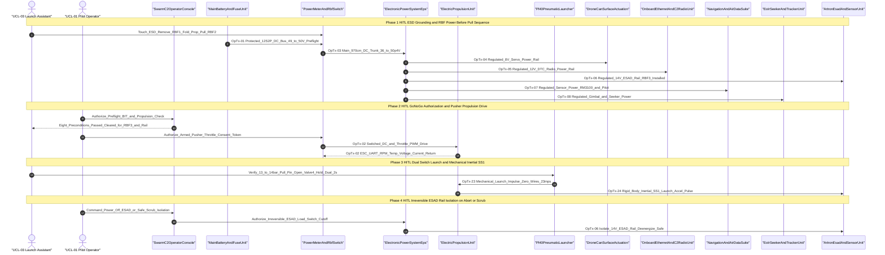
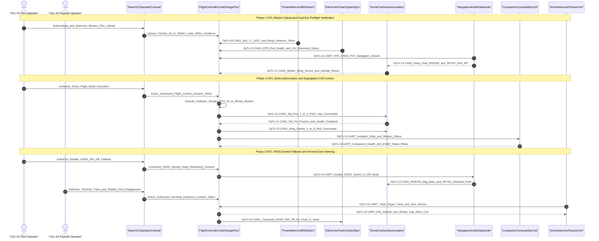
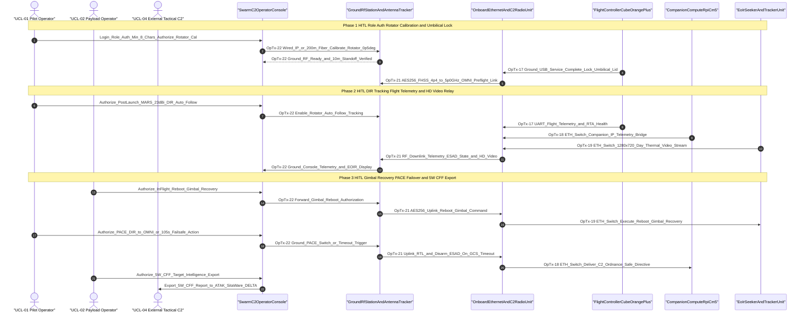
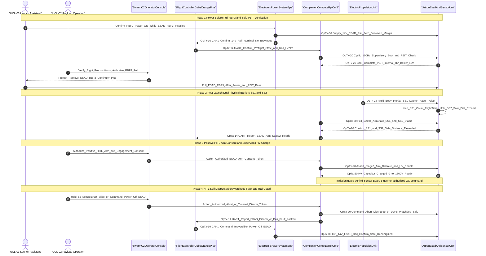

## 7. Operational Information Exchange (Op-Tx) Matrix

| Document Attribute | Specification |
| :--- | :--- |
| **Unit Title** | Operational Information Exchange (Op-Tx) Matrix |
| **Effective Date** | `2026-11-16` |
| **Document Version** | `1.0.0` |
| **System Baseline** | `Avenger5V25UasSystem` (`Avenger 5 V2.5 UAS` / `ASTK A5 V2.5` + `ELI Military Simulations PL-40 Rev 2.6` + `Artron ESAD AB00-0054-01AA-0005` + `SwarmC2`) |
| **JSON Schema Mapping** | `optx_exchanges` (`id`, `source_node`, `destination_node`, `information_element`, `throughput`, `max_latency`, `criticality`) |
| **Normative Governance** | `ISO/IEC/IEEE 29148:2018` §6.4.2-§6.4.3; `ISO/IEC/IEEE 15288:2023` §6.4.2-§6.4.4; `IEEE Std 1362-1998` §5.3; `OMG UAF v2.0` (Op-Tx / Rs-Tx); `RTCA DO-362A` §2.2, §3.2; `NATO STANAG 4187 Ed. 5`; `DoD Directive 3000.09` §4.1.a; `ASTM F3269-17` §5.2 |
| **SSOT Model Binding** | `.pipeline/schema.sysml` (`CONN_01` through `CONN_24`), `.pipeline/schema-digest.json` (`OpTx-01` through `OpTx-24`), `docs/architecture/views/sv1_platform_subsystems.mmd`, `schema/extracted/interface_table.md`, `schema/extracted/parametric_limits.md` |

---

### 7.1 Level 1B Operational Information Exchange Scope & Boundary Governance

In accordance with `OMG UAF v2.0` (`Operational Viewpoint Op-Tx` and `Resources Viewpoint Rs-Tx`), `ISO/IEC/IEEE 29148:2018` §6.4.2-§6.4.3, and `ISO/IEC/IEEE 15288:2023` §6.4.2-§6.4.4, Section 7 defines all `24` operational information, energy, and mechanical-coupling exchanges (`OpTx-01` through `OpTx-24`) executing across the `14` physical and ground subsystem assemblies of `Avenger5V25IntegratedSystem`. Every declared exchange maps in strict 1:1 bijection to a SysML v2 `connection def` node (`CONN_01` through `CONN_24`) in [`.pipeline/schema.sysml`](../../.pipeline/schema.sysml), [`.pipeline/schema-digest.json`](../../.pipeline/schema-digest.json), and [`docs/architecture/views/sv1_platform_subsystems.mmd`](../../docs/architecture/views/sv1_platform_subsystems.mmd).

**Strict Level 1B Operational Abstraction & Architectural Invariants:**
- **Level 1B vs. Level 1C ICD Firewall:** Section 7 specifies operational exchange payloads, functional supervision semantics, throughput/latency budgets, and safety criticalities at Level 1B ConOps scope (`OA-01` through `OA-19` and `SCN-01` through `SCN-08`). Component-internal serial hex opcodes, connector shell/pinout assignments, wire gauges, register bitmasks, and cyclic redundancy polynomial equations are strictly excluded from ConOps and reside exclusively in Level 1C Interface Control Documents (`ICD_01_SYSTEM_INTERFACE_MATRIX.md` and `ICD_02_MASTER_SIGNAL_DICTIONARY.md`).
- **Software-Hosted Simplex RTA & Bus Isolation (`standaloneRtaBoxCount == 0`):** Flight envelope clamping (`ASTM F3269-17` §5.2) executes in software inside `FlightControllerCubeOrangePlus` (`Cube orange+`), while ordnance protocol supervision executes inside `CompanionComputeRpiCm5` (`RPI CM5004032`). Onboard actuation and sensing remain physically partitioned across `CAN 1` (`OpTx-09`, `OpTx-10`, `OpTx-11`) and `CAN 2` (`OpTx-12`, `OpTx-13`).
- **Purely Mechanical Launcher Boundary (`IF-MECH-001`):** `OpTx-23` (`CONN_23`) transfers strictly mechanical rail-launch acceleration between `Pl40PneumaticLauncher` and `ElectricPropulsionUnit` (`electricalWireToUavCount == 0`), imparting rigid-body launch acceleration (`OpTx-24` / `CONN_24`) to the `ArtronEsadAndSensorUnit` inertial `SS1` barrier with zero electrical or CAN conductors crossing the rail.
- **Grounded Timing vs. `GAP-WCET` Bench Disposition (`REQ_SAF_08`):** Only the `RPI CM5004032` to `Artron ESAD` supervisory cycle (`OpTx-20`) carries OEM-printed timing limits (`100.0 Hz` / `0.01 s` polling, `<= 5.0 ms` reply ceiling, `<= 10.0 ms` incomplete-frame watchdog timeout per `GAP-04`) alongside grounded C2/operator timers (`105.0 s` `GCS Failsafe` RTL timeout, `2.0 min` telemetry detection window, `>= 2.0 s` dual-switch firing hold, `2.0-5.0 s` EO track hold, and `>= 5.0 s` ESAD self-destruct hold). Unprinted OEM DroneCAN bitrates, EKF2 rates, UART baud/WCET budgets, Trip6 tracker latency, and RF round-trip jitter are explicitly designated `Unprinted (GAP-WCET)` for bench verification rather than fabricated.
- **Zero Production Parachute & Power Grounding (`GAP-01`, `GAP-05`, `GAP-06`):** Production `Avenger 5 V2.5` excludes recovery parachutes (`rndRecoveryOptionInstalled == false`; `2x 50.0 V` EPS lines inhibited). Primary DC exchanges anchor strictly to `12S2P` `36.0-50.4 V` (`49.0-50.0 V` pre-flight check rejecting legacy `24-25 V` UI values), enforce `RBF #2` power-before-pull `RBF #3`, and supervise `OpTx-06` (`14.0 V` ESAD rail with `0.0 V` brownout margin) on `OpTx-10` and `OpTx-14`.

---

### 7.2 Complete Operational Information Exchange Matrix (`OpTx-01` through `OpTx-24`)

Table 7.1 enumerates 100% of the `24` operational exchanges declared in `.pipeline/schema-digest.json` (`OpTx-01` through `OpTx-24`) aligned 1:1 with `CONN_01` through `CONN_24` in `.pipeline/schema.sysml`. Table 7.2 isolates all grounded quantitative rate, timing, voltage, and physical threshold values into strictly separated numeric `Value` and unit-only `Units` columns.

#### Table 7.1: Operational Information Exchange (Op-Tx) Matrix (`24` of `24` AST Connection Parity)

| Op-Tx ID | Bound Connection & IF | Source Node (`Port`) | Destination Node (`Port`) | Information Element & Bound Operational Activities | Throughput / Exchange Regime | Max Latency / Timeout Budget | Criticality |
| :--- | :--- | :--- | :--- | :--- | :--- | :--- | :--- |
| `OpTx-01` | `CONN_01` (`IF-PWR-001`, `IF-PWR-002`, `IF-PWR-003`) | `MainBatteryAndFuseUnit` (`protectedDcOut`) | `PowerMeterAndRbfSwitch` (`mainDcIn`) | Fuse-protected `12S2P` main DC bus energy (`36.0-50.4 V` operating, `49.0-50.0 V` pre-flight, `200.0 A` fuse) gated by `RBF #2` switch closure (`OA-01`, `OA-04`) | Continuous unregulated DC power transfer; `RBF #2` discrete state transition on pull | Immediate electrical energization upon `RBF #2` removal (`GAP-05`, `GAP-06`) | Catastrophic (DAL-A Equivalent; `REQ_L_01`, `REQ_L_02`, `REQ_H_01`) |
| `OpTx-02` | `CONN_02` (`IF-PWR-004`, `IF-PWR-005`, `IF-PWM-001`, `IF-SER-005`) | `PowerMeterAndRbfSwitch` (`escDriveOut`) | `ElectricPropulsionUnit` (`escDriveIn`) | Bidirectional propulsion bus: switched `36.0-50.4 V` DC and unidirectional throttle PWM command to `IBEX160` ESC; unidirectional ESC UART telemetry return (RPM, ESC/motor temp, voltage, current) (`OA-02`) | Continuous DC propulsion feed; PWM throttle and ESC UART telemetry rate `Unprinted (GAP-WCET)` | Thermal/RPM control latency `Unprinted (GAP-WCET)` (`REQ_SAF_08`) | Hazardous (DAL-B Equivalent; `REQ_L_02`, `REQ_H_02`) |
| `OpTx-03` | `CONN_03` (`IF-PWR-006`) | `PowerMeterAndRbfSwitch` (`trunkDcOut970cm`) | `ElectronicPowerSystemEps` (`trunkDcIn`) | Main unregulated `12S2P` DC trunk energy (`36.0-50.4 V` over `970.0 cm` trunk harness) feeding EPS converters and load switches (`OA-01`, `OA-03`, `OA-04`) | Continuous unregulated DC trunk power transfer | Continuous supply; trunk `I * R` sag monitored for `GAP-01` brownout | Catastrophic (DAL-A Equivalent; `REQ_L_02`, `REQ_H_02`) |
| `OpTx-04` | `CONN_04` (`IF-PWR-007`) | `ElectronicPowerSystemEps` (`servo8VOut`) | `DroneCanSurfaceActuation` (`servo8VIn`) | Regulated `8.0 V` DC servo actuation rail powering `4x` tail ruddervators (`#1` through `#4`) and `4x` wing roll servos (`#5` through `#8`) (`OA-03`, `OA-09`) | Continuous regulated DC actuator rail (`8.0 V` nominal) | Continuous regulation across full aerodynamic surface load transients | Catastrophic (DAL-A Equivalent; `REQ_L_02`, `REQ_H_03`) |
| `OpTx-05` | `CONN_05` (`IF-PWR-008`) | `ElectronicPowerSystemEps` (`radio12VOut`) | `OnboardEthernetAndC2RadioUnit` (`radio12VIn`) | Regulated `12.0 V` DC datalink rail (`8.0-17.0 V` radio tolerance) powering airborne `DTC` `4.4-5.0 GHz` transceiver and onboard `ETH` switch (`OA-03`, `OA-14`) | Continuous regulated DC comms rail (`12.0 V` nominal) | Continuous regulation sustaining `2.0 W` RF transmission | Hazardous (DAL-B Equivalent; `REQ_L_03`, `REQ_H_05`) |
| `OpTx-06` | `CONN_06` (`IF-PWR-009`) | `ElectronicPowerSystemEps` (`esad14VOut`) | `ArtronEsadAndSensorUnit` (`esad14VIn`) | Switchable regulated `14.0 V` ordnance supply (`14.0-32.0 V` ICD band, `0.0 V` brownout margin per `GAP-01`) and irreversible `Power Off ESAD` rail cutoff (`OA-03`, `OA-10`, `OA-12`, `OA-17`) | Continuous `14.0 V` DC rail during authorized sortie; event-driven load-switch cutoff on abort | Zero undetected brownout below `14.0 V`; immediate load-switch cutoff on `Power Off ESAD` | Catastrophic (DAL-A Equivalent; `REQ_L_01`, `REQ_L_04`, `REQ_H_02`, `REQ_H_04`) |
| `OpTx-07` | `CONN_07` (`IF-PWR-011`) | `ElectronicPowerSystemEps` (`sensorPowerOut`) | `NavigationAndAirDataSuite` (`sensorPowerIn`) | Regulated sensor DC rails powering dual `mRo RM3100` magnetometers/barometers and heated `CUAV SKYE2` pitot tube (`OA-03`, `OA-06`, `OA-07`) | Continuous regulated DC sensor rail | Continuous regulation sustaining GNSS-denied DR instrumentation | Hazardous (DAL-B Equivalent; `REQ_L_03`, `REQ_H_03`) |
| `OpTx-08` | `CONN_08` (`IF-PWR-011`) | `ElectronicPowerSystemEps` (`gimbalPowerOut`) | `EoIrSeekerAndTrackerUnit` (`gimbalPowerIn`) | Regulated payload gimbal DC power feeding `Trip6` camera compute and `Nighthawk2UZ` 2-axis stabilized EO/IR gimbal (`OA-03`, `OA-13`, `OA-14`) | Continuous regulated DC gimbal rail; switched cycle on `Reboot Gimbal` | Continuous regulation; deterministic power reset on `Reboot Gimbal` | Major (DAL-C Equivalent; `REQ_L_03`, `REQ_H_05`) |
| `OpTx-09` | `CONN_09` (`IF-CAN1-001`) | `FlightControllerCubeOrangePlus` (`can1Master`) | `PowerMeterAndRbfSwitch` (`can1Tap`) | Bidirectional DroneCAN Bus 1 multi-drop tap: main `12S2P` voltage/current, `0.20` Bingo reserve status (`1080.0 s` floor), `36.0 V` sag alert, and bridged `IBEX160` ESC telemetry (`OA-01`, `OA-02`, `OA-04`) | DroneCAN Bus 1 bitrate and frame rate `Unprinted (GAP-WCET)` | `CAN 1` telemetry latency `Unprinted (GAP-WCET)` (`REQ_SAF_08`) | Hazardous (DAL-B Equivalent; `REQ_L_02`, `REQ_H_02`) |
| `OpTx-10` | `CONN_10` (`IF-CAN1-001`) | `FlightControllerCubeOrangePlus` (`can1Master`) | `ElectronicPowerSystemEps` (`can1Tap`) | Bidirectional DroneCAN Bus 1 multi-drop tap: `EPS` rail health telemetry, `14.0 V` ESAD brownout alert (`GAP-01`), and `Power Off ESAD` load-switch isolation command (`OA-03`, `OA-12`, `OA-17`) | DroneCAN Bus 1 bitrate and supervision cycle `Unprinted (GAP-WCET)` | Rail-fault isolation latency `Unprinted (GAP-WCET)` (`REQ_SAF_01`, `REQ_SAF_08`) | Catastrophic (DAL-A Equivalent; `REQ_L_01`, `REQ_L_04`, `REQ_H_02`) |
| `OpTx-11` | `CONN_11` (`IF-CAN1-001`) | `FlightControllerCubeOrangePlus` (`can1Master`) | `DroneCanSurfaceActuation` (`can1TailFins`) | Bidirectional DroneCAN Bus 1 (`4x 120.0 cm` stubs): mixed pitch/yaw skid-turn servo commands and actuator position/health feedback for tail ruddervators `#1` through `#4` (`OA-05`, `OA-09`) | DroneCAN Bus 1 actuator loop rate `Unprinted (GAP-WCET)` | Closed-loop tail actuation latency `Unprinted (GAP-WCET)` (`REQ_SAF_08`) | Catastrophic (DAL-A Equivalent; `REQ_L_02`, `REQ_H_03`) |
| `OpTx-12` | `CONN_12` (`IF-CAN2-001`) | `FlightControllerCubeOrangePlus` (`can2Master`) | `DroneCanSurfaceActuation` (`can2SplitterIn`) | Bidirectional isolated DroneCAN Bus 2 (`CAN/power splitter PCB`): active roll stabilization commands and actuator feedback for wing panels `#5` through `#8` plus upstream sensor relay (`OA-05`, `OA-09`) | DroneCAN Bus 2 actuator loop rate `Unprinted (GAP-WCET)` | Closed-loop wing actuation latency `Unprinted (GAP-WCET)` (`REQ_SAF_08`) | Catastrophic (DAL-A Equivalent; `REQ_L_02`, `REQ_H_03`) |
| `OpTx-13` | `CONN_13` (`IF-CAN2-001`) | `DroneCanSurfaceActuation` (`can2DaisyOutToSensors`) | `NavigationAndAirDataSuite` (`can2DaisyIn`) | Bidirectional DroneCAN Bus 2 series daisy-chain: dual `mRo RM3100` magnetometer/barometer states and `CUAV SKYE2` airspeed (`<= 3.0 m/s` calm / `>= 10.0 m/s` airflow check) (`OA-06`, `OA-07`) | DroneCAN Bus 2 sensor daisy-chain rate `Unprinted (GAP-WCET)` | Air-data / heading transport latency `Unprinted (GAP-WCET)` (`REQ_SAF_08`) | Catastrophic (DAL-A Equivalent; `REQ_L_02`, `REQ_L_03`, `REQ_H_03`) |
| `OpTx-14` | `CONN_14` (`IF-SER-001`) | `FlightControllerCubeOrangePlus` (`serialRpi`) | `CompanionComputeRpiCm5` (`serialFc`) | Bidirectional point-to-point internal UART serial: autopilot flight state, Simplex RTA abort/RTL directives, and companion-relayed ESAD bus fault and arm-status telemetry (`OA-05`, `OA-08`, `OA-12`) | Point-to-point UART baud/rate `Unprinted (GAP-WCET)` | Autopilot-to-companion coordination WCET `Unprinted (GAP-WCET)` (`REQ_SAF_08`) | Catastrophic (DAL-A Equivalent; `REQ_L_03`, `REQ_L_04`, `REQ_H_03`, `REQ_H_04`) |
| `OpTx-15` | `CONN_15` (`IF-SER-002`) | `FlightControllerCubeOrangePlus` (`serialGnss`) | `NavigationAndAirDataSuite` (`serialGnss`) | Bidirectional point-to-point UART serial: `Septentrio Asterx-m3 pro` RTK GNSS PVT navigation stream and `Disable GNSS` INS/DR mode switching control (`OA-06`, `OA-07`) | GNSS serial solution rate `Unprinted (GAP-WCET)` | PVT fix / failover latency `Unprinted (GAP-WCET)` (`REQ_SAF_08`) | Hazardous (DAL-B Equivalent; `REQ_L_03`, `REQ_H_03`) |
| `OpTx-16` | `CONN_16` (`IF-SER-003`) | `FlightControllerCubeOrangePlus` (`serialTrip6`) | `EoIrSeekerAndTrackerUnit` (`serialFc`) | Bidirectional point-to-point UART serial: `Trip6` terminal target lock (`2.0-5.0 s` hold), dive steering vectors (`<= 55.0 m/s` cap, `<= 0.5 m` CEP), INS attitude aid, and `Abort Engaging` (`OA-05`, `OA-13`) | Tracker serial steering rate `Unprinted (GAP-WCET)` | Seeker-to-autopilot guidance latency `Unprinted (GAP-WCET)` (`REQ_SAF_08`) | Catastrophic (DAL-A Equivalent; `REQ_L_04`, `REQ_H_05`) |
| `OpTx-17` | `CONN_17` (`IF-SER-004`, `IF-USB-001`) | `FlightControllerCubeOrangePlus` (`serialRadioAndUsbExt`) | `OnboardEthernetAndC2RadioUnit` (`fcSerialAndUsbExt`) | Bidirectional autopilot serial C2 stream to `DTC` radio plus ground USB firmware/log service behind lockable umbilical lid (`OA-05`, `OA-14`, `OA-18`) | Autopilot-to-radio serial rate `Unprinted (GAP-WCET)`; USB ground service only | Serial C2 forwarding latency `Unprinted (GAP-WCET)` (`REQ_SAF_08`) | Hazardous (DAL-B Equivalent; `REQ_L_03`, `REQ_H_05`) |
| `OpTx-18` | `CONN_18` (`IF-ETH-001`) | `CompanionComputeRpiCm5` (`ethSwitch`) | `OnboardEthernetAndC2RadioUnit` (`ethRpiPort`) | Bidirectional switched onboard Ethernet IP: `SwarmC2` mission directives, `RBF #3` / ESAD status, positive HITL arm/abort/self-destruct authorizations, and ground service ETH (`OA-08`, `OA-11`, `OA-12`, `OA-14`) | Switched onboard Ethernet IP; bandwidth/jitter `Unprinted (GAP-WCET)` | Companion Ethernet bridge latency `Unprinted (GAP-WCET)` (`REQ_SAF_08`) | Catastrophic (DAL-A Equivalent; `REQ_L_03`, `REQ_L_04`, `REQ_H_04`) |
| `OpTx-19` | `CONN_19` (`IF-ETH-001`) | `EoIrSeekerAndTrackerUnit` (`ethSwitch`) | `OnboardEthernetAndC2RadioUnit` (`ethTrip6Port`) | Bidirectional switched onboard Ethernet IP: `1280x720` Day and Thermal EO/IR video streams (`X40` zoom), gimbal cues, and in-flight `Reboot Gimbal` recovery command (`OA-13`, `OA-14`) | Switched Ethernet HD Day/Thermal video; exact bitrate `Unprinted (GAP-WCET)` | Video encoding and Ethernet transport latency `Unprinted (GAP-WCET)` | Hazardous (DAL-B Equivalent; `REQ_L_03`, `REQ_H_05`) |
| `OpTx-20` | `CONN_20` (`IF-ORD-001`, `IF-ORD-002`) | `CompanionComputeRpiCm5` (`esadOcControl`) | `ArtronEsadAndSensorUnit` (`ocControlIn`) | Level 1B supervised ESAD command/status cycle (`100.0 Hz` / `0.01 s`), PBIT safe-HV confirmation (`< 50.0 V`), high-voltage charge authorization (`0.0-1800.0 V` gated by `SS1`/`SS2`), abort/self-destruct supervision, and Stage 2 hardware arm discrete (`1000.0 Hz`, `2` pulses) (`OA-08`, `OA-10`, `OA-11`, `OA-12`) | `100.0 Hz` (`0.01 s` cycle) RS-485 cyclic supervision + `1000.0 Hz` (`2` pulses) Stage 2 discrete arm enable (`GAP-04`) | `<= 5.0 ms` ESAD reply latency; `<= 10.0 ms` incomplete-packet / watchdog lockout timeout (`GAP-04`) | Catastrophic (DAL-A Equivalent; `REQ_L_01`, `REQ_L_04`, `REQ_H_04`) |
| `OpTx-21` | `CONN_21` (`IF-RF-001`) | `OnboardEthernetAndC2RadioUnit` (`rfDatalinkOut`) | `GroundRfStationAndAntennaTracker` (`rfAirPort`) | Over-the-air `4.4-5.0 GHz` `AES-256` FHSS (`2.0 W` / `2x 1.0 W`, `60.0/90.0 km` RLOS) bidirectional C2 uplink, flight/ESAD telemetry downlink, and `1280x720` EO/IR video (`OA-07`, `OA-12`, `OA-13`, `OA-18`) | `4.4-5.0 GHz` encrypted RF link; exact net throughput `Unprinted (GAP-WCET)` | `2.0 min` (`120.0 s`) telemetry detect timeout; `105.0 s` `GCS Failsafe` RTL + `Disarm ESAD On GCS Timeout` | Catastrophic (DAL-A Equivalent; `REQ_L_03`, `REQ_L_04`, `REQ_H_05`) |
| `OpTx-22` | `CONN_22` (`IF-GND-001`) | `SwarmC2OperatorConsole` (`gcsStationPort`) | `GroundRfStationAndAntennaTracker` (`gcsStationPort`) | Bidirectional wired IP or optional `200.0 m` tactical fiber spool carrying role-authenticated C2 directives (`>= 8` chars), telemetry/video display, and `Antenna Rotator` (`Auto Follow` + `0.5 deg` step) control (`OA-18`, `OA-19`) | Wired IP / `200.0 m` fiber spool link; tablet round-trip jitter `Unprinted (GAP-WCET)` | Ground link latency `Unprinted (GAP-WCET)`; `>= 5.0 s` ESAD abort hold enforced at HMI | Catastrophic (DAL-A Equivalent; `REQ_L_01`, `REQ_L_03`, `REQ_L_04`, `REQ_H_05`) |
| `OpTx-23` | `CONN_23` (`IF-MECH-001`) | `Pl40PneumaticLauncher` (`mechLaunchOut`) | `ElectricPropulsionUnit` (`mechLaunchRailIn`) | Purely mechanical catapult impulse across `5.0 m` (`12.0 deg` elevation) rail at `13.0-14.0 bar`, delivering `~23.0 m/s` (`22.7-23.5 m/s` at `17.0 kg`, `<= 25.0 m/s` cap) with `0` electrical/CAN conductors (`OA-15`, `OA-16`, `OA-17`) | Event-driven pneumatic launch stroke (`>= 2.0 s` dual-switch hold; `<= 8.0 min` tank charge) | Instantaneous mechanical carriage impulse across `5.0 m` stroke (`GAP-03`, `GAP-SCRUB`) | Catastrophic (DAL-A Equivalent; `REQ_L_01`, `REQ_L_02`, `REQ_H_01`, `REQ_H_06`) |
| `OpTx-24` | `CONN_24` (Rigid-Body Mechanical) | `ElectricPropulsionUnit` (`inertialSs1Out`) | `ArtronEsadAndSensorUnit` (`inertialSs1In`) | Rigid-body longitudinal launch acceleration pulse (`SS1`) transmitted mechanically through airframe structure to trigger the ESAD inertial first safety barrier (`0` wires) (`OA-11`, `OA-16`) | Event-driven physical inertial acceleration impulse (`0.0039 g/LSB` sense scale) | Real-time physical rigid-body coupling; numeric launch `g` threshold tracked under `GAP-SEPDIST` | Catastrophic (DAL-A Equivalent; `REQ_L_01`, `REQ_L_04`, `REQ_H_04`) |

#### Table 7.2: Grounded Op-Tx Quantitative Exchange Thresholds & Timing Envelopes

| Param ID | Bound Op-Tx | Quantitative Parameter | Value | Units | Constraint / Gap Disposition |
| :--- | :--- | :--- | :--- | :--- | :--- |
| `PRM-AV-001` | `OpTx-01`, `OpTx-03` | Main `12S2P` Bus Operating Voltage Range | 36.0-50.4 | V | Continuous operating bus (`PRM-AV-002` upper limit) |
| `PRM-AV-003` | `OpTx-01` | Pre-Flight Battery Check Acceptance Window | 49.0-50.0 | V | Rejects legacy `24-25 V` UI values (`GAP-05`) |
| `PRM-AV-005` | `OpTx-01` | Main Inline Automotive Fuse Current Rating | 200.0 | A | Overcurrent protection upstream of `Power Meter` |
| `PRM-PERF-003` | `OpTx-09` | Statutory Bingo Energy Reserve Floor Ratio | 0.20 | ratio | Triggers RTL at `1080.0` s remaining of `5400.0` s (`MET-02`) |
| `PRM-AV-006` | `OpTx-04` | Regulated EPS Servo Actuation Rail Voltage | 8.0 | V | Feeds `8x HV6160-DroneCAN` tail and wing actuators |
| `PRM-AV-007` | `OpTx-05` | Regulated EPS C2 Radio Rail Voltage | 12.0 | V | Within `8.0-17.0` V `DTC` radio supply tolerance |
| `PRM-AV-010` | `OpTx-06` | Regulated EPS ESAD Supply Voltage (`GAP-01`) | 14.0 | V | Zero brownout margin above `14.0` V ESAD `VDC_IN` minimum |
| `PRM-AV-012` | `OpTx-03`, `OpTx-09` | Fuselage Main DC and `CAN 1` Trunk Length | 970.0 | cm | Parallel power and `CAN 1` fuselage trunk routing |
| `PRM-AV-013` | `OpTx-11` | Tail Fin Servo `CAN 1` Stub Length (`4x`) | 120.0 | cm | `4x` multi-drop stubs feeding ruddervators `#1` through `#4` |
| `PRM-AV-017` | `OpTx-13` | Pitot Pre-Flight Calm-Air Indicated Speed Max | 3.0 | m/s | `OA-06` pre-flight `CUAV SKYE2` sanity check ceiling |
| `PRM-AV-018` | `OpTx-13` | Pitot Pre-Flight Airflow Check Speed Min | 10.0 | m/s | `OA-06` indirect airflow verification threshold |
| `PRM-PERF-010` | `OpTx-11`, `OpTx-16` | Software Simplex RTA Engagement Speed Cap | 55.0 | m/s | Exceeding forces `Abort Engaging` (`80.0` m/s structural `VNE`) |
| `PRM-AV-019` | `OpTx-19`, `OpTx-21` | EO/IR Day and Thermal Video Horizontal Pixels | 1280 | px | Paired with `720` px vertical and `40.0`x optical/digital zoom |
| `PRM-ESAD-017` | `OpTx-20` | ESAD Supervisory Cyclic Polling Frequency | 100.0 | Hz | Equivalent `0.01` s period (`GAP-04` anchored baseline) |
| `PRM-ESAD-020` | `OpTx-20` | ESAD Supervisory Reply Maximum Latency | 5.0 | ms | End-of-command to end-of-reply ceiling (`GAP-04`) |
| `PRM-ESAD-019` | `OpTx-20` | ESAD Incomplete-Packet / Watchdog Timeout | 10.0 | ms | Triggers deterministic fault lockout / safe abort (`GAP-04`) |
| `PRM-ESAD-006` | `OpTx-20` | Arm Stage 2 Discrete (`DSC_IN1`) Pulse Rate | 1000.0 | Hz | `2` pulses (`1.0` ms period, `50.0` percent duty) gated to Stage 2 |
| `PRM-ESAD-029` | `OpTx-20` | PBIT Safe Internal High-Voltage Ceiling | 50.0 | V | Pre-flight PBIT strictly below `50.0` V (`0.0-1800.0` V HV firing output max) |
| `PRM-RF-001` | `OpTx-21` | Airborne and Ground `DTC` RF Operating Band | 4.4-5.0 | GHz | `AES-256` FHSS at `2.0` W total (`60.0` / `90.0` km RLOS) |
| `PRM-GCS-008` | `OpTx-21`, `OpTx-22` | `GCS Failsafe` Lost-Link RTL Timeout Baseline | 105.0 | s | Triggers autonomous RTL plus `Disarm ESAD On GCS Timeout` |
| `PRM-GCS-002` | `OpTx-21`, `OpTx-22` | Power-On Telemetry Acquisition Timeout | 2.0 | min | Maximum wait (`120.0` s) after `RBF #2` energization |
| `PRM-RF-012` | `OpTx-22` | Optional Ground Tactical Fiber Optic Spool | 200.0 | m | Remotes `Ground Radio Box` from `SwarmC2` tablet (`0.5` deg step) |
| `PRM-PL40-003` | `OpTx-23` | Interpolated PL-40 Exit Velocity (`17.0 kg` MTOW) | 23.0 | m/s | `22.7-23.5` m/s band (`<= 25.0` m/s cap at `13.0-14.0` bar, `GAP-03`) |
| `PRM-PL40-037` | `OpTx-23` | Dual-Switch Simultaneous Launch Firing Hold Min | 2.0 | s | Held simultaneously after `Main Valve 4` open and pin pull |
| `PRM-AF-008` | `OpTx-23`, `OpTx-24` | Electrical / CAN Conductors Across `PL-40` Rail | 0 | count | Strictly mechanical `IF-MECH-001` (`CONN_23`, `CONN_24`) |

---

### 7.3 Operational Information Exchange Interaction Sequences (`Diagram 10.1` through `Diagram 10.4`)

In compliance with the **100% Op-Tx Interaction Sequence Parity Invariant**, all `24` declared exchanges (`OpTx-01` through `OpTx-24`) are partitioned deterministically across four `OMG UAF v2.0` / `ISO/IEC/IEEE 29148:2018` §6.4.2 Mermaid `sequenceDiagram` specifications (`Diagram 10.1` through `Diagram 10.4`) with zero uncovered exchanges and strict Human-in-the-Loop (HITL) temporal safety precedence (`DoD Directive 3000.09` §4.1.a).

#### 7.3.1 Diagram 10.1: Power, Launch & Propulsion Exchange Sequence (`OpTx-01` through `OpTx-08`, `OpTx-23`, `OpTx-24`)

This interaction thread traces primary `12S2P` DC power distribution (`OpTx-01`, `OpTx-03` through `OpTx-08`), HITL propulsion authorization and ESC telemetry return (`OpTx-02`), zero-wire pneumatic catapult release (`OpTx-23`), rigid-body inertial `SS1` launch sensing (`OpTx-24`), and HITL-authorized ESAD rail isolation (`OpTx-06`).

#### 7.3.2 Diagram 10.2: Flight Control, Segregated DroneCAN & Navigation Sequence (`OpTx-09` through `OpTx-16`)

This interaction thread traces physically segregated `CAN 1` (`OpTx-09`, `OpTx-10`, `OpTx-11`) and `CAN 2` (`OpTx-12`, `OpTx-13`) buses, software-hosted `ASTM F3269-17` Simplex RTA supervision inside `FlightControllerCubeOrangePlus`, point-to-point UART exchanges (`OpTx-14`, `OpTx-15`, `OpTx-16`), and HITL-authorized GNSS-denied dead-reckoning and terminal engagement steering.

#### 7.3.3 Diagram 10.3: C2 RF Link, Onboard Ethernet & EO/IR Video Sequence (`OpTx-17`, `OpTx-18`, `OpTx-19`, `OpTx-21`, `OpTx-22`)

This interaction thread traces ground console to RF station and rotator control (`OpTx-22`), encrypted `4.4-5.0 GHz` `AES-256` FHSS air-ground RF transport (`OpTx-21`), autopilot serial C2 and locked USB service access (`OpTx-17`), switched onboard Ethernet IP bridging (`OpTx-18`), EO/IR Day/Thermal video streaming and HITL `Reboot Gimbal` recovery (`OpTx-19`), PACE link failover, and `5W` / `CFF` tactical export.

#### 7.3.4 Diagram 10.4: Ordnance Safe-Arm Supervision & Interlock Sequence (`OpTx-06`, `OpTx-10`, `OpTx-14`, `OpTx-20`, `OpTx-24`)

This safety-critical interaction thread enforces `NATO STANAG 4187 Ed. 5` and `DoD Directive 3000.09` §4.1.a across Level 1B ordnance supervision (`OpTx-06`, `OpTx-10`, `OpTx-14`, `OpTx-20`, `OpTx-24`), strictly isolating power-before-pull `RBF #3` ordering (`GAP-06`), pre-flight safe high-voltage PBIT verification (`< 50.0 V`), independent physical barriers `SS1` and `SS2 Safe Distance Exceed` (`GAP-07`), positive HITL arm/abort consent, and deterministic rail cutoff without exposing component-internal serial opcodes, pinouts, bitmasks, or checksum polynomial equations.

---

### 7.4 Op-Tx Coverage Parity & Traceability Summary

Table 7.3 confirms 100% deterministic closure of all `24` operational exchanges (`OpTx-01` through `OpTx-24`) across SysML `connection def` nodes (`CONN_01` through `CONN_24`), interaction sequence diagrams (`Diagram 10.1` through `Diagram 10.4`), UAF Operational Activities (`OA-01` through `OA-19`), Operational Scenarios (`SCN-01` through `SCN-08`), Safety Constraints (`REQ_SC_01` through `REQ_SC_16`, `REQ_SAF_01` through `REQ_SAF_12`), and Verification Test Cases (`TC_01` through `TC_08`).

#### Table 7.3: Op-Tx to Diagram, Operational Activity, Scenario & Verification Parity Matrix

| Op-Tx ID | SysML `connection def` | Sequence Diagram Allocation | Bound Operational Activities (`OA`) | Bound Scenarios (`SCN`) | Governing Constraints & Test Cases |
| :--- | :--- | :--- | :--- | :--- | :--- |
| `OpTx-01` | `CONN_01` | `Diagram 10.1` | `OA-01`, `OA-04` | `SCN-01`, `SCN-02`, `SCN-08` | `REQ_SC_01`, `REQ_SC_02`, `REQ_SAF_05`, `REQ_SAF_06`; `TC_01` |
| `OpTx-02` | `CONN_02` | `Diagram 10.1` | `OA-02`, `OA-16` | `SCN-01`, `SCN-02`, `SCN-06` | `REQ_SC_04`, `REQ_SAF_03`; `TC_01`, `TC_02`, `TC_07` |
| `OpTx-03` | `CONN_03` | `Diagram 10.1` | `OA-01`, `OA-03`, `OA-04` | `SCN-01`, `SCN-02` | `REQ_SC_02`, `REQ_SAF_01`, `REQ_SAF_05`; `TC_01`, `TC_02` |
| `OpTx-04` | `CONN_04` | `Diagram 10.1` | `OA-03`, `OA-09` | `SCN-01`, `SCN-02`, `SCN-04` | `REQ_SC_06`; `TC_02`, `TC_03` |
| `OpTx-05` | `CONN_05` | `Diagram 10.1` | `OA-03`, `OA-14` | `SCN-01`, `SCN-03`, `SCN-07` | `REQ_SC_02`, `REQ_SC_15`; `TC_02`, `TC_04` |
| `OpTx-06` | `CONN_06` | `Diagram 10.1`, `Diagram 10.4` | `OA-03`, `OA-10`, `OA-12`, `OA-17` | `SCN-01`, `SCN-05`, `SCN-08` | `REQ_SC_09`, `REQ_SC_16`, `REQ_SAF_01`, `REQ_SAF_06`; `TC_02`, `TC_06`, `TC_08` |
| `OpTx-07` | `CONN_07` | `Diagram 10.1` | `OA-03`, `OA-06`, `OA-07` | `SCN-01`, `SCN-03` | `REQ_SC_07`; `TC_02`, `TC_04` |
| `OpTx-08` | `CONN_08` | `Diagram 10.1` | `OA-03`, `OA-13`, `OA-14` | `SCN-01`, `SCN-04`, `SCN-07` | `REQ_SC_12`; `TC_02`, `TC_05` |
| `OpTx-09` | `CONN_09` | `Diagram 10.2` | `OA-01`, `OA-02`, `OA-04` | `SCN-01`, `SCN-02` | `REQ_SC_02`, `REQ_SC_04`, `REQ_SC_06`, `REQ_SAF_05`; `TC_01`, `TC_02` |
| `OpTx-10` | `CONN_10` | `Diagram 10.2`, `Diagram 10.4` | `OA-03`, `OA-12`, `OA-17` | `SCN-01`, `SCN-05`, `SCN-08` | `REQ_SC_02`, `REQ_SC_16`, `REQ_SAF_01`; `TC_02`, `TC_06`, `TC_08` |
| `OpTx-11` | `CONN_11` | `Diagram 10.2` | `OA-05`, `OA-09` | `SCN-02`, `SCN-03`, `SCN-04` | `REQ_SC_05`, `REQ_SC_06`, `REQ_SAF_02`; `TC_03` |
| `OpTx-12` | `CONN_12` | `Diagram 10.2` | `OA-05`, `OA-09` | `SCN-02`, `SCN-03`, `SCN-04` | `REQ_SC_05`, `REQ_SC_06`, `REQ_SAF_02`; `TC_03` |
| `OpTx-13` | `CONN_13` | `Diagram 10.2` | `OA-06`, `OA-07` | `SCN-01`, `SCN-03` | `REQ_SC_06`, `REQ_SC_07`; `TC_03`, `TC_04` |
| `OpTx-14` | `CONN_14` | `Diagram 10.2`, `Diagram 10.4` | `OA-05`, `OA-08`, `OA-12` | `SCN-02`, `SCN-03`, `SCN-05`, `SCN-08` | `REQ_SC_05`, `REQ_SC_08`, `REQ_SAF_04`; `TC_03`, `TC_04`, `TC_06` |
| `OpTx-15` | `CONN_15` | `Diagram 10.2` | `OA-06`, `OA-07` | `SCN-01`, `SCN-02`, `SCN-03` | `REQ_SC_07`; `TC_04` |
| `OpTx-16` | `CONN_16` | `Diagram 10.2` | `OA-05`, `OA-13` | `SCN-02`, `SCN-04` | `REQ_SC_05`, `REQ_SC_12`, `REQ_SAF_02`; `TC_03`, `TC_05` |
| `OpTx-17` | `CONN_17` | `Diagram 10.3` | `OA-05`, `OA-14`, `OA-18` | `SCN-01`, `SCN-03`, `SCN-07` | `REQ_SC_15`; `TC_04`, `TC_08` |
| `OpTx-18` | `CONN_18` | `Diagram 10.3` | `OA-08`, `OA-11`, `OA-12`, `OA-14` | `SCN-03`, `SCN-05`, `SCN-07`, `SCN-08` | `REQ_SC_08`, `REQ_SC_16`, `REQ_SAF_04`; `TC_04`, `TC_06`, `TC_08` |
| `OpTx-19` | `CONN_19` | `Diagram 10.3` | `OA-13`, `OA-14` | `SCN-04`, `SCN-07` | `REQ_SC_12`; `TC_05` |
| `OpTx-20` | `CONN_20` | `Diagram 10.4` | `OA-08`, `OA-10`, `OA-11`, `OA-12` | `SCN-01`, `SCN-05`, `SCN-08` | `REQ_SC_08`, `REQ_SC_09`, `REQ_SC_10`, `REQ_SC_11`, `REQ_SAF_04`, `REQ_SAF_06`, `REQ_SAF_07`; `TC_04`, `TC_06`, `TC_08` |
| `OpTx-21` | `CONN_21` | `Diagram 10.3` | `OA-07`, `OA-12`, `OA-13`, `OA-18` | `SCN-01`, `SCN-03`, `SCN-04`, `SCN-05`, `SCN-07`, `SCN-08` | `REQ_SC_12`, `REQ_SC_15`, `REQ_SAF_02`; `TC_04`, `TC_05`, `TC_08` |
| `OpTx-22` | `CONN_22` | `Diagram 10.3` | `OA-18`, `OA-19` | `SCN-01`, `SCN-03`, `SCN-07`, `SCN-08` | `REQ_SC_15`, `REQ_SC_16`, `REQ_SAF_12`; `TC_08` |
| `OpTx-23` | `CONN_23` | `Diagram 10.1` | `OA-15`, `OA-16`, `OA-17` | `SCN-06`, `SCN-08` | `REQ_SC_13`, `REQ_SC_14`, `REQ_SC_16`, `REQ_SAF_03`, `REQ_SAF_12`; `TC_07`, `TC_08` |
| `OpTx-24` | `CONN_24` | `Diagram 10.1`, `Diagram 10.4` | `OA-11`, `OA-16` | `SCN-05`, `SCN-06` | `REQ_SC_11`, `REQ_SAF_07`, `REQ_SAF_10`; `TC_06`, `TC_07` |

/// OperationalAllocation: [OA-01]
/// OperationalAllocation: [OA-02]
/// OperationalAllocation: [OA-03]
/// OperationalAllocation: [OA-04]
/// OperationalAllocation: [OA-05]
/// OperationalAllocation: [OA-06]
/// OperationalAllocation: [OA-07]
/// OperationalAllocation: [OA-08]
/// OperationalAllocation: [OA-09]
/// OperationalAllocation: [OA-10]
/// OperationalAllocation: [OA-11]
/// OperationalAllocation: [OA-12]
/// OperationalAllocation: [OA-13]
/// OperationalAllocation: [OA-14]
/// OperationalAllocation: [OA-15]
/// OperationalAllocation: [OA-16]
/// OperationalAllocation: [OA-17]
/// OperationalAllocation: [OA-18]
/// OperationalAllocation: [OA-19]
/// OperationalAllocation: [MET-02]
