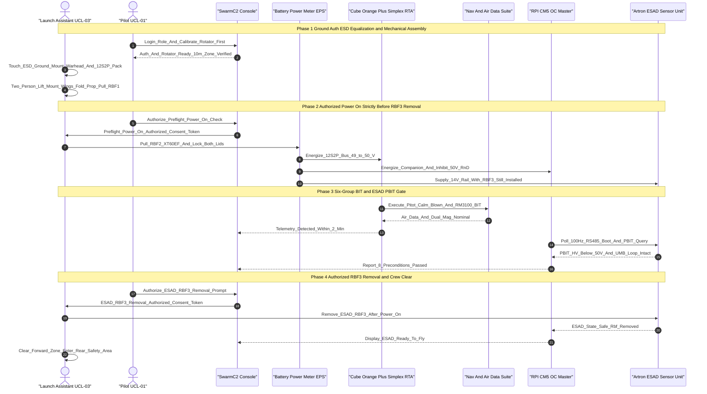
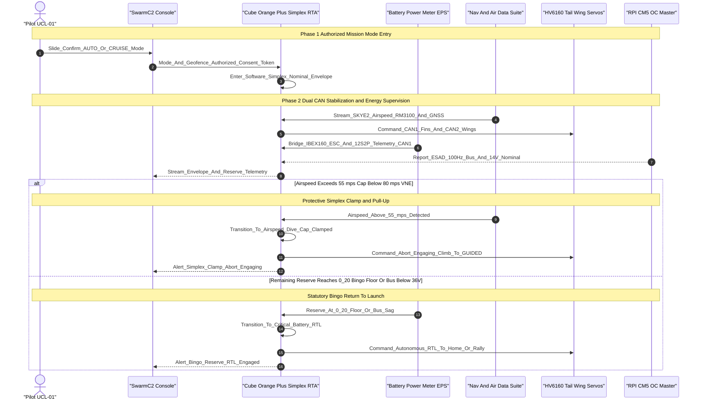
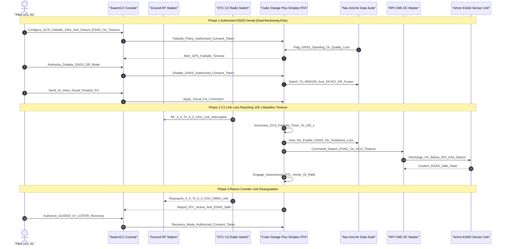
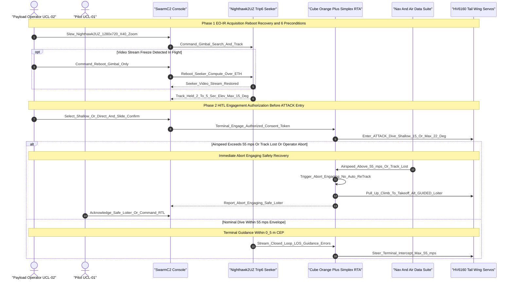
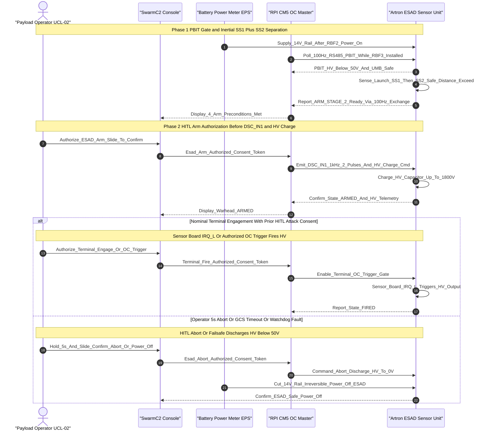
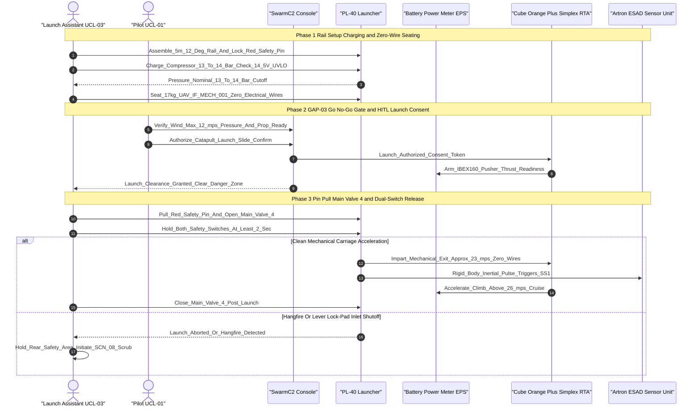
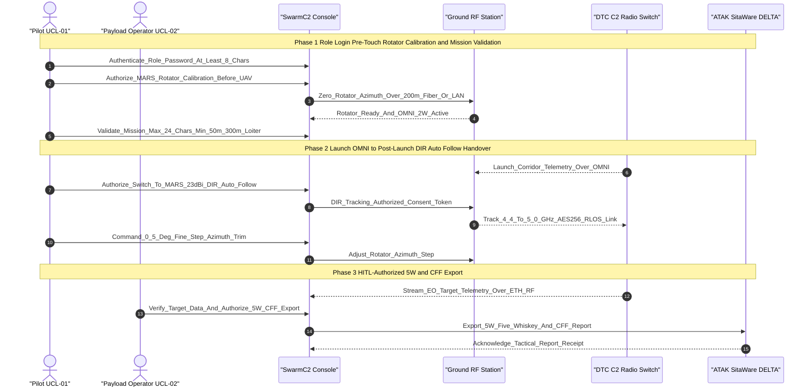
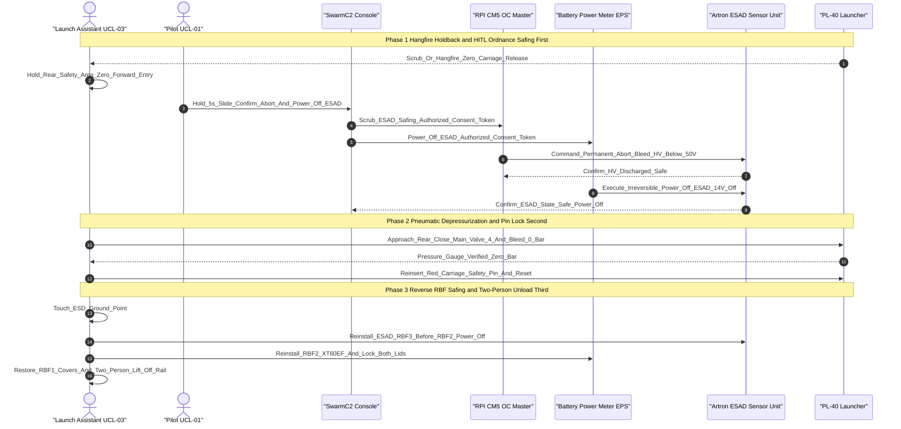

## 9. Multi-Threaded Operational Scenarios & System Timelines

**Document Baseline Date:** `2026-11-16` | **System Baseline:** `Avenger5V25UasSystem` (`Avenger 5 V2.5 UAS` / `ASTK A5 V2.5` + `ELI Military Simulations PL-40 Rev 2.6` + `Artron ESAD AB00-0054-01AA-0005` + `SwarmC2`)

In accordance with ISO/IEC/IEEE 29148:2018 §6.4.2, DoDAF v2.02 OV-6c, OMG UAF v2.0, and MIL-STD-882E §4.4, this section defines the multi-threaded operational scenarios, sequential step timelines, deterministic exit criteria, quantitative gate bounds, and dedicated OV-6c operational sequence diagrams across all eight system scenarios (`SCN-01` through `SCN-08`) aligned with the Level 1B Operational Activity threads (`OA-01` through `OA-19` in Section 6). Every scenario enforces strict hardware-faithful boundaries: software-resident `ASTM F3269-17` Simplex Runtime Assurance (RTA) executing on `Cube orange+` (`standaloneRtaBoxCount == 0`), purely mechanical `PL-40` to airframe coupling (`IF-MECH-001`, zero electrical or CAN wires), inhibited `Optional RnD` `50.0 V` recovery lines (zero production parachute), `12S2P` `36.0-50.4 V` main bus anchoring (`GAP-05`), and mandatory Human-in-the-Loop (HITL) temporal safety precedence prior to any irreversible actuation or ordnance arming.

### Table 9.1: Operational Scenario Spectrum & Traceability Summary

| Scenario ID | Scenario Title | Operational Category | Primary & Supporting User Classes | SysML Statechart & Interaction Coverage | Verification & Safety Requirement Refs |
| :--- | :--- | :--- | :--- | :--- | :--- |
| `SCN-01` | Pre-Flight Power-On, Diagnostics, and BIT Verification | Nominal Sortie Staging & PBIT | `UCL-03` Launch Assistant, `UCL-01` Pilot | `UavFlightLifecycleState::PreFlightCheck`, `EsadSafeArmState::SafeRbfInstalled`, `INT_01_PreflightPowerAndBit` | `TC_01_PreflightPowerAndRbfSequence`, `REQ_SC_01`, `REQ_SC_07`, `REQ_SC_09`, `REQ_SAF_05`, `REQ_SAF_06` |
| `SCN-02` | Flight Envelope Monitoring and Software Simplex RTA | Envelope Assurance & Resource Divert | `UCL-01` Pilot | `RtaEnvelopeMonitorState`, `UavFlightLifecycleState::CruiseAndLoiter`, `INT_02_PropulsionThrustAndBingoMonitor`, `INT_04_AutopilotRtaAndSurfaceActuation` | `TC_02_BingoReserveAndEpsBrownoutMonitor`, `TC_03_SimplexRtaEnvelopeAndActuation`, `REQ_SC_02`, `REQ_SC_04`, `REQ_SC_05`, `REQ_SC_06`, `REQ_SAF_01`, `REQ_SAF_02` |
| `SCN-03` | GNSS-Denied Dead-Reckoning and 105.0 s Lost-Link Failsafe | GNSS-Denied Navigation & Lost C2 Link | `UCL-01` Pilot | `PaceC2LinkState`, `INT_05_GnssDeniedDeadReckoningAndPaceLink` | `TC_04_GnssDeniedDrAndPaceLinkFailsafe`, `REQ_SC_07`, `REQ_SC_12`, `REQ_SC_15` |
| `SCN-04` | EO-IR Target Acquisition, Tracking, and 55.0 m/s Engagement Abort | Tactical Engagement & Safety Abort | `UCL-02` Payload Operator, `UCL-01` Pilot | `UavFlightLifecycleState::TargetTrackAndDive`, `RtaEnvelopeMonitorState::AirspeedDiveCapClamped`, `INT_06_EoIrSeekerTrackAndTerminalDive` | `TC_05_EoIrTargetTrackAndSpeedCapAbort`, `REQ_SC_12`, `REQ_SAF_02` |
| `SCN-05` | ESAD Safe/Arm Supervision, Dual-Barrier Sequencing, and Detonation | High-Consequence Safety Interlock & Ordnance | `UCL-02` Payload Operator, `UCL-01` Pilot | `EsadSafeArmState`, `INT_07_EsadDualBarrierArmAndDetonation` | `TC_06_EsadProtocolInterlockAndHvFireGate`, `REQ_SC_08`, `REQ_SC_09`, `REQ_SC_10`, `REQ_SC_11`, `REQ_SAF_04`, `REQ_SAF_06`, `REQ_SAF_07` |
| `SCN-06` | PL-40 Mechanical Zero-Wire Pneumatic Catapult Launch | Nominal Launch Execution | `UCL-03` Launch Assistant, `UCL-01` Pilot | `Pl40LauncherState`, `UavFlightLifecycleState::CatapultLaunch`, `INT_03_Pl40RailChargeAndLaunchSequence` | `TC_07_Pl40RailChargeLaunchAndZeroWire`, `REQ_SC_13`, `REQ_SC_14`, `REQ_SAF_03` |
| `SCN-07` | Ground C2 Rotator Tracking, Mission Bounds, and 5W / CFF Export | Ground RF C2 & Tactical Interoperability | `UCL-01` Pilot, `UCL-02` Payload Operator | `PaceC2LinkState::PrimaryDtcDirTracking`, `PaceC2LinkState::AlternateDtcOmniLocal` | `TC_08_EmergencyScrubHangfireAndC2Auth`, `REQ_SC_15`, `SwarmC2AuthAndMissionBoundsConstraint`, `GroundCrewSeparationAndEsdConstraint` |
| `SCN-08` | SAFE_SCRUB_ABORT Emergency Scrub and Hangfire Recovery | Launch Abort & Boundary Containment | `UCL-03` Launch Assistant, `UCL-01` Pilot, `UCL-02` Payload Operator | `Pl40LauncherState::ScrubbedSafeDepressurized`, `EsadSafeArmState::SafePowerOff`, `UavFlightLifecycleState::SafePostFlightShutdown`, `INT_08_EmergencyScrubAndSafing` | `TC_08_EmergencyScrubHangfireAndC2Auth`, `REQ_SC_16`, `REQ_SAF_12` |

### Table 9.2: Section 9 Grounded Scenario Quantitative Gate Parameters

| Param ID | Scenario Ref | Parameter Name | Value | Units | Constraint / Operational Gate | OEM / SysML SSOT Citation |
| :--- | :--- | :--- | :--- | :--- | :--- | :--- |
| `PRM-AV-003` | `SCN-01` | Pre-Flight Battery Voltage Min | 49.0 | V | Minimum `12S2P` pre-flight check pass (`GAP-05` rejects `23.9-25.0 V`) | `A5-user-manual 2.pdf#p53,#p56` |
| `PRM-AV-004` | `SCN-01` | Pre-Flight Battery Voltage Nominal Max | 50.0 | V | Nominal full `12S2P` pack check ceiling | `A5-user-manual 2.pdf#p56` |
| `PRM-AV-017` | `SCN-01` | Pitot Calm-Air Indicated Airspeed Max | 3.0 | m/s | Stationary calm-air `CUAV SKYE2` pitot pre-flight upper limit | `A5-user-manual 2.pdf#p56` |
| `PRM-AV-018` | `SCN-01` | Pitot Airflow Check Indicated Airspeed Min | 10.0 | m/s | Indirect blowing `CUAV SKYE2` pitot pre-flight lower limit | `A5-user-manual 2.pdf#p56` |
| `PRM-GCS-002` | `SCN-01` | GCS Telemetry Detection Timeout | 2.0 | min | Maximum wait for `SwarmC2` telemetry link after `RBF #2` power-on | `A5-user-manual 2.pdf#p52` |
| `PRM-AF-019` | `SCN-01` | Airframe Lift Crew Minimum | 2 | count | Minimum crew count (2 persons) lifting UAV onto `PL-40` carriage | `A5_prep and safety_rev7.pdf#p15` |
| `PRM-AF-010` | `SCN-01` | Warhead Holder Tested Mass Nominal | 4.98 | kg | Tested holder unit nominal mass (`+/- 0.02 kg` tolerance, `5.0 kg` max) | `A5_prep and safety_rev7.pdf#p10` |
| `PRM-AF-012` | `SCN-01` | Warhead CG CTQ Nominal | 30.57 | Dimensionless | Payload CG CTQ datum (`+/- 1.00` tolerance; OEM unit unprinted in manual) | `A5_prep and safety_rev7.pdf#p10` |
| `PRM-AF-014` | `SCN-01` | Warhead Overall CTQ Dimension | 173.00 | Dimensionless | Payload overall CTQ datum (OEM unit unprinted in manual) | `A5_prep and safety_rev7.pdf#p10` |
| `PRM-PERF-002` | `SCN-02` | Maximum Endurance | 5400.0 | s | SI equivalent of `90.0 min` maximum endurance | `AVENGER 5 Spec sheet_rev3.pdf#p2,#p3` |
| `PRM-PERF-003` | `SCN-02` | Statutory Bingo Energy Reserve Ratio | 0.20 | ratio | Mandatory reserve floor (`1080.0 s`) triggering autonomous `RTL` | `Derived -- JARUS SORA v2.5 / MIL-STD-882E` |
| `PRM-AV-001` | `SCN-02` | Main Battery Bus Voltage Min | 36.0 | V | Minimum `12S2P` DC bus floor before emergency `RTL` | `Avenger5_V2.5_block_diagram_rev5.pdf#p1` |
| `PRM-AV-010` | `SCN-02` | EPS ESAD Rail Nominal Output | 14.0 | V | Equals ESAD minimum `14.0 V` input (`0.0 V` margin per `GAP-01`) | `Avenger5_V2.5_block_diagram_rev5.pdf#p1` |
| `PRM-PERF-004` | `SCN-02` | Stall Speed V2.5 Spec Sheet | 24.0 | m/s | Airframe minimum flight speed (`26.0 m/s` conservative V1 floor) | `AVENGER 5 Spec sheet_rev3.pdf#p3` |
| `PRM-PERF-011` | `SCN-02` | Structural Dive Speed VNE | 80.0 | m/s | Hard structural airspeed ceiling (`VNE`) | `AVENGER 5 Spec sheet_rev3.pdf#p3` |
| `PRM-GCS-008` | `SCN-03` | GCS Failsafe Timeout Example Baseline | 105.0 | s | Link-loss duration triggering `RTL` and `Disarm ESAD On GCS Timeout` | `A5-user-manual 2.pdf#p34` |
| `PRM-RF-006` | `SCN-03` | RLOS Range Baseline | 60.0 | km | Baseline `4.4-5.0 GHz` RLOS datalink range (`90.0 km` V2.5 / `180.0 km` V1) | `AVENGER 5 Spec sheet_rev3.pdf#p3` |
| `PRM-PERF-010` | `SCN-04` | Target Engagement Speed Cap | 55.0 | m/s | Hard engagement cap (`Abort Engaging` on gimbal saturation exceedance) | `A5-user-manual 2.pdf#p10,#p88` |
| `PRM-PERF-020` | `SCN-04` | Terminal Accuracy CEP Max | 0.5 | m | Maximum terminal CEP (`50.0 cm`) against stationary targets | `AVENGER 5 Spec sheet_rev3.pdf#p1,#p2` |
| `PRM-GCS-011` | `SCN-04` | Engagement Target Track Hold Min | 2.0 | s | Minimum continuous `EO` daylight track hold prior to `ATTACK` | `A5-user-manual 2.pdf#p88` |
| `PRM-GCS-012` | `SCN-04` | Engagement Target Track Hold Max | 5.0 | s | Upper bound of `EO` track stabilization hold window | `A5-user-manual 2.pdf#p88` |
| `PRM-PERF-014` | `SCN-04` | Max Target Elevation at Start | 15.0 | deg | Maximum target elevation angle at start of terminal engagement | `A5-user-manual 2.pdf#p88` |
| `PRM-ESAD-004` | `SCN-05` | Umbilical Loop UMB Max Continuity Drop | 0.01 | V | `RBF #3` continuity voltage drop limit at `20.0 mA` sense current (OEM: `0.5 Ohm` max resistance) | `ESAD ICD AB00-0054-01AA-0005#p14` |
| `PRM-ESAD-006` | `SCN-05` | Discrete Arm DSC_IN1 Frequency | 1000.0 | Hz | Square-wave arm enable frequency (`1.0 ms` period, `2` pulses, `50.0%` duty) | `ESAD ICD AB00-0054-01AA-0005#p14` |
| `PRM-ESAD-017` | `SCN-05` | ESAD RS-485 Polling Frequency | 100.0 | Hz | `RPI CM5` OC Master polling rate (`0.01 s` period, `115200 bps`) | `ESAD ICD AB00-0054-01AA-0005#p15` |
| `PRM-ESAD-019` | `SCN-05` | ESAD Incomplete Packet Watchdog Timeout | 10.0 | ms | RS-485 incomplete frame watchdog limit (`<= 5.0 ms` reply latency) | `ESAD ICD AB00-0054-01AA-0005#p15` |
| `PRM-ESAD-029` | `SCN-05` | PBIT Safe High-Voltage Ceiling | 50.0 | V | Safe internal HV threshold during PBIT (`0.0-1800.0 V` fire envelope) | `ESAD ICD AB00-0054-01AA-0005#p18,#p26` |
| `PRM-PL40-002` | `SCN-06` | Max Allowed Launch Exit Velocity | 25.0 | m/s | Hard rated `PL-40` limit (`~23.0 m/s` / `22.7-23.5 m/s` at `17.0 kg`) | `PL-40 Manual Rev 2.6#p3,#p24,#p37` |
| `PRM-PL40-027` | `SCN-06` | Avenger 5 Operating Pressure Min | 13.0 | ratio | Minimum launch gauge pressure (Normalized pressure ratio P / 100 kPa; OEM: `13.0 bar`; `14.0 bar` auto-cutoff max) | `A5-user-manual 2.pdf#p54` |
| `PRM-PL40-034` | `SCN-06` | Compressor Battery UVLO Cutoff | 14.5 | V | `BL1860B` UVLO protection shutoff (`> 16.0 V` after `5.0 s` to restart) | `PL-40 Manual Rev 2.6#p23` |
| `PRM-PL40-037` | `SCN-06` | Dual-Switch Simultaneous Hold Min | 2.0 | s | Mandatory dual-switch press duration until UAV clears `5.0 m` rail | `PL-40 Manual Rev 2.6#p25,#p26,#p39` |
| `PRM-PERF-016` | `SCN-06` | Ground Launch Wind Tolerance Max | 12.0 | m/s | Maximum permitted ground wind speed for `PL-40` launch | `AVENGER 5 Spec sheet_rev3.pdf#p3` |
| `PRM-GCS-001` | `SCN-07` | Ground Radio to UAV Min Separation | 10.0 | m | Minimum clearance between UAV and Ground Radio Box during prep | `A5-user-manual 2.pdf#p52` |
| `PRM-GCS-004` | `SCN-07` | Minimum Waypoint / Slider Altitude | 50.0 | m | Mission validation floor (`3000.0 m` slider max, `>= 300.0 m` loiter) | `A5-user-manual 2.pdf#p46,#p63` |
| `PRM-RF-010` | `SCN-07` | Rotator Fine Step Increment | 0.5 | deg | Fine manual CCW/CW azimuth step under `Auto Follow` (`MARS 23.0 dBi`) | `A5-user-manual 2.pdf#p72-#p74` |
| `PRM-RF-012` | `SCN-07` | Optional Fiber Optic Ground Spool | 200.0 | m | Optional tactical fiber tether linking GCS tablet to Ground Radio Box | `A5-user-manual 2.pdf#p11` |
| `PRM-GCS-010` | `SCN-08` | ESAD Self-Destruct / Abort Hold Min | 5.0 | s | Mandatory button hold prior to `Slide to confirm` abort/self-destruct | `A5-user-manual 2.pdf#p84` |

---

### 9.1 SCN-01: Pre-Flight Power-On, Diagnostics, and BIT Verification

- **Objective:** Guarantee main bus `49.0-50.0 V`, zero premature `ESAD RBF #3` removal fault (`GAP-06`), and healthy avionics, actuator, sensor, and propulsion Built-In Test (BIT) prior to `PL-40` rail arming.
- **User Classes & Performers:** `UCL-03` Launch Assistant (Primary), `UCL-01` Pilot, `SwarmC2OperatorConsole`, `GroundRfStationAndAntennaTracker`, `MainBatteryAndFuseUnit`, `PowerMeterAndRbfSwitch`, `ElectronicPowerSystemEps`, `FlightControllerCubeOrangePlus`, `NavigationAndAirDataSuite`, `DroneCanSurfaceActuation`, `CompanionComputeRpiCm5`, `ArtronEsadAndSensorUnit`.
- **Entry Preconditions:** Operators hold current manual training authorization; airframe, warhead holder (`<= 5.0 kg`), and `12S2P` battery pack (`36.0-50.4 V`) reside in transport cases with `RBF #1`, `UAV Power R.B.F. Key #2`, and `ESAD R.B.F. #3` installed.
- **SysML v2 Bindings:** `ValidateBatteryAndPowerOnRbf2`, `RunPitotAndMagPreflightCheck`, `ExecuteEsadBootAndPbit`, `UavFlightLifecycleState::PreFlightCheck`, `EsadSafeArmState::SafePowerOff -> BootAndPbit -> SafeRbfInstalled -> SafeRbfRemoved`, `INT_01_PreflightPowerAndBit`, `REQ_SC_01`, `REQ_SC_07`, `REQ_SC_09`, `REQ_SAF_05`, `REQ_SAF_06`, `TC_01_PreflightPowerAndRbfSequence`.

#### Table 9.3: SCN-01 Sequential Execution Timeline & Exit Criteria

| Step | Elapsed Time | Actor / Performer | Action | Expected Result | Exit Criterion |
| :--- | :--- | :--- | :--- | :--- | :--- |
| 1 | `T+00:00:00` | `UCL-01` Pilot & `UCL-03` Launch Assistant | Verify manual currency; log in to `SwarmC2` (`>= 8` char password); erect GCS (`2.0 W`, `OMNI`) and calibrate Antenna Rotator BEFORE touching UAV (`>= 10.0 m` prep zone). | `SwarmC2` authenticated; ground RF station and rotator calibrated and ready. | Operator auth valid, rotator calibrated, `>= 10.0 m` ground radio zone marked (`A5_prep and safety_rev7.pdf#p2,#p6`). |
| 2 | `T+00:02:00` | `UCL-03` Launch Assistant | Touch yellow `EARTH / GROUNDING POINT` inside transport box; mount payload to ESAD (`1.5 mm` hex terminals, `RED FACE TO TOUCH HOLDER`, `4.98 +/- 0.02 kg` tested holder, CG `30.57 +/- 1.00`, overall `173.00`, units unprinted); lock payload hatch. | Electrostatic charge equalized; warhead holder and ESAD payload interface mechanically secured. | ESD equalization performed prior to handling and payload hatch locked (`A5_prep and safety_rev7.pdf#p7,#p9-#p11`). |
| 3 | `T+00:05:00` | `UCL-03` Launch Assistant | Inspect `12S2P` Li metal `BEI maximus20` pack for damage/swelling/leakage; match Battery ID and QR to fuselage ID/QR; check pack voltage `49.0-50.0 V` (`GAP-05` rejects `23.9-25.0 V`); mate connector and lock hatch. | Healthy `12S2P` pack secured while `RBF #2` and `RBF #3` remain installed. | Zero pack defects, QR match confirmed, and `49.0-50.0 V` pack reading verified (`A5-user-manual 2.pdf#p53,#p56`). |
| 4 | `T+00:07:00` | `UCL-03` Launch Assistant (`>= 2` persons) | Keep RBF pins installed; `2` persons lift airframe onto `PL-40` carriage (`145.0-155.5 mm` upper prop-safe zone); unfold wings without RF cable pinch; tighten `8` wing bolts (`4` front `M6 x 30 mm`, `10.0 mm` spanner) and `4` X-tail stabilizers. | Airframe seated on strictly mechanical zero-wire `PL-40` carriage (`IF-MECH-001`) with red carriage pin locked. | Wing/tail attachments tight and zero electrical/CAN cables routed between rail and UAV (`A5_prep and safety_rev7.pdf#p15-#p18`). |
| 5 | `T+00:11:00` | `UCL-03` Launch Assistant | Verify BOTH folding pusher prop blades fold rearward toward tail (trolley collision warning); remove pitot cover, sensor cover, and gimbal strap (`RBF #1`). | Rear propeller blades cleared of carriage trolley; pitot and optical apertures unobstructed. | Prop blades folded rearward and all `RBF #1` covers removed (`A5_prep and safety_rev7.pdf#p19-#p20`). |
| 6 | `T+00:12:00` | `UCL-03` Launch Assistant & `PowerMeterAndRbfSwitch` | Support airframe; pull `UAV Power R.B.F. Key #2 (XT60E-F)` strictly BEFORE removing `ESAD RBF #3` (`GAP-06`); close and lock BOTH `RBF` and umbilical lids. | `12S2P` (`36.0-50.4 V`, `200.0 A` fuse) bus energizes `Cube orange+`, `RPI CM5`, `EPS` (`8.0 V` servo, `12.0 V` radio, `14.0 V` ESAD, sensor/gimbal rails; `2x 50.0 V` RnD lines inhibited), and `DTC` radio. | `SwarmC2` detects telemetry within `2.0 min` and BOTH `RBF`/umbilical lids locked (`A5_prep and safety_rev7.pdf#p21`; `A5-user-manual 2.pdf#p52`). |
| 7 | `T+00:14:00` | `UCL-01` Pilot & `Cube orange+` | Complete `SwarmC2` checklist groups 1 through 5: `CUAV SKYE2` pitot `< 3.0 m/s` calm and `> 10.0 m/s` airflow; `2x mRo RM3100` online (`CAN 2`); `8x HV6160` actuator sweep (`CAN 1` / `CAN 2`); `Nighthawk2UZ` + `Trip6` `1280x720` video check. | Air-data sensors, magnetometers, ESC telemetry (`CAN 1`), control surfaces, and EO/IR seeker report healthy BIT. | Non-ordnance checklist groups `100%` green and bus `49.0-50.0 V` (`A5-user-manual 2.pdf#p53-#p57`). |
| 8 | `T+00:16:00` | `CompanionComputeRpiCm5` & `ArtronEsadAndSensorUnit` | `RPI CM5` OC Master initiates `100 Hz` (`0.01 s`) RS-485 (`115200 bps` `8N1`, `CRC-16 XModem`) supervision, receives ESAD boot indication, checks firmware version, and commands PBIT with `ESAD RBF #3` (`UMB < 0.5 Ohm` at `20.0 mA`) still installed. | ESAD enters `SafeRbfInstalled` with zero premature pull fault (`GAP-06`); PBIT verifies internal HV `< 50.0 V` and `UMB` intact. | PBIT HV `< 50.0 V`, reply `<= 5.0 ms`, zero fault bits, and all `8` pre-arm preconditions pass (`A5_prep and safety_rev7.pdf#p23`). |
| 9 | `T+00:18:00` | `UCL-01` Pilot & `UCL-03` Launch Assistant | `SwarmC2` authorizes `RBF #3` pull prompt; `LaunchAssistant` removes `ESAD RBF #3` and clears to rear `PL-40` `SAFETY AREA`. | ESAD transitions to `SafeRbfRemoved`; `SwarmC2` displays `ESAD: Ready to Fly`; launch crew behind rear anchor line. | `ESAD: Ready to Fly` confirmed on `SwarmC2` and forward/lateral `DANGER ZONE` 100% clear (`A5_prep and safety_rev7.pdf#p23-#p24`). |

- **Scenario Exit Criteria:**
  - **Nominal Exit:** `SwarmC2` shows all `6` pre-flight groups passed, `12S2P` bus `49.0-50.0 V`, `ESAD: Ready to Fly` (`< 50.0 V` HV), and crew clear in rear `SAFETY AREA`, enabling `SCN-06`.
  - **Degraded / Abort Transition:** Any BIT fault, voltage `< 49.0 V`, premature `RBF #3` pull fault, or pitot failure halts `CatapultLaunch` and transitions `PreFlightCheck` -> `SafePostFlightShutdown` (`SCN-08` if `RBF #3` already pulled).

#### Figure 9.1: SCN-01 OV-6c Pre-Flight Power-On, Diagnostics, and BIT Sequence

---

### 9.2 SCN-02: Flight Envelope Monitoring and Software Simplex RTA

- **Objective:** Maintain inner-loop aerodynamic stability across `CAN 1` / `CAN 2` actuation buses and automatically clamp or abort dive trajectories exceeding safety thresholds via software-resident `ASTM F3269-17` Simplex RTA on `Cube orange+` (zero standalone RTA hardware box).
- **User Classes & Performers:** `UCL-01` Pilot (Primary), `FlightControllerCubeOrangePlus`, `PowerMeterAndRbfSwitch`, `ElectronicPowerSystemEps`, `DroneCanSurfaceActuation`, `NavigationAndAirDataSuite`, `CompanionComputeRpiCm5`, `SwarmC2OperatorConsole`.
- **Entry Preconditions:** UAV airborne following `SCN-06` climb above `26.0 m/s`; `UavFlightLifecycleState` in `CruiseAndLoiter`; `RtaEnvelopeMonitorState` in `NominalPrimaryEnvelope`; `200.0 A` main bus healthy.
- **SysML v2 Bindings:** `ExecuteSimplexRtaEnvelopeCheck`, `CommandPusherThrottleAndReadEscTelem`, `DistributeRegulatedPowerRails`, `MonitorBingoEnergyReserve`, `ActuateTailAndWingSurfaces`, `RtaEnvelopeMonitorState`, `INT_02_PropulsionThrustAndBingoMonitor`, `INT_04_AutopilotRtaAndSurfaceActuation`, `SimplexRtaSoftwareHostingConstraint`, `FlightEnvelopeSpeedConstraint`, `BingoEnergyReserveConstraint`, `EpsEsadZeroBrownoutMarginConstraint`, `REQ_SC_02`, `REQ_SC_04`, `REQ_SC_05`, `REQ_SC_06`, `REQ_SAF_01`, `REQ_SAF_02`, `TC_02_BingoReserveAndEpsBrownoutMonitor`, `TC_03_SimplexRtaEnvelopeAndActuation`.

#### Table 9.4: SCN-02 Sequential Execution Timeline & Exit Criteria

| Step | Elapsed Time | Actor / Performer | Action | Expected Result | Exit Criterion |
| :--- | :--- | :--- | :--- | :--- | :--- |
| 1 | `T+00:00:00` | `UCL-01` Pilot | Select `AUTO` or `CRUISE` mode in `SwarmC2` (`Slide to confirm`) within validated `Inclusion`/`Exclusion` geofences and `50.0-3000.0 m` altitude envelope (`250.0 m` slider steps). | `Cube orange+` receives HITL mode consent token and initializes software Simplex RTA `NominalPrimaryEnvelope`. | Mode consent verified and geofence polygons active (`A5-user-manual 2.pdf#p50-#p51,#p59-#p65`). |
| 2 | `T+00:00:05` | `FlightControllerCubeOrangePlus` & `DroneCanSurfaceActuation` | Execute inner-loop EKF2 stabilization (`24.0-42.0 m/s` V2.5 / `26.0-38.0 m/s` V1 cruise corridor; `<= 5000.0 m` ceiling); drive `4x HV6160` tail fins (`CAN 1`, `120.0 cm` stubs) and `4x HV6160` wing roll servos (`CAN 2` splitter) on `8.0 V` EPS rail. | Independent `CAN 1` pitch/yaw and `CAN 2` roll buses maintain attitude within `>= 300.0 m` loiter or transit track. | Airspeed `26.0-42.0 m/s`, zero bus fault, and `standaloneRtaBoxCount == 0` (`Avenger5_V2.5_block_diagram_rev5.pdf#p1`). |
| 3 | `T+00:05:00` | `PowerMeterAndRbfSwitch` & `ElectronicPowerSystemEps` | Bridge `IBEX160` ESC UART telemetry (RPM, ESC/motor temp, bus V/I) onto `CAN 1`; regulate `8.0 V`, `12.0 V`, `14.0 V` ESAD (`0.0 V` margin per `GAP-01`), and sensor/gimbal rails (`970.0 cm` trunk). | Continuous electrical and propulsion telemetry streamed to `Cube orange+` and `SwarmC2`; `0.20` Bingo ratio tracked across `5400.0 s` max endurance. | Main bus `36.0-50.4 V`, ESAD rail `>= 14.0 V`, and reserve ratio `> 0.20` (`REQ_SC_02`, `REQ_SC_04`). |
| 4 | `T+00:15:00` | `FlightControllerCubeOrangePlus` (Simplex RTA) | Detect airspeed approaching or exceeding `55.0 m/s` dive cap during maneuvering (bounded well below `80.0 m/s` `VNE` and `22.0 deg` max dive angle per `GAP-02`). | Simplex RTA switches `NominalPrimaryEnvelope` -> `AirspeedDiveCapClamped`, overrides throttle/pitch, and triggers `Abort Engaging` pull-up. | Airspeed prevented from reaching `80.0 m/s` `VNE` and nose-up recovery established (`A5-user-manual 2.pdf#p10,#p88`). |
| 5 | `T+00:15:12` | `FlightControllerCubeOrangePlus` & `UCL-01` Pilot | Climb back toward `Takeoff altitude` into `GUIDED` loiter (`>= 300.0 m` radius) as airspeed decays inside `26.0-42.0 m/s`. | Airspeed stabilizes inside safe envelope; Simplex RTA exits clamp or holds `GUIDED` orbit under pilot command. | Positive climb/loiter stability confirmed inside `26.0-42.0 m/s` (`TC_03_SimplexRtaEnvelopeAndActuation`). |
| 6 | `T+00:30:00` | `CompanionComputeRpiCm5` & `ElectronicPowerSystemEps` | Supervise `100 Hz` RS-485 ESAD health (`<= 10.0 ms` incomplete packet watchdog) and `14.0 V` ESAD supply margin (`GAP-01`). | On bus timeout `> 10.0 ms` or brownout `< 14.0 V`, Simplex RTA enters `EsadBusWatchdogFaultFallback` and commands safe ESAD disarm/inhibit. | Zero unflagged ESAD bus fault or brownout (`REQ_SAF_01`, `REQ_SC_08`). |
| 7 | `T+01:12:00` | `FlightControllerCubeOrangePlus` | Detect remaining endurance reaching `<= 0.20` Bingo reserve (`1080.0 s`), bus sag `< 36.0 V`, or geofence breach condition. | `RtaEnvelopeMonitorState` enters `CriticalBatteryOrGeofenceRtb` and executes autonomous `RTL` (`Fly HOME Then Land` / closer Rally point). | `RTL` return track engaged with statutory `>= 0.20` energy margin preserved (`TC_02_BingoReserveAndEpsBrownoutMonitor`). |

- **Scenario Exit Criteria:**
  - **Nominal Exit:** Inner-loop stability maintained across `CAN 1`/`CAN 2`; mode handoff to `SCN-04` (if authorized) or controlled `RTL` upon mission completion.
  - **Degraded / Abort Transition:** Any dive overspeed (`> 55.0 m/s`) triggers `AirspeedDiveCapClamped`; any Bingo (`<= 0.20`), `< 36.0 V` bus sag, or geofence threat triggers `CriticalBatteryOrGeofenceRtb` (`RTL`).

#### Figure 9.2: SCN-02 OV-6c Flight Envelope Monitoring and Software Simplex RTA Sequence

---

### 9.3 SCN-03: GNSS-Denied Dead-Reckoning and `105.0 s` Lost-Link Failsafe

- **Objective:** Transition seamlessly to `mRo RM3100` / `CUAV SKYE2` dead-reckoning under GNSS jamming or spoofing and deterministically execute `Disarm ESAD On GCS Timeout` plus autonomous `RTL` upon sustained C2 link loss (`105.0 s` baseline).
- **User Classes & Performers:** `UCL-01` Pilot (Primary), `SwarmC2OperatorConsole`, `GroundRfStationAndAntennaTracker`, `OnboardEthernetAndC2RadioUnit`, `FlightControllerCubeOrangePlus`, `NavigationAndAirDataSuite`, `CompanionComputeRpiCm5`, `ArtronEsadAndSensorUnit`.
- **Entry Preconditions:** Aircraft operating in `PrimaryDtcDirTracking` (`4.4-5.0 GHz` AES-256 FHSS, `2.0 W`, `MARS 23.0 dBi` DIR rotator, `60.0 km` baseline / `90.0 km` V2.5 / `180.0 km` V1 RLOS) within authorized corridor.
- **SysML v2 Bindings:** `SwitchToGnssDeniedDeadReckoning`, `PaceC2LinkState` (`PrimaryDtcDirTracking` -> `AlternateDtcOmniLocal` -> `ContingencyGnssDeniedDrFlight` -> `EmergencyLostLinkRtlHolding`), `INT_05_GnssDeniedDeadReckoningAndPaceLink`, `REQ_SC_07`, `REQ_SC_12`, `REQ_SC_15`, `TC_04_GnssDeniedDrAndPaceLinkFailsafe`.

#### Table 9.5: SCN-03 Sequential Execution Timeline & Exit Criteria

| Step | Elapsed Time | Actor / Performer | Action | Expected Result | Exit Criterion |
| :--- | :--- | :--- | :--- | :--- | :--- |
| 1 | `T+00:00:00` | `NavigationAndAirDataSuite` & `FlightControllerCubeOrangePlus` | `Septentrio Asterx-m3 pro` + `Talysman TW3972EXF` detects GNSS jamming/spoofing anomaly (`GPS Failsafe Timeout`) and flags `SwarmC2`. | `SwarmC2` alerts `UCL-01` Pilot to degraded GNSS solution quality while `4.4-5.0 GHz` C2 link remains active. | GNSS degradation alert displayed in `SwarmC2` (`A5-user-manual 2.pdf#p34,#p91-#p92`). |
| 2 | `T+00:00:05` | `UCL-01` Pilot | Authorize `Disable GNSS` command in `SwarmC2` to reject spoofed satellite observables and engage INS/Dead-Reckoning (DR). | `PaceC2LinkState` transitions `PrimaryDtcDirTracking` -> `ContingencyGnssDeniedDrFlight`; `Cube orange+` fuses `2x mRo RM3100` mag/baro + `CUAV SKYE2` airspeed. | GNSS isolated from EKF2 and DR navigation active (`A5-user-manual 2.pdf#p91-#p92`). |
| 3 | `T+00:02:00` | `UCL-01` Pilot & `SwarmC2OperatorConsole` | Provide periodic visual map updates (`I'm Here` / `I'm Looking Here`) in `SwarmC2` using landmarks observed over `EO/IR` feed. | `Cube orange+` bounds DR position drift along planned corridor while maintaining stabilized `CRUISE` / `GUIDED` flight. | Bounded DR track error confirmed under C2 supervision (`A5-user-manual 2.pdf#p91-#p92`). |
| 4 | `T+00:10:00` | `GroundRfStationAndAntennaTracker` & `OnboardEthernetAndC2RadioUnit` | Severe RF fading/occlusion interrupts `4.4-5.0 GHz` bidirectional heartbeat; `Cube orange+` starts `GCS Failsafe` and `ESAD GCS Timeout` timers. | Rotator `Auto Follow` holds last track vector; operator attempts `DIR` / `OMNI` antenna switch or `0.5 deg` manual rotator fine step. | Link loss timer increments deterministically from `t_last_valid_rx` (`A5-user-manual 2.pdf#p34,#p72`). |
| 5 | `T+00:11:45` | `FlightControllerCubeOrangePlus` & `CompanionComputeRpiCm5` | Elapsed C2 loss reaches `>= 105.0 s` baseline `GCS Failsafe Timeout` (and `ESAD GCS Timeout` if non-zero while armed). | `Cube orange+` commands `RPI CM5` to execute `Disarm ESAD On GCS Timeout`; ESAD disarms and discharges (`< 50.0 V` safe); `Cube orange+` auto re-enables GNSS. | ESAD verified disarmed/safe prior to autonomous return transit (`A5-user-manual 2.pdf#p34`). |
| 6 | `T+00:11:46` | `FlightControllerCubeOrangePlus` | Transition `PaceC2LinkState` -> `EmergencyLostLinkRtlHolding`; execute configured `RTL` action (`Fly HOME Then Land`, closer Rally point, or `Go Directly to landing sequence`). | Airframe climbs/turns toward Home or Rally corridor along safe altitude envelope (`>= 50.0 m`). | Deterministic `RTL` egress trajectory active without C2 dependency (`A5-user-manual 2.pdf#p33,#p62`). |
| 7 | `T+00:18:00` | `GroundRfStationAndAntennaTracker` & `UCL-01` Pilot | Aircraft enters local `OMNI` / `DIR` footprint and re-establishes `4.4-5.0 GHz` AES-256 link; Pilot confirms mode recovery (`GUIDED` / `LOITER`). | `PaceC2LinkState` transitions `EmergencyLostLinkRtlHolding` -> `AlternateDtcOmniLocal` / `PrimaryDtcDirTracking` under Pilot authority. | Authenticated bidirectional telemetry restored and mode under Pilot control (`TC_04`). |

- **Scenario Exit Criteria:**
  - **Nominal Exit:** Either DR mission completes under C2 visual updates with restored GNSS, or autonomous `RTL` safely returns the disarmed airframe into `OMNI` / `DIR` reacquisition range.
  - **Degraded / Abort Transition:** Persistent total loss + critical Bingo (`<= 0.20`) forces direct landing sequence at Home or nearest Rally point with ESAD disarmed.

#### Figure 9.3: SCN-03 OV-6c GNSS-Denied Dead-Reckoning and 105.0 s Lost-Link Failsafe Sequence

---

### 9.4 SCN-04: EO-IR Target Acquisition, Tracking, and `<= 55.0 m/s` Engagement Abort

- **Objective:** Acquire, lock (`2.0-5.0 s`), and dive onto a stationary target at `<= 55.0 m/s` (`<= 0.5 m` / `50.0 cm` CEP) using `Nighthawk2UZ` + `Trip6`, while enforcing `<= 55.0 m/s` gimbal saturation safety abort (`Abort Engaging`) and explicit HITL attack authorization.
- **User Classes & Performers:** `UCL-02` Payload Operator (Primary), `UCL-01` Pilot, `SwarmC2OperatorConsole`, `EoIrSeekerAndTrackerUnit`, `FlightControllerCubeOrangePlus`, `NavigationAndAirDataSuite`, `DroneCanSurfaceActuation`.
- **Entry Preconditions:** UAV cruising in `CruiseAndLoiter` / `GUIDED` (`>= 300.0 m` loiter, `50.0-3000.0 m` altitude); warhead ESAD `ARMED` (`SS1` and `SS2` satisfied); `GCS Failsafe Timeout` active (`105.0 s` baseline).
- **SysML v2 Bindings:** `AcquireAndTrackTerminalTarget`, `RebootGimbalAndBridgeEthernet`, `UavFlightLifecycleState::TargetTrackAndDive`, `RtaEnvelopeMonitorState::AirspeedDiveCapClamped`, `INT_06_EoIrSeekerTrackAndTerminalDive`, `EngagementSpeedAndTrackHoldConstraint`, `FlightEnvelopeSpeedConstraint`, `REQ_SC_12`, `REQ_SAF_02`, `TC_05_EoIrTargetTrackAndSpeedCapAbort`.

#### Table 9.6: SCN-04 Sequential Execution Timeline & Exit Criteria

| Step | Elapsed Time | Actor / Performer | Action | Expected Result | Exit Criterion |
| :--- | :--- | :--- | :--- | :--- | :--- |
| 1 | `T+00:00:00` | `UCL-02` Payload Operator & `EoIrSeekerAndTrackerUnit` | Steer `Nighthawk2UZ` (`1280x720` Day/Thermal, `X40` zoom, Pitch `-45.0` to `+135.0 deg`, Yaw/Roll `+/-165.0 deg`) over `Trip6` Ethernet/Serial bridge to acquire stationary target. | Stabilized `1280x720` EO daylight video streamed over `4.4-5.0 GHz` link to `SwarmC2`. | Target centered in `EO` daylight FOV with clear `LOS` (`A5-user-manual 2.pdf#p88`). |
| 2 | `T+00:00:10` | `UCL-02` Payload Operator & `Trip6` | (If video freezes) execute `Reboot Gimbal` in `SwarmC2` (`Reboot Vehicle` strictly disabled once armed); re-acquire and initiate `Trip6` optical track lock. | `Trip6` locks onto target over `Nighthawk2UZ` HDMI + Ethernet fabric without interrupting `Cube orange+` stabilization. | Video stream active and `Trip6` tracker reporting `LOCKED` (`A5-user-manual 2.pdf#p38`). |
| 3 | `T+00:00:15` | `SwarmC2OperatorConsole` & `UCL-02` Payload Operator | Verify ALL `6` Engagement Preconditions: (1) sufficient `GCS Failsafe timeout`; (2) warhead `ARMED`; (3) tracked on `EO` daylight camera; (4) track held `2.0-5.0 s`; (5) target elevation `<= 15.0 deg` at start; (6) clear `LOS`. | `SwarmC2` enables engagement selection (`Shallow` `~15.0 deg` glidepath or `Direct` up to `22.0 deg` max dive) only after `2.0-5.0 s` continuous hold. | All `6` engagement preconditions verified green in `SwarmC2` (`A5-user-manual 2.pdf#p88`). |
| 4 | `T+00:00:20` | `UCL-02` Payload Operator | Select `Shallow` or `Direct` approach profile (locked upon `ATTACK` entry) and execute explicit HITL `Slide to confirm` engagement authorization in `SwarmC2`. | `SwarmC2` transmits `Terminal_Engage_Authorized_Consent_Token` to `Cube orange+`. | HITL consent token logged prior to `ATTACK` transition (`A5-user-manual 2.pdf#p86-#p90`). |
| 5 | `T+00:00:21` | `FlightControllerCubeOrangePlus` & `EoIrSeekerAndTrackerUnit` | Transition `UavFlightLifecycleState` -> `TargetTrackAndDive` (`ATTACK`); steer `CAN 1` tail fins and `CAN 2` wing servos via `Trip6` line-of-sight cues while enforcing `<= 55.0 m/s` cap. | Airframe executes `15.0 deg` shallow or `<= 22.0 deg` direct terminal dive holding target inside seeker envelope. | Closed-loop guidance tracks target toward `<= 0.5 m` (`50.0 cm`) CEP (`AVENGER 5 Spec sheet_rev3.pdf#p1,#p2`). |
| 6 | `T+00:00:30` | `NavigationAndAirDataSuite` & `FlightControllerCubeOrangePlus` | Continuously compare `CUAV SKYE2` airspeed against `55.0 m/s` gimbal saturation threshold and monitor `Trip6` track continuity and operator abort input. | Nominal dive remains `<= 55.0 m/s` to terminal intercept (`SCN-05` Step 8); any `> 55.0 m/s` or track loss immediately trips safety branch (Step 7). | Real-time airspeed `<= 55.0 m/s` and valid `Trip6` track flag (`A5-user-manual 2.pdf#p88`). |
| 7 | `T+00:00:32` | `FlightControllerCubeOrangePlus` (Abort Branch) | Upon airspeed `> 55.0 m/s` OR track loss (no auto re-track permitted) OR operator `Abort Engaging`, transition `TargetTrackAndDive` -> `EmergencyAbortOrRtb` (`AirspeedDiveCapClamped`). | Autopilot aborts dive, arrests descent, and commands climb back toward `Takeoff altitude` into `GUIDED` loiter (or `RTL` if C2 link lost). | Positive climb rate recovered above safe altitude floor (`A5-user-manual 2.pdf#p86-#p90`). |
| 8 | `T+00:00:45` | `UCL-01` Pilot & `UCL-02` Payload Operator | Confirm airframe stabilized in `GUIDED` loiter (`>= 300.0 m` radius) with airspeed `26.0-42.0 m/s`; evaluate re-engagement or `RTL`. | Safe post-abort orbit maintained with zero uncontrolled dive or unintended ordnance release. | Stable `GUIDED` orbit verified in `SwarmC2` (`TC_05_EoIrTargetTrackAndSpeedCapAbort`). |

- **Scenario Exit Criteria:**
  - **Nominal Terminal Exit:** Stationary target intercepted within `<= 0.5 m` CEP at `<= 55.0 m/s` dive airspeed leading to `SCN-05` terminal firing.
  - **Degraded / Abort Transition:** Airspeed `> 55.0 m/s`, seeker track loss (zero auto re-track), or operator veto executes `Abort Engaging` climb to `Takeoff altitude` (`GUIDED` loiter or `RTL`).

#### Figure 9.4: SCN-04 OV-6c EO-IR Target Tracking and 55.0 m/s Engagement Abort Sequence

---

### 9.5 SCN-05: ESAD Safe/Arm Supervision, Dual-Barrier Sequencing, and Detonation

- **Objective:** Guarantee zero premature High-Voltage (HV) output (`< 50.0 V` PBIT) and strictly gate `Artron ESAD` (`AB00-0054-01AA-0005`, `STANAG 4187` / `MIL-STD-461`) arming and detonation behind `RBF #3` power-before-pull (`GAP-06`), launch acceleration `SS1`, safe separation `SS2` (`Safe Distance Exceed == 1`, `GAP-07`), HITL authorization, `DSC_IN1` discrete pulses, and Sensor Board `IRQ_L` / `OC Trigger`.
- **User Classes & Performers:** `UCL-02` Payload Operator (Primary), `UCL-01` Pilot, `SwarmC2OperatorConsole`, `ElectronicPowerSystemEps`, `CompanionComputeRpiCm5` (OC Master), `ArtronEsadAndSensorUnit`.
- **Entry Preconditions:** Warhead (`<= 5.0 kg`, `4.98 +/- 0.02 kg` tested holder) integrated; `RBF #2` power applied prior to `RBF #3` removal (`GAP-06`); `14.0 V` EPS rail active (`0.0 V` brownout margin per `GAP-01`).
- **SysML v2 Bindings:** `ExecuteEsadBootAndPbit`, `TransitionEsadArmingSequence`, `CommandEsadAbortAndSelfDestruct`, `SuperviseEsadOcMasterCycle`, `EsadSafeArmState`, `INT_07_EsadDualBarrierArmAndDetonation`, `EsadInputVoltageAndBrownoutConstraint`, `EsadRs485ProtocolTimingConstraint`, `EsadRbf3PowerBeforePullConstraint`, `EsadSafeDistanceExceedConstraint`, `WarheadMassAndPbitHvSafetyConstraint`, `REQ_SC_08`, `REQ_SC_09`, `REQ_SC_10`, `REQ_SC_11`, `REQ_SAF_01`, `REQ_SAF_04`, `REQ_SAF_06`, `REQ_SAF_07`, `TC_06_EsadProtocolInterlockAndHvFireGate`.

#### Table 9.7: SCN-05 Sequential Execution Timeline & Exit Criteria

| Step | Elapsed Time | Actor / Performer | Action | Expected Result | Exit Criterion |
| :--- | :--- | :--- | :--- | :--- | :--- |
| 1 | `T+00:00:00` | `ElectronicPowerSystemEps` & `CompanionComputeRpiCm5` | Apply `14.0 V` EPS rail (`14.0-32.0 V` input range, `GAP-01`) with `ESAD RBF #3` installed; `RPI CM5` starts `100 Hz` (`0.01 s`, `115200 bps` `8N1`, `CRC-16 XModem`) supervision (`GAP-04`). | ESAD completes boot indication (`BootAndPbit`) with zero premature pull fault (`GAP-06`). | `<= 5.0 ms` ESAD reply latency and `14.0 V` rail telemetry valid (`ESAD ICD#p14-#p15`). |
| 2 | `T+00:00:05` | `CompanionComputeRpiCm5` & `ArtronEsadAndSensorUnit` | Execute PBIT query and verify `UMB` loop (`< 0.5 Ohm` at `20.0 mA`) intact while `RBF #3` installed; verify PBIT internal HV `< 50.0 V`. | ESAD enters `SafeRbfInstalled`; zero premature `DSC_IN1` pulses emitted. | PBIT HV `< 50.0 V` and zero fault bits; `8` preconditions satisfied (`ESAD ICD#p14,#p18`). |
| 3 | `T+00:02:00` | `SwarmC2OperatorConsole` & `UCL-03` Launch Assistant | After `SwarmC2` prompt, remove `ESAD RBF #3` (`SafeRbfRemoved`) and confirm `ESAD: Ready to Fly`; execute `PL-40` launch (`SCN-06`). | Onboard rigid-body acceleration (`0.0039 g/LSB` scale) triggers inertial `SS1`; ESAD transitions `SafeRbfRemoved` -> `ArmStage1TimerWait` (`ARM STAGE 1`). | `SS1` sensed and `FlightTimer` (`1.0 s/LSB`) advancing without `DSC_IN1` fault (`ESAD ICD#p20-#p23`). |
| 4 | `T+00:02:20` | `ArtronEsadAndSensorUnit` | Verify takeoff complete, aircraft in flight, and `Safe Distance Exceed == 1` (`SS2 Active`, `GAP-07`) satisfied. | ESAD latches second barrier `SS2` and enters `ArmStage2Armed` (`ARM STAGE 2`); premature `DSC_IN1` prior to this state locks `FaultLockout` bit 4. | `SS1 == 1` and `SS2 Safe Distance Exceed == 1` verified in periodic telemetry (`ESAD ICD#p21,#p23`). |
| 5 | `T+00:05:00` | `UCL-02` Payload Operator & `SwarmC2OperatorConsole` | Confirm all `4` arming preconditions in `SwarmC2` (powered/no fault, pin removed, takeoff done, in flight) and issue HITL `Authorize_ESAD_Arm` (`Slide to confirm`). | `SwarmC2` issues `Esad_Arm_Authorized_Consent_Token` to `RPI CM5` OC Master. | Explicit HITL arm consent logged prior to hardware discrete drive (`A5-user-manual 2.pdf#p84`). |
| 6 | `T+00:05:01` | `CompanionComputeRpiCm5` & `ArtronEsadAndSensorUnit` | `RPI CM5` outputs `DSC_IN1` discrete train (`1000.0 Hz`, `1.0 ms` period, `50.0%` duty, `2` pulses, `2.5-3.3 V` high / `0.0-0.7 V` low) and periodic HV charge enable. | ESAD transitions `ArmStage2Armed` -> `HvChargedReady` (`ARMED`); output capacitor charges (`0.0-1800.0 V`, `1.0 V/LSB`). | `ARMED` status and HV charge confirmed on `100 Hz` periodic telemetry (`ESAD ICD#p14,#p18,#p26`). |
| 7 | `T+00:15:00` | `ArtronEsadAndSensorUnit` (Nominal Impact/Proximity) | During authorized `ATTACK` terminal dive (`SCN-04`), Sensor Board (`5.0 V` supply) detects proximity/impact and asserts ORed `IRQ_L` (or HITL-authorized `OC Trigger`). | ESAD discharges `0.0-1800.0 V` HV firing pulse into `<= 5.0 kg` warhead (`FIRED` / `DetonatedOrAborted`). | Verified `SS1`, `SS2`, `DSC_IN1`, `HITL Consent`, and `IRQ_L`/`OC Trigger` gate closure (`ESAD ICD#p10-#p13,#p18`). |
| 8 | `T+00:15:05` | `UCL-02` Payload Operator / `CompanionComputeRpiCm5` (Abort/Self-Destruct Branch) | On `5.0 s` `SELF DESTRUCT` or permanent `ABORT` hold + `Slide to confirm`, OR `Disarm ESAD On GCS Timeout` (`105.0 s`), OR `> 10.0 ms` RS-485 watchdog loss / `< 14.0 V` brownout, OR landing while not armed: command safe discharge. | ESAD discharges HV (`< 50.0 V` / `0.0 V`), transitions to `DetonatedOrAborted` or `FaultLockout`, or auto-returns to `SAFE` if landing while not armed; irreversible `Power Off ESAD` drops `14.0 V` rail (`SafePowerOff`). | HV discharged `< 50.0 V` confirmed and ordnance rendered safe (`A5-user-manual 2.pdf#p34,#p36,#p84-#p85`). |

- **Scenario Exit Criteria:**
  - **Nominal Terminal Exit:** Warhead initiates exclusively when `SS1`, `SS2`, `DSC_IN1`, HITL authorization, and Sensor Board `IRQ_L` / `OC Trigger` are satisfied.
  - **Abort / Failsafe Exit:** HV capacitor safely bleeds `< 50.0 V`, ESAD returns to `SAFE` / `FaultLockout` / irreversible `SafePowerOff`, and zero uncommanded HV energization occurs.

#### Figure 9.5: SCN-05 OV-6c ESAD Safe/Arm Supervision, Dual-Barrier Sequencing, and Detonation

---

### 9.6 SCN-06: PL-40 Mechanical Zero-Wire Pneumatic Catapult Launch

- **Objective:** Assemble and pressurize the `ELI PL-40 Rev 2.6` catapult, satisfy the `GAP-03` launch Go/No-Go gate, and achieve safe mechanical rail exit (`~23.0 m/s` at `17.0 kg` MTOW, `<= 25.0 m/s` rated ceiling) with zero electrical or CAN umbilical wires to the airframe and clean onboard `SS1` acceleration latching.
- **User Classes & Performers:** `UCL-03` Launch Assistant (Primary), `UCL-01` Pilot, `Pl40PneumaticLauncher`, `SwarmC2OperatorConsole`, `ElectricPropulsionUnit`, `ArtronEsadAndSensorUnit`.
- **Entry Preconditions:** `SCN-01` diagnostics green (`49.0-50.0 V`, `ESAD: Ready to Fly`); `PL-40` components inspected (`100`-launch rope and bearing service interval current).
- **SysML v2 Bindings:** `ChargePl40CompressorWithUvloCheck`, `ExecuteLaunchGoNoGoAndDualTrigger`, `Pl40LauncherState`, `UavFlightLifecycleState::CatapultLaunch`, `INT_03_Pl40RailChargeAndLaunchSequence`, `Pl40MassAndExitVelocityConstraint`, `Pl40UvloAndDualSwitchConstraint`, `REQ_SC_13`, `REQ_SC_14`, `REQ_SAF_03`, `TC_07_Pl40RailChargeLaunchAndZeroWire`.

#### Table 9.8: SCN-06 Sequential Execution Timeline & Exit Criteria

| Step | Elapsed Time | Actor / Performer | Action | Expected Result | Exit Criterion |
| :--- | :--- | :--- | :--- | :--- | :--- |
| 1 | `T+00:00:00` | `UCL-03` Launch Assistant | Unpack `1.28 m` rail sections (`43.0 kg` case + `25.0 kg` compressor = `68.0 kg` total); assemble `5.0 m` (`4938.0 mm` CAD) rail (`5.0 min` setup, `602.0 mm` front leg span, `1116.0 mm` height, `12.0 deg` elevation); install ground anchors and lock carriage red safety pin. | `Pl40LauncherState` transitions `DisassembledTransport` -> `AnchoredAndLeveled` with `Main Valve 4` closed. | Fasteners tight, red safety pin locked, and `Main Valve 4` confirmed closed (`PL-40 Manual Rev 2.6#p4,#p37,#p41`). |
| 2 | `T+00:05:00` | `UCL-03` Launch Assistant & `Pl40PneumaticLauncher` | Charge tank via `2x Makita BL1860B` (`18.0 V`, `6000.0 mAh`, swapped after 1st launch & every `2` launches) or `DIN 8 mm PCP` aux (`<= 16.0 bar`) to `13.0-14.0 bar` (`<= 8.0 min`, `0.05 bar` hysteresis, `14.0 bar` auto-cutoff). | Tank reaches `13.0-14.0 bar`; if pack drops `<= 14.5 V`, UVLO cuts off (`PWR` LED flash -> `UvloPause`) requiring fresh pack `> 16.0 V` after `5.0 s`. | Stable gauge reading `13.0-14.0 bar` (`PL-40 Manual Rev 2.6#p22-#p24,#p28`; `A5-user-manual 2.pdf#p54`). |
| 3 | `T+00:12:00` | `UCL-03` Launch Assistant | Verify purely mechanical carriage seating (`IF-MECH-001`, zero electrical/CAN cables): `145.0-155.5 mm` upper prop-safe zone, payload CG within `200` longitudinal / `100` vertical envelope (units unprinted), hardpoints locked. | `Pl40LauncherState` in `ReadyAt13To14BarPinInstalled`; airframe mechanically restrained by carriage levers and red safety pin. | Zero electrical/CAN umbilical conductors connected across `PL-40 <-> UAV` (`PL-40 Manual Rev 2.6#p41-#p45`). |
| 4 | `T+00:13:00` | `UCL-01` Pilot & `SwarmC2OperatorConsole` | Execute `GAP-03` Go/No-Go gate: confirm `17.0 kg` MTOW (`<= 30.0 kg` limit), `13.0-14.0 bar` pressure, ground wind `<= 12.0 m/s`, `AXI 5345/16` pusher thrust readiness, `~23.0 m/s` (`22.7-23.5 m/s` at `17.0 kg`) `<= 25.0 m/s` limit, and clear corridor. | `SwarmC2` verifies launch parameters green; `UCL-01` Pilot issues explicit HITL `Authorize_Catapult_Launch` (`Slide to confirm`). | Launch consent token active and all personnel cleared to rear `SAFETY AREA` (`A5_prep and safety_rev7.pdf#p24`). |
| 5 | `T+00:13:30` | `UCL-03` Launch Assistant | Approach rear `SAFETY AREA` firing station; pull carriage red safety pin and open `Main Valve 4`; flip up both dual-switch safety covers. | `Pl40LauncherState` enters `DualSwitchFiring`; pneumatic reservoir coupled to launch valve; forward/lateral `DANGER ZONE` vacant. | Red pin removed, `Main Valve 4` open, and dual safety covers raised (`PL-40 Manual Rev 2.6#p24-#p26`). |
| 6 | `T+00:13:35` | `UCL-03` Launch Assistant & `Pl40PneumaticLauncher` | Press BOTH dual firing switches simultaneously for `>= 2.0 s` until UAV clears rail (loose carriage lever lock-pads trigger internal inlet-air shutoff abort). | Pneumatic piston accelerates carriage down `5.0 m` `12.0 deg` rail, imparting `~23.0 m/s` exit velocity (`RailLaunchReleased`); pressing trigger with pin installed forces full reset (`SCN-08`). | Clean carriage release without over-acceleration inlet shutoff (`PL-40 Manual Rev 2.6#p18,#p25-#p26,#p39`). |
| 7 | `T+00:13:37` | `ElectricPropulsionUnit` & `ArtronEsadAndSensorUnit` | Pusher motor (`IBEX160` + `AXI 5345/16`) unfolds prop and accelerates climb past `26.0 m/s` stall margin (`GAP-03`); onboard rigid-body acceleration triggers inertial `SS1`. | `UavFlightLifecycleState` transitions `CatapultLaunch` -> `CruiseAndLoiter`; `EsadSafeArmState` advances `SafeRbfRemoved` -> `ArmStage1TimerWait`. | Airspeed `>= 26.0 m/s`, positive climb rate, and `SS1 == 1` telemetry (`ESAD ICD#p20-#p23`). |
| 8 | `T+00:13:45` | `UCL-03` Launch Assistant | Close `Main Valve 4` immediately after launch, inspect rope/carriage wear (`100`-launch counter), and prepare battery swap after 1st launch. | Launcher safe and secured in post-launch configuration while aircraft transitions to `SCN-02` / `SCN-07`. | `Main Valve 4` closed and post-launch log recorded (`PL-40 Manual Rev 2.6#p24,#p26,#p29`). |

- **Scenario Exit Criteria:**
  - **Nominal Exit:** Airframe departs rail at `~23.0 m/s` (`<= 25.0 m/s`), climbs above `26.0 m/s`, latches `SS1`, and enters `CruiseAndLoiter`; `Main Valve 4` closed on ground.
  - **Degraded / Abort Transition:** `BL1860B <= 14.5 V` UVLO pauses charging (`UvloPause`); any scrub, lever lock-pad inlet abort, or hangfire enters `SCN-08` (`SAFE_SCRUB_ABORT`).

#### Figure 9.6: SCN-06 OV-6c PL-40 Mechanical Zero-Wire Catapult Launch Sequence

---

### 9.7 SCN-07: Ground C2 Rotator Tracking, Mission Bounds, and `5W` / `CFF` Export

- **Objective:** Maintain resilient `4.4-5.0 GHz` AES-256 FHSS C2 tracking across `OMNI`, `MARS 23.0 dBi` `DIR` rotator, and optional `200.0 m` tactical fiber paths while enforcing mission validation bounds and interoperable `5W` / `CFF` export to `ATAK`, `SitaWare HQ`, and `DELTA`.
- **User Classes & Performers:** `UCL-01` Pilot (Primary), `UCL-02` Payload Operator, `SwarmC2OperatorConsole`, `GroundRfStationAndAntennaTracker`, `OnboardEthernetAndC2RadioUnit`, `External Tactical C2 (ATAK / SitaWare HQ / DELTA)`.
- **Entry Preconditions:** `SwarmC2` rugged Windows 11 tablet powered; Ground Radio Box connected directly or via optional `200.0 m` tactical fiber spool.
- **SysML v2 Bindings:** `AuthenticateOperatorAndCalibrateRotator`, `ExportTargetReport5wCff`, `PaceC2LinkState`, `SwarmC2AuthAndMissionBoundsConstraint`, `GroundCrewSeparationAndEsdConstraint`, `REQ_SC_15`, `TC_08_EmergencyScrubHangfireAndC2Auth`.

#### Table 9.9: SCN-07 Sequential Execution Timeline & Exit Criteria

| Step | Elapsed Time | Actor / Performer | Action | Expected Result | Exit Criterion |
| :--- | :--- | :--- | :--- | :--- | :--- |
| 1 | `T+00:00:00` | `UCL-01` Pilot & `UCL-02` Payload Operator | Authenticate role sessions (`Pilot`, `Payload`, `Launch Assistant`) with `>= 8` char strong password (replacing short initial factory window). | Operator privilege tiers isolated and command logging active in `SwarmC2`. | Role login valid and password complexity `>= 8` chars enforced (`A5-user-manual 2.pdf#p27-#p29`). |
| 2 | `T+00:02:00` | `UCL-01` Pilot & `GroundRfStationAndAntennaTracker` | Link `SwarmC2` to Ground Radio Box (`4.4-5.0 GHz` AES-256 FHSS, `2.0 W`) over wired Ethernet or `200.0 m` fiber spool; calibrate Directional Antenna Rotator (`MARS 23.0 dBi` DIR) BEFORE touching UAV (`>= 10.0 m` UAV separation). | Rotator azimuth zeroed and `OMNI` antenna active (`AlternateDtcOmniLocal`) for pre-flight and launch. | Rotator calibration pass and `>= 10.0 m` radio separation enforced (`A5_prep and safety_rev7.pdf#p6`; `A5-user-manual 2.pdf#p11,#p52`). |
| 3 | `T+00:05:00` | `UCL-01` Pilot & `SwarmC2OperatorConsole` | Build and validate mission: name `<= 24` chars, `1` Takeoff, `>= 1` Waypoint, `1` Return, valid lat/lon/alt, min altitude `>= 50.0 m` (`50.0-3000.0 m` slider, `250.0 m` steps), loiter radius `>= 300.0 m`, and `Inclusion`/`Exclusion` geofences. | `SwarmC2` Mission Validator passes all topological and kinematic bounds. | Mission upload ready with zero validation warnings (`A5-user-manual 2.pdf#p46-#p51,#p63`). |
| 4 | `T+00:20:00` | `UCL-01` Pilot & `GroundRfStationAndAntennaTracker` | Execute launch on `OMNI` antenna (`2.0 W`); once airframe transitions downrange past near-field zone, command switch to `MARS 23.0 dBi` `DIR` antenna with `Auto Follow` rotator. | `PaceC2LinkState` transitions `AlternateDtcOmniLocal` -> `PrimaryDtcDirTracking` (`60.0 km` baseline / `90.0 km` V2.5 / `180.0 km` V1 RLOS). | Stable directional SNR lock confirmed (`A5-user-manual 2.pdf#p10,#p55,#p72`). |
| 5 | `T+00:25:00` | `UCL-01` Pilot | Fine-tune rotator azimuth in `0.5 deg` CCW/CW steps under `Auto Follow` (e.g., `4510.0 MHz` channel) to compensate multipath or terrain masking. | Link margin sustained across `1280x720` video downlink and command uplink. | Bidirectional packet loss within nominal link budget (`A5-user-manual 2.pdf#p72-#p74`). |
| 6 | `T+00:35:00` | `UCL-02` Payload Operator & `SwarmC2OperatorConsole` | Capture georeferenced target telemetry from `Nighthawk2UZ` + `Trip6` (`SCN-04`), validate coordinates, and authorize `5W` (`Five Whiskey`) / `CFF` (`Call For Fire`) export. | `SwarmC2` formats `5W` / `CFF` tactical payload upon explicit HITL export authorization. | Target report coordinates verified and HITL export command confirmed (`A5-user-manual 2.pdf#p67-#p69,#p93`). |
| 7 | `T+00:35:05` | `SwarmC2OperatorConsole` & External C2 | Transmit `5W` / `CFF` target report over ground tactical network to `ATAK`, `SitaWare HQ`, or `DELTA`. | External tactical systems ingest verified `5W` / `CFF` message with zero format fault. | Delivery receipt logged in `SwarmC2` tactical journal (`A5-user-manual 2.pdf#p93`). |

- **Scenario Exit Criteria:**
  - **Nominal Exit:** Uninterrupted `4.4-5.0 GHz` C2 and HD video tracking across `OMNI`/`DIR`/`200.0 m` fiber paths and verified `5W` / `CFF` delivery to `ATAK`, `SitaWare HQ`, or `DELTA`.
  - **Degraded / Abort Transition:** Loss of `DIR` tracking reverts to `OMNI` (`AlternateDtcOmniLocal`); total link loss exceeding `105.0 s` triggers `SCN-03` failsafe.

#### Figure 9.7: SCN-07 OV-6c Ground C2 Rotator Tracking and 5W / CFF Tactical Export Sequence

---

### 9.8 SCN-08: `SAFE_SCRUB_ABORT` Emergency Scrub and Hangfire Recovery

- **Objective:** Eliminate stored ordnance and pneumatic energy in deterministic safety order prior to crew approach following any launch scrub after `RBF #3` removal, `Main Valve 4` opening, carriage safety pin pull, `14.5 V` compressor UVLO stall, or catapult hangfire (`GAP-SCRUB`).
- **User Classes & Performers:** `UCL-03` Launch Assistant (Primary), `UCL-01` Pilot, `UCL-02` Payload Operator, `SwarmC2OperatorConsole`, `CompanionComputeRpiCm5`, `ElectronicPowerSystemEps`, `ArtronEsadAndSensorUnit`, `Pl40PneumaticLauncher`, `PowerMeterAndRbfSwitch`.
- **Entry Preconditions:** Launch aborted or hangfire declared while UAV sits on `PL-40` rail with `13.0-14.0 bar` stored air, carriage pin pulled, `Main Valve 4` open, or `ESAD RBF #3` removed.
- **SysML v2 Bindings:** `DepressurizeAndScrubPl40Launcher`, `CommandEsadAbortAndSelfDestruct`, `Pl40LauncherState::ScrubbedSafeDepressurized`, `EsadSafeArmState::SafePowerOff`, `UavFlightLifecycleState::SafePostFlightShutdown`, `INT_08_EmergencyScrubAndSafing`, `REQ_SC_16`, `REQ_SAF_12`, `TC_08_EmergencyScrubHangfireAndC2Auth`.

#### Table 9.10: SCN-08 Sequential Execution Timeline & Exit Criteria

| Step | Elapsed Time | Actor / Performer | Action | Expected Result | Exit Criterion |
| :--- | :--- | :--- | :--- | :--- | :--- |
| 1 | `T+00:00:00` | `UCL-03` Launch Assistant & `UCL-01` Pilot | Declare `SAFE_SCRUB_ABORT` upon hangfire (`>= 2.0 s` dual-switch hold with zero carriage release), lever lock-pad valve shutoff, `<= 14.5 V` UVLO stall, or tactical scrub. | All ground personnel hold strictly behind rear `SAFETY AREA`; zero entry into forward/lateral `DANGER ZONE` during hangfire holdback wait. | Scrub declared and `100%` crew accountability in rear `SAFETY AREA` (`PL-40 Manual Rev 2.6#p26,#p40`). |
| 2 | `T+00:01:00` | `UCL-02` Payload Operator / `UCL-01` Pilot | Inspect ESAD status in `SwarmC2`; if armed or charging, hold `ABORT` button `>= 5.0 s` + `Slide to confirm` (permanent abort) over RF link before approaching rail. | `RPI CM5` commands ESAD abort discharge; internal HV bleeds `< 50.0 V` (`0.0 V` safe). | ESAD telemetry confirms HV `< 50.0 V` (`A5-user-manual 2.pdf#p84`). |
| 3 | `T+00:01:10` | `UCL-01` Pilot & `ElectronicPowerSystemEps` | Execute HITL-authorized irreversible `Power Off ESAD` command in `SwarmC2` (`RPI CM5` / `EPS` drops `14.0 V` ESAD supply rail). | `EsadSafeArmState` transitions to `SafePowerOff`; `SwarmC2` displays ESAD `INACTIVE` / off before any crew touches launcher. | `14.0 V` ESAD supply confirmed isolated in `SwarmC2` telemetry (`A5-user-manual 2.pdf#p36`). |
| 4 | `T+00:02:00` | `UCL-03` Launch Assistant | Approach `PL-40` strictly from rear `SAFETY AREA`, close `Main Valve 4`, and bleed pneumatic tank completely to `0.0 bar`. | Pneumatic stored energy eliminated; gauge verified at `0.0 bar`. | `Main Valve 4` closed and pneumatic reservoir gauge `0.0 bar` (`PL-40 Manual Rev 2.6#p24-#p26`). |
| 5 | `T+00:03:00` | `UCL-03` Launch Assistant | Reinsert red carriage safety pin into `PL-40` carriage (executing full firing mechanism reset if dual switches were actuated). | `Pl40LauncherState` enters `ScrubbedSafeDepressurized` with carriage mechanically locked. | Carriage safety pin fully seated (`PL-40 Manual Rev 2.6#p3,#p25`). |
| 6 | `T+00:04:00` | `UCL-03` Launch Assistant | Touch yellow `EARTH / GROUNDING POINT` on transport box and reinstall `ESAD R.B.F. #3` (`UMB < 0.5 Ohm` hardware shunt) BEFORE removing battery power key. | ESAD mechanically and electrically shunted in reverse order of `GAP-06` prior to main power removal. | `ESAD RBF #3` seated and locked before `RBF #2` access (`A5_prep and safety_rev7.pdf#p21-#p23`). |
| 7 | `T+00:05:00` | `UCL-03` Launch Assistant | Open umbilical/RBF lid, reinstall `UAV Power R.B.F. Key #2 (XT60E-F)` to disconnect `12S2P` DC bus, lock lids, and reinstall `RBF #1` pitot, sensor, and gimbal covers. | Avionics, propulsion ESC, and RF radio completely de-energized; air-data and gimbal protected. | `12S2P` main bus isolated, lids locked, and all `RBF #1` covers restored (`A5_prep and safety_rev7.pdf#p20-#p21`). |
| 8 | `T+00:07:00` | `UCL-03` Launch Assistant (`>= 2` persons) | `2` personnel lift airframe off `PL-40` carriage (`UavFlightLifecycleState::SafePostFlightShutdown`) and inspect launcher/UAV prior to any re-attempt or pack-up. | Airframe safely unloaded with zero stored electrical, ordnance, or pneumatic energy. | `SafePostFlightShutdown` and `ScrubbedSafeDepressurized` logged (`GAP-SCRUB`). |

- **Scenario Exit Criteria:**
  - **Nominal Scrub Exit:** ESAD HV `0.0 V` and `14.0 V` rail off (`SafePowerOff`), `PL-40` tank `0.0 bar` with `Main Valve 4` closed and red safety pin locked (`ScrubbedSafeDepressurized`), `RBF #3` installed before `RBF #2`, and UAV lifted off rail by `2` crew (`SafePostFlightShutdown`).
  - **Escalation Transition:** Any stuck `Main Valve 4`, damaged carriage pin, or non-responsive ESAD maintains exclusion perimeter (`DANGER ZONE`) and locks out unit for I/D-level maintenance inspection (Section 10).

#### Figure 9.8: SCN-08 OV-6c SAFE_SCRUB_ABORT Emergency Scrub and Hangfire Recovery Sequence

/// OperationalAllocation: [OA-01]
/// OperationalAllocation: [OA-19]
