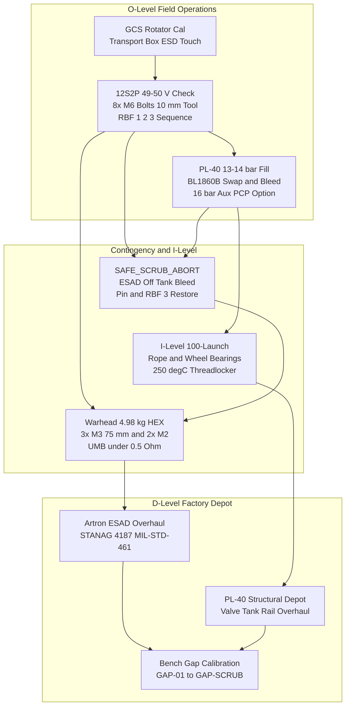

## 10. Maintenance & Sustainment Concepts (O/I/D Maintenance)

- **Document Date**: `2026-11-16`
- **System Baseline**: `Avenger5V25UasSystem` (`Avenger 5 V2.5 UAS` / `ASTK A5 V2.5` + `ELI Military Simulations PL-40 Rev 2.6` + `Artron ESAD AB00-0054-01AA-0005` + `SwarmC2`)
- **Authoritative SSOT Basis**: [.pipeline/schema.sysml](.pipeline/schema.sysml), [oem_bom.md](schema/extracted/oem_bom.md), [02_avenger5_operations_and_safety.md](schema/extracted/02_avenger5_operations_and_safety.md), [03_pl40_launcher_specifications.md](schema/extracted/03_pl40_launcher_specifications.md), [04_esad_excalibur_icd.md](schema/extracted/04_esad_excalibur_icd.md), and [parametric_limits.md](schema/extracted/parametric_limits.md)
- **Normative & Safety Standards**: `ISO/IEC/IEEE 29148:2018`, `ISO/IEC/IEEE 15288:2023`, `STANAG 4187`, `MIL-STD-461`, `UN 3481`, `ASTM F3269-17`, `MIL-STD-882E`, `JARUS SORA v2.5`

Maintenance and sustainment for `Avenger5V25UasSystem` follow a three-tier Organizational (`O-Level`), Intermediate (`I-Level`), and Depot (`D-Level`) model aligned with `ISO/IEC/IEEE 29148:2018` and `ISO/IEC/IEEE 15288:2023`. All sustainment procedures enforce the production system boundaries defined in `.pipeline/schema.sysml`:
1. **Strictly Mechanical Launch Interface (`IF-MECH-001`)**: Zero electrical conductors or CAN bus wires cross between the `ELI PL-40 Rev 2.6` pneumatic rail catapult (`BOM-LCH-001`) and the `Avenger V2.5` airframe (`BOM-AV-001`).
2. **Production Recovery Exclusion (`REQ_SC_03`)**: Production `Avenger V2.5` excludes recovery parachutes (`Recovery System: No`); the `2x 50.0 V` pyrotechnic recovery igniter lines (`BOM-AV-026`) from `EPS` (`BOM-AV-009`) remain disabled (`Optional RnD`).
3. **Software-Hosted Simplex RTA & Bridge Architecture**: Zero standalone RTA hardware enclosure exists; `ASTM F3269-17` Simplex RTA supervision runs in software on `Cube orange+` (`BOM-AV-010`), while `Artron ESAD` supervision runs on `RPI CM5004032` (`BOM-AV-011`).
4. **`12S2P` Electrical Baseline (`GAP-05`)**: Main DC power architecture is anchored exclusively to the `12S2P Li metal BEI` (`maximus20`, `BOM-AV-002`) `36.0-50.4 V` bus (`49.0-50.0 V` pre-flight pass), rejecting legacy `23.9-25.0 V` UI screenshots.

---

### 10.1 Three-Tier Sustainment Architecture & Grounded Support Equipment (GSE) Roster

Operational sustainment separates field pre-flight/turnaround/abort safety (`O-Level`), modular LRU diagnostics/calibration/mechanical interval servicing (`I-Level`), and factory structural/ordnance overhaul plus unprinted OEM gap bench closure (`D-Level`).

**Figure 10.1**: Three-Tier O-Level, I-Level, and D-Level Sustainment and `SAFE_SCRUB_ABORT` Escalation Flow.

#### Table 10.1: Grounded Ground Support Equipment (GSE) & Maintenance Tooling Baseline

| BOM / Tool ID | Support Equipment / Tool Item | Tier Allocation | Functional Role & Grounded Handling Constraint | SSOT Citation |
| :--- | :--- | :--- | :--- | :--- |
| `BOM-LCH-001` | `ELI Military Simulations PL-40 Rev 2.6` Pneumatic Rail Catapult | O-Level, I-Level, D-Level | Three-section modular launch rail with ground anchors and packed transport case (`IF-MECH-001` zero-wire launch; `PRM-PL40-001` through `PRM-PL40-013`) | `oem_bom.md` (`BOM-LCH-001`), `03_pl40_launcher_specifications.md#s1` |
| `BOM-LCH-002` | `PL-40` Carriage, Lever Lock-Pads, Safety Pin & Hardpoint Kits | O-Level, I-Level, D-Level | Aircraft carriage with prop-safe cradle, red safety pin interlock, and Option A/B/C hardpoints (`PRM-PL40-015` through `PRM-PL40-026`, `PRM-PL40-043`) | `oem_bom.md` (`BOM-LCH-002`), `03_pl40_launcher_specifications.md#s1-#s2` |
| `BOM-LCH-003` | `PL-40` Battery Compressor Unit & `DIN PCP` Aux Port | O-Level, D-Level | Portable compressor with auto-cutoff hysteresis, UVLO protection, condensate bleed point, and external aux fill port (`PRM-PL40-027` through `PRM-PL40-036`) | `oem_bom.md` (`BOM-LCH-003`), `03_pl40_launcher_specifications.md#s2` |
| `BOM-LCH-004` | `Makita BL1860B` Li-Ion Compressor Battery Packs (`UN 3481`) | O-Level, I-Level | Dual rechargeable battery packs powering `PL-40` compressor; field swap after first launch and every two launches (`PRM-PL40-032` through `PRM-PL40-041`) | `oem_bom.md` (`BOM-LCH-004`), `03_pl40_launcher_specifications.md#s2` |
| `BOM-LCH-005` | `PL-40` Main Outlet Valve `(4)` & Dual-Switch Firing Box | O-Level, D-Level | Mechanical outlet isolation valve and dual safety-cover simultaneous firing box (`PRM-PL40-037`, `REQ_SC_13`) | `oem_bom.md` (`BOM-LCH-005`), `03_pl40_launcher_specifications.md#s2` |
| `BOM-GCS-001` | `SwarmC2` Rugged `Windows 11` Tablet Console | O-Level, I-Level | Role-authenticated mission control, six-group pre-flight checklist, ESAD safing UI, and `ATAK`/`SitaWare HQ`/`DELTA` export (`PRM-GCS-002` through `PRM-GCS-010`) | `oem_bom.md` (`BOM-GCS-001`), `02_avenger5_operations_and_safety.md#s2-#s3` |
| `BOM-GCS-002` | Ground C2 Datalink Radio Box (`DTC` `FHSS`, `AES-256`) | O-Level, I-Level, D-Level | Ground RF transceiver maintaining mandatory UAV prep separation (`PRM-RF-001` through `PRM-RF-008`, `PRM-GCS-001`) | `oem_bom.md` (`BOM-GCS-002`), `02_avenger5_operations_and_safety.md#s2` |
| `BOM-GCS-003` | Directional Tracking Antenna Rotator | O-Level, I-Level | Ground azimuth tracker calibrated prior to touching UAV (`Auto Follow` and fine step tune, `PRM-RF-010`, `REQ_SC_15`) | `oem_bom.md` (`BOM-GCS-003`), `02_avenger5_operations_and_safety.md#s1-#s2` |
| `BOM-GCS-004` | `MARS` Directional Antenna & `OMNI` Ground Antenna | O-Level, I-Level | Dual ground antenna set (`OMNI` mandatory for ground prep and launch; selectable `OMNI` or `DIR` in flight, `PRM-RF-009`) | `oem_bom.md` (`BOM-GCS-004`), `02_avenger5_operations_and_safety.md#s2` |
| `BOM-GCS-005` | Optional Tactical Fiber Optic Spool | O-Level, I-Level | Optional armored tether between `SwarmC2` console and Ground Radio Box (`PRM-RF-012`) | `oem_bom.md` (`BOM-GCS-005`) |
| `BOM-GCS-006` | Transport Box `EARTH / GROUNDING POINT` | O-Level | Yellow electrostatic discharge point inside airframe transport box; touched before every component handling step (`REQ_SC_01`) | `oem_bom.md` (`BOM-GCS-006`), `02_avenger5_operations_and_safety.md#s1` |
| `TOOL-O-001` | Wing Bolt Spanner (`PRM-AF-018`) | O-Level, I-Level | Manual spanner used to tighten all eight wing mounting bolts including four front `M6` bolts (`PRM-AF-016`, `PRM-AF-017`) | `02_avenger5_operations_and_safety.md#s1`, `parametric_limits.md` |
| `TOOL-O-002` | Payload Terminal Hex Driver (`PRM-AF-015`) | O-Level, I-Level | Precision hex driver for fastening modular warhead payload leads to ESAD terminals | `oem_bom.md` (`BOM-ORD-004`), `02_avenger5_operations_and_safety.md#s1` |
| `TOOL-I-001` | Localized Bearing Heater & Threadlocker Kit (`PRM-PL40-044`) | I-Level | Thermal release and threadlocker application kit for `PL-40` carriage wheel bearing replacement interval (`PRM-PL40-043`) | `03_pl40_launcher_specifications.md#s2`, `parametric_limits.md` |
| `TOOL-I-002` | Milliohm Loop Tester, Mass Scale & `USB`/`ETH` Service Rig | I-Level, D-Level | Continuity verification for `J100` `UMB` loop (`PRM-ESAD-004`, `PRM-ESAD-005`), warhead holder mass check (`PRM-AF-010`), and External Interface Board (`BOM-AV-013`) service | `04_esad_excalibur_icd.md#s2`, `oem_bom.md` (`BOM-AV-013`, `BOM-ORD-002`, `BOM-ORD-004`) |

---

### 10.2 Organizational-Level (O-Level) Field Maintenance, Pre-Flight & `SAFE_SCRUB_ABORT`

O-Level sustainment covers all field preparation, handling interlocks, launcher pressurization, battery swapping, condensate bleeding, pre-flight BIT verification, launch execution, post-flight turnaround, and `SAFE_SCRUB_ABORT` hangfire recovery executed at the launch site by authorized `Pilot`, `Payload`, and `Launch Assistant` crew (`SwarmC2` role authentication with minimum `8`-character password; short initial factory password window replaced prior to operations).

#### 10.2.1 GCS Setup, Rotator Calibration & Transport Box ESD Equalization

1. **Documentation & Role Authorization Gate**: All O-Level personnel must hold current qualification across the `A5 User Manual`, `PL-40`, `Warhead`, `ESAD`, and `SwarmC2` manuals (`02_avenger5_operations_and_safety.md` Step 0).
2. **Ground RF Station & Rotator Calibration Before Touching UAV (`REQ_SC_15`)**:
   - Erect the Ground C2 Radio Box (`BOM-GCS-002`, `4.4-5.0 GHz`, `AES-256` `FHSS`, `2.0 W` RF), `OMNI` antenna (mandatory for ground prep and launch), and `MARS 23 dBi` directional antenna (`BOM-GCS-004`) mounted on the Directional Tracking Antenna Rotator (`BOM-GCS-003`), connecting the rugged `Windows 11` `SwarmC2` tablet (`BOM-GCS-001`) directly or through the optional `200.0 m` tactical fiber spool (`BOM-GCS-005`).
   - Maintain a strict `>= 10.0 m` physical separation (`PRM-GCS-001`) between the Ground Radio Box and the UAV assembly area during ground preparation.
   - **Calibrate the Directional Tracking Antenna Rotator (`Auto Follow` and `0.5 deg` CCW/CW fine tune step) BEFORE touching the UAV** (`02_avenger5_operations_and_safety.md` Step 2).
3. **Mandatory Transport Box ESD Touch (`REQ_SC_01`)**:
   - Touch the yellow `EARTH / GROUNDING POINT` inside the airframe Transport Box (`BOM-GCS-006`) immediately **before every component handling step** (`02_avenger5_operations_and_safety.md` Step 3) to equalize electrostatic potential prior to touching `Artron ESAD`, warhead terminals, avionics, or `12S2P` battery connectors.

#### 10.2.2 Airframe Assembly, `12S2P` `49.0-50.0 V` Pack Match & Ordered `RBF #1/#2/#3` Sequence

1. **Warhead Holder & Payload Hatch Check (`BOM-ORD-004`)**:
   - Following ESD equalization, verify `Warhead Holder` visual/mechanical readiness (`4.98 +/- 0.02 kg` tested unit mass within `<= 5.0 kg` max payload, CG CTQ `30.57 +/- 1.00`, overall `173.00`, `RED FACE TO TOUCH HOLDER` orientation), secure payload leads to ESAD via `1.5 mm` HEX terminals (`PRM-AF-015`), and lock the payload hatch (`02_avenger5_operations_and_safety.md` Step 4).
2. **`12S2P` Battery Inspection & `49.0-50.0 V` Match (`GAP-05`)**:
   - Inspect the removable `12S2P Li metal BEI` (`maximus20`, `BOM-AV-002`) battery pack for physical damage, swelling, or electrolyte leakage; any defect is an immediate **NO-GO**.
   - Confirm full pre-flight pack voltage within `49.0-50.0 V` (`PRM-AV-003`, `PRM-AV-004`) inside the `36.0-50.4 V` DC bus envelope (`PRM-AV-001`, `PRM-AV-002`). Legacy `23.9-25.0 V` screenshots are strictly rejected under `GAP-05` (`REQ_SAF_05`).
   - **Pack-to-Fuselage Identity Match**: Verify that the Battery ID and QR code match the target fuselage ID and QR code (`02_avenger5_operations_and_safety.md` Step 5), pre-connect the retention strap buckle, mate the main power connector and lock ring without sharp harness bends, and lock the battery hatch.
3. **Two-Person Lift, `8x M6 x 30 mm` Wing Assembly & `10 mm` Spanner Torque**:
   - With all Remove Before Flight (`RBF`) pins installed, a minimum of `2` persons (`PRM-AF-019`) lift the `17.0 kg` airframe without stressing wing panels or tail control surfaces and seat it onto the `PL-40` carriage (`145.0-155.5 mm` upper prop-safe zone, `02_avenger5_operations_and_safety.md` Step 6).
   - Rotate the `4` wing panels into position on their rear hinge bolts while routing the RF coax cable smoothly without pinching. Install the `4` front `M6 x 30 mm` (`6.0 mm` diameter, `30.0 mm` length) bolts and tighten all `8` wing bolts (`4` front + `4` rear) using a `10 mm` (`10.0 mm`) spanner (`PRM-AF-016` through `PRM-AF-018`, Step 7). Note under `GAP-SEPDIST` that numeric `M6` wrench torque is unprinted in OEM manuals and tracked as a D-Level calibration sign-off item.
   - Slide the `4` identical X-tail stabilisers over their ruddervator control horns and finger-tighten captive screws.
4. **Folding Pusher Prop & Ordered `RBF #1` -> `RBF #2` -> `RBF #3` & Lid Locks (`GAP-06`)**:
   - **Propeller & `RBF #1`**: Manually fold BOTH blades of the rear `Folding Pusher Propeller` (`BOM-AV-008`) rearward toward the tail prior to power-up (prevents carriage/trolley strike hazard). Remove `RBF #1` (`BOM-AV-025`: pitot cover, optical sensor cover, and `Nighthawk2UZ` gimbal transit strap; Step 8).
   - **`RBF #2` & Lid Locks**: While supporting the airframe, pull `UAV POWER R.B.F.` (`RBF #2`, `XT60E-F` connector housing, `BOM-AV-005`) to energize the main `36.0-50.4 V` DC bus (`Power Meter`, `200.0 A` fuse, `EPS`, `Cube orange+`, `RPI CM5004032`, `Artron ESAD`). Immediately **close and lock BOTH the RBF lid and the umbilical / External Interface Board lid (`BOM-AV-013`)** (`02_avenger5_operations_and_safety.md` Step 9).
   - **Pre-Flight Diagnostics**: Confirm `SwarmC2` telemetry acquisition within `2.0 min` (`PRM-GCS-002`), validate all `6` `SwarmC2` checklist groups (`Catapult`, `Mission & parameters`, `Preparation & mounting`, `System checks`, `Video Checks`, `Warhead and Safety`), verify `CUAV SKYE2` pitot calm-air (`< 3.0 m/s`) and indirect airflow (`> 10.0 m/s`) response, verify dual `mRo RM3100` magnetometers and `8x HV6160-DroneCAN` surface sweep, and verify `Artron ESAD` Power-On Built-In Test (`PBIT`) confirms internal high voltage `< 50.0 V` (`PRM-ESAD-029`).
   - **`RBF #3` Power-Before-Pull Gate (`REQ_SC_09`, `REQ_SAF_06`)**: Keep `ESAD R.B.F. Key` (`RBF #3`, `BOM-ORD-002`) installed throughout power-on and BIT; removing `RBF #3` before power-on triggers an immediate latched ESAD fault (`GAP-06`). Remove `RBF #3` **ONLY** when prompted by `SwarmC2` after all `8` preconditions pass, and wait for `ESAD: Ready to Fly` (`02_avenger5_operations_and_safety.md` Step 11).

#### 10.2.3 `PL-40` Compressor `13.0-14.0 bar`, Makita `BL1860B` Swap, Condensate Bleed & `16.0 bar` Aux PCP

1. **Launcher Mechanical & Environmental Prep**:
   - Deploy the `5.0 m` (`4938.0 mm` CAD) 3-section `PL-40` rail (`1.28 m` packed, `12.0 deg` elevation, `602.0 mm` front leg span, `1116.0 mm` rail top height, `5.0 min` nominal assembly) within `-20.0 to +50.0 degC`. Drive ground anchors, confirm all fasteners and carriage lever lock-pads are tight (loose lock-pads cause piston over-acceleration and internal inlet-air valve abort), confirm the red carriage safety pin is seated, and verify Main Outlet Valve `(4)` is closed.
2. **Pneumatic Pressurization (`13.0-14.0 bar`) & `GAP-03` Launch Margin Gate**:
   - Pressurize the `PL-40` air tank from the `25.0 kg` Battery Compressor Unit (`BOM-LCH-003`) to `13.0-14.0 bar` (`14.0 bar` auto-cutoff with `0.05 bar` regulation hysteresis, `<= 8.0 min` fill time). Confirm by manual gauge inspection (`02_avenger5_operations_and_safety.md` Step 1, `SwarmC2` `Catapult` checklist).
   - Under `GAP-03` (`REQ_SC_14`, `REQ_SAF_03`), Avenger 5 (`17.0 kg` MTOW) at `13.0-14.0 bar` achieves `~22.7-23.5 m/s` (`~23.0 m/s` nominal) rail exit speed, safely below the `25.0 m/s` launcher structural cap (`PRM-PL40-002`; lighter `< 15.0 kg` airframes at `14.0 bar` reach `25.3 m/s` over-speed). Because `~23.0 m/s` is below `24.0-26.0 m/s` stall speed without thrust/headwind, O-Level Go/No-Go requires verified pusher motor readiness and ground headwind `<= 12.0 m/s` (`PRM-PERF-016`).
3. **`Makita BL1860B` Pack Swap Cadence & `<= 14.5 V` UVLO Protection**:
   - The compressor uses `2x Makita BL1860B` `18.0 V` `6000 mAh` Li-Ion packs (`UN 3481`, `BOM-LCH-004`).
   - **Mandatory Swap Rule**: Swap compressor battery packs **after the 1st launch and every 2 launches thereafter** (`03_pl40_launcher_specifications.md#s2`).
   - **Under-Voltage Lockout (`<= 14.5 V`)**: If pack voltage drops to `<= 14.5 V` during pressurization (`PRM-PL40-034`), the compressor cuts OFF automatically with a flashing `PWR` LED (`Pl40LauncherState::UvloPause`). Install freshly charged packs (`> 16.0 V`) and wait at least `5.0 s` (`PRM-PL40-036`) before restarting. Recharge depleted `BL1860B` packs strictly within the `+10.0 to +40.0 degC` ambient window (`PRM-PL40-040`, `PRM-PL40-041`).
4. **Condensate Bleed & `16.0 bar` Aux PCP Contingency**:
   - **Condensate Bleed**: Perform O-level pneumatic moisture/condensate bleed during compressor cooldown, post-sortie tank depressurization, and wet/humid deployment turnarounds to prevent moisture accumulation in the pressure cylinder, Main Valve `(4)`, and internal over-acceleration valve. Unprinted tank volume (`L`) and relief valve cracking pressure (`bar`) are tracked under `GAP-ENV` (`REQ_SAF_11`).
   - **External Auxiliary Fill (`16.0 bar` PCP)**: When onboard compressor batteries are unavailable or depleted in field operations, connect an external compressed-air source to the `DIN 8 mm PCP` auxiliary fill port rated up to `16.0 bar` (`PRM-PL40-031`), regulating the launch tank to the `13.0-14.0 bar` Avenger 5 band before sealing the fill line.
5. **Firing Interlock & Post-Flight Turnaround**:
   - Evacuate all personnel behind the rear anchor (`SAFETY AREA`; forward and lateral zones are `DANGER ZONE`). Pull the red carriage safety pin, open Main Outlet Valve `(4)`, flip both firing-box safety covers, and hold BOTH trigger switches simultaneously for `>= 2.0 s` (`PRM-PL40-037`) until the UAV clears the rail. Note that pressing the trigger switches while the red carriage pin remains installed forces a full reset.
   - For non-expended training recoveries or aborted flights, execute safe disarm (`< 50.0 V` ESAD confirmed), reinstall `RBF #3` before reinserting `RBF #2` (`XT60E-F`), remove/inspect the `12S2P` pack, refit `RBF #1` covers and gimbal strap, close Main Valve `(4)`, bleed tank pressure and condensate, and swap `BL1860B` packs per cadence.

#### 10.2.4 `SAFE_SCRUB_ABORT` Hangfire & Post-`RBF #3` Safing Protocol (`GAP-SCRUB`)

Whenever a launch must be scrubbed after `RBF #3` removal or Main Valve `(4)` opening, or upon any `PL-40` hangfire, `<= 14.5 V` compressor UVLO, trigger-with-pin reset fault, or `Artron ESAD` fault lockout, O-Level crew execute `SAFE_SCRUB_ABORT` (`REQ_SC_16`, `REQ_SAF_12`, `Pl40LauncherState::ScrubbedSafeDepressurized`) strictly in the ordered sequence of Table 10.2.

#### Table 10.2: `SAFE_SCRUB_ABORT` Mandatory Disarm & Depressurization Sequence

| Step | Actor / Performer | Mandatory Action | Verification & Safe Exit Gate | SSOT Citation |
| :--- | :--- | :--- | :--- | :--- |
| 1 | Launch Crew (`SAFETY AREA`) | Hold position in rear `SAFETY AREA` across calibrated hangfire standoff wait window (`GAP-SCRUB`) | Zero crew entry into forward or lateral `DANGER ZONE` until standoff wait expires and command team clears approach | `03_pl40_launcher_specifications.md#s2`, `parametric_limits.md` (`GAP-SCRUB`) |
| 2 | `Payload` / `Pilot` (`SwarmC2`) | Hold `ABORT` or `SELF DESTRUCT` button (`PRM-GCS-010`) + `Slide to confirm`, or command irreversible `Power Off ESAD` | ESAD transitions to `DetonatedOrAborted` / `SafePowerOff`; internal capacitor HV confirmed below safe ceiling (`PRM-ESAD-029`) | `02_avenger5_operations_and_safety.md#s3`, `.pipeline/schema.sysml` (`REQ_SC_16`) |
| 3 | `Launch Assistant` (`PL-40`) | Close Main Outlet Valve `(4)` and depressurize/bleed pneumatic air tank plus condensate drain to zero gauge pressure | Tank gauge reads zero stored pneumatic pressure (`ScrubbedSafeDepressurized` state) | `03_pl40_launcher_specifications.md#s2`, `.pipeline/schema.sysml` (`Pl40LauncherState`) |
| 4 | `Launch Assistant` (`PL-40`) | Reinstall red carriage safety pin into `PL-40` carriage prior to touching airframe | Carriage physically locked against forward travel | `03_pl40_launcher_specifications.md#s2`, `.pipeline/schema.sysml` (`REQ_SC_16`) |
| 5 | `Launch Assistant` (UAV) | Touch Transport Box `EARTH / GROUNDING POINT` (`BOM-GCS-006`); reinstall `ESAD R.B.F. #3` (`BOM-ORD-002`) into `J100` `UMB` loop **before** reinserting `UAV Power R.B.F. #2` (`XT60E-F`, `BOM-AV-005`) | `UMB` shorting jumper verified seated prior to main `12S2P` disconnect (`GAP-06` inverse safe order) | `02_avenger5_operations_and_safety.md#s1`, `parametric_limits.md` (`GAP-06`, `GAP-SCRUB`) |
| 6 | `Launch Assistant` (UAV) | Close and lock BOTH RBF and umbilical lids; refit `RBF #1` pitot/sensor covers and gimbal strap (`BOM-AV-025`); conduct two-person airframe removal (`PRM-AF-019`) | Airframe secured in `UavFlightLifecycleState::SafePostFlightShutdown` for `I-Level` fault inspection | `02_avenger5_operations_and_safety.md#s1`, `.pipeline/schema.sysml` (`UavFlightLifecycleState`) |

---

### 10.3 Intermediate-Level (I-Level) Calibration, Mechanical Overhaul & Modular LRU Replacement

I-Level sustainment is conducted by trained maintenance technicians at forward or unit support workshops equipped with dimensional gauges, milliohm meters, localized thermal bearing tools, and `USB`/`ETH` diagnostic interfaces (`BOM-AV-013`).

#### 10.3.1 `PL-40` `100`-Launch Rope & Wheel Bearing Servicing (`250.0 degC` Threadlocker)

1. **`100`-Launch Preventive Interval (`PRM-PL40-043`)**: Every `100` launches, remove the `PL-40` pulling rope and carriage assembly (`BOM-LCH-002`) for mandatory preventive replacement of the pulling rope and all carriage wheel bearings (`03_pl40_launcher_specifications.md#s2`).
2. **`250.0 degC` Threadlocker Heat Removal (`PRM-PL40-044`)**: Apply controlled localized heat at `250.0 degC` to release factory threadlocker securing the carriage wheel bearing fasteners; extract worn bearings without scoring the carriage alloy frame (`271.0 mm` x `232.5 mm`, `156.0 mm` outer / `140.0 mm` inner width), clean threads, install replacement bearings with specified threadlocker, and verify smooth rail tracking across all three `5.0 m` rail sections (`145.0-155.5 mm` upper prop-safe zone).
3. **Hardpoint & Lock-Pad Inspection**: Inspect carriage lever lock-pads for wear or compression set (preventing piston over-acceleration aborts) and verify/replace airframe launch hardpoints across Option A (`6061-T6` split hooks `0.004 kg`, `178/186/206 mm`), Option B (`225.0 mm` single bar), or Option C (`AISI 304` `M8` mushroom pins, `320.0 mm` span).

#### 10.3.2 `Warhead Holder` Verification (`4.98 +/- 0.02 kg`, `1.5 mm` HEX, `3x M3` `75 mm` BCD, `2x M2`) & `UMB < 0.5 Ohm` Continuity

1. **`Warhead Holder` Mechanical & Mass Verification (`BOM-ORD-004`)**:
   - Confirm warhead/holder assembly mass lies within `4.98 +/- 0.02 kg` (`4980 +/- 20 g`, `PRM-AF-010`, `PRM-AF-011`) and never exceeds the `5.0 kg` lethal package ceiling (`PRM-AF-009`), keeping integrated UAV MTOW at or below `17.0 kg` (`PRM-AF-008`).
   - Verify CG CTQ datum `30.57 +/- 1.00` (`PRM-AF-012`, `PRM-AF-013`) and overall CTQ `173.00` (`PRM-AF-014`), confirm `RED FACE TO TOUCH HOLDER` alignment, and inspect ESAD payload terminal clamping using the `1.5 mm` HEX driver (`PRM-AF-015`).
2. **`Artron ESAD` & `Sensor Board` Mounting & Harness Inspection (`BOM-ORD-001`, `BOM-ORD-003`, `BOM-ORD-005`)**:
   - Verify `Artron ESAD` board mounting security at the `3x M3` (`3.0 mm`, `PRM-ESAD-035`) user mounting holes arranged on a `75.0 mm` (`75 mm`, `PRM-ESAD-036`) Bolt Circle Diameter (BCD); the `3` larger vendor-reserved holes must remain undisturbed at I-Level (`04_esad_excalibur_icd.md#s1`). Note `M3` fastener torque is tracked under `GAP-SEPDIST`.
   - Verify `ESAD Sensor Board` (combined proximity + impact ORed `IRQ_L -> IR_ESAD_L`) mounting at its `2x M2` (`2.0 mm`, `PRM-ESAD-037`) mounting holes and inspect the `28 AWG` `J102` (Harwin `G125-2241096F1` 10-pin epoxy-potted) to `J1` (Molex `501330-0800` 8-pin) harness (`5.0 V` `VOUT`, `DIST_COMM1/2` UART, `IRQ_L`) plus the `J401` custom 8-pin HV output harness (pins 4 and 8 removed, `0.0-1800.0 V` firing circuit).
3. **`J100` `UMB < 0.5 Ohm` Continuity Loop Verification (`BOM-ORD-002`, `REQ_SC_10`)**:
   - Verify `ESAD R.B.F. Key` (`RBF #3`) continuity loop resistance across `J100` (Harwin `G125-2241696F1` 16-pin, `22-28 AWG`, crimps `G125-0020005`) `UMB` / `UMB_RTN` terminals is strictly `< 0.5 Ohm` (`PRM-ESAD-004`) tested at `20.0 mA` sense current (`PRM-ESAD-005`, `04_esad_excalibur_icd.md#s2`). Replace worn `RBF #3` jumpers or damaged `J100` crimps before returning the airframe to flight readiness.

#### 10.3.3 Avionics, Power Bus, Propulsion & Sensor LRU Replacement & Calibration

1. **Main Power Bus & `EPS` Rail Health (`BOM-AV-003` through `BOM-AV-009`)**:
   - Inspect/replace the `200.0 A` automotive inline fuse (`PRM-AV-005`), `Power Meter` (`BOM-AV-004`), and `970.0 cm` trunk power/CAN harness (`PRM-AV-012`).
   - Verify `EPS` (`BOM-AV-009`) regulated outputs under load: `8.0 V` servo rail (`PRM-AV-006`), `12.0 V` radio rail within `8.0-17.0 V` DTC tolerance (`PRM-AV-007` through `PRM-AV-009`), and `14.0 V` ESAD `GE_POW` rail (`PRM-AV-010`). Under `GAP-01` (`REQ_SAF_01`), because `14.0 V` equals the `Artron ESAD` minimum `14.0 V` `VDC_IN` (`PRM-ESAD-001`) with zero cable-drop margin, I-Level harness checks must verify negligible IR drop across the `EPS` to `J100` `VDC_IN` path. Confirm optional `2x 50.0 V` RnD recovery igniter outputs (`BOM-AV-026`) remain disconnected/inhibited (`REQ_SC_03`).
2. **Propulsion, DroneCAN Actuation & Air-Data LRUs (`BOM-AV-006` through `BOM-AV-020`)**:
   - Swap modular `IBEX160` ESC, `AXI 5345/16 HD GOLD LINE V3` BLDC motor, folding pusher propeller, `4x HV6160-DroneCAN` tail ruddervator servos (`CAN 1` via `4x 120.0 cm` stubs), and `4x HV6160-DroneCAN` wing servos (`CAN 2` daisy-chain via `CAN/power splitter PCB`).
   - Verify `CUAV SKYE2` heated pitot water drainage and bench airflow calibration (`<= 3.0 m/s` calm air `PRM-AV-017`, `>= 10.0 m/s` indirect airflow `PRM-AV-018`, `REQ_SC_07`), dual `mRo RM3100` magnetometer/barometer health on `CAN 2`, and `Septentrio Asterx-m3 pro` + `Talysman TW3972EXF` RF coax continuity.
3. **Compute, Seeker & C2 LRUs (`BOM-AV-010` through `BOM-AV-024`, `BOM-GCS-001` through `BOM-GCS-005`)**:
   - Service `Cube orange+` (`BOM-AV-010`, including `ASTM F3269-17` Simplex RTA configuration parameters) and internal Ethernet switch (`BOM-AV-012`) through the External Interface Board `USB`/`ETH` port (`BOM-AV-013`), verifying the umbilical lid lock afterward.
   - Verify `RPI CM5004032` (`BOM-AV-011`) `115200 bps` `8N1` `100.0 Hz` (`0.01 s`) `RS-485` ESAD supervision link (`<= 5.0 ms` reply, `<= 10.0 ms` incomplete frame timeout, `CRC-16 XModem`, `DSC_IN1` `1000.0 Hz` `2`-pulse discrete output `2.5-3.3 V` high / `0.0-0.7 V` low, `REQ_SC_08`).
   - Bench-verify `Nighthawk2UZ` gimbal travel (`-45.0 to +135.0 deg` pitch, `-165.0 to +165.0 deg` yaw/roll, `1280x720` Day/Thermal, `X40` zoom), `Trip6` HDMI/ETH tracker link, `DTC 4.4-5.0 GHz` air/ground radio RF output (`2.0 W` / `2x 1.0 W`), `MPSL4400` and `MARS 23 dBi` / `OMNI` antenna paths, and `SwarmC2` tablet role password hygiene.

---

### 10.4 Depot-Level (D-Level) Factory Overhaul, Recertification & Gap Calibration (`GAP-01` through `GAP-SCRUB`)

D-Level sustainment encompasses factory/OEM overhaul of safety-critical ordnance, pneumatic launch hardware, structural composite airframe repairs, and engineering bench calibration closing all `12` OEM gaps (`parametric_limits.md` Section 2).

#### 10.4.1 `Artron ESAD` (`AB00-0054-01AA-0005`) Factory Depot Overhaul

1. **Ordnance Enclosure & Vendor-Reserved Hardware**: Opening the sealed drone bay for internal ESAD overhaul, accessing the `3` vendor-reserved larger PCB mounting holes (`04_esad_excalibur_icd.md#s1`), or servicing the epoxy-potted `J102` back shell is restricted exclusively to D-Level OEM / certified ordnance depot technicians.
2. **FPGA/CPLD Firmware & Safety Barrier Recertification**:
   - Audit FPGA and CPLD version telemetry via the ESAD serial maintenance interface (no unit-level hex opcodes exposed in Level 1B ConOps; framing governed by `ICD_AB00-0054-01AA-0005`).
   - Re-verify `STANAG 4187` independent safety barriers on automated test equipment: inertial `SS1` launch acceleration sensing (`0.0039 g/LSB` 13-bit signed calibration), `SS2` safe-separation `FlightTimer` (`1.0 s/LSB`) and `Safe Distance Exceed` latch (`GAP-07`), `DSC_IN1` `1000.0 Hz` `2`-pulse arm enable gating (confirming Fault bit 4 lockout if pulses arrive prior to `Arm Stage 2`), `0.0-1800.0 V` HV capacitor charge/discharge curve (`1.0 V/LSB` telemetry, `< 50.0 V` `PBIT` safe ceiling), and `J401` dielectric/insulation integrity.
   - Re-certify `MIL-STD-461` EMI/EMC shielding compliance following any PCB, harness, or enclosure rework.

#### 10.4.2 `ELI Military Simulations PL-40 Rev 2.6` & Airframe Factory Overhaul

1. **`PL-40` Pneumatic & Structural Overhaul (`BOM-LCH-001` through `BOM-LCH-005`)**:
   - Perform D-Level pressure-vessel inspection and hydrostatic proof testing of the `PL-40` air tank, rebuild of Main Outlet Valve `(4)`, overhaul of the internal piston over-acceleration shut-off valve, recalibration of the `14.0 bar` (`0.05 bar` hysteresis) compressor auto-cutoff regulator and `DIN 8 mm PCP` (`16.0 bar`) external fill assembly, and bench verification of the `14.5 V` UVLO (`> 16.0 V` after `5.0 s` restart) power control board.
   - Straightness, rail-joint datum, and elevation (`12.0 deg`) overhaul of the `5.0 m` (`4938.0 mm`) 3-section rail and carriage assembly (`68.0 kg` total set mass).
2. **Airframe & Avionics Depot Overhaul**:
   - Structural X-wing composite fuselage repair (`1.8 m` / `1803.0 mm` span, `1.6 m` / `1576.0 mm` length, `1.1 m` / `1095.0-1112.0 mm` height, `80.0 m/s` VNE envelope), `Cube orange+` / `RPI CM5004032` environmental stress screening (`-20.0 to +50.0 degC`), `Nighthawk2UZ` optical/gimbal alignment, and `DTC 4.4-5.0 GHz` RF power (`2.0 W`) and `AES-256` key zeroization/re-keying.

#### 10.4.3 Depot Bench Calibration Closure of OEM Engineering Gaps (`GAP-01` through `GAP-SCRUB`)

D-Level depot engineering maintains and closes the `12` unresolved or conflicting OEM parameters identified in `parametric_limits.md` Section 2 (`REQ_SAF_01` through `REQ_SAF_12`) before clearing revised hardware/firmware configurations to O-Level units (summarized in Table 10.5).

---

### 10.5 Quantitative Maintenance, GSE & Bench Calibration Parameters

All quantitative limits, intervals, dimensions, electrical ratings, and calibration datums governing O/I/D maintenance and GSE support are isolated in Table 10.3 with strictly separated `Value` and `Units` columns (`Check 26` compliance).

#### Table 10.3: Quantitative Maintenance, GSE & Bench Calibration Parameters

| Param ID | Subsystem / Scope | Parameter Name | Constraint / Condition | Value | Units | Tier | SSOT Citation |
| :--- | :--- | :--- | :--- | :--- | :--- | :--- | :--- |
| `PRM-AF-008` | Airframe | Maximum Takeoff Weight (MTOW) | Upper authorized airframe mass bound | 17.0 | kg | O, I, D | `parametric_limits.md` |
| `PRM-AF-009` | Payload | Max Lethal Package / Warhead Mass | Maximum authorized warhead mass | 5.0 | kg | O, I, D | `parametric_limits.md` |
| `PRM-AF-010` | Payload | Warhead Holder Tested Mass (Nominal) | Nominal tested holder assembly mass | 4.98 | kg | O, I | `parametric_limits.md` |
| `PRM-AF-011` | Payload | Warhead Holder Tested Mass Tolerance | Symmetric plus-or-minus tolerance | 0.02 | kg | O, I | `parametric_limits.md` |
| `PRM-AF-012` | Payload | Warhead CG CTQ Nominal | Payload CG CTQ datum (`GAP-SEPDIST` OEM unit unprinted) | 30.57 | Dimensionless | I, D | `parametric_limits.md` |
| `PRM-AF-013` | Payload | Warhead CG CTQ Tolerance | Symmetric plus-or-minus CG CTQ tolerance (`GAP-SEPDIST` OEM unit unprinted) | 1.00 | Dimensionless | I, D | `parametric_limits.md` |
| `PRM-AF-014` | Payload | Warhead Overall CTQ Dimension | Overall payload CTQ datum (`GAP-SEPDIST` OEM unit unprinted) | 173.00 | Dimensionless | I, D | `parametric_limits.md` |
| `PRM-AF-015` | Payload | ESAD Payload Terminal Hex Tool Size | Precision hex driver for payload-to-ESAD terminals | 1.5 | mm | O, I | `parametric_limits.md` |
| `PRM-AF-016` | Airframe | Front Wing Bolt Diameter (M6) | Thread diameter of four front wing bolts | 6.0 | mm | O, I | `parametric_limits.md` |
| `PRM-AF-017` | Airframe | Front Wing Bolt Length | Length of four front wing mounting bolts | 30.0 | mm | O, I | `parametric_limits.md` |
| `PRM-AF-018` | Airframe | Wing Bolt Spanner Size | Wrench size across all eight wing bolts | 10.0 | mm | O, I | `parametric_limits.md` |
| `PRM-AF-019` | Ground Handling | Airframe Lift Crew Minimum | Minimum crew count (`2` persons) lifting airframe onto `PL-40` carriage | 2 | count | O | `parametric_limits.md` |
| `PRM-PERF-016` | Performance | Ground Wind Tolerance Max | Maximum ground / launch wind tolerance | 12.0 | m/s | O, D | `parametric_limits.md` |
| `PRM-PERF-018` | Performance | Operating Temperature Min | Minimum ambient operating temperature for UAS (Normalized Kelvin scalar T / 1.0 K; OEM: `-20.0 degC`) | 253.15 | Dimensionless | O, D | `parametric_limits.md` |
| `PRM-PERF-019` | Performance | Operating Temperature Max | Maximum ambient operating temperature for UAS (Normalized Kelvin scalar T / 1.0 K; OEM: `50.0 degC`) | 323.15 | Dimensionless | O, D | `parametric_limits.md` |
| `PRM-AV-001` | Power Bus | Main Battery Bus Voltage Min | Minimum `12S2P` Li metal DC bus operating floor | 36.0 | V | O, I, D | `parametric_limits.md` |
| `PRM-AV-002` | Power Bus | Main Battery Bus Voltage Max | Maximum `12S2P` Li metal DC bus voltage | 50.4 | V | O, I, D | `parametric_limits.md` |
| `PRM-AV-003` | Power Bus | Pre-Flight Battery Voltage Min | Minimum `12S2P` pack pre-flight pass voltage (`GAP-05`) | 49.0 | V | O | `parametric_limits.md` |
| `PRM-AV-004` | Power Bus | Pre-Flight Battery Voltage Nominal Max | Nominal full `12S2P` pre-flight pack voltage (`GAP-05`) | 50.0 | V | O | `parametric_limits.md` |
| `PRM-AV-005` | Power Bus | Main Automotive Fuse Rating | Inline overcurrent fuse rating ahead of Power Meter | 200.0 | A | I, D | `parametric_limits.md` |
| `PRM-AV-006` | Power Bus | EPS Servo Rail Voltage | Regulated EPS supply to eight `HV6160` actuators | 8.0 | V | I, D | `parametric_limits.md` |
| `PRM-AV-007` | Power Bus | EPS C2 Radio Rail Voltage | Regulated EPS supply to onboard `DTC` radio | 12.0 | V | I, D | `parametric_limits.md` |
| `PRM-AV-008` | Power Bus | DTC Radio Supply Tolerance Min | Minimum allowed input voltage at `DTC` radio | 8.0 | V | I, D | `parametric_limits.md` |
| `PRM-AV-009` | Power Bus | DTC Radio Supply Tolerance Max | Maximum allowed input voltage at `DTC` radio | 17.0 | V | I, D | `parametric_limits.md` |
| `PRM-AV-010` | Power Bus | EPS ESAD Rail Voltage | Regulated EPS output to ESAD (`GAP-01` zero margin) | 14.0 | V | I, D | `parametric_limits.md` |
| `PRM-AV-011` | Power Bus | EPS RnD Recovery Igniter Rail Voltage | Inhibited on production V2.5 (`Optional RnD` only) | 50.0 | V | I, D | `parametric_limits.md` |
| `PRM-AV-012` | Harness | Power and CAN 1 Trunk Harness Length | Fuselage trunk wire length to `EPS` | 970.0 | cm | I, D | `parametric_limits.md` |
| `PRM-AV-013` | Harness | Tail Fin Servo CAN 1 Stub Length | Length per each of four tail fin `CAN 1` stubs | 120.0 | cm | I, D | `parametric_limits.md` |
| `PRM-AV-017` | Sensors | Pitot Calm-Air Indicated Airspeed Max | Upper bound for stationary calm-air pre-flight check | 3.0 | m/s | O, I | `parametric_limits.md` |
| `PRM-AV-018` | Sensors | Pitot Airflow Check Indicated Airspeed Min | Lower bound for indirect blowing pre-flight check | 10.0 | m/s | O, I | `parametric_limits.md` |
| `PRM-GCS-001` | Ground Safety | Minimum Ground Radio / Crew Separation | Minimum distance from Ground Radio Box to UAV during prep | 10.0 | m | O | `parametric_limits.md` |
| `PRM-GCS-002` | GCS | Telemetry Detection Timeout on Power-On | Maximum wait for telemetry acquisition after `RBF #2` pull | 2.0 | min | O | `parametric_limits.md` |
| `PRM-GCS-009` | GCS | Operator Password Minimum Character Count | Minimum `SwarmC2` role authentication password character count (OEM: `8 chars`) | 8 | count | O, I | `parametric_limits.md` |
| `PRM-GCS-010` | GCS / ESAD | ESAD Self-Destruct / Abort Hold Min | Minimum button hold prior to `Slide to confirm` | 5.0 | s | O | `parametric_limits.md` |
| `PRM-RF-010` | Datalink | Rotator Fine Step Increment | Manual CCW/CW fine azimuth step during calibration | 0.5 | deg | O, I | `parametric_limits.md` |
| `PRM-RF-012` | Datalink | Optional Fiber Optic Ground Spool Length | Optional GCS-to-Radio Box fiber tether spool | 200.0 | m | O, I | `parametric_limits.md` |
| `PRM-PL40-001` | Launcher | Max Supported Aircraft MTOW | Structural maximum UAV mass rated on `PL-40` | 30.0 | kg | O, D | `parametric_limits.md` |
| `PRM-PL40-002` | Launcher | Max Allowed Launch Exit Velocity | Hard carriage exit speed ceiling (`GAP-03`) | 25.0 | m/s | O, D | `parametric_limits.md` |
| `PRM-PL40-003` | Launcher | Avenger 5 Interpolated Exit Velocity | Approximate exit velocity at MTOW and operating pressure (`GAP-03`) | 23.0 | m/s | O, D | `parametric_limits.md` |
| `PRM-PL40-004` | Launcher | Avenger 5 Interpolated Exit Lower Bound | Lower interpolated rail exit speed at MTOW and operating pressure | 22.7 | m/s | O, D | `parametric_limits.md` |
| `PRM-PL40-005` | Launcher | Avenger 5 Interpolated Exit Upper Bound | Upper interpolated rail exit speed at MTOW and operating pressure | 23.5 | m/s | O, D | `parametric_limits.md` |
| `PRM-PL40-006` | Launcher | Rail Elevation Angle | Fixed deployed catapult inclination angle | 12.0 | deg | O, D | `parametric_limits.md` |
| `PRM-PL40-007` | Launcher | Assembled Rail Length Nominal | Nominal three-section deployed rail length | 5.0 | m | O, I, D | `parametric_limits.md` |
| `PRM-PL40-008` | Launcher | Ground-Projected CAD Rail Envelope | Ground-projected assembled CAD envelope | 4938.0 | mm | O, D | `parametric_limits.md` |
| `PRM-PL40-009` | Launcher | Disassembled Rail Section Length | Transport length of packed rail section | 1.28 | m | O | `parametric_limits.md` |
| `PRM-PL40-010` | Launcher | Deployed Front Leg Lateral Span | Lateral span across deployed front anchors/legs | 602.0 | mm | O, D | `parametric_limits.md` |
| `PRM-PL40-011` | Launcher | Deployed Rail Top Height | Deployed rail top height above ground | 1116.0 | mm | O, D | `parametric_limits.md` |
| `PRM-PL40-012` | Launcher | Total Launcher System Set Mass | Combined mass of launcher case plus compressor unit | 68.0 | kg | O, D | `parametric_limits.md` |
| `PRM-PL40-013` | Launcher | Launcher Transport Case Mass | Packed launcher rail case mass | 43.0 | kg | O | `parametric_limits.md` |
| `PRM-PL40-014` | Launcher | Compressor Unit Mass | Portable pneumatic compressor unit mass | 25.0 | kg | O | `parametric_limits.md` |
| `PRM-PL40-015` | Launcher | Carriage Overall Length | Launch carriage longitudinal length | 271.0 | mm | I, D | `parametric_limits.md` |
| `PRM-PL40-016` | Launcher | Carriage Overall Height | Launch carriage vertical height | 232.5 | mm | I, D | `parametric_limits.md` |
| `PRM-PL40-018` | Launcher | Carriage Outer Width | Launch carriage outer frame width | 156.0 | mm | I, D | `parametric_limits.md` |
| `PRM-PL40-019` | Launcher | Carriage Inner Width | Launch carriage inner fuselage cradle width | 140.0 | mm | I, D | `parametric_limits.md` |
| `PRM-PL40-020` | Launcher | Carriage Prop-Safe Upper Zone Min | Lower vertical bound of upper prop-safe zone | 145.0 | mm | O, I | `parametric_limits.md` |
| `PRM-PL40-021` | Launcher | Carriage Prop-Safe Upper Zone Max | Upper vertical bound of upper prop-safe zone | 155.5 | mm | O, I | `parametric_limits.md` |
| `PRM-PL40-024` | Launcher | Hardpoint Option A Split Hook Mass | Aluminum `6061-T6` split hook unit mass | 0.004 | kg | I | `parametric_limits.md` |
| `PRM-PL40-025` | Launcher | Hardpoint Option B Single Bar Span | Single bar hardpoint width | 225.0 | mm | I | `parametric_limits.md` |
| `PRM-PL40-026` | Launcher | Hardpoint Option C M8 Mushroom Pin Span | `AISI 304` mushroom pin span | 320.0 | mm | I | `parametric_limits.md` |
| `PRM-PL40-027` | Launcher | Avenger 5 Operating Pressure Min | Nominal lower bound for Avenger 5 launch pressure (Normalized pressure ratio P / 100 kPa; OEM: `13.0 bar`) | 13.0 | ratio | O, D | `parametric_limits.md` |
| `PRM-PL40-028` | Launcher | Onboard Max Working Pressure / Auto-Cutoff | Compressor automatic cutoff and Avenger 5 launch upper bound (Normalized pressure ratio P / 100 kPa; OEM: `14.0 bar`) | 14.0 | ratio | O, D | `parametric_limits.md` |
| `PRM-PL40-029` | Launcher | Pressure Regulation Hysteresis | Automatic cutoff regulation hysteresis band (Normalized pressure ratio P / 100 kPa; OEM: `0.05 bar`) | 0.05 | ratio | O, D | `parametric_limits.md` |
| `PRM-PL40-030` | Launcher | Onboard Compressor Charge Time Max | Maximum pneumatic tank fill duration | 8.0 | min | O | `parametric_limits.md` |
| `PRM-PL40-031` | Launcher | External Auxiliary Fill Port Max Pressure | `DIN PCP` external auxiliary fill ceiling (Normalized pressure ratio P / 100 kPa; OEM: `16.0 bar`) | 16.0 | ratio | O, D | `parametric_limits.md` |
| `PRM-PL40-032` | Launcher | Compressor Battery Nominal Voltage | Nominal `Makita BL1860B` pack voltage | 18.0 | V | O | `parametric_limits.md` |
| `PRM-PL40-033` | Launcher | Compressor Battery Capacity | Rated `Makita BL1860B` pack electric charge capacity (Normalized charge scalar Q / 1.0 C; OEM: `6000.0 mAh at 18.0 V`) | 21600.0 | Dimensionless | O | `parametric_limits.md` |
| `PRM-PL40-034` | Launcher | Compressor Battery UVLO Protection Cutoff | Compressor turns OFF at or below threshold (`PWR` flashes) | 14.5 | V | O, D | `parametric_limits.md` |
| `PRM-PL40-035` | Launcher | Compressor Battery UVLO Restart Threshold | Minimum pack voltage required for restart after UVLO | 16.0 | V | O, D | `parametric_limits.md` |
| `PRM-PL40-036` | Launcher | Compressor UVLO Restart Delay | Mandatory wait delay before UVLO restart check | 5.0 | s | O, D | `parametric_limits.md` |
| `PRM-PL40-037` | Launcher | Dual-Switch Simultaneous Firing Hold Min | Minimum simultaneous dual-switch press until plane clears rail | 2.0 | s | O | `parametric_limits.md` |
| `PRM-PL40-038` | Launcher | Operating Temperature Min | Minimum operational ambient temperature for `PL-40` (Normalized Kelvin scalar T / 1.0 K; OEM: `-20.0 degC`) | 253.15 | Dimensionless | O, D | `parametric_limits.md` |
| `PRM-PL40-039` | Launcher | Operating Temperature Max | Maximum operational ambient temperature for `PL-40` (Normalized Kelvin scalar T / 1.0 K; OEM: `50.0 degC`) | 323.15 | Dimensionless | O, D | `parametric_limits.md` |
| `PRM-PL40-040` | Launcher | Battery Charging Temperature Min | Minimum ambient temperature for `BL1860B` charging (Normalized Kelvin scalar T / 1.0 K; OEM: `10.0 degC`) | 283.15 | Dimensionless | O, I | `parametric_limits.md` |
| `PRM-PL40-041` | Launcher | Battery Charging Temperature Max | Maximum ambient temperature for `BL1860B` charging (Normalized Kelvin scalar T / 1.0 K; OEM: `40.0 degC`) | 313.15 | Dimensionless | O, I | `parametric_limits.md` |
| `PRM-PL40-042` | Launcher | Nominal Field Set-Up Time | Nominal field assembly duration for `PL-40` | 5.0 | min | O | `parametric_limits.md` |
| `PRM-PL40-043` | Launcher | Pulling Rope and Carriage Bearing Interval | Preventive replacement launch count cadence for rope and wheel bearings (`100` launches) | 100 | count | I | `parametric_limits.md` |
| `PRM-PL40-044` | Launcher | Bearing Threadlocker Heat Removal Temp | Localized heat temperature required to release bearing threadlocker (Normalized Kelvin scalar T / 1.0 K; OEM: `250.0 degC`) | 523.15 | Dimensionless | I | `parametric_limits.md` |
| `PRM-PL40-046` | Launcher | Over-Limit Velocity Warning (Lighter Airframe) | Exceeds structural exit rating when airframe is underloaded at auto-cutoff | 25.3 | m/s | D | `parametric_limits.md` |
| `PRM-ESAD-001` | ESAD Power | `VDC_IN` (`GE_POW`) Minimum Input Voltage | Minimum ESAD operating voltage (`GAP-01` vs `EPS` rail) | 14.0 | V | I, D | `parametric_limits.md` |
| `PRM-ESAD-002` | ESAD Power | `VDC_IN` (`GE_POW`) Nominal Input Voltage | ICD nominal operating voltage (`GAP-01` discrepancy) | 28.0 | V | D | `parametric_limits.md` |
| `PRM-ESAD-003` | ESAD Power | `VDC_IN` (`GE_POW`) Maximum Input Voltage | Upper allowed ESAD input voltage | 32.0 | V | D | `parametric_limits.md` |
| `PRM-ESAD-004` | ESAD Interlock | Umbilical Loop (`UMB`) Max Continuity Drop | Upper loop voltage drop ceiling across `J100` `UMB`/`UMB_RTN` at `20.0 mA` sense current (OEM: `0.5 Ohm` max resistance) | 0.01 | V | I, D | `parametric_limits.md` |
| `PRM-ESAD-005` | ESAD Interlock | Umbilical Loop (`UMB`) Sense Current | Continuity loop excitation current during `UMB` test | 20.0 | mA | I, D | `parametric_limits.md` |
| `PRM-ESAD-006` | ESAD Discrete | Discrete Arm (`DSC_IN1`) Pulse Frequency | Square-wave arm enable frequency (`Arm Stage 2` only) | 1000.0 | Hz | I, D | `parametric_limits.md` |
| `PRM-ESAD-009` | ESAD Discrete | Discrete Arm (`DSC_IN1`) Pulse Count | Required square-wave arm enable pulse count (`2` pulses) | 2 | count | I, D | `parametric_limits.md` |
| `PRM-ESAD-014` | ESAD Protocol | `RS-485` Baud Rate | Half-duplex `8N1` differential serial bus baud rate | 115200 | bps | I, D | `parametric_limits.md` |
| `PRM-ESAD-017` | ESAD Protocol | `RS-485` Polling Frequency | `OC` Master cyclic supervision frequency (`GAP-04`) | 100.0 | Hz | I, D | `parametric_limits.md` |
| `PRM-ESAD-018` | ESAD Protocol | `RS-485` Polling Period | Derived cyclic supervision interval (`GAP-04`) | 0.01 | s | I, D | `parametric_limits.md` |
| `PRM-ESAD-019` | ESAD Protocol | `RS-485` Incomplete Packet / Watchdog Timeout | Incomplete serial packet timeout threshold (`GAP-04`) | 10.0 | ms | I, D | `parametric_limits.md` |
| `PRM-ESAD-020` | ESAD Protocol | `RS-485` ESAD Reply Max Latency | Max delay from command last bit to reply last bit | 5.0 | ms | I, D | `parametric_limits.md` |
| `PRM-ESAD-029` | ESAD HV Safety | `PBIT` Safe High-Voltage Ceiling | Safe internal capacitor voltage ceiling during `PBIT` | 50.0 | V | O, I, D | `parametric_limits.md` |
| `PRM-ESAD-030` | ESAD HV Fire | HV Output Minimum (`J401`) | Discharged high-voltage output floor | 0.0 | V | D | `parametric_limits.md` |
| `PRM-ESAD-031` | ESAD HV Fire | HV Output Maximum (`J401`) | Maximum `HIGHVOLTAGE` capacitor charge / firing output | 1800.0 | V | D | `parametric_limits.md` |
| `PRM-ESAD-032` | ESAD Telemetry | High Voltage Telemetry Scale | `UINT16` capacitor voltage telemetry scaling resolution (per LSB telemetry scaling resolution; OEM: `1.0 V/LSB`) | 1.0 | V | D | `parametric_limits.md` |
| `PRM-ESAD-033` | ESAD Telemetry | FlightTimer Telemetry Scale | `UINT16` flight timer telemetry scaling resolution (per LSB timer scaling resolution; OEM: `1.0 s/LSB`) | 1.0 | s | D | `parametric_limits.md` |
| `PRM-ESAD-034` | ESAD Telemetry | Acceleration Telemetry Scale | 13-bit signed two's complement acceleration g/LSB gravity-normalized scaling (OEM: `0.0039 g/LSB`) | 0.0039 | Dimensionless | D | `parametric_limits.md` |
| `PRM-ESAD-035` | ESAD Mechanical | ESAD Board Mounting Hole Diameter (`M3`) | Three user mounting holes (three larger holes vendor-reserved) | 3.0 | mm | I, D | `parametric_limits.md` |
| `PRM-ESAD-036` | ESAD Mechanical | ESAD Board Mounting Circle Diameter | Bolt circle diameter (`BCD`) on ESAD PCB | 75.0 | mm | I, D | `parametric_limits.md` |
| `PRM-ESAD-037` | ESAD Mechanical | ESAD Sensor Board Mounting Hole Diameter (`M2`) | Two mounting holes on proximity/impact sensor board | 2.0 | mm | I, D | `parametric_limits.md` |

---

### 10.6 O/I/D Maintenance Allocation & OEM Engineering Gap Calibration Matrices

#### Table 10.4: Subsystem Allocation Across O-Level, I-Level, and D-Level Maintenance

| Subsystem / Segment | O-Level (Field Prep, Pre-Flight & Scrub) | I-Level (Workshop Servicing & LRU Swap) | D-Level (Factory Overhaul & Bench Cal) | Normative / Safety Trace |
| :--- | :--- | :--- | :--- | :--- |
| Airframe & Wings (`BOM-AV-001`) | Two-person carriage lift (`PRM-AF-019`), front `M6` wing bolts and eight-bolt spanner check (`PRM-AF-016` through `PRM-AF-018`), X-tail captive screws | Control horn, hinge bolt, RF routing, and `HV6160` wing/fin linkage replacement | Structural composite repair, `VNE` structural recertification, unprinted `M6` torque calibration | `02_avenger5_operations_and_safety.md`, `GAP-SEPDIST` |
| `12S2P` Battery, `EPS` & Propulsion (`BOM-AV-002` through `BOM-AV-009`) | Visual NO-GO check, `12S2P` pre-flight voltage check (`PRM-AV-003`, `PRM-AV-004`), ID/QR match, rearward prop fold, `RBF #2` pull & lid lock | Main inline fuse (`PRM-AV-005`), `Power Meter`, `ESC`, `BLDC` motor, prop, and `EPS` rail checks; `GAP-01` `EPS`-to-ESAD drop test; verify `Optional RnD` rail inhibited | `12S2P` energy/SoC characterization (`GAP-ENV`), `ESC`/motor thermal & current cutoff calibration, `EPS` DC/DC overhaul | `REQ_SC_01` through `REQ_SC_04`, `REQ_SAF_01`, `REQ_SAF_05` |
| Flight Control, Compute, Nav & Seeker (`BOM-AV-010` through `BOM-AV-025`) | `RBF #1` cover/strap removal, umbilical lid lock, `SwarmC2` 6-group checklist, calm/airflow pitot checks (`PRM-AV-017`, `PRM-AV-018`) | `Cube orange+` / `RPI CM5004032` `USB`/`ETH` diagnostics (`BOM-AV-013`), `SKYE2` water drain & cal, `RM3100`, `Septentrio`, `Nighthawk2UZ` / `Trip6` swaps | Software Simplex RTA & `WCET`/RMA bench verification (`GAP-02`, `GAP-WCET`), gimbal optical/servo factory overhaul | `REQ_SC_05` through `REQ_SC_08`, `REQ_SAF_02`, `REQ_SAF_08` |
| `Artron ESAD`, Sensor Board & `Warhead Holder` (`BOM-ORD-001` through `BOM-ORD-005`) | Transport Box ESD touch, `HEX` terminal check (`PRM-AF-015`), hatch lock, power-before-pull `RBF #3` gate (`GAP-06`), `SAFE_SCRUB_ABORT` disarm | Holder mass/CTQ verification (`PRM-AF-009` through `PRM-AF-014`), `M3` `BCD` & `M2` mount check (`PRM-ESAD-035` through `PRM-ESAD-037`), `J100` `UMB` continuity (`PRM-ESAD-004`, `PRM-ESAD-005`), `J102`-to-`J1` & `J401` harness swap | Sealed-bay & vendor-hole overhaul, FPGA/CPLD audit, `SS1`/`SS2`/`DS` & HV calibration (`PRM-ESAD-031`, `PRM-ESAD-034`), `STANAG 4187` & `MIL-STD-461` recertification | `REQ_SC_09` through `REQ_SC_12`, `REQ_SAF_04`, `REQ_SAF_06`, `REQ_SAF_07`, `REQ_SAF_10` |
| `ELI PL-40 Rev 2.6` Launcher (`BOM-LCH-001` through `BOM-LCH-005`) | Rail assembly, operating pressure fill (`PRM-PL40-027`, `PRM-PL40-028`), `BL1860B` first and every-two-launch swap & UVLO check (`PRM-PL40-034`), condensate bleed, aux `PCP` (`PRM-PL40-031`), `SAFE_SCRUB_ABORT` bleed & pin | Preventive pulling rope & wheel bearing replacement (`PRM-PL40-043`, `PRM-PL40-044`), lock-pad & hardpoint Option A/B/C swaps, `BL1860B` charge management (`PRM-PL40-040`, `PRM-PL40-041`) | Hydrostatic tank proof, internal over-accel valve & Main Valve `(4)` overhaul, pressure & UVLO electronics cal, rail alignment (`PRM-PL40-007`), `GAP-03` velocity verification | `REQ_SC_13`, `REQ_SC_14`, `REQ_SC_16`, `REQ_SAF_03`, `REQ_SAF_11`, `REQ_SAF_12` |
| Ground C2, RF Station & ESD (`BOM-GCS-001` through `BOM-GCS-006`) | Rotator cal before touching UAV (`PRM-RF-010`), ground radio separation (`PRM-GCS-001`), Transport Box ESD touch, `OMNI`/`MARS` setup, optional fiber spool (`PRM-RF-012`), `SwarmC2` role auth (`PRM-GCS-009`) | Rotator azimuth drive check, `DTC` ground radio RF test, `SwarmC2` tablet credential/software servicing | `DTC` `AES-256` `FHSS` factory RF calibration, tablet/rotator environmental & reliability tracking (`GAP-REL`) | `REQ_SC_15`, `REQ_SAF_09` |

#### Table 10.5: D-Level Bench Calibration & OEM Engineering Gap Closure Matrix (`GAP-01` through `GAP-SCRUB`)

| Gap ID | Affected Subsystem / Interface | OEM Discrepancy or Unprinted Parameter | D-Level Bench Calibration & Sustainment Disposition | Safety / Req Binding |
| :--- | :--- | :--- | :--- | :--- |
| `GAP-01` | `EPS` -> `Artron ESAD` Power | `EPS` regulated output equals `ESAD` minimum `VDC_IN` floor (zero brownout margin relative to ICD nominal input) | Measure harness voltage drop under worst-case servo/RF load; enforce brownout alarm and irreversible `Power Off ESAD` | `REQ_SAF_01`, `PRM-AV-010`, `PRM-ESAD-001` through `PRM-ESAD-003` |
| `GAP-02` | Flight Envelope & `Simplex RTA` | V1 manual vs V2.5 spec sheet differences in stall, cruise, max horizontal, structural dive `VNE`, and `RLOS` range | Calibrate `Cube orange+` Simplex RTA to conservative inner control envelope and verify dive speed abort clamp | `REQ_SAF_02`, `REQ_SC_05` |
| `GAP-03` | `PL-40` -> Airframe (`IF-MECH-001`) | Interpolated `PL-40` exit speed at `Avenger 5` MTOW and operating pressure lies below stall without thrust/headwind, while underloaded airframes risk exceeding launcher exit cap | Bench-calibrate MTOW rail exit profile (`PRM-PL40-003` through `PRM-PL40-005`) and codify pusher + headwind Go/No-Go gate (`PRM-PL40-002`, `PRM-PERF-016`) | `REQ_SAF_03`, `PRM-PL40-002`, `PRM-PL40-046` |
| `GAP-04` | `RPI CM5004032` <-> `Artron ESAD` | ICD platform note (`Avenger 3` vs `V2.5`) and cyclic polling frequency vs poll-period wording ambiguity | Verify `8N1` `RS-485` baud rate, cyclic polling cadence, reply latency, and incomplete-packet timeout on hardware-in-loop bench | `REQ_SAF_04`, `PRM-ESAD-014` through `PRM-ESAD-020` |
| `GAP-05` | `12S2P` Battery & `SwarmC2` UI | Conflicting `OBS` joystick text and legacy low-voltage UI screenshots vs `12S2P` pre-flight and operating bus envelope | Validate `SwarmC2` telemetry calibration strictly against `12S2P` operating and pre-flight thresholds; reject legacy low-voltage UI states | `REQ_SAF_05`, `PRM-AV-001` through `PRM-AV-004` |
| `GAP-06` | `RBF #2` & `ESAD RBF #3` | Removing `RBF #3` prior to UAV and ESAD power-on triggers immediate ESAD fault lockout | Bench-test hardware/software lifecycle gate requiring `RBF #2` ON and `PBIT` pass prior to `SwarmC2` `RBF #3` removal prompt | `REQ_SAF_06`, `REQ_SC_01`, `REQ_SC_09` |
| `GAP-07` | `SwarmC2` & `ESAD SS2` Interlock | Ambiguous wording between `SwarmC2` safe-distance text and ESAD `Safe Distance Exceed == 1` (`SS2` active) | Align `SwarmC2` display logic and ESAD telemetry bit decode strictly to `Safe Distance Exceed == 1` prior to arming | `REQ_SAF_07`, `REQ_SC_11` |
| `GAP-WCET` | `Cube orange+`, `CAN 1/2`, `RPI`, `Trip6` | Unprinted OEM loop execution frequencies and worst-case execution time (`WCET`) budgets | Measure EKF2, `CAN 1`/`CAN 2` bus saturation, `HV6160`, `Trip6`, `RPI`, and `SwarmC2` `WCET` margins anchored to `ESAD` polling cadence (`PRM-ESAD-017`) | `REQ_SAF_08`, `PRM-ESAD-017` |
| `GAP-REL` | All Avionics, Ordnance & `PL-40` LRUs | Unprinted piece-part failure rates (`lambda`) and `MTBF` across avionics, actuators, battery, radio, gimbal, and ESAD FPGA/CPLD | Maintain empirical depot failure-rate ledger across fleet cycles until OEM piece-part `MTBF` baselines are released | `REQ_SAF_09` |
| `GAP-SEPDIST` | `ESAD` & `Warhead Holder` / Wings | Unprinted safe-separation distance, launch `g` threshold, arming timer, `M3`/`M6` torque, and tested holder CTQ units | Measure and sign off calibrated safe-separation, `g`-switch, timer, `M3`/`M6` torque, and holder CTQ dimensional units prior to field arming | `REQ_SAF_10`, `PRM-AF-010` through `PRM-AF-017`, `PRM-ESAD-035` |
| `GAP-ENV` | `12S2P` Battery, `ESC`, `PL-40` Tank | Unprinted battery energy (`Wh`/`Ah`), SoC RTL floor, `ESC`/motor current/thermal cutoffs, tank volume, relief cracking pressure, IP/rain/icing, standoff distance | Qualify thermal, current, pneumatic relief, condensate/IP, and crew standoff thresholds via depot environmental chamber and tank tests | `REQ_SAF_11` |
| `GAP-SCRUB` | `PL-40`, `ESAD`, `SwarmC2` | Unprinted emergency scrub/unload sequence and hangfire wait time once `RBF #3` is pulled or Main Valve `(4)` opened | Validate hangfire standoff timer and end-to-end `SAFE_SCRUB_ABORT` depressurization, pin restoration, and `RBF #3` before `RBF #2` safing on bench | `REQ_SAF_12`, `REQ_SC_16` |
