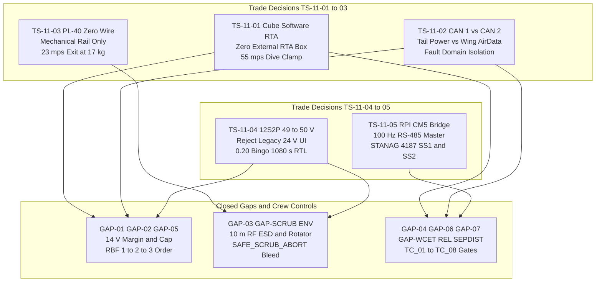

## 11. Operational Impacts, System Limitations & Documented Trade Studies

- **Document Date**: `2026-11-16`
- **System Baseline**: `Avenger5V25UasSystem` (`Avenger 5 V2.5 UAS` / `ASTK A5 V2.5` + `ELI Military Simulations PL-40 Rev 2.6` + `Artron ESAD AB00-0054-01AA-0005` + `SwarmC2`)
- **JSON Schema Mapping**: `proposed_capabilities` (`mission_drivers`, `value_proposition`, `trade_off_analysis`, operational impacts, and explicit system limitations per `ISO/IEC/IEEE 29148:2018` Annex A §A.2, `IEEE Std 1362-1998` §4, and `INCOSE SE Handbook v5.0` §2.3.5.4)
- **Authoritative SSOT Basis**: `.pipeline/schema.sysml` (`REQ_SAF_01` through `REQ_SAF_12`, `REQ_SC_01` through `REQ_SC_16`, `constraint def` and `part def` definitions), `schema/extracted/05_engineering_gaps_and_synthesis_ledger.md`, `schema/extracted/parametric_limits.md`, `docs/research/FAILURE_MODE_REGISTRY.md` (Section 5.1), `docs/research/RESEARCH_INVENTORY.md`, and `docs/safety/STPA_MATRIX.md`
- **Level 1B Hardware-Faithful Boundary**: This section enforces strict Level 1B abstraction (`UCL-01` through `UCL-05` user classes, `OA-01` through `OA-19` operational activities, `SCN-01` through `SCN-08` scenarios, and `OpTx-01` through `OpTx-24` / `CONN_01` through `CONN_24` exchanges), excludes Level 1C serial hex opcodes and pinouts, excludes Level 2 use-case identifiers, and locks all analysis to zero standalone RTA hardware enclosures (`standaloneRtaBoxCount == 0`), zero `PL-40` to airframe electrical/CAN wires (`IF-MECH-001`, `electricalWireToUavCount == 0`), zero production recovery parachutes (`rndRecoveryOptionInstalled == false`), and the normative `12S2P` (`36.0-50.4 V`) electrical baseline (`GAP-05`).

---

### 11.1 Operational & Organizational Impacts (`UCL-01` through `UCL-05`)

Deploying `Avenger5V25IntegratedSystem` introduces binding organizational procedures, crew-role separation, logistics replenishment cycles, and human-in-the-loop (HITL) ordnance safety disciplines across all five operational user classes (`UCL-01` Pilot Operator, `UCL-02` Payload Operator, `UCL-03` Launch Assistant, `UCL-04` External Tactical C2, and `UCL-05` Field Sustainment and Arming Safety Lead).

1. **Zero Production Parachute & Disposable Sortie Attrition Discipline (`REQ_SC_03`, `ProductionNoParachuteConstraint`, `OA-03`, `OA-04`)**:
   - Production `Avenger 5 V2.5` includes no parachute recovery system (`Recovery System: No`; `productionRecoverySystemInstalled == false`), and the optional `2x 50.0 V` pyrotechnic burn-wire igniter outputs from `ElectronicPowerSystemEps` (`BOM-AV-026`) remain permanently inhibited (`rndRecoveryOptionInstalled == false`).
   - **Organizational & Logistics Impact**: Operational units cannot rely on parachute capture for routine sortie turnaround or post-dive recovery. Terminal engagements (`SCN-04`, `SCN-05`) represent disposable `17.0 kg` MTOW airframe expenditure (`<= 5.0 kg` lethal package; `4.98 +/- 0.02 kg` tested warhead holder). Conversely, any non-terminal sortie abort (`SCN-02`, `SCN-03`) requires preserving recoverable flight energy via the `0.20` statutory Bingo reserve (`1080.0 s` out of `5400.0 s` / `90.0 min` maximum endurance, yielding `4320.0 s` usable mission endurance) and pre-planned `SwarmC2` `RTL` / Rally-point diversion (`Fly HOME Then Land` or `Go Directly to landing sequence`) within `JARUS SORA v2.5` Ground Risk Buffer boundaries (`MET-02`). `UCL-05` sustains whole-airframe and `12S2P` battery pack logistics rather than parachute repacking or pyrotechnic igniter refurbishment.

2. **Minimum `10.0 m` Ground RF Standoff & Tactical Fiber Separation (`GroundCrewSeparationAndEsdConstraint`, `PRM-GCS-001`, `PRM-RF-012`, `FM-14-03` RPN 192, `REQ_SC_15`)**:
   - During pre-flight assembly, `RBF #2` energization, and `2.0 min` telemetry acquisition (`PRM-GCS-002`), the `Avenger V2.5` airframe and staging crew (`UCL-03`) must maintain at least `10.0 m` separation from the `Ground Radio Box` (`GroundRfStationAndAntennaTracker`), which transmits `2.0 W` total (`2x 1.0 W`) across `4.4-5.0 GHz` (`OMNI` antenna on ground/launch). Violation of RF proximity or ESD controls constitutes Top-3 FMECA driver `FM-14-03` (`RPN 192`, `REQ_L_01`, `REQ_SC_15`).
   - **Organizational & Spatial Impact**: Site layout (`OA-18`, `SCN-07`) partitions the `PL-40` launch pad (`SAFETY AREA` strictly behind the rear rail anchor; `DANGER ZONE` all forward and lateral sectors) from the radiating Ground Radio Box (`>= 10.0 m` clearance) and permits deploying the optional `200.0 m` tactical fiber optic spool (`IF-GND-001`) so `UCL-01` and `UCL-02` operate the rugged `Windows 11` `SwarmC2` console (`>= 8` char role-authenticated login per `NIST SP 800-82r3`) from sheltered standoff.

3. **Transport Box ESD Equalization & Pre-UAV Antenna Rotator Calibration (`OA-18`, `FM-14-03` RPN 192, `REQ_SC_15`)**:
   - Ground crew (`UCL-03`, `UCL-05`) must touch the yellow `EARTH / GROUNDING POINT` inside the transport box before every component handling step (`A5_prep#p7`, `#p9`) to eliminate personnel-borne electrostatic discharge (`MIL-STD-461G` `CS118`) across ordnance (`Artron ESAD` + Sensor Board) and avionics harnesses.
   - Ground station commissioning (`A5_prep#p6`, `OA-18`) enforces strict temporal precedence: erect the `MARS 23.0 dBi` directional tracking antenna and `OMNI` antenna, power `SwarmC2`, and calibrate the `Directional Antenna Rotator` (`Auto Follow` and `0.5 deg` CCW/CW fine step, example channel `4510.0 MHz`) **before touching the UAV**. Mechanical airframe preparation further mandates `2`-person minimum airframe lift (`PRM-AF-019`) without stressing control surfaces, routing RF coaxial leads free of pinch points, tightening `8` wing bolts (`4x` front `M6 x 30.0 mm` with `10.0 mm` spanner), verifying battery-to-fuselage ID/QR match (`OA-01`), fastening payload terminals with a `1.5 mm` hex driver (`RED FACE TO TOUCH HOLDER`), and locking both RBF and `USB/ETH` umbilical lids (`OBL-04`).

4. **`PL-40` Launch Energy Management: `>= 2`-Launch `Makita BL1860B` Swap & `100`-Launch Rope/Bearing Cycle (`OA-15`, `REQ_SC_14`, `PRM-PL40-032` through `PRM-PL40-044`)**:
   - The `25.0 kg` portable compressor charges the `PL-40` tank (`43.0 kg` rail case, `68.0 kg` total set) to `13.0-14.0 bar` within `<= 8.0 min` (`0.05 bar` auto-cutoff hysteresis) using `2x Makita BL1860B` (`18.0 V`, `6000.0 mAh`, `UN 3481`) battery packs (`UAV_launcher_PL-40_user_manual_rev_2.6.pdf#p6,#p26,#p28`).
   - **Organizational & Maintenance Impact**: Crew (`UCL-03`) must swap compressor battery packs after the 1st launch and every `>= 2` launches thereafter, or immediately whenever pack voltage drops to `<= 14.5 V` UVLO cutoff (flashing `PWR` LED, requiring `>= 16.0 V` pack voltage and a `5.0 s` wait before restart), while keeping pack charging strictly inside `+10.0 to +40.0 degC` (narrower than the `-20.0 to +50.0 degC` operational launch envelope). High-tempo operations may substitute the `DIN 8 mm PCP` auxiliary fill port (`<= 16.0 bar`). At intermediate/depot intervals, `UCL-05` must track launch cycles and replace the `PL-40` pulling rope and carriage wheel bearings every `100` launches, applying localized `250.0 degC` heat to release bearing threadlocker (`PRM-PL40-043`, `PRM-PL40-044`).

5. **Strict `RBF #1 -> #2 -> #3` Sequencing & `SAFE_SCRUB_ABORT` Discipline (`REQ_SC_01`, `REQ_SC_09`, `REQ_SC_16`, `REQ_SAF_06`, `REQ_SAF_12`, `GAP-06`, `GAP-SCRUB`)**:
   - Crew roles (`UCL-01`, `UCL-02`, `UCL-03`) must execute an indivisible, non-parallelized launch gate sequence (`SCN-01`, `SCN-06`):
     1. Confirm both folding rear pusher propeller blades fold rearward inside the `145.0-155.5 mm` carriage prop-safe upper zone and remove `RBF #1` (pitot cover, sensor cover, gimbal strap).
     2. Pull `UAV Power RBF #2` (`XT60E-F`) to energize the `12S2P` bus (`49.0-50.0 V` check, `200.0 A` fuse) and immediately close and lock both the RBF lid and external `USB/ETH` umbilical lid.
     3. Complete all `6` `SwarmC2` checklist groups (`Catapult`, `Mission & parameters`, `Preparation & mounting`, `System checks`, `Video Checks`, `Warhead and Safety`), verify `CUAV SKYE2` pitot (`< 3.0 m/s` calm / `> 10.0 m/s` airflow) and dual `mRo RM3100` mag/baro online (`OA-06`), and confirm `Artron ESAD` boot welcome + PBIT internal high voltage `< 50.0 V` while `ESAD RBF #3` remains installed (`UMB < 0.5 Ohm` at `20.0 mA`, `OA-10`).
     4. Remove `ESAD RBF #3` **only** upon explicit `SwarmC2` prompt after all `8` preconditions pass (`GAP-06`; premature removal before power-on triggers an immediate ESAD fault, `FM-13-02` RPN `144`), wait for `ESAD: Ready to Fly`, clear all personnel behind `PL-40` `SAFETY AREA`, remove the carriage red safety pin, open `Main Valve 4`, and hold both safety-covered firing switches simultaneously for `>= 2.0 s` (`OA-16`).
   - **Aborted Launch & Hangfire Impact (`SAFE_SCRUB_ABORT`, `SCN-08`, `OA-17`, `MET-04`, `FM-12-02` RPN `150`)**: Under any hangfire, compressor UVLO stall, ESAD fault, or tactical abort on the armed rail, crew are strictly prohibited from approaching the `PL-40` `DANGER ZONE` until executing `SAFE_SCRUB_ABORT`: `UCL-02` / `UCL-01` hold ESAD abort/self-destruct for `>= 5.0 s` + `Slide to confirm` and command irreversible `Power Off ESAD` (`OA-12`); `UCL-03` closes `Main Valve 4`, bleeds pneumatic tank pressure to `0.0 bar`, and reinserts the red carriage safety pin; and `UCL-05` verifies ESAD `< 50.0 V` discharged and reinstalls `ESAD RBF #3` **prior** to disconnecting `UAV Power RBF #2`.

#### Table 11.1: Operational & Organizational Impact Matrix (`UCL-01` through `UCL-05`)

| User Class | Operational Role & Auth Gate | Primary Procedural & Training Impact | Hard Interlock & Safety Responsibility | Bound Activities & FMECA Risk Drivers |
| :--- | :--- | :--- | :--- | :--- |
| `UCL-01` Pilot Operator | Direct flight operator (`SwarmC2` `Pilot` login, `>= 8` char password) | Enforces `12S2P` `49.0-50.0 V` gate (rejecting `24 V` legacy UI), `0.20` Bingo RTL planning (`50.0-3000.0 m` alt, `>= 300.0 m` loiter), `Disable GNSS` DR fallback (`I'm Here` / `I'm Looking Here`), and non-parachute `RTL` diversion | Cannot bypass software Simplex RTA (`<= 55.0 m/s` dive cap, `<= 80.0 m/s` `VNE`) or unlock armed `Reboot Vehicle` | `OA-01`, `OA-02`, `OA-04`, `OA-05`, `OA-06`, `OA-07`, `OA-09`, `OA-18`; `FM-07-03` (`180`), `FM-08-03` (`180`), `FM-15-04` (`192`) |
| `UCL-02` Payload Operator | Direct EO/IR and ordnance supervisor (`SwarmC2` `Payload` login, `>= 8` char password) | Verifies all `6` engagement preconditions (`2.0-5.0 s` EO track hold, `<= 15.0 deg` elevation, `<= 55.0 m/s` cap), executes in-flight `Reboot Gimbal` over ETH on freeze, and exports `5W` / `CFF` target reports | Sole HITL authority for `DoD Directive 3000.09` arm consent, `>= 5.0 s` ESAD abort/self-destruct + `Slide to confirm`, and irreversible `Power Off ESAD` | `OA-03`, `OA-08`, `OA-10`, `OA-11`, `OA-12`, `OA-13`, `OA-14`, `OA-19`; `FM-11-01` (`160`), `FM-13-02` (`144`), `FM-15-03` (`150`) |
| `UCL-03` Launch Assistant | Direct ground staging and catapult operator (`SwarmC2` `Launch Assistant`, `>= 8` char) | Performs rotator calibration before touching UAV, transport-box ESD touch, `>= 10.0 m` RF standoff, `2`-person lift, `M6` bolt/prop-fold checks, `Makita BL1860B` swap (`>= 2` launches), and `PL-40` charge/fire | Enforces `RBF #1 -> #2 -> #3` strict ordering (`RBF #3` only after `SwarmC2` prompt), rear `SAFETY AREA` clearance, red pin + `Main Valve 4` + `>= 2.0 s` dual trigger, and `SAFE_SCRUB_ABORT` bleed | `OA-01`, `OA-10`, `OA-11`, `OA-15`, `OA-16`, `OA-17`, `OA-18`; `FM-14-03` (`192`), `FM-12-01` (`144`), `FM-12-02` (`150`) |
| `UCL-04` External Tactical C2 | External `ATAK`, `SitaWare HQ`, and `DELTA` battle-management consumers | Adapts ROE target tasking and airspace deconfliction to digital `5W` (`Five Whiskey`) / `CFF` (`Call For Fire`) feeds and disposable non-parachute strike profiles | Strictly isolated from direct flight-control or `Artron ESAD` actuation paths (`NIST SP 800-82r3` boundary) | `OA-19`; `OBL-04`, `MET-03` |
| `UCL-05` Field Sustainment & Arming Safety Lead | O/I/D maintainer and ordnance safety lead | Enforces `12S2P` pack damage/swelling `NO-GO` gate and QR match, `1.5 mm` hex warhead/ESAD mounting (`4.98 +/- 0.02 kg`), `+10.0 to +40.0 degC` `BL1860B` charging, and `100`-launch rope/bearing service (`250.0 degC` heat removal) | Holds stop-work authority on `GAP-01` brownout faults, premature `RBF #3` removal, `USB/ETH` lid security, and `SAFE_SCRUB_ABORT` hangfire restoration (`RBF #3` before `RBF #2`) | `OA-01`, `OA-12`, `OA-17`; `FM-01-01` (`135`), `FM-02-04` (`135`), `FM-03-02` (`135`), `FM-11-05` (`135`) |

#### Table 11.2: Operational & Organizational Impact Quantitative Gates

| Impact ID | Operational Impact Parameter | Qualifier | Value | Units | Governing Constraint & SSOT Citation |
| :--- | :--- | :--- | :--- | :--- | :--- |
| `IMP-01` | Production parachute recovery igniter circuits active (`REQ_SC_03`) | Exact | 0 | count | `ProductionNoParachuteConstraint`; `Avenger5_V2.5_block_diagram_rev5.pdf#p1`, `A5-user-manual 2.pdf#p10` |
| `IMP-02` | Statutory Bingo reserve flight duration (`0.20` of `5400.0 s` endurance) | Min | 1080.0 | s | `BingoEnergyReserveConstraint` (`PRM-PERF-002`, `PRM-PERF-003`) |
| `IMP-03` | Minimum Ground Radio Box to UAV separation during ground prep | Min | 10.0 | m | `GroundCrewSeparationAndEsdConstraint` (`PRM-GCS-001`, `A5-user-manual 2.pdf#p52`) |
| `IMP-04` | Optional tactical fiber optic standoff spool (`SwarmC2` to Ground Radio) | Max | 200.0 | m | `PRM-RF-012` (`A5-user-manual 2.pdf#p11`) |
| `IMP-05` | Antenna Rotator fine manual azimuth calibration step (`Auto Follow`) | Exact | 0.5 | deg | `PRM-RF-010` (`A5-user-manual 2.pdf#p72-#p74`) |
| `IMP-06` | Minimum personnel count (`2` persons) required to lift `17.0 kg` airframe onto `PL-40` carriage | Min | 2 | count | `PRM-AF-019` (`A5_prep and safety_rev7.pdf#p15`) |
| `IMP-07` | `Makita BL1860B` (`18.0 V`, `6000.0 mAh`) compressor swap cycle launch count after 1st launch (OEM: `2` launches) | Max | 2 | count | `UAV_launcher_PL-40_user_manual_rev_2.6.pdf#p26` |
| `IMP-08` | `Makita BL1860B` compressor battery undervoltage lockout (UVLO) cutoff | Min | 14.5 | V | `Pl40UvloAndDualSwitchConstraint` (`PRM-PL40-034`, `PL-40#p23`) |
| `IMP-09` | `Makita BL1860B` minimum restart voltage after `5.0 s` UVLO delay | Min | 16.0 | V | `PRM-PL40-035`, `PRM-PL40-036` (`PL-40#p23`) |
| `IMP-10` | `Makita BL1860B` battery ambient charging temperature minimum (Normalized Kelvin scalar T / 1.0 K; OEM: `10.0 degC`) | Min | 283.15 | Dimensionless | `PRM-PL40-040` (`PL-40#p28`) |
| `IMP-11` | `Makita BL1860B` battery ambient charging temperature maximum (Normalized Kelvin scalar T / 1.0 K; OEM: `40.0 degC`) | Max | 313.15 | Dimensionless | `PRM-PL40-041` (`PL-40#p28`) |
| `IMP-12` | `PL-40` pulling rope and carriage wheel bearing replacement launch count interval (OEM: `100` launches) | Max | 100 | count | `PRM-PL40-043` (`REQ_SC_14`, `PL-40#p29-#p36`) |
| `IMP-13` | `PL-40` carriage bearing localized threadlocker removal heat (Normalized Kelvin scalar T / 1.0 K; OEM: `250.0 degC`) | Nominal | 523.15 | Dimensionless | `PRM-PL40-044` (`PL-40#p29-#p36`) |
| `IMP-14` | Pre-flight `12S2P` main battery check pass floor (`GAP-05`) | Min | 49.0 | V | `MainBatteryPreFlightVoltageConstraint` (`PRM-AV-003`) |
| `IMP-15` | Pre-flight `12S2P` main battery check nominal ceiling (`GAP-05`) | Max | 50.0 | V | `MainBatteryPreFlightVoltageConstraint` (`PRM-AV-004`) |
| `IMP-16` | `ESAD RBF #3` umbilical loop (`UMB`) max continuity voltage drop at `20.0 mA` (OEM: `0.5 Ohm` max resistance) | Max | 0.01 | V | `EsadRbf3PowerBeforePullConstraint` (`PRM-ESAD-004`, `PRM-ESAD-005`) |
| `IMP-17` | `PL-40` dual safety-covered firing switch simultaneous hold duration | Min | 2.0 | s | `Pl40UvloAndDualSwitchConstraint` (`PRM-PL40-037`, `PL-40#p25-#p26`) |
| `IMP-18` | `SwarmC2` ESAD self-destruct / abort hold duration before `Slide to confirm` | Min | 5.0 | s | `PRM-GCS-010` (`REQ_SC_16`, `A5-user-manual 2.pdf#p84`) |

---

### 11.2 Explicit System Limitations & OEM Engineering Gap Ledger (`GAP-01` through `GAP-SCRUB`)

In accordance with `ISO/IEC/IEEE 29148:2018` §6.4 and `MIL-STD-882E` Tasks 202, 205, and 206, all cross-document OEM discrepancies (`GAP-01` through `GAP-07`) and unprinted OEM quantitative assurance/timing figures (`GAP-WCET`, `GAP-REL`, `GAP-SEPDIST`, `GAP-ENV`, `GAP-SCRUB`) from `schema/extracted/05_engineering_gaps_and_synthesis_ledger.md` and `schema/extracted/parametric_limits.md` are documented explicitly as hard operational limitations mapped `1:1` to `REQ_SAF_01` through `REQ_SAF_12` and Section 5.1 FMECA top-RPN modes (`RPN >= 135`).

#### 11.2.1 Cross-Document Hardware & Envelope Discrepancy Limitations (`GAP-01` through `GAP-07`)

1. **`GAP-01` (`REQ_SAF_01`): `0.0 V` ESAD Power-Rail Brownout Margin**:
   - `ElectronicPowerSystemEps` (`Avenger5_V2.5_block_diagram_rev5.pdf#p1`) outputs a regulated `14.0 V` ESAD supply (`esad14VOut`) fed across a `970.0 cm` DC trunk (`Power Meter -> EPS`), whereas the `Artron ESAD` ICD (`ESAD ICD#p14`) specifies `GE_POW` (`VDC_IN`, `J100` pins 1-2) Minimum = `14.0 V`, Nominal = `28.0 V`, Maximum = `32.0 V`. Consequently, `0.0 V` brownout margin exists between the `EPS` nominal output and the `ESAD` input floor; any connector contact drop, transient peak, or `970.0 cm` trunk voltage sag under high `IBEX160` propulsion or `HV6160` servo load can dip `VDC_IN` below `14.0 V` and trigger an ESAD fault (`FM-04-01` RPN `192`, `FM-04-04` RPN `192`, `FM-11-01` RPN `160`, `FM-02-04` RPN `135`).
   - **Limitation & Control**: Enforces continuous `CAN 1` bus voltage telemetry (`OA-03`, `OA-04`), brownout alerting (`EpsEsadZeroBrownoutMarginConstraint`), and irreversible `Power Off ESAD` safing if rail droop threatens ESAD stability (`TC_02`).

2. **`GAP-02` (`REQ_SAF_02`): Dual-Baseline Flight Envelope & RLOS Cap (`55.0/80.0 m/s` & `60.0/90.0 km`)**:
   - The legacy `V1` manual (`A5-user-manual 2.pdf#p10`) specifies `26.0-38.0 m/s` horizontal speed, `30.0 m/s` cruise, `55.0 m/s` max dive, and `60.0/180.0 km` RLOS, whereas the `V2.5` Spec Sheet (`AVENGER 5 Spec sheet_rev3.pdf#p3`) lists `24.0 m/s` stall, `31.0 m/s` cruise, `42.0 m/s` max horizontal, `80.0 m/s` structural dive (`VNE`), and `60.0/90.0 km` RLOS. Furthermore, `A5-user-manual 2.pdf#p88` dictates that exceeding `55.0 m/s` during terminal dive saturates the `Nighthawk2UZ` gimbal and forces immediate `Abort Engaging`.
   - **Limitation & Control**: System software clamps operational terminal engagement strictly at `<= 55.0 m/s` (`EngagementSpeedAndTrackHoldConstraint`), retains `80.0 m/s` purely as structural `VNE` (`FlightEnvelopeSpeedConstraint`), anchors stall protection across `24.0-26.0 m/s`, and limits RLOS operational planning conservatively to `60.0/90.0 km` (`TC_03`, `TC_05`).

3. **`GAP-03` (`REQ_SAF_03`): Sub-Stall `PL-40` Launch Margin at `17.0 kg` (`~23.0 m/s` vs. `24.0-26.0 m/s`) & `25.0 m/s` Ceiling**:
   - At `Avenger 5` `17.0 kg` MTOW and `13.0-14.0 bar` operating pressure, `PL-40` Table 2 interpolates carriage exit velocity to `~23.0 m/s` (`22.7-23.5 m/s` between `24.3-25.3 m/s` at `15.0 kg` and `21.1-21.9 m/s` at `20.0 kg`). That exit velocity lies slightly below the `24.0-26.0 m/s` aerodynamic stall window without headwind (`<= 12.0 m/s`) and `IBEX160`/`AXI 5345/16` electric pusher acceleration, while operating `< 15.0 kg` payloads at `14.0 bar` (`25.3 m/s`) exceeds the `PL-40` hard `25.0 m/s` carriage velocity limit (`FM-12-01` RPN `144`, `FM-15-01` RPN `144`).
   - **Limitation & Control**: Strictly prohibits tailwind or zero-thrust launches; `OA-16` enforces a multi-input Go/No-Go gate verifying pusher propulsion readiness, `13.0-14.0 bar` gauge pressure, headwind within `<= 12.0 m/s` ground limit, `17.0 kg` mass compliance (`<= 25.0 m/s` exit cap), and `12.0 deg` rail level (`Pl40MassAndExitVelocityConstraint`, `TC_07`).

4. **`GAP-04` (`REQ_SAF_04`): Platform Bridge Discrepancy & `100.0 Hz` vs. `100 ms` Polling Wording**:
   - The `Artron ESAD` ICD carries an `Avenger 3` (`28.0 V`) title header while `Avenger V2.5` uses `14.0 V` power and bridges `SwarmC2` IP and `Cube orange+` serial telemetry through `RPI CM5004032` (`Ring 2 -> Ring 3`); additionally, `ESAD ICD#p15` specifies both `100 Hz` (`0.01 s`) polling in Table 6 and `100 ms` poll wording in text alongside a `5.0 ms` max reply and `10.0 ms` incomplete-packet timeout (`FM-15-03` RPN `150`).
   - **Limitation & Control**: Enforces the conservative `100.0 Hz` (`0.01 s` period) cyclic RS-485 `CRC-16 XModem` supervision contract on `RPI CM5004032` with strict `<= 5.0 ms` reply verification and `<= 10.0 ms` watchdog timeout fault handling (`EsadRs485ProtocolTimingConstraint`, `TC_04`, `TC_06`).

5. **`GAP-05` (`REQ_SAF_05`): `OBS` Camera Contradiction & Legacy `23.9-25.0 V` UI Artifacts**:
   - `A5-user-manual 2.pdf` contains conflicting `OBS` joystick descriptions (`p79` vs `p81`) and depicts `23.9 V` / `25.0 V` battery telemetry screenshots alongside normative `49.0-50.0 V` (`12S2P`) pre-flight pass criteria (`p53`, `p56`).
   - **Limitation & Control**: Hard-anchors electrical validation (`MainBatteryPreFlightVoltageConstraint`) to `12S2P` `36.0-50.4 V` (`49.0-50.0 V` pre-flight check) and explicitly rejects `23.9-25.0 V` UI expectations (`legacy24VUiRejected == true`, `FM-13-02` RPN `144`, `TC_01`).

6. **`GAP-06` (`REQ_SAF_06`): Irreversible Boot Fault from Premature `ESAD RBF #3` Removal**:
   - Removing `ESAD RBF #3` (`J100` `UMB` continuity loop `< 0.5 Ohm` at `20.0 mA`) prior to `UAV Power RBF #2` energization and ESAD power-on induces an immediate `Artron ESAD` boot fault (`A5_prep#p23`, `FM-13-02` RPN `144`).
   - **Limitation & Control**: `EsadRbf3PowerBeforePullConstraint` and `EsadSafeArmState` lock `ESAD RBF #3` physically installed until `UAV Power RBF #2` is pulled, boot + PBIT (`< 50.0 V`) pass, and all `8` `SwarmC2` pre-arm preconditions confirm (`TC_01`, `TC_06`).

7. **`GAP-07` (`REQ_SAF_07`): `SwarmC2` vs. `ESAD ICD` Safe-Separation Wording Discrepancy**:
   - `A5-user-manual 2.pdf#p84` loosely describes `ARM STAGE 2` as occurring "within safe distance from launch point", contradicting `ESAD ICD#p21,#p23` (`Safe Distance Exceed` / `SS2 Active`).
   - **Limitation & Control**: `EsadSafeDistanceExceedConstraint` formally governs operational training and software semantics: physical arming requires **exceeding** the minimum launch-point safe-separation threshold and flight timer (`Safe Distance Exceed == 1`, `SS2` latched) after `SS1` launch acceleration (`TC_06`).

#### 11.2.2 Unprinted OEM Quantitative Assurance & Calibration Limitations (`GAP-WCET`, `GAP-REL`, `GAP-SEPDIST`, `GAP-ENV`, `GAP-SCRUB`)

1. **`GAP-WCET` (`REQ_SAF_08`): Unprinted Real-Time Control Loop Frequencies & WCET Budgets**:
   - OEM documentation specifies only the `100.0 Hz` (`0.01 s`) `ESAD` RS-485 cycle (`5.0 ms` reply, `10.0 ms` timeout) and omits WCET/rate specifications for `Cube orange+` EKF2/attitude/surface loops, `CAN 1`/`CAN 2` bitrates (`Mbps`), `HV6160-DroneCAN` servo update rates, `Septentrio Asterx-m3 pro` GNSS solution rate, `Trip6` tracking latency, `RPI CM5004032` Linux scheduling jitter, and `SwarmC2` RF link round-trip latency (`FM-15-03` RPN `150`, `FM-08-03` RPN `180`).
   - **System Limitation**: Software-hosted Simplex RTA and multi-hop `RPI CM5` / `EPS` abort paths operate with unverified end-to-end timing margin until OEM hardware-in-the-loop (HIL) bench WCET/RMA measurements close `TC_03` and `TC_04`.

2. **`GAP-REL` (`REQ_SAF_09`): Unprinted Component Failure Rates (`lambda`) & Supplier MTBF**:
   - OEM PDFs omit piece-part failure rates (`lambda`) and MTBF for `Cube orange+`, `IBEX160`, `AXI 5345/16`, `HV6160-DroneCAN`, `mRo RM3100`, `CUAV SKYE2`, `maximus20 12S2P`, `DTC 4.4-5.0 GHz`, `Trip6`, `Nighthawk2UZ`, and `Artron ESAD` FPGA/CPLD (`FM-04-03` RPN `150`, `FM-08-04` RPN `150`).
   - **System Limitation**: Quantitative reliability allocations remain parameterized against conservative component-class catalog baselines (`MIL-STD-1629A` Method 102) pending supplier reliability releases.

3. **`GAP-SEPDIST` (`REQ_SAF_10`): Unprinted Ordnance Safe-Separation Numeric Thresholds & Fastener Torques**:
   - OEM sheets omit numeric `SS2` safe-separation distance (`m`), `SS1` launch acceleration threshold (`g`, telemetry scaled at `0.0039 g/LSB`), arming timer duration (`s`, `1.0 s/LSB`), tightening torque specs for `3x M3` (`75.0 mm` BCD) ESAD mounts, `2x M2` sensor board mounts, `8x M6 x 30.0 mm` wing bolts, and dimensional units for warhead CTQ datums (`30.57 +/- 1.00`, `173.00`, and `PL-40` CG `200`/`100`, `FM-15-01` RPN `144`, `FM-11-05` RPN `135`).
   - **System Limitation**: Field units cannot authorize live warhead arming without OEM calibration sign-off populating these parameterized `schema/avenger5_uas/` thresholds.

4. **`GAP-ENV` (`REQ_SAF_11`): Unprinted Energy Capacity, Thermal Cutoffs, Tank Volume & Standoff Bounds**:
   - OEM PDFs omit `12S2P` pack energy (`Wh` / `Ah`), numeric SoC RTL floor, `IBEX160` / `AXI 5345/16` continuous current and thermal shutoff temperatures, `PL-40` tank internal volume (`L`), pneumatic relief cracking pressure (`bar`), IP water-ingress rating, rain/icing bounds, and numeric forward/lateral `DANGER ZONE` exclusion meters (`FM-04-04` RPN `192`, `FM-14-03` RPN `192`, `FM-15-04` RPN `192`).
   - **System Limitation**: Flight endurance and thermal/weather operating margins rely on voltage-plus-time supervision (`36.0 V` floor and `0.20` / `1080.0 s` endurance reserve) and conservative clear-weather launch gates (`<= 12.0 m/s` ground wind, `-20.0 to +50.0 degC`) until depot characterization closes `GAP-ENV`.

5. **`GAP-SCRUB` (`REQ_SAF_12`): Unprinted OEM Scrub, Hangfire Wait & De-Arm Sequence**:
   - None of the OEM manuals (`A5_prep`, `A5-user-manual`, `PL-40`) define an emergency scrub/unload sequence or hangfire waiting time after `ESAD RBF #3` removal, `Main Valve 4` opening, or carriage red safety pin removal (`FM-12-02` RPN `150`, `FM-04-03` RPN `150`).
   - **System Limitation**: Closed explicitly via synthesized operational procedure `SAFE_SCRUB_ABORT` (`OA-17`, `SCN-08`, `REQ_SC_16`, `TC_08`) requiring depot validation of the hangfire wait timer prior to live-warhead field deployment.

#### Table 11.3: Consolidated System Limitations & Engineering Gap Closure Matrix (`REQ_SAF_01` through `REQ_SAF_12`)

| Gap ID | SysML Req | Linked Top-RPN FMECA Modes (`RPN >= 135`) | Explicit System Limitation Summary | Operational Disposition & Verification Gate |
| :--- | :--- | :--- | :--- | :--- |
| `GAP-01` | `REQ_SAF_01` | `FM-04-01` (`192`), `FM-04-04` (`192`), `FM-15-04` (`192`), `FM-11-01` (`160`), `FM-02-04` (`135`) | `14.0 V` `EPS` output equals `14.0 V` `ESAD` minimum (`0.0 V` brownout margin across `970.0 cm` trunk vs `28.0 V` ICD nominal) | `EpsEsadZeroBrownoutMarginConstraint`, brownout telemetry alarm, irreversible `Power Off ESAD` (`TC_02`) |
| `GAP-02` | `REQ_SAF_02` | `FM-08-03` (`180`), `FM-15-03` (`150`) | `V1` (`26-38 m/s`, `55 m/s` dive, `60/180 km`) vs `V2.5` (`24-42 m/s`, `80 m/s` `VNE`, `60/90 km`) conflict | Clamp EO terminal engagement at `<= 55.0 m/s` (`Abort Engaging`), keep `80.0 m/s` `VNE`, use `60/90 km` RLOS (`TC_03`, `TC_05`) |
| `GAP-03` | `REQ_SAF_03` | `FM-12-01` (`144`), `FM-15-01` (`144`) | `~23.0 m/s` (`22.7-23.5 m/s`) `PL-40` exit at `17.0 kg` (`13-14 bar`) lies below `24-26 m/s` stall; `< 15 kg` at `14 bar` exceeds `25.0 m/s` | Require pusher thrust readiness, `13.0-14.0 bar`, headwind within `<= 12.0 m/s`, and `<= 25.0 m/s` exit cap (`TC_07`) |
| `GAP-04` | `REQ_SAF_04` | `FM-15-03` (`150`) | `ESAD ICD` `Avenger 3` (`28 V`) naming vs `V2.5` `RPI CM5` bridge and `100 Hz` (`0.01 s`) vs `100 ms` poll text | Enforce `100.0 Hz` (`0.01 s`) `RPI CM5` RS-485 `CRC-16 XModem` polling, `<= 5.0 ms` reply, `<= 10.0 ms` timeout (`TC_04`, `TC_06`) |
| `GAP-05` | `REQ_SAF_05` | `FM-13-02` (`144`) | Contradictory `OBS` joystick text (`p79` vs `p81`) and `23.9/25.0 V` legacy UI vs `12S2P` `49-50 V` normative check | Anchor `MainBatteryPreFlightVoltageConstraint` to `12S2P` `36.0-50.4 V` (`49.0-50.0 V` pre-flight); reject `24 V` UI (`TC_01`) |
| `GAP-06` | `REQ_SAF_06` | `FM-13-02` (`144`) | Pulling `ESAD RBF #3` prior to `UAV + ESAD` power-up (`RBF #2`) causes immediate ESAD fault | Enforce `EsadRbf3PowerBeforePullConstraint` (`RBF #2` ON -> PBIT `< 50.0 V` -> `8` checks -> pull `RBF #3`, `TC_01`, `TC_06`) |
| `GAP-07` | `REQ_SAF_07` | `FM-13-02` (`144`) | `SwarmC2` ("within safe distance") conflicts with `ESAD ICD` (`Safe Distance Exceed == 1` / `SS2 Active`) | Enforce `EsadSafeDistanceExceedConstraint`: arming strictly requires exceeding safe separation (`SS2 == 1`, `TC_06`) |
| `GAP-WCET` | `REQ_SAF_08` | `FM-04-04` (`192`), `FM-08-03` (`180`), `FM-15-03` (`150`) | Missing OEM frequencies and WCET budgets for EKF2, `CAN 1/2`, `HV6160`, `Septentrio`, `Trip6`, `RPI CM5`, `SwarmC2` | Anchor around `100.0 Hz` (`0.01 s`) ESAD cycle; require bench HIL WCET/RMA verification (`TC_03`, `TC_04`) |
| `GAP-REL` | `REQ_SAF_09` | `FM-04-03` (`150`), `FM-08-04` (`150`), `FM-15-03` (`150`) | Missing OEM piece-part failure rates (`lambda`) and supplier MTBF across avionics, actuators, and ESAD FPGA/CPLD | Parameterize FMECA/FTA using conservative component-class catalog baselines pending OEM MTBF (`TC_02`, `TC_03`, `TC_06`) |
| `GAP-SEPDIST` | `REQ_SAF_10` | `FM-15-01` (`144`), `FM-11-05` (`135`) | Missing numeric safe-separation (`m`), launch `g`, timer (`s`), `M3`/`M2`/`M6` torque, and CTQ holder units (`30.57`, `173.00`, `200`/`100`) | Declare calibration-gated `schema/avenger5_uas/` parameters requiring sign-off prior to live arming (`TC_06`, `TC_07`) |
| `GAP-ENV` | `REQ_SAF_11` | `FM-04-04` (`192`), `FM-14-03` (`192`), `FM-15-04` (`192`) | Missing `Wh`/`Ah`, SoC RTL floor, ESC/motor current & thermal cutoffs, `PL-40` tank `L` / relief `bar`, IP/rain/icing, `DANGER ZONE` `m` | Enforce `36.0 V` sag + `0.20` Bingo RTL, `<= 12.0 m/s` launch wind, `-20.0 to +50.0 degC` limits, and depot test (`TC_02`, `TC_08`) |
| `GAP-SCRUB` | `REQ_SAF_12` | `FM-04-03` (`150`), `FM-12-02` (`150`) | Missing OEM scrub/unload procedure after `RBF #3`, `Main Valve 4`, or red pin pull, and missing hangfire wait duration | Enforce synthesized `SAFE_SCRUB_ABORT` (`OA-17`, `REQ_SC_16`, `SCN-08`) with depot hangfire timer sign-off (`TC_08`) |

#### Table 11.4: Quantitative Limitation Boundaries & Margin Ledger

| Limit ID | Gap Driver | Quantitative Limitation Parameter | Qualifier | Value | Units | Normative / OEM Source |
| :--- | :--- | :--- | :--- | :--- | :--- | :--- |
| `LIM-01` | `GAP-01` | EPS-to-ESAD steady-state brownout margin (`14.0 V` minus `14.0 V` floor) | Max | 0.0 | V | `PRM-AV-010`, `PRM-ESAD-001` |
| `LIM-02` | `GAP-01` | Fuselage DC power and `CAN 1` trunk length feeding EPS | Nominal | 970.0 | cm | `PRM-AV-012` (`Avenger5_V2.5_block_diagram_rev5.pdf#p1`) |
| `LIM-03` | `GAP-02` | Conservative terminal engagement dive speed cap (`Abort Engaging`) | Max | 55.0 | m/s | `PRM-PERF-010` (`A5-user-manual 2.pdf#p10,#p88`) |
| `LIM-04` | `GAP-02` | Airframe structural dive never-exceed speed (`VNE`) | Max | 80.0 | m/s | `PRM-PERF-011` (`AVENGER 5 Spec sheet_rev3.pdf#p3`) |
| `LIM-05` | `GAP-02` | Conservative RLOS datalink range (`V2.5` baseline / extended) | Max | 90.0 | km | `PRM-RF-007` (`AVENGER 5 Spec sheet_rev3.pdf#p3`) |
| `LIM-06` | `GAP-03` | `PL-40` interpolated rail exit velocity at `17.0 kg` MTOW (`13-14 bar`) | Nominal | 23.0 | m/s | `PRM-PL40-003` (`PL-40#p37`) |
| `LIM-07` | `GAP-03` | `PL-40` hard maximum rated carriage launch velocity | Max | 25.0 | m/s | `PRM-PL40-002` (`PL-40#p3,#p24,#p37`) |
| `LIM-08` | `GAP-03` | Airframe minimum flight / stall speed floor (`V2.5` / `V1`) | Min | 24.0 | m/s | `PRM-PERF-004` (`26.0 m/s` `V1`, `PRM-PERF-005`) |
| `LIM-09` | `GAP-03` | Maximum ground surface wind tolerance during launch | Max | 12.0 | m/s | `PRM-PERF-016` (`AVENGER 5 Spec sheet_rev3.pdf#p3`) |
| `LIM-10` | `GAP-04` | Grounded `ESAD` cyclic RS-485 polling period (`100.0 Hz`) | Exact | 0.01 | s | `PRM-ESAD-018` (`ESAD ICD#p15`) |
| `LIM-11` | `GAP-04` | `ESAD` RS-485 incomplete packet / watchdog timeout ceiling | Max | 10.0 | ms | `PRM-ESAD-019` (`ESAD ICD#p15`) |
| `LIM-12` | `GAP-05` | Main `12S2P` DC bus operational discharge voltage floor | Min | 36.0 | V | `PRM-AV-001` (`Avenger5_V2.5_block_diagram_rev5.pdf#p1`) |
| `LIM-13` | `GAP-05` | Main `12S2P` DC bus operational charge ceiling | Max | 50.4 | V | `PRM-AV-002` (`Avenger5_V2.5_block_diagram_rev5.pdf#p1`) |
| `LIM-14` | `GAP-ENV` | Maximum airframe ambient operating temperature envelope (Normalized Kelvin scalar T / 1.0 K; OEM: `50.0 degC`) | Max | 323.15 | Dimensionless | `PRM-PERF-019` (`-20.0 degC` min, `PRM-PERF-018`) |
| `LIM-15` | `GAP-SEPDIST` | Tested warhead holder unit nominal mass (`+/- 0.02 kg` tolerance) | Nominal | 4.98 | kg | `PRM-AF-010` (`5.0 kg` max, `PRM-AF-009`) |

---

### 11.3 Quantitative Multi-Criteria Trade Studies (`TS-11-01` through `TS-11-05`)

In accordance with `INCOSE SE Handbook v5.0` §2.3.5.4 (Decision Management Process) and `ISO/IEC/IEEE 15288:2023` §6.4.4, five core architectural trade studies (`TS-11-01` through `TS-11-05`, binding `TRD-01` through `TRD-05` in Section 3.4) evaluate selected baseline options (`Option A`) against rejected architectural alternatives (`Option B`). Criterion weights and `1-5` option ratings are **analytically derived systems-engineering trade scores** anchored to OEM physical limits (`parametric_limits.md`), FMECA criticality scores (`FAILURE_MODE_REGISTRY.md` Section 5.1), and SysML v2 safety constraints (`.pipeline/schema.sysml`), without fabricating unprinted supplier bench test metrics.

#### Multi-Criteria Trade Evaluation & Electrical Trunk Loss Formulations

$$
\begin{aligned}
S_{\mathrm{total}}(a) &= \sum_{k=1}^{5} w_k \cdot s_k(a), \quad \sum_{k=1}^{5} w_k = 1.00 \\
\Delta S(a_{\mathrm{sel}}, a_{\mathrm{rej}}) &= S_{\mathrm{total}}(a_{\mathrm{sel}}) - S_{\mathrm{total}}(a_{\mathrm{rej}}) \\
I_{\mathrm{trunk}} &= \frac{P_{\mathrm{bus}}}{V_{\mathrm{bus}}}, \quad P_{\mathrm{loss}} = I_{\mathrm{trunk}}^2 \cdot R_{\mathrm{trunk}}, \quad \Delta V_{\mathrm{esad,margin}} = V_{\mathrm{EPS,esad}} - V_{\mathrm{ESAD,min}} - I_{\mathrm{esad}} \cdot R_{\mathrm{harness}}
\end{aligned}
$$

#### Parameter Definitions & Engineering Units

| Parameter | Symbol | Units | Constraint / Rule | Description |
| :--- | :--- | :--- | :--- | :--- |
| Weighted Total Trade Score | S_total | Dimensionless | 1.00 <= S_total <= 5.00 | Normalized multi-criteria trade utility score (1.00-5.00 score scale) across C1 through C5 |
| Evaluation Criterion Weight | w_k | ratio | sum(w_k) = 1.00 | Analytically derived criterion weights: C1 = 0.30, C2 = 0.25, C3 = 0.20, C4 = 0.15, C5 = 0.10 |
| Criterion Option Rating | s_k | Dimensionless | 1 <= s_k <= 5 | Ordinal engineering rating score anchored to OEM parameters and FMECA risk impact |
| Trade Advantage Margin | Delta S | Dimensionless | Delta S > 0.00 | Positive trade score utility gain of selected Option A over rejected Option B |
| Main Trunk Bus Current | I_trunk | A | I_trunk <= 200.0 | DC trunk current bounded by 200.0 A automotive fuse (`PRM-AV-005`) |
| Active Bus Power Demand | P_bus | W | P_bus > 0.0 | Combined avionics, EPS, and propulsion bus power demand |
| Main Bus Voltage | V_bus | V | 36.0 <= V_bus <= 50.4 | Normative `12S2P` DC bus operating voltage (`PRM-AV-001`, `PRM-AV-002`) |
| Trunk Resistive Loss | P_loss | W | P_loss > 0.0 | Ohmic loss along `970.0 cm` trunk resistance `R_trunk` (`PRM-AV-012`) |
| Trunk Harness Resistance | R_trunk | Dimensionless | R_trunk > 0.0 | Normalized effective loop resistance ratio of `970.0 cm` fuselage DC harness (relative to 1.0 Ohm base; physical impedance in Ohm) |
| EPS ESAD Output Voltage | V_EPS_esad | V | V_EPS_esad = 14.0 | Regulated EPS output feeding ESAD (`PRM-AV-010`, `GAP-01`) |
| ESAD Minimum Input Voltage | V_ESAD_min | V | V_ESAD_min = 14.0 | ESAD `GE_POW` minimum input voltage floor (`PRM-ESAD-001`) |
| ESAD Supply Current | I_esad | A | I_esad > 0.0 | Current draw across the EPS-to-ESAD power feed causing resistive drop |
| ESAD Harness Resistance | R_harness | Dimensionless | R_harness >= 0.0 | Normalized effective resistance ratio between EPS output and ESAD `J100` `GE_POW` input (relative to 1.0 Ohm base; physical impedance in Ohm) |
| ESAD Input Voltage Margin | Delta V_esad_margin | V | Delta V_esad_margin <= 0.0 | Available brownout margin after harness drop (`0.0 V` nominal before drop) |

#### Evaluation Criteria Definition (`sum w_k = 1.00`)
- **`C1` Safety, Hazard & Single-Point-Failure Elimination (`w_1 = 0.30`)**: Compliance with `MIL-STD-882E`, `NATO STANAG 4187 Ed. 5`, `MIL-STD-461G`, and elimination of pre-launch / handling single-point failures (`REQ_L_01` through `REQ_L_04`).
- **`C2` SWaP, `17.0 kg` MTOW & Electrical Margin (`w_2 = 0.25`)**: Preservation of `17.0 kg` MTOW, internal bay volume, `970.0 cm` trunk ohmic loss reduction, and protection of the zero-margin `14.0 V` ESAD rail (`GAP-01`).
- **`C3` Fault Containment & Graceful Degradation (`w_3 = 0.20`)**: Hardware/bus isolation under `SAE ARP4754A` §5.1 (`CAN 1` vs `CAN 2`), `Ring 2` vs `Ring 3` separation, and fallback survivability (`SCN-02`, `SCN-03`).
- **`C4` Determinism & Protocol Timing Margin (`w_4 = 0.15`)**: Preservation of grounded `100.0 Hz` (`0.01 s`) / `10.0 ms` ESAD RS-485 timing and inner-loop flight stabilization determinism (`GAP-04`, `GAP-WCET`).
- **`C5` Operational Simplicity, Field Turnaround & Scrub Safety (`w_5 = 0.10`)**: Crew workflow reliability (`UCL-01` through `UCL-05`), `5.0 min` rail setup, `RBF #1 -> #2 -> #3` clarity, and `SAFE_SCRUB_ABORT` responsiveness (`GAP-SCRUB`).

#### 11.3.1 `TS-11-01` (Cross-Ref `TRD-02`): `Cube orange+` Software-Hosted Simplex RTA vs. Standalone External RTA Hardware Box

- **Selected Architecture (`Option A` -- Score `4.35 / 5.00`)**: Software-hosted `ASTM F3269-17` §5.2 Simplex Run-Time Assurance (RTA) monitor (`RtaEnvelopeMonitorState`) executing directly inside `FlightControllerCubeOrangePlus` (`standaloneRtaBoxCount == 0`, `rtaHostedOnCubeOrangePlus == true`). Enforces `<= 55.0 m/s` terminal engagement clamping (`Abort Engaging`), `<= 80.0 m/s` structural `VNE` (`GAP-02`), `>= 24.0/26.0 m/s` stall envelope, `0.20` (`1080.0 s`) Bingo / `36.0 V` sag RTL, `105.0 s` GCS loss RTL, and ESAD bus-fault disarming (`OA-05`).
- **Rejected Alternative (`Option B` -- Score `2.55 / 5.00`; Margin `+1.80`)**: Standalone external Simplex RTA hardware enclosure wired inline between `Cube orange+`, `CAN 1` / `CAN 2` servo harnesses, and `Power Meter`.
- **Quantitative Multi-Criteria Comparison**:
  - `C2` SWaP & Power (`5` vs `1`): Within a `17.0 kg` MTOW airframe housing a `<= 5.0 kg` warhead, `12S2P` battery, `970.0 cm` trunk, `RPI CM5004032`, `Trip6`/`Nighthawk2UZ`, `DTC` radio, and `Artron ESAD`, adding a standalone enclosure consumes unallocated fuselage mass/volume and places extra quiescent load on `EPS`, directly exacerbating the `0.0 V` brownout margin on the `14.0 V` ESAD rail (`GAP-01`).
  - `C1` & `C3` Safety & Reliability (`4` vs `3` / `4` vs `3`): Eliminating an extra inline hardware relay box removes series connector failure modes (`MIL-STD-1629A` / `GAP-REL`) across both `CAN 1` and `CAN 2` actuator paths.
  - `C4` Determinism (`4` vs `4`) & `C5` Simplicity (`5` vs `2`): Co-locating RTA on `Cube orange+` streamlines `OA-05` BIT and pre-flight checks (`TC_03`) while accepting mandatory `RTCA DO-178C` §6.3 software partitioning and HIL bench closure of `GAP-WCET` (`REQ_SAF_08`).

#### 11.3.2 `TS-11-02` (Cross-Ref `TRD-03`): Physical `CAN 1` vs. `CAN 2` Bus Isolation vs. Single Unified DroneCAN Bus

- **Selected Architecture (`Option A` -- Score `4.60 / 5.00`)**: Dual physically isolated asymmetric DroneCAN buses (`canBusCount == 2`, `CanTopologyIsolationConstraint`, `CTL-04`): `CAN 1` operates as a multi-drop star/tap bus (`970.0 cm` trunk + `4x 120.0 cm` stubs) linking `Cube orange+` (`can1Master`) to `ElectronicPowerSystemEps`, `PowerMeterAndRbfSwitch` (bridging `IBEX160` ESC UART telemetry), and `4x HV6160-DroneCAN` tail ruddervators (`#1` through `#4` mixed pitch/yaw skid-turn); `CAN 2` operates as a strictly series daisy-chain from `Cube orange+` (`can2Master`) through the `CAN/power splitter PCB` across `4x HV6160-DroneCAN` wing roll servos (`#5` through `#8`) to `2x mRo RM3100` mag/baro units and `CUAV SKYE2` heated pitot (`CONN_12`, `CONN_13`).
- **Rejected Alternative (`Option B` -- Score `1.95 / 5.00`; Margin `+2.65`)**: Single unified DroneCAN bus multiplexing all `8x` servos, `EPS`, `Power Meter`, `2x RM3100`, and `SKYE2` pitot on one physical wire pair.
- **Quantitative Multi-Criteria Comparison**:
  - `C3` Fault Containment (`5` vs `1`) & `C1` Safety (`5` vs `2`): Physical bus segregation (`SAE ARP4754A` §5.1) prevents any single CAN short, node babble, or tail-fin stub fault from collapsing total flight control and power telemetry (`FM-08-03` RPN `180`). A `CAN 2` fault leaves `4x` pitch/yaw tail surfaces, `EPS`, and `Power Meter` Bingo telemetry intact on `CAN 1` for RTL; a `CAN 1` fault preserves `4x` wing roll surfaces, dual `RM3100`, and `SKYE2` pitot on `CAN 2`, while `Septentrio` RTK GNSS remains independently wired over `Serial` (`CONN_15`).
  - `C4` Timing Margin (`4` vs `2`): Segregating `ESC` / `EPS` power telemetry (`CAN 1`) from high-rate air-data / roll stabilization (`CAN 2`) cuts bus utilization and `CAN` arbitration contention (`GAP-WCET`). To mitigate `CAN 2` series daisy-chain dependency and shared `8.0 V` servo rail fault propagation (`FM-08-04` RPN `150`), `OA-06` executes full pre-flight sensor enumeration (`TC_03`, `TC_04`).

#### 11.3.3 `TS-11-03` (Cross-Ref `TRD-01`): Mechanical `PL-40` Zero-Wire Launch Rail (`IF-MECH-001`) vs. Hardwired Electrical / CAN Umbilical

- **Selected Architecture (`Option A` -- Score `4.40 / 5.00`)**: Strictly mechanical pneumatic catapult interface (`IF-MECH-001`, `CONN_23`, `electricalWireToUavCount == 0`) along the `5.0 m` (`4938.0 mm` CAD) `12.0 deg` `ELI PL-40 Rev 2.6` rail (`13.0-14.0 bar`, `~23.0 m/s` exit velocity at `17.0 kg` MTOW, strictly `<= 25.0 m/s` cap). Pre-flight BIT and `RBF #2` power operate autonomously on internal `12S2P` power via `4.4-5.0 GHz` RF (`>= 10.0 m` ground standoff), and `SS1` launch acceleration couples purely inertially into `Artron ESAD` (`CONN_24`).
- **Rejected Alternative (`Option B` -- Score `2.20 / 5.00`; Margin `+2.20`)**: Hardwired electrical/CAN umbilical harness spanning `PL-40` carriage to airframe for ground power, wired BIT, or launch-arm discretes.
- **Quantitative Multi-Criteria Comparison**:
  - `C1` Safety (`5` vs `2`) & `C5` Turnaround & Scrub Safety (`5` vs `2`): Zero physical conductors eliminates dynamic umbilical snag/shear failure at `~23.0 m/s` rail exit, eliminates conductive `MIL-STD-461G` `CS114`/`CS118` ESD/EMI transient entry into `Artron ESAD` during launch, keeps rail setup within `5.0 min` (`PRM-PL40-042`), and permits immediate `SAFE_SCRUB_ABORT` tank bleeding (`OA-17`, `GAP-SCRUB`) without detaching live umbilical plugs next to an armed warhead.
  - `C2` SWaP (`4` vs `2`) & `C3` Containment (`4` vs `3`): Eliminates umbilical bulkhead connectors and shear pins inside `17.0 kg` MTOW. Because no wire locks out pusher spin-up and `~23.0 m/s` sits slightly below `24.0-26.0 m/s` stall (`GAP-03`), `OA-16` enforces mandatory rearward prop folding (`145.0-155.5 mm` upper zone), `RBF #1` verification, `13.0-14.0 bar` check, `<= 12.0 m/s` headwind gate, and live RF BIT prior to pulling the red safety pin (`TC_07`).

#### 11.3.4 `TS-11-04` (Cross-Ref `TRD-05`): `12S2P` `49.0-50.0 V` (`36.0-50.4 V`) Electrical Architecture vs. Legacy `24 V` Telemetry/Pack Baseline

- **Selected Architecture (`Option A` -- Score `4.65 / 5.00`)**: Normative `12S2P Li metal BEI maximus20` pack (`36.0-50.4 V` operating bus, `49.0-50.0 V` pre-flight pass window, `legacy24VUiRejected == true`, `200.0 A` automotive fuse) driving `IBEX160` ESC and `970.0 cm` `EPS` DC trunk alongside `0.20` (`1080.0 s`) statutory Bingo RTL reserve (`5400.0 s` max endurance) and `36.0 V` sag RTL (`OA-04`).
- **Rejected Alternative (`Option B` -- Score `1.80 / 5.00`; Margin `+2.85`)**: Retaining legacy `24 V` (`23.9-25.0 V` screenshot / `6S`) voltage assumptions or launching without an enforced `49.0-50.0 V` gate and `0.20` reserve floor.
- **Quantitative Multi-Criteria Comparison**:
  - `C2` Electrical Margin (`5` vs `1`) & `C1` Safety (`5` vs `2`): Per the electrical loss formulation above, supplying equivalent bus power at `49.5 V` nominal (`36.0-50.4 V`) rather than `24.0 V` reduces `I_trunk` by `~51.5%` (halving current) and reduces `I^2 * R` ohmic heating and voltage sag along the `970.0 cm` DC trunk (`PRM-AV-012`) by `~76.5%`. Maintaining higher bus headroom across the trunk directly protects `ElectronicPowerSystemEps` regulation for the `0.0 V` brownout-margin `14.0 V` ESAD rail (`GAP-01`, `FM-04-04` RPN `192`).
  - `C3` Containment (`4` vs `2`) & `C5` Crew Clarity (`5` vs `1`): Rejecting `23.9-25.0 V` UI artifacts (`GAP-05`, `FM-13-02` RPN `144`) prevents crew (`UCL-01`, `UCL-03`) from launching a critically depleted `12S2P` battery (`< 36.0 V`), while dual `0.20` time-reserve and `36.0 V` voltage-sag triggers mitigate unprinted `Wh`/`Ah` capacity gaps (`GAP-ENV`, `TC_01`, `TC_02`).

#### 11.3.5 `TS-11-05` (Cross-Ref `TRD-04`): `RPI CM5004032` (`Ring 2`) Mediated `100.0 Hz` RS-485 ESAD Supervision vs. Direct Autopilot Coupling or Single-Barrier Arming

- **Selected Architecture (`Option A` -- Score `4.60 / 5.00`)**: `CompanionComputeRpiCm5` (`Ring 2`) serves as sole `OC Master` bridging `SwarmC2` IP (`Ethernet`) and `Cube orange+` (`Serial`) to `Artron ESAD` (`Ring 3`) over isolated half-duplex `115200 bps` `8N1` differential `RS-485` with `CRC-16 XModem` integrity at `100.0 Hz` (`0.01 s` period, `<= 5.0 ms` reply, `<= 10.0 ms` watchdog timeout per `GAP-04`), paired with out-of-band `DSC_IN1` (`1000.0 Hz`, `2` pulses, `50.0%` duty) hardware arm discrete, `STANAG 4187` dual physical barriers (`SS1` launch accel + `SS2` `Safe Distance Exceed == 1` per `GAP-07`), `RBF #2` power-before-pull `RBF #3` (`UMB < 0.5 Ohm` at `20.0 mA` per `GAP-06`), `< 50.0 V` PBIT safe ceiling, and `J401` `0.0-1800.0 V` initiation gating (`OA-08`, `OA-10`, `OA-11`).
- **Rejected Alternative (`Option B` -- Score `1.95 / 5.00`; Margin `+2.65`)**: Direct `Cube orange+` autopilot coupling to ESAD without `Ring 2` `OC Master` isolation, or software-only single-barrier arming omitting hardware `DSC_IN1` and `SS1`/`SS2`.
- **Quantitative Multi-Criteria Comparison**:
  - `C1` Ordnance Safety (`5` vs `1`) & `C3` Containment (`5` vs `2`): Achieves zero pre-launch single-point failures (`SAF-01`, `NATO STANAG 4187 Ed. 5`), enforces hardware `FaultStates` bit 4 lockout if `DSC_IN1` pulses arrive before `Arm Stage 2` (`TC_06`), and guarantees positive `DoD Directive 3000.09` HITL control (`>= 5.0 s` self-destruct/abort hold, `105.0 s` `Disarm ESAD On GCS Timeout`, and irreversible `Power Off ESAD` via `EPS`).
  - `C4` Determinism (`4` vs `2`): Offloads `100.0 Hz` (`0.01 s`) half-duplex `RS-485` polling, `CRC-16 XModem` verification, and `10.0 ms` watchdog supervision off `Cube orange+` flight-control threads (`GAP-WCET`). Residual `GAP-01` (`0.0 V` rail margin) and `GAP-SEPDIST` unprinted separation/timer constants are explicitly mitigated by `EpsEsadZeroBrownoutMarginConstraint` supervision (`TC_02`) and calibration sign-off before field arming.

#### Table 11.5: Multi-Criteria Weighted Trade Study Scorecard (`TS-11-01` through `TS-11-05`)

| Trade Study ID | Architectural Decision Domain | C1 Safety (`0.30`) Opt A / B | C2 SWaP & Power (`0.25`) Opt A / B | C3 Fault Isolation (`0.20`) Opt A / B | C4 Timing Margin (`0.15`) Opt A / B | C5 Ops & Scrub (`0.10`) Opt A / B | Weighted Score Option A | Weighted Score Option B | Net Margin (`Delta S`) |
| :--- | :--- | :--- | :--- | :--- | :--- | :--- | :--- | :--- | :--- |
| `TS-11-01` (`TRD-02`) | `Cube orange+` software RTA vs standalone box | `4` / `3` | `5` / `1` | `4` / `3` | `4` / `4` | `5` / `2` | 4.35 | 2.55 | 1.80 |
| `TS-11-02` (`TRD-03`) | Physical `CAN 1` vs `CAN 2` isolation vs unified CAN | `5` / `2` | `4` / `3` | `5` / `1` | `4` / `2` | `5` / `1` | 4.60 | 1.95 | 2.65 |
| `TS-11-03` (`TRD-01`) | Zero-wire `PL-40` rail vs electrical umbilical | `5` / `2` | `4` / `2` | `4` / `3` | `4` / `2` | `5` / `2` | 4.40 | 2.20 | 2.20 |
| `TS-11-04` (`TRD-05`) | `12S2P` `49-50 V` bus vs legacy `24 V` UI baseline | `5` / `2` | `5` / `1` | `4` / `2` | `4` / `3` | `5` / `1` | 4.65 | 1.80 | 2.85 |
| `TS-11-05` (`TRD-04`) | `RPI CM5` `100 Hz` RS-485 bridge vs direct autopilot | `5` / `1` | `4` / `3` | `5` / `2` | `4` / `2` | `5` / `2` | 4.60 | 1.95 | 2.65 |

#### Table 11.6: Quantitative Trade-Off Parameter Comparison (`TS-11-01` through `TS-11-05`)

| Trade Study ID | Quantitative Trade Metric | Qualifier | Value | Units | Rejected Alternative Comparison & Verification Reference |
| :--- | :--- | :--- | :--- | :--- | :--- |
| `TS-11-01` | Standalone external RTA hardware enclosure count (`Cube orange+` software RTA) | Exact | 0 | count | Option B adds `>= 1` unbudgeted box and inline connectors inside `17.0 kg` MTOW (`TC_03`) |
| `TS-11-01` | Software Simplex RTA terminal engagement dive speed cap (`Abort Engaging`) | Max | 55.0 | m/s | Clamps below `80.0 m/s` `VNE` without extra `EPS` rail drain on `GAP-01` (`TC_03`, `TC_05`) |
| `TS-11-02` | Physically isolated DroneCAN controller buses (`CAN 1` vs `CAN 2`) | Exact | 2 | count | Option B places all `8` servos, `EPS`, `Power Meter`, `2x RM3100`, `SKYE2` on `1` bus (`TC_03`, `TC_04`) |
| `TS-11-02` | `CAN 1` fuselage power and tail-fin actuation trunk length | Nominal | 970.0 | cm | Segregated from `CAN 2` splitter daisy-chain; `4x 120.0 cm` stubs feed fins `#1` through `#4` (`TC_03`) |
| `TS-11-03` | Electrical or CAN conductors crossing `PL-40` to UAV rail (`IF-MECH-001`) | Exact | 0 | count | Option B hardwired umbilical introduces snag/ESD hazard at `~23.0 m/s` rail exit (`TC_07`, `TC_08`) |
| `TS-11-03` | Interpolated `PL-40` exit velocity at `17.0 kg` MTOW (`<= 25.0 m/s` rated limit) | Nominal | 23.0 | m/s | `22.7-23.5 m/s` band gated by `13.0-14.0 bar` and `<= 12.0 m/s` headwind (`GAP-03`, `TC_07`) |
| `TS-11-04` | Pre-flight `12S2P` main battery verification voltage floor (`GAP-05`) | Min | 49.0 | V | Option B `23.9-25.0 V` legacy UI doubles `970.0 cm` trunk current (`~4x` ohmic loss, `TC_01`) |
| `TS-11-04` | Statutory `0.20` Bingo energy reserve duration (`5400.0 s` max endurance) | Min | 1080.0 | s | Option B zero-reserve mission sizing risks `SORA` corridor breach and `< 36.0 V` collapse (`TC_02`) |
| `TS-11-05` | `RPI CM5004032` cyclic RS-485 supervision polling frequency (`115200 bps`) | Exact | 100.0 | Hz | `0.01 s` period with `<= 5.0 ms` reply and `<= 10.0 ms` watchdog isolated from `Cube` RTOS (`TC_04`, `TC_06`) |
| `TS-11-05` | Stage 2 `DSC_IN1` hardware discrete arm enable square-wave frequency (`2` pulses) | Exact | 1000.0 | Hz | `1.0 ms` period, `50.0%` duty, `2.5-3.3 V` high; premature pulse latches fault (`TC_06`) |

---

### 11.4 Cross-Artifact Traceability & Verification Closure Summary

Every operational impact (`IMP-01` through `IMP-18`), explicit system limitation (`GAP-01` through `GAP-07`, `GAP-WCET`, `GAP-REL`, `GAP-SEPDIST`, `GAP-ENV`, `GAP-SCRUB`), and quantitative trade study (`TS-11-01` through `TS-11-05`) closes directly onto SysML v2 requirements (`.pipeline/schema.sysml`), STPA controls (`docs/safety/STPA_MATRIX.md`), FMECA failure modes (`docs/research/FAILURE_MODE_REGISTRY.md`), and verification test suites (`TC_01` through `TC_08`).

#### Table 11.7: Section 11 Impact, Limitation & Trade Study Verification Closure Matrix

| Section 11 Element | Bound `REQ_SAF_*` / `REQ_SC_*` | Bound `RESEARCH_INVENTORY.md` IDs | Bound `OA-*` & `SCN-*` Threads | Closing Verification Test Cases |
| :--- | :--- | :--- | :--- | :--- |
| Zero Parachute & `0.20` Bingo (`IMP-01`, `IMP-02`) | `REQ_SC_02`, `REQ_SC_03` | `MET-02`, `CTL-04`, `EXT-01` | `OA-03`, `OA-04`; `SCN-02`, `SCN-08` | `TC_01_PreflightPowerAndRbfSequence`, `TC_02_BingoReserveAndEpsBrownoutMonitor` |
| `>= 10.0 m` RF, ESD & Rotator (`IMP-03` through `IMP-06`) | `REQ_SC_01`, `REQ_SC_15` | `OBL-04`, `SAF-04`, `MET-02` | `OA-01`, `OA-18`; `SCN-01`, `SCN-07` | `TC_01_PreflightPowerAndRbfSequence`, `TC_08_EmergencyScrubHangfireAndC2Auth` |
| `BL1860B` Swap & `100`-Launch Cycle (`IMP-07` through `IMP-13`) | `REQ_SC_14`, `REQ_SAF_11` | `MET-01`, `EXT-02` | `OA-15`, `OA-16`; `SCN-06` | `TC_07_Pl40RailChargeLaunchAndZeroWire` |
| `RBF #1 -> #2 -> #3` & `SAFE_SCRUB_ABORT` (`IMP-14` through `IMP-18`) | `REQ_SC_01`, `REQ_SC_09`, `REQ_SC_16`, `REQ_SAF_06`, `REQ_SAF_12` | `SAF-01`, `MET-03`, `MET-04` | `OA-01`, `OA-10`, `OA-11`, `OA-12`, `OA-17`; `SCN-01`, `SCN-05`, `SCN-08` | `TC_01_PreflightPowerAndRbfSequence`, `TC_06_EsadProtocolInterlockAndHvFireGate`, `TC_08_EmergencyScrubHangfireAndC2Auth` |
| `TS-11-01` (`Cube` Software RTA) & `GAP-02`, `GAP-WCET` | `REQ_SC_05`, `REQ_SAF_02`, `REQ_SAF_08`, `REQ_SAF_09` | `CTL-01`, `SAF-03`, `MET-03` | `OA-05`, `OA-13`; `SCN-02`, `SCN-04` | `TC_03_SimplexRtaEnvelopeAndActuation`, `TC_05_EoIrTargetTrackAndSpeedCapAbort` |
| `TS-11-02` (`CAN 1` vs `CAN 2`) & `GAP-WCET`, `GAP-REL` | `REQ_SC_06`, `REQ_SC_07`, `REQ_SAF_08`, `REQ_SAF_09` | `CTL-04`, `SAF-02`, `SAF-03` | `OA-06`, `OA-07`, `OA-09`; `SCN-01`, `SCN-02`, `SCN-03` | `TC_03_SimplexRtaEnvelopeAndActuation`, `TC_04_GnssDeniedDrAndPaceLinkFailsafe` |
| `TS-11-03` (`PL-40` Zero Wire) & `GAP-03`, `GAP-SCRUB` | `REQ_SC_13`, `REQ_SC_14`, `REQ_SAF_03`, `REQ_SAF_12` | `MET-01`, `MET-04`, `EXT-02` | `OA-15`, `OA-16`, `OA-17`; `SCN-06`, `SCN-08` | `TC_07_Pl40RailChargeLaunchAndZeroWire`, `TC_08_EmergencyScrubHangfireAndC2Auth` |
| `TS-11-04` (`12S2P` `49-50 V`) & `GAP-01`, `GAP-05`, `GAP-ENV` | `REQ_SC_02`, `REQ_SC_04`, `REQ_SAF_01`, `REQ_SAF_05`, `REQ_SAF_11` | `CTL-04`, `MET-02`, `EXT-01` | `OA-01`, `OA-02`, `OA-03`, `OA-04`; `SCN-01`, `SCN-02` | `TC_01_PreflightPowerAndRbfSequence`, `TC_02_BingoReserveAndEpsBrownoutMonitor` |
| `TS-11-05` (`RPI CM5` `100 Hz` RS-485) & `GAP-04`, `GAP-06`, `GAP-07`, `GAP-SEPDIST` | `REQ_SC_08` through `REQ_SC_12`, `REQ_SAF_04`, `REQ_SAF_06`, `REQ_SAF_07`, `REQ_SAF_10` | `SAF-01`, `CTL-03`, `MET-03` | `OA-08`, `OA-10`, `OA-11`, `OA-12`; `SCN-03`, `SCN-05` | `TC_04_GnssDeniedDrAndPaceLinkFailsafe`, `TC_06_EsadProtocolInterlockAndHvFireGate` |

/// OperationalAllocation: [OA-01]
/// OperationalAllocation: [OA-02]
/// OperationalAllocation: [OA-03]
/// OperationalAllocation: [OA-04]
/// OperationalAllocation: [OA-05]
/// OperationalAllocation: [OA-06]
/// OperationalAllocation: [OA-07]
/// OperationalAllocation: [OA-08]
/// OperationalAllocation: [OA-09]
/// OperationalAllocation: [OA-10]
/// OperationalAllocation: [OA-11]
/// OperationalAllocation: [OA-12]
/// OperationalAllocation: [OA-13]
/// OperationalAllocation: [OA-14]
/// OperationalAllocation: [OA-15]
/// OperationalAllocation: [OA-16]
/// OperationalAllocation: [OA-17]
/// OperationalAllocation: [OA-18]
/// OperationalAllocation: [OA-19]
/// OperationalAllocation: [MET-01]
/// OperationalAllocation: [MET-02]
/// OperationalAllocation: [MET-03]
/// OperationalAllocation: [MET-04]
