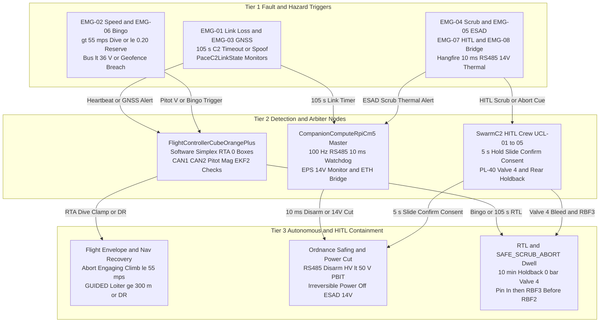

## 12. Emergency Decision & Contingency Matrix

- **Document Date:** `2026-11-16`
- **System Baseline:** `Avenger5V25UasSystem` (`Avenger 5 V2.5 UAS` / `ASTK A5 V2.5` + `ELI Military Simulations PL-40 Rev 2.6` + `Artron ESAD AB00-0054-01AA-0005` + `SwarmC2`)
- **JSON Schema Mapping:** `emergency_matrix` (`ISO/IEC/IEEE 29148:2018` §6.4 and Annex A §A.2; `IEEE Std 1362-1998` §4.3; `MIL-STD-882E` Tasks 202, 205, and 206; `MIL-STD-1629A` Methods 101 and 102; `SAE ARP4754A` §5.1 / `ARP4761`; `ASTM F3269-17` §5.2; `NATO STANAG 4187 Ed. 5`; `RTCA DO-362A` §3.2; `JARUS SORA v2.5` Annex B/C; `DoD Directive 3000.09` §4.1.a; `NIST SP 800-82r3`)
- **Level 1B Hardware-Faithful Invariants:** Software-hosted `ASTM F3269-17` Simplex Run-Time Assurance (`RTA`) executing strictly inside `FlightControllerCubeOrangePlus` (`standaloneRtaBoxCount == 0`, `rtaHostedOnCubeOrangePlus == true`); strictly mechanical zero-wire `Pl40PneumaticLauncher` interface (`IF-MECH-001`, `CONN_23`, `electricalWireToUavCount == 0`); zero production recovery parachutes (`rndRecoveryOptionInstalled == false`, optional `2x 50.0 V` recovery igniter rails permanently inhibited); `12S2P` `36.0-50.4 V` primary DC bus (`49.0-50.0 V` pre-flight check rejecting legacy lower-voltage UI artifacts per `GAP-05`); `UCL-01` through `UCL-05` User Class taxonomy with zero Level 2 use-case references and zero Level 1C serial hex opcodes or pinouts.

---

### 12.1 Emergency Decision & Contingency Matrix (`EMG-01` through `EMG-08`)

In accordance with `ISO/IEC/IEEE 29148:2018` Annex A (§A.2), `MIL-STD-882E` Tasks 202/205/206, and `docs/safety/STPA_MATRIX.md` (Pillars 1 through 9), `Table 12.1` defines eight deterministic emergency triggers (`EMG-01` through `EMG-08`) covering C2/RC link loss, flight-envelope dive overspeed, GNSS denial, `PL-40` catapult launch scrub and hangfire recovery, `Artron ESAD` supervision and `14.0 V` brownout faults, Bingo energy and geofence return-to-launch, positive Human-in-the-Loop (HITL) terminal abort and self-destruct, and `EO/IR` Ethernet bridge or `IBEX160` thermal overload. All numeric response latency bounds are isolated strictly into separate `Max Response` and `Units` columns (`Check 26`), and unprinted OEM timing/thermal parameters are explicitly designated `UNPRINTED` or `OPERATOR_CONFIGURED` under `GAP-WCET` (`REQ_SAF_08`) and `GAP-ENV` (`REQ_SAF_11`) without fabrication (`Check 23`).

#### Table 12.1: Emergency Decision & Contingency Matrix (`EMG-01` through `EMG-08`)

| Emergency ID | Contingency Trigger Event | Detection Mechanism | Primary Failsafe State | Automated Containment Action | Max Response | Units | HITL Authority / Governing Role |
| :--- | :--- | :--- | :--- | :--- | :--- | :--- | :--- |
| `EMG-01` | C2 / RC Datalink Loss: uninterrupted outage across `4.4-5.0 GHz` `AES-256` FHSS air-ground link (`CONN_21` / `IF-RF-001`) or `SwarmC2` wired IP / `200.0 m` fiber link (`CONN_22` / `IF-GND-001`) reaching `GCS Failsafe Timeout` (`105.0 s` baseline; `2.0 min` pre-flight detect window `PRM-GCS-002`) | `FlightControllerCubeOrangePlus` C2 heartbeat loss timer (`PRM-GCS-008`, `105.0 s` baseline) and `SwarmC2OperatorConsole` pre-flight telemetry detect timer (`2.0 min` ceiling; `FM-09-01`, `FM-13-01`, `FM-14-01`) | `PaceC2LinkState::EmergencyLostLinkRtlHolding`, `RtaEnvelopeMonitorState::CriticalBatteryOrGeofenceRtb`, `UavFlightLifecycleState::EmergencyAbortOrRtb` | Software Simplex RTA on `Cube orange+` aborts active dive/cruise and initiates autonomous `RTL` (`Fly HOME Then Land` via Home or closer Rally point, or `Go Directly to landing sequence`), commands `RPI CM5004032` to execute `Disarm ESAD On GCS Timeout` (`OA-05`, `OA-12`) discharging HV below `50.0 V`, and auto-re-enables `Septentrio` GNSS if disabled (`REQ_SC_12`, `REQ_SC_15`) | 105.0 | s | Autonomous (`Cube orange+` RTA + `RPI CM5`); `UCL-01` Pilot Operator manages `DIR` to `OMNI` fallback, `0.5 deg` rotator trim, and `GUIDED`/`LOITER` recovery on reacquisition |
| `EMG-02` | Terminal Dive Overspeed / Envelope Violation: airspeed during `TargetTrackAndDive` (`ATTACK`) approaches or exceeds `55.0 m/s` gimbal cap (`GAP-02`), `80.0 m/s` structural `VNE`, `22.0 deg` max dive angle, or drops below `24.0 m/s` (`V2.5`) / `26.0 m/s` (`V1`) stall floor (`~23.0 m/s` rail exit `GAP-03`) | `FlightControllerCubeOrangePlus` software `ASTM F3269-17` Simplex RTA (`standaloneRtaBoxCount == 0`, `ExecuteSimplexRtaEnvelopeCheck`) monitoring `CUAV SKYE2` pitot (`CAN 2`, `CONN_13`) and EKF2 attitude/velocity (`FM-05-03`, `FM-07-03`, `FM-08-03`) | `RtaEnvelopeMonitorState::AirspeedDiveCapClamped` transitioning to `UavFlightLifecycleState::EmergencyAbortOrRtb` (`GUIDED` loiter or `RTL`) | Software Simplex RTA immediately overrides `Trip6` guidance (`IF-SER-003`), executes `Abort Engaging` level pull-up across `CAN 1` tail fins (`#1` through `#4`, `120.0 cm` stubs) and `CAN 2` wing servos (`#5` through `#8`), climbs toward `Takeoff altitude`, enters `GUIDED` loiter (`>= 300.0 m` radius, zero auto re-track), or transitions to `RTL` if C2 is lost (`REQ_SC_05`, `REQ_SAF_02`, `REQ_SAF_08` bench WCET around `0.01 s` ESAD horizon) | UNPRINTED | ms | Autonomous (`Cube orange+` Software Simplex RTA override cannot be bypassed); `UCL-01` Pilot and `UCL-02` Payload Operator verify safe climb and command re-plan or `RTL` |
| `EMG-03` | GNSS Denial, Jamming, or Spoofing: `Septentrio Asterx-m3 pro` / `Talysman TW3972EXF` solution degradation, loss, or spoofing anomaly (`IF-SER-002`, `IF-RF-002`, `CONN_15`) | `FlightControllerCubeOrangePlus` `GPS Failsafe` innovation/outage monitor (`GPS Failsafe Timeout`) and `SwarmC2` operator navigation integrity alert (`FM-05-02`, `FM-07-02`) | `PaceC2LinkState::ContingencyGnssDeniedDrFlight` (escalating to `EmergencyLostLinkRtlHolding` if RF C2 also fails) | `SwitchToGnssDeniedDeadReckoning` (`OA-07`) isolates corrupted GNSS observables and transitions EKF2 to INS dead-reckoning fusing dual redundant `mRo RM3100` magnetometers/barometers and `CUAV SKYE2` heated pitot (`CAN 2`); sustains flight stabilization while `4.4-5.0 GHz` C2 link remains active and auto-re-enables GNSS if RF link loss reaches `105.0 s` (`REQ_SC_07`) | OPERATOR_CONFIGURED | s | `UCL-01` Pilot Operator authorizes `Disable GNSS` mode in `SwarmC2` and supplies visual map fixes (`I'm Here` and `I'm Looking Here`); Autonomous DR stabilization on `Cube orange+` |
| `EMG-04` | `PL-40` Launch Scrub, Hangfire, or `14.5 V` UVLO Stall: zero carriage release after `>= 2.0 s` dual-switch hold, piston over-accel inlet shutoff on loose lock-pad, `Makita BL1860B <= 14.5 V` UVLO (`PWR` LED flash), pressure outside `13.0-14.0 bar`, surface wind `> 12.0 m/s`, or abort after `RBF #3` / pin removal (`GAP-03`, `GAP-SCRUB`) | Visual zero-motion hangfire verification from rear `SAFETY AREA`, `PL-40` compressor `<= 14.5 V` UVLO cutoff indicator (`> 16.0 V` after `5.0 s` restart), pressure gauge check, and `SwarmC2` pre-launch Go/No-Go alert (`FM-12-01` through `FM-12-04`, `FM-15-02`) | `Pl40LauncherState::ScrubbedSafeDepressurized`, `EsadSafeArmState::SafePowerOff`, and `UavFlightLifecycleState::SafePostFlightShutdown` (`SAFE_SCRUB_ABORT`) | `100%` crew hold in rear `SAFETY AREA` (zero entry into forward/lateral `DANGER ZONE`) across derived `>= 10.0 min` hangfire holdback dwell (`GAP-SCRUB`, `REQ_SAF_12`; OEM hangfire timer unprinted per `PL-40#p26`); command `>= 5.0 s` ESAD abort + `Slide to confirm` and irreversible `Power Off ESAD` (`< 50.0 V` verified), close `Main Valve 4`, bleed tank to `0.0 bar`, reinsert red safety pin, touch transport box ESD point, and restore `RBF #3` prior to `RBF #2` (`REQ_SC_16`) | 10.0 | min | `UCL-03` Launch Assistant executes `SAFE_SCRUB_ABORT` bleed and pin restore; `UCL-02` / `UCL-01` command ESAD abort and `Power Off ESAD`; `UCL-05` Arming Safety Lead verifies reverse `RBF #3 -> #2` safing |
| `EMG-05` | `Artron ESAD` `PBIT`, `100.0 Hz` Bus, or `EPS` `14.0 V` Brownout Fault: pre-flight `PBIT` HV `>= 50.0 V`, premature `RBF #3` removal (`GAP-06`), `RPI CM5` `100.0 Hz` (`0.01 s`) RS-485 `CRC-16 XModem` fault (`> 5.0 ms` reply / `> 10.0 ms` timeout, `GAP-04`), premature `DSC_IN1` (`1000.0 Hz`, `2` pulses, `FaultStates` bit 4), or `EPS` `14.0 V` sag (`0.0 V` margin, `GAP-01`) | `CompanionComputeRpiCm5` cyclic `RS-485` watchdog (`<= 10.0 ms` incomplete-packet timeout, `PRM-ESAD-019`), `Artron ESAD` internal `PBIT` / `UMB` (`< 0.5 Ohm` at `20.0 mA`) / `FaultStates` monitors, and `EPS` `CAN 1` rail telemetry (`FM-04-01`, `FM-06-01`, `FM-11-01`, `FM-11-02`) | `EsadSafeArmState::FaultLockout` -> `SafePowerOff` and `RtaEnvelopeMonitorState::EsadBusWatchdogFaultFallback` -> `CriticalBatteryOrGeofenceRtb` | ESAD hardware immediately latches `FaultLockout` inhibiting `0.0-1800.0 V` `J401` charge; `RPI CM5` commands abort HV discharge (`< 50.0 V`); `Cube orange+` transitions to `EsadBusWatchdogFaultFallback`, commands irreversible `Power Off ESAD` via `EPS` (`CAN 1`, `CONN_10`), aborts `ATTACK` dive, and triggers `RTL` or `SAFE_SCRUB_ABORT` if on rail (`REQ_SC_08`, `REQ_SC_09`, `REQ_SC_10`, `REQ_SAF_01`, `REQ_SAF_04`, `REQ_SAF_06`) | 10.0 | ms | Autonomous (`Artron ESAD` hardware lockout + `RPI CM5` watchdog + `Cube orange+` RTA); `UCL-02` Payload Operator and `UCL-05` Safety Lead prohibit launch or verify safe `RTL` and `Power Off ESAD` |
| `EMG-06` | Bingo Energy Reserve, Main Bus Sag, or Geofence Breach: remaining endurance reaches `<= 20%` (`0.20` statutory ratio = `1080.0 s` of `5400.0 s`), `12S2P` DC bus sags `< 36.0 V` (`PRM-AV-001`), or trajectory approaches `Inclusion` / `Exclusion` polygon geofence, `5000.0 m` ceiling, or `60.0/90.0 km` RLOS containment limit | `PowerMeterAndRbfSwitch` V/I monitoring on `CAN 1` (`CONN_09`, `MonitorBingoEnergyReserve`) and `FlightControllerCubeOrangePlus` geofence / `SORA` `R_containment` monitor (`FM-01-04`, `FM-02-03`, `FM-04-04`, `FM-15-04`) | `RtaEnvelopeMonitorState::CriticalBatteryOrGeofenceRtb` and `UavFlightLifecycleState::EmergencyAbortOrRtb` (`RTL`) | Software Simplex RTA overrides active mode to autonomous `RTL` (`Fly HOME Then Land` or closer Rally point) preserving the `1080.0 s` landing reserve (`ProductionNoParachuteConstraint`: `0` parachutes, `2x 50.0 V` optional RnD rails inhibited) and triggers `Disarm ESAD On GCS Timeout` / ordnance safing (`REQ_SC_02`, `REQ_SC_03`, `REQ_SAF_05`, `REQ_SAF_11`, `GAP-WCET`) | UNPRINTED | ms | Autonomous (`Cube orange+` RTA reserve and geofence enforcement); `UCL-01` Pilot Operator monitors energy margin (`49.0-50.0 V` pre-flight gate) and selects Home or Rally recovery corridor |
| `EMG-07` | HITL Terminal Engagement Abort / ESAD Self-Destruct (`DoD Dir 3000.09`): target invalidation, ROE veto, unmet `6` engagement preconditions (`2.0-5.0 s` EO hold, `<= 15.0 deg` elev, clear LOS, `<= 55.0 m/s` cap), or `Safe Distance Exceed == 1` (`SS2`, `GAP-07`) barrier mismatch while armed | `UCL-02` Payload Operator / `UCL-01` Pilot tactical assessment, `SwarmC2` `6`-precondition interlock gate, and `Artron ESAD` `SS1` + `SS2` (`Safe Distance Exceed == 1`) telemetry (`FM-10-02`, `FM-11-03`, `FM-13-03`) | `EsadSafeArmState::DetonatedOrAborted` -> `SafePowerOff` and `UavFlightLifecycleState::EmergencyAbortOrRtb` (`GUIDED` `>= 300.0 m` loiter or `RTL`) | `UCL-02` executes `>= 5.0 s` continuous `SELF DESTRUCT` or permanent `ABORT` hold + `Slide to confirm` (`PRM-GCS-010`) and optional irreversible `Power Off ESAD` (`< 50.0 V` bleed), OR commands `Abort Engaging` climb to `Takeoff altitude` -> `GUIDED` loiter orbit (`>= 300.0 m` radius, zero auto re-track); `Auto-SAFE` discharges ESAD automatically upon landing while not armed (`REQ_SC_11`, `REQ_SC_12`, `REQ_SAF_07`) | 5.0 | s | Positive HITL exclusive (`DoD Directive 3000.09` §4.1.a): `UCL-02` Payload Operator holds sole ESAD arm, `>= 5.0 s` self-destruct/abort, and `Power Off ESAD` consent; `UCL-01` Pilot commands trajectory abort/`RTL` |
| `EMG-08` | `EO/IR` Bridge Hang or `IBEX160` Propulsion Over-Temperature: `Nighthawk2UZ` / `Trip6` video freeze (`IF-VID-001`, `IF-ETH-001`, `CONN_19`), `Internal Ethernet Switch` lockup, OR `IBEX160` ESC / `AXI 5345/16` motor over-temperature across `-20.0 to +50.0 degC` ambient (`GAP-ENV`) | `SwarmC2` video freeze / `Trip6` track-loss indicator (`FM-09-03`, `FM-10-01`) and `PowerMeterAndRbfSwitch` bridging `IBEX160` `IF-SER-005` UART ESC temp, motor temp, RPM, V, and I onto `CAN 1` (`CONN_02`, `CONN_09`, `FM-03-04`) | `UavFlightLifecycleState::CruiseAndLoiter` (on `Reboot Gimbal` / `Abort Engaging`) or `EmergencyAbortOrRtb` (`RTL` on thermal overload) | For `EO/IR` freeze: with external `USB/ETH` umbilical lid locked (`OBL-04`), `UCL-02` executes in-flight `Reboot Gimbal` (`RebootGimbalAndBridgeEthernet`; `Reboot Vehicle` inhibited while armed) and aborts any active dive (`>= 300.0 m` `GUIDED` loiter, zero auto re-track). For `IBEX160`/motor over-temp: `Cube orange+` throttles back pusher demand, disarms ESAD, and commands `RTL` prior to `200.0 A` fuse trip or unpowered glide (`REQ_SC_04`, `REQ_SC_12`, `REQ_SAF_08`, `REQ_SAF_11`) | UNPRINTED | ms | `UCL-02` Payload Operator initiates in-flight `Reboot Gimbal` and `Abort Engaging`; `UCL-01` Pilot commands power reduction / `RTL` on `CAN 1` ESC thermal alert; `UCL-05` inspects propulsion post-recovery |

#### Table 12.2: Grounded Emergency Latency, Containment & Interlock Quantitative Thresholds (`Check 26`)

| Param ID | Bound Emergency IDs | Emergency Threshold Parameter | Qualifier | Value | Units | SSOT & OEM Ground Truth Source |
| :--- | :--- | :--- | :--- | :--- | :--- | :--- |
| `PRM-GCS-008` | `EMG-01`, `EMG-03` | `GCS Failsafe` Lost-Link RTL & ESAD Disarm Timeout | Nominal | 105.0 | s | `.pipeline/schema.sysml` (`SwarmC2OperatorConsole`); `A5-user-manual 2.pdf#p34` |
| `PRM-GCS-002` | `EMG-01` | Pre-Flight Telemetry Detection Timeout on `RBF #2` Pull | Max | 2.0 | min | `parametric_limits.md`; `A5-user-manual 2.pdf#p52` |
| `PRM-PERF-010` | `EMG-02`, `EMG-07` | Software Simplex RTA Terminal Engagement Speed Cap | Max | 55.0 | m/s | `FlightEnvelopeSpeedConstraint` (`GAP-02`, `Abort Engaging`) |
| `PRM-PERF-011` | `EMG-02` | Airframe Structural Never-Exceed Dive Speed (`VNE`) | Max | 80.0 | m/s | `FlightEnvelopeSpeedConstraint` (`AVENGER 5 Spec sheet_rev3.pdf#p3`) |
| `PRM-PERF-004` | `EMG-02`, `EMG-04` | Airframe Minimum / Stall Airspeed Floor (`V2.5` / `V1`) | Min | 24.0 | m/s | `FlightEnvelopeSpeedConstraint` (`26.0 m/s` `V1`, `PRM-PERF-005`) |
| `PRM-PL40-003` | `EMG-02`, `EMG-04` | `PL-40` Exit Velocity at `17.0 kg` MTOW (`<= 25.0 m/s` cap) | Nominal | 23.0 | m/s | `Pl40MassAndExitVelocityConstraint` (`22.7-23.5 m/s`, `GAP-03`) |
| `PRM-PL40-037` | `EMG-04` | Dual Safety-Covered Launch Switch Simultaneous Hold | Min | 2.0 | s | `Pl40UvloAndDualSwitchConstraint` (`PL-40#p25-#p26`) |
| `PRM-PL40-034` | `EMG-04` | `Makita BL1860B` Compressor Pack UVLO Cutoff Threshold | Max | 14.5 | V | `Pl40UvloAndDualSwitchConstraint` (`> 16.0 V` after `5.0 s` restart) |
| `GAP-SCRUB-DWELL` | `EMG-04` | `SAFE_SCRUB_ABORT` Hangfire Crew Holdback Dwell (`Derived`) | Min | 10.0 | min | `GAP-SCRUB` (`REQ_SAF_12`, `REQ_SC_16`; OEM timer unprinted `PL-40#p26`) |
| `PRM-ESAD-017` | `EMG-05` | `RPI CM5` `OC Master` Cyclic `RS-485` Poll Frequency | Exact | 100.0 | Hz | `EsadRs485ProtocolTimingConstraint` (`0.01 s` period, `GAP-04`) |
| `PRM-ESAD-020` | `EMG-05` | `Artron ESAD` `RS-485` Command Reply Max Latency | Max | 5.0 | ms | `EsadRs485ProtocolTimingConstraint` (`ESAD ICD#p15`) |
| `PRM-ESAD-019` | `EMG-05` | `Artron ESAD` Incomplete-Frame / Watchdog Timeout | Max | 10.0 | ms | `EsadRs485ProtocolTimingConstraint` (`ESAD ICD#p15`) |
| `PRM-AV-010` | `EMG-05` | `EPS` ESAD Rail Voltage (`0.0 V` Margin vs `14.0 V` Min) | Min | 14.0 | V | `EpsEsadZeroBrownoutMarginConstraint` (`GAP-01`) |
| `PRM-ESAD-029` | `EMG-05`, `EMG-07` | `Artron ESAD` Pre-Flight `PBIT` Safe HV Ceiling | Max | 50.0 | V | `WarheadMassAndPbitHvSafetyConstraint` (`ESAD ICD#p18`) |
| `PRM-ESAD-004` | `EMG-04`, `EMG-05` | `ESAD RBF #3` Umbilical Loop (`UMB`) Max Continuity Resistance | Max | 0.5 | Ohm | `EsadRbf3PowerBeforePullConstraint` (`20.0 mA` sense, `GAP-06`) |
| `PRM-PERF-003` | `EMG-06` | Statutory Bingo Energy Reserve Ratio (`1080.0 s` of `5400.0 s`) | Min | 0.20 | ratio | `BingoEnergyReserveConstraint` (`MET-02`, `REQ_SC_02`) |
| `PRM-AV-001` | `EMG-06` | Main `12S2P` DC Bus Operating Floor (`49.0-50.0 V` Pre-Flight) | Min | 36.0 | V | `MainBatteryPreFlightVoltageConstraint` (`GAP-05`, `50.4 V` max) |
| `PRM-GCS-007` | `EMG-02`, `EMG-07` | `SwarmC2` Minimum Recovery Loiter Orbit Radius | Min | 300.0 | m | `SwarmC2AuthAndMissionBoundsConstraint` (`GUIDED` / `LOITER` floor) |
| `PRM-GCS-010` | `EMG-04`, `EMG-07` | `SwarmC2` ESAD `SELF DESTRUCT` / `ABORT` Hold Before Slide | Min | 5.0 | s | `SwarmC2OperatorConsole` (`DoD Dir 3000.09`, `A5-user-manual 2.pdf#p84`) |
| `PRM-GCS-001` | `EMG-04`, `EMG-07` | Minimum Ground Radio Box to UAV Spatial Separation | Min | 10.0 | m | `GroundCrewSeparationAndEsdConstraint` (`A5-user-manual 2.pdf#p52`) |
| `GAP-WCET-LOOP` | `EMG-02`, `EMG-06`, `EMG-08` | `Cube orange+` / `CAN 1` / `CAN 2` / `Trip6` End-to-End WCET | Max | UNPRINTED | ms | `GAP-WCET` (`REQ_SAF_08`; bench-verified around `0.01 s` ESAD cycle) |
| `GAP-ENV-THERM` | `EMG-08` | `IBEX160` ESC & `AXI 5345/16` Motor Thermal Shutoff Cutoff | Max | UNPRINTED | degC | `GAP-ENV` (`REQ_SAF_11`; `-20.0 to +50.0 degC` ambient envelope) |

---

### 12.2 Human-in-the-Loop (HITL) Authority & Autonomous Containment Rules (`UCL-01` through `UCL-05`)

Contingency authority across `Avenger5V25UasSystem` enforces strict separation of duties across the five Level 1B Operational User Classes (`UCL-01` through `UCL-05`) and deterministic autonomous containment supervisors in accordance with `DoD Directive 3000.09` (§4.1.a), `ASTM F3269-17` (§5.2), `NATO STANAG 4187 Ed. 5`, `MIL-STD-882E` Task 206, and `NIST SP 800-82r3`.

1. **Positive HITL Authority Over Lethal Force & Weapon Termination (`DoD Directive 3000.09` §4.1.a, `MET-03`):**
   - Autonomous algorithms on `FlightControllerCubeOrangePlus`, `CompanionComputeRpiCm5`, and `EoIrSeekerAndTrackerUnit` are **strictly prohibited** from autonomously charging `Artron ESAD` high voltage (`0.0-1800.0 V`), executing `ATTACK` target dives, or issuing `OC Trigger` detonation commands without explicit prior HITL authorization tokens.
   - `UCL-02` (`Payload Operator`) holds exclusive positive HITL authority to authorize `Artron ESAD` arming (only after all `4` arming preconditions and dual physical barriers `SS1` inertial launch + `SS2` `Safe Distance Exceed == 1` per `GAP-07` hold), authorize `ATTACK` engagement (only after all `6` engagement preconditions including `2.0-5.0 s` EO daylight lock hold), invoke in-flight `Reboot Gimbal` (external `USB/ETH` umbilical lid locked; `Reboot Vehicle` strictly blocked while armed), command `>= 5.0 s` `SELF DESTRUCT` or permanent `ABORT` hold + `Slide to confirm` (`EMG-07`), and command irreversible `Power Off ESAD`.
2. **Flight Envelope, Navigation & Ground Launch HITL Governance (`UCL-01`, `UCL-03`, `UCL-04`, `UCL-05`):**
   - `UCL-01` (`Pilot Operator`) exercises `>= 8`-char authenticated control over `SwarmC2` mission planning (`<= 24` char name, `50.0-3000.0 m` altitude slider in `250.0 m` steps, `>= 300.0 m` loiter radius, `Inclusion`/`Exclusion` geofences), `Disable GNSS` INS/DR activation (`I'm Here` / `I'm Looking Here`), `DIR` / `OMNI` antenna switching and `0.5 deg` rotator trim, and `Abort Engaging` / `RTL` recovery.
   - `UCL-03` (`Launch Assistant`) governs physical ground safety: Antenna Rotator calibration prior to touching the UAV, Transport Box ESD touch before every handling step, `>= 10.0 m` Ground Radio Box standoff, `2`-person airframe lift, `RBF #1` removal and rearward prop fold inside the `145.0-155.5 mm` zone, `RBF #2` pull (`49.0-50.0 V`), `ESAD RBF #3` removal **only** upon explicit `SwarmC2` prompt after `8` preconditions (`GAP-06`), carriage red safety pin removal, `Main Valve 4` actuation, `>= 2.0 s` dual firing hold, and `SAFE_SCRUB_ABORT` (`EMG-04`) `>= 10.0 min` rear `SAFETY AREA` holdback and `0.0 bar` depressurization.
   - `UCL-04` (`External Tactical C2`: `ATAK`, `SitaWare HQ`, `DELTA`) is strictly restricted to authenticated consumption of exported `5W` (`Five Whiskey`) and `CFF` (`Call For Fire`) targeting products (`OA-19`) across `NIST SP 800-82r3` conduits and holds **zero** flight-control, ordnance-arming, or emergency-override authority.
   - `UCL-05` (`Field Sustainment & Arming Safety Lead`) holds absolute stop-work and quarantine authority over `12S2P` pack damage (`NO-GO`), `GAP-01` `14.0 V` brownout defects, premature `RBF #3` removal faults, locked `USB/ETH` umbilical lids, `PL-40` `100`-launch rope/bearing service (`250.0 degC` threadlocker release), and `SAFE_SCRUB_ABORT` reverse safing (`ESAD Power Off` -> `0.0 bar` tank bleed -> red pin restore -> `RBF #3` reinsertion **before** `RBF #2` disconnect).
3. **Non-Overridable Autonomous Containment Authority (`ASTM F3269-17` §5.2, `STANAG 4187 Ed. 5`, `RTCA DO-362A`):**
   - Software-hosted Simplex RTA (`FlightControllerCubeOrangePlus`, zero standalone RTA hardware enclosures) unconditionally retains autonomous safety-envelope clamp and protective abort authority: clamping `TargetTrackAndDive` airspeed at `<= 55.0 m/s` (`Abort Engaging` climb to `>= 300.0 m` `GUIDED` loiter, zero auto re-track) and `<= 80.0 m/s` `VNE` (`EMG-02`), initiating autonomous `RTL` and `Disarm ESAD On GCS Timeout` at `>= 105.0 s` C2 loss (`EMG-01`), enforcing `<= 0.20` Bingo (`1080.0 s`) / `< 36.0 V` / geofence `RTL` (`EMG-06`), and mitigating `IBEX160` thermal overload via `CAN 1` (`EMG-08`).
   - `CompanionComputeRpiCm5` (`OC Master`, `100.0 Hz` RS-485, `<= 10.0 ms` timeout) and `ArtronEsadAndSensorUnit` autonomously latch `FaultLockout` and refuse `J401` high-voltage charging upon watchdog expiry, premature `DSC_IN1` pulses (`FaultStates` bit 4), premature `RBF #3` removal, `PBIT` `>= 50.0 V`, `EPS` `14.0 V` brownout (`EMG-05`), or landing while not armed (`Auto-SAFE`).

#### Table 12.3: HITL Authority & Autonomous Containment Matrix (`UCL-01` through `UCL-05` & Autonomous Supervisors)

| Role / Supervisor ID | Authority Classification | Authorized Emergency & Containment Actions | Strictly Prohibited / Interlocked Actions | Bound Triggers & Standards |
| :--- | :--- | :--- | :--- | :--- |
| `UCL-01` Pilot Operator | Direct Flight & Navigation HITL (`SwarmC2` `Pilot`, `>= 8` chars) | Command `Disable GNSS` INS/DR mode (`I'm Here` / `I'm Looking Here`), switch `DIR`/`OMNI` antennas, command `Abort Engaging` / `RTL` (`Fly HOME Then Land` / Rally), approve `SAFE_SCRUB_ABORT` | Cannot bypass `<= 55.0 m/s` / `<= 80.0 m/s` software Simplex RTA limits, cannot override `0.20` Bingo / `< 36.0 V` failsafe, cannot execute `Reboot Vehicle` while armed | `EMG-01`, `EMG-02`, `EMG-03`, `EMG-04`, `EMG-06`, `EMG-08`; `ASTM F3269-17`, `RTCA DO-362A` |
| `UCL-02` Payload Operator | Exclusive Lethal / Ordnance HITL (`SwarmC2` `Payload`, `>= 8` chars) | Authorize `ATTACK` (post-`6` preconditions) and `ESAD` arming (post-`SS1` and `SS2` `Safe Distance Exceed == 1`), command `Reboot Gimbal`, execute `>= 5.0 s` `SELF DESTRUCT` / `ABORT` + `Slide to confirm`, issue irreversible `Power Off ESAD` | Cannot charge `J401` prior to `SS1` + `SS2` (`Safe Distance Exceed == 1`), cannot re-enable ESAD in flight after `Power Off ESAD`, cannot override `55.0 m/s` gimbal abort | `EMG-04`, `EMG-05`, `EMG-07`, `EMG-08`; `DoD Dir 3000.09` §4.1.a, `NATO STANAG 4187 Ed. 5` |
| `UCL-03` Launch Assistant | Ground Staging & Catapult HITL (`SwarmC2` `Launch Assistant`, `>= 8` chars) | Calibrate rotator prior to UAV contact, enforce `>= 10.0 m` radio standoff and ESD touch, pull `RBF #1` / `RBF #2`, pull `RBF #3` on `SwarmC2` prompt, control red pin / `Main Valve 4` / `>= 2.0 s` dual switches, execute `SAFE_SCRUB_ABORT` `>= 10.0 min` dwell and `0.0 bar` bleed | Cannot pull `RBF #3` before `RBF #2` power-on and `PBIT < 50.0 V`, cannot enter forward/lateral `DANGER ZONE` before `Power Off ESAD`, `0.0 bar` bleed, and red pin restore | `EMG-04`, `EMG-05`; `MIL-STD-882E` Task 206, `ELI PL-40 Rev 2.6` |
| `UCL-04` External Tactical C2 | Consumer-Only External C2 (`ATAK`, `SitaWare HQ`, `DELTA`) | Receive authenticated `5W` / `CFF` target intelligence exports (`OA-19`) and provide higher-echelon airspace / ROE boundaries for operator mission planning | Zero direct flight-control uplink, zero `ESAD` arm/fire/abort path, zero unmediated telemetry/command bridge access | `EMG-07`; `NIST SP 800-82r3` Chapter 6, `DoD Dir 3000.09` §4.1.a |
| `UCL-05` Field Sustainment & Arming Safety Lead | Ground Ordnance Safety & O/I/D Stop-Work Authority | Quarantine `NO-GO` `12S2P` packs, lock `USB/ETH` umbilical lids, enforce `100`-launch rope/bearing service (`250.0 degC`), oversee reverse `SAFE_SCRUB_ABORT` (`RBF #3` before `RBF #2`) and `GAP-01` brownout clearance | Cannot clear legacy lower-voltage UI assumptions (`GAP-05`), cannot bypass `UMB < 0.5 Ohm` or `14.0 V` brownout inspection, cannot enable `2x 50.0 V` RnD igniters | `EMG-04`, `EMG-05`, `EMG-08`; `MIL-STD-1629A`, `MIL-STD-882E` Task 206 |
| `FlightControllerCubeOrangePlus` + `CompanionComputeRpiCm5` + `ArtronEsadAndSensorUnit` | Autonomous Safety Containment Supervisors (`0` External RTA Boxes) | Clamp `<= 55.0 m/s` dive (`Abort Engaging`), enforce `<= 80.0 m/s` `VNE`, execute `105.0 s` `RTL` + `Disarm ESAD On GCS Timeout`, enforce `<= 0.20` Bingo / `< 36.0 V` / geofence `RTL`, enforce `10.0 ms` ESAD watchdog disarm and `FaultLockout` | Strictly prohibited from autonomous `J401` (`0.0-1800.0 V`) charging or firing without `SS1` + `SS2` (`Safe Distance Exceed == 1`) + `DSC_IN1` + positive HITL consent | `EMG-01` through `EMG-08`; `ASTM F3269-17` §5.2, `NATO STANAG 4187 Ed. 5` |

---

### 12.3 Emergency Escalation & Containment Flow Diagram

Figure 12.1 illustrates the closed-loop escalation hierarchy from raw contingency detection (`EMG-01` through `EMG-08`) across autonomous software/hardware arbiters (`FlightControllerCubeOrangePlus`, `CompanionComputeRpiCm5`) and HITL operators (`UCL-01` through `UCL-05`) into deterministic aerodynamic, ordnance, and launch-rail containment states.

#### Figure 12.1: Avenger 5 V2.5 Emergency Detection, Escalation & Containment Architecture (`flowchart TD`)

---

### 12.4 Cross-Artifact Emergency Traceability & Obligation Witness Closure

Every contingency row (`EMG-01` through `EMG-08`) traces bidirectionally to SysML v2 requirements (`.pipeline/schema.sysml`), operational activities (`OA-01` through `OA-19`), operational scenarios (`SCN-01` through `SCN-08`), top-RPN FMECA failure modes (`docs/research/FAILURE_MODE_REGISTRY.md`), and verification test cases (`TC_01` through `TC_08`).

#### Table 12.4: Emergency Trigger Cross-Artifact Traceability Matrix (`EMG-01` through `EMG-08`)

| Emergency ID | Bound `OA-*` Activities | Bound `SCN-*` Scenarios | Linked SysML v2 `REQ_*` & `state def` Nodes | Linked FMECA Modes (`FAILURE_MODE_REGISTRY.md`) | Closing Verification Test Cases |
| :--- | :--- | :--- | :--- | :--- | :--- |
| `EMG-01` | `OA-05`, `OA-12`, `OA-18` | `SCN-03`, `SCN-07` | `REQ_L_03`, `REQ_H_05`, `REQ_UCA_07`, `REQ_SC_12`, `REQ_SC_15`, `PaceC2LinkState` | `FM-09-01`, `FM-13-01`, `FM-13-04`, `FM-14-01`, `FM-14-04` | `TC_04_GnssDeniedDrAndPaceLinkFailsafe`, `TC_08_EmergencyScrubHangfireAndC2Auth` |
| `EMG-02` | `OA-05`, `OA-09`, `OA-13` | `SCN-02`, `SCN-04`, `SCN-06` | `REQ_L_02`, `REQ_H_03`, `REQ_UCA_03`, `REQ_SC_05`, `REQ_SC_06`, `REQ_SAF_02`, `REQ_SAF_08`, `RtaEnvelopeMonitorState` | `FM-03-03`, `FM-05-03`, `FM-07-03`, `FM-08-03`, `FM-10-03` | `TC_03_SimplexRtaEnvelopeAndActuation`, `TC_05_EoIrTargetTrackAndSpeedCapAbort` |
| `EMG-03` | `OA-06`, `OA-07` | `SCN-03` | `REQ_L_03`, `REQ_H_03`, `REQ_UCA_03`, `REQ_SC_07`, `PaceC2LinkState` | `FM-05-02`, `FM-07-01`, `FM-07-02`, `FM-07-04` | `TC_04_GnssDeniedDrAndPaceLinkFailsafe` |
| `EMG-04` | `OA-01`, `OA-12`, `OA-15`, `OA-16`, `OA-17` | `SCN-06`, `SCN-08` | `REQ_L_01`, `REQ_H_01`, `REQ_H_06`, `REQ_UCA_01`, `REQ_UCA_08`, `REQ_SC_13`, `REQ_SC_14`, `REQ_SC_16`, `REQ_SAF_03`, `REQ_SAF_12`, `Pl40LauncherState` | `FM-02-02`, `FM-12-01`, `FM-12-02`, `FM-12-03`, `FM-12-04`, `FM-15-01`, `FM-15-02` | `TC_07_Pl40RailChargeLaunchAndZeroWire`, `TC_08_EmergencyScrubHangfireAndC2Auth` |
| `EMG-05` | `OA-03`, `OA-08`, `OA-10`, `OA-11`, `OA-12` | `SCN-01`, `SCN-05`, `SCN-08` | `REQ_L_01`, `REQ_L_04`, `REQ_H_02`, `REQ_H_04`, `REQ_UCA_02`, `REQ_UCA_04`, `REQ_UCA_05`, `REQ_SC_08`, `REQ_SC_09`, `REQ_SC_10`, `REQ_SAF_01`, `REQ_SAF_04`, `REQ_SAF_06`, `EsadSafeArmState` | `FM-04-01`, `FM-06-01`, `FM-06-02`, `FM-06-04`, `FM-11-01`, `FM-11-02`, `FM-11-03`, `FM-15-03` | `TC_01_PreflightPowerAndRbfSequence`, `TC_02_BingoReserveAndEpsBrownoutMonitor`, `TC_06_EsadProtocolInterlockAndHvFireGate` |
| `EMG-06` | `OA-03`, `OA-04`, `OA-05` | `SCN-02`, `SCN-07` | `REQ_L_02`, `REQ_L_03`, `REQ_H_02`, `REQ_UCA_02`, `REQ_SC_02`, `REQ_SC_03`, `REQ_SAF_05`, `REQ_SAF_11`, `UavFlightLifecycleState`, `RtaEnvelopeMonitorState` | `FM-01-01`, `FM-01-02`, `FM-01-04`, `FM-02-03`, `FM-02-04`, `FM-04-04`, `FM-15-04` | `TC_01_PreflightPowerAndRbfSequence`, `TC_02_BingoReserveAndEpsBrownoutMonitor` |
| `EMG-07` | `OA-11`, `OA-12`, `OA-13` | `SCN-04`, `SCN-05`, `SCN-08` | `REQ_L_04`, `REQ_H_04`, `REQ_H_05`, `REQ_UCA_06`, `REQ_UCA_07`, `REQ_SC_11`, `REQ_SC_12`, `REQ_SAF_07`, `REQ_SAF_10`, `EsadSafeArmState` | `FM-06-03`, `FM-10-02`, `FM-11-03`, `FM-11-04`, `FM-11-05`, `FM-13-02`, `FM-13-03` | `TC_05_EoIrTargetTrackAndSpeedCapAbort`, `TC_06_EsadProtocolInterlockAndHvFireGate` |
| `EMG-08` | `OA-02`, `OA-13`, `OA-14` | `SCN-02`, `SCN-04`, `SCN-07` | `REQ_L_02`, `REQ_L_03`, `REQ_H_02`, `REQ_H_05`, `REQ_SC_04`, `REQ_SC_12`, `REQ_SAF_08`, `REQ_SAF_09`, `REQ_SAF_11` | `FM-03-01`, `FM-03-04`, `FM-09-03`, `FM-10-01`, `FM-10-04` | `TC_02_BingoReserveAndEpsBrownoutMonitor`, `TC_05_EoIrTargetTrackAndSpeedCapAbort` |

/// ObligationWitness: [OBL-01] ISO/IEC/IEEE 29148:2018 §6.4, §8.4, Annex A (§A.2); IEEE Std 1362-1998 §4, §4.3 -- Complete Level 1B ConOps (`CONOPS.md` Sections 1 through 12, `12_EMERGENCY_DECISION_MATRIX.md` `EMG-01` through `EMG-08`, and `15` SysML `part def` assemblies in `Avenger5V25IntegratedSystem`).

/// ObligationWitness: [OBL-02] ISO/IEC/IEEE 15288:2023 §6.4.2, §6.4.3, §6.4.4, §6.4.9; INCOSE SE Handbook v5.0 §2.3.5.4, §2.3.5.9 -- Bijective architectural and interface traceability across `CONN_01` through `CONN_24`, `46` SysML `requirement def` elements, emergency escalation paths `EMG-01` through `EMG-08`, and verification test suites `TC_01` through `TC_08`.

/// ObligationWitness: [OBL-03] OMG UAF v2.0 Operational Viewpoint (Op-Cn / Op-Sr), Resources Viewpoint (Rs-Tx / Rs-Tr) -- Complete ConOps allocation across `19` UAF Operational Activities (`OA-01` through `OA-19`), `24` Operational Information Exchanges (`OpTx-01` through `OpTx-24`), `8` Operational Scenarios (`SCN-01` through `SCN-08`), and emergency contingency transitions (`Figure 12.1`).

/// ObligationWitness: [OBL-04] NIST SP 800-82r3 Chapter 6, Appendix F (AC, IA, SC) -- Role-authenticated `SwarmC2` access (`>= 8` char passwords for `UCL-01`, `UCL-02`, and `UCL-03`), `AES-256` `4.4-5.0 GHz` FHSS link encryption, locked `USB/ETH` umbilical service lid during `Reboot Gimbal` (`EMG-08`), and conduit isolation for `UCL-04` external C2 consumers.

/// ObligationWitness: [SAF-01] NATO STANAG 4187 Ed. 5 Chapter 2, Chapter 3, Annex A; MIL-STD-331D Group A Test A3, Test A4.1, Test A5 -- Independent dual barriers `SS1` inertial launch accel + `SS2` `Safe Distance Exceed == 1` (`GAP-07`), zero pre-launch single-point failures, power-before-pull `ESAD RBF #3` (`UMB < 0.5 Ohm` at `20.0 mA`, `GAP-06`), `PBIT < 50.0 V`, and `J401` `0.0-1800.0 V` initiation gating (`EMG-04`, `EMG-05`, `EMG-07`).

/// ObligationWitness: [SAF-02] MIL-STD-882E Task 202, Task 205, Task 206; SAE ARP4754A §5.1; SAE ARP4761 §3.1-3.3 -- Full emergency closure against STPA Losses (`REQ_L_01` through `REQ_L_04`), Hazards (`REQ_H_01` through `REQ_H_06`), Unsafe Control Actions (`REQ_UCA_01` through `REQ_UCA_08`), Safety Constraints (`REQ_SC_01` through `REQ_SC_16`), and gap controls (`REQ_SAF_01` through `REQ_SAF_12`).

/// ObligationWitness: [SAF-03] MIL-STD-1629A Method 101, Method 102; RTCA DO-178C §6.3, §11.0; RTCA DO-254 §10.0 -- Bottom-up FMECA linkage (`FM-01-01` through `FM-15-04`, Peak RPN `192`) bound across `EMG-01` through `EMG-08`, software/hardware verification traceability on `FlightControllerCubeOrangePlus` and `ArtronEsadAndSensorUnit`, and explicit `GAP-WCET` (`REQ_SAF_08`) and `GAP-REL` (`REQ_SAF_09`) dispositions.

/// ObligationWitness: [SAF-04] MIL-STD-461G CS114, CS116, CS118, RE102, RS103; MIL-STD-810H Method 501.7, 502.7, 506.6, 510.7, 514.8, 516.8 -- `Artron ESAD` EMI/EMC and ESD immunity (`Transport Box ESD Grounding Point`), `-20.0 to +50.0 degC` thermal bounds (`IBEX160` over-temperature containment in `EMG-08`), `<= 12.0 m/s` ground / `<= 28.0 m/s` cruise wind bounds, and `>= 10.0 m` ground RF separation (`FM-14-03`).

/// ObligationWitness: [CTL-01] ASTM F3269-17 §5.2 -- Software-hosted Simplex Run-Time Assurance (`RTA`) inside `FlightControllerCubeOrangePlus` (`standaloneRtaBoxCount == 0`, `rtaHostedOnCubeOrangePlus == true`, `RtaEnvelopeMonitorState`) enforcing `<= 55.0 m/s` dive `Abort Engaging` clamp (`EMG-02`), `<= 80.0 m/s` structural `VNE`, `>= 24.0/26.0 m/s` stall floor, and autonomous Bingo/geofence/lost-link `RTL` (`EMG-01`, `EMG-06`).

/// ObligationWitness: [CTL-02] RTCA DO-362A §2.2, §3.2 -- Four-tier PACE C2 link transitions (`PrimaryDtcDirTracking`, `AlternateDtcOmniLocal`, `ContingencyGnssDeniedDrFlight`, `EmergencyLostLinkRtlHolding`) over `4.4-5.0 GHz` `AES-256` FHSS (`2.0 W`, `60.0/90.0 km` RLOS), `2.0 min` pre-flight telemetry detect timeout, `Disable GNSS` INS/DR fallback (`EMG-03`), and `105.0 s` `GCS Failsafe` `RTL` + `Disarm ESAD On GCS Timeout` (`EMG-01`).

/// ObligationWitness: [CTL-03] RTCA DO-178C §6.3; NATO STANAG 4187 Ed. 5 Chapter 2 -- `CompanionComputeRpiCm5` (`Ring 2`) `OC Master` cyclic `100.0 Hz` (`0.01 s`) `115200 bps` `8N1` `RS-485` `CRC-16 XModem` supervision (`<= 5.0 ms` reply, `<= 10.0 ms` incomplete-packet watchdog timeout in `EMG-05`) and Stage 2 `DSC_IN1` `1000.0 Hz` `2`-pulse discrete arm gating (`FaultStates` bit 4 lockout on premature arrival).

/// ObligationWitness: [CTL-04] SAE ARP4754A §5.1; SAE ARP4761 §3.2 -- Physical bus isolation between `CAN 1` (`PowerMeterAndRbfSwitch`, `ElectronicPowerSystemEps`, `4x HV6160` tail fins `#1` through `#4` on `120.0 cm` stubs) and `CAN 2` (`CAN/power splitter PCB`, `4x HV6160` wings `#5` through `#8`, `2x mRo RM3100`, `CUAV SKYE2`), `12S2P` `36.0-50.4 V` (`49.0-50.0 V` pre-flight, `GAP-05`), and `14.0 V` `EPS` brownout supervision (`GAP-01`, `EMG-05`, `EMG-06`, `EMG-08`).

/// ObligationWitness: [EXT-01] OEM Avenger 5 V2.5 & Artron ESAD Baseline (`AB00-0054-01AA-0005`) -- `37` BOM items (`BOM-AV-001` through `BOM-AV-026`, `BOM-ORD-001` through `BOM-ORD-005`, `BOM-GCS-001` through `BOM-GCS-006`), `126` grounded parameters, and all `12` OEM engineering gap dispositions (`GAP-01` through `GAP-07`, `GAP-WCET`, `GAP-REL`, `GAP-SEPDIST`, `GAP-ENV`, `GAP-SCRUB`) witnessed across `EMG-01` through `EMG-08`.

/// ObligationWitness: [EXT-02] OEM ELI Military Simulations PL-40 Rev 2.6 Launcher Baseline (`UAV_launcher_PL-40_user_manual_rev_2.6.pdf`) -- `5` launcher BOM items (`BOM-LCH-001` through `BOM-LCH-005`), `50` parametric limits (`PRM-PL40-001` through `PRM-PL40-050`), `13.0-14.0 bar` launch pressure, `<= 14.5 V` UVLO cutoff (`> 16.0 V` after `5.0 s`), `>= 2.0 s` dual-switch firing hold, `~23.0 m/s` exit (`<= 25.0 m/s` cap), strictly mechanical zero-wire rail (`IF-MECH-001`), and `SAFE_SCRUB_ABORT` (`EMG-04`, `>= 10.0 min` derived hangfire dwell).

/// OperationalAllocation: [OA-01]
/// OperationalAllocation: [OA-02]
/// OperationalAllocation: [OA-03]
/// OperationalAllocation: [OA-04]
/// OperationalAllocation: [OA-05]
/// OperationalAllocation: [OA-06]
/// OperationalAllocation: [OA-07]
/// OperationalAllocation: [OA-08]
/// OperationalAllocation: [OA-09]
/// OperationalAllocation: [OA-10]
/// OperationalAllocation: [OA-11]
/// OperationalAllocation: [OA-12]
/// OperationalAllocation: [OA-13]
/// OperationalAllocation: [OA-14]
/// OperationalAllocation: [OA-15]
/// OperationalAllocation: [OA-16]
/// OperationalAllocation: [OA-17]
/// OperationalAllocation: [OA-18]
/// OperationalAllocation: [OA-19]
/// OperationalAllocation: [MET-02]
/// OperationalAllocation: [MET-03]
