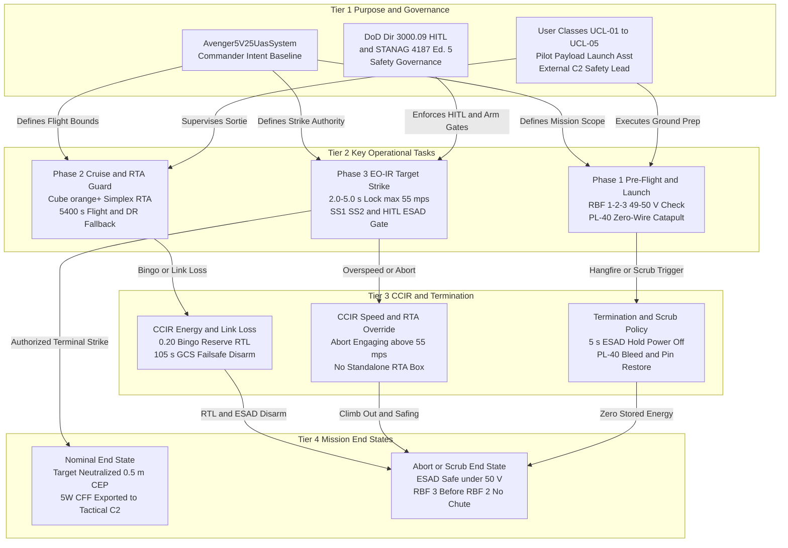

## 1. Commander's Intent & High-Level Operational Objectives

- **System Baseline:** `Avenger5V25UasSystem` (`Avenger5V25IntegratedSystem`: `Avenger 5 V2.5 UAS` / `ASTK A5 V2.5` + `ELI Military Simulations PL-40 Rev 2.6` + `Artron ESAD AB00-0054-01AA-0005` + `SwarmC2`)
- **Normative Baseline Date:** `2026-11-16`
- **Governing Standards & SSOT Anchors:** `ISO/IEC/IEEE 29148:2018 §6.4, Annex A (§A.2)`, `ISO/IEC/IEEE 15288:2023 §6.4.2, §6.4.3, §6.4.4`, `IEEE Std 1362-1998 §4, §4.3`, `INCOSE SE Handbook v5.0 §2.3.5.4`, `OMG UAF v2.0 Operational Viewpoint`, `NATO STANAG 4187 Ed. 5 Chapter 2, Chapter 3, Annex A`, `MIL-STD-882E Task 202, Task 205, Task 206`, `ASTM F3269-17 §5.2`, `RTCA DO-362A §2.2, §3.2`, `JARUS SORA v2.5 Annex B, Annex C`, `NIST SP 800-82r3 Chapter 6, Appendix F`, and `DoD Directive 3000.09 §4.1.a` (traceable to `docs/research/RESEARCH_INVENTORY.md` and `.pipeline/schema.sysml`).

---

### 1.1 Operational Purpose

The operational purpose of the `Avenger5V25UasSystem` is to deploy a rapidly assembled, catapult-launched, electric X-wing tactical precision loitering munition (`17.0 kg` MTOW, `<= 5.0 kg` lethal package warhead capacity with `4.98 +/- 0.02 kg` tested holder mass) capable of conducting mid-range reconnaissance, stationary target acquisition, and human-authorized terminal engagement (`<= 0.5 m` / `50.0 cm` CEP) across contested, GNSS-degraded environments while enforcing positive safety containment from ground staging through terminal action or scrub recovery (`OBL-01`, `MET-01`, `EXT-01`, `EXT-02`).

All operational execution is governed by four foundational architectural truths verified in `.pipeline/schema.sysml` and `docs/research/RESEARCH_INVENTORY.md`:
1. **Strictly Mechanical Launch Boundary (`IF-MECH-001` / `CONN_23`):** The airframe is launched from the `ELI Military Simulations PL-40 Rev 2.6` pneumatic rail catapult (`5.0 m` / `4938.0 mm` rail at `12.0 deg` elevation, `13.0-14.0 bar` launch pressure, `~23.0 m/s` exit velocity at `17.0 kg` within the `<= 25.0 m/s` rail ceiling) with `0` electrical or CAN umbilical wires crossing between launcher and airframe (`REQ_SC_13`, `REQ_SC_14`).
2. **12S2P Primary Energy & Zero Production Recovery (`GAP-05`, `REQ_SC_03`):** Propulsion and avionics derive solely from a removable `12S2P Li metal BEI maximus20` battery pack (`36.0-50.4 V` bus via `200.0 A` fuse, strictly verified at `49.0-50.0 V` pre-flight while rejecting legacy `23.9-25.0 V` UI readings) supporting up to `5400.0 s` (`90.0 min`) endurance. Production `Avenger V2.5` aircraft exclude recovery parachute systems (`productionRecoverySystemInstalled == false`, `rndRecoveryOptionInstalled == false`), keeping the `2x 50.0 V` `Optional RnD` recovery igniter rails on `ElectronicPowerSystemEps` permanently inhibited (`ProductionNoParachuteConstraint`).
3. **Software-Hosted Simplex Run-Time Assurance (`ASTM F3269-17 §5.2`, `CTL-01`):** Flight envelope protection (`RtaEnvelopeMonitorState`) runs strictly in software inside `FlightControllerCubeOrangePlus` (`Cube orange+`, `standaloneRtaBoxCount == 0`, `rtaHostedOnCubeOrangePlus == true`) across physically isolated `CAN 1` (EPS, Power Meter, tail fins `#1-#4`) and `CAN 2` (splitter, wing panels `#5-#8`, `2x mRo RM3100` mag/baro, `CUAV SKYE2` heated pitot) buses (`REQ_SC_05`, `REQ_SC_06`).
4. **Positive Human-in-the-Loop (HITL) Lethal Governance (`DoD Directive 3000.09 §4.1.a`, `NATO STANAG 4187 Ed. 5`):** Appropriate human judgment governs every arming, target commitment, abort, and destruct transition via `SwarmC2OperatorConsole`, reinforced by hardware/inertial `Artron ESAD` barriers (`RBF #1`, `RBF #2`, `RBF #3` power-before-pull ordering, `SS1`, `SS2`, and `DSC_IN1` supervision by `CompanionComputeRpiCm5`).

---

### 1.2 Key Tasks

Achieving Commander's Intent across the `UavFlightLifecycleState` operational lifecycle requires sequential execution of six core operational task blocks traced to `OA-01` through `OA-19` and `SCN-01` through `SCN-08` (`OBL-03`, `MET-01` through `MET-04`):

1. **Authenticated Ground Staging, Rotator Calibration & ESD Protection (`OA-15`, `OA-18`, `SCN-01`, `SCN-07`):** Authenticate `Pilot`, `Payload`, and `Launch Assistant` roles on `SwarmC2` (`>= 8`-character strong password), enforce transport box `EARTH / GROUNDING POINT` ESD touch before component handling, calibrate the `GroundRfStationAndAntennaTracker` rotator (`Auto Follow` / `0.5 deg` step) prior to touching the airframe, enforce `>= 10.0 m` UAV-to-ground-radio separation, assemble the `PL-40` rail, and charge the pneumatic tank to `13.0-14.0 bar` while monitoring `2x Makita BL1860B` (`18.0 V`) packs against the `<= 14.5 V` UVLO cutoff (`>= 16.0 V` after `5.0 s` restart).
2. **Ordered Pre-Flight Energization & Power-Before-Pull `RBF` Sequencing (`OA-01`, `OA-06`, `OA-10`, `SCN-01`):** Match battery and fuselage QR/IDs, install payload/ESAD (`1.5 mm HEX`, `RED FACE TO TOUCH HOLDER`, `4.98 +/- 0.02 kg`), fold both rear pusher propeller blades rearward, remove `RBF #1` covers/strap, pull `UAV Power R.B.F. Key #2` (`XT60E-F`) to energize the `12S2P` bus (`49.0-50.0 V` check) and lock both RBF and umbilical lids while `ESAD RBF #3` remains installed (`GAP-06`, `REQ_SC_01`). Complete all `6` `SwarmC2` checklist groups (`SKYE2` pitot `< 3.0 m/s` calm / `> 10.0 m/s` airflow, dual `RM3100`, `HV6160` sweep, `ESAD` PBIT `< 50.0 V` internal HV) before removing `RBF #3` strictly upon `SwarmC2` prompt after all `8` preconditions pass.
3. **Zero-Wire Pneumatic Catapult Launch & Climb Transition (`OA-11`, `OA-16`, `SCN-06`):** Validate Go/No-Go readiness (`13.0-14.0 bar`, `17.0 kg` MTOW, `<= 12.0 m/s` ground headwind, `<= 25.0 m/s` exit cap, clear rear safety area and launch corridor), pull the carriage red safety pin, open `Main Valve 4`, hold dual firing switches simultaneously for `>= 2.0 s` to release at `~23.0 m/s`, trigger onboard `SS1` rigid-body launch acceleration, and climb past `24.0-26.0 m/s` stall into nominal cruise (`30.0-31.0 m/s`, `50.0-3000.0 m` waypoint altitude, `<= 5000.0 m` ceiling).
4. **Resilient PACE C2, GNSS-Denied Navigation & Software Simplex RTA Supervision (`OA-03`, `OA-04`, `OA-05`, `OA-07`, `OA-08`, `OA-09`, `SCN-02`, `SCN-03`, `SCN-07`):** Maintain `4.4-5.0 GHz` `AES-256` FHSS C2 (`2.0 W`, `60.0/90.0 km` RLOS across `DIR` `MARS 23 dBi` / `OMNI` / `200.0 m` fiber), transition to `RM3100` + `SKYE2` INS/DR (`I'm Here` / `I'm Looking Here` fixes) upon `GPS Failsafe` or manual `Disable GNSS`, continuously run `CompanionComputeRpiCm5` `100 Hz` (`0.01 s`) RS-485 `CRC-16 XModem` supervision (`<= 5.0 ms` reply, `<= 10.0 ms` timeout) and `14.0 V` `EPS` brownout watch (`GAP-01`), and enforce `Cube orange+` software Simplex RTA boundaries (`<= 80.0 m/s` `VNE`, `Exclusion`/`Inclusion` geofences, `>= 0.20` statutory Bingo reserve over `5400.0 s`).
5. **HITL Target Acquisition, EO/IR Dive & STANAG 4187 Terminal Gating (`OA-11`, `OA-13`, `OA-14`, `OA-19`, `SCN-04`, `SCN-05`):** Verify all `6` engagement preconditions (`GCS Failsafe` margin, warhead `ARMED` after `SS1` + `SS2` `Safe Distance Exceed == 1` + `Arm Stage 2` `1 kHz` `2`-pulse `DSC_IN1` hardware gate, `EO` daylight camera lock on `Nighthawk2UZ` `1280x720` `X40` / `Trip6`, `2.0-5.0 s` continuous track hold, target elevation `<= 15.0 deg` at start, clear LOS), commit `ATTACK` upon HITL `Slide to confirm`, execute `Shallow` (`~15.0 deg`) or `Direct` (`<= 22.0 deg`) terminal dive strictly `<= 55.0 m/s` (`<= 0.5 m` CEP) with `Sensor Board` `ORed IRQ_L` initiation (`0-1800 V` on `J401`), and export `5W` / `CFF` target reports to `ATAK`, `SitaWare HQ`, or `DELTA`.
6. **In-Flight Abort, Emergency Self-Destruct & Hangfire Scrub Recovery (`OA-12`, `OA-14`, `OA-17`, `SCN-04`, `SCN-08`):** Execute `Reboot Gimbal` over internal `ETH` on video freeze, enforce immediate `Abort Engaging` climb-out if airspeed exceeds `55.0 m/s` or track drops (no auto re-track), execute HITL `>= 5.0 s` `SELF DESTRUCT` / permanent `ABORT` + `Slide to confirm` or irreversible `Power Off ESAD` when commanded, and enforce `SAFE_SCRUB_ABORT` (`GAP-SCRUB`) before any crew approach to an unlaunched rail.

---

### 1.3 End State

Mission completion is defined exclusively by two deterministic, verifiable terminal states under `UavFlightLifecycleState` and `EsadSafeArmState` (`REQ_L_01` through `REQ_L_04`, `SAF-01`, `MET-02`, `MET-03`, `MET-04`):

1. **Nominal Mission Accomplishment End State (`DetonatedOrAborted` / Terminal Strike):** The `Avenger 5 V2.5` airframe reaches the human-authorized stationary target within `<= 0.5 m` CEP following satisfied `SS1` launch acceleration, `SS2` (`Safe Distance Exceed == 1`), `DSC_IN1` arm gating, `2.0-5.0 s` `EO/IR` track lock, and `<= 55.0 m/s` terminal speed governance, initiating the `<= 5.0 kg` warhead only against the approved target with `5W` / `CFF` battle-damage / target telemetry exported via `SwarmC2` to external tactical C2 consumers (`ATAK`, `SitaWare HQ`, `DELTA`).
2. **Controlled Abort, Failsafe RTL, or Safe Scrub End State (`SafePostFlightShutdown` / `FaultLockout` / `ScrubbedSafeDepressurized`):** Any mission aborted pre-launch, aborted in flight (`Abort Engaging`, `5.0 s` `ABORT` / `SELF DESTRUCT`, `Power Off ESAD`, `105.0 s` GCS Failsafe RTL, or `<= 0.20` Bingo reserve RTL) concludes with `Artron ESAD` verified disarmed and internal HV discharged `< 50.0 V` (or `Power Off ESAD` / `FaultLockout` latched), `PL-40 Main Valve 4` closed and pneumatic tank bled to `0 bar` with the red carriage safety pin reinstalled, `RBF #3` (`J100 UMB < 0.5 Ohm`) restored prior to `RBF #2` battery disconnect, zero personnel injury, and zero collateral detonation outside the authorized corridor. Because production `Avenger V2.5` ships with zero recovery parachutes (`rndRecoveryOptionInstalled == false`), in-flight mission termination prioritizes safe airspace/ground-risk containment (`JARUS SORA v2.5 Annex B/C`) and irreversible ordnance safing before vehicle landing/expenditure.

---

### 1.4 Commander's Critical Information Requirements (CCIR) & Termination Policy

Commander's Critical Information Requirements (CCIR) and deterministic termination thresholds govern go/no-go launch authority, in-flight operational safety overrides, and lethal engagement termination (`DoD Directive 3000.09 §4.1.a`, `MIL-STD-882E Task 206`, `ASTM F3269-17 §5.2`, `RTCA DO-362A §3.2`, `JARUS SORA v2.5`):

| Policy / Operational Parameter | Value | Units | Governing Constraint & Clause |
| :--- | :--- | :--- | :--- |
| Pre-Flight `12S2P` Battery Window | 49.0-50.0 | V | `MainBatteryPreFlightVoltageConstraint` (`GAP-05`, `REQ_SAF_05`) |
| Nominal `12S2P` Bus Operating Envelope | 36.0-50.4 | V | `MainBatteryAndFuseUnit` (`REQ_SC_02`, `CTL-04`) |
| Nominal Flight Endurance | 5400.0 | s | `MainBatteryAndFuseUnit` (`MET-02`) |
| Statutory Bingo Energy Reserve Ratio | 0.20 | ratio | `BingoEnergyReserveConstraint` (`REQ_SC_02`, `MET-02`) |
| `EPS` to `ESAD` Regulated Rail (`GAP-01`) | 14.0 | V | `EpsEsadZeroBrownoutMarginConstraint` (`REQ_SAF_01`) |
| `PL-40` Operating Pneumatic Pressure | 13.0-14.0 | bar | `Pl40MassAndExitVelocityConstraint` (`REQ_SC_14`, `EXT-02`) |
| `PL-40` Maximum Rail Exit Velocity | 25.0 | m/s | `Pl40MassAndExitVelocityConstraint` (`GAP-03`, `REQ_SAF_03`) |
| `PL-40` Ground Headwind Limit | 12.0 | m/s | `Pl40MassAndExitVelocityConstraint` (`SAF-04`, `MIL-STD-810H`) |
| `PL-40` Dual-Switch Firing Hold Minimum | 2.0 | s | `Pl40UvloAndDualSwitchConstraint` (`REQ_SC_13`) |
| `Makita BL1860B` Compressor UVLO Cutoff | 14.5 | V | `Pl40UvloAndDualSwitchConstraint` (`REQ_SC_14`) |
| Crew-to-Ground-Radio Minimum Separation | 10.0 | m | `GroundCrewSeparationAndEsdConstraint` (`REQ_SC_15`, `MET-02`) |
| `EO/IR` Target Track Hold Window | 2.0-5.0 | s | `EngagementSpeedAndTrackHoldConstraint` (`REQ_SC_12`, `MET-03`) |
| Terminal Dive Engagement Speed Cap | 55.0 | m/s | `FlightEnvelopeSpeedConstraint` (`REQ_SC_05`, `CTL-01`) |
| Airframe Structural `VNE` Limit | 80.0 | m/s | `FlightEnvelopeSpeedConstraint` (`GAP-02`, `REQ_SC_05`) |
| `ESAD` RS-485 `OC Master` Poll Rate | 100.0 | Hz | `EsadRs485ProtocolTimingConstraint` (`GAP-04`, `REQ_SC_08`) |
| `ESAD` RS-485 Watchdog Timeout Limit | 10.0 | ms | `EsadRs485ProtocolTimingConstraint` (`REQ_SC_08`, `CTL-03`) |
| `ESAD` PBIT Safe Internal HV Ceiling | 50.0 | V | `WarheadMassAndPbitHvSafetyConstraint` (`SAF-01`, `REQ_SC_09`) |
| `ESAD` `J401` Fire Voltage Envelope | 0.0-1800.0 | V | `WarheadMassAndPbitHvSafetyConstraint` (`SAF-01`, `REQ_SC_11`) |
| `GCS` Telemetry Detection Timeout | 120.0 | s | `SwarmC2OperatorConsole` (`CTL-02`, `RTCA DO-362A §3.2`) |
| `GCS` Failsafe RTL Timeout Baseline | 105.0 | s | `SwarmC2OperatorConsole` (`CTL-02`, `REQ_SC_15`) |
| `ESAD` Self-Destruct / Permanent Abort Hold | 5.0 | s | `CommandEsadAbortAndSelfDestruct` (`MET-03`, `DoD Directive 3000.09 §4.1.a`) |
| `Optional RnD` Recovery System Status | false | Boolean | `ProductionNoParachuteConstraint` (`REQ_SC_03`) |

#### Mandatory Commander's Critical Information Requirements (CCIR)
The Commander / `Field Safety Lead` (`UCL-05`) and mission crew (`UCL-01` through `UCL-03`) must receive immediate notification upon any of the following conditions:
1. **Ordnance Sequence or Premature Arming Fault (`REQ_H_04`, `GAP-06`, `GAP-07`):** Any `ESAD` boot/PBIT failure (`HV >= 50.0 V`), premature `RBF #3` removal prior to `UAV Power R.B.F. Key #2` and `8` preconditions, premature `DSC_IN1` pulse arrival (`FaultStates` fault), failure of `SS2` (`Safe Distance Exceed == 1`), or `> 10.0 ms` `RS-485` heartbeat interruption (`RPI CM5004032` to `ESAD`).
2. **Power, Endurance, or Brownout Excursion (`REQ_H_02`, `GAP-01`, `GAP-05`):** Any pre-flight battery reading outside `49.0-50.0 V`, in-flight `12S2P` sag below `36.0 V`, `EPS` `14.0 V` `ESAD` rail brownout alert, or breach of the `0.20` (`1080.0 s`) statutory Bingo energy reserve threshold.
3. **Catapult Over-Velocity, Wind, or Hangfire Condition (`REQ_H_06`, `GAP-03`, `GAP-SCRUB`):** Any `PL-40` pressure deviation outside `13.0-14.0 bar`, ground headwind `> 12.0 m/s`, `Makita BL1860B` `<= 14.5 V` UVLO pause, or launch hangfire after `RBF #3` removal and `Main Valve 4` opening.
4. **C2 Link Loss, GNSS Spoofing, or Engagement Overspeed (`REQ_H_03`, `REQ_H_05`):** Sustained `4.4-5.0 GHz` C2 loss exceeding `105.0 s` (`GCS Failsafe` RTL), GNSS spoofing/loss requiring `Disable GNSS` INS/DR mode, `Trip6`/`Nighthawk2UZ` video freeze requiring `Reboot Gimbal`, `Inclusion`/`Exclusion` geofence breach, or terminal dive airspeed exceeding `55.0 m/s` (`Abort Engaging`).

#### Deterministic Termination & `SAFE_SCRUB_ABORT` Policy
1. **In-Flight Kinetic / Target Engagement Termination (`DoD Directive 3000.09 §4.1.a`):** Terminal `ATTACK` requires explicit human authorization (`Slide to confirm`), `2.0-5.0 s` continuous EO track lock, and airspeed `<= 55.0 m/s`. If airspeed exceeds `55.0 m/s`, track is lost, or human veto occurs, `Cube orange+` Simplex RTA / `SwarmC2` immediately commands `Abort Engaging` (climb to takeoff altitude into `GUIDED` loiter or `RTL` if C2 is lost, with no autonomous re-track). If safe disposal is required, the operator executes `>= 5.0 s` `SELF DESTRUCT` or permanent `ABORT` + `Slide to confirm`, or commands irreversible in-flight `Power Off ESAD`. Sustained C2 loss automatically executes `Disarm ESAD On GCS Timeout` and autonomous `RTL`.
2. **Pre-Launch Hangfire / `SAFE_SCRUB_ABORT` Policy (`GAP-SCRUB`, `REQ_SC_16`, `MET-04`):** Prior to any personnel approaching the `PL-40` rail after an aborted launch or hangfire, crew must: (a) execute `>= 5.0 s` `ESAD` abort / `Power Off ESAD` via `SwarmC2` and confirm `< 50.0 V` safe state; (b) close `PL-40 Main Valve 4` and safely bleed pneumatic tank pressure to `0 bar`; (c) reinstall the red carriage safety pin; and (d) reinstall `ESAD RBF #3` (`J100 UMB < 0.5 Ohm`) strictly before re-inserting/disconnecting `UAV Power R.B.F. Key #2`.

---

### 1.5 Operational User Class Mapping (`UCL-01` through `UCL-05`)

In accordance with `ISO/IEC/IEEE 29148:2018 §5.2.4` and strict Level 1B stakeholder disambiguation (`rules/conops-mission-intent-integrity.md`), all human and tactical C2 user classes are cataloged exclusively as `UCL-01` through `UCL-05` mapped directly to `Avenger5V25UasSystem` roles, authentication gates, and termination authorities:

| User Class ID | User Class / Role Title | Auth & Access Boundary (`NIST SP 800-82r3`) | Operational Responsibilities & Activities (`OA-01` through `OA-19`) | Safety & Termination Authority (`DoD Dir 3000.09` / `STANAG 4187`) | Authoritative SSOT Grounding |
| :--- | :--- | :--- | :--- | :--- | :--- |
| `UCL-01` | `Pilot Operator` (`SwarmC2` `Pilot` role; Air Vehicle & Flight Control Operator) | Authenticated `SwarmC2` `Pilot` role (strong password rule, minimum character length enforced at console) | Verifies avionics/air-data BIT (`SKYE2` pitot, dual `RM3100`, `HV6160`, `12S2P` bus), calibrates antenna rotator before touching UAV, manages flight modes, `OMNI`/`DIR` RF, and `Disable GNSS` INS/DR (`OA-04`, `OA-05`, `OA-06`, `OA-07`, `OA-18`) | Commands manual `RTL`, `Abort Engaging` flight recovery, `Disable GNSS` under spoofing, and `Reboot Gimbal` during video freeze (`Reboot Vehicle` locked out while armed) | `FlightControllerCubeOrangePlus`, `NavigationAndAirDataSuite`, `GroundRfStationAndAntennaTracker` |
| `UCL-02` | `Payload Operator` (`SwarmC2` `Payload` role; EO/IR Seeker & Ordnance Supervision Operator) | Authenticated `SwarmC2` `Payload` role (strong password rule, separate from `Pilot` and `Launch Assistant`) | Operates `Nighthawk2UZ` + `Trip6` Day/Thermal seeker, verifies `6` engagement preconditions, maintains EO track lock (`OA-10` through `OA-14`, `OA-19`) | Sole HITL authority (`DoD Directive 3000.09 §4.1.a`) to authorize `ATTACK` (`Slide to confirm`), trigger `Abort Engaging`, hold `SELF DESTRUCT` / `ABORT` (`Slide to confirm`), or execute irreversible `Power Off ESAD` | `EoIrSeekerAndTrackerUnit`, `ArtronEsadAndSensorUnit`, `CompanionComputeRpiCm5` |
| `UCL-03` | `Launch Assistant` (`SwarmC2` `Launch Assistant` role; Ground Prep, Catapult & Ordnance Staging Crew) | Authenticated `SwarmC2` `Launch Assistant` role plus mandatory training/manual completion and ESD touch | Assembles `PL-40` rail, charges compressor with UVLO check, performs two-person UAV lift, bolts wings/tails, pulls `RBF #1`, folds prop, pulls `RBF #2`, pulls `RBF #3` on prompt, fires dual switches (`OA-01`, `OA-15`, `OA-16`, `OA-17`) | Enforces power-before-pull `RBF #3` sequence, removes carriage red safety pin only at final arming, executes `SAFE_SCRUB_ABORT` (`Main Valve 4` close, tank bleed, red pin restore, `RBF #3` before `RBF #2`) | `Pl40PneumaticLauncher`, `MainBatteryAndFuseUnit`, `PowerMeterAndRbfSwitch`, `A5_prep and safety_rev7.pdf` |
| `UCL-04` | `External Tactical C2` (`ATAK`, `SitaWare HQ`, `DELTA` + `SwarmC2` Tactical C2 Export Consumer) | Consumes exports from rugged `Windows 11` `SwarmC2` tablet enforcing role-gated login (`Pilot`, `Payload`, `Launch Assistant`), bounded mission parameters, and locked service ports | Consumes `5W` / `CFF` target exports (`ATAK`, `SitaWare HQ`, `DELTA`) via `SwarmC2`, which hosts `6`-group pre-flight checklist, mission planning, geofences, and RLOS telemetry display (`OA-08`, `OA-18`, `OA-19`) | Read-only external tactical C2 export consumer; `SwarmC2` gates `RBF #3` prompt behind `8` preconditions, enforces `Slide to confirm` for `ATTACK` / `ABORT` / `SELF DESTRUCT`, and executes `Disarm ESAD On GCS Timeout` and `GCS Failsafe` | `SwarmC2OperatorConsole`, `SwarmC2AuthAndMissionBoundsConstraint`, `A5-user-manual 2.pdf` |
| `UCL-05` | `Field Safety Lead` (Range Safety & Operating Hazard Authority) | Independent safety oversight authority per `MIL-STD-882E Task 206` and `JARUS SORA v2.5` (non-flight-control veto) | Audits training/manual currency, enforces ground radio separation distance and transport box ESD touch, verifies launch corridor and `Inclusion`/`Exclusion` geofences prior to launch (`OBL-01`, `SAF-02`, `MET-02`, `MET-04`) | Holds pre-launch safety veto, clears personnel behind `PL-40` rear safety area before dual-switch firing, oversees statutory Bingo / airspace termination policy, and clears hangfire scrub safety before crew rail approach | `RESEARCH_INVENTORY.md` (`MET-02`, `MET-03`, `MET-04`, `SAF-01`, `SAF-02`), `A5_prep and safety_rev7.pdf (#p2, #p24)` |

---

### 1.6 Operational Intent Hierarchy

#### Figure 1.1: Avenger5V25UasSystem Operational Intent Hierarchy

---

/// OperationalAllocation: [OA-01]
/// OperationalAllocation: [OA-03]
/// OperationalAllocation: [OA-04]
/// OperationalAllocation: [OA-05]
/// OperationalAllocation: [OA-06]
/// OperationalAllocation: [OA-07]
/// OperationalAllocation: [OA-08]
/// OperationalAllocation: [OA-09]
/// OperationalAllocation: [OA-10]
/// OperationalAllocation: [OA-11]
/// OperationalAllocation: [OA-12]
/// OperationalAllocation: [OA-13]
/// OperationalAllocation: [OA-14]
/// OperationalAllocation: [OA-15]
/// OperationalAllocation: [OA-16]
/// OperationalAllocation: [OA-17]
/// OperationalAllocation: [OA-18]
/// OperationalAllocation: [OA-19]
/// OperationalAllocation: [MET-01]
/// OperationalAllocation: [MET-02]
/// OperationalAllocation: [MET-03]
/// OperationalAllocation: [MET-04]
