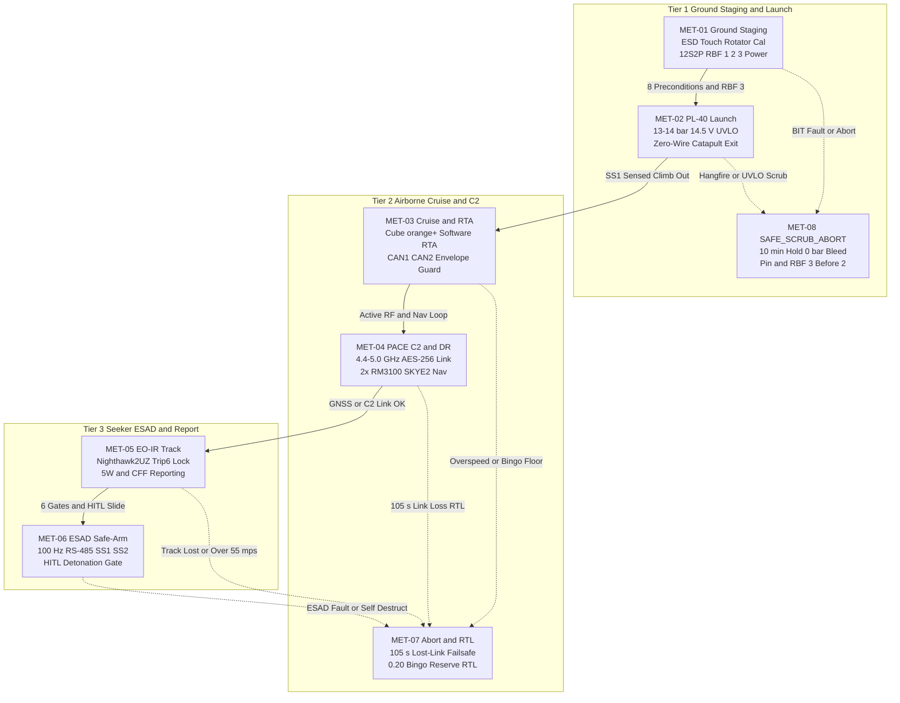

## 2. Mission Essential Task List (METL) & Operational Task Allocation

- **System Baseline:** `Avenger5V25UasSystem` (`Avenger 5 V2.5 UAS` / `ASTK A5 V2.5` + `ELI Military Simulations PL-40 Rev 2.6` + `Artron ESAD AB00-0054-01AA-0005` + `SwarmC2`)
- **Normative Baseline Date:** `2026-11-16`
- **JSON Schema Mapping:** `metl_tasks` (`.pipeline/schemas/mission_intent_specification_schema.json`)
- **Governing Standards & SSOT Anchors:** `ISO/IEC/IEEE 29148:2018` (`§5.2.4`, `§6.4`, `Annex A §A.2`), `ISO/IEC/IEEE 15288:2023` (`§6.4.2`, `§6.4.3`, `§6.4.4`, `§6.4.9`), `IEEE Std 1362-1998` (`§4`, `§4.3`), `INCOSE SE Handbook v5.0` (`§2.3.5.4`, `§2.3.5.9`), `OMG UAF v2.0` (`Operational Viewpoint Op-Cn / Op-Sr`, `Resources Viewpoint Rs-Tx / Rs-Tr`), `NATO STANAG 4187 Ed. 5` (`Chapter 2`, `Chapter 3`, `Annex A`), `MIL-STD-331D` (`Group A Test A3, Test A4.1, Test A5`), `MIL-STD-461G` (`CS114`, `CS116`, `CS118`, `RE102`, `RS103`), `MIL-STD-810H` (`Method 501.7, 502.7, 506.6, 510.7, 514.8, 516.8`), `MIL-STD-882E` (`Task 202`, `Task 205`, `Task 206`), `MIL-STD-1629A` (`Method 101`, `Method 102`), `RTCA DO-178C` (`§6.3`, `§11.0`), `RTCA DO-254` (`§10.0`), `SAE ARP4754A` (`§5.1`) / `ARP4761` (`§3.1-3.3`), `ASTM F3269-17` (`§5.2`), `RTCA DO-362A` (`§2.2`, `§3.2`), `JARUS SORA v2.5` (`Annex B`, `Annex C`), `NIST SP 800-82r3` (`Chapter 6`, `Appendix F: AC, IA, SC`), and `DoD Directive 3000.09` (`§4.1.a`), grounded strictly in `docs/research/RESEARCH_INVENTORY.md`, `docs/safety/STPA_MATRIX.md`, `.pipeline/schema.sysml`, and `.pipeline/schema-digest.json`.

---

### 2.1 Master Mission Essential Task List (`MET-01` through `MET-08`)

In accordance with `ISO/IEC/IEEE 29148:2018` (`§6.4`, `Annex A §A.2`), `ISO/IEC/IEEE 15288:2023` (`§6.4.2`, `§6.4.4`, `§6.4.9`), and `docs/research/RESEARCH_INVENTORY.md` (`MET-01` through `MET-04`, `OBL-01` through `OBL-04`, `SAF-01` through `SAF-04`, `CTL-01` through `CTL-04`, `EXT-01`, `EXT-02`), the operational mission space of `Avenger5V25UasSystem` is partitioned into eight doctrinal Mission Essential Tasks (`MET-01` through `MET-08`).

All eight tasks enforce the four hardware-faithful architectural invariants of `.pipeline/schema.sysml`:
1. **Software-Hosted Simplex Run-Time Assurance (`standaloneRtaBoxCount == 0`):** `ASTM F3269-17` runtime envelope supervision executes strictly in software on `FlightControllerCubeOrangePlus` (`Cube orange+`), never in a separate hardware RTA enclosure.
2. **Purely Mechanical Catapult Interface (`IF-MECH-001` / `CONN_23`):** `Pl40PneumaticLauncher` (`ELI PL-40 Rev 2.6`) transmits axial mechanical launch acceleration with zero electrical or CAN umbilical conductors (`electricalWireToUavCount == 0`).
3. **Zero Production Parachute Recovery (`rndRecoveryOptionInstalled == false`):** `ProductionNoParachuteConstraint` keeps the `Optional RnD` `50.0 V` pyrotechnic igniter lines on `ElectronicPowerSystemEps` permanently inhibited.
4. **Strict Level 1B Operational & Protocol Boundaries:** Human and external C2 allocations exclusively reference canonical User Classes `UCL-01` through `UCL-05`, operational scenarios `SCN-01` through `SCN-08`, and operational activities `OA-01` through `OA-19`. Detailed serial command opcodes, bitmasks, and connector pinouts remain isolated to Level 1C ICDs (`docs/interfaces/`), while all numeric targets reside in strictly separated `Value` and `Units` columns in Table 2.2.

#### Table 2.1: Master Mission Essential Task List Summary (`MET-01` through `MET-08`)

| MET ID | Mission Essential Task Name | Operational Conditions & Entry State | Quantitative Success Criteria (Values in Table 2.2) | Primary & Supporting User Classes (`UCL`) | Mapped `OA`, `SCN` & Verification (`TC`) | Public Clause Citations |
| :--- | :--- | :--- | :--- | :--- | :--- | :--- |
| `MET-01` | Ground Staging, ESD Touch, Rotator Calibration & `12S2P` `RBF #1/#2/#3` Energization | System unpackaged at launch site with manual currency confirmed; `UavFlightLifecycleState::PreFlightCheck`; `EsadSafeArmState::SafePowerOff` progressing to `SafeRbfRemoved`; `RBF #1`, `RBF #2`, and `RBF #3` initially installed. | `SwarmC2AuthAndMissionBoundsConstraint` (`PRM-GCS-009`) and `GroundCrewSeparationAndEsdConstraint` (`PRM-GCS-001`) satisfied; rotator calibrated (`PRM-RF-010`) before touching UAV; ESD point touched; `12S2P` pre-flight check passes (`MainBatteryPreFlightVoltageConstraint`, `GAP-05` rejecting legacy lower-voltage UI); ordered `RBF #1` off -> prop fold rearward -> `RBF #2` pull before `RBF #3` (`GAP-06`); lids locked; `PitotPreflightCalibrationConstraint` (`PRM-AV-017`, `PRM-AV-018`, `PRM-AV-016`), actuator sweep, and ESAD PBIT safe HV (`PRM-ESAD-029`, `PRM-ESAD-004`) pass prior to `SwarmC2` `RBF #3` removal prompt. | `UCL-03` (Primary Staging), `UCL-01` (Auth / BIT), `UCL-02` (Seeker / ESAD BIT), `UCL-05` (Safety / Packing Lead) | `OA-01`, `OA-03`, `OA-06`, `OA-10`, `OA-18`; `SCN-01`, `SCN-07`; `INT_01_PreflightPowerAndBit`; `TC_01_PreflightPowerAndRbfSequence` (Test, Inspection, Demonstration) | `ISO/IEC/IEEE 29148:2018 §6.4, Annex A (§A.2)`; `ISO/IEC/IEEE 15288:2023 §6.4.2, §6.4.4`; `NIST SP 800-82r3 Chapter 6, Appendix F`; `NATO STANAG 4187 Ed. 5 Chapter 2`; `MIL-STD-461G CS118`; `MIL-STD-882E Task 206` |
| `MET-02` | `PL-40` Pneumatic Pressurization, UVLO Guard & Zero-Wire Launch | Airframe mechanically mounted on assembled `PL-40` rail (`PRM-PL40-007`, `PRM-PL40-006`) inside prop-safe zone (`PRM-PL40-020`, `PRM-PL40-021`); `Pl40LauncherState::AnchoredAndLeveled` -> `CompressorCharging` -> `ReadyAt13To14BarPinInstalled` -> `DualSwitchFiring` -> `RailLaunchReleased`; `MET-01` BIT green. | `Pl40MassAndExitVelocityConstraint` and `Pl40UvloAndDualSwitchConstraint` enforced: tank charged to operating pressure (`PRM-PL40-027` through `PRM-PL40-031`) while compressor packs (`PRM-PL40-032`, `PRM-PL40-033`) obey UVLO cutoff and restart interlocks (`PRM-PL40-034` through `PRM-PL40-036`); `GAP-03` Go/No-Go confirms MTOW (`PRM-AF-008`, `PRM-PL40-001`), ground headwind (`PRM-PERF-016`), pusher throttle readiness, zero rail wires (`IF-MECH-001`), and clear rear safety area; red safety pin pulled, `Main Valve 4` opened, and dual firing hold (`PRM-PL40-037`) achieves nominal exit speed (`PRM-PL40-003` within `PRM-PL40-002` ceiling) triggering `SS1` and pusher climb above stall (`PRM-PERF-004`, `PRM-PERF-005`). | `UCL-03` (Primary Catapult Operator), `UCL-01` (Go/No-Go & Climb Mode), `UCL-05` (Safety & Corridor Authority) | `OA-02`, `OA-15`, `OA-16`; `SCN-06`; `INT_03_Pl40RailChargeAndLaunchSequence`; `TC_07_Pl40RailChargeLaunchAndZeroWire` (Test, Inspection, Demonstration) | `ISO/IEC/IEEE 15288:2023 §6.4.4, §6.4.9`; `MIL-STD-882E Task 202, Task 206`; `MIL-STD-810H Method 501.7, 502.7, 514.8, 516.8`; `JARUS SORA v2.5 Annex B`; `ELI PL-40 Rev 2.6 (#p3-#p4, #p21-#p45)` |
| `MET-03` | Cruise Flight & Software Simplex RTA Envelope Guard (`Cube orange+`) | Airframe airborne above minimum climb speed; `UavFlightLifecycleState::CruiseAndLoiter`; `RtaEnvelopeMonitorState::NominalPrimaryEnvelope`; `12S2P` DC bus within `PRM-AV-001`, `PRM-AV-002`, and `PRM-AV-005` fuse limit. | `SimplexRtaSoftwareHostingConstraint` (`standaloneRtaBoxCount == 0`), `CanTopologyIsolationConstraint` (`CAN 1` tail fins `PRM-AV-014` on `PRM-AV-013` stubs vs `CAN 2` splitter wings `PRM-AV-015` and air-data), `FlightEnvelopeSpeedConstraint` (`PRM-PERF-004` through `PRM-PERF-011` per `GAP-02`), `EpsEsadZeroBrownoutMarginConstraint` (`PRM-AV-010`, `GAP-01`), and `ProductionNoParachuteConstraint` enforced; `IBEX160` ESC UART telemetry bridged onto `CAN 1`; waypoints bounded inside `SwarmC2` altitude (`PRM-GCS-004`, `PRM-GCS-005`), loiter (`PRM-GCS-007`), ceiling (`PRM-PERF-015`), cruise wind (`PRM-PERF-017`), and thermal (`PRM-PERF-018`, `PRM-PERF-019`) limits. | `UCL-01` (Primary Flight Supervisor), `UCL-04` (Airspace Bounds Coordination), `UCL-05` (Avionics & Maintenance Integrity) | `OA-02`, `OA-03`, `OA-04`, `OA-05`, `OA-09`; `SCN-02`; `INT_02_PropulsionThrustAndBingoMonitor`, `INT_04_AutopilotRtaAndSurfaceActuation`; `TC_02_BingoReserveAndEpsBrownoutMonitor`, `TC_03_SimplexRtaEnvelopeAndActuation` (Test, Analysis, Simulation) | `ASTM F3269-17 §5.2`; `RTCA DO-178C §6.3, §11.0`; `RTCA DO-254 §10.0`; `SAE ARP4754A §5.1`; `SAE ARP4761 §3.1-3.3`; `MIL-STD-1629A Method 101, 102`; `MIL-STD-810H Method 501.7, 502.7, 506.6, 510.7, 514.8` |
| `MET-04` | Contested C2 PACE & GNSS-Denied INS/DR Navigation (`RM3100 + SKYE2`) | Sortie operating within RF horizon (`PRM-RF-006`, `PRM-RF-007`); EW jamming, GNSS spoofing (`GPS Failsafe Timeout`), or RF occlusion encountered; `PaceC2LinkState` across `AlternateDtcOmniLocal`, `PrimaryDtcDirTracking`, `ContingencyGnssDeniedDrFlight`, and `EmergencyLostLinkRtlHolding`. | Resilient PACE RF continuity over `DTC` AES-256 FHSS link (`PRM-RF-001` through `PRM-RF-005`, `PRM-AV-007` through `PRM-AV-009`) across `MARS` DIR (`PRM-RF-009`, `PRM-RF-010`), `OMNI`, and optional fiber (`PRM-RF-012`); seamless `Disable GNSS` or automatic `GPS Failsafe` switchover to INS/DR using dual `mRo RM3100` (`PRM-AV-016`) + `CUAV SKYE2` pitot on `CAN 2` with `I'm Here` / `I'm Looking Here` fixes; deterministic GNSS re-enable + `RTL` on `GCS Failsafe` (`PRM-GCS-008`); external `USB/ETH` lid locked. | `UCL-01` (Primary C2 / Rotator / `Disable GNSS` Operator), `UCL-02` (Visual Landmark Cueing), `UCL-04` (Tactical C2 Conduit Boundary) | `OA-06`, `OA-07`, `OA-14`, `OA-18`; `SCN-03`, `SCN-07`; `INT_05_GnssDeniedDeadReckoningAndPaceLink`; `TC_04_GnssDeniedDrAndPaceLinkFailsafe` (Test, Demonstration, Analysis) | `RTCA DO-362A §2.2, §3.2`; `NIST SP 800-82r3 Chapter 6, Appendix F (AC, IA, SC)`; `SAE ARP4761 §3.2`; `ISO/IEC/IEEE 15288:2023 §6.4.4`; `MIL-STD-461G RS103, RE102, CS114` |
| `MET-05` | `EO/IR` (`Nighthawk2UZ`/`Trip6`) Terminal Track & `5W`/`CFF` Target Reporting | Airborne loiter within optical line-of-sight of stationary target; ESAD `ARMED`; `UavFlightLifecycleState::TargetTrackAndDive`; sufficient `GCS Failsafe` margin. | `Nighthawk2UZ` (`PRM-AV-019` through `PRM-AV-025`) + `Trip6` track lock maintained within `EngagementSpeedAndTrackHoldConstraint` (`PRM-GCS-011`, `PRM-GCS-012`, `PRM-PERF-014`); in-flight `Reboot Gimbal` available on video freeze (`Reboot Vehicle` blocked); positive HITL `Slide to confirm` required prior to `ATTACK` dive (`PRM-PERF-012`, `PRM-PERF-013`); dive capped at `PRM-PERF-010` achieving terminal accuracy (`PRM-PERF-020`, `PRM-PERF-021`); authenticated `5W` / `CFF` target export delivered to `UCL-04` (`ATAK`, `SitaWare HQ`, `DELTA`). | `UCL-02` (Primary Seeker / HITL `ATTACK` / `5W` Export), `UCL-01` (Envelope / Abort Support), `UCL-04` (`5W` / `CFF` Consumer) | `OA-13`, `OA-14`, `OA-19`; `SCN-04`, `SCN-07`; `INT_06_EoIrSeekerTrackAndTerminalDive`; `TC_05_EoIrTargetTrackAndSpeedCapAbort` (Test, Demonstration) | `DoD Directive 3000.09 §4.1.a`; `ISO/IEC/IEEE 29148:2018 §6.4, Annex A (§A.2)`; `OMG UAF v2.0 Operational Viewpoint`; `NIST SP 800-82r3 Chapter 6`; `RTCA DO-178C §6.3` |
| `MET-06` | Positive HITL `Artron ESAD` Safe-Arm & `SS1`/`SS2` Detonation Gate (`DoD Dir 3000.09`) | Warhead (`PRM-AF-009`, `PRM-AF-010`, `PRM-AF-011`) integrated (`PRM-ESAD-035` through `PRM-ESAD-037`); `RBF #2` energized before `RBF #3` pull (`GAP-06`); `EsadSafeArmState` from `BootAndPbit` through `HvChargedReady` and `DetonatedOrAborted`. | `EsadRs485ProtocolTimingConstraint` (`PRM-ESAD-014` through `PRM-ESAD-020`, `GAP-04`) enforced by `RPI CM5` (`OC Master`); `WarheadMassAndPbitHvSafetyConstraint` and `EsadInputVoltageAndBrownoutConstraint` (`PRM-ESAD-001`, `PRM-ESAD-003`, `PRM-ESAD-029`, `GAP-01`) verified; sequential barriers `SS1` (`PRM-ESAD-034`), `SS2` (`Safe Distance Exceed == 1`, `GAP-07`), positive HITL arm consent, and `DSC_IN1` pulses (`PRM-ESAD-006` through `PRM-ESAD-012`) gate `J401` charge (`PRM-ESAD-030`, `PRM-ESAD-031`); premature `DSC_IN1` latches `FaultLockout`; detonation gated strictly by `Sensor Board` (`PRM-ESAD-013`) `ORed IRQ_L` or authorized `OC Trigger`. | `UCL-02` (Exclusive HITL Arm/Fire Consent), `UCL-03` (Ordered `RBF #3` Pull), `UCL-05` (Ordnance Safety Lead), `UCL-01` (Failsafe Coordination) | `OA-08`, `OA-10`, `OA-11`; `SCN-05`; `INT_07_EsadDualBarrierArmAndDetonation`; `TC_06_EsadProtocolInterlockAndHvFireGate` (Test, Inspection, Analysis) | `DoD Directive 3000.09 §4.1.a`; `NATO STANAG 4187 Ed. 5 Chapter 2, Chapter 3, Annex A`; `MIL-STD-331D Group A Test A3, Test A4.1, Test A5`; `MIL-STD-461G CS114, CS116, CS118, RE102, RS103`; `RTCA DO-178C §6.3`; `RTCA DO-254 §10.0` |
| `MET-07` | In-Flight Abort, Lost-Link RTL & Statutory Bingo Reserve Protection | Airborne anomaly: dive overspeed, EO track loss, HITL abort/destruct, `GCS Failsafe` link outage, Bingo reserve depletion, main bus sag, `EPS` brownout, ESAD RS-485 watchdog expiry, or geofence breach (`UavFlightLifecycleState::EmergencyAbortOrRtb`). | Immediate `Abort Engaging` climb to `Takeoff altitude` (`GUIDED` loiter `PRM-GCS-007`, zero auto re-track) on overspeed (`PRM-PERF-010`) or track drop; `Disarm ESAD On GCS Timeout` + GNSS re-enable + `RTL` upon link loss (`PRM-GCS-008`); `BingoEnergyReserveConstraint` (`PRM-PERF-003` of `PRM-PERF-002`) and bus floor (`PRM-AV-001`) enforce `RTL`; HITL `SELF DESTRUCT` / `ABORT` hold (`PRM-GCS-010`) + `Slide to confirm` or irreversible `Power Off ESAD` discharge HV (`PRM-ESAD-029`); `Auto-SAFE` discharges unarmed ESAD on landing (`ProductionNoParachuteConstraint`). | `UCL-01` (Flight Abort / `RTL` Mode Recovery), `UCL-02` (Exclusive HITL Self-Destruct / `Power Off ESAD`), `UCL-05` (Containment Policy Oversight) | `OA-03`, `OA-04`, `OA-05`, `OA-07`, `OA-08`, `OA-12`, `OA-13`; `SCN-02`, `SCN-03`, `SCN-04`, `SCN-05`; `INT_02_PropulsionThrustAndBingoMonitor`, `INT_05_GnssDeniedDeadReckoningAndPaceLink`; `TC_02_BingoReserveAndEpsBrownoutMonitor`, `TC_04_GnssDeniedDrAndPaceLinkFailsafe` (Test, Simulation, Analysis) | `JARUS SORA v2.5 Annex B, Annex C`; `RTCA DO-362A §3.2`; `ASTM F3269-17 §5.2`; `DoD Directive 3000.09 §4.1.a`; `MIL-STD-882E Task 205, Task 206`; `NATO STANAG 4187 Ed. 5 Chapter 2` |
| `MET-08` | Pre-Launch `SAFE_SCRUB_ABORT` Hangfire Recovery (`GAP-SCRUB`) | Pre-launch abort, `PL-40` UVLO stall (`PRM-PL40-034`), BIT/ESAD fault, or launch hangfire occurring after `RBF #3` removal, red carriage pin pull, or `Main Valve 4` opening (`Pl40LauncherState::ScrubbedSafeDepressurized`, `UavFlightLifecycleState::SafePostFlightShutdown`). | Zero crew entry into forward/lateral `DANGER ZONE` across mandatory rear `SAFETY AREA` hangfire dwell (`GAP-SCRUB`); remote ESAD abort (`PRM-GCS-010`) + irreversible `Power Off ESAD` verified safe HV (`PRM-ESAD-029`) from standoff (`PRM-GCS-001`); `Main Valve 4` closed and `PL-40` tank bled to zero residual pressure (`REQ_SC_16`); red carriage pin restored before crew approach; ESD point touched and `RBF #3` (`PRM-ESAD-004`) reinstalled strictly before `RBF #2` power disconnect (`GAP-06`). | `UCL-03` (Physical Bleed, Pin & Reverse `RBF` Crew), `UCL-02` (Remote ESAD Abort / `Power Off ESAD`), `UCL-01` (Launch Scrub Control), `UCL-05` (Arming Safety Verification & Quarantine) | `OA-12`, `OA-15`, `OA-17`; `SCN-08`; `INT_08_EmergencyScrubAndSafing`; `TC_08_EmergencyScrubHangfireAndC2Auth` (Demonstration, Inspection, Test) | `MIL-STD-882E Task 206`; `NATO STANAG 4187 Ed. 5 Chapter 2`; `DoD Directive 3000.09 §4.1.a`; `MIL-STD-331D Group A Test A4.1, Test A5`; `ISO/IEC/IEEE 29148:2018 Annex A (§A.2)`; `ELI PL-40 Rev 2.6 (#p26)`; `A5_prep and safety_rev7.pdf (#p23)` |

---

### 2.2 Quantitative METL Thresholds & Performance Targets

In strict enforcement of `Check 26` and `rules/latex-katex-integrity.md`, Table 2.2 separates every numerical performance target, physical limit, and threshold bound across `MET-01` through `MET-08` into dedicated `Value` and `Units` columns with zero units inside `Value` cells, zero numeric digits inside `Units` cells, and zero inline number-unit strings in descriptive columns.

#### Table 2.2: Grounded Quantitative METL Thresholds & Performance Targets

| MET ID | SSOT Param / Gate ID | Target Parameter / Success Threshold | Qualifier | Value | Units | Governing Constraint & SSOT Citation |
| :--- | :--- | :--- | :--- | :--- | :--- | :--- |
| `MET-01` | `PRM-GCS-009` | Minimum `SwarmC2` role authentication password length | Min | 8 | chars | `SwarmC2AuthAndMissionBoundsConstraint`; `A5-user-manual 2.pdf#p27-#p29` |
| `MET-01` | `PRM-GCS-003` | Maximum `SwarmC2` mission name character length | Max | 24 | chars | `SwarmC2AuthAndMissionBoundsConstraint`; `A5-user-manual 2.pdf#p46-#p48` |
| `MET-01` | `PRM-GCS-001` | Minimum Ground Radio Box to UAV spatial separation during prep | Min | 10.0 | m | `GroundCrewSeparationAndEsdConstraint`; `A5-user-manual 2.pdf#p52` |
| `MET-01` | `PRM-RF-010` | Antenna Rotator fine manual CCW/CW azimuth step (calibrated pre-UAV) | Nominal | 0.5 | deg | `GroundRfStationAndAntennaTracker`; `A5-user-manual 2.pdf#p72-#p74` |
| `MET-01` | `PRM-AF-019` | Minimum crew required to lift UAV onto `PL-40` carriage | Min | 2 | persons | `ElectricPropulsionUnit`; `A5_prep and safety_rev7.pdf#p15` |
| `MET-01` | `PRM-AF-009` | Maximum authorized warhead / lethal package mass | Max | 5.0 | kg | `WarheadMassAndPbitHvSafetyConstraint`; `AVENGER 5 Spec sheet_rev3.pdf#p2` |
| `MET-01` | `PRM-AF-010` | Warhead holder tested nominal mass (`PRM-AF-011` tolerance) | Nominal | 4.98 | kg | `ArtronEsadAndSensorUnit`; `A5_prep and safety_rev7.pdf#p10` |
| `MET-01` | `PRM-AF-011` | Warhead holder tested mass symmetric tolerance | Nominal | 0.02 | kg | `ArtronEsadAndSensorUnit`; `A5_prep and safety_rev7.pdf#p10` |
| `MET-01` | `PRM-AV-003` | Pre-flight `12S2P` battery voltage check pass window (`GAP-05`) | Nominal | 49.0-50.0 | V | `MainBatteryPreFlightVoltageConstraint`; `A5-user-manual 2.pdf#p53,#p56` |
| `MET-01` | `PRM-AV-001` | Main `12S2P` Li metal DC bus operating envelope (`PRM-AV-001/002`) | Nominal | 36.0-50.4 | V | `MainBatteryAndFuseUnit`; `Avenger5_V2.5_block_diagram_rev5.pdf#p1` |
| `MET-01` | `PRM-AV-005` | Main DC bus inline automotive overcurrent fuse rating | Exact | 200.0 | A | `MainBatteryAndFuseUnit`; `Avenger5_V2.5_block_diagram_rev5.pdf#p1` |
| `MET-01` | `PRM-GCS-002` | Maximum GCS telemetry acquisition wait after `RBF #2` power-on | Max | 2.0 | min | `SwarmC2OperatorConsole`; `A5-user-manual 2.pdf#p52` |
| `MET-01` | `PRM-AV-017` | Pre-flight `CUAV SKYE2` pitot stationary calm-air reading ceiling | Max | 3.0 | m/s | `PitotPreflightCalibrationConstraint`; `A5-user-manual 2.pdf#p56` |
| `MET-01` | `PRM-AV-018` | Pre-flight `CUAV SKYE2` pitot indirect airflow reading floor | Min | 10.0 | m/s | `PitotPreflightCalibrationConstraint`; `A5-user-manual 2.pdf#p56` |
| `MET-01` | `PRM-AV-016` | Dual-redundant `mRo RM3100` mag/baro modules online on `CAN 2` | Exact | 2 | count | `CanTopologyIsolationConstraint`; `Avenger5_V2.5_block_diagram_rev5.pdf#p1` |
| `MET-01` | `PRM-ESAD-004` | `ESAD RBF #3` umbilical continuity loop (`UMB`) max resistance | Max | 0.5 | Ohm | `EsadRbf3PowerBeforePullConstraint`; `ESAD ICD#p14` |
| `MET-01` | `PRM-ESAD-005` | `ESAD RBF #3` umbilical continuity loop sense current | Nominal | 20.0 | mA | `ArtronEsadAndSensorUnit`; `ESAD ICD#p14` |
| `MET-01` | `PRM-ESAD-029` | `Artron ESAD` PBIT internal high-voltage safe ceiling pre-`RBF #3` pull | Max | 50.0 | V | `WarheadMassAndPbitHvSafetyConstraint`; `ESAD ICD#p18,#p26` |
| `MET-01` | `PRM-AV-011` | Production `Optional RnD` recovery parachute installation status | Exact | false | Boolean | `ProductionNoParachuteConstraint`; `.pipeline/schema.sysml` |
| `MET-02` | `PRM-PL40-007` | Assembled `ELI PL-40 Rev 2.6` three-section pneumatic rail length | Nominal | 5.0 | m | `Pl40PneumaticLauncher`; `PL-40 Manual Rev 2.6#p37` |
| `MET-02` | `PRM-PL40-006` | Fixed `PL-40` pneumatic catapult rail inclination elevation | Exact | 12.0 | deg | `Pl40PneumaticLauncher`; `PL-40 Manual Rev 2.6#p37,#p41` |
| `MET-02` | `PRM-PL40-027` | `PL-40` operating pneumatic launch pressure window (`PRM-PL40-027/028`) | Nominal | 13.0-14.0 | bar | `Pl40MassAndExitVelocityConstraint`; `A5-user-manual 2.pdf#p54` |
| `MET-02` | `PRM-PL40-029` | `PL-40` auto-cutoff pressure regulation hysteresis | Nominal | 0.05 | bar | `Pl40PneumaticLauncher`; `PL-40 Manual Rev 2.6#p22` |
| `MET-02` | `PRM-PL40-030` | Maximum onboard compressor charging time to operating pressure | Max | 8.0 | min | `Pl40PneumaticLauncher`; `PL-40 Manual Rev 2.6#p37` |
| `MET-02` | `PRM-PL40-031` | External DIN PCP auxiliary supply fill pressure ceiling | Max | 16.0 | bar | `Pl40PneumaticLauncher`; `PL-40 Manual Rev 2.6#p21,#p37` |
| `MET-02` | `PRM-PL40-032` | Dual `Makita BL1860B` compressor pack nominal voltage | Nominal | 18.0 | V | `Pl40PneumaticLauncher`; `PL-40 Manual Rev 2.6#p6,#p28` |
| `MET-02` | `PRM-PL40-033` | `Makita BL1860B` compressor battery pack charge capacity | Nominal | 6000.0 | mAh | `Pl40PneumaticLauncher`; `PL-40 Manual Rev 2.6#p6,#p28` |
| `MET-02` | `PRM-PL40-034` | `Makita BL1860B` compressor pack UVLO protection cutoff voltage | Max | 14.5 | V | `Pl40UvloAndDualSwitchConstraint`; `PL-40 Manual Rev 2.6#p23` |
| `MET-02` | `PRM-PL40-035` | `Makita BL1860B` minimum pack voltage to restart post-UVLO | Min | 16.0 | V | `Pl40PneumaticLauncher`; `PL-40 Manual Rev 2.6#p23` |
| `MET-02` | `PRM-PL40-036` | Mandatory wait delay before post-UVLO compressor restart check | Min | 5.0 | s | `Pl40PneumaticLauncher`; `PL-40 Manual Rev 2.6#p23` |
| `MET-02` | `PRM-AF-008` | Avenger 5 Maximum Takeoff Weight | Max | 17.0 | kg | `Pl40MassAndExitVelocityConstraint`; `AVENGER 5 Spec sheet_rev3.pdf#p3` |
| `MET-02` | `PRM-PL40-001` | Structural maximum aircraft MTOW supported by `PL-40` | Max | 30.0 | kg | `Pl40MassAndExitVelocityConstraint`; `PL-40 Manual Rev 2.6#p3,#p37` |
| `MET-02` | `PRM-PERF-016` | Maximum authorized surface ground headwind at launch | Max | 12.0 | m/s | `Pl40MassAndExitVelocityConstraint`; `AVENGER 5 Spec sheet_rev3.pdf#p3` |
| `MET-02` | `PRM-PL40-037` | Simultaneous dual safety-covered launch firing switch hold | Min | 2.0 | s | `Pl40UvloAndDualSwitchConstraint`; `PL-40 Manual Rev 2.6#p25-#p26` |
| `MET-02` | `PRM-PL40-003` | Nominal catapult exit speed at Avenger 5 MTOW (`GAP-03`) | Nominal | 23.0 | m/s | `Pl40PneumaticLauncher`; `PL-40 Manual Rev 2.6#p37` |
| `MET-02` | `PRM-PL40-004` | Interpolated catapult exit velocity bounds (`PRM-PL40-004/005`) | Nominal | 22.7-23.5 | m/s | `Pl40PneumaticLauncher`; `PL-40 Manual Rev 2.6#p37` |
| `MET-02` | `PRM-PL40-002` | `PL-40` hard maximum rated carriage exit velocity ceiling (`GAP-03`) | Max | 25.0 | m/s | `Pl40MassAndExitVelocityConstraint`; `PL-40 Manual Rev 2.6#p3,#p24,#p37` |
| `MET-02` | `IF-MECH-001` | Electrical or CAN umbilical conductors crossing `PL-40` to UAV | Exact | 0 | count | `Pl40PneumaticLauncher` (`CONN_23`); `.pipeline/schema.sysml` |
| `MET-02` | `PRM-PL40-043` | Pulling rope and carriage wheel bearing preventive service interval | Exact | 100 | launches | `Pl40PneumaticLauncher`; `PL-40 Manual Rev 2.6#p29-#p36` |
| `MET-03` | `standaloneRtaBoxCount` | Standalone external RTA hardware box count (hosted on `Cube orange+`) | Exact | 0 | count | `SimplexRtaSoftwareHostingConstraint`; `.pipeline/schema.sysml` |
| `MET-03` | `PRM-PERF-004` | Airframe minimum / stall airspeed floor (`V2.5` Spec Sheet, `GAP-02`) | Min | 24.0 | m/s | `FlightEnvelopeSpeedConstraint`; `AVENGER 5 Spec sheet_rev3.pdf#p3` |
| `MET-03` | `PRM-PERF-005` | Conservative minimum flight airspeed (`V1` User Manual, `GAP-02`) | Min | 26.0 | m/s | `ElectricPropulsionUnit`; `A5-user-manual 2.pdf#p10` |
| `MET-03` | `PRM-PERF-006` | Nominal horizontal cruise airspeed corridor (`PRM-PERF-006/007`) | Nominal | 30.0-31.0 | m/s | `ElectricPropulsionUnit`; `A5-user-manual 2.pdf#p10`; `Spec sheet#p3` |
| `MET-03` | `PRM-PERF-008` | Maximum horizontal airspeed bounds (`PRM-PERF-008/009`) | Max | 38.0-42.0 | m/s | `ElectricPropulsionUnit`; `A5-user-manual 2.pdf#p10`; `Spec sheet#p3` |
| `MET-03` | `PRM-PERF-011` | Airframe structural Never-Exceed Dive Speed (`VNE`, `GAP-02`) | Max | 80.0 | m/s | `FlightEnvelopeSpeedConstraint`; `AVENGER 5 Spec sheet_rev3.pdf#p3` |
| `MET-03` | `PRM-PERF-015` | Operational aerodynamic service ceiling | Max | 5000.0 | m | `ElectricPropulsionUnit`; `AVENGER 5 Spec sheet_rev3.pdf#p3` |
| `MET-03` | `PRM-GCS-004` | `SwarmC2` mission waypoint altitude slider range (`PRM-GCS-004/005`) | Nominal | 50.0-3000.0 | m | `SwarmC2AuthAndMissionBoundsConstraint`; `A5-user-manual 2.pdf#p63` |
| `MET-03` | `PRM-GCS-006` | `SwarmC2` dynamic altitude slider major graduation step | Exact | 250.0 | m | `SwarmC2OperatorConsole`; `A5-user-manual 2.pdf#p63,#p65` |
| `MET-03` | `PRM-GCS-007` | Minimum default clockwise `LOITER` / recovery orbit radius | Min | 300.0 | m | `SwarmC2AuthAndMissionBoundsConstraint`; `A5-user-manual 2.pdf#p46,#p59` |
| `MET-03` | `PRM-PERF-017` | Maximum qualified airborne cruise wind tolerance | Max | 28.0 | m/s | `ElectricPropulsionUnit`; `AVENGER 5 Spec sheet_rev3.pdf#p3` |
| `MET-03` | `PRM-PERF-018` | Qualified ambient operating temperature lower bound | Min | -20.0 | degC | `ElectricPropulsionUnit`; `AVENGER 5 Spec sheet_rev3.pdf#p3` |
| `MET-03` | `PRM-PERF-019` | Qualified ambient operating temperature upper bound | Max | 50.0 | degC | `ElectricPropulsionUnit`; `AVENGER 5 Spec sheet_rev3.pdf#p3` |
| `MET-03` | `PRM-AV-006` | Regulated `EPS` servo rail feeding tail fins and wing servos | Nominal | 8.0 | V | `ElectronicPowerSystemEps`; `Avenger5_V2.5_block_diagram_rev5.pdf#p1` |
| `MET-03` | `PRM-AV-013` | `CAN 1` tail ruddervator servo stub harness length | Nominal | 120.0 | cm | `CanTopologyIsolationConstraint`; `Avenger5_V2.5_block_diagram_rev5.pdf#p1` |
| `MET-03` | `PRM-AV-012` | Fuselage power and `CAN 1` main trunk harness length | Nominal | 970.0 | cm | `PowerMeterAndRbfSwitch`; `Avenger5_V2.5_block_diagram_rev5.pdf#p1` |
| `MET-04` | `PRM-RF-001` | `DTC` FHSS C2 radio operating frequency band (`PRM-RF-001/002`) | Nominal | 4.4-5.0 | GHz | `OnboardEthernetAndC2RadioUnit`; `AVENGER 5 Spec sheet_rev3.pdf#p3` |
| `MET-04` | `PRM-RF-005` | `DTC` C2 datalink AES encryption key strength | Exact | 256 | bits | `OnboardEthernetAndC2RadioUnit`; `AVENGER 5 Spec sheet_rev3.pdf#p3` |
| `MET-04` | `PRM-RF-003` | Total `DTC` C2 radio RF transmit output power | Nominal | 2.0 | W | `OnboardEthernetAndC2RadioUnit`; `AVENGER 5 Spec sheet_rev3.pdf#p3` |
| `MET-04` | `PRM-RF-004` | Per-antenna RF output power across dual `MPSL4400` chain | Nominal | 1.0 | W | `OnboardEthernetAndC2RadioUnit`; `Avenger5_V2.5_block_diagram_rev5.pdf#p1` |
| `MET-04` | `PRM-AV-007` | Regulated `EPS` radio supply rail nominal voltage | Nominal | 12.0 | V | `ElectronicPowerSystemEps`; `Avenger5_V2.5_block_diagram_rev5.pdf#p1` |
| `MET-04` | `PRM-AV-008` | `DTC` C2 radio accepted input voltage tolerance (`PRM-AV-008/009`) | Nominal | 8.0-17.0 | V | `OnboardEthernetAndC2RadioUnit`; `Avenger5_V2.5_block_diagram_rev5.pdf#p1` |
| `MET-04` | `PRM-RF-006` | Baseline Radio Line-of-Sight (`RLOS`) datalink range | Nominal | 60.0 | km | `OnboardEthernetAndC2RadioUnit`; `AVENGER 5 Spec sheet_rev3.pdf#p3` |
| `MET-04` | `PRM-RF-007` | Extended Radio Line-of-Sight (`RLOS`) range (`V2.5` Spec Sheet, `GAP-02`) | Nominal | 90.0 | km | `OnboardEthernetAndC2RadioUnit`; `AVENGER 5 Spec sheet_rev3.pdf#p3` |
| `MET-04` | `PRM-RF-009` | Ground `MARS` directional tracking antenna gain | Nominal | 23.0 | dBi | `GroundRfStationAndAntennaTracker`; `A5-user-manual 2.pdf#p11` |
| `MET-04` | `PRM-RF-012` | Optional tactical fiber optic spool between `SwarmC2` and Ground Radio Box | Nominal | 200.0 | m | `GroundRfStationAndAntennaTracker`; `A5-user-manual 2.pdf#p11` |
| `MET-05` | `PRM-AV-019` | `Nighthawk2UZ` Day and Thermal video horizontal pixel resolution | Exact | 1280 | px | `EoIrSeekerAndTrackerUnit`; `AVENGER 5 Spec sheet_rev3.pdf#p3` |
| `MET-05` | `PRM-AV-020` | `Nighthawk2UZ` Day and Thermal video vertical pixel resolution | Exact | 720 | px | `EoIrSeekerAndTrackerUnit`; `AVENGER 5 Spec sheet_rev3.pdf#p3` |
| `MET-05` | `PRM-AV-021` | `Nighthawk2UZ` combined optical/digital zoom factor | Max | 40.0 | zoom | `EoIrSeekerAndTrackerUnit`; `AVENGER 5 Spec sheet_rev3.pdf#p3` |
| `MET-05` | `PRM-AV-022` | `Nighthawk2UZ` gimbal pitch travel lower bound | Min | -45.0 | deg | `EoIrSeekerAndTrackerUnit`; `AVENGER 5 Spec sheet_rev3.pdf#p3` |
| `MET-05` | `PRM-AV-023` | `Nighthawk2UZ` gimbal pitch travel upper bound | Max | 135.0 | deg | `EoIrSeekerAndTrackerUnit`; `AVENGER 5 Spec sheet_rev3.pdf#p3` |
| `MET-05` | `PRM-AV-024` | `Nighthawk2UZ` gimbal yaw and roll travel lower bound | Min | -165.0 | deg | `EoIrSeekerAndTrackerUnit`; `AVENGER 5 Spec sheet_rev3.pdf#p3` |
| `MET-05` | `PRM-AV-025` | `Nighthawk2UZ` gimbal yaw and roll travel upper bound | Max | 165.0 | deg | `EoIrSeekerAndTrackerUnit`; `AVENGER 5 Spec sheet_rev3.pdf#p3` |
| `MET-05` | `PRM-GCS-011` | Mandatory continuous `EO` daylight track lock hold prior to `ATTACK` | Nominal | 2.0-5.0 | s | `EngagementSpeedAndTrackHoldConstraint`; `A5-user-manual 2.pdf#p88` |
| `MET-05` | `PRM-PERF-014` | Maximum target elevation angle at engagement start | Max | 15.0 | deg | `EoIrSeekerAndTrackerUnit`; `A5-user-manual 2.pdf#p88` |
| `MET-05` | `PRM-PERF-013` | `Shallow` terminal attack glidepath approach angle | Nominal | 15.0 | deg | `EoIrSeekerAndTrackerUnit`; `A5-user-manual 2.pdf#p86-#p90` |
| `MET-05` | `PRM-PERF-012` | `Direct` terminal attack maximum dive angle | Max | 22.0 | deg | `ElectricPropulsionUnit`; `A5-user-manual 2.pdf#p10` |
| `MET-05` | `PRM-PERF-020` | Terminal engagement accuracy ceiling in meters | Max | 0.5 | m | `EngagementSpeedAndTrackHoldConstraint`; `AVENGER 5 Spec sheet_rev3.pdf#p1,#p2` |
| `MET-05` | `PRM-PERF-021` | Terminal engagement accuracy ceiling in centimeters | Max | 50.0 | cm | `EoIrSeekerAndTrackerUnit`; `AVENGER 5 Spec sheet_rev3.pdf#p1,#p2` |
| `MET-06` | `PRM-AV-010` | `EPS` `ESAD` regulated rail voltage (`GAP-01` zero brownout margin) | Nominal | 14.0 | V | `EpsEsadZeroBrownoutMarginConstraint`; `Avenger5_V2.5_block_diagram_rev5.pdf#p1` |
| `MET-06` | `PRM-ESAD-001` | `Artron ESAD` `VDC_IN` (`GE_POW`) supported ICD range (`PRM-ESAD-001/003`) | Nominal | 14.0-32.0 | V | `EsadInputVoltageAndBrownoutConstraint`; `ESAD ICD#p14` |
| `MET-06` | `PRM-ESAD-017` | `RPI CM5` `OC Master` cyclic `RS-485` polling rate | Exact | 100.0 | Hz | `EsadRs485ProtocolTimingConstraint`; `ESAD ICD#p15` |
| `MET-06` | `PRM-ESAD-018` | `RPI CM5` `OC Master` cyclic `RS-485` polling period | Exact | 0.01 | s | `EsadRs485ProtocolTimingConstraint`; `ESAD ICD#p15` |
| `MET-06` | `PRM-ESAD-014` | `RPI CM5` to `Artron ESAD` half-duplex differential `RS-485` baud rate | Exact | 115200 | bps | `EsadRs485ProtocolTimingConstraint`; `ESAD ICD#p14-#p15` |
| `MET-06` | `PRM-ESAD-020` | Maximum allowed `Artron ESAD` `RS-485` command reply latency | Max | 5.0 | ms | `EsadRs485ProtocolTimingConstraint`; `ESAD ICD#p15` |
| `MET-06` | `PRM-ESAD-019` | `RS-485` incomplete-packet watchdog timeout triggering disarm | Max | 10.0 | ms | `EsadRs485ProtocolTimingConstraint`; `ESAD ICD#p15` |
| `MET-06` | `PRM-ESAD-006` | Stage 2 `DSC_IN1` hardware discrete arming pulse burst frequency | Exact | 1000.0 | Hz | `DscIn1ArmPulseTrain`; `ESAD ICD#p14` |
| `MET-06` | `PRM-ESAD-009` | Required `DSC_IN1` square-wave pulse count | Exact | 2 | pulses | `DscIn1ArmPulseTrain`; `ESAD ICD#p14` |
| `MET-06` | `PRM-ESAD-011` | `DSC_IN1` hardware discrete logic-high input band (`PRM-ESAD-011/012`) | Nominal | 2.5-3.3 | V | `DscIn1ArmPulseTrain`; `ESAD ICD#p14` |
| `MET-06` | `PRM-ESAD-013` | `Artron ESAD Sensor Board` regulated supply voltage (`J102->J1`) | Nominal | 5.0 | V | `ArtronEsadAndSensorUnit`; `ESAD ICD#p10-#p13` |
| `MET-06` | `PRM-ESAD-031` | Armed `J401` high-voltage initiation output envelope (`PRM-ESAD-030/031`) | Nominal | 0.0-1800.0 | V | `WarheadMassAndPbitHvSafetyConstraint`; `ESAD ICD#p18,#p26-#p27` |
| `MET-06` | `PRM-ESAD-034` | `Artron ESAD` 13-bit signed `SS1` acceleration telemetry scaling | Nominal | 0.0039 | g/LSB | `InertialLaunchAccelPulse`; `ESAD ICD#p20,#p23` |
| `MET-07` | `PRM-PERF-010` | Terminal dive engagement airspeed cap (`Abort Engaging` if exceeded) | Max | 55.0 | m/s | `FlightEnvelopeSpeedConstraint`; `A5-user-manual 2.pdf#p10,#p88` |
| `MET-07` | `PRM-GCS-008` | Baseline `GCS Failsafe` lost-link `RTL` & ESAD timeout disarm trigger | Nominal | 105.0 | s | `SwarmC2OperatorConsole`; `A5-user-manual 2.pdf#p34` |
| `MET-07` | `PRM-PERF-001` | Maximum nominal airframe mission endurance in minutes | Max | 90.0 | min | `MainBatteryAndFuseUnit`; `AVENGER 5 Spec sheet_rev3.pdf#p2,#p3` |
| `MET-07` | `PRM-PERF-002` | Maximum nominal airframe mission endurance in seconds | Max | 5400.0 | s | `MainBatteryAndFuseUnit`; `AVENGER 5 Spec sheet_rev3.pdf#p2,#p3` |
| `MET-07` | `PRM-PERF-003` | Statutory Bingo reserve ratio triggering autonomous `RTL` | Min | 0.20 | ratio | `BingoEnergyReserveConstraint`; `JARUS SORA v2.5 / MIL-STD-882E` |
| `MET-07` | `bingoReserveSec` | Statutory Bingo reserve landing energy duration floor | Min | 1080.0 | s | `MainBatteryAndFuseUnit`; `BingoEnergyReserveConstraint` |
| `MET-07` | `PRM-AV-001` | Minimum `12S2P` DC bus floor triggering critical-battery `RTL` | Min | 36.0 | V | `MainBatteryPreFlightVoltageConstraint`; `Avenger5_V2.5_block_diagram_rev5.pdf#p1` |
| `MET-07` | `PRM-GCS-010` | Minimum HITL `ESAD SELF DESTRUCT` / permanent `ABORT` hold before slide | Min | 5.0 | s | `SwarmC2OperatorConsole`; `A5-user-manual 2.pdf#p84` |
| `MET-08` | `GAP-SCRUB` | Derived `SAFE_SCRUB_ABORT` hangfire holdback dwell in rear `SAFETY AREA` | Min | 10.0 | min | `REQ_SC_16`, `REQ_SAF_12` (`GAP-SCRUB`; OEM wait unprinted `PL-40#p26`) |
| `MET-08` | `REQ_SC_16` | Target `PL-40` pneumatic tank pressure after `Main Valve 4` close & bleed | Exact | 0.0 | bar | `DepressurizeAndScrubPl40Launcher`; `REQ_SC_16`, `GAP-SCRUB` |

---

### 2.3 Detailed METL Task Specifications & Gate 24 Allocation Directives (`MET-01` through `MET-08`)

#### 2.3.1 `MET-01`: Ground Staging, ESD Touch, Rotator Calibration & `12S2P` (`49.0-50.0 V`) `RBF #1/#2/#3` Energization

- **Doctrinal Task Title:** Ground Staging, ESD Touch, Rotator Calibration & `12S2P` (`49.0-50.0 V`) `RBF #1/#2/#3` Energization.
- **Operational Conditions & Entry State:** Deployment crew unpacks the `Avenger 5 V2.5` fuselage, wing/tail surfaces, `12S2P` battery, `Artron ESAD` / warhead holder, `PL-40`, and `GroundRfStationAndAntennaTracker` at the launch site (`-20.0 to +50.0 degC`, ground wind `<= 12.0 m/s`), starting in `UavFlightLifecycleState::PreFlightCheck` and `EsadSafeArmState::SafePowerOff` with `RBF #1`, `UAV Power R.B.F. Key #2`, and `ESAD R.B.F. #3` installed.
- **Quantitative Standards & Execution Sequence:**
  1. Authenticate `Pilot` (`UCL-01`), `Payload` (`UCL-02`), and `Launch Assistant` (`UCL-03`) on `SwarmC2` (`>= 8`-character password, `<= 24`-character mission name, `50.0-3000.0 m` altitude slider in `250.0 m` steps, `>= 300.0 m` loiter radius, `Inclusion`/`Exclusion` geofences), confirm manual training currency (`UCL-05`), erect the ground RF station at `>= 10.0 m` UAV separation, and calibrate the Directional Antenna Rotator (`Auto Follow` + `0.5 deg` fine step) **prior to touching the UAV** (`OA-18`).
  2. Touch the yellow `EARTH / GROUNDING POINT` inside the transport box before every component handling operation (`GroundCrewSeparationAndEsdConstraint`). Integrate warhead (`<= 5.0 kg` max, `4.98 +/- 0.02 kg` tested holder, `CG 30.57 +/- 1.00`, overall `173.00`, units unprinted per `GAP-SEPDIST`) onto `Artron ESAD` (`1.5 mm` hex terminals, `RED FACE TO TOUCH HOLDER`).
  3. Inspect the `12S2P Li metal BEI maximus20` pack (`NO-GO` on swelling, damage, or leakage), match pack QR/ID to fuselage QR/ID, and verify `49.0-50.0 V` (`MainBatteryPreFlightVoltageConstraint`, `36.0-50.4 V` operating bus, `200.0 A` fuse, strictly rejecting legacy lower-voltage UI values per `GAP-05`).
  4. Perform a `>= 2`-person lift (`17.0 kg` MTOW) onto the `PL-40` carriage (`145.0-155.5 mm` upper prop-safe zone), secure `8` wing bolts (`4` front `M6 x 30.0 mm`, `10.0 mm` spanner) and `4` X-tail stabilizers, fold both rear pusher propeller blades rearward toward the tail, and remove `RBF #1` covers/strap (`OA-01`).
  5. **Power-Before-Pull `RBF` Order (`GAP-06`, `EsadRbf3PowerBeforePullConstraint`):** Pull `UAV Power R.B.F. Key #2 (XT60E-F)` strictly **before** removing `ESAD R.B.F. #3` (`J100 UMB < 0.5 Ohm` at `20.0 mA`), lock both RBF and external `USB/ETH` umbilical lids (`NIST SP 800-82r3`), verify `SwarmC2` telemetry within `2.0 min`, and verify `EPS` regulated rails (`8.0 V` servos, `12.0 V` radio, `14.0 V` ESAD per `GAP-01`, sensor/gimbal rails, with `2x 50.0 V` `Optional RnD` rails permanently inhibited per `ProductionNoParachuteConstraint`, `OA-03`).
  6. Pass all `6` `SwarmC2` pre-flight groups (`CUAV SKYE2 <= 3.0 m/s` calm / `>= 10.0 m/s` indirect airflow, `2x mRo RM3100` online on `CAN 2`, `8x HV6160-DroneCAN` sweep, `Nighthawk2UZ` `1280x720` video, and `Artron ESAD` PBIT internal HV `< 50.0 V` via `RPI CM5`, `OA-06`, `OA-10`), then remove `ESAD R.B.F. #3` **only** upon `SwarmC2` prompt after `8` preconditions pass (`ESAD: Ready to Fly`) and clear all crew to rear `SAFETY AREA`.
- **Operational Allocations (`UCL`, `OA`, `SCN`):** `UCL-03` (Primary), `UCL-01`, `UCL-02`, `UCL-05`; `OA-01`, `OA-03`, `OA-06`, `OA-10`, `OA-18`; `SCN-01`, `SCN-07`; `INT_01_PreflightPowerAndBit`.
- **Verification Method & Public Clauses:** Test, Inspection, and Demonstration (`TC_01_PreflightPowerAndRbfSequence`); `ISO/IEC/IEEE 29148:2018 §6.4, Annex A (§A.2)`, `ISO/IEC/IEEE 15288:2023 §6.4.2, §6.4.4`, `NIST SP 800-82r3 Chapter 6, Appendix F (AC, IA, SC)`, `NATO STANAG 4187 Ed. 5 Chapter 2`, `MIL-STD-461G CS118`, `MIL-STD-882E Task 206`, `MIL-STD-331D Group A Test A3, A4.1, A5` (`OBL-01`, `OBL-04`, `SAF-01`, `MET-01`, `EXT-01`).

/// OperationalAllocation: [MET-01]

---

#### 2.3.2 `MET-02`: `PL-40` Pneumatic Pressurization (`13.0-14.0 bar`, `14.5 V` UVLO) & Zero-Wire Launch

- **Doctrinal Task Title:** `PL-40` Pneumatic Pressurization (`13.0-14.0 bar`, `14.5 V` UVLO) & Zero-Wire Launch.
- **Operational Conditions & Entry State:** `ELI Military Simulations PL-40 Rev 2.6` assembled and anchored on level ground (`Pl40LauncherState::AnchoredAndLeveled` -> `CompressorCharging` -> `ReadyAt13To14BarPinInstalled` -> `DualSwitchFiring` -> `RailLaunchReleased`), airframe passing `MET-01` (`ESAD: Ready to Fly`), and crew clear in rear `SAFETY AREA`.
- **Quantitative Standards & Execution Sequence:**
  1. Verify `3`-section `5.0 m` (`4938.0 mm` CAD) rail setup (`602.0 mm` front leg span, `1116.0 mm` height, fixed `12.0 deg` elevation), carriage red safety pin installed, and preventive `100`-launch rope/bearing service currency (`250.0 degC` threadlocker overhaul standard).
  2. Pressurize reservoir to `13.0-14.0 bar` (`<= 8.0 min`, `0.05 bar` cutoff hysteresis; or `<= 16.0 bar` `DIN 8 mm` PCP external aux fill) via `2x Makita BL1860B` (`18.0 V`, `6000.0 mAh`) packs while enforcing `Pl40UvloAndDualSwitchConstraint`: pack voltage `<= 14.5 V` forces `UvloPause` (`PWR` LED flash) requiring pack replacement and `>= 16.0 V` after `5.0 s` delay to restart (`OA-15`).
  3. Pass all `GAP-03` and `Pl40MassAndExitVelocityConstraint` Go/No-Go checks: `17.0 kg` MTOW (`<= 30.0 kg` rail limit), `13.0-14.0 bar` gauge pressure, `<= 12.0 m/s` ground headwind, `-20.0 to +50.0 degC` ambient, `IBEX160` + `AXI 5345/16` pusher thrust readiness (`OA-02`), rear `SAFETY AREA` containment, and **zero electrical or CAN umbilical wires** across `IF-MECH-001` / `CONN_23` (`electricalWireToUavCount == 0`, purely mechanical split-hook/`225.0 mm` bar/`320.0 mm` M8 pin interface inside `145.0-155.5 mm` upper prop-safe zone).
  4. Remove carriage red safety pin, open `Main Valve 4`, and hold both safety-covered firing switches simultaneously for `>= 2.0 s` until airframe exits rail at `~23.0 m/s` (`22.7-23.5 m/s` interpolated at `17.0 kg`, strictly `<= 25.0 m/s` hard rail ceiling, `GAP-03`), imparting rigid-body `SS1` launch acceleration (`CONN_24`) and climbing under pusher thrust past `24.0 m/s` (`V2.5` stall) / `26.0 m/s` (`V1` min) (`OA-16`).
- **Operational Allocations (`UCL`, `OA`, `SCN`):** `UCL-03` (Primary Catapult Execution), `UCL-01` (Go/No-Go & Climb Supervision), `UCL-05` (Safety & Corridor Clearance); `OA-02`, `OA-15`, `OA-16`; `SCN-06`; `INT_03_Pl40RailChargeAndLaunchSequence`.
- **Verification Method & Public Clauses:** Test, Inspection, and Demonstration (`TC_07_Pl40RailChargeLaunchAndZeroWire`); `ISO/IEC/IEEE 15288:2023 §6.4.4, §6.4.9`, `MIL-STD-882E Task 202, Task 206`, `MIL-STD-810H Method 501.7, 502.7, 514.8, 516.8`, `JARUS SORA v2.5 Annex B`, `UAV_launcher_PL-40_user_manual_rev_2.6.pdf (#p3-#p4, #p6, #p21-#p28, #p29-#p45)` (`OBL-02`, `SAF-02`, `SAF-04`, `MET-01`, `EXT-02`).

/// OperationalAllocation: [MET-02]

---

#### 2.3.3 `MET-03`: Cruise Flight & Software Simplex RTA Envelope Guard (`Cube orange+`)

- **Doctrinal Task Title:** Cruise Flight & Software Simplex RTA Envelope Guard (`Cube orange+`).
- **Operational Conditions & Entry State:** Aircraft stabilized post-launch above `26.0 m/s` minimum climb airspeed (`UavFlightLifecycleState::CruiseAndLoiter`, `RtaEnvelopeMonitorState::NominalPrimaryEnvelope`), executing autonomous `AUTO` / `CRUISE` / `LOITER` / `GUIDED` navigation within `SwarmC2` mission bounds.
- **Quantitative Standards & Execution Sequence:**
  1. Execute EKF2 attitude/trajectory stabilization and `ASTM F3269-17 §5.2` Simplex Run-Time Assurance strictly in software inside `FlightControllerCubeOrangePlus` (`Cube orange+`, `SimplexRtaSoftwareHostingConstraint`: `standaloneRtaBoxCount == 0`, `rtaHostedOnCubeOrangePlus == true`), tracking WCET margins around the `0.01 s` (`100.0 Hz`) ESAD control horizon (`GAP-WCET`, `REQ_SAF_08`).
  2. Enforce physical bus separation (`CanTopologyIsolationConstraint`): `CAN 1` (`PowerMeterAndRbfSwitch`, `ElectronicPowerSystemEps`, `4x HV6160-DroneCAN` tail ruddervators `#1` through `#4` on `4x 120.0 cm` stubs and `970.0 cm` trunk) vs `CAN 2` series daisy-chain (`splitter PCB` -> `4x HV6160-DroneCAN` wing roll servos `#5` through `#8` -> `2x mRo RM3100` -> `CUAV SKYE2` pitot), supplied by `8.0 V` EPS servo rail (`OA-09`).
  3. Supervise `IBEX160` ESC UART telemetry (`RPM`, ESC/motor temp, voltage, current bridged onto `CAN 1`, `200.0 A` fuse limit, `OA-02`), `36.0-50.4 V` `12S2P` bus health, `14.0 V` `EPS` -> `ESAD` rail (`EpsEsadZeroBrownoutMarginConstraint`, `0.0 V` margin per `GAP-01`, `OA-03`), and permanent inhibition of `Optional RnD` `2x 50.0 V` recovery igniters (`ProductionNoParachuteConstraint`).
  4. Enforce conservative dual-baseline envelope (`FlightEnvelopeSpeedConstraint`, `GAP-02`): `24.0 m/s` (`V2.5`) / `26.0 m/s` (`V1`) minimum speed, `30.0-31.0 m/s` nominal cruise, `38.0-42.0 m/s` max horizontal, `<= 55.0 m/s` dive engagement cap (`AirspeedDiveCapClamped`), `<= 80.0 m/s` structural `VNE`, `50.0-3000.0 m` mission waypoints (`5000.0 m` ceiling), `>= 300.0 m` loiter radius, `<= 28.0 m/s` cruise wind, `-20.0 to +50.0 degC` ambient limits, and `Inclusion`/`Exclusion` geofences (`OA-05`).
- **Operational Allocations (`UCL`, `OA`, `SCN`):** `UCL-01` (Primary Flight Supervisor), `UCL-04` (Airspace Coordination), `UCL-05` (Bus/Reliability Oversight); `OA-02`, `OA-03`, `OA-04`, `OA-05`, `OA-09`; `SCN-02`; `INT_02_PropulsionThrustAndBingoMonitor`, `INT_04_AutopilotRtaAndSurfaceActuation`.
- **Verification Method & Public Clauses:** Test, Analysis, and Simulation (`TC_02_BingoReserveAndEpsBrownoutMonitor`, `TC_03_SimplexRtaEnvelopeAndActuation`); `ASTM F3269-17 §5.2`, `RTCA DO-178C §6.3, §11.0`, `RTCA DO-254 §10.0`, `SAE ARP4754A §5.1`, `SAE ARP4761 §3.1-3.3`, `MIL-STD-1629A Method 101, 102`, `MIL-STD-810H Method 501.7, 502.7, 506.6, 510.7, 514.8` (`SAF-02`, `SAF-03`, `SAF-04`, `CTL-01`, `CTL-04`).

/// OperationalAllocation: [MET-03]

---

#### 2.3.4 `MET-04`: Contested C2 PACE & GNSS-Denied INS/DR Navigation (`2x RM3100 + SKYE2`)

- **Doctrinal Task Title:** Contested C2 PACE & GNSS-Denied INS/DR Navigation (`2x RM3100 + SKYE2`).
- **Operational Conditions & Entry State:** Airborne operation inside contested EW / RF environments (`PaceC2LinkState::AlternateDtcOmniLocal`, `PrimaryDtcDirTracking`, `ContingencyGnssDeniedDrFlight`, escalating to `EmergencyLostLinkRtlHolding` upon sustained outage).
- **Quantitative Standards & Execution Sequence:**
  1. Execute 4-tier PACE C2 management over `DTC 4.4-5.0 GHz` `AES-256` FHSS (`2.0 W` total / `2x 1.0 W` via dual `MPSL4400` airborne antennas supplied by `12.0 V` EPS rail inside `8.0-17.0 V` tolerance):
     - **Primary (`PrimaryDtcDirTracking`):** `Ground Radio Box` (`2.0 W`) + `MARS 23.0 dBi` DIR antenna on pre-calibrated `Auto Follow` rotator (`0.5 deg` manual trim, optional `200.0 m` ground fiber tether), supporting `60.0 km` baseline / `90.0 km` `V2.5` (`180.0 km` `V1`, `GAP-02`) RLOS.
     - **Alternate (`AlternateDtcOmniLocal`):** `Ground OMNI` antenna fallback for near-field launch/recovery or rotator degradation (`>= 10.0 m` separation).
     - **Contingency (`ContingencyGnssDeniedDrFlight`):** Upon `Septentrio Asterx-m3 pro` / `Talysman TW3972EXF` (`CONN_15`) jamming/spoofing (`GPS Failsafe Timeout`) OR manual `UCL-01` `Disable GNSS` activation (`OA-07`), EKF2 isolates satellite inputs and transitions seamlessly to INS/Dead-Reckoning fusing `2x mRo RM3100` magnetometers/barometers and heated `CUAV SKYE2` pitot on `CAN 2`, constrained by `UCL-01` visual map updates (`I'm Here` / `I'm Looking Here`).
     - **Emergency (`EmergencyLostLinkRtlHolding`):** Sustained RF link loss reaching `105.0 s` `GCS Failsafe` baseline automatically re-enables GNSS, executes `Disarm ESAD On GCS Timeout`, and commands `RTL`.
  2. Enforce `NIST SP 800-82r3` OT/C2 boundary protection with external `USB/ETH` umbilical lid locked (`OBL-04`).
- **Operational Allocations (`UCL`, `OA`, `SCN`):** `UCL-01` (Primary C2 / Rotator / `Disable GNSS` Operator), `UCL-02` (Visual Landmark Cueing via EO/IR), `UCL-04` (C2 Conduit Boundary); `OA-06`, `OA-07`, `OA-14`, `OA-18`; `SCN-03`, `SCN-07`; `INT_05_GnssDeniedDeadReckoningAndPaceLink`.
- **Verification Method & Public Clauses:** Test, Demonstration, and Analysis (`TC_04_GnssDeniedDrAndPaceLinkFailsafe`); `RTCA DO-362A §2.2, §3.2`, `NIST SP 800-82r3 Chapter 6, Appendix F (AC, IA, SC)`, `SAE ARP4761 §3.2`, `ISO/IEC/IEEE 15288:2023 §6.4.4`, `MIL-STD-461G RS103, RE102, CS114` (`OBL-04`, `CTL-02`, `CTL-04`).

/// OperationalAllocation: [MET-04]

---

#### 2.3.5 `MET-05`: `EO/IR` (`Nighthawk2UZ`/`Trip6`) Terminal Track & `5W`/`CFF` Target Reporting

- **Doctrinal Task Title:** `EO/IR` (`Nighthawk2UZ`/`Trip6`) Terminal Track & `5W`/`CFF` Target Reporting.
- **Operational Conditions & Entry State:** Aircraft on station in `CruiseAndLoiter` / `GUIDED` with stationary target inside `Nighthawk2UZ` field of regard, `Artron ESAD` `ARMED`, and sufficient `GCS Failsafe` margin prior to `UavFlightLifecycleState::TargetTrackAndDive`.
- **Quantitative Standards & Execution Sequence:**
  1. Operate `Nighthawk2UZ` 2-axis stabilized gimbal (`1280x720 px` Day/Thermal, `X40` zoom, Pitch `-45.0 to +135.0 deg`, Yaw/Roll `+/-165.0 deg`) paired with `Trip6` camera compute (`HDMI`/Power, internal `ETH` switch `CONN_19`, Serial `CONN_16` to `Cube orange+`). On video freeze, `UCL-02` invokes in-flight `Reboot Gimbal` on internal Ethernet (`OA-14`; `Reboot Vehicle` inhibited while armed).
  2. Enforce all `6` `SwarmC2` engagement preconditions (`EngagementSpeedAndTrackHoldConstraint`, `A5-user-manual 2.pdf#p88`): (1) `GCS Failsafe timeout` margin valid; (2) warhead `ARMED`; (3) target tracked on `EO` daylight camera; (4) continuous track lock held `2.0-5.0 s`; (5) target elevation `<= 15.0 deg` at start; (6) unobstructed `LOS`.
  3. `UCL-02` selects `Shallow` (`~15.0 deg`) or `Direct` (`<= 22.0 deg`) dive profile (locked on `ATTACK` entry) and authorizes commitment exclusively upon positive HITL `Slide to confirm` (`DoD Directive 3000.09 §4.1.a`). Execute terminal dive strictly at `<= 55.0 m/s` airspeed (`Abort Engaging` climb-out if `> 55.0 m/s` or track drops, with zero auto re-track) to `<= 0.5 m` (`50.0 cm`) CEP (`OA-13`).
  4. Format and export verified `5W` (`Five Whiskey`) and `CFF` (`Call For Fire`) target coordinates/intelligence from `SwarmC2` to `UCL-04` (`ATAK`, `SitaWare HQ`, `DELTA`) with zero unmediated flight or ordnance uplink exposure (`OA-19`).
- **Operational Allocations (`UCL`, `OA`, `SCN`):** `UCL-02` (Primary Seeker / HITL `ATTACK` / `5W` Export), `UCL-01` (Envelope/Abort Oversight), `UCL-04` (External `5W`/`CFF` Consumer); `OA-13`, `OA-14`, `OA-19`; `SCN-04`, `SCN-07`; `INT_06_EoIrSeekerTrackAndTerminalDive`.
- **Verification Method & Public Clauses:** Test and Demonstration (`TC_05_EoIrTargetTrackAndSpeedCapAbort`); `DoD Directive 3000.09 §4.1.a`, `ISO/IEC/IEEE 29148:2018 §6.4, Annex A (§A.2)`, `OMG UAF v2.0 Operational Viewpoint`, `NIST SP 800-82r3 Chapter 6`, `RTCA DO-178C §6.3` (`OBL-03`, `OBL-04`, `MET-01`, `MET-03`).

/// OperationalAllocation: [MET-05]

---

#### 2.3.6 `MET-06`: Positive HITL `Artron ESAD` `100.0 Hz` Safe-Arm & `SS1`/`SS2` Detonation Gate (`DoD Dir 3000.09`)

- **Doctrinal Task Title:** Positive HITL `Artron ESAD` `100.0 Hz` Safe-Arm & `SS1`/`SS2` Detonation Gate (`DoD Dir 3000.09`).
- **Operational Conditions & Entry State:** `Artron ESAD` (`AB00-0054-01AA-0005`) + `Sensor Board` (`5.0 V` `J102->J1`) + `<= 5.0 kg` warhead holder (`4.98 +/- 0.02 kg` tested) powered via `14.0 V` `EPS` rail (`GAP-01`) and supervised by `CompanionComputeRpiCm5` (`RPI CM5004032`, sole `OC Master` across `Ring 2` to `Ring 3`, `CONN_20`), progressing across `EsadSafeArmState` from `BootAndPbit` through `HvChargedReady` and `DetonatedOrAborted`.
- **Quantitative Standards & Execution Sequence:**
  1. Sustain cyclic `100.0 Hz` (`0.01 s` period) `115200 bps` `8N1` half-duplex `RS-485` `CRC-16 XModem` supervision (`EsadRs485ProtocolTimingConstraint`, `<= 5.0 ms` reply latency, `<= 10.0 ms` incomplete-packet timeout, `GAP-04`, `OA-08`).
  2. Enforce zero pre-launch single-point failures (`NATO STANAG 4187 Ed. 5`, `MIL-STD-461G`, `MIL-STD-331D`): `RBF #3` (`J100 UMB < 0.5 Ohm` at `20.0 mA`) remains installed through `RBF #2` power-on and PBIT `< 50.0 V` internal HV (`GAP-06`, `OA-10`), removed only on `SwarmC2` prompt after `8` preconditions pass.
  3. Enforce sequential arming barriers prior to any `J401` high-voltage charging (`0.0-1800.0 V`, `1.0 V/LSB`, `OA-11`):
     - **Barrier 1 (`SS1`):** Post-launch rigid-body acceleration (`0.0039 g/LSB`, `CONN_24`) transitions `SafeRbfRemoved` -> `ArmStage1TimerWait` (`1.0 s/LSB` `FlightTimer`).
     - **Barrier 2 (`SS2`):** Exceeding safe separation (`Safe Distance Exceed == 1`, `GAP-07`, `EsadSafeDistanceExceedConstraint`) transitions `ArmStage1TimerWait` -> `ArmStage2Armed`.
     - **Positive HITL Consent & Hardware `DSC_IN1` Gate:** `UCL-02` authorizes arming (`DoD Directive 3000.09 §4.1.a`), enabling `RPI CM5` hardware discrete `DSC_IN1` (`1000.0 Hz`, `1.0 ms` period, `50.0%` duty, `2` pulses, `0.0-0.7 V` low, `2.5-3.3 V` high); premature `DSC_IN1` before `ArmStage2Armed` latches `FaultLockout`.
     - **Gated Initiation:** `J401` HV discharge into warhead fires **only** upon `Sensor Board` proximity/impact `ORed IRQ_L` or authorized `OC Trigger`.
- **Operational Allocations (`UCL`, `OA`, `SCN`):** `UCL-02` (Exclusive HITL Arm/Fire Authority), `UCL-03` (Ordered `RBF #3` Ground Pull), `UCL-05` (Ordnance Safety & Mechanical Lead), `UCL-01` (Failsafe/Flight Supervision); `OA-08`, `OA-10`, `OA-11`; `SCN-05`; `INT_07_EsadDualBarrierArmAndDetonation`.
- **Verification Method & Public Clauses:** Test, Inspection, and Analysis (`TC_06_EsadProtocolInterlockAndHvFireGate`); `DoD Directive 3000.09 §4.1.a`, `NATO STANAG 4187 Ed. 5 Chapter 2, Chapter 3, Annex A`, `MIL-STD-331D Group A Test A3, Test A4.1, Test A5`, `MIL-STD-461G CS114, CS116, CS118, RE102, RS103`, `RTCA DO-178C §6.3`, `RTCA DO-254 §10.0` (`SAF-01`, `SAF-03`, `SAF-04`, `MET-03`, `CTL-03`).

/// OperationalAllocation: [MET-06]

---

#### 2.3.7 `MET-07`: In-Flight Abort, `105.0 s` Lost-Link RTL & Bingo Reserve (`0.20`)

- **Doctrinal Task Title:** In-Flight Abort, `105.0 s` Lost-Link RTL & Bingo Reserve (`0.20`).
- **Operational Conditions & Entry State:** Airborne contingency detected during `CruiseAndLoiter` or `TargetTrackAndDive` (`UavFlightLifecycleState::EmergencyAbortOrRtb`), encompassing dive overspeed, EO track loss, HITL engagement veto/self-destruct, sustained C2 loss, Bingo depletion, `< 36.0 V` bus sag, `14.0 V` ESAD brownout, ESAD RS-485 watchdog expiry, or geofence threat (`EMG-01`, `EMG-02`, `EMG-05`, `EMG-06`, `EMG-07`, `EMG-08`).
- **Quantitative Standards & Execution Sequence:**
  1. **Dive / Seeker Abort (`OA-05`, `OA-13`):** Dive airspeed `> 55.0 m/s`, `Trip6` track loss (zero auto re-track permitted), or operator abort immediately commands `Abort Engaging` level pull-up toward `Takeoff altitude` into `GUIDED` loiter (`>= 300.0 m` radius), escalating to `RTL` if C2 is lost.
  2. **Lost-Link `105.0 s` Failsafe (`OA-05`, `OA-07`, `OA-12`):** Uninterrupted C2 loss reaching `105.0 s` `GCS Failsafe` baseline automatically re-enables GNSS if disabled, commands `RPI CM5` to execute `Disarm ESAD On GCS Timeout` (discharging internal HV `< 50.0 V`), and transitions `PaceC2LinkState` into `EmergencyLostLinkRtlHolding` (`Fly HOME Then Land`, closer Rally point, or `Go Directly to landing sequence`).
  3. **Bingo `0.20` Reserve & Fault `RTL` (`OA-03`, `OA-04`, `OA-08`, `OA-12`):** Remaining endurance reaching `<= 0.20` statutory Bingo reserve (`1080.0 s` out of `5400.0 s` / `90.0 min`), `12S2P` sag `< 36.0 V`, geofence boundary violation, `14.0 V` ESAD brownout (`GAP-01`), or `> 10.0 ms` RS-485 timeout enters `CriticalBatteryOrGeofenceRtb` / `EsadBusWatchdogFaultFallback`, triggering `RTL` and ordnance disarm/isolation; `Auto-SAFE` discharges unarmed ESAD upon landing (`ProductionNoParachuteConstraint` excludes recovery parachutes).
  4. **Positive HITL Self-Destruct & Irreversible Power-Off (`OA-12`):** `UCL-02` holds `>= 5.0 s` continuous `SELF DESTRUCT` or permanent `ABORT` + `Slide to confirm`, or issues irreversible `Power Off ESAD` via `EPS` (`CAN 1`, `CONN_10`) latching `EsadSafeArmState::SafePowerOff`.
- **Operational Allocations (`UCL`, `OA`, `SCN`):** `UCL-01` (Flight Recovery / `RTL` Supervision), `UCL-02` (Exclusive HITL `>= 5.0 s` Abort / Self-Destruct / `Power Off ESAD`), `UCL-05` (Safety Containment Policy); `OA-03`, `OA-04`, `OA-05`, `OA-07`, `OA-08`, `OA-12`, `OA-13`; `SCN-02`, `SCN-03`, `SCN-04`, `SCN-05`; `INT_02_PropulsionThrustAndBingoMonitor`, `INT_05_GnssDeniedDeadReckoningAndPaceLink`.
- **Verification Method & Public Clauses:** Test, Simulation, and Analysis (`TC_02_BingoReserveAndEpsBrownoutMonitor`, `TC_04_GnssDeniedDrAndPaceLinkFailsafe`); `JARUS SORA v2.5 Annex B, Annex C`, `RTCA DO-362A §3.2`, `ASTM F3269-17 §5.2`, `DoD Directive 3000.09 §4.1.a`, `MIL-STD-882E Task 205, Task 206`, `NATO STANAG 4187 Ed. 5 Chapter 2` (`MET-02`, `MET-03`, `CTL-01`, `CTL-02`).

/// OperationalAllocation: [MET-07]

---

#### 2.3.8 `MET-08`: Pre-Launch `SAFE_SCRUB_ABORT` Hangfire Recovery (`GAP-SCRUB`)

- **Doctrinal Task Title:** Pre-Launch `SAFE_SCRUB_ABORT` Hangfire Recovery (`GAP-SCRUB`).
- **Operational Conditions & Entry State:** Pre-launch abort, `PL-40` `<= 14.5 V` UVLO compressor stall, pre-flight/ESAD fault, or zero-release launch hangfire after `ESAD R.B.F. #3` removal, red carriage safety pin pull, or `Main Valve 4` opening (`Pl40LauncherState::ScrubbedSafeDepressurized`, `EsadSafeArmState::SafePowerOff`, `UavFlightLifecycleState::SafePostFlightShutdown`, `EMG-04`).
- **Quantitative Standards & Execution Sequence:**
  1. **Crew Holdback (`GAP-SCRUB`):** Zero crew entry into forward/lateral `DANGER ZONE`; all crew remain strictly behind `PL-40` rear `SAFETY AREA` across the derived `>= 10.0 min` hangfire holdback dwell (`REQ_SC_16`, `REQ_SAF_12`; OEM hangfire timer unprinted per `PL-40#p26`).
  2. **Remote Ordnance Safing First (`OA-12`):** From `>= 10.0 m` safe standoff, `UCL-02` / `UCL-01` execute `>= 5.0 s` `ESAD` abort / `SELF DESTRUCT` hold + `Slide to confirm` followed by irreversible `Power Off ESAD` in `SwarmC2`, verifying internal HV `< 50.0 V` safe state and zero `DSC_IN1` activity.
  3. **Pneumatic Depressurization & Mechanical Lock (`OA-17`):** `UCL-03` closes `PL-40 Main Valve 4`, bleeds pneumatic tank strictly to `0.0 bar`, and physically reinserts the red carriage safety pin prior to approaching or unloading the airframe.
  4. **ESD Touch & Reverse `RBF #3 -> #2 -> #1` Safing (`GAP-06`):** `UCL-03` and `UCL-05` touch the transport box `EARTH / GROUNDING POINT`, reinstall `ESAD R.B.F. #3` (`J100 UMB < 0.5 Ohm` continuity verified) **strictly prior to** reinstalling/disconnecting `UAV Power R.B.F. Key #2` (`XT60E-F`), restore `RBF #1` covers, disconnect/inspect the `12S2P` battery, and quarantine/log anomalies (`UCL-05`).
- **Operational Allocations (`UCL`, `OA`, `SCN`):** `UCL-03` (Physical Bleed, Red Pin & Reverse `RBF` Crew), `UCL-02` (Remote ESAD Abort / `Power Off ESAD`), `UCL-01` (Launch Scrub Control), `UCL-05` (Arming Safety Lead Verification & Quarantine); `OA-12`, `OA-15`, `OA-17`; `SCN-08`; `INT_08_EmergencyScrubAndSafing`.
- **Verification Method & Public Clauses:** Demonstration, Inspection, and Test (`TC_08_EmergencyScrubHangfireAndC2Auth`); `MIL-STD-882E Task 206`, `NATO STANAG 4187 Ed. 5 Chapter 2`, `DoD Directive 3000.09 §4.1.a`, `MIL-STD-331D Group A Test A4.1, Test A5`, `ISO/IEC/IEEE 29148:2018 Annex A (§A.2)`, `UAV_launcher_PL-40_user_manual_rev_2.6.pdf (#p26)`, `A5_prep and safety_rev7.pdf (#p23)` (`MET-04`, `SAF-01`, `SAF-02`, `EXT-01`, `EXT-02`).

/// OperationalAllocation: [MET-08]

---

### 2.4 Canonical Operational User Class Task Allocation Matrix (`UCL-01` through `UCL-05`)

In accordance with `ISO/IEC/IEEE 29148:2018` (`§5.2.4`, `§6.4.2`), `NIST SP 800-82r3` (`Chapter 6`, `Appendix F`), and `DoD Directive 3000.09` (`§4.1.a`), Table 2.3 allocates all eight Mission Essential Tasks (`MET-01` through `MET-08`) across the five canonical Level 1B User Classes (`UCL-01` through `UCL-05`) with explicit authentication boundaries and non-bypassable termination authorities.

#### Table 2.3: Operational User Class (`UCL-01` through `UCL-05`) METL & Safety Authority Allocation

| User Class ID | Canonical Role Title | Auth & Access Boundary (`NIST SP 800-82r3`) | Owned Primary METs | Supported METs | Mapped `OA` & `SCN` Scope | Positive HITL, Safety & Termination Authority | Authoritative Public Clause Citations |
| :--- | :--- | :--- | :--- | :--- | :--- | :--- | :--- |
| `UCL-01` | Pilot Operator (`SwarmC2` `Pilot` role) | Role-separated login on rugged `Windows 11` `SwarmC2` tablet (`passwordMinChars` >= `SwarmC2AuthAndMissionBoundsConstraint` floor); locked service umbilical | `MET-03`, `MET-04`, `MET-07` | `MET-01`, `MET-02`, `MET-05`, `MET-06`, `MET-08` | `OA-02`, `OA-03`, `OA-04`, `OA-05`, `OA-06`, `OA-07`, `OA-09`, `OA-12`, `OA-14`, `OA-16`, `OA-18`; `SCN-01` through `SCN-04`, `SCN-06`, `SCN-07`, `SCN-08` | Commands `AUTO` / `CRUISE` / `LOITER` / `GUIDED` / `RTL`, `Disable GNSS` INS/DR mode (`I'm Here` / `I'm Looking Here`), `DIR`/`OMNI` switching, and flight `Abort Engaging`; cannot bypass software Simplex RTA envelope limits or `Reboot Vehicle` while armed | `ISO/IEC/IEEE 29148:2018 §5.2.4`; `ASTM F3269-17 §5.2`; `RTCA DO-362A §2.2, §3.2`; `NIST SP 800-82r3 Appendix F` |
| `UCL-02` | Payload Operator (`SwarmC2` `Payload` role) | Role-separated `SwarmC2` `Payload` login distinct from `Pilot` and `Launch Assistant`; encrypted RF & switched internal Ethernet only | `MET-05`, `MET-06` | `MET-01`, `MET-04`, `MET-07`, `MET-08` | `OA-03`, `OA-08`, `OA-10`, `OA-11`, `OA-12`, `OA-13`, `OA-14`, `OA-17`, `OA-19`; `SCN-01`, `SCN-04`, `SCN-05`, `SCN-07`, `SCN-08` | Exclusive positive HITL authority (`DoD Dir 3000.09`) to command `ATTACK` (`Slide to confirm`), authorize post-`SS1`/`SS2` ESAD arming, execute in-flight `Reboot Gimbal`, hold `SELF DESTRUCT` / permanent `ABORT` + `Slide to confirm`, trigger irreversible `Power Off ESAD`, and export `5W` / `CFF` | `DoD Directive 3000.09 §4.1.a`; `NATO STANAG 4187 Ed. 5 Chapter 2, Chapter 3`; `NIST SP 800-82r3 Appendix F` |
| `UCL-03` | Launch Assistant (`SwarmC2` `Launch Assistant` role) | Role-separated `SwarmC2` `Launch Assistant` login + verified OEM manual training currency + mandatory ESD grounding before contact | `MET-01`, `MET-02`, `MET-08` | `MET-06` | `OA-01`, `OA-06`, `OA-10`, `OA-11`, `OA-15`, `OA-16`, `OA-17`, `OA-18`; `SCN-01`, `SCN-06`, `SCN-08` | Calibrates rotator prior to touching UAV; enforces ESD touch, radio standoff, `RBF #1` -> prop fold -> `RBF #2` -> `RBF #3` power-before-pull (`GAP-06`); controls red safety pin, `Main Valve 4`, and dual firing switches; executes `SAFE_SCRUB_ABORT` holdback, `Main Valve 4` bleed, pin restore, and `RBF #3` before `RBF #2` safing | `MIL-STD-882E Task 206`; `NATO STANAG 4187 Ed. 5 Chapter 2`; `JARUS SORA v2.5 Annex B`; `ELI PL-40 Rev 2.6` |
| `UCL-04` | External Tactical C2 (`ATAK`, `SitaWare HQ`, `DELTA`) | Authenticated export boundary from `SwarmC2OperatorConsole` across `NIST SP 800-82r3` tactical conduits; zero direct RF/ordnance uplink | None (Consumer-Only External Actor) | `MET-03`, `MET-04`, `MET-05` | `OA-19`; `SCN-07` | Consumes formatted `5W` (`Five Whiskey`) and `CFF` (`Call For Fire`) target intelligence exported by `UCL-02`; supplies higher-echelon airspace deconfliction and target tasking context for operator planning; strictly barred from autonomous or unmediated aircraft/ESAD control | `ISO/IEC/IEEE 29148:2018 §6.4`; `OMG UAF v2.0 Operational Viewpoint`; `NIST SP 800-82r3 Chapter 6`; `DoD Directive 3000.09 §4.1.a` |
| `UCL-05` | Field Sustainment & Arming Safety Lead | Independent Range Safety & O/I/D sustainment inspection authority (`MIL-STD-882E Task 206`) | Cross-cutting Safety & O/I/D Oversight (`MET-01`, `MET-08` sign-off) | `MET-01`, `MET-02`, `MET-03`, `MET-06`, `MET-07`, `MET-08` | `OA-01`, `OA-12`, `OA-17`, `OA-18`; `SCN-01`, `SCN-06`, `SCN-08` | Absolute stop-work / `NO-GO` quarantine over `12S2P` pack damage, `GAP-01` ESAD brownout defects, out-of-order `RBF #3`, and unlocked `USB/ETH` umbilical lids; enforces `PL-40` preventive rope/bearing overhaul (`PRM-PL40-043`) and rear `SAFETY AREA` clearance; signs off `SAFE_SCRUB_ABORT` reverse safing before crew approach | `MIL-STD-882E Task 205, Task 206`; `MIL-STD-1629A Method 101, 102`; `MIL-STD-331D Group A`; `NATO STANAG 4187 Ed. 5 Chapter 2` |

---

### 2.5 Mission Essential Task Dependency & Execution Flow

Figure 2.1 illustrates the causal progression, abort branches, and safety-gate transitions across `MET-01` through `MET-08` from ground staging through terminal engagement or scrub recovery.

#### Figure 2.1: Avenger 5 V2.5 Mission Essential Task Architecture (`MET-01` through `MET-08`)

---

/// OperationalAllocation: [OA-01]
/// OperationalAllocation: [OA-02]
/// OperationalAllocation: [OA-03]
/// OperationalAllocation: [OA-04]
/// OperationalAllocation: [OA-05]
/// OperationalAllocation: [OA-06]
/// OperationalAllocation: [OA-07]
/// OperationalAllocation: [OA-08]
/// OperationalAllocation: [OA-09]
/// OperationalAllocation: [OA-10]
/// OperationalAllocation: [OA-11]
/// OperationalAllocation: [OA-12]
/// OperationalAllocation: [OA-13]
/// OperationalAllocation: [OA-14]
/// OperationalAllocation: [OA-15]
/// OperationalAllocation: [OA-16]
/// OperationalAllocation: [OA-17]
/// OperationalAllocation: [OA-18]
/// OperationalAllocation: [OA-19]
