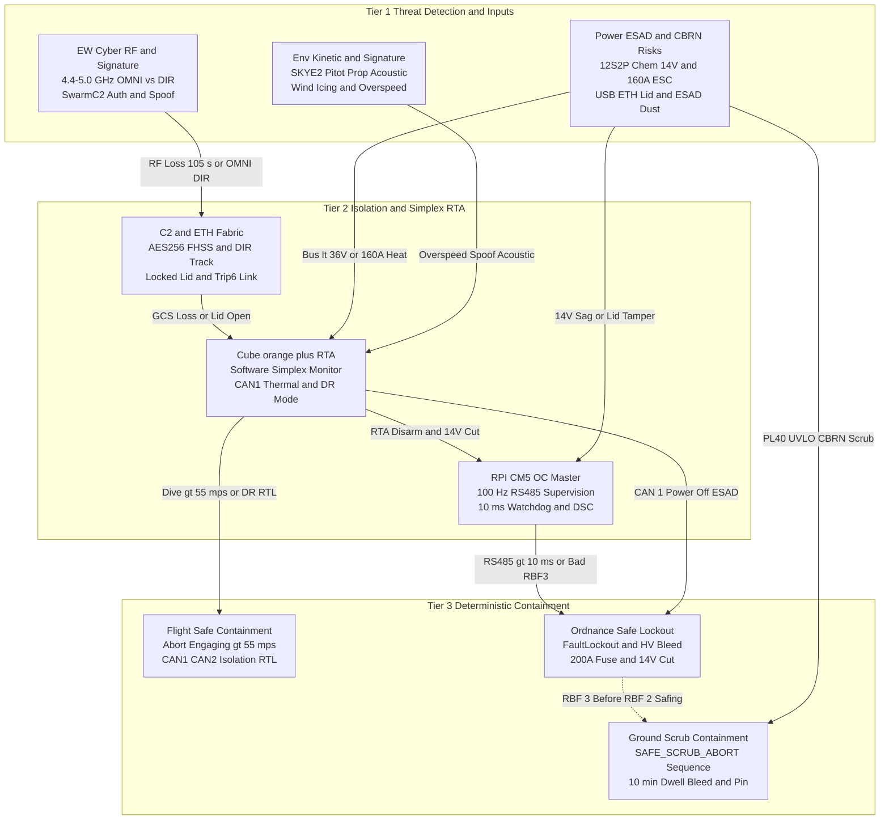

## 4. Multi-Domain Threat, Electronic Warfare & Cyber Environment Matrix

- **Baseline Date:** `2026-11-16`
- **System Baseline:** `Avenger5V25UasSystem` (`Avenger 5 V2.5 UAS` / `ASTK A5 V2.5` / `ELI Military Simulations PL-40 Rev 2.6` / `Artron ESAD AB00-0054-01AA-0005` / `SwarmC2`)
- **Governance Scope:** Level 1B Operational Threat Taxonomy covering `THR-01` through `THR-11` across all eleven mission-critical threat domains (`Kinetic`, `Mechanical`, `Environmental`, `EW / Cyber`, `Power / Thermal`, `Optical`, `Human Factors`, `RF/Spectrum`, `Ordnance/Safety`, `Signature / Acoustic`, and `CBRN`), derived deterministically from `docs/research/RESEARCH_INVENTORY.md`, `docs/research/FAILURE_MODE_REGISTRY.md`, and `docs/safety/STPA_MATRIX.md`. All operational scenarios (`SCN-01` through `SCN-08`), operational activities (`OA-01` through `OA-19`), and user classes (`UCL-01` through `UCL-05`) maintain strict Level 1B boundary separation (`standaloneRtaBoxCount == 0`, zero electrical wires across `IF-MECH-001`, production `rndRecoveryOptionInstalled == false`).

### 4.1 Multi-Domain Threat, EW & Cyber Environment Register (Table 4.1)

| ID | Domain | Vector | Technical Description | Severity | Detection Mechanism | Autonomous Mitigation Rule | Public Clause Citation |
| :--- | :--- | :--- | :--- | :--- | :--- | :--- | :--- |
| `THR-01` | `Kinetic` | Dive overspeed (`> 55.0 m/s` cap / `> 80.0 m/s` VNE), PL-40 sub-stall/overspeed launch (`GAP-03`), and boundary excursion | During catapult release (`SCN-06`, `OA-16`), `Pl40PneumaticLauncher` accelerates the `17.0 kg` airframe (`<= 5.0 kg` warhead holder, zero production parachute) to `~23.0 m/s` (`22.7 m/s` to `23.5 m/s` at `13.0 bar` to `14.0 bar`), near the `24.0 m/s` to `26.0 m/s` stall floor (`GAP-03`), while configurations `< 15.0 kg` risk exceeding the `25.0 m/s` rail cap. During `TargetTrackAndDive` (`SCN-04`, `OA-13`), dives up to `22.0 deg` (`15.0 deg` shallow nominal) can push speed above the `55.0 m/s` gimbal limit toward `80.0 m/s` `VNE` (`GAP-02`) or violate SORA Ground Risk Buffer bounds (`50.0 m` to `3000.0 m` altitude, `>= 300.0 m` loiter, `5000.0 m` ceiling). | `Critical` | `CUAV SKYE2` pitot on `CAN 2` (`OA-06` pre-flight `<= 3.0 m/s` calm and `>= 10.0 m/s` airflow) and `FlightControllerCubeOrangePlus` EKF2/INS IMU continuously evaluate airspeed, dive pitch, `SS1` launch acceleration across `CONN_24`, and geofence limits (`FlightEnvelopeSpeedConstraint`). | Software-hosted ASTM F3269-17 Simplex RTA on `Cube orange+` (`OA-05`, `standaloneRtaBoxCount == 0`) overrides `Trip6` dive cues whenever airspeed `> 55.0 m/s`, commands `Abort Engaging` (climb to Takeoff altitude into `GUIDED` loiter or `RTL` with zero auto re-track), clamps flight speed below `80.0 m/s` `VNE` and above `24.0 m/s` stall, and gates launch on `<= 25.0 m/s` exit and pusher readiness (`REQ_SC_05`, `REQ_SAF_02`, `REQ_SAF_03`). | `ASTM F3269-17 §5.2; JARUS SORA v2.5 Annex B, Annex C; DoD Directive 3000.09 §4.1.a; MIL-STD-882E Task 202, Task 205` |
| `THR-02` | `Mechanical` | PL-40 carriage/hardpoint arrest, `CAN 2` daisy-chain break, surface jam, and fastener/rope fatigue | Zero-wire mechanical coupling (`IF-MECH-001`, `CONN_23`) is exposed to carriage lock-pad piston over-acceleration air shutoff, prop interference outside the `145.0 mm` to `155.5 mm` upper safe zone (`FM-03-02`, `FM-12-01`), and `100`-launch pulling rope or wheel-bearing fatigue (`FM-12-04`). Airborne, a break in the `CAN 2` series daisy-chain (`Splitter -> Wings #5-#8 -> 2x RM3100 -> SKYE2`), un-torqued `M6 x 30 mm` wing bolts or `M3` (`75.0 mm` BCD) ESAD mounts (`GAP-SEPDIST`), or `HV6160` actuator binding degrades roll control and `SS1` shock transfer (`CONN_24`). | `Critical` | Pre-flight `HV6160-DroneCAN` full-deflection sweep (`OA-09`), `onlineMagCount == 2` `RM3100` check, and `SKYE2` airflow check; in-flight `Cube orange+` DroneCAN node heartbeat counters, EKF2 attitude-rate residual monitoring, and `Artron ESAD` `SS1` inertial launch switch plus `SS2` (`Safe Distance Exceed == 1`). | Physical `CAN 1` (Power Meter, EPS, `4x` tail fins `#1-#4` via `120.0 cm` stubs) vs `CAN 2` (splitter, `4x` wings `#5-#8`, `2x RM3100`, `SKYE2`) topology isolation (`CanTopologyIsolationConstraint`, `REQ_SC_06`) preserves tail pitch/yaw control during any `CAN 2` break; `Cube orange+` enters `EmergencyAbortOrRtb` (`RTL`) on actuator/sensor heartbeat loss, while `Pl40LauncherState` enforces `<= 14.0 bar` and `>= 2.0 s` dual-switch hold (`REQ_SC_13`, `REQ_SC_14`). | `SAE ARP4754A §5.1; SAE ARP4761 §3.1-3.3; MIL-STD-810H Method 514.8, 516.8; MIL-STD-331D Group A Test A3, Test A4.1, Test A5` |
| `THR-03` | `Environmental` | Thermal soak (`-20.0 degC` to `+50.0 degC`), wind gusts (`> 12.0 m/s` launch / `> 28.0 m/s` cruise), rain/dust, pitot icing, and umbilical ingress | Ambient temperatures outside `-20.0 degC` to `+50.0 degC` (or `+10.0 degC` to `+40.0 degC` Makita charge limits), ground winds above `12.0 m/s` at launch (`Pl40MassAndExitVelocityConstraint`), or cruise turbulence above `28.0 m/s` accelerate `12S2P` voltage sag and pneumatic fill load (`FM-01-04`, `FM-03-04`). Rain, sand/dust, pitot ice obstruction, or an unlatched `External Interface Board (USB/ETH)` umbilical lid (`FM-07-03`, `FM-09-02`, `GAP-ENV`) biases `SKYE2` airspeed or exposes internal `ASTK A5 V2.5` avionics to moisture and FOD. | `High` | `CUAV SKYE2` heated pitot pre-flight calibration check (`<= 3.0 m/s` calm, `>= 10.0 m/s` blown, `OA-06`), `Cube orange+` EKF2 airspeed-to-IMU innovation checks, `IBEX160` ESC/motor thermal telemetry bridged onto `CAN 1` (`OA-02`), and pre-flight dual-lid lock check (`externalLidLocked == true`). | `Cube orange+` Simplex RTA blocks launch or triggers `Abort Engaging` / `RTL` on `PitotPreflightCalibrationConstraint` failure (`REQ_SC_07`) or thermally induced bus sag `< 36.0 V` / Bingo `<= 0.20` (`REQ_SC_02`); `RebootGimbalAndBridgeEthernet` requires `externalLidLocked == true`; operational weather gates suspend catapult launch whenever ground wind exceeds `12.0 m/s` (`REQ_SAF_11`). | `MIL-STD-810H Method 501.7, 502.7, 506.6, 510.7, 514.8, 516.8; MIL-STD-882E Task 202, Task 206` |
| `THR-04` | `EW / Cyber` | GNSS jamming/spoofing, unauthorized `SwarmC2` / `USB/ETH` ingress, C2 link injection, and `ESAD` `RS-485` bus disruption | Hostile jamming or spoofing at `Talysman TW3972EXF` (`IF-RF-002`, `FM-07-02`) drives `Septentrio Asterx-m3 pro` PVT divergence and flyaway (`REQ_L_03`); unauthorized console login, unsealed `USB/ETH` service ports (`FM-09-02`), or malformed `5W`/`CFF` exchange threatens C2 integrity (`UCL-04`); EMI or `RPI CM5004032` jitter threatens the `100.0 Hz` (`115200 bps` `8N1`, `CRC-16 XModem`) `RS-485` ESAD supervision bus (`IF-ORD-001`, `FM-06-01`, `GAP-04`). | `Critical` | `Cube orange+` `GPS Failsafe` monitor (`OA-07`) and `UCL-01` `Disable GNSS` command; `SwarmC2` `>= 8`-char role auth (`UCL-01`, `UCL-02`, `UCL-03`), `2.0 min` pre-flight link detect, and `105.0 s` airborne C2 heartbeat watchdog (`PaceC2LinkState`); `RPI CM5` `100.0 Hz` `RS-485` `CRC-16 XModem` check (`<= 5.0 ms` reply, `<= 10.0 ms` incomplete-packet timeout). | On GNSS anomaly, `Cube orange+` transitions to `SwitchToGnssDeniedDeadReckoning` (`RM3100 + SKYE2` DR, `SCN-03`) and bars auto re-enable of spoofed GNSS during RTL. `4.4 GHz` to `5.0 GHz` C2 enforces `AES-256` `FHSS` (`OBL-04`), `105.0 s` `GCS Failsafe` executes `RTL` plus `Disarm ESAD On GCS Timeout` (`REQ_SC_12`), and any `RS-485` `CRC-16` error or `> 10.0 ms` timeout drives `EsadBusWatchdogFaultFallback`, `ESAD` `FaultLockout`, and irreversible `Power Off ESAD` (`REQ_SC_08`, `REQ_SAF_04`). | `NIST SP 800-82r3 Chapter 6, Appendix F (AC, IA, SC); RTCA DO-362A §2.2, §3.2; RTCA DO-178C §6.3; ASTM F3269-17 §5.2` |
| `THR-05` | `Power / Thermal` | `EPS 14.0 V` zero brownout margin (`GAP-01`), `12S2P` sag (`< 36.0 V`) / `0.20` Bingo exhaustion, `8.0 V` servo rail fault, and `14.5 V` PL-40 UVLO | `ElectronicPowerSystemEps` outputs `14.0 V` to `Artron ESAD` (`14.0 V` min `VDC_IN`, `0.0 V` brownout margin per `GAP-01`) across `22-28 AWG` wiring from the `970.0 cm` trunk (`FM-04-01`, `FM-11-01`, `FM-15-04`), creating peak RPN (`192`) sag risk. Single-point `8.0 V` servo rail overload (`FM-08-04`), `12S2P` voltage sag below `36.0 V` / `0.20` Bingo (`1080.0 s` of `5400.0 s`), `IBEX160` over-temperature (`FM-03-04`), or `Makita BL1860B` sag `<= 14.5 V` UVLO (`FM-12-04`) threatens avionics blackout or prep stall. | `Critical` | `MainBatteryPreFlightVoltageConstraint` validates `49.0 V` to `50.0 V` pre-flight (`legacy24VUiRejected == true`, `GAP-05`, `OA-01`); `PowerMeterAndRbfSwitch` and `IBEX160` report `V`, `I`, `RPM`, and ESC/motor temps on `CAN 1` (`OA-02`, `OA-04`); `EPS` monitors `14.0 V` ESAD and `8.0 V` / `12.0 V` rails on `CAN 1`; `PL-40` compressor hardware senses `<= 14.5 V` UVLO (`PWR` LED flash). | `Cube orange+` Simplex RTA commands `CriticalBatteryOrGeofenceRtb` (`RTL`) at `< 36.0 V` bus or `<= 0.20` Bingo reserve, while `EPS 14.0 V` brownout guard raises `esadBrownoutAlert` and triggers irreversible `Power Off ESAD` rail isolation (`EpsEsadZeroBrownoutMarginConstraint`, `REQ_SAF_01`, `REQ_SC_02`); `200.0 A` fuse protects the main bus (`REQ_SC_04`); `Optional RnD 2x 50.0 V` igniters stay inhibited (`REQ_SC_03`); `PL-40` enforces `<= 14.5 V` cutoff (`> 16.0 V` after `5.0 s` restart) and pack swaps (`REQ_SC_14`). | `SAE ARP4754A §5.1; SAE ARP4761 §3.1-3.3; MIL-STD-1629A Method 101, Method 102; MIL-STD-810H Method 501.7, 502.7` |
| `THR-06` | `Optical` | `Nighthawk2UZ` / `Trip6` video freeze, EO/IR dazzle or contrast loss, gimbal saturation (`> 55.0 m/s`), and retained `RBF #1` | `Nighthawk2UZ` (`1280x720` Day/Thermal, `X40` zoom, pitch `-45.0 deg` to `+135.0 deg`, yaw/roll `+/-165.0 deg`) and `Trip6` tracker are vulnerable to `IF-VID-001` or `IF-ETH-001` stream freezes (`FM-10-01`, `FM-09-03`), laser/solar blinding or precipitation obscuration (`FM-10-04`), interrupted `2.0 s` to `5.0 s` target track hold, gimbal rate saturation above `55.0 m/s` (`> 0.5 m` CEP loss, `FM-10-03`), or power-on with `RBF #1` front sensor cover/strap attached (`FM-03-02`). | `High` | Pre-flight `RBF #1` removal checklist and `SwarmC2` `Video Checks` (`SCN-01`); live `Trip6` Ethernet frame monitoring by `UCL-02`, `2.0 s` to `5.0 s` EO track-hold and `<= 15.0 deg` target elevation gating (`EngagementSpeedAndTrackHoldConstraint`), and `SKYE2` airspeed supervision in `Cube orange+` (`<= 55.0 m/s`). | On EO/IR video freeze with `externalLidLocked == true`, `UCL-02` triggers in-flight `Reboot Gimbal` (`RebootGimbalAndBridgeEthernet`, `OA-14`) over `ETH Switch`; if target track drops, elevation exceeds `15.0 deg`, or airspeed exceeds `55.0 m/s`, `Cube orange+` Simplex RTA immediately forces `Abort Engaging` (climb to Takeoff altitude, `GUIDED` loiter or `RTL`, zero auto re-track, `REQ_SC_12`) while preserving mandatory `UCL-02` HITL engagement consent. | `DoD Directive 3000.09 §4.1.a; ASTM F3269-17 §5.2; MIL-STD-810H Method 506.6, 510.7; ISO/IEC/IEEE 29148:2018 Annex A (§A.2)` |
| `THR-07` | `Human Factors` | Reversed `RBF #1/#2/#3` sequence, omitted ESD ground / `< 10.0 m` RF prep, unbleed hangfire approach, and UI misread | Operator errors across `UCL-01`, `UCL-02`, `UCL-03`, and `UCL-05` include pulling `RBF #2` before `RBF #1` removal / rearward prop fold (`REQ_UCA_01`, `FM-02-02`), pulling `ESAD RBF #3` before `RBF #2` power-on (`GAP-06`, `FM-11-03`), omitting Transport Box `EARTH / GROUNDING POINT` touch or pre-handling rotator calibration (`FM-14-03`, RPN `192`), misreading `SS2` wording (`GAP-07`, `FM-13-02`), entering bad mission altitudes (`50.0 m` to `3000.0 m`), or approaching a `13.0 bar` to `14.0 bar` hangfire rail without safing (`GAP-SCRUB`, `FM-12-02`). | `Catastrophic` | `SwarmC2` enforces `>= 8`-char role auth, `<= 24`-char mission name, `50.0 m` to `3000.0 m` altitude (`250.0 m` step), `>= 300.0 m` loiter, `49.0 V` to `50.0 V` battery check (`REQ_SAF_05`), 8-precondition `RBF #3` prompt gate (`REQ_SC_09`, `REQ_SAF_06`), `Safe Distance Exceed == 1` text (`REQ_SAF_07`), armed `Reboot Vehicle` lockout, and `>= 5.0 s` hold + `Slide-to-Confirm` abort. | Ordered hardware/software interlocks latch `ESAD` `FaultLockout` on premature `RBF #3` pull (`EsadRbf3PowerBeforePullConstraint`) and require red carriage safety pin pull + Main Valve `4` open + `>= 2.0 s` dual firing hold on `PL-40` (`REQ_SC_13`). Any launch scrub or hangfire enforces `SAFE_SCRUB_ABORT` (`OA-17`, `SCN-08`, `REQ_SC_16`, `REQ_SAF_12`): execute `>= 5.0 s` ESAD abort + irreversible `Power Off ESAD`, shut Main Valve `4` and bleed tank to `0.0 bar`, reinstall red pin, and reinsert `RBF #3` strictly before `RBF #2` disconnect. | `MIL-STD-882E Task 206; DoD Directive 3000.09 §4.1.a; NIST SP 800-82r3 Appendix F (AC, IA, SC); IEEE Std 1362-1998 §4.3` |
| `THR-08` | `RF/Spectrum` | `4.4 GHz` to `5.0 GHz` RLOS fade (`> 60.0/90.0 km`), rotator misalignment, `< 10.0 m` saturation, coax pinch, and EMI/ESD | Energizing the `2.0 W` (`2x 1.0 W`) `DTC 4.4 GHz` to `5.0 GHz` Ground Radio Box inside `< 10.0 m` UAV separation (`FM-14-03`), launching in `DIR` instead of `OMNI`, skipping Antenna Rotator calibration (`Auto Follow` / `0.5 deg` step, `FM-14-02`), pinching `2x MPSL4400` coax (`FM-09-01`), flying beyond V2.5 `60.0 km` / `90.0 km` RLOS (`GAP-02`, `FM-14-04`), or `CS114`/`CS116`/`CS118`/`RE102`/`RS103` EMI coupling disrupts C2 telemetry and ESAD `RS-485` timing (`FM-11-02`). | `High` | Pre-flight `2.0 min` `SwarmC2` telemetry check (`PRM-GCS-002`), `>= 10.0 m` radio separation rule (`GroundCrewSeparationAndEsdConstraint`), live `4.4 GHz` to `5.0 GHz` RSSI / link-quality telemetry, and airborne `105.0 s` `GCS Failsafe` heartbeat loss watchdog (`PaceC2LinkState`). | Ground/launch operations lock to `OMNI` (`AlternateDtcOmniLocal`) prior to `PrimaryDtcDirTracking` (`MARS 23 dBi` + optional `200.0 m` fiber spool), fall back `DIR -> OMNI` on near-field/rotator fault (`0.5 deg` manual trim), and engage `EmergencyLostLinkRtlHolding` at `105.0 s` loss (`RTL` + `Disarm ESAD On GCS Timeout`, `OA-12`, `REQ_SC_12`, `REQ_SC_15`); `MIL-STD-461G` shielding, differential `RS-485`, and `RBF #3` `< 0.5 Ohm` shorting protect ordnance against EMI/ESD. | `RTCA DO-362A §2.2, §3.2; MIL-STD-461G CS114, CS116, CS118, RE102, RS103; JARUS SORA v2.5 Annex B, Annex C` |
| `THR-09` | `Ordnance/Safety` | Premature `Artron ESAD` `0.0 V` to `1800.0 V` HV charge, `PBIT >= 50.0 V`, early `DSC_IN1`, `SS1`/`SS2` bypass, and shock/drop | Catastrophic ordnance exposure occurs if `Artron ESAD` (`AB00-0054-01AA-0005`, `<= 5.0 kg` warhead holder / `4.98 +/- 0.02 kg` tested) encounters `RBF #3` removal before `RBF #2` power-on (`GAP-06`), receives `DSC_IN1` (`1000.0 Hz`, `2` pulses) prior to `Arm Stage 2` (`FaultStates` bit 4, `FM-06-02`), charges `J401` (`0.0 V` to `1800.0 V`) before `SS1` + `SS2` (`Safe Distance Exceed == 1`, `GAP-07`, `FM-11-03`), retains `>= 50.0 V` at PBIT (`FM-11-04`), loses `100.0 Hz` `RS-485` supervision, or undergoes handling drop shock. | `Catastrophic` | `ESAD` boot welcome and pre-flight `PBIT` (`< 50.0 V` safe threshold) via `RPI CM5004032` (`OC Master`, `100.0 Hz` `RS-485`, `<= 5.0 ms` reply, `<= 10.0 ms` timeout, `OA-08`, `OA-10`); `UMB` continuity (`< 0.5 Ohm` at `20.0 mA`); dual hardware barriers (`SS1` accel + `SS2 == 1`), `FaultStates` bits 0-8, `Sensor Board` `IRQ_L` gate, and `1.0 V/LSB` HV readback (`WarheadMassAndPbitHvSafetyConstraint`). | `STANAG 4187` sequential gating (`OA-11`, `SCN-05`) prohibits HV charge until `RBF #2` ON -> `PBIT < 50.0 V` -> `RBF #3` pull -> `SS1` launch -> `SS2 == 1` -> `Arm Stage 2` `DSC_IN1` (`1000.0 Hz`, `2` pulses) -> `SwarmC2` arm consent; premature `DSC_IN1`, `RS-485 > 10.0 ms` fault, `PBIT >= 50.0 V`, `EPS 14.0 V` sag, or `105.0 s` GCS loss forces immediate HV bleed (`< 50.0 V`), `FaultLockout` / `Disarm ESAD On GCS Timeout`, and backup irreversible `Power Off ESAD` via `CAN 1` (`REQ_SC_08` through `REQ_SC_11`, `REQ_SAF_01`). | `NATO STANAG 4187 Ed. 5 Chapter 2, Chapter 3, Annex A; MIL-STD-331D Group A Test A3, Test A4.1, Test A5; RTCA DO-178C §6.3, §11.0; RTCA DO-254 §10.0` |
| `THR-10` | `Signature / Acoustic` | `AXI 5345/16` pusher/propeller acoustic noise, `IBEX160` (`160.0 A`) ESC/motor thermal emission, and `OMNI` vs `DIR` RF signature | Acoustic and thermal detectability increases from rear `AXI 5345/16` pusher propeller operation (`145.0 mm` to `155.5 mm` upper clearance zone, `FM-03-02`, `SCN-02`, `SCN-06`) and `160.0 A`-rated `IBEX160` ESC/motor heating (`FM-03-04`, `-20.0 degC` to `+50.0 degC` ambient soak) during climb (`>= 26.0 m/s`), `31.0 m/s` cruise, and `<= 55.0 m/s` dive (`SCN-04`). On the `4.4 GHz` to `5.0 GHz` `DTC` `AES-256` `FHSS` link (`2.0 W` / `2x 1.0 W` `MPSL4400`), remaining in ground `OMNI` (`AlternateDtcOmniLocal`) instead of promoting to narrow-beam `MARS 23.0 dBi` `DIR` tracking (`PrimaryDtcDirTracking`) or omitting the `200.0 m` ground fiber (`IF-GND-001`, `SCN-07`) increases omnidirectional RF emission exposure (`FM-09-01`, `FM-14-01`). | `High` | `IBEX160` ESC/motor thermal, current, and `RPM` telemetry bridged onto `CAN 1` alongside `PowerMeterAndRbfSwitch` (`OA-02`, `OA-04`); `SwarmC2` `OMNI`/`DIR` mode, `4.4 GHz` to `5.0 GHz` RSSI, and `Auto Follow` rotator (`0.5 deg` trim) supervision (`OA-18`, `PaceC2LinkState`); pre-flight propeller clearance (`145.0 mm` to `155.5 mm`) check (`OA-09`); and `Cube orange+` airspeed/altitude bounds (`OA-05`). | `PaceC2LinkState` transitions `AlternateDtcOmniLocal` (`OMNI` ground/launch) to directional `PrimaryDtcDirTracking` (`MARS 23.0 dBi` `DIR`) upon airborne lock (`T_OmniToDir`), paired with optional `200.0 m` tactical fiber (`IF-GND-001` / `CONN_22`, `OBL-04`, `CTL-02`) to reduce ground RF/copper signature; `Cube orange+` Simplex `RTA` constrains climb/cruise/dive (`24.0 m/s` to `42.0 m/s` horizontal, `<= 55.0 m/s` dive, `50.0 m` to `3000.0 m` altitude) to bound acoustic and `IBEX160` thermal load, executing `RTL` on `< 36.0 V` or `<= 0.20` Bingo thermal sag (`REQ_SC_02`, `REQ_SC_05`, `MIL-STD-461G RE102`). | `MIL-STD-461G RE102, RS103; RTCA DO-362A §2.2, §3.2; MIL-STD-810H Method 501.7, 502.7; ASTM F3269-17 §5.2; NIST SP 800-82r3 Chapter 6` |
| `THR-11` | `CBRN` | `12S2P` Li-metal electrolyte / thermal-runaway chemical hazard, `Artron ESAD` energetic dust/residue, and unsealed `USB/ETH` lid contamination | Cell puncture, `< 36.0 V` deep discharge, `> 200.0 A` short-circuit, or ambient soak outside `-20.0 degC` to `+50.0 degC` across `12S2P` Li-metal flight packs (`49.0 V` to `50.0 V` pre-flight, `36.0 V` to `50.4 V` bus, `FM-01-01`, `FM-01-04`, `FM-04-04`) creates toxic electrolyte leakage and thermal-runaway chemical hazards. Ordnance handling, `1.5 mm` HEX assembly (`FM-11-05`), or hangfire scrub of `Artron ESAD` (`AB00-0054-01AA-0005`, `<= 5.0 kg` warhead holder / `4.98 +/- 0.02 kg`) introduces energetic dust/residue hazards (`SCN-08`), while unlatched `External Interface Board (USB/ETH)` or `RBF` lids (`FM-07-03`, `FM-09-02`, `GAP-ENV`) expose internal `ASTK A5 V2.5` avionics to chemical, rain, or particulate contamination. | `High` | `MainBatteryPreFlightVoltageConstraint` (`49.0 V` to `50.0 V`, `OA-01`) and `PowerMeterAndRbfSwitch` (`CAN 1`, `OA-02`, `OA-04`) tracking `>= 36.0 V` bus, `200.0 A` fuse margin, and `IBEX160` temperature; mandatory `RBF` and `External Interface Board (USB/ETH)` lid-lock gate (`externalLidLocked == true`, `umbilicalLidLocked == true`, `OA-14`); `Artron ESAD` `PBIT < 50.0 V` and `FaultStates` (`OA-08`, `OA-10`); and `>= 10.0 min` rear `SAFETY AREA` scrub dwell (`OA-17`). | `Cube orange+` Simplex `RTA` executes `CriticalBatteryOrGeofenceRtb` (`RTL`) at `< 36.0 V` or `<= 0.20` Bingo before Li-metal thermal runaway (`REQ_SC_02`), while the `200.0 A` fuse limits short-circuit ignition (`REQ_SC_04`) and `Optional RnD 2x 50.0 V` igniters stay inhibited (`REQ_SC_03`). Pre-flight checklists and `RebootGimbalAndBridgeEthernet` enforce `externalLidLocked == true` / `umbilicalLidLocked == true` (`REQ_SC_01`, `GAP-ENV`) as sealed `USB/ETH` contamination defense (`MIL-STD-810H` Method 506.6, 510.7); any scrub mandates `SAFE_SCRUB_ABORT` (`>= 10.0 min` dwell, ESAD `Power Off < 50.0 V`, `PL-40` bleed to `0.0 Pa`, red pin restore, ESD touch, and `RBF #3` before `RBF #2`, `REQ_SC_16`, `REQ_SAF_12`). | `MIL-STD-810H Method 501.7, 502.7, 506.6, 510.7; MIL-STD-882E Task 202, Task 205, Task 206; NIST SP 800-82r3 Chapter 6; NATO STANAG 4187 Ed. 5 Chapter 2` |

### 4.2 Quantitative Multi-Domain Threat Bounds (Table 4.2)

| Bound ID | Threat ID | Monitored Threat Parameter | Boundary Condition | Value | Units | Authoritative SSOT Constraint / Source |
| :--- | :--- | :--- | :--- | :---: | :--- | :--- |
| `BND-01` | `THR-01` | Terminal Engagement Dive Airspeed Cap (`Abort Engaging`) | Maximum (`<=`) | `55.0` | `m/s` | `FlightEnvelopeSpeedConstraint` (`GAP-02`) |
| `BND-02` | `THR-01` | Structural Never-Exceed Airspeed (`VNE`) | Maximum (`<=`) | `80.0` | `m/s` | `FlightEnvelopeSpeedConstraint` (`GAP-02`) |
| `BND-03` | `THR-01` | Minimum Controlled Flight Airspeed (`V2.5` Stall Floor) | Minimum (`>=`) | `24.0` | `m/s` | `FlightEnvelopeSpeedConstraint` (`GAP-02`, `GAP-03`) |
| `BND-04` | `THR-01` | PL-40 Launch Rail Exit Speed Cap (`~23.0` at `17.0 kg`) | Maximum (`<=`) | `25.0` | `m/s` | `Pl40MassAndExitVelocityConstraint` (`GAP-03`) |
| `BND-05` | `THR-02` | PL-40 Supported Airframe Mass Limit (`17.0 kg` MTOW) | Maximum (`<=`) | `30.0` | `kg` | `Pl40MassAndExitVelocityConstraint` (`PRM-PL40-001`) |
| `BND-06` | `THR-02` | PL-40 Pneumatic Launch Tank Operating Pressure (Normalized pressure ratio P / 100 kPa; OEM: `13.0 to 14.0 bar`) | Range | `13.0 to 14.0` | `ratio` | `Pl40MassAndExitVelocityConstraint` (`PRM-PL40-027`) |
| `BND-07` | `THR-02` | PL-40 Pulling Rope and Bearing Overhaul Interval (`100` pneumatic launch cycles) | Maximum (`<=`) | `100` | `count` | `REQ_SC_14` (`PRM-PL40-035`) |
| `BND-08` | `THR-03` | System Ambient Operating Temperature Envelope (Normalized Kelvin scalar T / 1.0 K; OEM: `-20.0 to +50.0 degC`) | Range | `253.15 to 323.15` | `Dimensionless` | `PRM-PERF-018`, `PRM-PERF-019` (`SAF-04`) |
| `BND-09` | `THR-03` | Ground Catapult Launch Wind Tolerance Limit | Maximum (`<=`) | `12.0` | `m/s` | `Pl40MassAndExitVelocityConstraint` (`PRM-PERF-016`) |
| `BND-10` | `THR-03` | Airborne Cruise Wind Tolerance Limit | Maximum (`<=`) | `28.0` | `m/s` | `PRM-PERF-017` (`SAF-04`) |
| `BND-11` | `THR-03` | Pitot Pre-Flight Calm Air Zero-Check Ceiling | Maximum (`<=`) | `3.0` | `m/s` | `PitotPreflightCalibrationConstraint` (`REQ_SC_07`) |
| `BND-12` | `THR-03` | Pitot Pre-Flight Indirect Airflow Validation Floor | Minimum (`>=`) | `10.0` | `m/s` | `PitotPreflightCalibrationConstraint` (`REQ_SC_07`) |
| `BND-13` | `THR-04` | ESAD RS-485 OC Master Polling Rate | Nominal | `100.0` | `Hz` | `EsadRs485ProtocolTimingConstraint` (`GAP-04`) |
| `BND-14` | `THR-04` | ESAD RS-485 Slave Reply Latency Limit | Maximum (`<=`) | `5.0` | `ms` | `EsadRs485ProtocolTimingConstraint` (`REQ_SC_08`) |
| `BND-15` | `THR-04` | ESAD RS-485 Incomplete-Packet Watchdog Timeout | Maximum (`<=`) | `10.0` | `ms` | `EsadRs485ProtocolTimingConstraint` (`REQ_SC_08`) |
| `BND-16` | `THR-04` | Airborne GCS Failsafe RTL and ESAD Disarm Timeout | Nominal | `105.0` | `s` | `PaceC2LinkState` (`PRM-GCS-008`, `REQ_SC_12`) |
| `BND-17` | `THR-04` | SwarmC2 Role-Based Operator Password Character Count Floor (characters) | Minimum (`>=`) | `8` | `count` | `SwarmC2AuthAndMissionBoundsConstraint` (`OBL-04`) |
| `BND-18` | `THR-05` | Main `12S2P` Battery Pre-Flight Readiness Window | Range | `49.0 to 50.0` | `V` | `MainBatteryPreFlightVoltageConstraint` (`GAP-05`) |
| `BND-19` | `THR-05` | Main `12S2P` Flight Bus Voltage Operating Envelope | Range | `36.0 to 50.4` | `V` | `MainBatteryPreFlightVoltageConstraint` (`REQ_SC_02`) |
| `BND-20` | `THR-05` | Statutory Bingo Energy Reserve Ratio | Minimum (`>=`) | `0.20` | `ratio` | `BingoEnergyReserveConstraint` (`REQ_SC_02`) |
| `BND-21` | `THR-05` | Nominal Flight Endurance (`1080.0 s` Bingo Reserve) | Nominal | `5400.0` | `s` | `PRM-PERF-001`, `PRM-PERF-002` (`MET-02`) |
| `BND-22` | `THR-05` | EPS Regulated ESAD Supply Voltage (`0.0 V` Brownout Guard) | Range | `14.0 to 32.0` | `V` | `EpsEsadZeroBrownoutMarginConstraint` (`GAP-01`) |
| `BND-23` | `THR-05` | PL-40 Compressor Battery Pack UVLO Cutoff Floor | Minimum (`>`) | `14.5` | `V` | `Pl40UvloAndDualSwitchConstraint` (`REQ_SC_14`) |
| `BND-24` | `THR-06` | EO/IR Target Track Hold Authorization Window | Range | `2.0 to 5.0` | `s` | `EngagementSpeedAndTrackHoldConstraint` (`REQ_SC_12`) |
| `BND-25` | `THR-06` | Terminal Dive Circular Error Probable (`CEP`) | Maximum (`<=`) | `0.5` | `m` | `EngagementSpeedAndTrackHoldConstraint` (`PRM-PERF-020`) |
| `BND-26` | `THR-07` | ESAD Self-Destruct / Abort Operator Hold Duration | Minimum (`>=`) | `5.0` | `s` | `PRM-GCS-010` (`REQ_SC_16`, `MET-03`) |
| `BND-27` | `THR-07` | PL-40 Dual Safety-Cover Firing Switch Simultaneous Hold | Minimum (`>=`) | `2.0` | `s` | `Pl40UvloAndDualSwitchConstraint` (`REQ_SC_13`) |
| `BND-28` | `THR-08` | C2 Operating RF Band (`AES-256` FHSS `2.0 W` TX) | Range | `4.4 to 5.0` | `GHz` | `OBL-04`, `CTL-02` (`PRM-RF-001`) |
| `BND-29` | `THR-08` | Ground Radio to UAV Pre-Flight Separation Minimum | Minimum (`>=`) | `10.0` | `m` | `GroundCrewSeparationAndEsdConstraint` (`REQ_SC_15`) |
| `BND-30` | `THR-08` | V2.5 Baseline Radio Line-of-Sight (`RLOS`) | Nominal | `60.0` | `km` | `REQ_SAF_02` (`GAP-02`) |
| `BND-31` | `THR-08` | V2.5 Extended Radio Line-of-Sight (`RLOS`) | Maximum (`<=`) | `90.0` | `km` | `REQ_SAF_02` (`GAP-02`) |
| `BND-32` | `THR-09` | ESAD PBIT Safe Residual High-Voltage Ceiling | Maximum (`<`) | `50.0` | `V` | `WarheadMassAndPbitHvSafetyConstraint` (`SAF-01`) |
| `BND-33` | `THR-09` | ESAD RBF #3 Umbilical Continuity Voltage Drop (`< 0.5 Ohm` at `20.0 mA`) | Maximum (`<`) | `0.01` | `V` | `EsadRbf3PowerBeforePullConstraint` (`GAP-06`) |
| `BND-34` | `THR-09` | ESAD J401 High-Voltage Fire Output Envelope | Range | `0.0 to 1800.0` | `V` | `WarheadMassAndPbitHvSafetyConstraint` (`SAF-01`) |
| `BND-35` | `THR-09` | Warhead Package and Holder Mass Ceiling | Maximum (`<=`) | `5.0` | `kg` | `WarheadMassAndPbitHvSafetyConstraint` (`REQ_SC_12`) |
| `BND-36` | `THR-10` | `IBEX160` Propulsion ESC Rated Continuous Current Thermal Envelope | Maximum (`<=`) | `160.0` | `A` | `ElectricPropulsionUnit` (`FM-03-04`, `OA-02`) |
| `BND-37` | `THR-10` | Pusher Propeller Upper Structural Clearance Zone (`FM-03-02`) | Range | `145.0 to 155.5` | `mm` | `ElectricPropulsionUnit` (`FM-03-02`, `OA-09`) |
| `BND-38` | `THR-10` | Ground `MARS` Directional (`DIR`) Antenna Gain (`OMNI` to `DIR` Narrowing) | Nominal | `23.0` | `dBi` | `GroundRfStationAndAntennaTracker` (`PRM-RF-009`, `CTL-02`) |
| `BND-39` | `THR-11` | `MainBatteryAndFuseUnit` Main Bus Thermal-Runaway Over-Current Fuse Limit | Maximum (`<=`) | `200.0` | `A` | `MainBatteryAndFuseUnit` (`REQ_SC_04`, `FM-04-04`) |
| `BND-40` | `THR-11` | `External Interface Board (USB/ETH)` Sealed Lid Contamination Lock (`1 = locked`) | Exact | `1` | `Dimensionless` | `RebootGimbalAndBridgeEthernet` (`REQ_SC_01`, `GAP-ENV`, `FM-09-02`) |
| `BND-41` | `THR-11` | `SAFE_SCRUB_ABORT` Rear `SAFETY AREA` Hangfire and Energetic Residue Dwell | Minimum (`>=`) | `10.0` | `min` | `Pl40LauncherState` (`GAP-SCRUB`, `REQ_SC_16`, `MET-04`) |

### 4.3 Multi-Domain Threat Detection, Isolation & Failsafe Containment Topology

The threat isolation architecture partitions sensing, supervisory isolation, and deterministic containment across three hierarchical tiers (Figure 4.1). Software-hosted ASTM F3269-17 Simplex RTA inside `FlightControllerCubeOrangePlus` (`Cube orange+`), `RPI CM5004032` (`OC Master`), and physical `CAN 1` / `CAN 2` / `IF-MECH-001` boundaries isolate threats before loss escalation (`REQ_L_01`, `REQ_L_02`, `REQ_L_03`, `REQ_L_04`).

#### Figure 4.1: Multi-Domain Threat Isolation & Containment Architecture

### 4.4 Threat Authority Allocation & STPA/FMECA Traceability

Operational threat authority is partitioned deterministically across canonical user classes (`UCL-01` through `UCL-05`) and traced across `STPA_MATRIX.md` and `FAILURE_MODE_REGISTRY.md`:

- **Canonical User Class Threat Responsibilities:**
  - `UCL-01` (`Pilot Operator` -- `SwarmC2` `Pilot` role): Commands `Disable GNSS` (`SCN-03`, `OA-07`), verifies `>= 10.0 m` ground radio separation and rotator calibration (`OA-18`), promotes `OMNI` to directional `MARS 23.0 dBi` `DIR` to narrow RF signature (`THR-10`), and exercises supervisory override / `RTL` authority (`THR-01`, `THR-04`, `THR-08`).
  - `UCL-02` (`Payload Operator` -- `SwarmC2` `Payload` role): Supervises `Nighthawk2UZ` / `Trip6` video checks, triggers in-flight `Reboot Gimbal` (`OA-14`) on freeze with umbilical lid locked, enforces `2.0 s` to `5.0 s` EO track consent, and executes `>= 5.0 s` ESAD abort / self-destruct or irreversible `Power Off ESAD` (`THR-06`, `THR-09`).
  - `UCL-03` (`Launch Assistant` -- `SwarmC2` `Launch Assistant` role): Executes pre-flight `RBF #1` / `RBF #2` / `RBF #3` ordering, `49.0 V` to `50.0 V` battery verification (`OA-01`), locks `RBF` and `External Interface Board (USB/ETH)` lids against contamination ingress (`OA-14`, `REQ_SC_01`, `THR-11`), executes `PL-40` compressor `1300000.0 Pa` to `1400000.0 Pa` (`13.0 bar` to `14.0 bar`) charging with `14.5 V` UVLO swap (`OA-15`), red safety pin / Main Valve `4` / `>= 2.0 s` dual firing (`OA-16`), and `SAFE_SCRUB_ABORT` (`OA-17`, `THR-02`, `THR-07`).
  - `UCL-04` (`External Tactical C2` -- `ATAK`, `SitaWare HQ`, `DELTA`): Receives validated `5W` / `CFF` targeting reports (`OA-19`) gated on `targetCoordsValid` and authenticated C2 connectivity (`THR-04`, `OBL-04`).
  - `UCL-05` (`Field Sustainment & Arming Safety Lead`): Enforces Transport Box ESD grounding touch, `100`-launch `PL-40` rope/bearing overhaul (`FM-12-04`), `145.0 mm` to `155.5 mm` pusher prop clearance and `IBEX160` thermal audit (`THR-10`), `12S2P` Li-metal cell / warhead `<= 5.0 kg` / `1.5 mm` HEX inspection (`FM-11-05`, `THR-11`), and post-scrub `>= 10.0 min` dwell plus `RBF #3` before `RBF #2` ordnance safing (`THR-02`, `THR-07`, `THR-09`).

| Threat ID | Linked Scenarios (`SCN-*`) | Linked Operational Activities (`OA-*`) | Linked STPA Requirements (`REQ_*`) | Key FMECA Modes (`FM-*`) | `RESEARCH_INVENTORY.md` Anchors |
| :--- | :--- | :--- | :--- | :--- | :--- |
| `THR-01` | `SCN-02`, `SCN-04`, `SCN-06` | `OA-05`, `OA-13`, `OA-16` | `REQ_L_02`, `REQ_H_01`, `REQ_H_03`, `REQ_H_05`, `REQ_H_06`, `REQ_SC_05`, `REQ_SAF_02`, `REQ_SAF_03` | `FM-03-03`, `FM-05-03`, `FM-10-03`, `FM-12-01`, `FM-15-01` | `MET-02`, `MET-03`, `CTL-01`, `SAF-02`, `EXT-01`, `EXT-02` |
| `THR-02` | `SCN-01`, `SCN-02`, `SCN-06` | `OA-06`, `OA-09`, `OA-11`, `OA-16` | `REQ_L_01`, `REQ_L_02`, `REQ_H_03`, `REQ_H_06`, `REQ_SC_06`, `REQ_SC_13`, `REQ_SC_14`, `REQ_SAF_10` | `FM-03-02`, `FM-07-01`, `FM-08-01`, `FM-08-02`, `FM-11-05`, `FM-12-01`, `FM-12-04` | `OBL-02`, `SAF-01`, `SAF-02`, `CTL-04`, `EXT-01`, `EXT-02` |
| `THR-03` | `SCN-01`, `SCN-02`, `SCN-04` | `OA-02`, `OA-04`, `OA-06`, `OA-14` | `REQ_L_02`, `REQ_L_03`, `REQ_H_02`, `REQ_H_03`, `REQ_SC_01`, `REQ_SC_02`, `REQ_SC_07`, `REQ_SAF_11` | `FM-01-04`, `FM-03-04`, `FM-07-03`, `FM-09-02`, `FM-10-04` | `SAF-02`, `SAF-04`, `EXT-01`, `EXT-02` |
| `THR-04` | `SCN-03`, `SCN-05`, `SCN-07` | `OA-07`, `OA-08`, `OA-12`, `OA-18`, `OA-19` | `REQ_L_03`, `REQ_L_04`, `REQ_H_03`, `REQ_UCA_03`, `REQ_UCA_04`, `REQ_SC_07`, `REQ_SC_08`, `REQ_SC_12`, `REQ_SAF_04`, `REQ_SAF_08` | `FM-05-02`, `FM-06-01`, `FM-06-04`, `FM-07-02`, `FM-09-02`, `FM-11-02`, `FM-13-01` | `OBL-04`, `CTL-01`, `CTL-02`, `CTL-03`, `SAF-02`, `SAF-03` |
| `THR-05` | `SCN-01`, `SCN-02`, `SCN-06` | `OA-01`, `OA-02`, `OA-03`, `OA-04`, `OA-15` | `REQ_L_02`, `REQ_H_02`, `REQ_UCA_02`, `REQ_SC_02`, `REQ_SC_03`, `REQ_SC_04`, `REQ_SC_14`, `REQ_SAF_01`, `REQ_SAF_05` | `FM-01-01`, `FM-01-02`, `FM-02-04`, `FM-04-01`, `FM-04-03`, `FM-04-04`, `FM-08-04`, `FM-11-01`, `FM-12-04`, `FM-15-04` | `SAF-02`, `SAF-03`, `SAF-04`, `CTL-04`, `EXT-01`, `EXT-02` |
| `THR-06` | `SCN-01`, `SCN-04`, `SCN-07` | `OA-05`, `OA-13`, `OA-14` | `REQ_L_04`, `REQ_H_05`, `REQ_UCA_07`, `REQ_SC_01`, `REQ_SC_12`, `REQ_SAF_02` | `FM-09-03`, `FM-10-01`, `FM-10-02`, `FM-10-03`, `FM-10-04` | `MET-01`, `MET-03`, `CTL-01`, `SAF-04`, `EXT-01` |
| `THR-07` | `SCN-01`, `SCN-05`, `SCN-08` | `OA-01`, `OA-10`, `OA-11`, `OA-12`, `OA-16`, `OA-17`, `OA-18` | `REQ_L_01`, `REQ_L_04`, `REQ_H_01`, `REQ_H_04`, `REQ_H_06`, `REQ_UCA_01`, `REQ_UCA_05`, `REQ_UCA_08`, `REQ_SC_01`, `REQ_SC_09`, `REQ_SC_13`, `REQ_SC_15`, `REQ_SC_16`, `REQ_SAF_06`, `REQ_SAF_07`, `REQ_SAF_12` | `FM-02-02`, `FM-03-02`, `FM-11-03`, `FM-12-02`, `FM-13-02`, `FM-13-03`, `FM-14-03`, `FM-15-02` | `OBL-04`, `MET-03`, `MET-04`, `SAF-01`, `SAF-02`, `EXT-01`, `EXT-02` |
| `THR-08` | `SCN-03`, `SCN-07` | `OA-07`, `OA-12`, `OA-18` | `REQ_L_01`, `REQ_L_03`, `REQ_H_05`, `REQ_SC_12`, `REQ_SC_15`, `REQ_SAF_02`, `REQ_SAF_11` | `FM-09-01`, `FM-09-04`, `FM-14-01`, `FM-14-02`, `FM-14-03`, `FM-14-04` | `OBL-04`, `MET-02`, `CTL-02`, `SAF-04`, `EXT-01` |
| `THR-09` | `SCN-01`, `SCN-05`, `SCN-08` | `OA-08`, `OA-10`, `OA-11`, `OA-12`, `OA-17` | `REQ_L_01`, `REQ_L_04`, `REQ_H_04`, `REQ_UCA_04`, `REQ_UCA_05`, `REQ_UCA_06`, `REQ_SC_08`, `REQ_SC_09`, `REQ_SC_10`, `REQ_SC_11`, `REQ_SC_16`, `REQ_SAF_01`, `REQ_SAF_04`, `REQ_SAF_06`, `REQ_SAF_07` | `FM-06-01`, `FM-06-02`, `FM-06-03`, `FM-11-01`, `FM-11-02`, `FM-11-03`, `FM-11-04`, `FM-11-05`, `FM-15-02`, `FM-15-03` | `SAF-01`, `SAF-02`, `SAF-03`, `CTL-03`, `EXT-01` |
| `THR-10` | `SCN-02`, `SCN-04`, `SCN-06`, `SCN-07` | `OA-02`, `OA-05`, `OA-09`, `OA-12`, `OA-18` | `REQ_L_02`, `REQ_L_03`, `REQ_H_02`, `REQ_H_05`, `REQ_SC_02`, `REQ_SC_05`, `REQ_SC_15`, `REQ_SAF_02` | `FM-03-02`, `FM-03-04`, `FM-09-01`, `FM-09-04`, `FM-14-01`, `FM-14-02`, `FM-14-04` | `OBL-04`, `MET-02`, `CTL-01`, `CTL-02`, `SAF-03`, `SAF-04`, `EXT-01` |
| `THR-11` | `SCN-01`, `SCN-02`, `SCN-06`, `SCN-08` | `OA-01`, `OA-02`, `OA-04`, `OA-08`, `OA-10`, `OA-14`, `OA-17`, `OA-18` | `REQ_L_01`, `REQ_L_02`, `REQ_H_02`, `REQ_H_04`, `REQ_SC_01`, `REQ_SC_02`, `REQ_SC_03`, `REQ_SC_04`, `REQ_SC_16`, `REQ_SAF_05`, `REQ_SAF_11`, `REQ_SAF_12` | `FM-01-01`, `FM-01-04`, `FM-04-04`, `FM-07-03`, `FM-09-02`, `FM-11-05`, `FM-13-03`, `FM-15-02` | `OBL-04`, `MET-04`, `SAF-01`, `SAF-02`, `SAF-04`, `CTL-04`, `EXT-01`, `EXT-02` |

---

/// OperationalAllocation: [OA-01]
/// OperationalAllocation: [OA-02]
/// OperationalAllocation: [OA-03]
/// OperationalAllocation: [OA-04]
/// OperationalAllocation: [OA-05]
/// OperationalAllocation: [OA-06]
/// OperationalAllocation: [OA-07]
/// OperationalAllocation: [OA-08]
/// OperationalAllocation: [OA-09]
/// OperationalAllocation: [OA-10]
/// OperationalAllocation: [OA-11]
/// OperationalAllocation: [OA-12]
/// OperationalAllocation: [OA-13]
/// OperationalAllocation: [OA-14]
/// OperationalAllocation: [OA-15]
/// OperationalAllocation: [OA-16]
/// OperationalAllocation: [OA-17]
/// OperationalAllocation: [OA-18]
/// OperationalAllocation: [OA-19]
/// OperationalAllocation: [MET-01]
/// OperationalAllocation: [MET-02]
/// OperationalAllocation: [MET-03]
/// OperationalAllocation: [MET-04]
