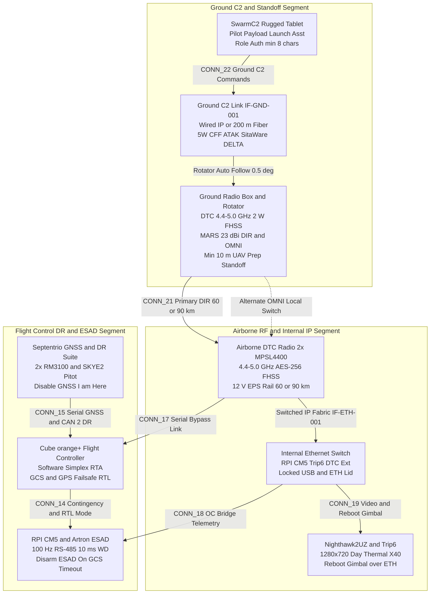
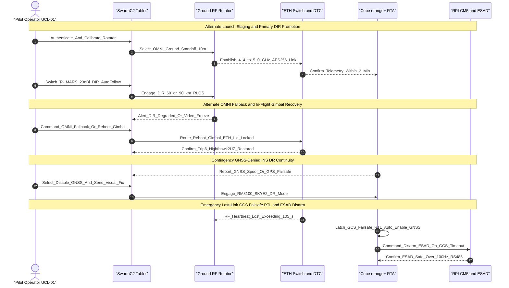

## 5. PACE C2 Communications Plan & Link Resilience

- **Baseline Date:** `2026-11-16`
- **System Baseline:** `Avenger5V25UasSystem` (`Avenger5V25IntegratedSystem`: `Avenger 5 V2.5 UAS` / `ASTK A5 V2.5` + `ELI Military Simulations PL-40 Rev 2.6` + `Artron ESAD AB00-0054-01AA-0005` + `SwarmC2`)
- **JSON Schema Mapping:** `pace_c2_plan` (`.pipeline/schemas/mission_intent_specification_schema.json`)
- **Normative Governance:** `RTCA DO-362A` (§2.2 Physical/RF Equipment Performance, §3.2 Link Continuity, Availability, Integrity and Lost-Link Resilience), `NIST SP 800-82r3` (Chapter 6 OT Cybersecurity Architecture, Appendix F AC/IA/SC), `ISO/IEC/IEEE 15288:2023` (§6.4.2, §6.4.3, §6.4.4, §6.4.9), `ISO/IEC/IEEE 29148:2018` (§6.4, §8.4, Annex A §A.2), `IEEE Std 1362-1998` (§4, §4.3), `INCOSE SE Handbook v5.0` (§2.3.5.4, §2.3.5.9), `OMG UAF v2.0` (Operational Viewpoint Op-Cn/Op-Sr, Resources Viewpoint Rs-Tx/Rs-Tr), `ASTM F3269-17` (§5.2), `JARUS SORA v2.5` (Annex B, Annex C), `MIL-STD-882E` (Task 202, Task 205, Task 206), `SAE ARP4754A / ARP4761` (§5.1, §3.1-3.3), `MIL-STD-461G` (CS114, CS116, CS118, RE102, RS103), `MIL-STD-810H` (Method 501.7, 502.7, 506.6, 510.7, 514.8, 516.8), `RTCA DO-178C / RTCA DO-254` (§6.3, §11.0, §10.0), `NATO STANAG 4187 Ed. 5` (Chapter 2, Chapter 3, Annex A), and `DoD Directive 3000.09` (§4.1.a) -- traceable exclusively to `docs/research/RESEARCH_INVENTORY.md`.
- **Architectural Truth Invariants:** Software-hosted `ASTM F3269-17` Simplex Run-Time Assurance (`RTA`) and `PaceC2LinkState` failsafe supervision execute strictly on `FlightControllerCubeOrangePlus` (`standaloneRtaBoxCount == 0`, `rtaHostedOnCubeOrangePlus == true`); `Pl40PneumaticLauncher` maintains a strictly mechanical launch interface with zero electrical or CAN conductors to the airframe (`IF-MECH-001`, `CONN_23`, `electricalWireToUavCount == 0`); production `Avenger V2.5` excludes recovery parachutes (`rndRecoveryOptionInstalled == false`, permanently inhibiting `2x 50.0 V` Optional RnD recovery lines per `REQ_SC_03`); primary energy derives from the `12S2P` `36.0-50.4 V` DC bus (`49.0-50.0 V` pre-flight per `GAP-05`); and strict Level 1B operational abstraction uses `UCL-01` through `UCL-05` and `SCN-01` through `SCN-08` with zero Level 2 use-case IDs or Level 1C serial opcode/pinout dumps.

---

### 5.1 4-Tier PACE C2 Communications Plan (`pace_c2_plan`)

In accordance with `RTCA DO-362A` (§2.2, §3.2), `NIST SP 800-82r3` (Chapter 6, Appendix F), and `PaceC2LinkState` in `.pipeline/schema.sysml`, command, control, telemetry, EO/IR video, and ordnance supervision across `Avenger5V25UasSystem` follow a deterministic four-tier **Primary, Alternate, Contingency, and Emergency (PACE)** architecture spanning `SwarmC2OperatorConsole`, `GroundRfStationAndAntennaTracker`, `OnboardEthernetAndC2RadioUnit`, `NavigationAndAirDataSuite`, `FlightControllerCubeOrangePlus`, and `CompanionComputeRpiCm5`.

Physical parameters across all four tiers derive strictly from `schema/extracted/parametric_limits.md`, `schema/extracted/interface_table.md`, and `.pipeline/schema.sysml`:
- **Primary (`PaceC2LinkState::PrimaryDtcDirTracking`):** Over-the-air `DTC 4.4-5.0 GHz` `AES-256` `FHSS` datalink (`2.0 W` total / `2x 1.0 W` across dual `MPSL4400` airborne antennas, `12.0 V` regulated `EPS` feed within `8.0-17.0 V` tolerance) coupled to the ground `MARS 23.0 dBi` directional (`DIR`) tracking antenna (`Auto Follow` + `0.5 deg` CCW/CW fine azimuth trim) supporting `60.0 km` baseline and `90.0 km` `V2.5` extended Radio Line-of-Sight (`RLOS`) reach (`GAP-02` notes legacy `V1` manual `60.0/180.0 km` figure; `V2.5` planning adopts the conservative `60.0/90.0 km` bound).
- **Alternate (`PaceC2LinkState::AlternateDtcOmniLocal`):** Ground, catapult launch, near-field flight, and `DIR` track-degradation switching to the `DTC 4.4-5.0 GHz` `OMNI` ground antenna (`T_DirToOmni` / `T_OmniToDir`), paired with the wired IP link or optional `200.0 m` tactical ground fiber optic spool (`IF-GND-001` / `CONN_22`) connecting `SwarmC2` to the `Ground Radio Box` and `Antenna Rotator`, plus the `IF-SER-004` (`CONN_17`) point-to-point `Cube orange+ <-> DTC Radio` serial bypass path alongside `IF-ETH-001`.
- **Contingency (`PaceC2LinkState::ContingencyGnssDeniedDrFlight`):** Navigation continuity under `Septentrio Asterx-m3 pro` / `Talysman TW3972EXF` GNSS jamming or spoofing while `DTC 4.4-5.0 GHz` (`DIR` or `OMNI`) C2 remains active. Entered either manually via `SwarmC2` `Disable GNSS` or automatically upon `GPS Failsafe` timeout, transitioning `Cube orange+` EKF2 to inertial dead-reckoning (`INS/DR`) using dual `mRo RM3100` magnetometers/barometers and the `CUAV SKYE2` heated pitot on `CAN 2` (`IF-CAN2-001`), refined by operator `I'm Here` and `I'm Looking Here` visual coordinate fixes (`A5-user-manual 2.pdf#p91-#p92`).
- **Emergency (`PaceC2LinkState::EmergencyLostLinkRtlHolding`):** Deterministic lost-link containment triggered when continuous RF C2 silence reaches `GCS Failsafe Timeout` (`105.0 s` baseline in `SwarmC2` Fig 5.4, `PRM-GCS-008`), commanding autonomous `FlightControllerCubeOrangePlus` Return-to-Launch (`RTL`), executing `Disarm ESAD On GCS Timeout` (`RPI CM5004032` over `100.0 Hz` `RS-485` to `Artron ESAD` unless `ESAD GCS Timeout = 0`), and automatically re-enabling `GNSS` if `Disable GNSS` was active so autonomous `RTL` regains satellite navigation if available (`02_avenger5_operations_and_safety.md#s3`).

In strict adherence to `SKILL.md` §4.6 and `GAP-WCET` (`REQ_SAF_08`), unprinted OEM radio Mbps throughput, `Primary -> Alternate` RF switch timeouts, `GPS Failsafe Timeout`, and hysteresis dwell windows are declared explicitly as `UNPRINTED_OEM` or `OPERATOR_CONFIGURED` rather than fabricating synthetic timeout constants. In accordance with `Check 26`, `Table 5.1` and `Table 5.2` isolate all numeric values and engineering units into strictly separate columns.

#### Table 5.1: 4-Tier PACE C2 Communications & Failover Matrix (`pace_c2_plan`)

| Tier | State & Link Medium | Freq Value | Freq Units | Power Value | Power Units | Gain Value | Gain Units | Span Value | Span Units | Rate Value | Rate Units | Timeout Value | Timeout Units | Failover Hysteresis | Priority Role & Authority | Public Clause Citations |
| :--- | :--- | :--- | :--- | :--- | :--- | :--- | :--- | :--- | :--- | :--- | :--- | :--- | :--- | :--- | :--- | :--- |
| `Primary` | `PaceC2LinkState::PrimaryDtcDirTracking` -- `DTC` `AES-256` `FHSS` airborne transceiver (`2x MPSL4400`) + ground `MARS` `DIR` antenna tracker (`Auto Follow`) | `4.4-5.0` | `GHz` | `2.0` | `W` | `23.0` | `dBi` | `60.0/90.0` | `km` | `UNPRINTED_OEM` | `bps` | `OPERATOR_CONFIGURED` | `s` | `OPERATOR_CONFIGURED` (`T_OmniToDir` on rotator lock; `T_DirToOmni` on `DIR` degradation) | Primary airborne cruise, target-track `EO/IR` video over `ETH`, and `SwarmC2` payload C2 across `RLOS` (`UCL-01`, `UCL-02`) | `RTCA DO-362A §2.2, §3.2`; `NIST SP 800-82r3 Chapter 6, Appendix F (SC)` |
| `Alternate` | `PaceC2LinkState::AlternateDtcOmniLocal` -- `DTC` `AES-256` `FHSS` ground `OMNI` antenna switch + optional wired IP or ground tactical fiber spool (`IF-GND-001` / `CONN_22`) | `4.4-5.0` | `GHz` | `2.0` | `W` | `UNPRINTED_OEM` | `dBi` | `200.0` | `m` | `UNPRINTED_OEM` | `bps` | `OPERATOR_CONFIGURED` | `s` | `OPERATOR_CONFIGURED` (ground launch state and near-field `DIR` track-loss recovery) | Ground staging, catapult launch, close-in corridor C2, and `DIR` beam-loss recovery (`UCL-01`, `UCL-03`) | `RTCA DO-362A §2.2, §3.2`; `NIST SP 800-82r3 Chapter 6, Appendix F (AC, IA, SC)`; `ISO/IEC/IEEE 15288:2023 §6.4.4` |
| `Contingency` | `PaceC2LinkState::ContingencyGnssDeniedDrFlight` -- active `DTC` `FHSS` (`DIR` or `OMNI`) + manual `Disable GNSS` or `GPS Failsafe` `INS/DR` using `2x mRo RM3100` + `CUAV SKYE2` pitot + `I'm Here` / `I'm Looking Here` | `4.4-5.0` | `GHz` | `2.0` | `W` | `23.0` | `dBi` | `60.0/90.0` | `km` | `UNPRINTED_OEM` | `bps` | `OPERATOR_CONFIGURED` | `s` | `OPERATOR_CONFIGURED` (`T_DirToGnssDenied` on spoof/loss; `T_GnssDeniedToDir` on RTK restore) | Contested GNSS-denied navigation continuity over `CAN 2` while retaining positive HITL C2 and ordnance abort (`UCL-01`, `UCL-02`) | `RTCA DO-362A §3.2`; `SAE ARP4761 §3.2`; `ASTM F3269-17 §5.2`; `MIL-STD-461G RS103` |
| `Emergency` | `PaceC2LinkState::EmergencyLostLinkRtlHolding` -- RF C2 lost: autonomous `GCS Failsafe` `RTL` + `Disarm ESAD On GCS Timeout` + auto `GNSS` re-enable | `0.0` | `GHz` | `0.0` | `W` | `0.0` | `dBi` | `0.0` | `km` | `0` | `bps` | `105.0` | `s` | `OPERATOR_CONFIGURED` (`T_DirToEmergencyRtl` / `T_ContingencyToEmergencyRtl` at timeout; `T_EmergencyToOmni` on reacquire) | Autonomous `Cube orange+` Simplex `RTA` return-home and `RPI CM5` `ESAD` disarm containment (`UCL-01`, `UCL-05`) | `RTCA DO-362A §3.2`; `ASTM F3269-17 §5.2`; `JARUS SORA v2.5 Annex B, Annex C`; `DoD Directive 3000.09 §4.1.a` |

#### Table 5.2: Grounded RF Datalink, Fiber, Standoff & ESAD Supervision Parameters (`Check 26` Ledger)

| Param ID | PACE Tier / Scope | Parameter Description | Qualifier | Value | Units | Constraint / Condition | SSOT Citation |
| :--- | :--- | :--- | :--- | :--- | :--- | :--- | :--- |
| `PRM-RF-001` | `Primary / Alternate / Contingency` | `DTC` `FHSS` C2 radio minimum operating frequency | `Min` | `4.4` | `GHz` | Lower bound of `IF-RF-001` operating spectrum | `OnboardEthernetAndC2RadioUnit`; `Spec sheet#p3` |
| `PRM-RF-002` | `Primary / Alternate / Contingency` | `DTC` `FHSS` C2 radio maximum operating frequency | `Max` | `5.0` | `GHz` | Upper bound of `IF-RF-001` operating spectrum | `OnboardEthernetAndC2RadioUnit`; `Spec sheet#p3` |
| `PRM-RF-011` | `Primary (Ground Rotator)` | Example operating channel frequency in `SwarmC2` rotator UI | `Nominal` | `4510.0` | `MHz` | Representative channel inside `IF-RF-001` band | `GroundRfStationAndAntennaTracker`; `A5-um#p72-#p74` |
| `PRM-RF-003` | `Primary / Alternate` | Total `DTC` C2 radio RF transmit output power | `Nominal` | `2.0` | `W` | Air and ground transceiver nominal TX rating | `OnboardEthernetAndC2RadioUnit`; `A5-um#p55` |
| `PRM-RF-004` | `Airborne MPSL4400 Chain` | Per-antenna RF transmit power across dual `MPSL4400` antennas | `Nominal` | `1.0` | `W` | Split across two airborne RF coax branches (`FM-09-01`) | `OnboardEthernetAndC2RadioUnit`; `Block diagram#p1` |
| `PRM-RF-005` | `All Active RF Tiers` | `DTC` `FHSS` link encryption key bit count (`256`-bit `AES-256`, `NIST SP 800-82r3`) | `Exact` | `256` | `count` | Symmetric `AES-256` over-the-air link protection (`256` key bits) | `OnboardEthernetAndC2RadioUnit`; `OBL-04` |
| `PRM-AV-007` | `EPS -> DTC Radio` | Regulated `EPS` supply rail feeding airborne `DTC` radio | `Nominal` | `12.0` | `V` | `IF-PWR-008` (`CONN_05`) regulated DC output | `ElectronicPowerSystemEps`; `Block diagram#p1` |
| `PRM-AV-008` | `DTC Radio Supply` | Accepted `DTC` radio DC input voltage window (`PRM-AV-008/009`) | `Nominal` | `8.0-17.0` | `V` | Acceptable radio DC input tolerance window | `OnboardEthernetAndC2RadioUnit`; `FM-09-04` |
| `PRM-RF-006` | `Primary` | Baseline Radio Line-of-Sight (`RLOS`) C2 reach | `Nominal` | `60.0` | `km` | Baseline `V2.5` and `V1` `RLOS` operational reach | `OnboardEthernetAndC2RadioUnit`; `CTL-02` |
| `PRM-RF-007` | `Primary` | Extended `V2.5` Spec Sheet `RLOS` C2 reach (`GAP-02`) | `Max` | `90.0` | `km` | Conservative `V2.5` extended bound (`V1` `PRM-RF-008` excluded) | `OnboardEthernetAndC2RadioUnit`; `REQ_SAF_02` |
| `PRM-RF-009` | `Primary (MARS DIR)` | Ground `MARS` directional tracking antenna gain | `Nominal` | `23.0` | `dBi` | Paired with `Auto Follow` ground tracking rotator | `GroundRfStationAndAntennaTracker`; `A5-um#p11` |
| `PRM-RF-010` | `Primary (Rotator)` | Rotator manual CCW/CW azimuth trim step under `Auto Follow` | `Nominal` | `0.5` | `deg` | Calibrated prior to handling UAV (`OA-18`) | `GroundRfStationAndAntennaTracker`; `A5-um#p72-#p74` |
| `PRM-RF-012` | `Alternate (Ground Fiber)` | Optional tactical fiber optic spool (`SwarmC2` to Ground Box) | `Nominal` | `200.0` | `m` | Ground standoff tether along `IF-GND-001` (`CONN_22`) | `GroundRfStationAndAntennaTracker`; `A5-um#p11` |
| `PRM-GCS-001` | `Alternate (Ground Prep)` | Minimum Ground Radio Box to UAV prep standoff separation | `Min` | `10.0` | `m` | `GroundCrewSeparationAndEsdConstraint` (`REQ_SC_15`) | `GroundRfStationAndAntennaTracker`; `A5-um#p52` |
| `PRM-GCS-002` | `Pre-Flight Telemetry Check` | Maximum wait for telemetry acquisition after `RBF #2` power-on | `Max` | `2.0` | `min` | Pre-flight `SwarmC2` link acquisition gate | `SwarmC2OperatorConsole`; `A5-um#p52` |
| `PRM-GCS-002` | `Pre-Flight Telemetry Check (SI)` | Maximum wait for telemetry acquisition in SI seconds | `Max` | `120.0` | `s` | Equivalent SI upper bound for pre-flight link check | `SwarmC2OperatorConsole`; `MoP-08` |
| `PRM-GCS-008` | `Emergency (GCS Failsafe)` | `GCS Failsafe` `RTL` trigger timeout baseline (`SwarmC2` Fig 5.4) | `Nominal` | `105.0` | `s` | Triggers `RTL` + `Disarm ESAD` + auto `GNSS` re-enable | `SwarmC2OperatorConsole`; `PaceC2LinkState`; `CTL-02` |
| `PRM-AV-016` | `Contingency (INS/DR)` | Dual redundant `mRo RM3100` mag/baro modules on `CAN 2` | `Exact` | `2` | `count` | Daisy-chained via `CAN/power splitter PCB` (`IF-CAN2-001`) | `NavigationAndAirDataSuite`; `CanTopologyIsolationConstraint` |
| `PRM-AV-017` | `Contingency (Pitot Calm)` | `CUAV SKYE2` heated pitot pre-flight calm-air upper ceiling | `Max` | `3.0` | `m/s` | `PitotPreflightCalibrationConstraint` (`OA-06`, `REQ_SC_07`) | `NavigationAndAirDataSuite`; `A5-um#p56` |
| `PRM-AV-018` | `Contingency (Pitot Airflow)` | `CUAV SKYE2` heated pitot pre-flight indirect airflow floor | `Min` | `10.0` | `m/s` | `PitotPreflightCalibrationConstraint` (`OA-06`, `REQ_SC_07`) | `NavigationAndAirDataSuite`; `A5-um#p56` |
| `PRM-ESAD-014` | `Local ESAD Supervision` | `RPI CM5` to `Artron ESAD` `RS-485` baud rate (`8N1`) | `Exact` | `115200` | `bps` | `IF-ORD-001` (`CONN_20`), `CRC-16 XModem` framing | `CompanionComputeRpiCm5`; `EsadRs485ProtocolTimingConstraint` |
| `PRM-ESAD-017` | `Local ESAD Supervision` | `OC Master` cyclic `RS-485` polling frequency (`GAP-04`) | `Exact` | `100.0` | `Hz` | Derived period in `PRM-ESAD-018` (`REQ_SC_08`) | `CompanionComputeRpiCm5`; `ESAD ICD#p15` |
| `PRM-ESAD-018` | `Local ESAD Supervision` | Derived `RS-485` cyclic polling period | `Exact` | `0.01` | `s` | Reciprocal of `100.0` polling frequency (`GAP-04`) | `CompanionComputeRpiCm5`; `REQ_SAF_04` |
| `PRM-ESAD-020` | `Local ESAD Supervision` | Maximum `Artron ESAD` `RS-485` reply latency | `Max` | `5.0` | `ms` | Command last bit to reply last bit (`CTL-03`) | `ArtronEsadAndSensorUnit`; `ESAD ICD#p15` |
| `PRM-ESAD-019` | `Local ESAD Supervision` | `RS-485` incomplete packet and watchdog timeout | `Max` | `10.0` | `ms` | Drives `EsadBusWatchdogFaultFallback` on timeout | `CompanionComputeRpiCm5`; `RtaEnvelopeMonitorState` |
| `PRM-GCS-009` | `SwarmC2 Access Control` | Minimum role authentication password character count (`characters`) | `Min` | `8` | `count` | Applies to `Pilot`, `Payload`, `Launch Assistant` roles (`>= 8` characters) | `SwarmC2AuthAndMissionBoundsConstraint`; `OBL-04` |

---

### 5.2 Parametric Failover Transition Dynamics & Hysteresis Model

In accordance with `SKILL.md` §4.6, `PaceC2LinkState`, `RtaEnvelopeMonitorState`, and `RTCA DO-362A §3.2`, tier degradation and recovery hysteresis across `Primary` (`Tier_1`), `Alternate` (`Tier_2`), `Contingency` (`Tier_3`), and `Emergency` (`Tier_4`) obey pure symbolic transition dynamics driven exclusively by measured frame-loss duration, operator-configured or schema-grounded timeouts, and hysteresis dwell timers:

$$
\begin{aligned}
\Delta t_{\mathrm{loss}}(t) &= t - t_{\mathrm{last,valid,rx}} \\
\mathrm{State}(t) &= \begin{cases}
\mathrm{Tier}_i & \text{if } \Delta t_{\mathrm{loss}}(t) < \tau_{\mathrm{timeout},i} \\
\mathrm{Tier}_{i+1} & \text{if } \Delta t_{\mathrm{loss}}(t) \ge \tau_{\mathrm{timeout},i} \quad \text{for } t \ge t_{\mathrm{fail}} + \tau_{\mathrm{hysteresis},i+1}
\end{cases} \\
q_{\mathrm{DR}}(t) &= \mathbf{1}\!\left(\left(\Delta t_{\mathrm{GNSS}}(t) \ge \tau_{\mathrm{gps,fs}}\right) \lor \left(u_{\mathrm{disableGNSS}}(t) = 1\right)\right) \land \left(\Delta t_{\mathrm{loss}}(t) < \tau_{\mathrm{gcs,fs}}\right) \\
u_{\mathrm{emg}}(t) &= \mathbf{1}\!\left(\Delta t_{\mathrm{loss}}(t) \ge \tau_{\mathrm{gcs,fs}}\right) \implies \left(\mathrm{RTL} \land \mathrm{DisarmESAD} \land \mathrm{AutoEnableGNSS}\right) \\
d_{\mathrm{sep,gnd}} &\ge d_{\mathrm{sep,min}}, \qquad \tau_{\mathrm{wd,ESAD}}(t) \le \tau_{\mathrm{wd,max}}
\end{aligned}
$$

#### Parameter Definitions & Engineering Units: Parametric Failover Transition Dynamics

| Parameter | Symbol | Units | Constraint / Rule | Description |
| :--- | :--- | :--- | :--- | :--- |
| Active Link Loss Duration | Delta t_loss | s | Measured Online (t - t_last_valid_rx) | Measured elapsed duration since last authenticated AES-256 FHSS frame |
| Last Valid Frame Timestamp | t_last_valid_rx | s | Monotonic ASTK / SwarmC2 clock | Timestamp of most recent authenticated C2 heartbeat frame |
| Tier Fault Onset Timestamp | t_fail | s | t_fail >= t_last_valid_rx | Epoch at which active tier exceeded timeout threshold |
| Primary Heartbeat Timeout | tau_timeout_Primary | s | OPERATOR_CONFIGURED (tau_timeout_Primary > 0, < tau_gcs_fs) | Threshold triggering fallback from Primary DIR to Alternate OMNI (T_DirToOmni) per schema AST or operator config |
| Alternate Heartbeat Timeout | tau_timeout_Alternate | s | OPERATOR_CONFIGURED (> tau_timeout_Primary, <= 120.0 pre-flight PRM-GCS-002) | Threshold governing Alternate OMNI / ground fiber escalation prior to Contingency/Emergency |
| Contingency Heartbeat Timeout | tau_timeout_Contingency | s | OPERATOR_CONFIGURED (GPS Failsafe Timeout > 0) | Persistence threshold triggering GPS Failsafe INS/DR unless operator selects Disable GNSS |
| Emergency Heartbeat Timeout | tau_timeout_Emergency / tau_gcs_fs | s | 105.0 baseline (PRM-GCS-008); >= tau_timeout_Contingency | Timeout initiating EmergencyLostLinkRtlHolding (autonomous RTL, Disarm ESAD On GCS Timeout, auto GNSS re-enable) |
| Re-acquisition Hysteresis Window | tau_hysteresis | s | OPERATOR_CONFIGURED (tau_hysteresis > 0) | Continuous stable link duration required prior to up-tier promotion (T_OmniToDir, T_GnssDeniedToDir, T_EmergencyToOmni) |
| GNSS Loss Persistence | Delta t_GNSS, tau_gps_fs | s | OPERATOR_CONFIGURED (SwarmC2 GPS Failsafe Timeout) | Measured duration of degraded or spoofed Septentrio RTK PVT triggering ContingencyGnssDeniedDrFlight |
| Manual Disable GNSS Flag | u_disableGNSS | Dimensionless | Boolean 0 or 1 (SwarmC2 Pilot command) | Boolean flag (0 = GNSS enabled, 1 = manual Disable GNSS override) entering RM3100 + SKYE2 INS/DR mode with I'm Here / I'm Looking Here visual fixes |
| Contingency DR Active State | q_DR | Dimensionless | Boolean 0 or 1 | Boolean state indicator (0 = nominal GNSS PVT, 1 = ContingencyGnssDeniedDrFlight active while C2 RF link remains valid) |
| Emergency Failsafe Command | u_emg | Dimensionless | Boolean 0 or 1 (Delta t_loss >= tau_gcs_fs) | Boolean command flag (0 = link nominal, 1 = triggers autonomous Cube orange+ RTL, ESAD disarm unless ESAD GCS Timeout = 0, and GNSS auto re-enable) |
| Ground Radio-to-UAV Separation | d_sep_gnd, d_sep_min | m | >= 10.0 during ground prep (PRM-GCS-001) | Mandatory standoff distance between Ground Radio Box and airframe (GroundCrewSeparationAndEsdConstraint) |
| ESAD RS-485 Watchdog Threshold | tau_wd_ESAD, tau_wd_max | ms | <= 10.0 watchdog at PRM-ESAD-017 polling rate | Ring 2 -> Ring 3 RPI CM5004032 to Artron ESAD supervision limit (EsadRs485ProtocolTimingConstraint) |

---

### 5.3 Internal Ethernet Switch, EO/IR Recovery & Locked `USB/ETH` Conduit Security

Within `OnboardEthernetAndC2RadioUnit`, the `Internal Ethernet Switch` (`BOM-AV-012`) forms the switched IP backbone inside the `ASTK A5 V2.5` stack (`IF-ETH-001`, `CONN_18`, `CONN_19`), separating high-bandwidth IP payload/video/mission traffic from flight-critical serial and DroneCAN control buses (`SAE ARP4754A §5.1`, `NIST SP 800-82r3 Chapter 6`):

1. **4-Port Switched Topology (`BOM-AV-012`, `IF-ETH-001`):**
   - **Port 1 -- `CompanionComputeRpiCm5` (`RPI CM5004032`, `ethRpiPort`, `CONN_18`):** Bridges `SwarmC2` IP mission/payload commands to `FlightControllerCubeOrangePlus` via `IF-SER-001` (`CONN_14`) and acts as the sole `Ring 2 -> Ring 3` `OC Master` supervising `ArtronEsadAndSensorUnit` over `100.0 Hz` (`0.01 s`), `115200 bps` `8N1` `RS-485` (`CRC-16 XModem`) and `DSC_IN1` (`IF-ORD-001`, `IF-ORD-002`, `CONN_20`).
   - **Port 2 -- `EoIrSeekerAndTrackerUnit` (`Trip6` + `Nighthawk2UZ`, `ethTrip6Port`, `CONN_19`):** Streams `1280x720` Daylight and `1280x720` Thermal EO/IR video (`Nighthawk2UZ` `X40` zoom, `-45.0 to +135.0 deg` pitch, `+/-165.0 deg` yaw/roll) across `IF-VID-001` (`Power + HDMI` between `Nighthawk2UZ` and `Trip6`) onto the `ETH Switch` and `DTC` radio downlink while `Trip6` sends target steering cues directly to `Cube orange+` over point-to-point UART `IF-SER-003` (`CONN_16`).
   - **Port 3 -- `DTC 4.4-5.0 GHz` Airborne Radio (`BOM-AV-021`, `rfDatalinkOut`, `CONN_21`):** Bridges switched `ETH` traffic (`RPI CM5` and `Trip6`) over the `2.0 W` (`2x 1.0 W` dual `MPSL4400`) `AES-256` `FHSS` RF channel. Separately, `IF-SER-004` (`CONN_17`, `fcSerialAndUsbExt`) routes point-to-point `Cube orange+ <-> DTC Radio` serial telemetry directly, preserving baseline flight telemetry even if the `ETH Switch` stalls (`FM-09-03`).
   - **Port 4 -- `External Interface Board (USB/ETH)` (`BOM-AV-013`, `IF-USB-001`, `IF-ETH-001`):** Provides ground maintenance, autopilot log offload (`USB -> Cube orange+`), and IP debug (`ETH -> ETH Switch`) behind a physically lockable umbilical/service lid.

2. **In-Flight `Reboot Gimbal` vs Armed `Reboot Vehicle` Lockout (`OA-14`, `RebootGimbalAndBridgeEthernet`, `FM-09-02`, `FM-09-03`):**
   - If `Nighthawk2UZ` or `Trip6` EO/IR video freezes during flight (`OA-14`), `Pilot` (`UCL-01`) or `Payload Operator` (`UCL-02`) executes `Reboot Gimbal` over the `Internal Ethernet Switch` (`IF-ETH-001`) while `externalLidLocked == true` remains enforced.
   - `SwarmC2` permanently locks out `Reboot Vehicle` while the aircraft is armed (`02_avenger5_operations_and_safety.md#s3`), guaranteeing that `Cube orange+` software Simplex `RTA` (`ASTM F3269-17 §5.2`) and `ESAD` state supervision never reset during armed flight.
   - If the `Internal Ethernet Switch` deadlocks (`FM-09-03`) and cannot forward `Reboot Gimbal` or `RPI CM5` IP traffic, `Cube orange+` retains `IF-SER-004` serial C2 heartbeat, and any sustained complete RF loss triggers `105.0 s` `GCS Failsafe` `RTL` + `Disarm ESAD On GCS Timeout`.

3. **Locked `USB/ETH` Service Lid & `NIST SP 800-82r3` OT Access Enforcement (`OBL-04`, `REQ_SC_01`, `FM-09-02`):**
   - During pre-flight Step 9 (`A5_prep and safety_rev7.pdf#p21`), after pulling `UAV Power R.B.F. Key #2` (`XT60E-F`), `Launch Assistant` (`UCL-03`) closes and locks **both** the `RBF` lid and the `External Interface Board (USB/ETH)` umbilical lid prior to flight diagnostics (`umbilicalLidLocked == true`, `UsbServicePacket`), preventing moisture/particulate ingress (`MIL-STD-810H`, `GAP-ENV`) and blocking physical conduit tampering (`NIST SP 800-82r3` Chapter 6, Appendix F `AC`, `IA`, `SC`).
   - `SwarmC2OperatorConsole` enforces role-segregated authentication (`Pilot`, `Payload`, `Launch Assistant`, `>= 8`-char strong passwords, `PRM-GCS-009`), mission validation bounds (`<= 24`-char name, `50.0-3000.0 m` altitude, `>= 300.0 m` loiter radius), and authenticated `5W` / `CFF` export to `UCL-04` (`ATAK`, `SitaWare HQ`, `DELTA`).

---

### 5.4 Ground RF Standoff (`>= 10.0 m`), Rotator Calibration & Tactical Fiber Resilience

Ground RF deployment (`GroundRfStationAndAntennaTracker`, `OA-18`, `TC_08`, `FM-14-01` through `FM-14-04`) enforces strict physical standoff, electrostatic discharge (`ESD`) equalization, and pre-handling tracker alignment:

1. **Mandatory `>= 10.0 m` Ground RF Standoff (`PRM-GCS-001`, `GroundCrewSeparationAndEsdConstraint`, `REQ_SC_15`):**
   - During ground preparation, power-on telemetry check (`<= 2.0 min` / `120.0 s`, `PRM-GCS-002`), and all six `SwarmC2` pre-flight checklist groups, the `Avenger 5 V2.5` airframe (`Artron ESAD` + `2x MPSL4400`) MUST remain at `>= 10.0 m` spatial separation (`separationM >= 10.0`) from the energized `2.0 W` `4.4-5.0 GHz` `Ground Radio Box` (`BOM-GCS-002`).
   - This `>= 10.0 m` RF standoff prevents near-field receiver front-end desense/saturation (`FM-09-04`, `FM-14-03`), reinforces ordnance electromagnetic safety alongside `MIL-STD-461G` (`CS114`, `CS116`, `RE102`, `RS103`) and `J100` `UMB` `< 0.5 Ohm` (`20.0 mA`) `RBF #3` shorting (`GAP-06`), and preserves ground risk buffer separation (`JARUS SORA v2.5 Annex B`, `MET-02`).

2. **Ordered Ground Setup, ESD Touch & Rotator Calibration (`OA-18`, `REQ_SC_15`):**
   - Crew (`UCL-01`, `UCL-03`) touch the yellow `EARTH / GROUNDING POINT` inside the transport box (`BOM-GCS-006`, `MIL-STD-461G CS118`) before every hardware handling step (`esdGrounded == true`).
   - Prior to touching the UAV (`A5_prep and safety_rev7.pdf#p6`), the crew erects the `Ground Radio Box` (`OMNI` installed for ground/launch, `MARS 23.0 dBi` `DIR` mounted on the tracker) and calibrates the `Directional Tracking Antenna Rotator` (`BOM-GCS-003`: `Auto Follow` + `0.5 deg` CCW/CW fine azimuth trim, `PRM-RF-010`, e.g., `4510.0 MHz` UI channel `PRM-RF-011`).

3. **Optional `200.0 m` Tactical Fiber Optic Spool (`PRM-RF-012`, `IF-GND-001` / `CONN_22`, `FM-14-01`):**
   - `SwarmC2OperatorConsole` (`Windows 11` rugged tablet, `BOM-GCS-001`) connects to the `Ground Radio Box` and `Antenna Rotator` through wired IP or the optional `200.0 m` tactical fiber optic spool (`BOM-GCS-005`), enabling remote `Pilot`/`Payload` (`UCL-01`/`UCL-02`) operation from shelter or covered positions while eliminating copper ground-loop / lightning coupling across the ground C2 conduit (`NIST SP 800-82r3`, `FM-14-01`).

---

### 5.5 PACE C2 Operational Topology & Failover Sequence Diagrams

#### Figure 5.1: `Avenger5V25UasSystem` PACE C2, Internal Ethernet Switch & Failover Topology (`PaceC2LinkState`)

#### Figure 5.2: PACE C2 Tiered Degradation, `Reboot Gimbal`, GNSS-Denied DR & `105.0 s` `GCS Failsafe` Sequence (`OV-6c`)

---

### 5.6 Verification Mapping, OEM Gaps & Normative Clause Traceability

Every PACE C2 tier, security conduit control, and failsafe state transition traces bidirectionally to `RESEARCH_INVENTORY.md`, `.pipeline/schema.sysml`, `docs/research/FAILURE_MODE_REGISTRY.md`, and native verification test cases (`TC_01` through `TC_08`):

#### Table 5.3: PACE C2 Verification, FMECA & Normative Traceability Matrix

| PACE Tier / Control Domain | Schema AST & Constraint Anchors | Operational Activities & Scenarios | Covered FMECA / Gap IDs | `RESEARCH_INVENTORY.md` Population & Clause Citations | Verification Test Cases |
| :--- | :--- | :--- | :--- | :--- | :--- |
| `Primary` (`DTC` `DIR` Tracker) | `PaceC2LinkState::PrimaryDtcDirTracking`, `OnboardEthernetAndC2RadioUnit`, `GroundRfStationAndAntennaTracker`, `CONN_21` | `OA-18`, `OA-19`, `SCN-04`, `SCN-07` | `FM-09-01`, `FM-09-04`, `FM-14-02`, `FM-14-04`, `GAP-02` | `CTL-02` (`RTCA DO-362A §2.2, §3.2`), `OBL-04` (`NIST SP 800-82r3 Chapter 6, Appendix F`), `EXT-01` | `TC_04_GnssDeniedDrAndPaceLinkFailsafe`, `TC_05_EoIrTargetTrackAndSpeedCapAbort` |
| `Alternate` (`OMNI` + Fiber + Ground RF Standoff) | `PaceC2LinkState::AlternateDtcOmniLocal`, `GroundCrewSeparationAndEsdConstraint`, `GroundStationC2AndFiberInterface`, `CONN_22` | `OA-18`, `SCN-01`, `SCN-07` | `FM-13-01`, `FM-14-01`, `FM-14-02`, `FM-14-03`, `GAP-ENV` | `OBL-02` (`ISO/IEC/IEEE 15288:2023 §6.4.4`), `MET-02` (`JARUS SORA v2.5 Annex B, Annex C`), `SAF-04` (`MIL-STD-461G CS118, RS103`) | `TC_01_PreflightPowerAndRbfSequence`, `TC_08_EmergencyScrubHangfireAndC2Auth` |
| `Internal Ethernet Switch` & `Reboot Gimbal` | `EthernetFabricPort`, `OnboardEthernetAndServiceInterface`, `RebootGimbalAndBridgeEthernet`, `UsbServicePacket`, `CONN_17`, `CONN_18`, `CONN_19` | `OA-14`, `SCN-01`, `SCN-04` | `FM-09-02`, `FM-09-03`, `FM-10-01`, `GAP-WCET`, `GAP-REL` | `OBL-04` (`NIST SP 800-82r3 Chapter 6, Appendix F AC/IA/SC`), `SAF-03` (`RTCA DO-178C §6.3`), `REQ_SC_01`, `REQ_SC_12` | `TC_05_EoIrTargetTrackAndSpeedCapAbort`, `TC_08_EmergencyScrubHangfireAndC2Auth` |
| `Contingency` (`GNSS`-Denied `INS/DR`) | `PaceC2LinkState::ContingencyGnssDeniedDrFlight`, `SwitchToGnssDeniedDeadReckoning`, `CanTopologyIsolationConstraint`, `PitotPreflightCalibrationConstraint`, `CONN_13`, `CONN_15` | `OA-06`, `OA-07`, `SCN-03` | `FM-07-01`, `FM-07-02`, `FM-07-03`, `FM-07-04`, `GAP-WCET` | `CTL-02` (`RTCA DO-362A §3.2`), `CTL-04` (`SAE ARP4754A §5.1; ARP4761 §3.2`), `CTL-01` (`ASTM F3269-17 §5.2`), `REQ_SC_06`, `REQ_SC_07` | `TC_04_GnssDeniedDrAndPaceLinkFailsafe`, `TC_03_SimplexRtaEnvelopeAndActuation` |
| `Emergency` (`GCS Failsafe` `RTL` + `ESAD` Disarm) | `PaceC2LinkState::EmergencyLostLinkRtlHolding`, `RtaEnvelopeMonitorState`, `SimplexRtaSoftwareHostingConstraint`, `EsadRs485ProtocolTimingConstraint`, `CONN_14`, `CONN_20` | `OA-05`, `OA-08`, `OA-12`, `SCN-03`, `SCN-05`, `SCN-08` | `FM-05-02`, `FM-06-01`, `FM-11-02`, `FM-13-04`, `FM-15-03`, `GAP-04`, `GAP-SCRUB` | `CTL-01` (`ASTM F3269-17 §5.2`), `CTL-02` (`RTCA DO-362A §3.2`), `CTL-03` (`RTCA DO-178C §6.3; NATO STANAG 4187 Ed. 5 Chapter 2`), `MET-03` (`DoD Directive 3000.09 §4.1.a`), `MET-04` (`MIL-STD-882E Task 206`) | `TC_04_GnssDeniedDrAndPaceLinkFailsafe`, `TC_06_EsadProtocolInterlockAndHvFireGate`, `TC_08_EmergencyScrubHangfireAndC2Auth` |

---

/// OperationalAllocation: [OA-05]
/// OperationalAllocation: [OA-06]
/// OperationalAllocation: [OA-07]
/// OperationalAllocation: [OA-08]
/// OperationalAllocation: [OA-12]
/// OperationalAllocation: [OA-14]
/// OperationalAllocation: [OA-18]
/// OperationalAllocation: [OA-19]
/// OperationalAllocation: [MET-02]
/// OperationalAllocation: [MET-03]
/// OperationalAllocation: [MET-04]
