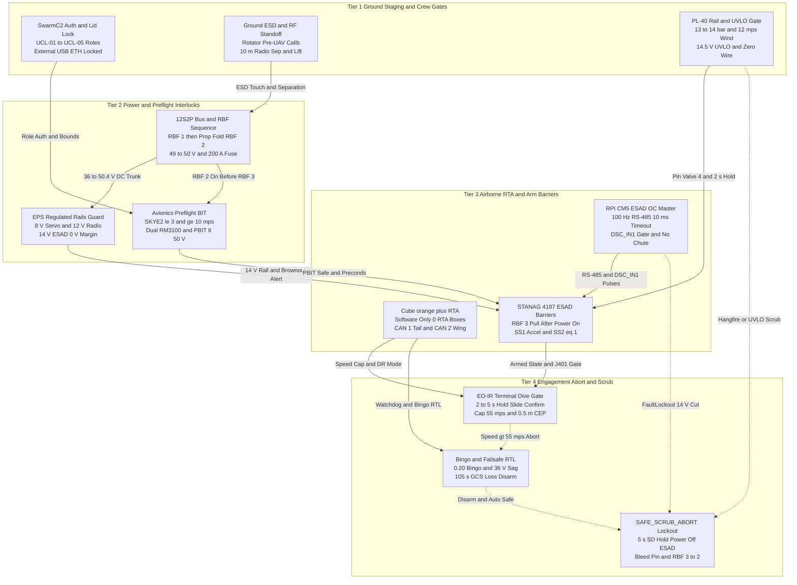

## 6. Safety Constraints & Subsystem Interlocks

- **Baseline Date:** `2026-11-16`
- **System Baseline:** `Avenger5V25UasSystem` (`Avenger5V25IntegratedSystem`: `Avenger 5 V2.5 UAS` / `ASTK A5 V2.5` + `ELI Military Simulations PL-40 Rev 2.6` + `Artron ESAD AB00-0054-01AA-0005` + `SwarmC2`)
- **JSON Schema Mapping:** `safety_interlocks` (`.pipeline/schemas/mission_intent_specification_schema.json`)
- **Governing Standards & SSOT Anchors:** `NATO STANAG 4187 Ed. 5` (`Chapter 2`, `Chapter 3`, `Annex A`), `MIL-STD-882E` (`Task 202`, `Task 205`, `Task 206`), `MIL-STD-331D` (`Group A Test A3, Test A4.1, Test A5`), `MIL-STD-461G` (`CS114`, `CS116`, `CS118`, `RE102`, `RS103`), `MIL-STD-810H` (`Method 501.7, 502.7, 506.6, 510.7, 514.8, 516.8`), `MIL-STD-1629A` (`Method 101`, `Method 102`), `ASTM F3269-17` (`§5.2`), `RTCA DO-178C` (`§6.3`, `§11.0`), `RTCA DO-254` (`§10.0`), `RTCA DO-362A` (`§2.2`, `§3.2`), `SAE ARP4754A` (`§5.1`) / `ARP4761` (`§3.1-3.3`), `JARUS SORA v2.5` (`Annex B`, `Annex C`), `NIST SP 800-82r3` (`Chapter 6`, `Appendix F: AC, IA, SC`), `DoD Directive 3000.09` (`§4.1.a`), `ISO/IEC/IEEE 15288:2023` (`§6.4.2`, `§6.4.4`, `§6.4.9`), `ISO/IEC/IEEE 29148:2018` (`§5.2.4`, `§6.4`, `Annex A §A.2`), `IEEE Std 1362-1998` (`§4`, `§4.3`), and `OMG UAF v2.0`, synthesized directly from `.pipeline/schema.sysml`, `.pipeline/schema-digest.json`, `docs/research/RESEARCH_INVENTORY.md`, `docs/research/FAILURE_MODE_REGISTRY.md`, and `docs/safety/STPA_MATRIX.md`.

All safety interlocks enforce the four hardware-faithful architectural invariants of `Avenger5V25UasSystem`:
1. **Software-Hosted Simplex RTA (`standaloneRtaBoxCount == 0`):** `ASTM F3269-17 §5.2` Run-Time Assurance executes strictly in software inside `FlightControllerCubeOrangePlus` (`Cube orange+`), with zero standalone RTA hardware enclosures.
2. **Strictly Mechanical Launch Rail (`IF-MECH-001` / `CONN_23`):** `Pl40PneumaticLauncher` (`ELI PL-40 Rev 2.6`) imparts mechanical launch energy with `0` electrical or CAN umbilical conductors crossing to the UAV (`electricalWireToUavCount == 0`).
3. **Zero Production Parachutes (`rndRecoveryOptionInstalled == false`):** `ProductionNoParachuteConstraint` permanently inhibits the `2x 50.0 V` `Optional RnD` recovery igniters on `ElectronicPowerSystemEps`.
4. **Strict Level 1B Operational & Protocol Boundaries:** Stakeholder authority references exclusively canonical User Classes `UCL-01` through `UCL-05`, Operational Activities `OA-01` through `OA-19`, and Operational Scenarios `SCN-01` through `SCN-08`. Level 1C serial opcode tables and connector pinouts remain excluded from Level 1B interlock tables, and numeric limits reside in strictly separated `Value` and `Units` columns (`Table 6.2`).

---

### 6.1 Safety Constraints & Subsystem Interlocks Register (Table 6.1)

`Table 6.1` defines `INT-01` through `INT-18`, establishing 1:1 bijective enforcement across all `18` SysML v2 `constraint def` invariants and binding every transition across all `5` SysML v2 `state def` machines (`UavFlightLifecycleState`, `RtaEnvelopeMonitorState`, `EsadSafeArmState`, `PaceC2LinkState`, and `Pl40LauncherState`).

| Interlock ID | Subsystem / Scope | Normative Rule Statement | Formal Interlock Predicate Condition | Governing AST Constraint & State Transitions | Authority (`UCL`) & STPA / Clause Traceability |
| :--- | :--- | :--- | :--- | :--- | :--- |
| `INT-01` | `MainBatteryAndFuseUnit`, `PowerMeterAndRbfSwitch` | Verify `12S2P` battery `QR/ID` match and `49.0-50.0 V` pre-flight readiness (rejecting legacy lower-voltage UI values per `GAP-05`), remove `RBF #1` covers/strap, fold both rear pusher propeller blades rearward, pull `UAV Power R.B.F. Key #2` (`XT60E-F`) strictly before removing `ESAD R.B.F. #3` (`GAP-06`), protect the `36.0-50.4 V` main bus via the `200.0 A` fuse, and lock both RBF and external `USB/ETH` umbilical lids (`OA-01`). | `packVoltageV >= 49.0 and packVoltageV <= 50.0 and busVoltageV >= 36.0 and busVoltageV <= 50.4 and legacy24VUiRejected == true and rbf1Removed == true and propFoldedRearward == true and rbf3StillInstalled == true and rbf2RemovedPowersOn == true and externalLidLocked == true` | `MainBatteryPreFlightVoltageConstraint`; `UavFlightLifecycleState::PreFlightCheck` (`T_Init`, `T_PreflightToLaunch`) | `UCL-03`, `UCL-01`; `REQ_SC_01`, `REQ_SC_04`, `REQ_SAF_05`, `REQ_H_01`, `REQ_UCA_01`, `TC_01`; `SAE ARP4754A §5.1`, `MIL-STD-882E Task 206` |
| `INT-02` | `MainBatteryAndFuseUnit`, `PowerMeterAndRbfSwitch` | Continuously monitor remaining energy endurance (`5400.0 s` / `90.0 min` rated) and `12S2P` DC bus voltage across `CAN 1` (`IBEX160` ESC UART telemetry bridged onto `CAN 1`), enforcing the `0.20` (`1080.0 s`) statutory Bingo reserve floor and triggering autonomous Return-to-Launch (`RTL`) before reserve exhaustion or `< 36.0 V` bus sag (`OA-02`, `OA-04`). | `reserveRatio >= 0.20 and (remainingEnduranceSec / 5400.0 <= 0.20 or busVoltageV < 36.0) implies (bingoReached == true and rtlTriggered == true)` | `BingoEnergyReserveConstraint`; `UavFlightLifecycleState` (`T_CruiseToAbort`), `RtaEnvelopeMonitorState` (`T_NomToRtb` -> `CriticalBatteryOrGeofenceRtb`) | `UCL-01`, `UCL-05`; `REQ_SC_02`, `REQ_SC_04`, `REQ_H_02`, `REQ_UCA_02`, `TC_02`; `JARUS SORA v2.5 Annex B/C`, `MIL-STD-882E Task 205` |
| `INT-03` | `ElectricPropulsionUnit`, `FlightControllerCubeOrangePlus` | Enforce the conservative dual-baseline airspeed envelope (`GAP-02`) from catapult climb (`> 26.0 m/s` `V1` min, `>= 24.0 m/s` `V2.5` stall) through cruise (`30.0-31.0 m/s`) and horizontal limits (`38.0-42.0 m/s`), clamping terminal dive speed at `<= 55.0 m/s` (`Abort Engaging` override) and airframe structural never-exceed dive limit (`VNE`) at `<= 80.0 m/s` (`OA-05`). | `airspeedMs >= 24.0 and airspeedMs <= 80.0 and (not engagementActive or airspeedMs <= 55.0) and (airspeedMs > 55.0 and engagementActive implies abortEngaging == true and climbToTakeoffAlt == true)` | `FlightEnvelopeSpeedConstraint`; `UavFlightLifecycleState` (`T_LaunchToCruise`, `T_DiveToAbort`), `RtaEnvelopeMonitorState` (`T_NomToClamp`, `T_ClampToNom`, `T_ClampToRtb`) | `UCL-01`, `UCL-02`; `REQ_SC_05`, `REQ_SAF_02`, `REQ_H_03`, `REQ_H_05`, `REQ_UCA_03`, `TC_03`; `ASTM F3269-17 §5.2`, `SAE ARP4761 §3.2` |
| `INT-04` | `ElectronicPowerSystemEps`, `ArtronEsadAndSensorUnit` | Regulate `8.0 V` servo, `12.0 V` radio, `14.0 V` ESAD, and sensor/gimbal DC rails from the `970.0 cm` trunk while supervising the zero-margin `14.0 V` EPS-to-ESAD boundary (`0.0 V` margin above `14.0 V` `VDC_IN` minimum per `GAP-01`), raising an immediate `CAN 1` brownout alarm and commanding irreversible `Power Off ESAD` rail isolation on `< 14.0 V` sag (`OA-03`). | `epsEsadOutV >= 14.0 and epsEsadOutV <= 32.0 and (epsEsadOutV < 14.0 or esadPowerOffCmd == true implies esadBrownoutAlert == true and esad14VIsolated == true)` | `EpsEsadZeroBrownoutMarginConstraint`; `RtaEnvelopeMonitorState` (`T_NomToEsadFault` -> `EsadBusWatchdogFaultFallback`), `EsadSafeArmState` (`T_OffToBoot`, `T_AnyArmToFault`, `T_HvToSafeOff`) | `UCL-02`, `UCL-01`, `UCL-05`; `REQ_SC_02`, `REQ_SAF_01`, `REQ_H_02`, `REQ_UCA_02`, `TC_02`; `SAE ARP4754A §5.1`, `MIL-STD-1629A Method 101` |
| `INT-05` | `ElectronicPowerSystemEps`, `ElectricPropulsionUnit` | Enforce the production Avenger V2.5 zero-parachute architecture (`Recovery System: No`), keeping `productionRecoverySystemInstalled == false`, `rndRecoveryOptionInstalled == false`, and both `50.0 V` `Optional RnD` recovery igniter rails permanently inhibited; upon unarmed recovery/landing, execute `Auto-SAFE` ESAD HV discharge and contain flight energy under `JARUS SORA v2.5` ground buffers (`OA-03`, `OA-12`). | `rndRecoveryOptionInstalled == false and productionRecoverySystemInstalled == false and rndRecoveryRail50VEnabled == false` | `ProductionNoParachuteConstraint`; `UavFlightLifecycleState` (`T_AbortToShutdown`, `T_ShutdownToTerminal`) | `UCL-01`, `UCL-05`; `REQ_SC_03`, `REQ_H_01`, `REQ_UCA_01`, `TC_01`, `TC_03`; `JARUS SORA v2.5 Annex B/C`, `MIL-STD-882E Task 205` |
| `INT-06` | `NavigationAndAirDataSuite`, `FlightControllerCubeOrangePlus` | Gate pre-flight launch readiness on `CUAV SKYE2` heated pitot calibration (`<= 3.0 m/s` stationary calm air and `>= 10.0 m/s` indirect airflow) plus both `mRo RM3100` mag/baro units online (`OA-06`); upon `GPS Failsafe` or operator `Disable GNSS`, switch cleanly to `RM3100` + `SKYE2` INS dead-reckoning (`DR`) without re-enabling spoofed GNSS unless commanded or required for lost-link `RTL` (`OA-07`, `SCN-03`). | `calmAirMs <= 3.0 and blownAirMs >= 10.0 and onlineMagCount == 2 and ((not gnssHealthy or disableGnssCommanded) implies deadReckoningActive == true)` | `PitotPreflightCalibrationConstraint`; `PaceC2LinkState` (`T_DirToGnssDenied`, `T_GnssDeniedToDir`, `T_ContingencyToEmergencyRtl`) | `UCL-01`, `UCL-02`; `REQ_SC_07`, `REQ_H_03`, `REQ_UCA_03`, `TC_04`; `RTCA DO-178C §6.3`, `SAE ARP4761 §3.2`, `MIL-STD-810H Method 506.6` |
| `INT-07` | `DroneCanSurfaceActuation`, `FlightControllerCubeOrangePlus` | Maintain strict physical isolation between `CAN 1` (`PowerMeterAndRbfSwitch`, `ElectronicPowerSystemEps`, and `4x HV6160-DroneCAN` tail ruddervators `#1` through `#4` via `120.0 cm` stubs) and `CAN 2` series daisy-chain (`CAN/power splitter PCB` -> `4x HV6160-DroneCAN` wing servos `#5` through `#8` -> `2x mRo RM3100` -> `CUAV SKYE2` pitot), supplied by the `8.0 V` EPS servo rail (`OA-09`). | `finCount == 4 and wingCount == 4 and magCount == 2 and stubLenCm == 120.0 and can1IsolatedFromCan2 == true and servoSupplyVoltageV == 8.0` | `CanTopologyIsolationConstraint`; `UavFlightLifecycleState` (`T_LaunchToCruise`, `T_CruiseToEngage`), `RtaEnvelopeMonitorState::NominalPrimaryEnvelope` | `UCL-01`, `UCL-05`; `REQ_SC_06`, `REQ_H_03`, `REQ_UCA_03`, `TC_03`; `SAE ARP4754A §5.1`, `MIL-STD-1629A Method 101` |
| `INT-08` | `FlightControllerCubeOrangePlus`, `CompanionComputeRpiCm5` | Host the `ASTM F3269-17 §5.2` Simplex RTA envelope monitor strictly in software inside `FlightControllerCubeOrangePlus` (`Cube orange+`) with `0` standalone RTA hardware boxes, coordinating `CAN 1/2` recovery overrides, geofence boundaries, `105.0 s` `GCS Failsafe` `RTL`, and `RPI CM5004032` ESAD disarm actions (`OA-05`, `SCN-02`). | `standaloneRtaBoxCount == 0 and rtaHostedOnCubeOrangePlus == true and (airspeedAbove55MsInDive or esadWatchdogOrCrcTimeout10Ms or criticalBatteryOrGcsFailsafeOrGeofence implies rtaOverrideActive == true)` | `SimplexRtaSoftwareHostingConstraint`; `RtaEnvelopeMonitorState` (`T_Init`, `T_NomToClamp`, `T_ClampToNom`, `T_NomToEsadFault`, `T_NomToRtb`, `T_ClampToRtb`, `T_EsadFaultToRtb`, `T_RtbToTerminal`) | `UCL-01`, `UCL-02`; `REQ_SC_05`, `REQ_SAF_08`, `REQ_H_03`, `REQ_UCA_03`, `TC_03`; `ASTM F3269-17 §5.2`, `RTCA DO-178C §6.3` |
| `INT-09` | `ArtronEsadAndSensorUnit`, `ElectronicPowerSystemEps` | Constrain `Artron ESAD` `VDC_IN` (`GE_POW`) strictly within `14.0-32.0 V` (`28.0 V` ICD nominal vs `14.0 V` EPS supply per `GAP-01`); any brownout excursion below `14.0 V` prevents PBIT pass or transitions `EsadSafeArmState` to `FaultLockout` and triggers irreversible `Power Off ESAD` (`OA-03`, `OA-10`). | `vdcInV >= 14.0 and vdcInV <= 32.0 and (vdcInV < 14.0 implies esadBootInhibitedOrFaultLockout == true)` | `EsadInputVoltageAndBrownoutConstraint`; `EsadSafeArmState` (`T_OffToBoot`, `T_BootToFault`, `T_AnyArmToFault`, `T_FaultToTerminal`) | `UCL-02`, `UCL-05`; `REQ_SAF_01`, `REQ_H_02`, `REQ_H_04`, `TC_02`, `TC_06`; `NATO STANAG 4187 Ed. 5 Chapter 2`, `MIL-STD-461G CS114` |
| `INT-10` | `CompanionComputeRpiCm5`, `ArtronEsadAndSensorUnit` | Designate `RPI CM5004032` (`Ring 2`) as sole `OC Master` polling `Artron ESAD` (`Ring 3`) over half-duplex differential `RS-485` (`115200 bps`, `8N1`, `CRC-16 XModem`) at `100.0 Hz` (`0.01 s` period per `GAP-04`) using cyclic `EXCHANGE` frames with `<= 5.0 ms` reply and `<= 10.0 ms` incomplete-packet timeout; any CRC error or `> 10.0 ms` watchdog expiry triggers `EsadBusWatchdogFaultFallback`, `FaultLockout`, and safe disarm (`OA-08`, `OA-12`). | `baudBps == 115200 and pollHz == 100.0 and replyMs <= 5.0 and timeoutMs <= 10.0 and (timeoutMs > 10.0 or crcError == true implies faultLockout == true and disarmEsadRequested == true)` | `EsadRs485ProtocolTimingConstraint`; `RtaEnvelopeMonitorState` (`T_NomToEsadFault`, `T_EsadFaultToRtb`), `EsadSafeArmState` (`T_AnyArmToFault`) | `UCL-02`, `UCL-01`; `REQ_SC_08`, `REQ_SAF_04`, `REQ_SAF_08`, `REQ_H_03`, `REQ_UCA_04`, `TC_04`, `TC_06`; `RTCA DO-178C §6.3`, `NATO STANAG 4187 Ed. 5 Chapter 2` |
| `INT-11` | `ArtronEsadAndSensorUnit`, `PowerMeterAndRbfSwitch`, `SwarmC2OperatorConsole` | Enforce strict power-before-pull ordering (`GAP-06`): `RBF #2` must energize the UAV and `14.0 V` ESAD bus (`WELCOME` + `VERSION` + `PBIT < 50.0 V`) while `ESAD R.B.F. #3` remains installed with `J100 UMB` continuity resistance `< 0.5 Ohm` at `20.0 mA`; `SwarmC2` prompts `RBF #3` removal only after all `8` pre-arm preconditions pass (`ESAD: Ready to Fly`), and premature removal latches `FaultLockout` (`OA-01`, `OA-10`, `SCN-01`). | `uavPoweredBeforeRbf3Pull == true and umbResistanceOhm < 0.5 and welcomeOk == true and pbitHvUnder50V == true and preconditions8Passed == true and (not uavPoweredBeforeRbf3Pull implies faultLockout == true)` | `EsadRbf3PowerBeforePullConstraint`; `EsadSafeArmState` (`T_OffToBoot`, `T_BootToSafeRbf`, `T_BootToFault`, `T_RbfInToOut`) | `UCL-03`, `UCL-02`, `UCL-05`; `REQ_SC_09`, `REQ_SC_10`, `REQ_SAF_06`, `REQ_H_04`, `REQ_UCA_05`, `TC_01`, `TC_06`; `NATO STANAG 4187 Ed. 5 Chapter 2`, `MIL-STD-331D Group A Test A4.1` |
| `INT-12` | `ArtronEsadAndSensorUnit`, `CompanionComputeRpiCm5`, `ElectricPropulsionUnit` | Gate physical ESAD arming behind two independent `STANAG 4187` barriers plus hardware discrete arming (`OA-11`, `SCN-05`): `SS1` rigid-body launch acceleration sensed across `CONN_24` (`0.0039 g/LSB`) transitions `SafeRbfRemoved` -> `ArmStage1TimerWait`; `SS2` (`Safe Distance Exceed == 1` per `GAP-07`) transitions -> `ArmStage2Armed`; only in `ArmStage2Armed` does `RPI CM5` emit `DSC_IN1` (`1000.0 Hz`, `2` pulses, `2.5-3.3 V` high) with `OC Arm Enable` to authorize `HIGHVOLTAGE` charging; premature `DSC_IN1` before `Arm Stage 2` latches `FaultStates` bit 4 `FaultLockout` (`REQ_SC_10`). | `safeDistanceExceeded == true and ss1Sensed == true and armStage2Reached == true and dscIn1FreqHz == 1000.0 and dscIn1Pulses == 2 and (prematureDscIn1 implies faultStatesBit4Lockout == true)` | `EsadSafeDistanceExceedConstraint`; `EsadSafeArmState` (`T_RbfOutToStage1`, `T_Stage1ToStage2`, `T_Stage2ToHv`, `T_AnyArmToFault`) | `UCL-02`, `UCL-05`; `REQ_SC_10`, `REQ_SC_11`, `REQ_SAF_07`, `REQ_SAF_10`, `REQ_H_04`, `REQ_UCA_05`, `REQ_UCA_06`, `TC_06`; `NATO STANAG 4187 Ed. 5 Chapter 2, Chapter 3, Annex A` |
| `INT-13` | `ArtronEsadAndSensorUnit`, `SwarmC2OperatorConsole` | Bound warhead payload holder mass to `<= 5.0 kg` (`4.98 +/- 0.02 kg` tested, `1.5 mm` hex fasteners), require `PBIT` internal high voltage strictly `< 50.0 V` prior to `RBF #3` removal, restrict armed `J401` firing energy to `0.0-1800.0 V` (`1.0 V/LSB`) gated solely by `Sensor Board` (`5.0 V`) `ORed IRQ_L` or authorized `OC Trigger`, and enforce `>= 5.0 s` HITL `SELF DESTRUCT` / permanent `ABORT` hold + `Slide to confirm`, irreversible `Power Off ESAD`, or `105.0 s` `Disarm ESAD On GCS Timeout` (`OA-10`, `OA-12`). | `warheadMassKg <= 5.0 and pbitHvV < 50.0 and fireHvV >= 0.0 and fireHvV <= 1800.0 and (pbitHvV >= 50.0 implies faultLockout == true) and (selfDestructOrAbortCmd implies holdDurationSec >= 5.0 and slideConfirmed == true)` | `WarheadMassAndPbitHvSafetyConstraint`; `EsadSafeArmState` (`T_BootToSafeRbf`, `T_BootToFault`, `T_HvToDetonateOrAbort`, `T_HvToSafeOff`, `T_SafeOffToTerminal`, `T_FaultToTerminal`) | `UCL-02`, `UCL-05`; `REQ_SC_09`, `REQ_SC_11`, `REQ_SC_12`, `REQ_SAF_10`, `REQ_H_04`, `TC_06`, `TC_08`; `DoD Directive 3000.09 §4.1.a`, `NATO STANAG 4187 Ed. 5`, `MIL-STD-331D` |
| `INT-14` | `EoIrSeekerAndTrackerUnit`, `FlightControllerCubeOrangePlus`, `OnboardEthernetAndC2RadioUnit` | Enforce all `6` engagement preconditions (`GCS Failsafe` margin, warhead `ARMED`, `EO` daylight camera active, `2.0-5.0 s` continuous `Nighthawk2UZ` `1280x720` `X40` / `Trip6` track hold, target elevation `<= 15.0 deg`, clear LOS) and positive HITL `Slide to confirm` `ATTACK` (`<= 0.5 m` CEP, `15.0 deg` shallow / `<= 22.0 deg` dive); abort immediately via `Abort Engaging` (`no` auto re-track) if dive speed `> 55.0 m/s` or track drops, and allow in-flight `Reboot Gimbal` over `ETH` only while the external `USB/ETH` lid remains locked (`OA-13`, `OA-14`, `SCN-04`). | `airspeedMs <= 55.0 and trackHoldSec >= 2.0 and trackHoldSec <= 5.0 and cepM <= 0.5 and targetElevDeg <= 15.0 and hitlAttackSlideConfirmed == true and (rebootGimbal implies externalLidLocked == true)` | `EngagementSpeedAndTrackHoldConstraint`; `UavFlightLifecycleState` (`T_CruiseToEngage`, `T_DiveToAbort`), `RtaEnvelopeMonitorState` (`T_NomToClamp`, `T_ClampToRtb`) | `UCL-02`, `UCL-01`; `REQ_SC_12`, `REQ_H_05`, `REQ_UCA_07`, `TC_05`; `DoD Directive 3000.09 §4.1.a`, `ASTM F3269-17 §5.2` |
| `INT-15` | `Pl40PneumaticLauncher`, `ElectricPropulsionUnit` | Gate `ELI PL-40 Rev 2.6` catapult launch on `<= 30.0 kg` rail MTOW (`17.0 kg` Avenger 5 MTOW), `13.0-14.0 bar` pneumatic pressure (`0.05 bar` hysteresis, `<= 8.0 min` fill, `<= 16.0 bar` aux PCP), `<= 25.0 m/s` exit ceiling (`~23.0 m/s` / `22.7-23.5 m/s` at `17.0 kg` per `GAP-03`), `<= 12.0 m/s` ground headwind, active pusher climb thrust, `145.0-155.5 mm` prop-safe carriage clearance, `100`-launch rope/bearing service, and `0` electrical or CAN wires across `IF-MECH-001` (`OA-16`, `SCN-06`). | `uavMassKg <= 30.0 and pressureBar >= 13.0 and pressureBar <= 14.0 and exitVelMs <= 25.0 and windMs <= 12.0 and electricalWireToUavCount == 0` | `Pl40MassAndExitVelocityConstraint`; `Pl40LauncherState` (`T_Init`, `T_TransToAnchored`, `T_ChargeToReady`, `T_ReleasedToTerminal`), `UavFlightLifecycleState` (`T_PreflightToLaunch`) | `UCL-03`, `UCL-01`, `UCL-05`; `REQ_SC_13`, `REQ_SC_14`, `REQ_SAF_03`, `REQ_SAF_11`, `REQ_H_06`, `REQ_UCA_08`, `TC_07`; `MIL-STD-882E Task 202, Task 206`, `MIL-STD-810H` |
| `INT-16` | `Pl40PneumaticLauncher` | Protect `2x Makita BL1860B` (`18.0 V`, `6000.0 mAh`) compressor batteries by cutting off charging at `<= 14.5 V` UVLO into `UvloPause` and requiring pack replacement (`>= 16.0 V` after `5.0 s` delay) before resuming `CompressorCharging` (`OA-15`); require removal of the carriage red safety pin, opening of `Main Valve 4`, clear rear `SAFETY AREA`, and simultaneous `>= 2.0 s` hold on both safety-covered firing switches for carriage release, or transition to `ScrubbedSafeDepressurized` (`OA-16`, `OA-17`). | `packVoltageV > 14.5 and dualHoldSec >= 2.0 and redPinRemoved == true and mainValve4Open == true and (packVoltageV <= 14.5 implies uvloPaused == true and restartRequiresAtLeast16VAfter5Sec == true)` | `Pl40UvloAndDualSwitchConstraint`; `Pl40LauncherState` (`T_AnchoredToCharge`, `T_ChargeToUvlo`, `T_UvloToCharge`, `T_ReadyToFire`, `T_FireToReleased`, `T_ReadyToScrub`, `T_FireToScrub`, `T_ScrubbedToTerminal`) | `UCL-03`, `UCL-05`; `REQ_SC_13`, `REQ_SC_14`, `REQ_SC_16`, `REQ_SAF_12`, `REQ_H_06`, `REQ_UCA_08`, `TC_07`, `TC_08`; `MIL-STD-882E Task 206`, `PLI PL-40 Rev 2.6 (#p23-#p26)` |
| `INT-17` | `SwarmC2OperatorConsole`, `OnboardEthernetAndC2RadioUnit`, `GroundRfStationAndAntennaTracker` | Enforce role-based `SwarmC2` login (`Pilot`, `Payload`, `Launch Assistant`, `>= 8`-char password), `<= 24`-char mission names, `50.0-3000.0 m` waypoint altitudes (`250.0 m` step, `<= 5000.0 m` ceiling), `>= 300.0 m` loiter radius, `Inclusion`/`Exclusion` geofences, `2.0 min` pre-flight telemetry detect, `105.0 s` airborne `GCS Failsafe` (`RTL` + `Disarm ESAD On GCS Timeout`), `4.4-5.0 GHz` `AES-256` FHSS C2 (`60.0/90.0 km` RLOS), locked external `USB/ETH` lid, armed `Reboot Vehicle` lockout, and validated `5W`/`CFF` export to `ATAK`/`SitaWare HQ`/`DELTA` (`OA-18`, `OA-19`). | `passwordLen >= 8 and missionNameLen <= 24 and waypointAltM >= 50.0 and waypointAltM <= 3000.0 and loiterRadiusM >= 300.0 and aesBits == 256 and externalLidLocked == true and (armed implies rebootVehicleInhibited == true)` | `SwarmC2AuthAndMissionBoundsConstraint`; `PaceC2LinkState` (`T_Init`, `T_OmniToDir`, `T_DirToOmni`, `T_DirToEmergencyRtl`, `T_ContingencyToEmergencyRtl`, `T_EmergencyToOmni`, `T_OmniToTerminal`, `T_EmergencyToTerminal`) | `UCL-01`, `UCL-02`, `UCL-03`, `UCL-04`; `REQ_SC_12`, `REQ_SC_15`, `REQ_L_03`, `TC_04`, `TC_08`; `NIST SP 800-82r3 Chapter 6, Appendix F`, `RTCA DO-362A §2.2, §3.2`, `JARUS SORA v2.5` |
| `INT-18` | `GroundRfStationAndAntennaTracker`, `Pl40PneumaticLauncher`, `ArtronEsadAndSensorUnit` | Require Transport Box `EARTH / GROUNDING POINT` ESD touch before component handling, Antenna Rotator calibration (`Auto Follow` / `0.5 deg` step) **before touching the UAV**, `>= 10.0 m` Ground Radio Box-to-UAV separation during prep, `>= 2`-person `17.0 kg` airframe lift, and strict `SAFE_SCRUB_ABORT` (`GAP-SCRUB`) before crew approach after any hangfire/scrub: `>= 5.0 s` ESAD abort/self-destruct + `Slide to confirm` + irreversible `Power Off ESAD`, `>= 10.0 min` rear `SAFETY AREA` dwell, `Main Valve 4` close and tank bleed to `0.0 bar`, red carriage pin reinsertion, and `RBF #3` (`< 0.5 Ohm`) reinstall strictly prior to `RBF #2` power disconnect (`OA-17`, `OA-18`, `SCN-08`). | `esdGrounded == true and separationM >= 10.0 and rotatorCalibratedBeforeTouch == true and (scrubRequested implies esadPowerOffConfirmed == true and hangfireDwellMin >= 10.0 and tankDepressurizedBar == 0.0 and redPinReinstalled == true and rbf3ReinstalledBeforeRbf2Disconnect == true)` | `GroundCrewSeparationAndEsdConstraint`; `Pl40LauncherState` (`T_ReadyToScrub`, `T_FireToScrub`, `T_ScrubbedToTerminal`), `UavFlightLifecycleState` (`T_PreflightToShutdown`, `T_AbortToShutdown`) | `UCL-03`, `UCL-02`, `UCL-01`, `UCL-05`; `REQ_SC_01`, `REQ_SC_15`, `REQ_SC_16`, `REQ_SAF_12`, `REQ_H_06`, `REQ_UCA_08`, `TC_08`; `MIL-STD-882E Task 206`, `MIL-STD-461G CS118`, `NATO STANAG 4187 Ed. 5 Chapter 2` |

---

### 6.2 Quantitative Interlock Limits & Boundary Thresholds (Table 6.2)

In strict compliance with `Check 26` and `rules/latex-katex-integrity.md`, `Table 6.2` separates all numeric thresholds and boolean interlock constants across `INT-01` through `INT-18` into dedicated `Value` and `Units` columns with zero units inside `Value`, zero digits inside `Units`, and zero `$...$` math delimiters inside table cells.

#### Table 6.2: Grounded Quantitative Subsystem Interlock Limits

| Interlock ID | Parameter / Interlock Limit | Condition | Value | Units | Authoritative SSOT Constraint / Requirement |
| :--- | :--- | :--- | :---: | :--- | :--- |
| `INT-01` | Pre-flight battery pack readiness voltage window (`GAP-05`) | Range | `49.0-50.0` | `V` | `MainBatteryPreFlightVoltageConstraint`, `PRM-AV-003` |
| `INT-01` | Primary DC bus operating envelope | Range | `36.0-50.4` | `V` | `MainBatteryPreFlightVoltageConstraint`, `PRM-AV-001` |
| `INT-01` | Main inline automotive overcurrent fuse limit | Max | `200.0` | `A` | `MainBatteryAndFuseUnit`, `REQ_SC_04` |
| `INT-01` | Legacy lower-voltage battery UI rejection flag (`GAP-05`) | Exact | `true` | `Boolean` | `MainBatteryAndFuseUnit`, `REQ_SAF_05` |
| `INT-02` | Statutory Bingo energy reserve ratio | Min | `0.20` | `ratio` | `BingoEnergyReserveConstraint`, `REQ_SC_02` |
| `INT-02` | Statutory Bingo reserve landing duration floor | Min | `1080.0` | `s` | `MainBatteryAndFuseUnit`, `REQ_UCA_02` |
| `INT-02` | Maximum nominal airframe sortie endurance | Max | `5400.0` | `s` | `MainBatteryAndFuseUnit`, `PRM-PERF-002` |
| `INT-03` | Airframe minimum flight stall speed floor (`GAP-02`) | Min | `24.0` | `m/s` | `FlightEnvelopeSpeedConstraint`, `PRM-PERF-004` |
| `INT-03` | Conservative post-launch climb transition floor (`GAP-02`) | Min | `26.0` | `m/s` | `UavFlightLifecycleState`, `PRM-PERF-005` |
| `INT-03` | Nominal horizontal cruise airspeed corridor (`GAP-02`) | Range | `30.0-31.0` | `m/s` | `ElectricPropulsionUnit`, `PRM-PERF-006` |
| `INT-03` | Airframe structural never-exceed dive airspeed ceiling (`VNE`) | Max | `80.0` | `m/s` | `FlightEnvelopeSpeedConstraint`, `PRM-PERF-011` |
| `INT-04` | Regulated EPS output rail supplying Artron ESAD (`GAP-01`) | Nominal | `14.0` | `V` | `EpsEsadZeroBrownoutMarginConstraint`, `PRM-AV-010` |
| `INT-04` | Nominal EPS-to-ESAD voltage brownout margin (`GAP-01`) | Exact | `0.0` | `V` | `EpsEsadZeroBrownoutMarginConstraint`, `REQ_SAF_01` |
| `INT-04` | Regulated EPS servo actuator rail voltage | Nominal | `8.0` | `V` | `ElectronicPowerSystemEps`, `PRM-AV-006` |
| `INT-04` | Regulated EPS onboard C2 radio rail voltage | Nominal | `12.0` | `V` | `ElectronicPowerSystemEps`, `PRM-AV-007` |
| `INT-04` | Fuselage main DC and CAN trunk harness length | Nominal | `970.0` | `cm` | `PowerMeterAndRbfSwitch`, `PRM-AV-012` |
| `INT-05` | Optional RnD recovery parachute installation flag | Exact | `false` | `Boolean` | `ProductionNoParachuteConstraint`, `REQ_SC_03` |
| `INT-05` | Production recovery parachute assembly count | Exact | `0` | `count` | `ProductionNoParachuteConstraint`, `REQ_SC_03` |
| `INT-05` | Inhibited Optional RnD pyrotechnic igniter rail voltage | Nominal | `50.0` | `V` | `ElectronicPowerSystemEps`, `PRM-AV-011` |
| `INT-06` | Pre-flight SKYE2 pitot calm-air reading ceiling | Max | `3.0` | `m/s` | `PitotPreflightCalibrationConstraint`, `REQ_SC_07` |
| `INT-06` | Pre-flight SKYE2 pitot indirect airflow check floor | Min | `10.0` | `m/s` | `PitotPreflightCalibrationConstraint`, `REQ_SC_07` |
| `INT-06` | Dual-redundant mRo RM3100 magnetometer-barometer count | Exact | `2` | `count` | `CanTopologyIsolationConstraint`, `PRM-AV-016` |
| `INT-07` | Tail ruddervator HV6160 servo count on first CAN bus | Exact | `4` | `count` | `CanTopologyIsolationConstraint`, `REQ_SC_06` |
| `INT-07` | Wing roll HV6160 servo count on second CAN bus | Exact | `4` | `count` | `CanTopologyIsolationConstraint`, `REQ_SC_06` |
| `INT-07` | Individual tail ruddervator CAN stub harness length | Exact | `120.0` | `cm` | `CanTopologyIsolationConstraint`, `PRM-AV-013` |
| `INT-08` | Standalone external hardware RTA box count | Exact | `0` | `count` | `SimplexRtaSoftwareHostingConstraint`, `REQ_SC_05` |
| `INT-08` | Software-hosted Simplex RTA inside Cube orange plus flag | Exact | `true` | `Boolean` | `SimplexRtaSoftwareHostingConstraint`, `REQ_SC_05` |
| `INT-09` | Artron ESAD input supply voltage operating envelope | Range | `14.0-32.0` | `V` | `EsadInputVoltageAndBrownoutConstraint`, `PRM-ESAD-001` |
| `INT-10` | ESAD differential RS-485 line baud rate | Exact | `115200` | `bps` | `EsadRs485ProtocolTimingConstraint`, `REQ_SC_08` |
| `INT-10` | RPI CM5 OC Master cyclic ESAD RS-485 poll rate (`GAP-04`) | Exact | `100.0` | `Hz` | `EsadRs485ProtocolTimingConstraint`, `PRM-ESAD-017` |
| `INT-10` | ESAD RS-485 slave reply latency ceiling | Max | `5.0` | `ms` | `EsadRs485ProtocolTimingConstraint`, `PRM-ESAD-020` |
| `INT-10` | ESAD RS-485 incomplete-packet watchdog timeout ceiling | Max | `10.0` | `ms` | `EsadRs485ProtocolTimingConstraint`, `PRM-ESAD-019` |
| `INT-11` | Power-before-pull ordering flag before RBF #3 removal (`GAP-06`) | Exact | `true` | `Boolean` | `EsadRbf3PowerBeforePullConstraint`, `REQ_SC_09` |
| `INT-11` | ESAD RBF #3 umbilical continuity loop max resistance | Max | `0.5` | `Ohm` | `EsadRbf3PowerBeforePullConstraint`, `REQ_SC_10` |
| `INT-11` | ESAD RBF #3 umbilical continuity loop sense current | Nominal | `20.0` | `mA` | `ArtronEsadAndSensorUnit`, `PRM-ESAD-005` |
| `INT-12` | Stage 2 hardware arm discrete DSC_IN1 pulse frequency | Exact | `1000.0` | `Hz` | `DscIn1ArmPulseTrain`, `PRM-ESAD-006` |
| `INT-12` | Stage 2 hardware arm discrete DSC_IN1 square-wave pulse count | Exact | `2` | `pulses` | `DscIn1ArmPulseTrain`, `PRM-ESAD-009` |
| `INT-12` | Hardware arm discrete DSC_IN1 logic-high voltage band | Range | `2.5-3.3` | `V` | `DscIn1ArmPulseTrain`, `PRM-ESAD-011` |
| `INT-12` | ESAD Sensor Board regulated supply rail voltage | Nominal | `5.0` | `V` | `ArtronEsadAndSensorUnit`, `PRM-ESAD-013` |
| `INT-13` | Maximum authorized lethal warhead payload and holder mass | Max | `5.0` | `kg` | `WarheadMassAndPbitHvSafetyConstraint`, `PRM-AF-009` |
| `INT-13` | ESAD PBIT internal high-voltage safe threshold ceiling | Max | `50.0` | `V` | `WarheadMassAndPbitHvSafetyConstraint`, `REQ_SC_09` |
| `INT-13` | Armed ESAD J401 firing capacitor voltage envelope | Range | `0.0-1800.0` | `V` | `WarheadMassAndPbitHvSafetyConstraint`, `REQ_SC_11` |
| `INT-13` | HITL ESAD self-destruct and permanent abort button hold floor | Min | `5.0` | `s` | `CommandEsadAbortAndSelfDestruct`, `PRM-GCS-010` |
| `INT-14` | EO daylight target track lock stabilization window | Range | `2.0-5.0` | `s` | `EngagementSpeedAndTrackHoldConstraint`, `REQ_SC_12` |
| `INT-14` | Terminal engagement dive airspeed cap (`Abort Engaging`) | Max | `55.0` | `m/s` | `EngagementSpeedAndTrackHoldConstraint`, `FlightEnvelopeSpeedConstraint` |
| `INT-14` | Terminal target circular error probable (`CEP`) ceiling | Max | `0.5` | `m` | `EngagementSpeedAndTrackHoldConstraint`, `PRM-PERF-020` |
| `INT-14` | Maximum initial target elevation angle at dive initiation | Max | `15.0` | `deg` | `EoIrSeekerAndTrackerUnit`, `PRM-PERF-014` |
| `INT-14` | Maximum authorized terminal dive glidepath angle | Max | `22.0` | `deg` | `ElectricPropulsionUnit`, `PRM-PERF-012` |
| `INT-15` | PL-40 structural maximum supported aircraft MTOW | Max | `30.0` | `kg` | `Pl40MassAndExitVelocityConstraint`, `PRM-PL40-001` |
| `INT-15` | Avenger 5 V2.5 airframe maximum takeoff weight (`MTOW`) | Max | `17.0` | `kg` | `ElectricPropulsionUnit`, `PRM-AF-008` |
| `INT-15` | PL-40 pneumatic reservoir launch pressure envelope | Range | `13.0-14.0` | `bar` | `Pl40MassAndExitVelocityConstraint`, `REQ_SC_14` |
| `INT-15` | PL-40 hard maximum rated carriage exit velocity (`GAP-03`) | Max | `25.0` | `m/s` | `Pl40MassAndExitVelocityConstraint`, `PRM-PL40-002` |
| `INT-15` | Avenger 5 nominal interpolated rail exit velocity (`GAP-03`) | Nominal | `23.0` | `m/s` | `Pl40PneumaticLauncher`, `PRM-PL40-003` |
| `INT-15` | Maximum authorized surface ground headwind at launch | Max | `12.0` | `m/s` | `Pl40MassAndExitVelocityConstraint`, `PRM-PERF-016` |
| `INT-15` | Electrical and CAN conductor count crossing PL-40 rail to UAV | Exact | `0` | `count` | `Pl40PneumaticLauncher`, `REQ_SC_13` |
| `INT-16` | Makita BL1860B compressor battery UVLO cutoff floor | Min | `14.5` | `V` | `Pl40UvloAndDualSwitchConstraint`, `REQ_SC_14` |
| `INT-16` | Makita BL1860B minimum pack voltage for post-UVLO restart | Min | `16.0` | `V` | `Pl40PneumaticLauncher`, `PRM-PL40-035` |
| `INT-16` | Post-UVLO pack swap stabilization delay before restart | Min | `5.0` | `s` | `Pl40PneumaticLauncher`, `PRM-PL40-036` |
| `INT-16` | Simultaneous dual safety-covered firing switch hold floor | Min | `2.0` | `s` | `Pl40UvloAndDualSwitchConstraint`, `REQ_SC_13` |
| `INT-17` | SwarmC2 operator role authentication password length floor | Min | `8` | `chars` | `SwarmC2AuthAndMissionBoundsConstraint`, `REQ_SC_15` |
| `INT-17` | SwarmC2 mission plan identifier length ceiling | Max | `24` | `chars` | `SwarmC2AuthAndMissionBoundsConstraint`, `PRM-GCS-003` |
| `INT-17` | SwarmC2 mission waypoint altitude corridor | Range | `50.0-3000.0` | `m` | `SwarmC2AuthAndMissionBoundsConstraint`, `PRM-GCS-004` |
| `INT-17` | Default clockwise loiter and recovery orbit radius floor | Min | `300.0` | `m` | `SwarmC2AuthAndMissionBoundsConstraint`, `PRM-GCS-007` |
| `INT-17` | Airborne GCS failsafe lost-link RTL and ESAD disarm timeout | Nominal | `105.0` | `s` | `PaceC2LinkState`, `PRM-GCS-008` |
| `INT-17` | External USB and Ethernet service port lid locked state | Exact | `true` | `Boolean` | `RebootGimbalAndBridgeEthernet`, `OBL-04` |
| `INT-18` | Transport Box ESD grounding touch mandatory pre-handling flag | Exact | `true` | `Boolean` | `GroundCrewSeparationAndEsdConstraint`, `REQ_SC_15` |
| `INT-18` | Minimum Ground Radio Box to UAV spatial standoff distance | Min | `10.0` | `m` | `GroundCrewSeparationAndEsdConstraint`, `REQ_SC_15` |
| `INT-18` | Derived SAFE_SCRUB_ABORT hangfire crew holdback dwell (`GAP-SCRUB`) | Min | `10.0` | `min` | `REQ_SC_16`, `REQ_SAF_12` |
| `INT-18` | Target PL-40 pneumatic reservoir pressure after scrub bleed | Exact | `0.0` | `bar` | `DepressurizeAndScrubPl40Launcher`, `REQ_SC_16` |

---

### 6.3 Subsystem State Machine Transition Guards (Table 6.3)

`Table 6.3` accounts for 100% of the `5` SysML v2 `state def` state machines (`31` states and `52` guarded transitions) declared in `.pipeline/schema.sysml`, binding every state progression and fault fallback to `INT-01` through `INT-18`.

| AST State Machine (`state def`) | Declared States | Guarded Transitions (`52 / 52` Transitions Covered) | Critical Safety Interlock Guards | Linked Interlocks |
| :--- | :--- | :--- | :--- | :--- |
| `UavFlightLifecycleState` | `PreFlightCheck`, `CatapultLaunch`, `CruiseAndLoiter`, `TargetTrackAndDive`, `EmergencyAbortOrRtb`, `SafePostFlightShutdown` | `T_Init` (`Initial` -> `PreFlightCheck`), `T_PreflightToLaunch` (`launchAuthorizedAndCarriageReleased`), `T_LaunchToCruise` (`climbAirspeedAbove26Ms`), `T_CruiseToEngage` (`targetLockedAndArmed`), `T_DiveToAbort` (`abortEngagingOrSpeedAbove55Ms`), `T_CruiseToAbort` (`gcsFailsafeOrBingoReserveReached`), `T_AbortToShutdown` (`safeRecoveryOrScrubCompleted`), `T_PreflightToShutdown` (`scrubAbortCommanded`), `T_ShutdownToTerminal` (`Terminal`) | Blocks `T_PreflightToLaunch` unless ESD touch, rotator pre-UAV calib, `>= 10.0 m` RF standoff, `49.0-50.0 V` pack, `RBF #1` -> prop fold -> `RBF #2` -> `PBIT < 50.0 V` -> `RBF #3` pass; enforces `> 26.0 m/s` climb, `<= 55.0 m/s` dive cap, `<= 0.20` Bingo / `105.0 s` RTL, `0` parachutes, and reverse `RBF #3` before `RBF #2` safing (`T_PreflightToShutdown`, `T_AbortToShutdown`). | `INT-01`, `INT-02`, `INT-03`, `INT-05`, `INT-14`, `INT-15`, `INT-18` |
| `RtaEnvelopeMonitorState` | `NominalPrimaryEnvelope`, `AirspeedDiveCapClamped`, `EsadBusWatchdogFaultFallback`, `CriticalBatteryOrGeofenceRtb` | `T_Init` (`Initial` -> `NominalPrimaryEnvelope`), `T_NomToClamp` (`airspeedAbove55MsInDive`), `T_ClampToNom` (`airspeedRecoveredWithinEnvelope`), `T_NomToEsadFault` (`esadWatchdogOrCrcTimeout10Ms`), `T_NomToRtb` (`criticalBatteryOrGcsFailsafeOrGeofence`), `T_ClampToRtb` (`abortEngagementEscalatedToRtl`), `T_EsadFaultToRtb` (`missionAbortedAfterEsadSafe`), `T_RtbToTerminal` (`Terminal`) | Executes software-only (`0` RTA boxes) inside `Cube orange+`; clamps terminal speed `> 55.0 m/s` and `< 80.0 m/s` `VNE`; isolates `> 10.0 ms` `RS-485` / `CRC-16` / `< 14.0 V` ESAD brownout faults; commands deterministic `RTL` on `<= 0.20` Bingo, `< 36.0 V` sag, geofence breach, or `105.0 s` GCS loss. | `INT-02`, `INT-03`, `INT-04`, `INT-07`, `INT-08`, `INT-10`, `INT-14` |
| `EsadSafeArmState` | `SafePowerOff`, `BootAndPbit`, `SafeRbfInstalled`, `SafeRbfRemoved`, `ArmStage1TimerWait`, `ArmStage2Armed`, `HvChargedReady`, `DetonatedOrAborted`, `FaultLockout` | `T_Init` (`Initial` -> `SafePowerOff`), `T_OffToBoot` (`eps14VAppliedWithRbf3Installed`), `T_BootToSafeRbf` (`pbitPassedHvUnder50V`), `T_BootToFault` (`pbitFailedOrPrematureRbf3Pull`), `T_RbfInToOut` (`preconditions8PassedAndRbf3Removed`), `T_RbfOutToStage1` (`ss1LaunchAccelSensed`), `T_Stage1ToStage2` (`ss2SafeDistanceExceeded`), `T_Stage2ToHv` (`dscIn1TwoPulsesAndOcArmEnable`), `T_HvToDetonateOrAbort` (`sensorIrqLOrAbortOrSelfDestruct`), `T_AnyArmToFault` (`prematureDscIn1OrRs485WatchdogOrBrownout`), `T_HvToSafeOff` (`hvDischargedAndPowerOffEsad`), `T_SafeOffToTerminal` (`Terminal`), `T_FaultToTerminal` (`Terminal`) | Enforces `STANAG 4187` multi-barrier firing containment: `14.0 V` power-on with `RBF #3` (`< 0.5 Ohm`), `PBIT < 50.0 V`, `8` preconditions before `RBF #3` pull, `SS1` launch accel, `SS2` (`Safe Distance Exceed == 1`), `DSC_IN1` `1000.0 Hz` `2`-pulse hardware gate, `0.0-1800.0 V` `J401` gated by `Sensor Board` `ORed IRQ_L` or `5.0 s` HITL abort/self-destruct, and `FaultLockout` on any out-of-order `RBF #3`, premature `DSC_IN1`, `> 10.0 ms` `RS-485` loss, or `< 14.0 V` sag. | `INT-04`, `INT-09`, `INT-10`, `INT-11`, `INT-12`, `INT-13`, `INT-18` |
| `PaceC2LinkState` | `PrimaryDtcDirTracking`, `AlternateDtcOmniLocal`, `ContingencyGnssDeniedDrFlight`, `EmergencyLostLinkRtlHolding` | `T_Init` (`Initial` -> `AlternateDtcOmniLocal`), `T_OmniToDir` (`postLaunchDirRotatorLockAcquired`), `T_DirToOmni` (`dirTrackingDegradedNearFieldFallbackOmni`), `T_DirToGnssDenied` (`gnssSpoofOrDisableGnssSelected`), `T_GnssDeniedToDir` (`gnssRtkRestoredAndEnabled`), `T_DirToEmergencyRtl` (`gcsLinkLostExceeding105Sec`), `T_ContingencyToEmergencyRtl` (`gcsLinkLostExceeding105Sec`), `T_EmergencyToOmni` (`linkReacquiredInReturnCorridor`), `T_OmniToTerminal` (`Terminal`), `T_EmergencyToTerminal` (`Terminal`) | Locks ground/launch to `OMNI` (`>= 10.0 m` separation, pre-calibrated rotator) prior to `MARS 23 dBi` `DIR` (`4.4-5.0 GHz` `AES-256` `60.0/90.0 km` RLOS); switches seamlessly to `RM3100` + `SKYE2` INS/DR on `GPS Failsafe` or `Disable GNSS`; enforces `105.0 s` `GCS Failsafe` `RTL` plus `Disarm ESAD On GCS Timeout` while keeping external `USB/ETH` lid locked. | `INT-06`, `INT-10`, `INT-14`, `INT-17`, `INT-18` |
| `Pl40LauncherState` | `DisassembledTransport`, `AnchoredAndLeveled`, `CompressorCharging`, `UvloPause`, `ReadyAt13To14BarPinInstalled`, `DualSwitchFiring`, `RailLaunchReleased`, `ScrubbedSafeDepressurized` | `T_Init` (`Initial` -> `DisassembledTransport`), `T_TransToAnchored` (`railAnchoredAndLeveled12Deg`), `T_AnchoredToCharge` (`compressorStartAuthorized`), `T_ChargeToUvlo` (`packVoltageAtOrBelow14_5V`), `T_UvloToCharge` (`freshPackAbove16VAfter5Sec`), `T_ChargeToReady` (`pressureWithin13To14BarAndUavMounted`), `T_ReadyToFire` (`pinPulledValve4OpenAndGoNoGoPass`), `T_FireToReleased` (`dualSwitchHeldAtLeast2Sec`), `T_ReadyToScrub` (`launchScrubbedOrHangfire`), `T_FireToScrub` (`hangfireOrSwitchReleasedEarly`), `T_ReleasedToTerminal` (`Terminal`), `T_ScrubbedToTerminal` (`Terminal`) | Isolates `<= 14.5 V` Makita pack sag into `UvloPause` until swap (`>= 16.0 V` after `5.0 s`); requires `13.0-14.0 bar`, `<= 12.0 m/s` headwind, `<= 25.0 m/s` exit (`17.0 kg` MTOW), `0` electrical/CAN wires (`IF-MECH-001`), carriage red pin pull, `Main Valve 4` open, and `>= 2.0 s` dual hold; enforces `SAFE_SCRUB_ABORT` (`T_ReadyToScrub`, `T_FireToScrub`) bleeding tank to `0.0 bar` and restoring red pin before crew approach. | `INT-15`, `INT-16`, `INT-18` |

---

### 6.4 Safety Interlock Architecture Hierarchy (Figure 6.1)

`Figure 6.1` illustrates the vertical causal interlock flow from ground staging and `SwarmC2` authentication (`Tier 1`) through pre-flight power/BIT (`Tier 2`), software Simplex RTA and `STANAG 4187` arm barriers (`Tier 3`), to terminal dive gating, failsafe `RTL`, and `SAFE_SCRUB_ABORT` containment (`Tier 4`).

#### Figure 6.1: Avenger5V25UasSystem End-to-End Safety Interlock Hierarchy

---

### 6.5 Canonical User Class Interlock Authorities (Table 6.4)

Per `ISO/IEC/IEEE 29148:2018 §5.2.4`, `DoD Directive 3000.09 §4.1.a`, and `NIST SP 800-82r3 Appendix F`, `Table 6.4` partitions safety interlock enforcement, override veto, and `SAFE_SCRUB_ABORT` authority cleanly across canonical User Classes `UCL-01` through `UCL-05`.

| User Class ID | Canonical Role Title | Enforced Interlocks (`INT-01` through `INT-18`) | Positive HITL, Override & Scrub Authority | Authoritative SSOT Anchor |
| :--- | :--- | :--- | :--- | :--- |
| `UCL-01` | `Pilot Operator` (`SwarmC2` `Pilot` role) | `INT-01`, `INT-02`, `INT-03`, `INT-05`, `INT-06`, `INT-07`, `INT-08`, `INT-14`, `INT-15`, `INT-17`, `INT-18` | Executes `>= 8`-char login, pre-UAV antenna rotator calibration, `>= 10.0 m` RF check, avionics/pitot/mag/servo BIT, manual `Disable GNSS` INS/DR transition, manual `RTL`, and flight `Abort Engaging` recovery (`Reboot Vehicle` locked while armed). | `SwarmC2OperatorConsole`, `FlightControllerCubeOrangePlus`, `NavigationAndAirDataSuite` |
| `UCL-02` | `Payload Operator` (`SwarmC2` `Payload` role) | `INT-03`, `INT-04`, `INT-08`, `INT-09`, `INT-10`, `INT-11`, `INT-12`, `INT-13`, `INT-14`, `INT-17`, `INT-18` | Sole HITL authority (`DoD Directive 3000.09 §4.1.a`) to confirm `6` engagement preconditions and `2.0-5.0 s` EO lock, command `ATTACK` via `Slide to confirm`, trigger in-flight `Reboot Gimbal` (locked `USB/ETH` lid verified), hold `>= 5.0 s` `SELF DESTRUCT` / permanent `ABORT` + `Slide to confirm`, and execute irreversible `Power Off ESAD`. | `EoIrSeekerAndTrackerUnit`, `ArtronEsadAndSensorUnit`, `CompanionComputeRpiCm5` |
| `UCL-03` | `Launch Assistant` (`SwarmC2` `Launch Assistant` role) | `INT-01`, `INT-11`, `INT-15`, `INT-16`, `INT-17`, `INT-18` | Executes Transport Box ESD touch, `>= 2`-person UAV lift onto `PL-40`, ordered `RBF #1` -> rear prop fold -> `RBF #2` (`49.0-50.0 V`) -> locked lids -> `RBF #3` pull strictly upon `SwarmC2` prompt, `13.0-14.0 bar` pressurization with `<= 14.5 V` UVLO swap, red safety pin pull, `Main Valve 4` open, `>= 2.0 s` dual firing hold, and physical `SAFE_SCRUB_ABORT` bleed/pin/reverse-`RBF` safing. | `Pl40PneumaticLauncher`, `MainBatteryAndFuseUnit`, `PowerMeterAndRbfSwitch` |
| `UCL-04` | `External Tactical C2` (`ATAK`, `SitaWare HQ`, `DELTA`) | `INT-14`, `INT-17` | Authenticated external tactical C2 consumer receiving validated `5W` / `CFF` target reports from `SwarmC2` (`OA-19`); strictly excluded from direct flight actuation, ESAD arming, or catapult release control (`NIST SP 800-82r3 Chapter 6`). | `SwarmC2OperatorConsole`, `GroundRfStationAndAntennaTracker`, `RESEARCH_INVENTORY.md` (`OBL-04`) |
| `UCL-05` | `Field Sustainment & Arming Safety Lead` | `INT-02`, `INT-04`, `INT-05`, `INT-07`, `INT-09`, `INT-11`, `INT-12`, `INT-13`, `INT-15`, `INT-16`, `INT-18` | Holds independent pre-launch range safety veto (`MIL-STD-882E Task 206`), audits `<= 5.0 kg` warhead integration (`1.5 mm` hex), `100`-launch `PL-40` rope/bearing service, clear rear `SAFETY AREA`, locked `USB/ETH` and RBF lids, statutory `0.20` Bingo / `JARUS SORA v2.5` containment compliance, and `SAFE_SCRUB_ABORT` clearance (`>= 10.0 min` dwell, `0.0 bar` tank, `RBF #3` before `RBF #2`) before crew rail approach. | `RESEARCH_INVENTORY.md` (`SAF-01`, `SAF-02`, `MET-02`, `MET-04`), `STPA_MATRIX.md` |

---

/// OperationalAllocation: [OA-01]
/// OperationalAllocation: [OA-02]
/// OperationalAllocation: [OA-03]
/// OperationalAllocation: [OA-04]
/// OperationalAllocation: [OA-05]
/// OperationalAllocation: [OA-06]
/// OperationalAllocation: [OA-07]
/// OperationalAllocation: [OA-08]
/// OperationalAllocation: [OA-09]
/// OperationalAllocation: [OA-10]
/// OperationalAllocation: [OA-11]
/// OperationalAllocation: [OA-12]
/// OperationalAllocation: [OA-13]
/// OperationalAllocation: [OA-14]
/// OperationalAllocation: [OA-15]
/// OperationalAllocation: [OA-16]
/// OperationalAllocation: [OA-17]
/// OperationalAllocation: [OA-18]
/// OperationalAllocation: [OA-19]
/// OperationalAllocation: [MET-02]
/// OperationalAllocation: [MET-04]
