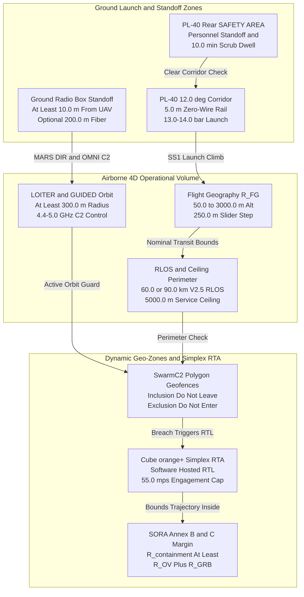

## 7. Airspace Deconfliction & Dynamic Geo-Zones

- **Baseline Date:** `2026-11-16`
- **System Baseline:** `Avenger5V25UasSystem` (`Avenger5V25IntegratedSystem`: `Avenger 5 V2.5 UAS` / `ASTK A5 V2.5` + `ELI Military Simulations PL-40 Rev 2.6` + `Artron ESAD AB00-0054-01AA-0005` + `SwarmC2`)
- **JSON Schema Mapping:** `airspace_geozones` (`.pipeline/schemas/mission_intent_specification_schema.json`)
- **Normative Governance:** `JARUS SORA v2.5` (Annex B Ground Risk Buffer and Ground Risk Mitigations, Annex C Air Risk and Operational Containment), `ASTM F3269-17` (§5.2 Software-Hosted Run-Time Assurance), `RTCA DO-362A` (§2.2 Physical/RF Equipment Performance, §3.2 Link Continuity, Availability, Integrity and Lost-Link Resilience), `MIL-STD-882E` (Task 202, Task 205, Task 206), `NATO STANAG 4187 Ed. 5` (Chapter 2, Chapter 3, Annex A), `DoD Directive 3000.09` (§4.1.a), `SAE ARP4754A` (§5.1) / `ARP4761` (§3.1-3.3), `NIST SP 800-82r3` (Chapter 6, Appendix F: AC, IA, SC), `ISO/IEC/IEEE 15288:2023` (§6.4.2, §6.4.4, §6.4.9), and `ISO/IEC/IEEE 29148:2018` (§5.2.4, §6.4, Annex A §A.2) -- traced exclusively to `docs/research/RESEARCH_INVENTORY.md`, `.pipeline/schema.sysml`, and `schema/extracted/parametric_limits.md`.
- **Architectural Truth Invariants:** `ASTM F3269-17` Simplex Run-Time Assurance (`RTA`) geofence and `RTL` supervision execute strictly in software inside `FlightControllerCubeOrangePlus` (`Cube orange+`, `SimplexRtaSoftwareHostingConstraint`: `standaloneRtaBoxCount == 0`, `rtaHostedOnCubeOrangePlus == true`); `Pl40PneumaticLauncher` (`ELI PL-40 Rev 2.6`) enforces a strictly mechanical `12.0 deg` launch corridor with `0` electrical or CAN conductors to the airframe (`IF-MECH-001`, `CONN_23`, `electricalWireToUavCount == 0`); production `Avenger V2.5` carries `0` recovery parachutes (`ProductionNoParachuteConstraint`: `rndRecoveryOptionInstalled == false`, permanently inhibiting `2x 50.0 V` Optional RnD igniters per `REQ_SC_03`); primary energy derives from the `12S2P` `36.0-50.4 V` DC bus (`49.0-50.0 V` pre-flight check rejecting lower-voltage legacy UI artifacts per `GAP-05`); and strict Level 1B operational boundaries cite `UCL-01` through `UCL-05`, `SCN-01` through `SCN-08`, `OA-01` through `OA-19`, and `EMG-01` through `EMG-08` with zero Level 2 use-case IDs and zero Level 1C serial opcodes or pinouts.

---

### 7.1 Primary Boundary Perimeter & Dynamic Inclusion/Exclusion Geo-Zones

In accordance with `JARUS SORA v2.5` (Annex B and Annex C, `MET-02`), `ASTM F3269-17` (§5.2, `CTL-01`), `RTCA DO-362A` (§3.2, `CTL-02`), and `SwarmC2AuthAndMissionBoundsConstraint` in `.pipeline/schema.sysml`, operational airspace for `Avenger5V25UasSystem` is bounded across three nested spatial and kinematic constructs: the **Primary Boundary Perimeter (`primary_boundary_perimeter`)**, **Dynamic Inclusion/Exclusion Geo-Zones (`dynamic_exclusion_zones`)**, and **Cube orange+ Software Simplex RTA Geofence `RTL` Containment**.

1. **Primary Boundary Perimeter (`primary_boundary_perimeter`):**
   - **Lateral Radio Line-of-Sight (`RLOS`) Envelope (`60.0/90.0 km` V2.5 Bound):** Lateral mission reach is anchored on `GroundRfStationAndAntennaTracker` operating over the `DTC 4.4-5.0 GHz` `AES-256` `FHSS` datalink (`2.0 W` total / `2x 1.0 W` dual `MPSL4400` airborne antennas, `MARS 23.0 dBi` `DIR` tracking rotator with `Auto Follow` and `0.5 deg` trim, plus `OMNI` close-in antenna and optional `200.0 m` ground fiber spool). Per `GAP-02` (`REQ_SAF_02`, `PRM-RF-006`, `PRM-RF-007`), `Avenger 5 V2.5` perimeter planning uses `60.0 km` baseline and `90.0 km` extended `V2.5` Spec Sheet `RLOS` range, rejecting the legacy `V1` manual `180.0 km` (`PRM-RF-008`) extended claim for conservative containment.
   - **Vertical Waypoint Corridor & Service Ceiling (`50.0-3000.0 m` within `5000.0 m`):** `SwarmC2OperatorConsole` (`SwarmC2AuthAndMissionBoundsConstraint`) constrains planned mission waypoints and the in-flight dynamic altitude slider between `50.0 m` minimum altitude (`PRM-GCS-004`) and `3000.0 m` slider ceiling (`PRM-GCS-005`) in `250.0 m` major graduations (`PRM-GCS-006`). All operational trajectories remain strictly below the `5000.0 m` aircraft service ceiling (`PRM-PERF-015`, `ElectricPropulsionUnit`), preserving a `2000.0 m` upper vertical Simplex RTA recovery margin (`5000.0 - 3000.0 = 2000.0 m`).
   - **Mission Plan Validation Rules (`A5-user-manual 2.pdf#p46-#p48`):** Prior to launch unlock, `SwarmC2` rejects any mission plan lacking: a mission name `<= 24` characters (`PRM-GCS-003`), exactly `1` Takeoff item, `>= 1` Waypoint item, `1` Return item, valid lat/lon/alt across every waypoint, waypoint altitude `>= 50.0 m`, and loiter orbit radius `>= 300.0 m` (`PRM-GCS-007`).

2. **Dynamic Inclusion/Exclusion Geo-Zones & Software Simplex RTA Geofence `RTL` (`dynamic_exclusion_zones`):**
   - **Independent `SwarmC2` Polygon Geo-Zones (`A5-user-manual 2.pdf#p50-#p51`):** Mission planners (`UCL-01` and `UCL-05`) configure two independent polygon geofence layers inside `SwarmC2OperatorConsole`:
     - **Inclusion Polygons ("do not leave"):** Convex or non-convex operational mission boundaries enclosing the active Flight Geography (`R_FG`) and Contingency Volume (`Delta R_CV`) strictly within the `60.0/90.0 km` `RLOS` perimeter and `JARUS SORA v2.5` `R_containment` envelope.
     - **Exclusion Polygons ("do not enter"):** Dynamic keep-out polygons protecting friendly ground forces, populated areas, terrain obstacles, non-participant corridors, and pop-up restricted airspace zones along the ingress, loiter, and egress paths.
   - **Software-Hosted Simplex RTA Geofence `RTL` (`FlightControllerCubeOrangePlus`, `standaloneRtaBoxCount == 0`):** Runtime geofence enforcement and envelope clamping execute exclusively in software inside `Cube orange+` (`RtaEnvelopeMonitorState`, `ExecuteSimplexRtaEnvelopeCheck`, `SimplexRtaSoftwareHostingConstraint`) without any standalone RTA hardware enclosure. Upon predicted or actual transgression of an `Inclusion` perimeter, intrusion into an `Exclusion` polygon, exceedance of the `3000.0 m` mission / `5000.0 m` ceiling limit, `105.0 s` `GCS Failsafe` timeout (`PRM-GCS-008`, `EMG-01`), or `<= 0.20` (`1080.0 s`) statutory Bingo energy reserve (`EMG-06`), `RtaEnvelopeMonitorState` transitions to `CriticalBatteryOrGeofenceRtb` and overrides active guidance to autonomous `RTL`.
   - **Deterministic `RTL` Recovery Modes & Ordnance Safing (`02_avenger5_operations_and_safety.md#s3`):** `SwarmC2` defines four configurable `RTL` behaviors (`Fly HOME Then Land` diverting to a closer Rally point if in range, `Go Directly to landing sequence`, `OnlyForGoAround`, and `Disable`, where `Disable` carries an explicit high aircraft-loss hazard warning and is prohibited for nominal SORA compliance). Any geofence or lost-link `RTL` commands `CompanionComputeRpiCm5` (`100.0 Hz` `RS-485` `OC Master`, `<= 10.0 ms` watchdog) to execute `Disarm ESAD On GCS Timeout` / ordnance disarm (`OA-05`, `OA-12`), auto-re-enables `Septentrio` GNSS if `Disable GNSS` was active, and relies on `Auto-SAFE` discharge upon landing (`N_parachute = 0`).
   - **Terminal Corridor Clamping (`<= 55.0 m/s` Dive Cap, `EMG-02`):** During `TargetTrackAndDive` (`ATTACK`), `Cube orange+` Simplex RTA clamps dive speed `<= 55.0 m/s` (`PRM-PERF-010`) below the `80.0 m/s` structural `VNE` limit (`PRM-PERF-011`). Exceeding `55.0 m/s` or losing `EO` track immediately triggers `AirspeedDiveCapClamped` -> `Abort Engaging` climb toward `Takeoff altitude` into `GUIDED` (`>= 300.0 m` loiter, zero autonomous re-track), preventing uncontained high-energy overshoot beyond the authorized target corridor (`REQ_SC_05`, `REQ_SC_12`).

#### Table 7.1: Primary Boundary Perimeter, Dynamic Geo-Zone & Containment Thresholds (`airspace_geozones`)

| Zone ID | Geo-Zone / Perimeter Class | Operational Scope & Boundary Enforcement Logic | Governing AST State / Constraint | Qualifier | Value | Units | SSOT & Normative Citation |
| :--- | :--- | :--- | :--- | :--- | :--- | :--- | :--- |
| `GEO-01` | `Primary Boundary Perimeter` | Baseline `V2.5` `DTC` `IF-RF-001` `AES-256` `FHSS` `RLOS` lateral containment perimeter | `OnboardEthernetAndC2RadioUnit`; `PaceC2LinkState` | Max | 60.0 | km | `PRM-RF-006`, `RTCA DO-362A §3.2`, `CTL-02` |
| `GEO-02` | `Primary Boundary Perimeter` | Extended `V2.5` Spec Sheet `RLOS` lateral perimeter (`GAP-02` rejects `V1` extended claim) | `OnboardEthernetAndC2RadioUnit`; `REQ_SAF_02` | Max | 90.0 | km | `PRM-RF-007`, `AVENGER 5 Spec sheet_rev3.pdf#p3` |
| `GEO-03` | `Primary Boundary Perimeter` | Minimum `SwarmC2` mission waypoint and dynamic slider altitude floor | `SwarmC2AuthAndMissionBoundsConstraint`; `REQ_SC_15` | Min | 50.0 | m | `PRM-GCS-004`, `A5-user-manual 2.pdf#p46-#p48,#p63` |
| `GEO-04` | `Primary Boundary Perimeter` | Upper `SwarmC2` dynamic altitude slider mission planning ceiling | `SwarmC2AuthAndMissionBoundsConstraint`; `REQ_SC_15` | Max | 3000.0 | m | `PRM-GCS-005`, `A5-user-manual 2.pdf#p63,#p65` |
| `GEO-05` | `Primary Boundary Perimeter` | Discrete major altitude graduation interval on `SwarmC2` dynamic altitude slider | `SwarmC2OperatorConsole`; `REQ_SC_15` | Exact | 250.0 | m | `PRM-GCS-006`, `A5-user-manual 2.pdf#p63,#p65` |
| `GEO-06` | `Primary Boundary Perimeter` | Aircraft service ceiling enforcing vertical Simplex RTA recovery headroom above slider max | `ElectricPropulsionUnit`; `RtaEnvelopeMonitorState` | Max | 5000.0 | m | `PRM-PERF-015`, `AVENGER 5 Spec sheet_rev3.pdf#p3` |
| `GEO-07` | `Dynamic Inclusion Zone` | Minimum CW `LOITER`, `GUIDED`, and `Abort Engaging` recovery orbit radius | `SwarmC2AuthAndMissionBoundsConstraint`; `REQ_SC_15` | Min | 300.0 | m | `PRM-GCS-007`, `A5-user-manual 2.pdf#p46-#p64` |
| `GEO-08` | `Dynamic Inclusion & Exclusion Zones` | Standalone RTA hardware box count (`100%` software-hosted geofence `RTL` inside `Cube orange+`) | `SimplexRtaSoftwareHostingConstraint`; `REQ_SC_05` | Exact | 0 | count | `ASTM F3269-17 §5.2`, `CTL-01`, `.pipeline/schema.sysml` |
| `GEO-09` | `Dynamic Lost-Link Perimeter` | `GCS Failsafe` lost-link `RTL` and `Disarm ESAD On GCS Timeout` trigger baseline | `PaceC2LinkState::EmergencyLostLinkRtlHolding`; `REQ_SC_15` | Nominal | 105.0 | s | `PRM-GCS-008`, `A5-user-manual 2.pdf#p34`, `EMG-01` |
| `GEO-10` | `Terminal Engagement Corridor` | Software Simplex RTA dive airspeed cap triggering `Abort Engaging` pull-up | `FlightEnvelopeSpeedConstraint`; `EngagementSpeedAndTrackHoldConstraint` | Max | 55.0 | m/s | `PRM-PERF-010`, `GAP-02`, `A5-user-manual 2.pdf#p88` |
| `GEO-11` | `Ground Launch Corridor` | Fixed `ELI PL-40 Rev 2.6` pneumatic catapult launch rail inclination angle (`IF-MECH-001`) | `Pl40PneumaticLauncher`; `REQ_SC_13` | Exact | 12.0 | deg | `PRM-PL40-006`, `PL-40 Manual Rev 2.6#p37,#p41` |
| `GEO-12` | `Ground RF Standoff Zone` | Minimum physical standoff between `Ground Radio Box` and UAV during ground prep | `GroundCrewSeparationAndEsdConstraint`; `REQ_SC_15` | Min | 10.0 | m | `PRM-GCS-001`, `A5-user-manual 2.pdf#p52` |
| `GEO-13` | `Ground Hangfire Scrub Zone` | Derived rear `SAFETY AREA` crew holdback dwell prior to `SAFE_SCRUB_ABORT` approach (`GAP-SCRUB`) | `Pl40LauncherState::ScrubbedSafeDepressurized`; `REQ_SC_16` | Min | 10.0 | min | `GAP-SCRUB`, `REQ_SAF_12`, `MET-04`, `EMG-04` |

---

### 7.2 Airspace Separation Minima & Ground Launch Safety Zones

Deconfliction across airborne flight phases and ground catapult operations (`separation_minima`) partitions spatial, kinematic, and procedural safety buffers between `Avenger5V25UasSystem`, ground crew (`UCL-01` through `UCL-05`), and external airspace participants (`JARUS SORA v2.5`, `MIL-STD-882E Task 206`, `NATO STANAG 4187 Ed. 5`, `DoD Directive 3000.09`).

1. **Airborne Horizontal, Vertical & Kinematic Separation Minima:**
   - **Horizontal Orbit & Turn Separation (`>= 300.0 m`):** Every planned `LOITER` holding pattern (default clockwise orbit), map-commanded `GUIDED` (`Loiter Here`) circle, and `Abort Engaging` post-dive recovery orbit enforces a minimum lateral radius of `300.0 m` (`PRM-GCS-007`), preventing tight high-bank stalls near `24.0-26.0 m/s` and bounding lateral airspace footprint inside `Inclusion` polygons.
   - **Vertical Separation & Upper Simplex RTA Buffer (`50.0-3000.0 m` vs `5000.0 m`):** Waypoint altitudes progress in `250.0 m` discrete slider steps (`PRM-GCS-006`) between `50.0 m` (`PRM-GCS-004`) and `3000.0 m` (`PRM-GCS-005`), leaving `2000.0 m` of protected vertical altitude headroom beneath the `5000.0 m` service ceiling (`PRM-PERF-015`) for climb-outs (`Abort Engaging` toward `Takeoff altitude`) and `RTL` transit separation.
   - **Terminal Dive & Safe-Separation (`SS2`) Gating:** Prior to committing `ATTACK`, `SwarmC2` and `Artron ESAD` verify `SS1` launch acceleration, `SS2` (`Safe Distance Exceed == 1`, `EsadSafeDistanceExceedConstraint`, `GAP-07`), `2.0-5.0 s` continuous `EO` daylight track lock (`PRM-GCS-011`, `PRM-GCS-012`), initial target elevation `<= 15.0 deg` (`PRM-PERF-014`), and clear line-of-sight. Terminal approach executes at `15.0 deg` shallow (`PRM-PERF-013`) or `<= 22.0 deg` maximum dive (`PRM-PERF-012`), strictly capped at `<= 55.0 m/s` (`PRM-PERF-010`) and achieving `<= 0.5 m` (`50.0 cm`) CEP (`PRM-PERF-020`, `PRM-PERF-021`). Because OEM ESAD documentation does not print the exact numeric `SS2` meter/second arming threshold (`GAP-SEPDIST`), `REQ_SAF_10` mandates calibration sign-off before field arming.
   - **Wind & Speed Envelope Containment (`GAP-02`):** Conservative V2.5 planning bounds airspeed between `24.0 m/s` (`V2.5` stall, `26.0 m/s` `V1` climb transition) and `42.0 m/s` max horizontal (`31.0 m/s` `V2.5` / `30.0 m/s` `V1` cruise), `<= 55.0 m/s` terminal engagement cap, and `80.0 m/s` structural `VNE`, against `<= 12.0 m/s` ground launch wind and `<= 28.0 m/s` cruise wind drift (`PRM-PERF-004` through `PRM-PERF-017`).

2. **Ground Launch Corridor & Safety Zones (`PL-40` Rev 2.6 + Ground RF Standoff):**
   - **Zero-Wire `PL-40` `12.0 deg` Launch Corridor (`IF-MECH-001` / `CONN_23`):** `Pl40PneumaticLauncher` launches the `17.0 kg` airframe (`<= 30.0 kg` rail rating) along a `5.0 m` (`4938.0 mm` CAD) rail elevated at `12.0 deg` (`1116.0 mm` rail top height, `602.0 mm` front leg span) using `13.0-14.0 bar` pneumatic pressure (`<= 8.0 min` charge, `0.05 bar` hysteresis, `2x Makita BL1860B` `18.0 V` packs with `<= 14.5 V` UVLO cutoff) and `0` electrical or CAN wires (`electricalWireToUavCount == 0`). Under `GAP-03`, `~23.0 m/s` (`22.7-23.5 m/s`) rail exit lies below `24.0-26.0 m/s` stall without headwind or pusher thrust; therefore, the downrange `12.0 deg` departure corridor must remain free of terrain and obstructions while `AXI 5345/16` pusher thrust accelerates the airframe cleanly above stall.
   - **Rear `SAFETY AREA` vs Forward/Lateral `DANGER ZONE` (`PL-40 Manual Rev 2.6#p40`):** During final launch arming (post-`RBF #3` prompt removal, red carriage pin pull, `Main Valve 4` opening, and `>= 2.0 s` simultaneous dual-switch hold), `100%` of personnel (`UCL-01` through `UCL-05`) MUST evacuate into the **rear `SAFETY AREA`** directly behind the `PL-40` rear anchor/foot. The **`DANGER ZONE`** comprises all forward downrange launch sectors and lateral sectors flanking the rail and carriage path; because OEM documentation states no numeric exclusion radius in meters (`GAP-SEPDIST`, `GAP-ENV`), `REQ_SAF_10` and `REQ_SAF_11` mandate formal range-safety clearance distances prior to firing.
   - **Ground RF Standoff (`>= 10.0 m`) & Optional `200.0 m` Tactical Fiber:** `GroundCrewSeparationAndEsdConstraint` (`PRM-GCS-001`) requires `>= 10.0 m` physical separation between the radiating `2.0 W` `4.4-5.0 GHz` `Ground Radio Box` and the UAV during ground preparation, while the optional `200.0 m` fiber spool (`PRM-RF-012`) allows `SwarmC2` operators (`UCL-01`, `UCL-02`) to stand off inside protected positions away from both the `PL-40` rail and RF transmitter.
   - **Hangfire Quarantine & `SAFE_SCRUB_ABORT` Sequence (`GAP-SCRUB`, `EMG-04`):** Upon any launch abort or hangfire after `RBF #3` removal, red pin pull, or `Main Valve 4` opening, zero personnel may exit the rear `SAFETY AREA` into the forward/lateral `DANGER ZONE` across the derived `>= 10.0 min` dwell (`EMG-04`). Crew must remotely execute `>= 5.0 s` ESAD abort + `Slide to confirm` / irreversible `Power Off ESAD` (`< 50.0 V` verified), close `Main Valve 4`, bleed pneumatic pressure to `0.0 bar`, reinstall the red safety pin, touch the transport box `EARTH / GROUNDING POINT`, and restore `RBF #3` (`UMB < 0.5 Ohm` at `20.0 mA`) strictly before re-inserting/disconnecting `UAV Power R.B.F. Key #2` (`REQ_SC_16`, `REQ_SAF_12`).

#### Table 7.2: Grounded Airspace, Geo-Zone, Separation & Ground Safety Thresholds (`Check 26`)

| Param ID | Zone / Separation Domain | Parameter Description | Qualifier | Value | Units | Governing Constraint & SSOT Citation |
| :--- | :--- | :--- | :--- | :--- | :--- | :--- |
| `PRM-GCS-004` | Vertical Perimeter | Minimum mission waypoint and slider altitude floor | Min | 50.0 | m | `SwarmC2AuthAndMissionBoundsConstraint`; `A5-user-manual 2.pdf#p46-#p63` |
| `PRM-GCS-005` | Vertical Perimeter | Maximum `SwarmC2` dynamic altitude slider ceiling | Max | 3000.0 | m | `SwarmC2AuthAndMissionBoundsConstraint`; `A5-user-manual 2.pdf#p63,#p65` |
| `PRM-GCS-006` | Vertical Separation | `SwarmC2` dynamic altitude slider major graduation step | Exact | 250.0 | m | `SwarmC2OperatorConsole`; `A5-user-manual 2.pdf#p63,#p65` |
| `PRM-PERF-015` | Vertical Ceiling | Airframe operational service ceiling | Max | 5000.0 | m | `ElectricPropulsionUnit`; `AVENGER 5 Spec sheet_rev3.pdf#p3` |
| `PRM-GCS-007` | Lateral Separation | Minimum CW `LOITER`, `GUIDED`, and `Abort Engaging` orbit radius | Min | 300.0 | m | `SwarmC2AuthAndMissionBoundsConstraint`; `A5-user-manual 2.pdf#p46-#p64` |
| `PRM-GCS-003` | Mission Validation | Maximum `SwarmC2` mission identifier character count (characters) | Max | 24 | count | `SwarmC2AuthAndMissionBoundsConstraint`; `A5-user-manual 2.pdf#p46-#p48` |
| `PRM-RF-006` | Lateral Perimeter | Baseline `V2.5` `RLOS` operational datalink perimeter | Max | 60.0 | km | `OnboardEthernetAndC2RadioUnit`; `AVENGER 5 Spec sheet_rev3.pdf#p3` |
| `PRM-RF-007` | Lateral Perimeter | Extended `V2.5` `RLOS` perimeter (`GAP-02` conservative cap) | Max | 90.0 | km | `OnboardEthernetAndC2RadioUnit`; `AVENGER 5 Spec sheet_rev3.pdf#p3` |
| `PRM-RF-012` | Ground Standoff | Optional tactical ground fiber spool tether length | Max | 200.0 | m | `GroundRfStationAndAntennaTracker`; `A5-user-manual 2.pdf#p11` |
| `PRM-GCS-001` | Ground RF Standoff | Minimum `Ground Radio Box` to UAV separation during prep | Min | 10.0 | m | `GroundCrewSeparationAndEsdConstraint`; `A5-user-manual 2.pdf#p52` |
| `PRM-RF-001` | C2 Spectrum Floor | `DTC` `AES-256` `FHSS` lower operating frequency | Min | 4.4 | GHz | `OnboardEthernetAndC2RadioUnit`; `AVENGER 5 Spec sheet_rev3.pdf#p3` |
| `PRM-RF-002` | C2 Spectrum Ceiling | `DTC` `AES-256` `FHSS` upper operating frequency | Max | 5.0 | GHz | `OnboardEthernetAndC2RadioUnit`; `AVENGER 5 Spec sheet_rev3.pdf#p3` |
| `PRM-RF-003` | Ground/Air RF Power | Total `DTC` C2 transceiver RF output power | Nominal | 2.0 | W | `OnboardEthernetAndC2RadioUnit`; `A5-user-manual 2.pdf#p55` |
| `PRM-GCS-008` | Lost-Link Boundary | `GCS Failsafe` lost-link `RTL` and ESAD disarm timeout | Nominal | 105.0 | s | `SwarmC2OperatorConsole`; `A5-user-manual 2.pdf#p34` |
| `PRM-PERF-004` | Kinematic Floor | Airframe stall / minimum flight speed (`V2.5` spec) | Min | 24.0 | m/s | `FlightEnvelopeSpeedConstraint`; `AVENGER 5 Spec sheet_rev3.pdf#p3` |
| `PRM-PERF-005` | Kinematic Climb | Conservative minimum climb transition airspeed (`V1` manual) | Min | 26.0 | m/s | `UavFlightLifecycleState`; `A5-user-manual 2.pdf#p10` |
| `PRM-PERF-007` | Kinematic Cruise | Nominal `V2.5` cruise airspeed (`V1` nominal conservative) | Nominal | 31.0 | m/s | `ElectricPropulsionUnit`; `AVENGER 5 Spec sheet_rev3.pdf#p3` |
| `PRM-PERF-009` | Kinematic Ceiling | Maximum `V2.5` horizontal containment speed | Max | 42.0 | m/s | `ElectricPropulsionUnit`; `AVENGER 5 Spec sheet_rev3.pdf#p3` |
| `PRM-PERF-010` | Engagement Cap | Simplex RTA terminal dive speed cap (`Abort Engaging`) | Max | 55.0 | m/s | `EngagementSpeedAndTrackHoldConstraint`; `A5-user-manual 2.pdf#p88` |
| `PRM-PERF-011` | Structural Limit | Airframe structural never-exceed dive airspeed (`V_NE`) | Max | 80.0 | m/s | `FlightEnvelopeSpeedConstraint`; `AVENGER 5 Spec sheet_rev3.pdf#p3` |
| `PRM-PERF-012` | Dive Corridor | Maximum aerodynamic terminal dive angle | Max | 22.0 | deg | `ElectricPropulsionUnit`; `A5-user-manual 2.pdf#p10` |
| `PRM-PERF-013` | Approach Corridor | Nominal shallow engagement glidepath angle | Nominal | 15.0 | deg | `EoIrSeekerAndTrackerUnit`; `A5-user-manual 2.pdf#p86-#p90` |
| `PRM-PERF-016` | Launch Wind Gate | Maximum ground surface headwind at catapult launch | Max | 12.0 | m/s | `Pl40MassAndExitVelocityConstraint`; `AVENGER 5 Spec sheet_rev3.pdf#p3` |
| `PRM-PERF-017` | Drift Wind Gate | Maximum cruise wind tolerance for GRB drift bounding | Max | 28.0 | m/s | `ElectricPropulsionUnit`; `AVENGER 5 Spec sheet_rev3.pdf#p3` |
| `PRM-PL40-006` | Launch Corridor | Fixed `PL-40` pneumatic catapult rail elevation angle | Exact | 12.0 | deg | `Pl40PneumaticLauncher`; `PL-40 Manual Rev 2.6#p37,#p41` |
| `PRM-PL40-007` | Launch Corridor | Assembled three-section `PL-40` launch rail length | Nominal | 5.0 | m | `Pl40PneumaticLauncher`; `PL-40 Manual Rev 2.6#p37` |
| `PRM-PL40-003` | Launch Corridor | `PL-40` interpolated carriage exit velocity at MTOW (`GAP-03`) | Nominal | 23.0 | m/s | `Pl40PneumaticLauncher`; `PL-40 Manual Rev 2.6#p37` |
| `PRM-PL40-002` | Launch Corridor | `PL-40` structural maximum rated exit velocity ceiling | Max | 25.0 | m/s | `Pl40MassAndExitVelocityConstraint`; `PL-40 Manual Rev 2.6#p3,#p24` |
| `PRM-PL40-027` | Launch Pressure | `PL-40` operating launch tank pressure window (`PRM-PL40-027/028`, Normalized pressure ratio P / 100 kPa; OEM: `13.0 to 14.0 bar`) | Nominal | 13.0 to 14.0 | ratio | `Pl40MassAndExitVelocityConstraint`; `A5-user-manual 2.pdf#p54` |
| `PRM-PL40-037` | Launch Interlock | Dual safety-covered firing switch simultaneous hold duration | Min | 2.0 | s | `Pl40UvloAndDualSwitchConstraint`; `PL-40 Manual Rev 2.6#p25-#p26` |
| `PRM-AF-008` | Impact Energy | Aircraft Maximum Takeoff Weight (`MTOW`) | Max | 17.0 | kg | `ElectricPropulsionUnit`; `AVENGER 5 Spec sheet_rev3.pdf#p3` |
| `PRM-PERF-003` | Energy Containment | Statutory Bingo energy reserve ratio enabling `RTL` return | Min | 0.20 | ratio | `BingoEnergyReserveConstraint`; `MET-02` |
| `PRM-GCS-010` | Ordnance Abort | HITL `SELF DESTRUCT` and permanent `ABORT` hold duration | Min | 5.0 | s | `CommandEsadAbortAndSelfDestruct`; `A5-user-manual 2.pdf#p84` |
| `GAP-SCRUB-DWELL` | Scrub Safety Zone | Derived rear `SAFETY AREA` hangfire crew holdback dwell (`GAP-SCRUB`) | Min | 10.0 | min | `REQ_SC_16`, `REQ_SAF_12`, `MET-04`, `EMG-04` |
| `GAP-SEPDIST-SS2` | Ordnance Separation | `Artron ESAD` `SS2` `Safe Distance Exceed` physical distance (`GAP-07`) | Min | UNPRINTED_OEM | m | `EsadSafeDistanceExceedConstraint`; `REQ_SAF_10`, `GAP-SEPDIST` |
| `GAP-SEPDIST-DZ` | Ground Danger Zone | `PL-40` forward and lateral `DANGER ZONE` exclusion radius | Min | UNPRINTED_OEM | m | `PL-40 Manual Rev 2.6#p40`; `REQ_SAF_10`, `REQ_SAF_11` |
| `SimplexRtaBoxCount` | RTA Architecture | Standalone hardware RTA enclosures (`100%` software on `Cube orange+`) | Exact | 0 | count | `SimplexRtaSoftwareHostingConstraint`; `REQ_SC_05`, `CTL-01` |
| `Pl40WireCount` | Launch Interface | Electrical or CAN conductors across `PL-40` to airframe (`IF-MECH-001`) | Exact | 0 | count | `Pl40PneumaticLauncher`; `CONN_23`, `REQ_SC_13` |
| `ProductionParachuteCount` | Recovery Exclusion | Production recovery parachutes (`2x 50.0 V` Optional RnD rails inhibited) | Exact | 0 | count | `ProductionNoParachuteConstraint`; `REQ_SC_03` |

---

### 7.3 JARUS SORA v2.5 Annex B & Annex C Ground Risk Buffer & Containment Math

In accordance with `JARUS SORA v2.5` Annex B (Ground Risk Buffer and unpowered trajectory bounding) and Annex C (Operational Volume partitioning into Flight Geography and Contingency Volume, `MET-02`), and aligned 1:1 with `CONOPS.md §5.2` and `MISSION_INTENT.md §3.2.3` (`MoE-03`), the operational containment radius `R_containment` MUST bound the sum of the Operational Volume (`R_OV`) and Ground Risk Buffer (`R_GRB`) while remaining enclosed inside the active `RLOS` perimeter (`R_RLOS`):

$$
\begin{aligned}
R_{\mathrm{OV}} &= R_{\mathrm{FG}} + \Delta R_{\mathrm{CV}}, \qquad R_{\mathrm{FG}} \ge r_{\mathrm{loiter,min}}, \qquad h_{\mathrm{mission,min}} \le h(t) \le h_{\mathrm{mission,max}} \le h_{\mathrm{ceiling}} \\
t_{\mathrm{fall}} &= \sqrt{\frac{2 \, h_{\mathrm{mission,max}}}{g_{\mathrm{accel}}}}, \qquad d_{\mathrm{ballistic}} = \frac{h_{\mathrm{mission,max}}}{\tan\!\left(\theta_{\mathrm{dive,max}}\right)} \\
d_{\mathrm{wind}} &= v_{\mathrm{wind,crs,max}} \, t_{\mathrm{fall}}, \qquad d_{\mathrm{glide,max}} = \max\!\left(d_{\mathrm{ballistic}}, \, \gamma_{\mathrm{glide}} \, h_{\mathrm{mission,max}}\right) + d_{\mathrm{wind}} \\
R_{\mathrm{GRB}} &\ge d_{\mathrm{glide,max}} + V_{\mathrm{horiz,max}} \, \tau_{\mathrm{react}} + \Delta r_{\mathrm{nav}} \\
R_{\mathrm{containment}} &\ge R_{\mathrm{min}} = R_{\mathrm{OV}} + R_{\mathrm{GRB}}, \qquad R_{\mathrm{containment}} \le R_{\mathrm{RLOS}}, \qquad M_{\mathrm{contain}} = \frac{R_{\mathrm{containment}}}{R_{\mathrm{min}}} \ge 1.0 \\
E_{\mathrm{impact}} &= \frac{1}{2} \, m_{\mathrm{MTOW}} \, v_{\mathrm{terminal}}^{2}, \qquad N_{\mathrm{parachute}} = 0
\end{aligned}
$$

#### Parameter Definitions & Engineering Units: JARUS SORA v2.5 Annex B & Annex C Containment

| Parameter | Symbol | Qualifier | Value | Units | Constraint / Rule | Grounded SSOT Citation |
| :--- | :--- | :--- | :--- | :--- | :--- | :--- |
| Flight Geography Radius | R_FG | Min | 300.0 | m | R_FG >= r_loiter_min inside Inclusion polygon | `PRM-GCS-007`, `SwarmC2AuthAndMissionBoundsConstraint` |
| Contingency Volume Lateral Buffer | Delta R_CV | Min | OPERATOR_CONFIGURED | m | Excursion buffer enclosing Simplex RTA pull-ups and DR drift | `JARUS SORA v2.5 Annex C`, `CONOPS.md §5.2` |
| Operational Volume Radius | R_OV | Derived | DERIVED | m | R_OV = R_FG + Delta R_CV | `JARUS SORA v2.5 Annex C`, `MET-02` |
| Minimum CW Loiter Orbit Radius | r_loiter_min | Min | 300.0 | m | Lower geometric bound on holding and recovery circles | `PRM-GCS-007`, `SwarmC2OperatorConsole` |
| Mission Altitude Floor | h_mission_min | Min | 50.0 | m | Lower SwarmC2 waypoint and slider bound | `PRM-GCS-004`, `SwarmC2AuthAndMissionBoundsConstraint` |
| Mission Altitude Ceiling | h_mission_max | Max | 3000.0 | m | Upper SwarmC2 dynamic altitude slider bound | `PRM-GCS-005`, `SwarmC2AuthAndMissionBoundsConstraint` |
| Aircraft Service Ceiling | h_ceiling | Max | 5000.0 | m | Hard vertical envelope limit above mission slider | `PRM-PERF-015`, `ElectricPropulsionUnit` |
| Standard Gravitational Acceleration | g_accel | Exact | 9.80665 | m/s^2 | SI standard gravitational constant (1 N/kg == 1 m/s^2) | `CONOPS.md §5.2`, `MoE-03` |
| Unpowered Free-Fall Time Envelope | t_fall | Derived | DERIVED | s | Vertical unpowered drop time from h_mission_max | `JARUS SORA v2.5 Annex B`, `CONOPS.md §5.2` |
| Maximum Aerodynamic Dive Angle | theta_dive_max | Max | 22.0 | deg | Worst-case ballistic impact trajectory angle | `PRM-PERF-012`, `ElectricPropulsionUnit` |
| Ballistic Horizontal Excursion | d_ballistic | Derived | DERIVED | m | Horizontal travel along theta_dive_max dive slope | `JARUS SORA v2.5 Annex B`, `CONOPS.md §5.2` |
| Maximum Cruise Wind Drift Speed | v_wind_crs_max | Max | 28.0 | m/s | Worst-case airborne wind drift velocity | `PRM-PERF-017`, `ElectricPropulsionUnit` |
| Wind Drift Excursion Term | d_wind | Derived | DERIVED | m | Lateral wind drift integrated over t_fall | `JARUS SORA v2.5 Annex B`, `CONOPS.md §5.2` |
| Unpowered Glide Ratio (L/D) | gamma_glide | Nominal | UNPRINTED_OEM | ratio | Empirically calibrated pre-ops under GAP-ENV | `GAP-ENV`, `REQ_SAF_11`, `CONOPS.md §5.2` |
| Maximum Unpowered Glide + Wind Reach | d_glide_max | Derived | DERIVED | m | Dominant ballistic or glide excursion plus d_wind | `JARUS SORA v2.5 Annex B`, `CONOPS.md §5.2` |
| Max Horizontal Containment Speed | V_horiz_max | Max | 42.0 | m/s | V2.5 max horizontal speed during RTA intervention | `PRM-PERF-009`, `GAP-02`, `FlightEnvelopeSpeedConstraint` |
| End-to-End RTA & Bus Reaction Latency | tau_react | Max | BENCH_CALIBRATED | s | Cube orange+ RTA + CAN + ESAD watchdog cycle (`PRM-ESAD-018`, `GAP-WCET`) | `REQ_SAF_08`, `PRM-ESAD-018`, `CONOPS.md §5.2` |
| GNSS-Denied INS/DR Drift Allowance | Delta r_nav | Max | UNPRINTED_OEM | m | RM3100 + SKYE2 dead-reckoning drift calibrated pre-ops | `GAP-SEPDIST`, `REQ_SAF_10`, `CONOPS.md §5.2` |
| Ground Risk Buffer Radius | R_GRB | Min | DERIVED | m | d_glide_max + V_horiz_max * tau_react + Delta r_nav | `JARUS SORA v2.5 Annex B`, `MET-02` |
| Minimum Required Containment Radius | R_min | Min | DERIVED | m | Sum of R_OV and R_GRB | `JARUS SORA v2.5 Annex B/C`, `MET-02` |
| Declared Operational Containment Radius | R_containment | Min | OPERATOR_CONFIGURED | m | Must satisfy R_min <= R_containment <= R_RLOS | `MET-02`, `TC_02`, `TC_08` |
| Rated RLOS Datalink Containment Limit | R_RLOS | Max | 60.0-90.0 | km | Baseline (`PRM-RF-006`) or V2.5 extended (`PRM-RF-007`) RLOS reach | `PRM-RF-006`, `PRM-RF-007`, `GAP-02` |
| Boundary Containment Margin Ratio | M_contain | Min | 1.0 | ratio | Ratio R_containment / R_min >= 1.0 | `MoE-03`, `JARUS SORA v2.5 Annex B/C` |
| Aircraft Maximum Takeoff Mass | m_MTOW | Max | 17.0 | kg | Production airframe MTOW including authorized warhead payload | `PRM-AF-008`, `PRM-AF-009` |
| Terminal Impact Velocity | v_terminal | Range | 24.0-80.0 | m/s | Spans stall floor (24.0) to V_NE ceiling (80.0) | `PRM-PERF-004`, `PRM-PERF-011` |
| Terminal Unpowered Impact Energy | E_impact | Range | 4896.0-54400.0 | J | Kinetic energy across stall, cruise, dive cap, V_NE | `CONOPS.md §5.2`, `PRM-AF-008` |
| Production Recovery Parachutes | N_parachute | Exact | 0 | count | Production parachute excluded (Optional RnD igniter rails inhibited) | `ProductionNoParachuteConstraint`, `REQ_SC_03` |

- **Containment Engineering Interpretation (`GAP-ENV`, `GAP-WCET`, `GAP-SEPDIST`):** Because production `Avenger 5 V2.5` excludes recovery parachutes (`N_parachute = 0`) and carries `17.0 kg` MTOW yielding between `4896.0 J` (at `24.0 m/s` stall) and `54400.0 J` (at `80.0 m/s` structural `V_NE`), physical ground-risk containment relies on bounding `R_containment >= R_min = R_OV + R_GRB` strictly inside the `60.0/90.0 km` `RLOS` datalink envelope while coupling `CriticalBatteryOrGeofenceRtb` with deterministic `Artron ESAD` safing (`Disarm ESAD On GCS Timeout` and `Auto-SAFE`). Unprinted OEM glide ratio `gamma_glide` (`GAP-ENV`), `INS/DR` drift `Delta r_nav` (`GAP-SEPDIST`), and closed-loop `tau_react` (`GAP-WCET` around the grounded `0.01 s` ESAD cycle) MUST receive calibrated bench and flight-test sign-off prior to declaring operational `R_containment` per `REQ_SAF_08`, `REQ_SAF_10`, and `REQ_SAF_11`.

---

### 7.4 Airspace Volume, Dynamic Geo-Zones & Ground Safety Architecture

#### Figure 7.1: `Avenger5V25UasSystem` Airspace Volume, Dynamic Geo-Zones & Ground Standoff Architecture

---

### 7.5 Airspace & Geo-Zone Governance Responsibilities (`UCL-01` through `UCL-05`)

In accordance with `ISO/IEC/IEEE 29148:2018 §5.2.4`, `DoD Directive 3000.09 §4.1.a`, `MIL-STD-882E Task 206`, and `NIST SP 800-82r3`, airspace planning, polygon enforcement, launch corridor clearance, and hangfire quarantine responsibilities are segregated across the five canonical Level 1B Operational User Classes (`UCL-01` through `UCL-05`) in Table 7.3.

#### Table 7.3: User Class Airspace, Geo-Zone & Ground Safety Governance (`UCL-01` through `UCL-05`)

| User Class ID | Canonical User Class & Role | Airspace, Geo-Zone & Corridor Responsibilities | Separation, RTA & Termination Authority | Grounded SSOT & Clause Anchors |
| :--- | :--- | :--- | :--- | :--- |
| `UCL-01` | `Pilot Operator` (`SwarmC2` `Pilot` role) | Authors mission plans within `SwarmC2AuthAndMissionBoundsConstraint` (`PRM-GCS-003` through `PRM-GCS-007`), loads `Inclusion` / `Exclusion` polygons, selects valid `RTL` recovery mode (disallowing `Disable`), calibrates `MARS` rotator before touching UAV, and maintains `RLOS` (`PRM-RF-006`, `PRM-RF-007`) | Commands manual `RTL`, `GUIDED` recovery orbits (`>= r_loiter_min`), `OMNI` / `DIR` RF switching, and `Disable GNSS` INS/DR fixes (`I'm Here` / `I'm Looking Here`) while `Cube orange+` Simplex RTA enforces autonomous geofence `RTL` | `SwarmC2OperatorConsole`, `FlightControllerCubeOrangePlus`, `GroundRfStationAndAntennaTracker`; `RTCA DO-362A §3.2`, `ASTM F3269-17 §5.2` |
| `UCL-02` | `Payload Operator` (`SwarmC2` `Payload` role) | Verifies target geometry inside authorized engagement corridor (`PRM-PERF-014` elev, clear LOS, `PRM-GCS-011`/`012` EO track lock) and verifies `SS1`/`SS2` (`GAP-07`) telemetry prior to terminal commit | Holds exclusive positive HITL authority to authorize `ATTACK` (`Slide to confirm`), initiate `Abort Engaging` (`<= PRM-PERF-010`), hold `SELF DESTRUCT` / `ABORT` (`PRM-GCS-010`), or execute irreversible `Power Off ESAD` on geofence or scrub abort | `EoIrSeekerAndTrackerUnit`, `ArtronEsadAndSensorUnit`, `CompanionComputeRpiCm5`; `DoD Directive 3000.09 §4.1.a`, `NATO STANAG 4187 Ed. 5` |
| `UCL-03` | `Launch Assistant` (`SwarmC2` `Launch Assistant` role) | Stages zero-wire `PL-40` rail (`PRM-PL40-006`, `PRM-PL40-007`, `IF-MECH-001`), verifies downrange launch corridor clearance and `>= PRM-GCS-001` radio standoff, and positions crew inside rear `SAFETY AREA` prior to dual-switch firing (`PRM-PL40-037`) | Enforces zero entry into forward/lateral `DANGER ZONE` across `GAP-SCRUB-DWELL` on any hangfire; closes `Main Valve 4`, bleeds pneumatic tank, restores red pin, touches ESD point, and restores `RBF #3` prior to `RBF #2` (`REQ_SC_16`) | `Pl40PneumaticLauncher`, `MainBatteryAndFuseUnit`, `PowerMeterAndRbfSwitch`; `MIL-STD-882E Task 206`, `PL-40 Manual Rev 2.6#p40` |
| `UCL-04` | `External Tactical C2` (`ATAK`, `SitaWare HQ`, `DELTA`) | Consumes authenticated `5W` (`Five Whiskey`) and `CFF` (`Call For Fire`) target coordinates and sortie status exports from `SwarmC2` for friendly airspace and fires deconfliction (`OA-19`) | Strictly read-only tactical situational awareness consumer; holds zero uplink flight-mode, geofence override, `RTL` suppression, or ordnance firing authority (`NIST SP 800-82r3` zone boundary) | `SwarmC2OperatorConsole`, `GroundStationC2AndFiberInterface`; `NIST SP 800-82r3 Chapter 6`, `ISO/IEC/IEEE 29148:2018 §5.2.4` |
| `UCL-05` | `Field Sustainment & Arming Safety Lead` | Audits `JARUS SORA v2.5` Annex B/C `R_containment >= R_min` calculations (`MoE-03`), verifies pre-ops calibration of `gamma_glide`, `Delta r_nav`, `SS2`, and `DANGER ZONE` radii (`GAP-ENV`, `GAP-SEPDIST`), and inspects `Inclusion`/`Exclusion` geofences before launch | Holds independent range-safety launch veto (`MET-02`), verifies rear `SAFETY AREA` evacuation prior to firing, and certifies `SAFE_SCRUB_ABORT` tank bleed and `RBF #3 -> #2` safing completion prior to crew approach (`SCN-08`) | `RESEARCH_INVENTORY.md` (`MET-02`, `MET-04`, `SAF-01`, `SAF-02`), `A5_prep and safety_rev7.pdf#p23-#p24`, `MIL-STD-882E Task 206` |

---

### 7.6 Operational Traceability Summary

- **Scenario & Activity Coverage:** Primary boundary containment, dynamic `Inclusion`/`Exclusion` geo-zones, software Simplex RTA geofence `RTL`, `PL-40` launch corridor safety, and `SAFE_SCRUB_ABORT` quarantine govern `OA-04`, `OA-05`, `OA-07`, `OA-11`, `OA-12`, `OA-13`, `OA-16`, `OA-17`, `OA-18`, and `OA-19` across `SCN-01` through `SCN-08` (`EMG-01` through `EMG-08`) and `MET-01` through `MET-08`.
- **Verification Alignment:** Automated and test-range compliance across `R_containment >= R_min = R_OV + R_GRB`, `Cube orange+` software Simplex RTA clamping (`standaloneRtaBoxCount == 0`), `50.0-3000.0 m` / `>= 300.0 m` `SwarmC2` mission bounds, `60.0/90.0 km` `RLOS` perimeter, `>= 10.0 m` ground RF standoff, zero-wire `12.0 deg` `PL-40` corridor, and `SAFE_SCRUB_ABORT` dwell is verified by `TC_02`, `TC_03`, `TC_04`, `TC_05`, `TC_07`, and `TC_08` (`.pipeline/schema.sysml`, `docs/research/RESEARCH_INVENTORY.md`).

---

/// OperationalAllocation: [OA-01]
/// OperationalAllocation: [OA-04]
/// OperationalAllocation: [OA-05]
/// OperationalAllocation: [OA-07]
/// OperationalAllocation: [OA-11]
/// OperationalAllocation: [OA-12]
/// OperationalAllocation: [OA-13]
/// OperationalAllocation: [OA-16]
/// OperationalAllocation: [OA-17]
/// OperationalAllocation: [OA-18]
/// OperationalAllocation: [OA-19]
/// OperationalAllocation: [MET-01]
/// OperationalAllocation: [MET-02]
/// OperationalAllocation: [MET-04]
/// OperationalAllocation: [MET-08]
