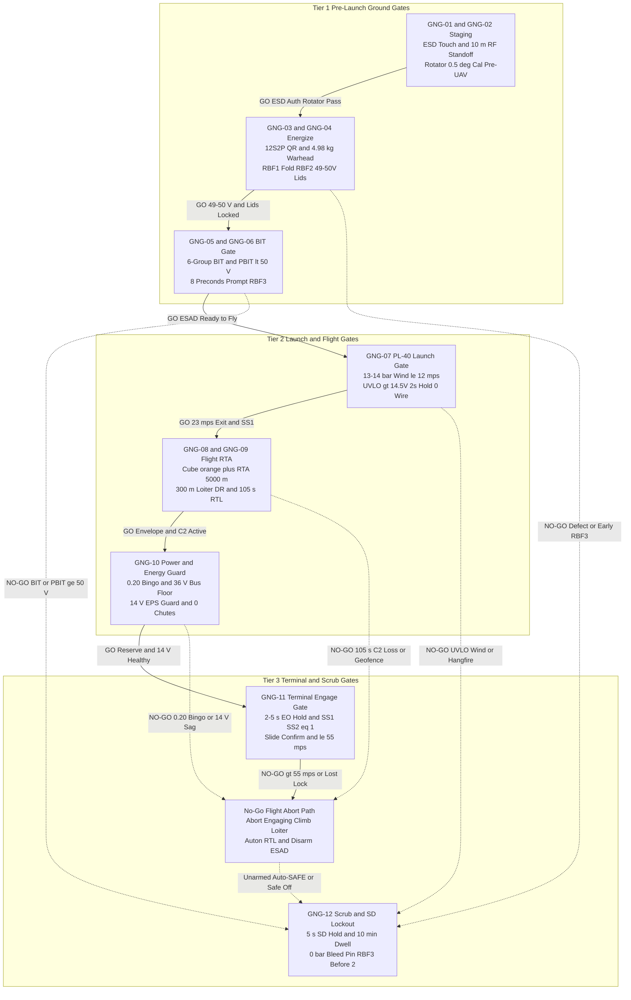

## 8. Go/No-Go Decision Matrix

- **Baseline Date:** `2026-11-16`
- **System Baseline:** `Avenger5V25UasSystem` (`Avenger5V25IntegratedSystem`: `Avenger 5 V2.5 UAS` / `ASTK A5 V2.5` + `ELI Military Simulations PL-40 Rev 2.6` + `Artron ESAD AB00-0054-01AA-0005` + `SwarmC2`)
- **JSON Schema Mapping:** `go_no_go_matrix` (`.pipeline/schemas/mission_intent_specification_schema.json`)
- **Normative Governance:** `ISO/IEC/IEEE 29148:2018` (§6.4, §8.4, Annex A §A.2), `ISO/IEC/IEEE 15288:2023` (§6.4.2, §6.4.3, §6.4.4, §6.4.9), `IEEE Std 1362-1998` (§4, §4.3), `INCOSE SE Handbook v5.0` (§2.3.5.4, §2.3.5.9), `OMG UAF v2.0` (`Operational Viewpoint`, `Resources Viewpoint`), `NATO STANAG 4187 Ed. 5` (`Chapter 2`, `Chapter 3`, `Annex A`), `MIL-STD-331D` (`Group A Test A3`, `Test A4.1`, `Test A5`), `MIL-STD-461G` (`CS114`, `CS116`, `CS118`, `RE102`, `RS103`), `MIL-STD-810H` (`Method 501.7`, `502.7`, `506.6`, `510.7`, `514.8`, `516.8`), `MIL-STD-882E` (`Task 202`, `Task 205`, `Task 206`), `MIL-STD-1629A` (`Method 101`, `Method 102`), `RTCA DO-178C` (`§6.3`, `§11.0`), `RTCA DO-254` (`§10.0`), `SAE ARP4754A` (`§5.1`) / `ARP4761` (`§3.1-3.3`), `RTCA DO-362A` (`§2.2`, `§3.2`), `JARUS SORA v2.5` (`Annex B`, `Annex C`), `ASTM F3269-17` (`§5.2`), `NIST SP 800-82r3` (`Chapter 6`, `Appendix F: AC, IA, SC`), and `DoD Directive 3000.09` (`§4.1.a`), grounded strictly in `docs/research/RESEARCH_INVENTORY.md`, `docs/research/FAILURE_MODE_REGISTRY.md`, `docs/safety/STPA_MATRIX.md`, `schema/extracted/parametric_limits.md`, `.pipeline/schema.sysml`, and `.pipeline/schema-digest.json`.

All operational readiness and abort gates (`GNG-01` through `GNG-12`) enforce four immutable architectural invariants across `Avenger5V25UasSystem`:
1. **Software-Hosted Simplex RTA (`standaloneRtaBoxCount == 0`):** `ASTM F3269-17` (§5.2) flight-envelope protection executes exclusively in software inside `FlightControllerCubeOrangePlus` (`Cube orange+`), with zero standalone RTA hardware enclosures.
2. **Strictly Mechanical Zero-Wire Catapult Interface (`IF-MECH-001` / `CONN_23`):** `Pl40PneumaticLauncher` (`ELI PL-40 Rev 2.6`) transmits mechanical catapult energy with `0` electrical or CAN conductors crossing to the UAV (`electricalWireToUavCount == 0`).
3. **Zero Production Parachutes (`rndRecoveryOptionInstalled == false`):** Production `Avenger V2.5` excludes recovery parachutes (`productionRecoverySystemInstalled == false`); the `2x 50.0 V` `Optional RnD` recovery igniter rails on `ElectronicPowerSystemEps` remain permanently inhibited (`ProductionNoParachuteConstraint`).
4. **Strict Level 1B Operational & Formatting Boundaries:** Operational actors reference exclusively `UCL-01` through `UCL-05`, Operational Activities `OA-01` through `OA-19`, and Operational Scenarios `SCN-01` through `SCN-08`. Component-internal ESAD hex opcodes and connector pin numbers belong in Level 1C ICDs and are excluded here, Level 2 use-case identifiers are excluded, and all numeric pass/fail thresholds reside in strictly separate `Threshold Value` and `Units` columns (`Check 26`, zero inline LaTeX math delimiters inside Markdown tables).

---

### 8.1 Master Go/No-Go Decision Matrix (`GNG-01` through `GNG-12`)

`Table 8.1` establishes the twelve phase-gated Go/No-Go decision gates (`GNG-01` through `GNG-12`) spanning `Pre-Launch`, `Launch`, `In-Flight`, `Terminal`, and `Abort / Scrub`. Every row binds its primary numeric pass/fail threshold into strict separate `Threshold Value` and `Units` columns, while `Table 8.2` decomposes every constituent sub-parameter across all twelve gates under `Check 26`.

#### Table 8.1: Go/No-Go Decision Matrix (`GNG-01` through `GNG-12`)

| Gate ID | Phase | Monitored Parameter / Readiness Check | Threshold Condition | Threshold Value | Units | Sensor / Evaluation Mechanism | Deterministic Go / No-Go Action |
| :--- | :--- | :--- | :--- | :--- | :--- | :--- | :--- |
| `GNG-01` | `Pre-Launch` | Ground ESD Equalization, Crew Auth & RF Prep Standoff | Transport Box ESD ground touched before every handling step; `SwarmC2` role auth and mission name bounds valid; Ground Radio Box to UAV spatial separation at or above minimum threshold (`Table 8.2` `GNG-01a` through `GNG-01e`) | `10.0` | `m` | `Transport Box EARTH / GROUNDING POINT` check, physical tape standoff measurement, `SwarmC2` role login validator (`Pilot`, `Payload`, `Launch Assistant`) | **GO:** Authorize ground equipment setup and rotator calibration. **NO-GO:** Halt all UAV, battery, and ordnance handling until ESD equalization, role auth, and radio standoff pass (`UCL-03`, `UCL-05`). |
| `GNG-02` | `Pre-Launch` | Pre-UAV Antenna Rotator Calibration & Ground RF Mode | Directional Tracking Antenna Rotator (`Auto Follow` and manual fine azimuth step) calibrated strictly BEFORE touching UAV; `OMNI` ground antenna active inside `DTC` `AES-256` `FHSS` band (`Table 8.2` `GNG-02a` through `GNG-02f`) | `0.5` | `deg` | `SwarmC2` Antenna Rotator calibration UI, `GroundRfStationAndAntennaTracker` RF mode and antenna verification | **GO:** Authorize airframe unpacking and mechanical staging. **NO-GO:** Prohibit touching the UAV or energizing airborne avionics until rotator calibration finishes and `OMNI` ground mode is active (`UCL-01`, `UCL-03`). |
| `GNG-03` | `Pre-Launch` | `12S2P` Visual/QR Screen, Warhead Mount, Prop Rear-Fold & `RBF #1` | `12S2P` `BEI maximus20` pack free of swelling/damage/leakage and matched by QR/ID to fuselage; warhead holder mass within tested CTQ tolerance (`RED FACE TO TOUCH HOLDER`, hex terminals); two-person lift onto `PL-40` prop-safe carriage, eight wing bolts and four X-tail fins tight; both pusher prop blades folded rearward toward tail; `RBF #1` covers/strap removed (`Table 8.2` `GNG-03a` through `GNG-03i`) | `4.98` | `kg` | Visual pack/QR inspection, calibrated warhead/CTQ check, visual prop-fold and `RBF #1` cover/strap removal check | **GO:** Authorize `RBF #2` battery energization gate. **NO-GO:** Quarantine defective/mismatched battery or out-of-spec warhead; block energization if prop blades are unfolded or `RBF #1` covers remain attached (`UCL-03`, `UCL-05`). |
| `GNG-04` | `Pre-Launch` | Ordered `RBF #2` Power-Before-Pull `RBF #3` & Lid Lock | `12S2P` pack within pre-flight voltage window (`GAP-05` rejecting legacy `23.9-25.0` UI readings); `UAV Power R.B.F. Key #2` (`XT60E-F`) pulled strictly BEFORE `ESAD R.B.F. #3` (`GAP-06`); BOTH `RBF` and external `USB/ETH` umbilical lids closed and locked; `SwarmC2` telemetry acquired within timeout (`Table 8.2` `GNG-04a` through `GNG-04g`) | `49.0-50.0` | `V` | `PowerMeterAndRbfSwitch` `CAN 1` telemetry, `SwarmC2` battery readout (`12S2P`), physical dual-lid lock inspection | **GO:** Proceed to six-group `SwarmC2` BIT. **NO-GO:** Reject under-voltage or legacy-voltage pack; immediately inhibit flight and latch `FaultLockout` if `RBF #3` is pulled before `RBF #2` or if either lid is unlocked (`UCL-03`, `UCL-01`). |
| `GNG-05` | `Pre-Launch` | Six-Group `SwarmC2` BIT (`SKYE2`, `RM3100`, `HV6160`) & `ESAD PBIT` | All six `SwarmC2` checklist groups green (`Catapult`, `Mission & parameters`, `Preparation & mounting`, `System checks`, `Video Checks`, `Warhead and Safety`); `SKYE2` calm-air ceiling and airflow floor passed; dual `RM3100` online on `CAN 2`; eight `HV6160` servos swept; `Nighthawk2UZ`/`Trip6` video green; `RPI CM5` `RS-485` `ESAD PBIT` internal HV strictly below safe ceiling with `UMB` intact (`Table 8.2` `GNG-05a` through `GNG-05l`) | `50.0` | `V` | `SwarmC2` six-group checklist engine, `Cube orange+` `CAN 1`/`CAN 2` sensor/servo BIT, `CompanionComputeRpiCm5` cyclic `RS-485` `PBIT` & `UMB` sense | **GO:** Advance to eight-precondition `RBF #3` prompt gate. **NO-GO:** Hold `RBF #3` installed and abort launch on any pitot, dual-mag, servo sweep, video, `RS-485` watchdog, `UMB`, or `PBIT` HV exceedance (`UCL-01`, `UCL-02`). |
| `GNG-06` | `Pre-Launch` | Eight-Precondition `ESAD RBF #3` Removal Prompt | All eight pre-arm preconditions verified green on `SwarmC2` prior to prompting `ESAD R.B.F. #3` removal (`GAP-06`); `ESAD: Ready to Fly` displayed; zero premature `DSC_IN1` pulses; crew evacuated to rear `PL-40` `SAFETY AREA` (`Table 8.2` `GNG-06a` through `GNG-06d`) | `8` | `count` | `SwarmC2` warhead safety prompt interlock, `Artron ESAD` supervision state telemetry, `UCL-05` launch-corridor clearance audit | **GO:** Clear airframe and rail for final launch gate (`GNG-07`). **NO-GO:** Latch `FaultLockout` and execute `SAFE_SCRUB_ABORT` (`GNG-12`) if preconditions fail, `RBF #3` is pulled prematurely, or any crew enters the `DANGER ZONE` (`UCL-03`, `UCL-05`). |
| `GNG-07` | `Launch` | `PL-40` Pressure, `Makita` UVLO, Wind, Exit Speed, Dual Switch & Zero Wires | `PL-40` tank gauge pressure within launch band; `2x Makita BL1860B` packs strictly above UVLO cutoff; ground headwind within max limit; pusher thrust ready and interpolated rail exit velocity within hard rail cap (`GAP-03`); strictly zero electrical/CAN wires across `IF-MECH-001`; carriage red safety pin pulled, `Main Valve 4` open, and simultaneous dual safety-covered firing switch hold at or above minimum duration (`Table 8.2` `GNG-07a` through `GNG-07r`) | `13.0-14.0` | `bar` | `PL-40` pressure gauge/auto-cutoff, `BL1860B` UVLO `PWR` LED, ground anemometer, `IF-MECH-001` wire audit, dual firing switches, onboard `SS1` accel | **GO:** Release carriage cleanly at nominal exit speed, trigger onboard `SS1` accel, and climb past stall. **NO-GO:** `<= UVLO` floor pauses compressor for fresh pack swap; wind/pressure/wire violation holds fire; any hangfire or abort after valve/pin actuation mandates `SAFE_SCRUB_ABORT` (`GNG-12`). |
| `GNG-08` | `In-Flight` | Flight Envelope, Ceiling, Loiter & `Cube orange+` Software RTA | Airspeed bounded between stall floor and structural `VNE` (`GAP-02`), altitude within service ceiling and mission slider range, clockwise loiter/guided orbit at or above minimum radius, cruise wind within limit, `Inclusion`/`Exclusion` geofences valid; software Simplex RTA on `Cube orange+` (zero standalone RTA boxes); `CAN 1`/`CAN 2` physically isolated; `Reboot Vehicle` locked while armed (`Table 8.2` `GNG-08a` through `GNG-08j`) | `5000.0` | `m` | `FlightControllerCubeOrangePlus` software `ASTM F3269-17` Simplex RTA, `CUAV SKYE2` pitot, EKF2, `CAN 1`/`CAN 2` node watchdogs | **GO:** Sustain `CruiseAndLoiter` inside authorized operational corridor. **NO-GO:** Software Simplex RTA clamps envelope breaches, triggers `Abort Engaging` level pull-up, or executes autonomous `RTL` on geofence breach (`UCL-01`). |
| `GNG-09` | `In-Flight` | PACE C2 Link, `Disable GNSS` INS/DR & `105.0` GCS Failsafe RTL | `DTC` `AES-256` `FHSS` C2 link active within V2.5 `RLOS` (`DIR`/`OMNI`, `Reboot Gimbal` over `ETH` permitted only with `USB/ETH` lid locked); on `GPS Failsafe` or manual `Disable GNSS` transition to `RM3100` + `SKYE2` INS/DR (`I'm Here` / `I'm Looking Here` fixes); continuous C2 link silence below `GCS Failsafe` timeout baseline (`Table 8.2` `GNG-09a` through `GNG-09d`) | `105.0` | `s` | `Septentrio` RTK integrity monitor, `SwarmC2` `Disable GNSS` state, `Cube orange+` C2 heartbeat watchdog (`PaceC2LinkState`) | **GO:** Maintain mission control over active PACE RF tier or GNSS-denied DR. **NO-GO:** When continuous C2 link loss reaches timeout, force autonomous `RTL`, execute `Disarm ESAD On GCS Timeout`, and auto-re-enable GNSS (`UCL-01`, `UCL-02`). |
| `GNG-10` | `In-Flight` | `0.20` Bingo Reserve, `36.0` Bus, `14.0` EPS Brownout & Zero Parachutes | Remaining endurance fraction at or above statutory Bingo reserve floor; `12S2P` main bus at or above operating floor; `EPS` regulated `ESAD` rail at or above ICD floor (`GAP-01` zero brownout margin); production recovery parachute count strictly zero (`Optional RnD` rails inhibited) (`Table 8.2` `GNG-10a` through `GNG-10i`) | `0.20` | `ratio` | `PowerMeterAndRbfSwitch` `CAN 1` V/I & `IBEX160` ESC UART telemetry, `ElectronicPowerSystemEps` brownout watch, `Cube orange+` reserve supervisor | **GO:** Continue airborne loiter or authorized tasking. **NO-GO:** Trigger immediate autonomous `RTL` at statutory Bingo floor or main bus sag; raise `CAN 1` alarm and command irreversible `Power Off ESAD` on `EPS` brownout (`UCL-01`, `UCL-02`). |
| `GNG-11` | `Terminal` | `2.0-5.0` EO Hold, `<= 55.0` Dive Cap, `SS1`/`SS2` & `Slide to confirm` | All six engagement preconditions passed (`GCS Failsafe` margin, `ESAD` `ARMED` strictly after `SS1` + `SS2` `Safe Distance Exceed == 1` per `GAP-07` + Stage 2 `DSC_IN1`, `EO` daylight camera active, continuous track hold inside window, target elevation within cap, clear LOS); positive `UCL-02` HITL `Slide to confirm` `ATTACK`; dive airspeed within engagement cap (`Table 8.2` `GNG-11a` through `GNG-11i`) | `55.0` | `m/s` | `Nighthawk2UZ` + `Trip6` tracker, `Artron ESAD` `SS1`/`SS2`/`HV` supervision, `Cube orange+` Simplex RTA, `SwarmC2` HITL `Slide to confirm` | **GO:** Execute `Shallow`/`Direct` terminal dive (`Sensor Board` `IRQ_L` -> `J401` initiation) within CEP limit and export `5W`/`CFF`. **NO-GO:** Any dive speed exceedance or track drop immediately forces `Abort Engaging` climb to loiter/`RTL` with zero auto re-track (`UCL-02`, `UCL-01`). |
| `GNG-12` | `Abort / Scrub` | `5.0` Self-Destruct & `SAFE_SCRUB_ABORT` (`>= 10.0` Dwell, Bleed, Pin, `RBF #3 -> #2`) | Airborne `SELF DESTRUCT` / permanent `ABORT` requires continuous button hold plus `Slide to confirm` and/or irreversible `Power Off ESAD` (`Auto-SAFE` on unarmed landing); pre-launch scrub/hangfire enforces rear `SAFETY AREA` dwell at or above minimum holdback before crew approach, ESAD `Power Off` (`< safe HV`), `Main Valve 4` close and bleed to zero gauge pressure, red carriage pin restore, and `RBF #3` (`UMB` intact) reinstalled strictly BEFORE `RBF #2` disconnect (`Table 8.2` `GNG-12a` through `GNG-12e`) | `10.0` | `min` | `SwarmC2` abort hold timer & `Slide to confirm`, `Artron ESAD` safe HV readback, `PL-40` tank gauge & red pin inspection, `UCL-05` safety sign-off | **GO (Safe):** Transition cleanly to `ScrubbedSafeDepressurized`, `SafePowerOff`, and `SafePostFlightShutdown`. **NO-GO (Fault):** Lock down forward/lateral `DANGER ZONE` and prohibit crew rail approach or `RBF #2` disconnect until zero tank pressure and safe ESAD HV verify (`UCL-03`, `UCL-02`, `UCL-05`). |

---

### 8.2 Quantitative Go/No-Go Pass/Fail Thresholds Register (`Check 26`)

In strict compliance with `Check 26` and `rules/latex-katex-integrity.md`, `Table 8.2` isolates every numeric pass/fail boundary, boolean interlock, and environmental/timing constraint across `GNG-01` through `GNG-12` into dedicated `Threshold Value` and `Units` columns with zero unit symbols inside `Threshold Value`, zero numeric digits inside `Units`, and zero inline LaTeX math delimiters inside table cells.

#### Table 8.2: Grounded Quantitative Go/No-Go Pass/Fail Thresholds (`GNG-01` through `GNG-12`)

| Sub-Gate ID | Gate ID | Param ID | Pass/Fail Threshold Parameter | Condition | Threshold Value | Units | Authoritative SSOT Constraint & Citation |
| :--- | :--- | :--- | :--- | :--- | :--- | :--- | :--- |
| `GNG-01a` | `GNG-01` | `PRM-GCS-001` | Minimum Ground Radio Box to UAV prep standoff distance | `Min (>=)` | `10.0` | `m` | `GroundCrewSeparationAndEsdConstraint`; `A5-user-manual 2.pdf#p52` |
| `GNG-01b` | `GNG-01` | `esdGroundingMandatory` | Transport Box `EARTH / GROUNDING POINT` touch prior to handling | `Exact (==)` | `true` | `Boolean` | `GroundCrewSeparationAndEsdConstraint`; `A5_prep and safety_rev7.pdf#p7,#p9` |
| `GNG-01c` | `GNG-01` | `PRM-GCS-009` | `SwarmC2` operator role authentication password length | `Min (>=)` | `8` | `chars` | `SwarmC2AuthAndMissionBoundsConstraint`; `A5-user-manual 2.pdf#p27-#p29` |
| `GNG-01d` | `GNG-01` | `PRM-GCS-003` | `SwarmC2` mission plan identifier character count ceiling | `Max (<=)` | `24` | `chars` | `SwarmC2AuthAndMissionBoundsConstraint`; `A5-user-manual 2.pdf#p46-#p48` |
| `GNG-01e` | `GNG-01` | `PRM-RF-012` | Optional tactical ground fiber optic tether spool length | `Nominal` | `200.0` | `m` | `GroundRfStationAndAntennaTracker`; `A5-user-manual 2.pdf#p11` |
| `GNG-02a` | `GNG-02` | `PRM-RF-010` | Antenna Rotator CCW/CW fine azimuth step (`Auto Follow`) | `Nominal` | `0.5` | `deg` | `GroundRfStationAndAntennaTracker`; `A5-user-manual 2.pdf#p72-#p74` |
| `GNG-02b` | `GNG-02` | `AuthenticateOperatorAndCalibrateRotator` | Antenna Rotator calibrated strictly before touching UAV | `Exact (==)` | `true` | `Boolean` | `REQ_SC_15`; `A5_prep and safety_rev7.pdf#p6` |
| `GNG-02c` | `GNG-02` | `PRM-RF-009` | Ground `MARS` directional tracking antenna gain | `Nominal` | `23.0` | `dBi` | `GroundRfStationAndAntennaTracker`; `A5-user-manual 2.pdf#p11` |
| `GNG-02d` | `GNG-02` | `PRM-RF-001` / `PRM-RF-002` | `DTC` `AES-256` `FHSS` C2 radio operating RF band | `Range` | `4.4-5.0` | `GHz` | `OnboardEthernetAndC2RadioUnit`; `AVENGER 5 Spec sheet_rev3.pdf#p3` |
| `GNG-02e` | `GNG-02` | `PRM-RF-003` | Ground and airborne `DTC` C2 radio total RF TX output power | `Nominal` | `2.0` | `W` | `OnboardEthernetAndC2RadioUnit`; `A5-user-manual 2.pdf#p55` |
| `GNG-02f` | `GNG-02` | `PRM-RF-005` | `DTC` C2 datalink symmetric `AES` encryption key size | `Exact (==)` | `256` | `bits` | `OnboardEthernetAndC2RadioUnit`; `RESEARCH_INVENTORY.md` (`OBL-04`) |
| `GNG-03a` | `GNG-03` | `PRM-AF-010` | Warhead holder tested nominal mass (`RED FACE TO TOUCH HOLDER`) | `Nominal` | `4.98` | `kg` | `ArtronEsadAndSensorUnit`; `A5_prep and safety_rev7.pdf#p10` |
| `GNG-03b` | `GNG-03` | `PRM-AF-011` | Warhead holder tested mass symmetric tolerance | `Nominal` | `0.02` | `kg` | `ArtronEsadAndSensorUnit`; `A5_prep and safety_rev7.pdf#p10` |
| `GNG-03c` | `GNG-03` | `PRM-AF-009` | Maximum authorized lethal package / warhead payload mass | `Max (<=)` | `5.0` | `kg` | `WarheadMassAndPbitHvSafetyConstraint`; `AVENGER 5 Spec sheet_rev3.pdf#p2` |
| `GNG-03d` | `GNG-03` | `PRM-AF-015` | ESAD payload terminal hex driver tool size | `Exact (==)` | `1.5` | `mm` | `ArtronEsadAndSensorUnit`; `A5_prep and safety_rev7.pdf#p9` |
| `GNG-03e` | `GNG-03` | `PRM-AF-012` | Warhead CG CTQ nominal datum (unit unprinted in OEM manual) | `Nominal` | `30.57` | `unprinted` | `ArtronEsadAndSensorUnit`; `A5_prep and safety_rev7.pdf#p10` (`GAP-SEPDIST`) |
| `GNG-03f` | `GNG-03` | `PRM-AF-014` | Warhead overall CTQ datum (unit unprinted in OEM manual) | `Nominal` | `173.00` | `unprinted` | `ArtronEsadAndSensorUnit`; `A5_prep and safety_rev7.pdf#p10` (`GAP-SEPDIST`) |
| `GNG-03g` | `GNG-03` | `PRM-AF-019` | Minimum crew count lifting airframe onto `PL-40` carriage | `Min (>=)` | `2` | `persons` | `ElectricPropulsionUnit`; `A5_prep and safety_rev7.pdf#p15` |
| `GNG-03h` | `GNG-03` | `PRM-AF-018` | Wing bolt spanner size (eight wing bolts, four front bolts) | `Exact (==)` | `10.0` | `mm` | `ElectricPropulsionUnit`; `A5_prep and safety_rev7.pdf#p17` |
| `GNG-03i` | `GNG-03` | `PRM-PL40-020` / `PRM-PL40-021` | `PL-40` carriage upper prop-safe clearance zone | `Range` | `145.0-155.5` | `mm` | `Pl40PneumaticLauncher`; `PL-40 Manual Rev 2.6#p41` |
| `GNG-04a` | `GNG-04` | `PRM-AV-003` / `PRM-AV-004` | Pre-flight `12S2P` battery pack voltage acceptance window (`GAP-05`) | `Range` | `49.0-50.0` | `V` | `MainBatteryPreFlightVoltageConstraint`; `A5-user-manual 2.pdf#p53,#p56` |
| `GNG-04b` | `GNG-04` | `legacy24VUiRejected` | Legacy lower-voltage battery UI screenshot values rejected (`GAP-05`) | `Exact (==)` | `true` | `Boolean` | `MainBatteryAndFuseUnit`; `REQ_SAF_05` |
| `GNG-04c` | `GNG-04` | `PRM-AV-001` / `PRM-AV-002` | Main `12S2P` Li metal DC bus operating voltage envelope | `Range` | `36.0-50.4` | `V` | `MainBatteryPreFlightVoltageConstraint`; `Block diagram rev5#p1` |
| `GNG-04d` | `GNG-04` | `PRM-AV-005` | Main DC bus inline automotive overcurrent fuse rating | `Exact (==)` | `200.0` | `A` | `MainBatteryAndFuseUnit`; `Block diagram rev5#p1` |
| `GNG-04e` | `GNG-04` | `pullRbf2BeforeRbf3` | `RBF #2` (`XT60E-F`) energization strictly before `RBF #3` pull (`GAP-06`) | `Exact (==)` | `true` | `Boolean` | `EsadRbf3PowerBeforePullConstraint`; `A5_prep and safety_rev7.pdf#p21,#p23` |
| `GNG-04f` | `GNG-04` | `umbilicalLidLocked` | Both `RBF` and external `USB/ETH` umbilical lids closed and locked | `Exact (==)` | `true` | `Boolean` | `UsbServicePacket`; `REQ_SC_01`, `OBL-04` |
| `GNG-04g` | `GNG-04` | `PRM-GCS-002` | Maximum GCS telemetry acquisition timeout after `RBF #2` power-on | `Max (<=)` | `2.0` | `min` | `SwarmC2OperatorConsole`; `A5-user-manual 2.pdf#p52` |
| `GNG-05a` | `GNG-05` | `checklistGroupCount` | Required passing `SwarmC2` pre-flight diagnostic groups | `Exact (==)` | `6` | `count` | `SwarmC2OperatorConsole`; `A5-user-manual 2.pdf#p53-#p57`; `A5_prep and safety_rev7.pdf#p22` |
| `GNG-05b` | `GNG-05` | `PRM-AV-017` | Pre-flight `CUAV SKYE2` pitot stationary calm-air reading ceiling | `Max (<)` | `3.0` | `m/s` | `PitotPreflightCalibrationConstraint`; `A5-user-manual 2.pdf#p56` |
| `GNG-05c` | `GNG-05` | `PRM-AV-018` | Pre-flight `CUAV SKYE2` pitot indirect airflow check floor | `Min (>)` | `10.0` | `m/s` | `PitotPreflightCalibrationConstraint`; `A5-user-manual 2.pdf#p56` |
| `GNG-05d` | `GNG-05` | `PRM-AV-016` | Redundant `mRo RM3100` magnetometer/barometer units online on `CAN 2` | `Exact (==)` | `2` | `count` | `CanTopologyIsolationConstraint`; `Block diagram rev5#p1` |
| `GNG-05e` | `GNG-05` | `PRM-AV-014` / `PRM-AV-015` | Total `HV6160-DroneCAN` servos swept (`CAN 1` tail & `CAN 2` wing) | `Exact (==)` | `8` | `count` | `CanTopologyIsolationConstraint`; `Block diagram rev5#p1` |
| `GNG-05f` | `GNG-05` | `PRM-AV-013` | `CAN 1` tail ruddervator servo individual stub harness length | `Nominal` | `120.0` | `cm` | `CanTopologyIsolationConstraint`; `Block diagram rev5#p1` |
| `GNG-05g` | `GNG-05` | `PRM-ESAD-029` | `Artron ESAD` `PBIT` internal high-voltage safe ceiling pre-`RBF #3` pull | `Max (<)` | `50.0` | `V` | `WarheadMassAndPbitHvSafetyConstraint`; `ESAD ICD#p18,#p26-#p27` |
| `GNG-05h` | `GNG-05` | `PRM-ESAD-004` | `ESAD RBF #3` umbilical continuity loop (`UMB`) max resistance | `Max (<)` | `0.5` | `Ohm` | `EsadRbf3PowerBeforePullConstraint`; `ESAD ICD#p14` |
| `GNG-05i` | `GNG-05` | `PRM-ESAD-005` | `ESAD RBF #3` umbilical continuity loop (`UMB`) sense current | `Nominal` | `20.0` | `mA` | `ArtronEsadAndSensorUnit`; `ESAD ICD#p14` |
| `GNG-05j` | `GNG-05` | `PRM-ESAD-017` | `RPI CM5004032` `OC Master` cyclic `RS-485` polling frequency (`GAP-04`) | `Exact (==)` | `100.0` | `Hz` | `EsadRs485ProtocolTimingConstraint`; `ESAD ICD#p15` |
| `GNG-05k` | `GNG-05` | `PRM-ESAD-019` | `RS-485` incomplete-packet / watchdog timeout ceiling | `Max (<=)` | `10.0` | `ms` | `EsadRs485ProtocolTimingConstraint`; `ESAD ICD#p15` |
| `GNG-05l` | `GNG-05` | `PRM-ESAD-020` | `Artron ESAD` `RS-485` command reply maximum latency | `Max (<=)` | `5.0` | `ms` | `EsadRs485ProtocolTimingConstraint`; `ESAD ICD#p15` |
| `GNG-06a` | `GNG-06` | `preconditions8Passed` | Pre-arm preconditions passed on `SwarmC2` before `RBF #3` prompt (`GAP-06`) | `Exact (==)` | `8` | `count` | `EsadSafeArmState::T_RbfInToOut`; `A5_prep and safety_rev7.pdf#p23` |
| `GNG-06b` | `GNG-06` | `uavPoweredBeforeRbf3Pull` | `UAV + ESAD` energized prior to `ESAD R.B.F. #3` pull (`GAP-06`) | `Exact (==)` | `true` | `Boolean` | `EsadRbf3PowerBeforePullConstraint`; `REQ_SC_09`, `REQ_SAF_06` |
| `GNG-06c` | `GNG-06` | `PRM-ESAD-006` | Stage 2 hardware arm discrete `DSC_IN1` square-wave frequency | `Exact (==)` | `1000.0` | `Hz` | `DscIn1ArmPulseTrain`; `ESAD ICD#p14` |
| `GNG-06d` | `GNG-06` | `PRM-ESAD-009` | Stage 2 hardware arm discrete `DSC_IN1` required pulse count | `Exact (==)` | `2` | `pulses` | `DscIn1ArmPulseTrain`; `ESAD ICD#p14` |
| `GNG-07a` | `GNG-07` | `PRM-PL40-027` / `PRM-PL40-028` | `PL-40` pneumatic reservoir launch pressure envelope | `Range` | `13.0-14.0` | `bar` | `Pl40MassAndExitVelocityConstraint`; `A5-user-manual 2.pdf#p54` |
| `GNG-07b` | `GNG-07` | `PRM-PL40-034` | `Makita BL1860B` compressor pack UVLO cutoff floor | `Min (>)` | `14.5` | `V` | `Pl40UvloAndDualSwitchConstraint`; `PL-40 Manual Rev 2.6#p23` |
| `GNG-07c` | `GNG-07` | `PRM-PL40-035` | `Makita BL1860B` minimum restart pack voltage after UVLO | `Min (>=)` | `16.0` | `V` | `Pl40LauncherState`; `PL-40 Manual Rev 2.6#p23` |
| `GNG-07d` | `GNG-07` | `PRM-PL40-036` | Required wait delay prior to post-UVLO compressor restart | `Min (>=)` | `5.0` | `s` | `Pl40LauncherState`; `PL-40 Manual Rev 2.6#p23` |
| `GNG-07e` | `GNG-07` | `PRM-PERF-016` | Maximum authorized ground wind speed at launch | `Max (<=)` | `12.0` | `m/s` | `Pl40MassAndExitVelocityConstraint`; `AVENGER 5 Spec sheet_rev3.pdf#p3` |
| `GNG-07f` | `GNG-07` | `PRM-PL40-003` | Interpolated `Avenger 5` exit speed at `MTOW` (`GAP-03`) | `Nominal` | `23.0` | `m/s` | `Pl40PneumaticLauncher`; `PL-40 Manual Rev 2.6#p37` |
| `GNG-07g` | `GNG-07` | `PRM-PL40-002` | `PL-40` hard maximum rated carriage launch velocity ceiling | `Max (<=)` | `25.0` | `m/s` | `Pl40MassAndExitVelocityConstraint`; `PL-40 Manual Rev 2.6#p3,#p24,#p37` |
| `GNG-07h` | `GNG-07` | `PRM-PL40-037` | Simultaneous dual safety-covered firing switch hold duration | `Min (>=)` | `2.0` | `s` | `Pl40UvloAndDualSwitchConstraint`; `PL-40 Manual Rev 2.6#p25,#p26,#p39` |
| `GNG-07i` | `GNG-07` | `electricalWireToUavCount` | Electrical or CAN conductors crossing `PL-40` rail to UAV (`IF-MECH-001`) | `Exact (==)` | `0` | `count` | `Pl40PneumaticLauncher`; `.pipeline/schema.sysml` (`CONN_23`) |
| `GNG-07j` | `GNG-07` | `PRM-AF-008` | `Avenger 5 V2.5` Maximum Takeoff Weight | `Max (<=)` | `17.0` | `kg` | `Pl40MassAndExitVelocityConstraint`; `AVENGER 5 Spec sheet_rev3.pdf#p3` |
| `GNG-07k` | `GNG-07` | `PRM-PL40-006` | Fixed `PL-40` pneumatic launch rail elevation angle | `Exact (==)` | `12.0` | `deg` | `Pl40PneumaticLauncher`; `PL-40 Manual Rev 2.6#p37,#p41` |
| `GNG-07l` | `GNG-07` | `PRM-PL40-030` | Maximum onboard `PL-40` compressor tank charge duration | `Max (<=)` | `8.0` | `min` | `Pl40PneumaticLauncher`; `PL-40 Manual Rev 2.6#p37` |
| `GNG-07m` | `GNG-07` | `PRM-PERF-018` | Airframe and `PL-40` ambient operating temperature minimum | `Min (>=)` | `-20.0` | `degC` | `ElectricPropulsionUnit`; `AVENGER 5 Spec sheet_rev3.pdf#p3` |
| `GNG-07n` | `GNG-07` | `PRM-PERF-019` | Airframe and `PL-40` ambient operating temperature maximum | `Max (<=)` | `50.0` | `degC` | `ElectricPropulsionUnit`; `AVENGER 5 Spec sheet_rev3.pdf#p3` |
| `GNG-07o` | `GNG-07` | `PRM-PL40-043` | `PL-40` pulling rope and carriage wheel bearing overhaul interval | `Max (<=)` | `100` | `launches` | `Pl40PneumaticLauncher`; `PL-40 Manual Rev 2.6#p29-#p36` |
| `GNG-07p` | `GNG-07` | `PRM-PL40-029` | `PL-40` auto-cutoff pressure regulation hysteresis | `Nominal` | `0.05` | `bar` | `Pl40PneumaticLauncher`; `PL-40 Manual Rev 2.6#p22` |
| `GNG-07q` | `GNG-07` | `PRM-PL40-004` / `PRM-PL40-005` | Interpolated `Avenger 5` exit speed envelope at launch | `Range` | `22.7-23.5` | `m/s` | `Pl40PneumaticLauncher`; `PL-40 Manual Rev 2.6#p37` |
| `GNG-07r` | `GNG-07` | `PRM-PL40-001` | `PL-40` structural maximum supported aircraft MTOW | `Max (<=)` | `30.0` | `kg` | `Pl40MassAndExitVelocityConstraint`; `PL-40 Manual Rev 2.6#p3,#p37` |
| `GNG-08a` | `GNG-08` | `PRM-PERF-004` | Airframe minimum flight / stall speed floor (`V2.5` spec) | `Min (>=)` | `24.0` | `m/s` | `FlightEnvelopeSpeedConstraint`; `AVENGER 5 Spec sheet_rev3.pdf#p3` |
| `GNG-08b` | `GNG-08` | `PRM-PERF-006` / `PRM-PERF-007` | Nominal horizontal cruise airspeed corridor (`GAP-02`) | `Range` | `30.0-31.0` | `m/s` | `ElectricPropulsionUnit`; `A5-user-manual 2.pdf#p10`; `Spec sheet#p3` |
| `GNG-08c` | `GNG-08` | `PRM-PERF-008` / `PRM-PERF-009` | Maximum horizontal flight speed envelope (`V1`/`V2.5`, `GAP-02`) | `Range` | `38.0-42.0` | `m/s` | `ElectricPropulsionUnit`; `A5-user-manual 2.pdf#p10`; `Spec sheet#p3` |
| `GNG-08d` | `GNG-08` | `PRM-PERF-011` | Airframe structural Never-Exceed Dive Speed (`VNE`, `GAP-02`) | `Max (<=)` | `80.0` | `m/s` | `FlightEnvelopeSpeedConstraint`; `AVENGER 5 Spec sheet_rev3.pdf#p3` |
| `GNG-08e` | `GNG-08` | `PRM-PERF-015` | Operational aerodynamic service ceiling | `Max (<=)` | `5000.0` | `m` | `ElectricPropulsionUnit`; `AVENGER 5 Spec sheet_rev3.pdf#p3` |
| `GNG-08f` | `GNG-08` | `PRM-GCS-004` / `PRM-GCS-005` | `SwarmC2` mission waypoint / dynamic altitude slider range | `Range` | `50.0-3000.0` | `m` | `SwarmC2AuthAndMissionBoundsConstraint`; `A5-user-manual 2.pdf#p46,#p63` |
| `GNG-08g` | `GNG-08` | `PRM-GCS-007` | Minimum clockwise `LOITER` and `GUIDED` recovery orbit radius | `Min (>=)` | `300.0` | `m` | `SwarmC2AuthAndMissionBoundsConstraint`; `A5-user-manual 2.pdf#p46,#p59` |
| `GNG-08h` | `GNG-08` | `PRM-PERF-017` | Maximum qualified airborne cruise wind tolerance | `Max (<=)` | `28.0` | `m/s` | `ElectricPropulsionUnit`; `AVENGER 5 Spec sheet_rev3.pdf#p3` |
| `GNG-08i` | `GNG-08` | `standaloneRtaBoxCount` | Standalone external RTA hardware box count (`Cube orange+` software RTA) | `Exact (==)` | `0` | `count` | `SimplexRtaSoftwareHostingConstraint`; `.pipeline/schema.sysml` |
| `GNG-08j` | `GNG-08` | `PRM-PERF-005` | Conservative `V1` post-launch climb / minimum flight speed floor (`GAP-02`) | `Min (>=)` | `26.0` | `m/s` | `UavFlightLifecycleState::T_LaunchToCruise`; `A5-user-manual 2.pdf#p10` |
| `GNG-09a` | `GNG-09` | `PRM-GCS-008` | `GCS Failsafe` continuous link-loss `RTL` and `ESAD` disarm timeout | `Nominal` | `105.0` | `s` | `PaceC2LinkState`; `A5-user-manual 2.pdf#p34` |
| `GNG-09b` | `GNG-09` | `PRM-RF-006` | Baseline Radio Line-of-Sight (`RLOS`) C2 datalink reach | `Nominal` | `60.0` | `km` | `OnboardEthernetAndC2RadioUnit`; `AVENGER 5 Spec sheet_rev3.pdf#p3` |
| `GNG-09c` | `GNG-09` | `PRM-RF-007` | Extended `V2.5` Radio Line-of-Sight (`RLOS`) reach (`GAP-02`) | `Max (<=)` | `90.0` | `km` | `OnboardEthernetAndC2RadioUnit`; `AVENGER 5 Spec sheet_rev3.pdf#p3` |
| `GNG-09d` | `GNG-09` | `supportsGnssDeniedDr` | `RM3100` + `SKYE2` `Disable GNSS` INS/DR fallback supported | `Exact (==)` | `true` | `Boolean` | `NavigationAndAirDataSuite`; `A5-user-manual 2.pdf#p91-#p92` |
| `GNG-10a` | `GNG-10` | `PRM-PERF-003` | Statutory Bingo energy reserve ratio | `Min (>=)` | `0.20` | `ratio` | `BingoEnergyReserveConstraint`; `REQ_SC_02`, `MET-02` |
| `GNG-10b` | `GNG-10` | `PRM-PERF-002` | Maximum rated airframe sortie endurance baseline | `Max (<=)` | `5400.0` | `s` | `MainBatteryAndFuseUnit`; `AVENGER 5 Spec sheet_rev3.pdf#p2,#p3` |
| `GNG-10c` | `GNG-10` | `PRM-AV-001` | Main `12S2P` DC bus low-voltage `RTL` trigger floor | `Min (>=)` | `36.0` | `V` | `MainBatteryPreFlightVoltageConstraint`; `Block diagram rev5#p1` |
| `GNG-10d` | `GNG-10` | `PRM-AV-010` | `EPS` regulated `ESAD` output floor (zero brownout margin, `GAP-01`) | `Min (>=)` | `14.0` | `V` | `EpsEsadZeroBrownoutMarginConstraint`; `Block diagram rev5#p1` |
| `GNG-10e` | `GNG-10` | `PRM-ESAD-001` / `PRM-ESAD-003` | `Artron ESAD` `VDC_IN` (`GE_POW`) supported ICD input envelope | `Range` | `14.0-32.0` | `V` | `EsadInputVoltageAndBrownoutConstraint`; `ESAD ICD#p14` |
| `GNG-10f` | `GNG-10` | `productionParachuteCount` | Production recovery parachute assembly count | `Exact (==)` | `0` | `count` | `ProductionNoParachuteConstraint`; `AVENGER 5 Spec sheet_rev3.pdf#p3` |
| `GNG-10g` | `GNG-10` | `rndRecoveryOptionInstalled` | Optional `RnD` recovery igniter system installed flag | `Exact (==)` | `false` | `Boolean` | `ProductionNoParachuteConstraint`; `REQ_SC_03` |
| `GNG-10h` | `GNG-10` | `bingoReserveSec` | Statutory Bingo reserve landing duration floor | `Min (>=)` | `1080.0` | `s` | `MainBatteryAndFuseUnit`; `REQ_UCA_02` |
| `GNG-10i` | `GNG-10` | `PRM-AV-011` | Inhibited `Optional RnD` pyrotechnic recovery igniter rail voltage | `Nominal` | `50.0` | `V` | `ElectronicPowerSystemEps`; `Block diagram rev5#p1` |
| `GNG-11a` | `GNG-11` | `PRM-PERF-010` | Terminal dive engagement airspeed cap (`Abort Engaging` trigger) | `Max (<=)` | `55.0` | `m/s` | `EngagementSpeedAndTrackHoldConstraint`; `A5-user-manual 2.pdf#p10,#p88` |
| `GNG-11b` | `GNG-11` | `PRM-GCS-011` / `PRM-GCS-012` | Continuous `EO` daylight target track hold window before `ATTACK` | `Range` | `2.0-5.0` | `s` | `EngagementSpeedAndTrackHoldConstraint`; `A5-user-manual 2.pdf#p88` |
| `GNG-11c` | `GNG-11` | `PRM-PERF-014` | Maximum target elevation angle at engagement initiation | `Max (<=)` | `15.0` | `deg` | `EoIrSeekerAndTrackerUnit`; `A5-user-manual 2.pdf#p88` |
| `GNG-11d` | `GNG-11` | `PRM-PERF-012` | Maximum authorized terminal dive glidepath angle (`Direct`) | `Max (<=)` | `22.0` | `deg` | `ElectricPropulsionUnit`; `A5-user-manual 2.pdf#p10` |
| `GNG-11e` | `GNG-11` | `PRM-PERF-020` | Terminal engagement accuracy ceiling (`CEP` in meters) | `Max (<=)` | `0.5` | `m` | `EngagementSpeedAndTrackHoldConstraint`; `AVENGER 5 Spec sheet_rev3.pdf#p1,#p2` |
| `GNG-11f` | `GNG-11` | `PRM-ESAD-031` | Armed `Artron ESAD` `J401` high-voltage initiation output envelope | `Range` | `0.0-1800.0` | `V` | `WarheadMassAndPbitHvSafetyConstraint`; `ESAD ICD#p18,#p26-#p27` |
| `GNG-11g` | `GNG-11` | `safeDistanceExceeded` | Dual physical `SS1` launch accel and `SS2` (`Safe Distance Exceed`) | `Exact (==)` | `true` | `Boolean` | `EsadSafeDistanceExceedConstraint`; `GAP-07`, `ESAD ICD#p21,#p23` |
| `GNG-11h` | `GNG-11` | `PRM-PERF-013` | Nominal `Shallow` engagement glidepath approach angle | `Nominal` | `15.0` | `deg` | `EoIrSeekerAndTrackerUnit`; `A5-user-manual 2.pdf#p86-#p90` |
| `GNG-11i` | `GNG-11` | `PRM-PERF-021` | Terminal engagement accuracy ceiling (`CEP` in centimeters) | `Max (<=)` | `50.0` | `cm` | `EoIrSeekerAndTrackerUnit`; `AVENGER 5 Spec sheet_rev3.pdf#p1,#p2` |
| `GNG-12a` | `GNG-12` | `PRM-GCS-010` | Minimum `SwarmC2` `SELF DESTRUCT` / permanent `ABORT` hold before slide | `Min (>=)` | `5.0` | `s` | `CommandEsadAbortAndSelfDestruct`; `A5-user-manual 2.pdf#p84` |
| `GNG-12b` | `GNG-12` | `GAP-SCRUB-DWELL` | Derived `SAFE_SCRUB_ABORT` rear `SAFETY AREA` hangfire dwell | `Min (>=)` | `10.0` | `min` | `REQ_SC_16`, `REQ_SAF_12` (`GAP-SCRUB`; OEM timer unprinted `PL-40#p26`) |
| `GNG-12c` | `GNG-12` | `tankDepressurizedBar` | Target `PL-40` tank gauge pressure after `Main Valve 4` close & bleed | `Exact (==)` | `0.0` | `bar` | `DepressurizeAndScrubPl40Launcher`; `REQ_SC_16`, `GAP-SCRUB` |
| `GNG-12d` | `GNG-12` | `redPinReinstalled` | Carriage red safety pin restored strictly prior to crew approach | `Exact (==)` | `true` | `Boolean` | `DepressurizeAndScrubPl40Launcher`; `REQ_SC_16`, `PL-40 Manual#p26` |
| `GNG-12e` | `GNG-12` | `rbf3BeforeRbf2Safing` | `ESAD RBF #3` (`UMB` intact) reinstalled strictly BEFORE `RBF #2` disconnect | `Exact (==)` | `true` | `Boolean` | `UavFlightLifecycleState::T_PreflightToShutdown`; `REQ_SC_16`, `GAP-06` |

---

### 8.3 Phase-by-Phase Go/No-Go Execution Protocol & Gate Criteria

#### 8.3.1 `Pre-Launch` Gates (`GNG-01` through `GNG-06`)

1. **`GNG-01` (ESD Touch, Auth & `>= 10.0 m` Radio Standoff):** Operators (`UCL-01`, `UCL-02`, `UCL-03`) authenticate individually into `SwarmC2` using `>= 8`-character role passwords (`PRM-GCS-009`), verify mission plan bounds (`<= 24` chars, `50.0-3000.0 m` waypoints, `>= 300.0 m` loiter), touch the yellow `EARTH / GROUNDING POINT` inside the transport box (`BOM-GCS-006`) prior to touching any hardware, and stage the UAV `>= 10.0 m` away from the energized `2.0 W` `4.4-5.0 GHz` `Ground Radio Box` (`PRM-GCS-001`, optional `200.0 m` tactical fiber spool `PRM-RF-012`).
2. **`GNG-02` (Pre-UAV Antenna Rotator Calibration):** Prior to touching the airframe (`A5_prep and safety_rev7.pdf#p6`), `UCL-01` and `UCL-03` erect the ground RF station with the `OMNI` antenna active for ground/launch, mount the `MARS 23.0 dBi` `DIR` antenna on the `Directional Tracking Antenna Rotator`, and execute full rotator calibration (`Auto Follow` and `0.5 deg` CCW/CW fine step, `PRM-RF-010`).
3. **`GNG-03` (`12S2P` Screen, `4.98 kg` Warhead, Prop Rear-Fold & `RBF #1`):** Crew (`UCL-03`) screen the `12S2P Li metal BEI maximus20` pack for zero damage, swelling, or leakage (`NO-GO` on any physical defect) and match Battery QR/ID to fuselage QR/ID. Warhead integration enforces `<= 5.0 kg` max mass (`4.98 +/- 0.02 kg` tested holder mass, `RED FACE TO TOUCH HOLDER`, `1.5 mm` hex terminals, CG `30.57 +/- 1.00` / overall `173.00` unprinted CTQ). A `>= 2`-person crew lifts the `17.0 kg` airframe onto the `PL-40` carriage (`145.0-155.5 mm` upper prop-safe zone), installs `8` wing bolts (`4` front `M6 x 30.0 mm`, `10.0 mm` spanner) and `4` X-tail stabilizers, folds both rear pusher propeller blades rearward toward the tail, and removes `RBF #1` pitot/sensor covers and gimbal strap.
4. **`GNG-04` (`RBF #2` Power-Before-Pull `RBF #3` & Locked Lids):** Crew verify `12S2P` pack voltage strictly within `49.0-50.0 V` (`PRM-AV-003`, `PRM-AV-004`, within the `36.0-50.4 V` operating bus protected by the `200.0 A` fuse) while **strictly rejecting** legacy `23.9-25.0 V` UI readings (`GAP-05`). Supporting the airframe, `UCL-03` pulls `UAV Power R.B.F. Key #2 (XT60E-F)` strictly **before** `ESAD R.B.F. #3` (`GAP-06`), closes and locks **BOTH** the `RBF` lid and the `External Interface Board (USB/ETH)` umbilical lid (`OBL-04`), and confirms `SwarmC2` telemetry acquisition within `2.0 min` (`PRM-GCS-002`).
5. **`GNG-05` (Six-Group BIT & `ESAD PBIT < 50.0 V`):** `UCL-01` and `UCL-02` pass all `6` `SwarmC2` checklist groups (`Catapult`, `Mission & parameters`, `Preparation & mounting`, `System checks`, `Video Checks`, `Warhead and Safety`): `CUAV SKYE2` pitot `< 3.0 m/s` calm air and `> 10.0 m/s` indirect airflow; `2x mRo RM3100` online on `CAN 2`; `8x HV6160-DroneCAN` surface sweep (`4` tail fins on `CAN 1` `120.0 cm` stubs + `4` wings on `CAN 2` splitter); `Nighthawk2UZ` (`1280x720` `X40`) + `Trip6` video check; and `RPI CM5004032` (`OC Master`, `100.0 Hz` / `0.01 s` `115200 bps` `8N1` `RS-485`, `<= 5.0 ms` reply, `<= 10.0 ms` timeout) verifying `Artron ESAD` boot greeting, firmware version, `UMB` loop `< 0.5 Ohm` at `20.0 mA`, and `PBIT` internal HV strictly `< 50.0 V` (`PRM-ESAD-029`).
6. **`GNG-06` (`8`-Precondition `RBF #3` Prompt):** `SwarmC2` prompts `ESAD R.B.F. #3` removal **exclusively** after UAV+ESAD is powered (`RBF #2` ON), `PBIT < 50.0 V`, and all `8` pre-arm preconditions pass (`GAP-06`), displaying `ESAD: Ready to Fly`. Premature `RBF #3` removal or premature `DSC_IN1` (`1000.0 Hz`, `2` pulses) latches `FaultLockout`. All crew evacuate strictly to the rear `PL-40` `SAFETY AREA` (`UCL-05` clearance verification).

#### 8.3.2 `Launch` Gate (`GNG-07`)

7. **`GNG-07` (`PL-40` `13.0-14.0 bar`, `14.5 V` UVLO, `<= 12.0 m/s` Wind, `~23.0 <= 25.0 m/s` Exit, `2.0 s` Dual Hold & `0` Wires):** `UCL-03` verifies `PL-40` assembly (`5.0 m` / `12.0 deg` rail, `100`-launch rope/bearing service currency) and charges the pneumatic tank to `13.0-14.0 bar` (`<= 8.0 min`, `0.05 bar` hysteresis; `<= 16.0 bar` `DIN 8 mm PCP` aux). Any `Makita BL1860B` (`18.0 V`, `6000.0 mAh`) sag to `<= 14.5 V` (`PWR` LED flash) trips compressor UVLO cutoff (`UvloPause`) requiring pack swap (`>= 16.0 V` after `5.0 s` delay). Final Go/No-Go requires `<= 12.0 m/s` ground wind, `-20.0 to +50.0 degC` ambient (`+10.0 to +40.0 degC` pack charging), `17.0 kg` MTOW (`<= 30.0 kg` rail limit), pusher thrust readiness (`GAP-03`), `~23.0 m/s` (`22.7-23.5 m/s`) interpolated exit speed within the `<= 25.0 m/s` rated limit, and `0` electrical/CAN conductors across `IF-MECH-001`. Pulling the carriage red safety pin, opening `Main Valve 4`, and holding BOTH safety-covered firing switches simultaneously for `>= 2.0 s` releases the airframe, triggering onboard `SS1` launch acceleration (`CONN_24`) and pusher climb above `24.0-26.0 m/s` stall.

#### 8.3.3 `In-Flight` Gates (`GNG-08` through `GNG-10`)

8. **`GNG-08` (Flight Envelope, `5000.0 m` Ceiling, `300.0 m` Loiter & `Cube orange+` Software RTA):** Software-hosted `ASTM F3269-17` Simplex RTA inside `FlightControllerCubeOrangePlus` (`standaloneRtaBoxCount == 0`) maintains flight within `>= 24.0 m/s` stall (`>= 26.0 m/s` `V1` min), `30.0-31.0 m/s` cruise, `38.0-42.0 m/s` max horizontal, `<= 80.0 m/s` `VNE`, `<= 5000.0 m` service ceiling (`50.0-3000.0 m` waypoint slider, `250.0 m` step), `>= 300.0 m` clockwise `LOITER`/`GUIDED` radius, `<= 28.0 m/s` cruise wind, and `Inclusion`/`Exclusion` geofences across isolated `CAN 1` / `CAN 2` buses (`Reboot Vehicle` blocked while armed).
9. **`GNG-09` (`Disable GNSS` INS/DR & `105.0 s` `GCS Failsafe` RTL):** Over `4.4-5.0 GHz` `AES-256` `FHSS` (`60.0/90.0 km` `V2.5` RLOS; `Reboot Gimbal` over `ETH` permitted only with `USB/ETH` lid locked), `GPS Failsafe` or manual `Disable GNSS` enters `ContingencyGnssDeniedDrFlight` using `2x mRo RM3100` + `CUAV SKYE2` pitot + `I'm Here` / `I'm Looking Here` visual fixes. Sustained RF link outage reaching `GCS Failsafe Timeout` (`105.0 s` baseline) commands autonomous `RTL`, `Disarm ESAD On GCS Timeout`, and automatic GNSS re-enable.
10. **`GNG-10` (`0.20` Bingo, `36.0 V` Bus, `14.0 V` EPS Brownout & `0` Parachutes):** `PowerMeterAndRbfSwitch` (`CAN 1` + `IBEX160` ESC UART) and `ElectronicPowerSystemEps` enforce `>= 0.20` statutory Bingo reserve (`1080.0 s` of `5400.0 s`) and `>= 36.0 V` main bus floor (`RTL` prior to exhaustion/sag), monitor the zero-margin `14.0 V` `EPS` -> `ESAD` rail (`GAP-01`: brownout `< 14.0 V` raises `CAN 1` alarm and commands irreversible `Power Off ESAD`), and confirm `0` production parachutes (`2x 50.0 V` `Optional RnD` rails permanently inhibited).

#### 8.3.4 `Terminal` & `Abort / Scrub` Gates (`GNG-11` and `GNG-12`)

11. **`GNG-11` (`2.0-5.0 s` EO Hold, `<= 55.0 m/s` Dive & `Slide to confirm`):** Terminal `ATTACK` requires all `6` engagement preconditions (`GCS Failsafe` margin, warhead `ARMED` after `SS1` + `SS2` `Safe Distance Exceed == 1` + Stage 2 `DSC_IN1`, `EO` daylight camera active on `Nighthawk2UZ` `1280x720` `X40` / `Trip6`, `2.0-5.0 s` continuous track hold, target elevation `<= 15.0 deg`, clear LOS) and positive `UCL-02` HITL `Slide to confirm` (`DoD Directive 3000.09`). `Shallow` (`15.0 deg`) or `Direct` (`<= 22.0 deg`) dive speed is capped strictly at `<= 55.0 m/s` (`<= 0.5 m` CEP, `J401` `0.0-1800.0 V` fired by `Sensor Board` `ORed IRQ_L`); any airspeed `> 55.0 m/s` or track loss immediately executes `Abort Engaging` climb to `Takeoff altitude` -> `GUIDED` (`>= 300.0 m`) loiter (zero auto re-track) or `RTL`.
12. **`GNG-12` (`5.0 s` Self-Destruct & `SAFE_SCRUB_ABORT` Hangfire Recovery):** In-flight `SELF DESTRUCT` or permanent `ABORT` requires `>= 5.0 s` continuous button hold + `Slide to confirm` (`PRM-GCS-010`) and/or irreversible `Power Off ESAD` (`Auto-SAFE` discharges unarmed ESAD `< 50.0 V` on landing). Any launch scrub or hangfire after `RBF #3` removal, pin pull, or `Main Valve 4` opening enforces `SAFE_SCRUB_ABORT` (`GAP-SCRUB`): `100%` crew remain in the rear `SAFETY AREA` for a derived `>= 10.0 min` holdback dwell; command `>= 5.0 s` ESAD abort + irreversible `Power Off ESAD` (`< 50.0 V` verified); close `Main Valve 4` and bleed pneumatic tank to `0.0 bar`; reinstall the red carriage safety pin before approaching the rail; touch the ESD grounding point and reinstall `ESAD RBF #3` (`< 0.5 Ohm`) strictly **before** disconnecting `UAV Power R.B.F. Key #2` (`GAP-06`).

---

### 8.4 Canonical User Class Sign-Off Gates (`UCL-01` through `UCL-05`)

In accordance with `ISO/IEC/IEEE 29148:2018` (§5.2.4), `DoD Directive 3000.09` (§4.1.a), `MIL-STD-882E` (`Task 206`), and `NIST SP 800-82r3` (`Appendix F: AC, IA`), `Table 8.3` assigns positive sign-off, hold/abort, and veto responsibilities exclusively across canonical User Classes `UCL-01` through `UCL-05`.

#### Table 8.3: Canonical User Class Go/No-Go Sign-Off Authorities (`UCL-01` through `UCL-05`)

| User Class ID | Canonical Role Title | Assigned Go/No-Go Gates | Mandatory Positive Sign-Off & Veto Scope | Strict Role & Interlock Boundaries |
| :--- | :--- | :--- | :--- | :--- |
| `UCL-01` | `Pilot Operator` (`SwarmC2` `Pilot` role) | `GNG-01`, `GNG-02`, `GNG-04`, `GNG-05`, `GNG-08`, `GNG-09`, `GNG-10`, `GNG-11`, `GNG-12` | Signs off role login, mission corridor bounds, pre-UAV antenna rotator calibration, six-group avionics/air-data BIT (`SKYE2`, `RM3100`, `HV6160`), `Disable GNSS` INS/DR transition, manual `RTL`, and `Abort Engaging` trajectory recovery. | Cannot override `Cube orange+` software Simplex RTA (`VNE`, dive cap, Bingo `RTL`), cannot execute `Reboot Vehicle` while armed, and cannot arm or detonate ordnance autonomously. |
| `UCL-02` | `Payload Operator` (`SwarmC2` `Payload` role) | `GNG-01`, `GNG-05`, `GNG-06`, `GNG-09`, `GNG-10`, `GNG-11`, `GNG-12` | Signs off `Nighthawk2UZ`/`Trip6` video check and `ESAD PBIT` safe HV; holds sole positive HITL consent (`DoD Dir 3000.09`) for `Slide to confirm` `ATTACK` engagement, in-flight `Reboot Gimbal` (with `USB/ETH` lid locked), `SELF DESTRUCT`/`ABORT` hold + `Slide to confirm`, and irreversible `Power Off ESAD`. | Cannot bypass `SS1` + `SS2` (`Safe Distance Exceed == 1`) or `DSC_IN1` hardware gates, cannot exceed terminal engagement speed cap, and cannot re-enable ESAD after `Power Off ESAD`. |
| `UCL-03` | `Launch Assistant` (`SwarmC2` `Launch Assistant` role) | `GNG-01`, `GNG-02`, `GNG-03`, `GNG-04`, `GNG-06`, `GNG-07`, `GNG-12` | Signs off Transport Box ESD touch, radio standoff, `12S2P` visual/QR screen, warhead mounting, two-person lift, wing/tail assembly, rearward prop fold, `RBF #1` removal, `RBF #2` energization (`49.0-50.0 V`), locked `RBF`/`USB/ETH` lids, `RBF #3` removal **only** on `SwarmC2` prompt, `PL-40` pressure/UVLO/zero-wire checks, pin/Valve 4/dual-switch launch, and physical `SAFE_SCRUB_ABORT` bleed/pin/reverse-`RBF`. | Strictly prohibited from pulling `RBF #3` before `RBF #2` power-on and eight preconditions, prohibited from entering `DANGER ZONE` during hangfire before bleed and pin restore, and prohibited from disconnecting `RBF #2` prior to `RBF #3` reinstall. |
| `UCL-04` | `External Tactical C2` (`ATAK`, `SitaWare HQ`, `DELTA`) | `GNG-08`, `GNG-09`, `GNG-11` | Authenticated external tactical consumer validating airspace/ROE deconfliction context and ingesting `SwarmC2` `5W` / `CFF` target reports (`OA-19`) across `NIST SP 800-82r3` boundary conduits. | Strictly read-only external consumer; holds **zero** Go/No-Go release sign-off, zero flight actuation uplink, zero `ESAD` arm/fire authority, and zero scrub/abort override. |
| `UCL-05` | `Field Sustainment & Arming Safety Lead` | `GNG-01`, `GNG-03`, `GNG-04`, `GNG-05`, `GNG-06`, `GNG-07`, `GNG-10`, `GNG-12` | Exercises independent range safety stop-work veto (`MIL-STD-882E Task 206`): audits manual currency, `12S2P` pack quarantine (`NO-GO`), warhead holder CTQ/hex fasteners, `100`-launch `PL-40` rope/bearing overhaul, rear `SAFETY AREA` containment, locked lids, `GAP-01` brownout inspection, and `SAFE_SCRUB_ABORT` hangfire clearance prior to crew approach. | Cannot clear legacy `23.9-25.0` UI readings (`GAP-05`), cannot bypass `UMB` continuity or `PBIT` HV ceilings, and cannot authorize enabling inhibited `Optional RnD` recovery igniters. |

---

### 8.5 Operational Go/No-Go Decision Tree (`flowchart TD`)

`Figure 8.1` visualizes the end-to-end deterministic `Pre-Launch`, `Launch`, `In-Flight`, `Terminal`, and `Abort / Scrub` Go/No-Go decision tree conforming strictly to `rules/platform-independence.md` (`flowchart TD`, `direction TB`, `<= 3` horizontal columns per tier, lines `<= 35` characters wrapped via ` `, and zero prohibited label delimiters).

#### Figure 8.1: Avenger 5 V2.5 End-to-End Go/No-Go Decision Tree (`GNG-01` through `GNG-12`)

---

### 8.6 Cross-Artifact Go/No-Go Traceability & Verification Closure

`Table 8.4` links all twelve Go/No-Go gates (`GNG-01` through `GNG-12`) bidirectionally to Operational Activities (`OA-01` through `OA-19`), Operational Scenarios (`SCN-01` through `SCN-08`), Safety Interlocks (`INT-01` through `INT-18`), Emergency Triggers (`EMG-01` through `EMG-08`), FMECA modes (`docs/research/FAILURE_MODE_REGISTRY.md`), SysML v2 `state def` and `REQ_*` nodes (`.pipeline/schema.sysml`), `RESEARCH_INVENTORY.md` anchors, and native verification test cases (`TC_01_PreflightPowerAndRbfSequence` through `TC_08_EmergencyScrubHangfireAndC2Auth`).

#### Table 8.4: Cross-Artifact Go/No-Go Traceability Matrix (`GNG-01` through `GNG-12`)

| Gate ID | Bound `OA-*` & `SCN-*` | Bound `INT-*` & `EMG-*` | SysML v2 `state def` & `REQ_*` Anchors | Linked FMECA (`FAILURE_MODE_REGISTRY.md`) & Gaps | `RESEARCH_INVENTORY.md` & Test Case Verification |
| :--- | :--- | :--- | :--- | :--- | :--- |
| `GNG-01` | `OA-18`; `SCN-01`, `SCN-07` | `INT-17`, `INT-18`; `EMG-04` | `UavFlightLifecycleState::PreFlightCheck`, `REQ_SC_15`, `REQ_H_06` | `FM-13-03`, `FM-14-03` (`RPN` Peak); `GAP-ENV` | `OBL-04`, `MET-02`, `SAF-04`; `TC_01_PreflightPowerAndRbfSequence`, `TC_08_EmergencyScrubHangfireAndC2Auth` |
| `GNG-02` | `OA-18`; `SCN-01`, `SCN-07` | `INT-17`, `INT-18`; `EMG-01` | `PaceC2LinkState::AlternateDtcOmniLocal`, `REQ_SC_15`, `REQ_L_03` | `FM-14-01`, `FM-14-02`, `FM-14-04`; `GAP-02` | `OBL-04`, `CTL-02`, `EXT-01`; `TC_04_GnssDeniedDrAndPaceLinkFailsafe`, `TC_08_EmergencyScrubHangfireAndC2Auth` |
| `GNG-03` | `OA-01`, `OA-16`; `SCN-01` | `INT-01`, `INT-13`, `INT-15`; `EMG-04`, `EMG-05` | `UavFlightLifecycleState::PreFlightCheck`, `REQ_SC_01`, `REQ_H_01`, `REQ_UCA_01` | `FM-01-01`, `FM-03-02`, `FM-11-05`, `FM-15-02`; `GAP-SEPDIST` | `OBL-01`, `SAF-01`, `SAF-03`, `EXT-01`; `TC_01_PreflightPowerAndRbfSequence` |
| `GNG-04` | `OA-01`, `OA-03`, `OA-10`; `SCN-01` | `INT-01`, `INT-11`, `INT-17`; `EMG-05`, `EMG-06` | `EsadSafeArmState::BootAndPbit`, `REQ_SC_01`, `REQ_SC_04`, `REQ_SC_09`, `REQ_SAF_05`, `REQ_SAF_06` | `FM-01-02`, `FM-02-02`, `FM-02-03`, `FM-09-02`, `FM-13-02`; `GAP-05`, `GAP-06` | `OBL-04`, `SAF-01`, `CTL-04`, `EXT-01`; `TC_01_PreflightPowerAndRbfSequence`, `TC_06_EsadProtocolInterlockAndHvFireGate` |
| `GNG-05` | `OA-06`, `OA-08`, `OA-09`, `OA-10`; `SCN-01` | `INT-06`, `INT-07`, `INT-10`, `INT-11`, `INT-13`; `EMG-05` | `EsadSafeArmState::SafeRbfInstalled`, `REQ_SC_06`, `REQ_SC_07`, `REQ_SC_08`, `REQ_SC_10`, `REQ_SAF_04` | `FM-06-01`, `FM-07-03`, `FM-08-03`, `FM-11-02`, `FM-11-04`; `GAP-04`, `GAP-WCET` | `SAF-01`, `SAF-03`, `CTL-03`, `CTL-04`; `TC_01_PreflightPowerAndRbfSequence`, `TC_04_GnssDeniedDrAndPaceLinkFailsafe`, `TC_06_EsadProtocolInterlockAndHvFireGate` |
| `GNG-06` | `OA-10`, `OA-11`, `OA-16`; `SCN-01`, `SCN-05` | `INT-11`, `INT-12`, `INT-18`; `EMG-04`, `EMG-05` | `EsadSafeArmState::SafeRbfRemoved`, `REQ_SC_09`, `REQ_SC_10`, `REQ_UCA_05`, `REQ_SAF_06` | `FM-11-03`, `FM-13-02`, `FM-15-02`; `GAP-06`, `GAP-SEPDIST` | `SAF-01`, `SAF-02`, `MET-01`; `TC_01_PreflightPowerAndRbfSequence`, `TC_06_EsadProtocolInterlockAndHvFireGate` |
| `GNG-07` | `OA-02`, `OA-11`, `OA-15`, `OA-16`; `SCN-06` | `INT-12`, `INT-15`, `INT-16`; `EMG-02`, `EMG-04` | `Pl40LauncherState::RailLaunchReleased`, `UavFlightLifecycleState::CatapultLaunch`, `REQ_SC_13`, `REQ_SC_14`, `REQ_SAF_03` | `FM-03-03`, `FM-12-01`, `FM-12-03`, `FM-12-04`, `FM-15-01`; `GAP-03`, `GAP-ENV` | `OBL-02`, `SAF-04`, `MET-01`, `EXT-02`; `TC_07_Pl40RailChargeLaunchAndZeroWire` |
| `GNG-08` | `OA-05`, `OA-09`; `SCN-02` | `INT-03`, `INT-07`, `INT-08`; `EMG-02`, `EMG-08` | `UavFlightLifecycleState::CruiseAndLoiter`, `RtaEnvelopeMonitorState::NominalPrimaryEnvelope`, `REQ_SC_05`, `REQ_SC_06`, `REQ_SAF_02` | `FM-05-03`, `FM-08-01`, `FM-08-04`, `FM-10-03`; `GAP-02`, `GAP-WCET`, `GAP-REL` | `CTL-01`, `CTL-04`, `SAF-02`, `SAF-03`; `TC_03_SimplexRtaEnvelopeAndActuation` |
| `GNG-09` | `OA-05`, `OA-07`, `OA-14`; `SCN-03`, `SCN-07` | `INT-06`, `INT-14`, `INT-17`; `EMG-01`, `EMG-03`, `EMG-08` | `PaceC2LinkState`, `RtaEnvelopeMonitorState`, `REQ_SC_07`, `REQ_SC_12`, `REQ_SC_15` | `FM-05-02`, `FM-07-02`, `FM-09-01`, `FM-09-03`, `FM-13-01`, `FM-13-04`; `GAP-02`, `GAP-WCET` | `CTL-02`, `OBL-04`, `SAF-02`; `TC_04_GnssDeniedDrAndPaceLinkFailsafe`, `TC_05_EoIrTargetTrackAndSpeedCapAbort` |
| `GNG-10` | `OA-02`, `OA-03`, `OA-04`; `SCN-02` | `INT-02`, `INT-04`, `INT-05`, `INT-09`; `EMG-05`, `EMG-06`, `EMG-08` | `RtaEnvelopeMonitorState::CriticalBatteryOrGeofenceRtb`, `REQ_SC_02`, `REQ_SC_03`, `REQ_SC_04`, `REQ_SAF_01`, `REQ_SAF_11` | `FM-01-03`, `FM-01-04`, `FM-02-04`, `FM-03-04`, `FM-04-01`, `FM-04-04`, `FM-11-01`, `FM-15-04`; `GAP-01`, `GAP-ENV` | `MET-02`, `CTL-04`, `SAF-02`, `EXT-01`; `TC_02_BingoReserveAndEpsBrownoutMonitor` |
| `GNG-11` | `OA-08`, `OA-11`, `OA-13`, `OA-19`; `SCN-04`, `SCN-05` | `INT-10`, `INT-12`, `INT-13`, `INT-14`; `EMG-02`, `EMG-07` | `UavFlightLifecycleState::TargetTrackAndDive`, `EsadSafeArmState::HvChargedReady`, `REQ_SC_11`, `REQ_SC_12`, `REQ_SAF_07` | `FM-10-02`, `FM-10-03`, `FM-11-03`, `FM-11-04`; `GAP-07`, `GAP-SEPDIST` | `MET-03`, `SAF-01`, `CTL-01`, `CTL-03`; `TC_05_EoIrTargetTrackAndSpeedCapAbort`, `TC_06_EsadProtocolInterlockAndHvFireGate` |
| `GNG-12` | `OA-12`, `OA-17`; `SCN-05`, `SCN-08` | `INT-13`, `INT-16`, `INT-18`; `EMG-04`, `EMG-07` | `Pl40LauncherState::ScrubbedSafeDepressurized`, `EsadSafeArmState::SafePowerOff`, `UavFlightLifecycleState::SafePostFlightShutdown`, `REQ_SC_16`, `REQ_SAF_12` | `FM-02-02`, `FM-11-04`, `FM-12-02`, `FM-13-03`, `FM-15-02`; `GAP-06`, `GAP-SCRUB` | `MET-03`, `MET-04`, `SAF-01`, `SAF-02`, `EXT-02`; `TC_08_EmergencyScrubHangfireAndC2Auth` |

---

/// OperationalAllocation: [OA-01]
/// OperationalAllocation: [OA-02]
/// OperationalAllocation: [OA-03]
/// OperationalAllocation: [OA-04]
/// OperationalAllocation: [OA-05]
/// OperationalAllocation: [OA-06]
/// OperationalAllocation: [OA-07]
/// OperationalAllocation: [OA-08]
/// OperationalAllocation: [OA-09]
/// OperationalAllocation: [OA-10]
/// OperationalAllocation: [OA-11]
/// OperationalAllocation: [OA-12]
/// OperationalAllocation: [OA-13]
/// OperationalAllocation: [OA-14]
/// OperationalAllocation: [OA-15]
/// OperationalAllocation: [OA-16]
/// OperationalAllocation: [OA-17]
/// OperationalAllocation: [OA-18]
/// OperationalAllocation: [OA-19]
/// OperationalAllocation: [MET-01]
/// OperationalAllocation: [MET-02]
/// OperationalAllocation: [MET-03]
/// OperationalAllocation: [MET-04]
