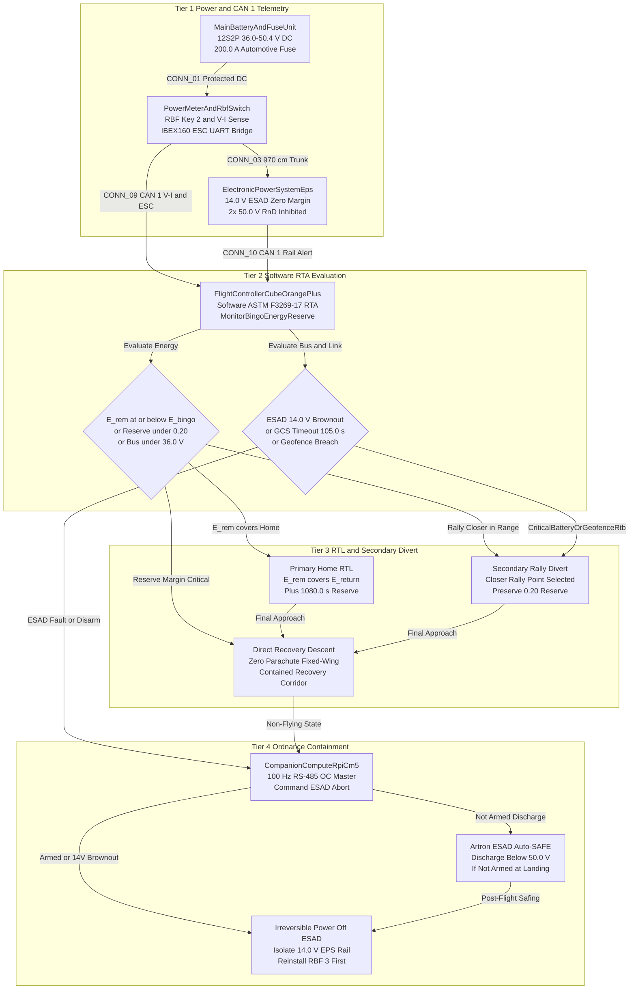

## 9. Bingo Energy Mathematics & Secondary Divert Protocols

**Baseline Date:** `2026-11-16` | **System Baseline:** `Avenger5V25UasSystem` (`Avenger 5 V2.5 UAS` / `ASTK A5 V2.5` + `ELI Military Simulations PL-40 Rev 2.6` + `Artron ESAD AB00-0054-01AA-0005` + `SwarmC2`) | **Normative Allocation:** `MET-02`, `CTL-01`, `CTL-02`, `CTL-04`, `SAF-01`, `SAF-02`, `EXT-01`

### 9.1 Grounded Power-Bus Model & Analytical Energy Capacity (`e_capacity_joules`)

The Avenger 5 V2.5 air vehicle draws all propulsion and avionics electrical energy from a single removable `MainBatteryAndFuseUnit` (`BOM-AV-002`, `12S2P Li metal BEI maximus20` pack) protected by an inline `200.0` A automotive fuse (`BOM-AV-003`, `PRM-AV-005`) and switched by `PowerMeterAndRbfSwitch` (`BOM-AV-004`, `BOM-AV-005`, `UAV Power R.B.F. Key #2` in an `XT60E-F` housing). Across the six OEM reference manuals (`EXT-01`, `schema/extracted/05_engineering_gaps_and_synthesis_ledger.md` Section 2.4 `GAP-ENV`), exact battery pack energy (`Wh` or `Ah`), continuous `IBEX160` ESC / `AXI 5345/16` current cutoffs, and low-voltage State-of-Charge (`SoC`) return thresholds are unprinted. Accordingly, `e_capacity_joules` and all energy-partition quantities are **Analytically Derived** symbolically from the **Directly Evidenced** `5400.0` s (`90.0` min) maximum endurance (`PRM-PERF-001`, `PRM-PERF-002`), the `12S2P` `36.0` to `50.4` V DC bus bounds (`PRM-AV-001`, `PRM-AV-002`), the `49.0` to `50.0` V pre-flight check window (`PRM-AV-003`, `PRM-AV-004`, `GAP-05`), the `200.0` A fuse limit (`PRM-AV-005`), and the `14.0` V `ElectronicPowerSystemEps` to `ArtronEsadAndSensorUnit` `GE_POW` supply (`PRM-AV-010`, `GAP-01`). Per `GAP-05` and `REQ_SAF_05` (`legacy24VUiRejected == true`), all battery monitoring anchors strictly to the `12S2P` `36.0` to `50.4` V envelope and rejects legacy lower-voltage UI screenshot artifacts.

$$
\begin{aligned}
P_{\mathrm{bus}}(t) &= V_{\mathrm{bus}}(t) \, I_{\mathrm{bus}}(t) = P_{\mathrm{prop}}(t) + P_{\mathrm{EPS}}(t) \\
E_{\mathrm{capacity}} &= \int_{0}^{T_{\mathrm{endurance}}} P_{\mathrm{cruise,nom}}(t) \, \mathrm{d}t = \bar{P}_{\mathrm{cruise}} \, T_{\mathrm{endurance}} = \bar{V}_{\mathrm{bus}} \, \bar{I}_{\mathrm{cruise}} \, T_{\mathrm{endurance}} \\
E_{\mathrm{rem}}(t) &= E_{\mathrm{init}}(0) - \int_{0}^{t} V_{\mathrm{bus}}(\tau) \, I_{\mathrm{bus}}(\tau) \, \mathrm{d}\tau \\
P_{\mathrm{fuse,max}}(t) &= V_{\mathrm{bus}}(t) \, I_{\mathrm{fuse,max}}
\end{aligned}
$$

**Parameter Definitions & Engineering Units:**

| Parameter | Symbol | Schema Key | Value | Units | Derivation Grade | Constraint & SSOT Provenance |
| :--- | :--- | :--- | :--- | :--- | :--- | :--- |
| Total Nominal Energy Capacity | E_capacity | e_capacity_joules | Symbolic | J | Analytically Derived | Equals P_cruise_bar multiplied by 5400.0 s; exact Wh/J unprinted in OEM PDFs (`GAP-ENV`, `REQ_SAF_11`) |
| Remaining Stored Energy | E_rem | - | Symbolic | J | Analytically Derived | Real-time remaining usable energy integrated from `PowerMeterAndRbfSwitch` V/I telemetry (`CAN 1`) |
| Initial Pre-Flight Energy | E_init | - | Symbolic | J | Analytically Derived | Initial energy after `MainBatteryPreFlightVoltageConstraint` pass (`49.0` to `50.0` V, `GAP-05`) |
| Instantaneous Main Bus Power | P_bus | - | Symbolic | W | Analytically Derived | Product V_bus * I_bus; equals sum of P_prop plus P_EPS |
| Instantaneous Propulsion Power | P_prop | - | Symbolic | W | Analytically Derived | Power drawn by `IBEX160` ESC and `AXI 5345/16` motor (`IF-PWR-004`, `IF-PWR-005`) |
| Instantaneous EPS Trunk Power | P_EPS | - | Symbolic | W | Analytically Derived | Power drawn over `970.0` cm trunk to `ElectronicPowerSystemEps` (`IF-PWR-006`, `CONN_03`) |
| Instantaneous Main Bus Voltage | V_bus | - | Symbolic | V | Directly Evidenced | Measured on `CAN 1` by `PowerMeterAndRbfSwitch`; bounded within `36.0` to `50.4` V (`PRM-AV-001`, `PRM-AV-002`) |
| Mean Nominal Bus Voltage | V_bus_bar | - | Symbolic | V | Analytically Derived | Endurance-averaged `12S2P` DC bus voltage across nominal sortie (`36.0` to `50.4` V range) |
| Instantaneous Main Bus Current | I_bus | - | Symbolic | A | Directly Evidenced | Measured on `CAN 1` by `PowerMeterAndRbfSwitch`; bounded by `200.0` A fuse (`PRM-AV-005`) |
| Mean Cruise Bus Current | I_cruise_bar | - | Symbolic | A | Analytically Derived | Endurance-averaged current draw at `30.0` to `31.0` m/s cruise (`GAP-ENV`) |
| Nominal Cruise Power Profile | P_cruise_nom | - | Symbolic | W | Analytically Derived | Time-varying nominal cruise power profile integrated over `5400.0` s endurance |
| Nominal Cruise Mean Power | P_cruise_bar | - | Symbolic | W | Analytically Derived | Mean power at nominal `30.0` to `31.0` m/s cruise (`PRM-PERF-006`, `PRM-PERF-007`, `GAP-ENV`) |
| Instantaneous Fuse Power Limit | P_fuse_max | - | Symbolic | W | Analytically Derived | Instantaneous product `V_bus(t) * 200.0 A` (`I_fuse_max` hardware trip boundary) |
| Maximum Flight Endurance | T_endurance | - | 5400.0 | s | Directly Evidenced | Equivalent to `90.0` min (`PRM-PERF-001`, `PRM-PERF-002`); ConOps and weather dependent |
| Main Bus Voltage Floor | V_bus_min | - | 36.0 | V | Directly Evidenced | Minimum `12S2P Li metal BEI maximus20` operating DC bus voltage (`PRM-AV-001`, `REQ_H_02`) |
| Main Bus Voltage Ceiling | V_bus_max | - | 50.4 | V | Directly Evidenced | Maximum `12S2P Li metal BEI maximus20` operating DC bus voltage (`PRM-AV-002`) |
| Pre-Flight Pack Voltage Min | V_pre_min | - | 49.0 | V | Directly Evidenced | Minimum pass voltage at `PreFlightCheck` (`PRM-AV-003`, `GAP-05`, `REQ_SC_01`, `REQ_SAF_05`) |
| Pre-Flight Pack Voltage Max | V_pre_max | - | 50.0 | V | Directly Evidenced | Nominal full pre-flight voltage check ceiling (`PRM-AV-004`, `GAP-05`, `REQ_SAF_05`) |
| Main Automotive Fuse Rating | I_fuse_max | - | 200.0 | A | Directly Evidenced | In-line DC overcurrent fuse between battery and `PowerMeterAndRbfSwitch` (`PRM-AV-005`, `REQ_SC_04`) |
| Fuse Ceiling Power at Max Bus | P_fuse_cap_max | - | 10080.0 | W | Analytically Derived | Theoretical fuse-trip upper boundary (`50.4 * 200.0`); not continuous propulsion power (`GAP-ENV`) |
| Fuse Ceiling Power at Min Bus | P_fuse_cap_minV | - | 7200.0 | W | Analytically Derived | Theoretical fuse-trip boundary at `36.0` V floor (`36.0 * 200.0`); `970.0` cm trunk (`PRM-AV-012`) |

Pre-flight and in-flight voltage admissibility across the `12S2P` bus (`MainBatteryPreFlightVoltageConstraint`) and the downstream `ElectronicPowerSystemEps` regulated rails (`EpsEsadZeroBrownoutMarginConstraint`, `EsadInputVoltageAndBrownoutConstraint`, `GAP-01`) must hold continuously:

$$
\begin{aligned}
V_{\mathrm{pre,min}} &\le V_{\mathrm{pack}}(0) \le V_{\mathrm{pre,max}} \\
V_{\mathrm{bus,min}} &\le V_{\mathrm{bus}}(t) \le V_{\mathrm{bus,max}} \\
I_{\mathrm{bus}}(t) &\le I_{\mathrm{fuse,max}} \\
V_{\mathrm{ESAD,min}} &\le V_{\mathrm{ESAD}}(t) \le V_{\mathrm{ESAD,max}} \\
\Delta V_{\mathrm{ESAD,margin}}(t) &= V_{\mathrm{EPS,ESAD}}(t) - V_{\mathrm{ESAD,min}} - I_{\mathrm{ESAD}}(t) \, R_{\mathrm{harness}}
\end{aligned}
$$

**Parameter Definitions & Engineering Units:**

| Parameter | Symbol | Schema Key | Value | Units | Derivation Grade | Constraint & SSOT Provenance |
| :--- | :--- | :--- | :--- | :--- | :--- | :--- |
| Pre-Flight Pack Voltage | V_pack | - | Symbolic | V | Directly Evidenced | Pack open-circuit voltage checked prior to `RBF #2` removal (`49.0` to `50.0` V, `GAP-05`) |
| EPS to ESAD Nominal Output | V_EPS_ESAD | - | 14.0 | V | Directly Evidenced | Regulated `ElectronicPowerSystemEps` output (`PRM-AV-010`, `IF-PWR-009`, `CONN_06`) |
| ESAD Input Voltage at J100 | V_ESAD | - | Symbolic | V | Directly Evidenced | Regulated `GE_POW` voltage measured at `Artron ESAD` `J100` after harness drop |
| ESAD Input Voltage Floor | V_ESAD_min | - | 14.0 | V | Directly Evidenced | Artron ESAD `J100` `VDC_IN` (`GE_POW`) minimum input (`PRM-ESAD-001`, `GAP-01`) |
| ESAD Input Voltage Ceiling | V_ESAD_max | - | 32.0 | V | Directly Evidenced | Artron ESAD `J100` `VDC_IN` maximum input (`PRM-ESAD-003`; ICD nominal `28.0` V `PRM-ESAD-002`) |
| ESAD Nominal Brownout Margin | Delta_V_ESAD_margin | - | 0.0 | V | Directly Evidenced | Zero cable-drop margin (`14.0 - 14.0 = 0.0`); requires immediate alert on sag (`REQ_SAF_01`, `FM-04-01`) |
| ESAD Supply Current | I_ESAD | - | Symbolic | A | Analytically Derived | Current drawn on `IF-PWR-009` (`22` to `28` AWG harness); value unprinted (`GAP-ENV`) |
| ESAD Harness Resistance | R_harness | - | Symbolic | Ohm | Analytically Derived | Series resistance of `EPS` to `ESAD` `J100` feed causing ohmic voltage drop |
| EPS Servo Rail Voltage | V_servo_rail | - | 8.0 | V | Directly Evidenced | Regulated supply to `8x HV6160-DroneCAN` tail/wing actuators (`PRM-AV-006`, `IF-PWR-007`) |
| EPS Radio Rail Voltage | V_radio_rail | - | 12.0 | V | Directly Evidenced | Regulated supply to `DTC 4.4-5.0 GHz` C2 radio (`PRM-AV-007`; tolerance `8.0` to `17.0` V `PRM-AV-008`, `PRM-AV-009`) |
| Main Power Trunk Length | L_trunk | - | 970.0 | cm | Directly Evidenced | Fuselage trunk wire length from `PowerMeterAndRbfSwitch` to `EPS` (`PRM-AV-012`, `IF-PWR-006`) |

---

### 9.2 Trajectory Return (`e_return_joules`), Secondary Divert (`e_divert_joules`), Dynamic Contingency (`e_contingency_joules`), Statutory Reserve (`e_reserve_joules`, `statutory_reserve_ratio`), and Bingo Threshold (`e_bingo_threshold_joules`)

During `CruiseAndLoiter` flight (`UavFlightLifecycleState`), `FlightControllerCubeOrangePlus` continuously computes both the primary return energy `e_return_joules` ($E_{\mathrm{return}}$) back to the `Home` recovery point and the minimum secondary divert energy `e_divert_joules` ($E_{\mathrm{divert}}$) across all reachable `SwarmC2` Rally recovery sites (`Fly HOME Then Land` with automatic Rally divert per `02_avenger5_operations_and_safety.md` Section 3). Under the conservative inner flight envelope (`GAP-02`, `REQ_SAF_02`), ground speed along any recovery track $\Gamma$ is strongly degraded by headwinds up to the `28.0` m/s cruise wind tolerance (`PRM-PERF-017`) relative to the `30.0` to `31.0` m/s nominal cruise airspeed (`PRM-PERF-006`, `PRM-PERF-007`), bounded by the `24.0` to `26.0` m/s stall floor (`PRM-PERF-004`, `PRM-PERF-005`) and `38.0` to `42.0` m/s maximum horizontal airspeed (`PRM-PERF-008`, `PRM-PERF-009`).

$$
\begin{aligned}
v_{\mathrm{gs}}(t) &= \max\left( v_{\mathrm{min}}, \; \mathbf{v}_{\mathrm{air}}(t) \cdot \hat{\mathbf{u}}_{\mathrm{track}} + \mathbf{w}(t) \cdot \hat{\mathbf{u}}_{\mathrm{track}} \right) \\
E_{\mathrm{return}}(t) &= \int_{\Gamma_{\mathrm{home}}(t)} \frac{P_{\mathrm{cruise}}(s)}{v_{\mathrm{gs,home}}(s)} \, \mathrm{d}s + \Delta E_{\mathrm{alt,home}}(t) + E_{\mathrm{loiter,final}} \\
E_{\mathrm{divert}}(t) &= \min_{j \in \mathcal{R}_{\mathrm{rally}}} \left( \int_{\Gamma_{\mathrm{rally},j}(t)} \frac{P_{\mathrm{cruise}}(s)}{v_{\mathrm{gs},j}(s)} \, \mathrm{d}s + \Delta E_{\mathrm{alt},j}(t) + E_{\mathrm{loiter,final}} \right) \\
E_{\mathrm{contingency}}(t) &= \Delta E_{\mathrm{wind}}(\mathbf{w}, t) + \Delta E_{\mathrm{cold}}(T_{\mathrm{amb}}, t) + \Delta E_{\mathrm{RTA}}(t) + \Delta E_{\mathrm{GCS}}(\tau_{\mathrm{GCS}})
\end{aligned}
$$

**Parameter Definitions & Engineering Units:**

| Parameter | Symbol | Schema Key | Value | Units | Derivation Grade | Constraint & SSOT Provenance |
| :--- | :--- | :--- | :--- | :--- | :--- | :--- |
| Primary Return Trajectory Energy | E_return | e_return_joules | Symbolic | J | Analytically Derived | Integrated cruise, climb/descent (`Delta_E_alt_home`), and `E_loiter_final` along path `Gamma_home` to `Home` |
| Secondary Divert Trajectory Energy | E_divert | e_divert_joules | Symbolic | J | Analytically Derived | Minimum return energy among reachable `SwarmC2` Rally recovery sites (`R_rally`, paths `Gamma_rally_j`) |
| Dynamic Contingency Energy Buffer | E_contingency | e_contingency_joules | Symbolic | J | Analytically Derived | Sum of `Delta_E_wind`, `Delta_E_cold`, `Delta_E_RTA`, and `Delta_E_GCS` contingency components |
| Track Groundspeed | v_gs | - | Symbolic | m/s | Analytically Derived | Projection of airspeed `v_air` plus wind `w` along unit track vector `u_hat_track`, bounded by `v_min` |
| Conservative Stall / Min Airspeed | v_min | - | 26.0 | m/s | Directly Evidenced | V1 conservative minimum speed (`PRM-PERF-005`); V2.5 spec sheet stall floor is `24.0` m/s (`PRM-PERF-004`, `GAP-02`) |
| Nominal Cruise Airspeed (V1 / V2.5) | v_cruise | - | 30.0 | m/s | Directly Evidenced | V1 manual cruise (`PRM-PERF-006`); V2.5 spec sheet nominal cruise is `31.0` m/s (`PRM-PERF-007`, `GAP-02`) |
| Maximum Horizontal Speed (V1 / V2.5) | v_horiz_max | - | 38.0 | m/s | Directly Evidenced | V1 conservative cap (`PRM-PERF-008`); V2.5 spec sheet max horizontal is `42.0` m/s (`PRM-PERF-009`, `GAP-02`) |
| Cruise Wind Tolerance Max | w_cruise_max | - | 28.0 | m/s | Directly Evidenced | Maximum cruise wind speed (`PRM-PERF-017`); leaves thin groundspeed margin against `30.0` to `31.0` m/s cruise |
| Airframe MTOW Mass | m_MTOW | - | 17.0 | kg | Directly Evidenced | Governs climb potential energy delta `Delta_E_alt` (`PRM-AF-008`) |
| Waypoint Altitude Floor / Ceiling | h_mission_min | - | 50.0 | m | Directly Evidenced | `SwarmC2` min mission waypoint altitude (`PRM-GCS-004`); slider max `3000.0` m (`PRM-GCS-005`), ceiling `5000.0` m (`PRM-PERF-015`) |
| Default Loiter Radius Minimum | R_loiter_min | - | 300.0 | m | Directly Evidenced | Governs terminal approach/holding energy `E_loiter_final` (`PRM-GCS-007`) |
| Terminal Loiter Pattern Energy | E_loiter_final | - | Symbolic | J | Analytically Derived | Energy reserved for final approach pattern at `>= 300.0` m loiter radius (`PRM-GCS-007`) |
| Operating Ambient Temp Min | T_amb | - | -20.0 | degC | Directly Evidenced | Cold-soak impedance driver in `Delta_E_cold` (`PRM-PERF-018`; max `+50.0` degC `PRM-PERF-019`, `FM-01-04`) |
| GCS Failsafe Timeout Baseline | tau_GCS | - | 105.0 | s | Directly Evidenced | Holding duration before autonomous lost-link RTL initiation (`PRM-GCS-008`, `CTL-02`, `Delta_E_GCS`) |
| Engagement Speed Cap (Abort Climbing) | v_engage_cap | - | 55.0 | m/s | Directly Evidenced | Exceeding triggers `Abort Engaging` climb to takeoff altitude (`PRM-PERF-010`, `Delta_E_RTA`) |
| Headwind Contingency Energy | Delta_E_wind | - | Symbolic | J | Analytically Derived | Extra energy to overcome headwind `w` up to `28.0` m/s within `24.0` to `42.0` m/s flight envelope |
| Cold-Soak Cell Droop Margin | Delta_E_cold | - | Symbolic | J | Analytically Derived | Energy derating allowance across `-20.0` to `+50.0` degC to prevent `12S2P` sag below `36.0` V |
| RTA Abort Climb Energy Margin | Delta_E_RTA | - | Symbolic | J | Analytically Derived | Energy required to recover from `AirspeedDiveCapClamped` climb-out toward `Takeoff altitude` |
| Lost-Link Hold Energy Margin | Delta_E_GCS | - | Symbolic | J | Analytically Derived | Energy consumed during `105.0` s `GCS Failsafe` waiting interval prior to RTL egress |

In accordance with `JARUS SORA v2.5 Annex B and Annex C`, `MIL-STD-882E Task 202 and Task 205`, and `.pipeline/schema.sysml` `BingoEnergyReserveConstraint` (`MET-02`, `REQ_SC_02`), the aircraft must maintain at least a `0.20` statutory energy reserve fraction (`statutory_reserve_ratio`, `e_reserve_joules`), corresponding to a `1080.0` s (`18.0` min) reserve floor out of the `5400.0` s nominal endurance (`PRM-PERF-003`). The resulting usable mission-plus-transit time budget is at most `4320.0` s (`72.0` min), and the Bingo threshold `e_bingo_threshold_joules` triggers autonomous return or secondary Rally divert strictly before encroaching on the `0.20` statutory reserve floor.

$$
\begin{aligned}
r_{\mathrm{stat}} &= \frac{E_{\mathrm{reserve}}}{E_{\mathrm{capacity}}} \ge 0.20 \\
E_{\mathrm{reserve}} &= r_{\mathrm{stat}} \, E_{\mathrm{capacity}} \ge 0.20 \, \bar{P}_{\mathrm{cruise}} \, T_{\mathrm{endurance}} \\
T_{\mathrm{reserve}} &= r_{\mathrm{stat}} \, T_{\mathrm{endurance}} \ge 0.20 \times 5400.0 = 1080.0 \\
E_{\mathrm{usable,max}} &= E_{\mathrm{capacity}} - E_{\mathrm{reserve}} \le 0.80 \, E_{\mathrm{capacity}} \\
E_{\mathrm{bingo,home}}(t) &= E_{\mathrm{return}}(t) + E_{\mathrm{contingency}}(t) + E_{\mathrm{reserve}} \\
E_{\mathrm{bingo}}(t) &= \min\left( E_{\mathrm{return}}(t), \; E_{\mathrm{divert}}(t) \right) + E_{\mathrm{contingency}}(t) + E_{\mathrm{reserve}}
\end{aligned}
$$

**Parameter Definitions & Engineering Units:**

| Parameter | Symbol | Schema Key | Value | Units | Derivation Grade | Constraint & SSOT Provenance |
| :--- | :--- | :--- | :--- | :--- | :--- | :--- |
| Statutory Reserve Ratio | r_stat | statutory_reserve_ratio | 0.20 | ratio | Analytically Derived | Minimum `E_reserve / E_capacity` (`BingoEnergyReserveConstraint`, `PRM-PERF-003`, `JARUS SORA v2.5`, `MET-02`) |
| Mandatory Statutory Energy Reserve | E_reserve | e_reserve_joules | Symbolic | J | Analytically Derived | At least `0.20 * E_capacity`; corresponds to `1080.0` s at nominal cruise power (`REQ_SC_02`) |
| Statutory Reserve Time Floor | T_reserve | - | 1080.0 | s | Analytically Derived | `0.20 * 5400.0 s` (`18.0` min) protected energy time equivalent (`RESEARCH_INVENTORY.md` `MET-02`) |
| Maximum Usable Mission Energy | E_usable_max | - | Symbolic | J | Analytically Derived | `E_capacity - E_reserve <= 0.80 * E_capacity` active mission ceiling |
| Maximum Usable Mission Budget | T_usable_max | - | 4320.0 | s | Analytically Derived | `0.80 * 5400.0 s` (`72.0` min) maximum active transit, loiter, and return budget before Bingo floor |
| Primary-Return Bingo Threshold | E_bingo_home | - | Symbolic | J | Analytically Derived | Threshold requiring immediate `Fly HOME Then Land` to primary recovery site |
| Critical Bingo Threshold (Divert-Aware) | E_bingo | e_bingo_threshold_joules | Symbolic | J | Analytically Derived | Minimum reachable trajectory (`Home` or Rally) plus `E_contingency` plus `E_reserve` (`REQ_SC_02`) |

---

### 9.3 `CAN 1` Power & ESC Telemetry Supervision (`PowerMeterAndRbfSwitch`, `IBEX160`, `ElectronicPowerSystemEps`)

Closed-loop energy accounting and brownout early warning execute strictly over physically isolated `CAN 1` (`CanTopologyIsolationConstraint`, `REQ_SC_06`, `CTL-04`), keeping propulsion/power telemetry physically separated from `CAN 2` (`CAN/power splitter PCB`, `4x` wing roll servos `#5-#8`, `2x mRo RM3100` mag/baro, and `CUAV SKYE2` heated pitot):

1. **Primary Bus Sensing & `IBEX160` ESC UART Bridging (`CONN_01`, `CONN_02`, `CONN_09`)**:
   - `PowerMeterAndRbfSwitch` measures main `12S2P` DC bus voltage and current downstream of the `200.0` A automotive fuse (`IF-PWR-001`, `IF-PWR-002`, `IF-PWR-003`) while delivering switched `36.0` to `50.4` V power (`IF-PWR-004`) and unidirectional `PWM` throttle (`IF-PWM-001`) to the `IBEX160` ESC (`BOM-AV-006`).
   - The `IBEX160` ESC returns unidirectional `Telemetry UART` frames (`IF-SER-005`, `EscTelemetryFrame`) containing motor RPM, ESC temperature, motor temperature, bus voltage, and bus current (`CommandPusherThrottleAndReadEscTelem`). `PowerMeterAndRbfSwitch` bridges these parameters plus pack V/I onto multi-drop `CAN 1` (`IF-CAN1-001`, `CONN_09`) for ingestion by `FlightControllerCubeOrangePlus` (`MonitorBingoEnergyReserve`, `REQ_SC_04`).
   - Dual-sensor cross-checking compares `PowerMeterAndRbfSwitch` V/I against `IBEX160` `EscTelemetryFrame` V/I (`FM-02-03`) to detect shunt drift, `XT60E-F` `RBF #2` contact degradation (`FM-02-04`), or excessive voltage drop along the `970.0` cm `EPS` trunk (`IF-PWR-006`, `FM-04-04`).
2. **`ElectronicPowerSystemEps` Rail Health & `GAP-01` Brownout Guard (`CONN_03`, `CONN_06`, `CONN_10`)**:
   - `ElectronicPowerSystemEps` (`BOM-AV-009`) converts the `36.0` to `50.4` V trunk (`CONN_03`) into `8.0` V servo (`IF-PWR-007`), `12.0` V radio (`IF-PWR-008`), `14.0` V `Artron ESAD` `GE_POW` (`IF-PWR-009`, `CONN_06`), and sensor/gimbal rails (`IF-PWR-011`), transmitting rail status and `esadBrownoutAlert` on `CAN 1` (`CONN_10`, `DistributeRegulatedPowerRails`).
   - Because `EPS` outputs `14.0` V nominal directly at the `Artron ESAD` `14.0` V minimum `VDC_IN` floor (`GAP-01`, `esadBrownoutMarginV == 0.0`, `FM-04-01`), any `970.0` cm trunk voltage sag near `36.0` V or converter foldback triggers immediate `esadBrownoutAlert` on `CAN 1`, prompting `FlightControllerCubeOrangePlus` and `CompanionComputeRpiCm5` to execute `REQ_SAF_01` failsafe containment.
   - Per `GAP-WCET` (`REQ_SAF_08`), exact `CAN 1` bitrate and `UART`-to-`CAN 1` bridge latency are unprinted in OEM PDFs and tracked as bench verification targets anchored around the grounded `100.0` Hz (`0.01` s) `RPI CM5004032` to `Artron ESAD` `RS-485` supervision cycle (`GAP-04`, `REQ_SC_08`).

---

### 9.4 `CriticalBatteryOrGeofenceRtb`, Secondary Divert & Zero-Parachute Recovery Containment

All runtime energy, voltage, and airspace boundary guards execute inside the software-hosted **ASTM F3269-17 §5.2 Simplex RTA monitor** (`RtaEnvelopeMonitorState`) resident on `FlightControllerCubeOrangePlus` (`SimplexRtaSoftwareHostingConstraint`: `standaloneRtaBoxCount == 0`, `rtaHostedOnCubeOrangePlus == true`, `CTL-01`, `REQ_SC_05`), eliminating any ungrounded standalone RTA hardware unit.

$$
\begin{aligned}
\mathrm{Transition}_{\mathrm{RTB}}(t) &\iff \left( E_{\mathrm{rem}}(t) \le E_{\mathrm{bingo}}(t) \right) \lor \left( \frac{E_{\mathrm{rem}}(t)}{E_{\mathrm{capacity}}} \le 0.20 \right) \lor \left( V_{\mathrm{bus}}(t) < 36.0 \right) \lor \left( V_{\mathrm{ESAD}}(t) < 14.0 \right) \lor \mathrm{GeoBreach}(t) \lor \left( \Delta t_{\mathrm{GCS}}(t) \ge 105.0 \right) \\
\mathrm{RecoveryMode}(t) &= \begin{cases}
\mathrm{RtlHome} & \text{if } E_{\mathrm{rem}}(t) \ge E_{\mathrm{return}}(t) + E_{\mathrm{contingency}}(t) + E_{\mathrm{reserve}} \\
\mathrm{DivertRally} & \text{if } E_{\mathrm{return}}(t) + E_{\mathrm{contingency}}(t) + E_{\mathrm{reserve}} > E_{\mathrm{rem}}(t) \ge E_{\mathrm{divert}}(t) + E_{\mathrm{contingency}}(t) + E_{\mathrm{reserve}} \\
\mathrm{DirectLanding} & \text{if } E_{\mathrm{rem}}(t) < E_{\mathrm{divert}}(t) + E_{\mathrm{contingency}}(t) + E_{\mathrm{reserve}}
\end{cases}
\end{aligned}
$$

**Parameter Definitions & Engineering Units:**

| Parameter | Symbol | Schema Key | Value | Units | Derivation Grade | Constraint & SSOT Provenance |
| :--- | :--- | :--- | :--- | :--- | :--- | :--- |
| RTB Failsafe Transition Predicate | Transition_RTB | - | Symbolic | Boolean | Analytically Derived | Boolean trigger entering `RtaEnvelopeMonitorState.CriticalBatteryOrGeofenceRtb` |
| Recovery Mode Selector | RecoveryMode | - | Symbolic | Enum | Analytically Derived | Selects `RtlHome` (`Fly HOME Then Land`), `DivertRally`, or `DirectLanding` |
| Geofence Boundary Breach Flag | GeoBreach | - | Symbolic | Boolean | Directly Evidenced | `SwarmC2` `Exclusion` entry or `Inclusion` boundary intercept (`02_avenger5_operations_and_safety.md`) |
| Active GCS Link-Loss Elapsed Time | delta_t_GCS | - | Symbolic | s | Directly Evidenced | Elapsed time since last authenticated `DTC 4.4-5.0 GHz` C2 uplink frame |
| Statutory Energy Ratio Floor | r_floor | statutory_reserve_ratio | 0.20 | ratio | Analytically Derived | Hard `CriticalBatteryOrGeofenceRtb` trigger (`BingoEnergyReserveConstraint`, `REQ_SC_02`) |
| Main Bus Collapse Floor | V_bus_floor | - | 36.0 | V | Directly Evidenced | Triggers immediate `CriticalBatteryOrGeofenceRtb` before propulsion/EPS dropout (`PRM-AV-001`, `REQ_H_02`) |
| ESAD Brownout Threshold | V_ESAD_floor | - | 14.0 | V | Directly Evidenced | Zero margin floor (`GAP-01`, `REQ_SAF_01`); sag triggers `esadBrownoutAlert` and ESAD safing |
| GCS Lost-Link Timeout | delta_t_GCS_max | - | 105.0 | s | Directly Evidenced | Triggers `PaceC2LinkState.EmergencyLostLinkRtlHolding` and `Disarm ESAD On GCS Timeout` (`PRM-GCS-008`, `CTL-02`) |
| ESAD Auto-SAFE HV Ceiling | V_HV_safe_max | - | 50.0 | V | Directly Evidenced | `PBIT` bit 12 and post-discharge safe capacitor ceiling (`PRM-ESAD-029`, `REQ_SC_09`, `SAF-01`) |
| ESAD HV Armed Envelope Max | V_HV_arm_max | - | 1800.0 | V | Directly Evidenced | Maximum `J401` high-voltage charge when armed (`PRM-ESAD-031`; discharged to `0.0` V `PRM-ESAD-030` on abort) |
| Self-Destruct / Abort Hold Time | tau_abort_hold | - | 5.0 | s | Directly Evidenced | Minimum `SwarmC2` button hold prior to `Slide-to-Confirm` (`PRM-GCS-010`, `MET-03`, `DoD Directive 3000.09`) |
| Inhibited RnD Igniter Rail | V_RnD_inhib | - | 50.0 | V | Directly Evidenced | `2x 50.0` V `Optional RnD` parachute igniter lines strictly disabled (`PRM-AV-011`, `ProductionNoParachuteConstraint`) |

Deterministic `CriticalBatteryOrGeofenceRtb` execution and zero-parachute ordnance recovery containment enforce four sequential safeguards:

1. **Primary `RTL` & Secondary Rally Divert Selection (`Fly HOME Then Land`)**:
   - Upon entering `CriticalBatteryOrGeofenceRtb` (`UavFlightLifecycleState.EmergencyAbortOrRtb`), `FlightControllerCubeOrangePlus` first aborts any active terminal dive (`Abort Engaging` climb toward `Takeoff altitude`) and commands `Fly HOME Then Land` toward `Home` whenever `E_rem(t) >= E_bingo_home(t)`.
   - If adverse `28.0` m/s headwinds, cold-soak `12S2P` droop, or distant mission position causes `E_rem(t) < E_bingo_home(t)` while a pre-planned Rally recovery site is reachable (`E_rem(t) >= E_divert(t) + E_contingency(t) + E_reserve`), `RTL` automatically diverts to the closest feasible Rally point (`DivertRally`) inside `Inclusion` geofences and outside `Exclusion` zones (`JARUS SORA v2.5 Annex B and Annex C`).
   - If neither `Home` nor any Rally point is reachable with full `E_reserve >= 0.20 * E_capacity` intact, `FlightControllerCubeOrangePlus` executes `Go Directly to landing sequence` (`DirectLanding`) within the authorized Ground Risk Buffer while preserving airspeed above `24.0` to `26.0` m/s stall until flare/touchdown.
2. **Zero-Parachute Production Invariant (`ProductionNoParachuteConstraint`, `REQ_SC_03`)**:
   - Production `Avenger V2.5` excludes recovery parachutes (`Recovery System: No`, `rndRecoveryOptionInstalled == false`). The `2x 50.0` V pyrotechnic recovery igniter lines (`BOM-AV-026`, `IF-PWR-010`, `PRM-AV-011`) on `ElectronicPowerSystemEps` remain permanently inhibited (`FM-04-02`). Because touchdown occurs as an unassisted fixed-wing recovery without parachute deceleration, ordnance must be demonstrably discharged and power-isolated prior to ground impact and crew approach (`UCL-03`, `UCL-05`, `REQ_L_01`, `REQ_L_04`).
3. **Automatic `Auto-SAFE` (`< 50.0` V) & Irreversible `Power Off ESAD` Escalation (`GAP-01`, `GAP-04`, `CTL-03`)**:
   - Whenever the aircraft transitions to landing or non-flying status while the `Artron ESAD` is `NOT ARMED` (`SAFE`, `ARM STAGE 1`, or `ARM STAGE 2` without active HV firing state), the system executes **Auto-SAFE**, automatically returning `EsadSafeArmState` to `SafePowerOff` / `SAFE` and bleeding internal capacitor voltage strictly below `50.0` V (`PRM-ESAD-029`, `02_avenger5_operations_and_safety.md` Section 3).
   - If the warhead had already reached `ARMED` / `HvChargedReady` (`0.0` to `1800.0` V on `J401`), or if `ElectronicPowerSystemEps` reports `14.0` V `GE_POW` brownout (`esadBrownoutAlert == true`, `GAP-01`), or `CompanionComputeRpiCm5` (`RPI CM5004032`, `CONN_20`, `IF-ORD-001`) detects a `> 10.0` ms `RS-485` watchdog timeout (`EsadBusWatchdogFaultFallback`), `CompanionComputeRpiCm5` asserts abort control over `RS-485` (`CommandEsadAbortAndSelfDestruct`) to discharge HV `< 50.0` V, and `SwarmC2` / `UCL-01` (`Pilot Operator`) / `UCL-02` (`Payload Operator`) or failsafe logic commands **irreversible `Power Off ESAD`** (`DistributeRegulatedPowerRails` with `esadPowerOffCmd == true`), permanently opening the `14.0` V `IF-PWR-009` feed in flight (`REQ_SAF_01`, `REQ_SC_16`). During `105.0` s `GCS Failsafe`, `Disarm ESAD On GCS Timeout` additionally enforces autonomous disarming (`REQ_SC_12`).
4. **Post-Recovery Ground Safing & `SAFE_SCRUB_ABORT` Ordering (`GAP-06`, `GAP-SCRUB`, `REQ_SC_16`)**:
   - Following any emergency landing, divert, or ground `SAFE_SCRUB_ABORT`, `UCL-05` (`Field Sustainment & Arming Safety Lead`) and `UCL-03` (`Launch Assistant`) must confirm HV `< 50.0` V and `Power Off ESAD` via `SwarmC2`, wait out any `PL-40` pneumatic bleed / red carriage pin restoration if on rail (`IF-MECH-001`), touch the transport box ESD ground point (`BOM-GCS-006`), and reinstall `ESAD R.B.F. Key #3` (`J100` `UMB` `< 0.5` Ohm at `20.0` mA, `IF-ORD-003`) **strictly prior to** reinstalling `UAV Power R.B.F. Key #2` (`XT60E-F`, `REQ_SC_01`, `REQ_SC_09`, `REQ_SC_16`).

---

### 9.5 Derivation-Annotation & OEM Gap Disposition Ledger

| Analytical Element | Input Anchors | Methodology Citation | Derivation Grade | Caveat & Downstream Verification Requirement |
| :--- | :--- | :--- | :--- | :--- |
| `e_capacity_joules`, `e_return_joules`, `e_divert_joules`, `e_contingency_joules`, `e_bingo_threshold_joules` | `PRM-PERF-001`, `PRM-PERF-002` (`90.0` min / `5400.0` s), `PRM-AV-001` through `PRM-AV-005` (`36.0` to `50.4` V, `200.0` A), `GAP-ENV` | `JARUS SORA v2.5 Annex B and Annex C`; `SAE ARP4761 §3.1 through §3.3` | Analytically Derived | Exact pack `Wh`/`Ah`, `IBEX160`/`AXI 5345/16` continuous current/thermal cutoffs, and low-SoC RTL floor are unprinted (`GAP-ENV`, `REQ_SAF_11`); verify nominal cruise power `P_cruise_bar` by bench/flight characterization prior to operational release |
| `e_reserve_joules` & `statutory_reserve_ratio` (`>= 0.20`, `1080.0` s) | `PRM-PERF-002` (`5400.0` s), `PRM-PERF-003` (`0.20`), `BingoEnergyReserveConstraint`, `MET-02` | `JARUS SORA v2.5 Annex B and Annex C`; `MIL-STD-882E Task 202 and Task 205` | Analytically Derived | Derived `0.20` statutory floor (`1080.0` s of `5400.0` s) enforces non-negotiable reserve margin for `RTL` / Rally divert (`TC_02_BingoReserveAndEpsBrownoutMonitor`) |
| `GAP-01` `14.0` V EPS-to-ESAD Zero-Margin Brownout Containment | `PRM-AV-010` (`14.0` V), `PRM-ESAD-001` through `PRM-ESAD-003` (`14.0` to `32.0` V), `EpsEsadZeroBrownoutMarginConstraint` | Leveson STPA (`REQ_UCA_02`, `REQ_H_02`); `MIL-STD-1629A Method 101` (`FM-04-01`) | Directly Evidenced | `0.0` V margin under `970.0` cm trunk and `22` to `28` AWG `J100` harness drop requires `CAN 1` `esadBrownoutAlert` and irreversible `Power Off ESAD` (`REQ_SAF_01`, `TC_02_BingoReserveAndEpsBrownoutMonitor`) |
| `GAP-05` `12S2P` Pre-Flight Voltage Anchoring (`49.0` to `50.0` V) | `PRM-AV-003`, `PRM-AV-004`, `MainBatteryPreFlightVoltageConstraint`, `REQ_SAF_05` | `ISO/IEC/IEEE 29148:2018 §6.4`; Leveson STPA (`REQ_SC_01`, `FM-01-02`) | Directly Evidenced | Rejects legacy lower-voltage UI artifacts (`legacy24VUiRejected == true`) before `RBF #2` / `RBF #3` arming checks (`TC_01_PreflightPowerAndRbfSequence`) |
| Zero-Parachute `Auto-SAFE` (`< 50.0` V) & `Power Off ESAD` | `PRM-AV-011` (`50.0` V RnD), `PRM-ESAD-029` (`< 50.0` V PBIT safe), `ProductionNoParachuteConstraint` (`BOM-AV-026`) | `NATO STANAG 4187 Ed. 5 Chapter 2 and Chapter 3`; `ASTM F3269-17 §5.2`; `DoD Directive 3000.09 §4.1.a` | Directly Evidenced | Production airframe lacks recovery parachute (`Recovery System: No`); `2x 50.0` V `Optional RnD` lines stay disabled (`REQ_SC_03`); ground `GAP-WCET` (`CAN 1` bitrate) and `GAP-SCRUB` (`SAFE_SCRUB_ABORT`) require bench/drill sign-off (`REQ_SAF_08`, `REQ_SAF_12`) |

---

/// OperationalAllocation: [MET-02]
/// OperationalAllocation: [MET-03]
