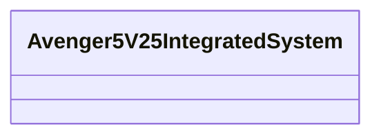
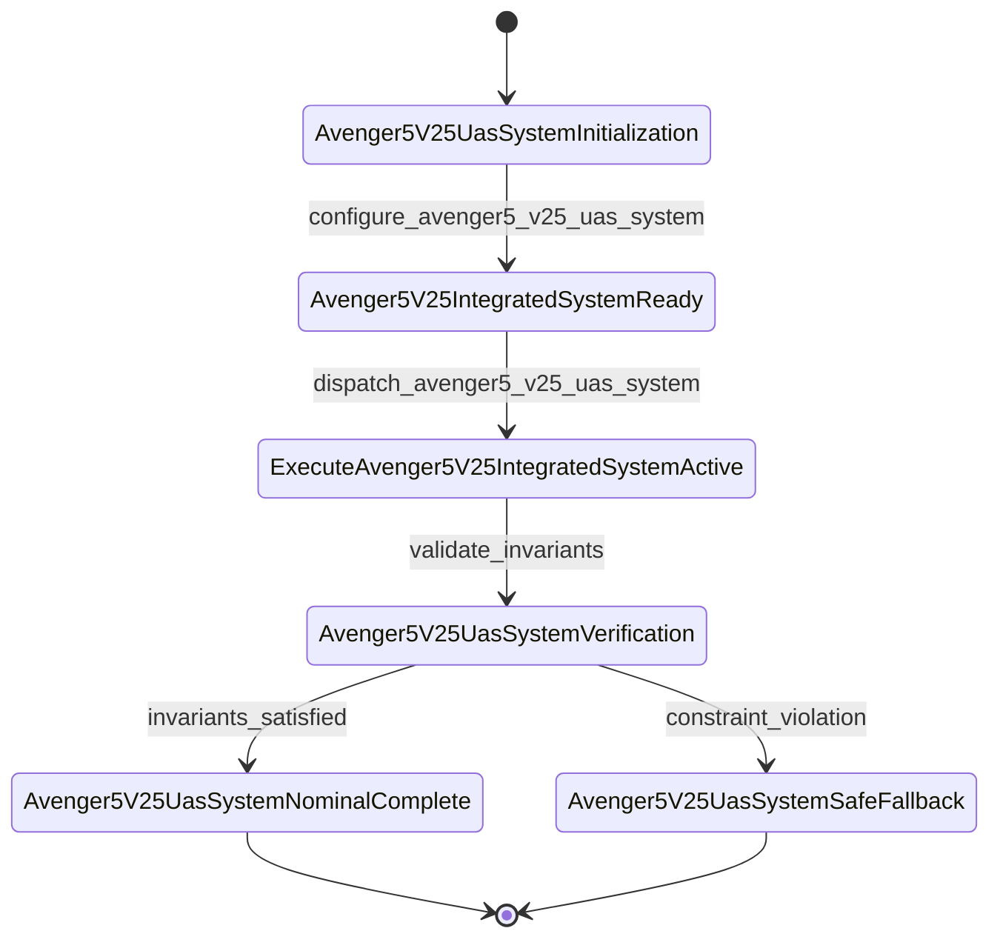

| Attribute | Specification Detail |
| :--- | :--- |
| **Issue ID** | #47 |
| **Title** | Epic 01: Avenger5 V25 Uas System System Architecture |
| **Type** | epic |
| **Package** | Avenger5V25UasSystem |
| **Subsystem** | System Architecture |
| **Generation Mode** | subagent |
| **Specification Source** | [schema/model.sysml](../../schema/model.sysml) |

# Epic 01: Avenger5 V25 Uas System System Architecture

## 1. Context
Avenger 5 (Avenger V2.5 / ASTK A5 V2.5) Uncrewed Aircraft System Hardware-Faithful SysML v2 Model. Grounded 100% in schema/extracted/{oem_bom,interface_table,parametric_limits}.md. Zero standalone RTA box; zero electrical/CAN wire between PL-40 and UAV; production Recovery System excluded (Optional RnD only).

## 2. Requirements & Checklist
- [ ] #32 - [Feature 01: [System Architecture] Avenger5V25IntegratedSystem](../features/FEAT-01-Avenger5V25IntegratedSystem.md)

### Associated Use Cases & User Stories

#### Associated Use Cases
- None directly allocated (operational behavior allocated at system ConOps level in Epic 02)

#### Associated User Stories
- None directly allocated (operational behavior allocated at system ConOps level in Epic 02)

## 3. Architecture
Classifiers: `Avenger5V25IntegratedSystem`.

## 4. Operational Considerations
Package `Avenger5V25UasSystem` declares structural definitions with no direct `StateDef`, `ActionDef`, or `InteractionDef` behavioral nodes.

## 5. Security & Governance
Package `Avenger5V25UasSystem` declares no package-scoped `RequirementDef` or `ConstraintDef` governance invariants in schema.

## 6. Source References
- System Architecture Model: `schema/model.sysml`
- Normative Systems Engineering Standard: ISO/IEC/IEEE 15288:2023 §6.4.3 Architecture Definition Process

Subsystem architectural composition and formal invariants derive from `schema/model.sysml` pursuant to ISO/IEC/IEEE 15288.

## System-Level UML Class Diagram

## System State Machine Diagram

