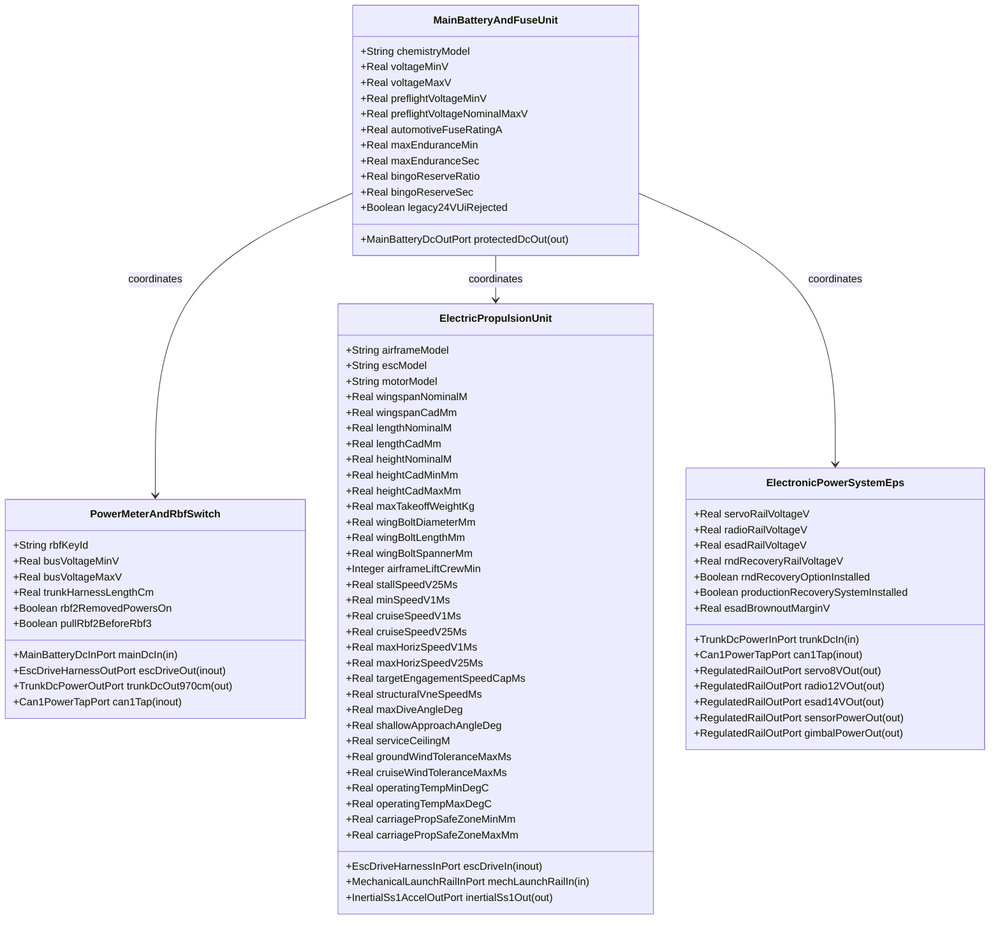
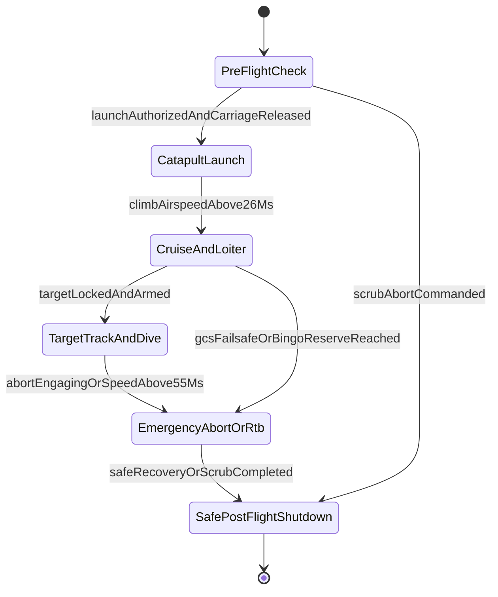

| Attribute | Specification Detail |
| :--- | :--- |
| **Issue ID** | #48 |
| **Title** | Epic 02: Airframe Power And Propulsion |
| **Type** | epic |
| **Package** | AirframePowerAndPropulsion |
| **Subsystem** | Airframe Power And Propulsion |
| **Generation Mode** | subagent |
| **Specification Source** | [schema/model.sysml](../../schema/model.sysml) |

# Epic 02: Airframe Power And Propulsion

## 1. Context
Subsystem Package 1 covering Main Battery and 200A Fuse, Power Meter and RBF #2 Switch, Electric Propulsion and Avenger V2.5 Airframe Envelope, and Electronic Power System (EPS).

## 2. Requirements & Checklist
- [ ] #33 - [Feature 02: [Airframe Power And Propulsion] MainBatteryAndFuseUnit](../features/FEAT-02-MainBatteryAndFuseUnit.md)
- [ ] #34 - [Feature 03: [Airframe Power And Propulsion] PowerMeterAndRbfSwitch](../features/FEAT-03-PowerMeterAndRbfSwitch.md)
- [ ] #35 - [Feature 04: [Airframe Power And Propulsion] ElectricPropulsionUnit](../features/FEAT-04-ElectricPropulsionUnit.md)
- [ ] #36 - [Feature 05: [Airframe Power And Propulsion] ElectronicPowerSystemEps](../features/FEAT-05-ElectronicPowerSystemEps.md)

### Associated Use Cases & User Stories

#### Associated Use Cases
- [ ] #24 - [Use Case 01: Verify Preflight Power And Bit](../use-cases/UC-01-VerifyPreflightPowerAndBit.md)

#### Associated User Stories
- [ ] #5 - [User Story 01: Validate Battery And Power On Rbf2](../user-stories/US-01-ValidateBatteryAndPowerOnRbf2.md)
- [ ] #6 - [User Story 02: Command Pusher Throttle And Read Esc Telem](../user-stories/US-02-CommandPusherThrottleAndReadEscTelem.md)
- [ ] #7 - [User Story 03: Distribute Regulated Power Rails](../user-stories/US-03-DistributeRegulatedPowerRails.md)
- [ ] #8 - [User Story 04: Monitor Bingo Energy Reserve](../user-stories/US-04-MonitorBingoEnergyReserve.md)

## 3. Architecture
Classifiers: `MainBatteryAndFuseUnit` (ports: `out protectedDcOut : MainBatteryDcOutPort`); `PowerMeterAndRbfSwitch` (ports: `in mainDcIn : MainBatteryDcInPort`, `inout escDriveOut : EscDriveHarnessOutPort`, `out trunkDcOut970cm : TrunkDcPowerOutPort`, `inout can1Tap : Can1PowerTapPort`); `ElectricPropulsionUnit` (ports: `inout escDriveIn : EscDriveHarnessInPort`, `in mechLaunchRailIn : MechanicalLaunchRailInPort`, `out inertialSs1Out : InertialSs1AccelOutPort`); `ElectronicPowerSystemEps` (ports: `in trunkDcIn : TrunkDcPowerInPort`, `inout can1Tap : Can1PowerTapPort`, `out servo8VOut : RegulatedRailOutPort`, `out radio12VOut : RegulatedRailOutPort`, `out esad14VOut : RegulatedRailOutPort`, `out sensorPowerOut : RegulatedRailOutPort`, `out gimbalPowerOut : RegulatedRailOutPort`). Package port definitions: `MainBatteryDcOutPort`, `MainBatteryDcInPort`, `EscDriveHarnessOutPort`, `EscDriveHarnessInPort`, `TrunkDcPowerOutPort`, `TrunkDcPowerInPort`, `RegulatedRailOutPort`, `RegulatedRailInPort`, `Can1PowerTapPort`, `MechanicalLaunchRailInPort`, `InertialSs1AccelOutPort`.

## 4. Operational Considerations
Lifecycle state machines: `UavFlightLifecycleState` (Initial -> PreFlightCheck; PreFlightCheck -> CatapultLaunch on launchAuthorizedAndCarriageReleased; CatapultLaunch -> CruiseAndLoiter on climbAirspeedAbove26Ms; CruiseAndLoiter -> TargetTrackAndDive on targetLockedAndArmed; TargetTrackAndDive -> EmergencyAbortOrRtb on abortEngagingOrSpeedAbove55Ms; CruiseAndLoiter -> EmergencyAbortOrRtb on gcsFailsafeOrBingoReserveReached; EmergencyAbortOrRtb -> SafePostFlightShutdown on safeRecoveryOrScrubCompleted; PreFlightCheck -> SafePostFlightShutdown on scrubAbortCommanded; SafePostFlightShutdown -> Terminal). Operational actions: `ValidateBatteryAndPowerOnRbf2`, `CommandPusherThrottleAndReadEscTelem`, `DistributeRegulatedPowerRails`, `MonitorBingoEnergyReserve`. Interaction sequences: `INT_01_PreflightPowerAndBit`, `INT_02_PropulsionThrustAndBingoMonitor`.

## 5. Security & Governance
Allocated requirements: `REQ_L_01`, `REQ_L_02`, `REQ_H_01`, `REQ_H_02`, `REQ_UCA_01`, `REQ_UCA_02`, `REQ_SC_01`, `REQ_SC_02`, `REQ_SC_03`, `REQ_SC_04`, `REQ_SAF_01`, `REQ_SAF_02`, `REQ_SAF_05`. Enforced invariant constraints: `MainBatteryPreFlightVoltageConstraint (in packVoltageV : Real && in busVoltageV : Real && attribute invariantExpr : String = "packVoltageV >= 49.0 and packVoltageV <= 50.0 and busVoltageV >= 36.0 and busVoltageV <= 50.4")`, `BingoEnergyReserveConstraint (in reserveRatio : Real && attribute invariantExpr : String = "reserveRatio >= 0.20")`, `FlightEnvelopeSpeedConstraint (in airspeedMs : Real && in engagementActive : Boolean && attribute invariantExpr : String = "airspeedMs >= 24.0 and airspeedMs <= 80.0 and (not engagementActive or airspeedMs <= 55.0)")`, `EpsEsadZeroBrownoutMarginConstraint (in epsEsadOutV : Real && attribute invariantExpr : String = "epsEsadOutV >= 14.0 and epsEsadOutV <= 32.0")`, `ProductionNoParachuteConstraint (in rndRecoveryOptionInstalled : Boolean && attribute invariantExpr : String = "rndRecoveryOptionInstalled == false")`.

## 6. Source References
- System Architecture Model: `schema/model.sysml`
- Normative Systems Engineering Standard: ISO/IEC/IEEE 15288:2023 §6.4.3 Architecture Definition Process

Subsystem architectural composition and formal invariants derive from `schema/model.sysml` pursuant to ISO/IEC/IEEE 15288.

## System-Level UML Class Diagram

## System State Machine Diagram

