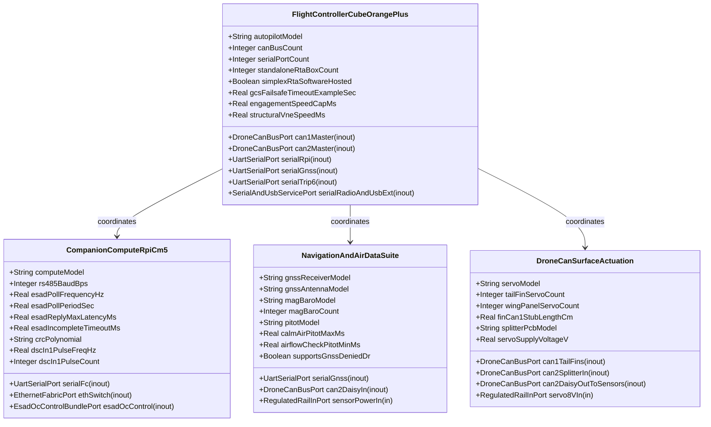
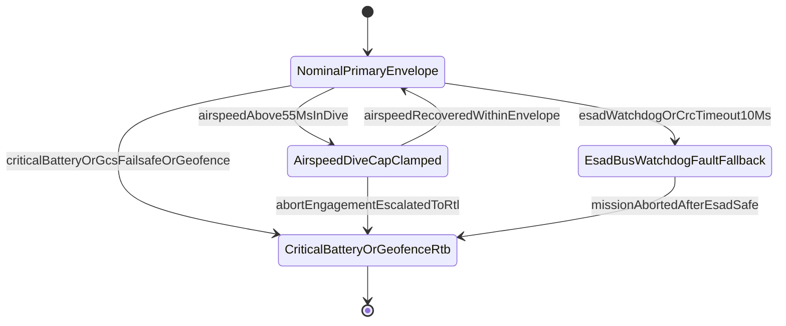

| Attribute | Specification Detail |
| :--- | :--- |
| **Issue ID** | #49 |
| **Title** | Epic 03: Avionics Guidance And Control |
| **Type** | epic |
| **Package** | AvionicsGuidanceAndControl |
| **Subsystem** | Avionics Guidance And Control |
| **Generation Mode** | subagent |
| **Specification Source** | [schema/model.sysml](../../schema/model.sysml) |

# Epic 03: Avionics Guidance And Control

## 1. Context
Subsystem Package 2 covering Cube orange+ Autopilot & Software Simplex RTA, RPI CM5004032 Companion Computer, GNSS/Mag/Pitot Navigation & Air Data Suite, and DroneCAN Surface Actuation.

## 2. Requirements & Checklist
- [ ] #37 - [Feature 06: [Avionics Guidance And Control] FlightControllerCubeOrangePlus](../features/FEAT-06-FlightControllerCubeOrangePlus.md)
- [ ] #38 - [Feature 07: [Avionics Guidance And Control] CompanionComputeRpiCm5](../features/FEAT-07-CompanionComputeRpiCm5.md)
- [ ] #39 - [Feature 08: [Avionics Guidance And Control] NavigationAndAirDataSuite](../features/FEAT-08-NavigationAndAirDataSuite.md)
- [ ] #40 - [Feature 09: [Avionics Guidance And Control] DroneCanSurfaceActuation](../features/FEAT-09-DroneCanSurfaceActuation.md)

### Associated Use Cases & User Stories

#### Associated Use Cases
- [ ] #25 - [Use Case 02: Monitor Flight Envelope And Simplex Rta](../use-cases/UC-02-MonitorFlightEnvelopeAndSimplexRta.md)
- [ ] #26 - [Use Case 03: Execute Gnss Denied And Lost Link Failsafe](../use-cases/UC-03-ExecuteGnssDeniedAndLostLinkFailsafe.md)

#### Associated User Stories
- [ ] #9 - [User Story 05: Execute Simplex Rta Envelope Check](../user-stories/US-05-ExecuteSimplexRtaEnvelopeCheck.md)
- [ ] #10 - [User Story 06: Run Pitot And Mag Preflight Check](../user-stories/US-06-RunPitotAndMagPreflightCheck.md)
- [ ] #11 - [User Story 07: Switch To Gnss Denied Dead Reckoning](../user-stories/US-07-SwitchToGnssDeniedDeadReckoning.md)
- [ ] #12 - [User Story 08: Supervise Esad Oc Master Cycle](../user-stories/US-08-SuperviseEsadOcMasterCycle.md)
- [ ] #13 - [User Story 09: Actuate Tail And Wing Surfaces](../user-stories/US-09-ActuateTailAndWingSurfaces.md)

## 3. Architecture
Classifiers: `FlightControllerCubeOrangePlus` (ports: `inout can1Master : DroneCanBusPort`, `inout can2Master : DroneCanBusPort`, `inout serialRpi : UartSerialPort`, `inout serialGnss : UartSerialPort`, `inout serialTrip6 : UartSerialPort`, `inout serialRadioAndUsbExt : SerialAndUsbServicePort`); `CompanionComputeRpiCm5` (ports: `inout serialFc : UartSerialPort`, `inout ethSwitch : EthernetFabricPort`, `inout esadOcControl : EsadOcControlBundlePort`); `NavigationAndAirDataSuite` (ports: `inout serialGnss : UartSerialPort`, `inout can2DaisyIn : DroneCanBusPort`, `in sensorPowerIn : RegulatedRailInPort`); `DroneCanSurfaceActuation` (ports: `inout can1TailFins : DroneCanBusPort`, `inout can2SplitterIn : DroneCanBusPort`, `inout can2DaisyOutToSensors : DroneCanBusPort`, `in servo8VIn : RegulatedRailInPort`). Package port definitions: `DroneCanBusPort`, `UartSerialPort`, `UsbExternalServicePort`, `SerialAndUsbServicePort`, `GnssCoaxRfPort`.

## 4. Operational Considerations
Lifecycle state machines: `RtaEnvelopeMonitorState` (Initial -> NominalPrimaryEnvelope; NominalPrimaryEnvelope -> AirspeedDiveCapClamped on airspeedAbove55MsInDive; AirspeedDiveCapClamped -> NominalPrimaryEnvelope on airspeedRecoveredWithinEnvelope; NominalPrimaryEnvelope -> EsadBusWatchdogFaultFallback on esadWatchdogOrCrcTimeout10Ms; NominalPrimaryEnvelope -> CriticalBatteryOrGeofenceRtb on criticalBatteryOrGcsFailsafeOrGeofence; AirspeedDiveCapClamped -> CriticalBatteryOrGeofenceRtb on abortEngagementEscalatedToRtl; EsadBusWatchdogFaultFallback -> CriticalBatteryOrGeofenceRtb on missionAbortedAfterEsadSafe; CriticalBatteryOrGeofenceRtb -> Terminal). Operational actions: `ExecuteSimplexRtaEnvelopeCheck`, `RunPitotAndMagPreflightCheck`, `SwitchToGnssDeniedDeadReckoning`, `SuperviseEsadOcMasterCycle`, `ActuateTailAndWingSurfaces`. Interaction sequences: `INT_04_AutopilotRtaAndSurfaceActuation`, `INT_05_GnssDeniedDeadReckoningAndPaceLink`.

## 5. Security & Governance
Allocated requirements: `REQ_L_03`, `REQ_H_03`, `REQ_UCA_03`, `REQ_UCA_04`, `REQ_SC_05`, `REQ_SC_06`, `REQ_SC_07`, `REQ_SC_08`, `REQ_SAF_08`, `REQ_SAF_09`. Enforced invariant constraints: `PitotPreflightCalibrationConstraint (in calmAirMs : Real && in blownAirMs : Real && attribute invariantExpr : String = "calmAirMs <= 3.0 and blownAirMs >= 10.0")`, `CanTopologyIsolationConstraint (in finCount : Integer && in wingCount : Integer && in magCount : Integer && in stubLenCm : Real && attribute invariantExpr : String = "finCount == 4 and wingCount == 4 and magCount == 2 and stubLenCm == 120.0")`, `SimplexRtaSoftwareHostingConstraint (in standaloneRtaBoxCount : Integer && in rtaHostedOnCubeOrangePlus : Boolean && attribute invariantExpr : String = "standaloneRtaBoxCount == 0 and rtaHostedOnCubeOrangePlus == true")`.

## 6. Source References
- System Architecture Model: `schema/model.sysml`
- Normative Systems Engineering Standard: ISO/IEC/IEEE 15288:2023 §6.4.3 Architecture Definition Process

Subsystem architectural composition and formal invariants derive from `schema/model.sysml` pursuant to ISO/IEC/IEEE 15288.

## System-Level UML Class Diagram

## System State Machine Diagram

