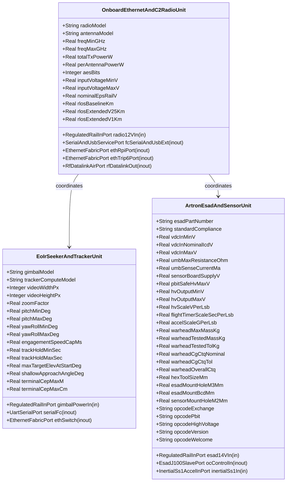
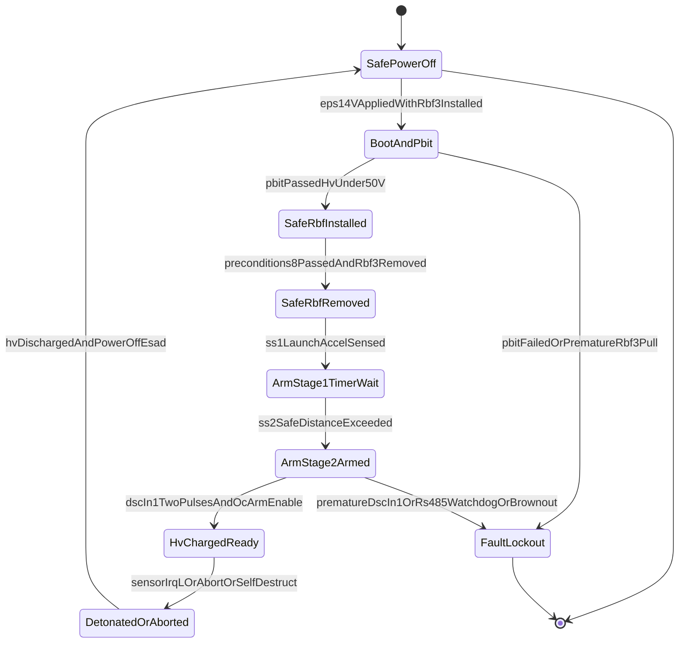

| Attribute | Specification Detail |
| :--- | :--- |
| **Issue ID** | #50 |
| **Title** | Epic 04: Mission Payloads Comms And Ordnance Safety |
| **Type** | epic |
| **Package** | MissionPayloadsCommsAndOrdnanceSafety |
| **Subsystem** | Mission Payloads Comms And Ordnance Safety |
| **Generation Mode** | subagent |
| **Specification Source** | [schema/model.sysml](../../schema/model.sysml) |

# Epic 04: Mission Payloads Comms And Ordnance Safety

## 1. Context
Subsystem Package 3 covering Onboard ETH Switch / External Interface / DTC C2 Radio, Nighthawk2UZ + Trip6 EO/IR Seeker, and Artron ESAD + Sensor Board + Warhead Holder.

## 2. Requirements & Checklist
- [ ] #41 - [Feature 10: [Mission Payloads Comms And Ordnance Safety] OnboardEthernetAndC2RadioUnit](../features/FEAT-10-OnboardEthernetAndC2RadioUnit.md)
- [ ] #42 - [Feature 11: [Mission Payloads Comms And Ordnance Safety] EoIrSeekerAndTrackerUnit](../features/FEAT-11-EoIrSeekerAndTrackerUnit.md)
- [ ] #43 - [Feature 12: [Mission Payloads Comms And Ordnance Safety] ArtronEsadAndSensorUnit](../features/FEAT-12-ArtronEsadAndSensorUnit.md)

### Associated Use Cases & User Stories

#### Associated Use Cases
- [ ] #27 - [Use Case 04: Track And Engage Target With Eo Ir](../use-cases/UC-04-TrackAndEngageTargetWithEoIr.md)
- [ ] #28 - [Use Case 05: Supervise Esad Arm And Detonation](../use-cases/UC-05-SuperviseEsadArmAndDetonation.md)

#### Associated User Stories
- [ ] #14 - [User Story 10: Execute Esad Boot And Pbit](../user-stories/US-10-ExecuteEsadBootAndPbit.md)
- [ ] #15 - [User Story 11: Transition Esad Arming Sequence](../user-stories/US-11-TransitionEsadArmingSequence.md)
- [ ] #16 - [User Story 12: Command Esad Abort And Self Destruct](../user-stories/US-12-CommandEsadAbortAndSelfDestruct.md)
- [ ] #17 - [User Story 13: Acquire And Track Terminal Target](../user-stories/US-13-AcquireAndTrackTerminalTarget.md)
- [ ] #18 - [User Story 14: Reboot Gimbal And Bridge Ethernet](../user-stories/US-14-RebootGimbalAndBridgeEthernet.md)

## 3. Architecture
Classifiers: `OnboardEthernetAndC2RadioUnit` (ports: `in radio12VIn : RegulatedRailInPort`, `inout fcSerialAndUsbExt : SerialAndUsbServicePort`, `inout ethRpiPort : EthernetFabricPort`, `inout ethTrip6Port : EthernetFabricPort`, `inout rfDatalinkOut : RfDatalinkAirPort`); `EoIrSeekerAndTrackerUnit` (ports: `in gimbalPowerIn : RegulatedRailInPort`, `inout serialFc : UartSerialPort`, `inout ethSwitch : EthernetFabricPort`); `ArtronEsadAndSensorUnit` (ports: `in esad14VIn : RegulatedRailInPort`, `inout ocControlIn : EsadJ100SlavePort`, `in inertialSs1In : InertialSs1AccelInPort`). Package port definitions: `EthernetFabricPort`, `RfDatalinkAirPort`, `EsadOcControlBundlePort`, `EsadJ100SlavePort`, `InertialSs1AccelInPort`.

## 4. Operational Considerations
Lifecycle state machines: `EsadSafeArmState` (Initial -> SafePowerOff; SafePowerOff -> BootAndPbit on eps14VAppliedWithRbf3Installed; BootAndPbit -> SafeRbfInstalled on pbitPassedHvUnder50V; BootAndPbit -> FaultLockout on pbitFailedOrPrematureRbf3Pull; SafeRbfInstalled -> SafeRbfRemoved on preconditions8PassedAndRbf3Removed; SafeRbfRemoved -> ArmStage1TimerWait on ss1LaunchAccelSensed; ArmStage1TimerWait -> ArmStage2Armed on ss2SafeDistanceExceeded; ArmStage2Armed -> HvChargedReady on dscIn1TwoPulsesAndOcArmEnable; HvChargedReady -> DetonatedOrAborted on sensorIrqLOrAbortOrSelfDestruct; ArmStage2Armed -> FaultLockout on prematureDscIn1OrRs485WatchdogOrBrownout; DetonatedOrAborted -> SafePowerOff on hvDischargedAndPowerOffEsad; SafePowerOff -> Terminal; FaultLockout -> Terminal), `PaceC2LinkState` (Initial -> AlternateDtcOmniLocal; AlternateDtcOmniLocal -> PrimaryDtcDirTracking on postLaunchDirRotatorLockAcquired; PrimaryDtcDirTracking -> AlternateDtcOmniLocal on dirTrackingDegradedNearFieldFallbackOmni; PrimaryDtcDirTracking -> ContingencyGnssDeniedDrFlight on gnssSpoofOrDisableGnssSelected; ContingencyGnssDeniedDrFlight -> PrimaryDtcDirTracking on gnssRtkRestoredAndEnabled; PrimaryDtcDirTracking -> EmergencyLostLinkRtlHolding on gcsLinkLostExceeding105Sec; ContingencyGnssDeniedDrFlight -> EmergencyLostLinkRtlHolding on gcsLinkLostExceeding105Sec; EmergencyLostLinkRtlHolding -> AlternateDtcOmniLocal on linkReacquiredInReturnCorridor; AlternateDtcOmniLocal -> Terminal; EmergencyLostLinkRtlHolding -> Terminal). Operational actions: `ExecuteEsadBootAndPbit`, `TransitionEsadArmingSequence`, `CommandEsadAbortAndSelfDestruct`, `AcquireAndTrackTerminalTarget`, `RebootGimbalAndBridgeEthernet`. Interaction sequences: `INT_06_EoIrSeekerTrackAndTerminalDive`, `INT_07_EsadDualBarrierArmAndDetonation`.

## 5. Security & Governance
Allocated requirements: `REQ_L_04`, `REQ_H_04`, `REQ_H_05`, `REQ_UCA_05`, `REQ_UCA_06`, `REQ_UCA_07`, `REQ_SC_09`, `REQ_SC_10`, `REQ_SC_11`, `REQ_SC_12`, `REQ_SAF_04`, `REQ_SAF_06`, `REQ_SAF_07`, `REQ_SAF_10`. Enforced invariant constraints: `EsadInputVoltageAndBrownoutConstraint (in vdcInV : Real && attribute invariantExpr : String = "vdcInV >= 14.0 and vdcInV <= 32.0")`, `EsadRs485ProtocolTimingConstraint (in baudBps : Integer && in pollHz : Real && in replyMs : Real && in timeoutMs : Real && attribute invariantExpr : String = "baudBps == 115200 and pollHz == 100.0 and replyMs <= 5.0 and timeoutMs <= 10.0")`, `EsadRbf3PowerBeforePullConstraint (in uavPoweredBeforeRbf3Pull : Boolean && in umbResistanceOhm : Real && attribute invariantExpr : String = "uavPoweredBeforeRbf3Pull == true and umbResistanceOhm < 0.5")`, `EsadSafeDistanceExceedConstraint (in safeDistanceExceeded : Boolean && in ss1Sensed : Boolean && attribute invariantExpr : String = "safeDistanceExceeded == true and ss1Sensed == true")`, `WarheadMassAndPbitHvSafetyConstraint (in warheadMassKg : Real && in pbitHvV : Real && in fireHvV : Real && attribute invariantExpr : String = "warheadMassKg <= 5.0 and pbitHvV < 50.0 and fireHvV >= 0.0 and fireHvV <= 1800.0")`, `EngagementSpeedAndTrackHoldConstraint (in airspeedMs : Real && in trackHoldSec : Real && in cepM : Real && attribute invariantExpr : String = "airspeedMs <= 55.0 and trackHoldSec >= 2.0 and trackHoldSec <= 5.0 and cepM <= 0.5")`.

## 6. Source References
- System Architecture Model: `schema/model.sysml`
- Normative Systems Engineering Standard: ISO/IEC/IEEE 15288:2023 §6.4.3 Architecture Definition Process

Subsystem architectural composition and formal invariants derive from `schema/model.sysml` pursuant to ISO/IEC/IEEE 15288.

## System-Level UML Class Diagram

## System State Machine Diagram

