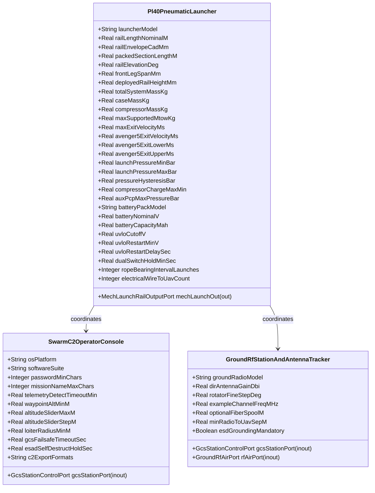
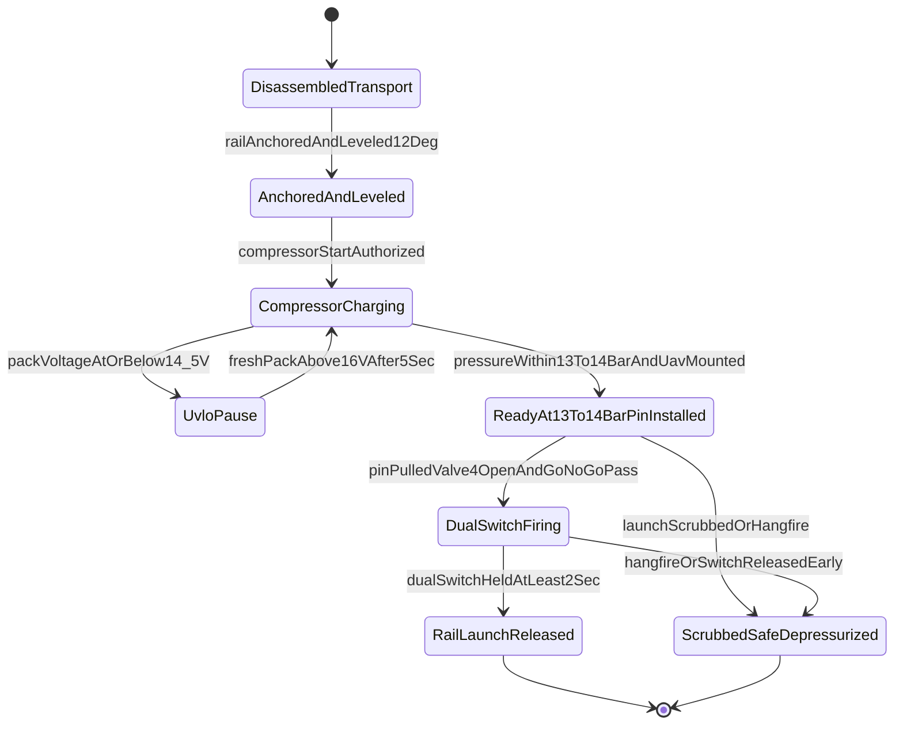

| Attribute | Specification Detail |
| :--- | :--- |
| **Issue ID** | #51 |
| **Title** | Epic 05: Ground Launch And Command Segment |
| **Type** | epic |
| **Package** | GroundLaunchAndCommandSegment |
| **Subsystem** | Ground Launch And Command Segment |
| **Generation Mode** | subagent |
| **Specification Source** | [schema/model.sysml](../../schema/model.sysml) |

# Epic 05: Ground Launch And Command Segment

## 1. Context
Subsystem Package 4 covering ELI PL-40 Rev 2.6 Pneumatic Launcher, SwarmC2 Windows 11 Rugged Tablet Console, and Ground DTC RF Station / MARS Rotator / ESD Grounding.

## 2. Requirements & Checklist
- [ ] #44 - [Feature 13: [Ground Launch And Command Segment] Pl40PneumaticLauncher](../features/FEAT-13-Pl40PneumaticLauncher.md)
- [ ] #45 - [Feature 14: [Ground Launch And Command Segment] SwarmC2OperatorConsole](../features/FEAT-14-SwarmC2OperatorConsole.md)
- [ ] #46 - [Feature 15: [Ground Launch And Command Segment] GroundRfStationAndAntennaTracker](../features/FEAT-15-GroundRfStationAndAntennaTracker.md)

### Associated Use Cases & User Stories

#### Associated Use Cases
- [ ] #29 - [Use Case 06: Execute Pl40 Rail Launch](../use-cases/UC-06-ExecutePl40RailLaunch.md)
- [ ] #30 - [Use Case 07: Manage Ground C2 Rotator And Data Export](../use-cases/UC-07-ManageGroundC2RotatorAndDataExport.md)
- [ ] #31 - [Use Case 08: Execute Safe Scrub And Hangfire Recovery](../use-cases/UC-08-ExecuteSafeScrubAndHangfireRecovery.md)

#### Associated User Stories
- [ ] #19 - [User Story 15: Charge Pl40 Compressor With Uvlo Check](../user-stories/US-15-ChargePl40CompressorWithUvloCheck.md)
- [ ] #20 - [User Story 16: Execute Launch Go No Go And Dual Trigger](../user-stories/US-16-ExecuteLaunchGoNoGoAndDualTrigger.md)
- [ ] #21 - [User Story 17: Depressurize And Scrub Pl40 Launcher](../user-stories/US-17-DepressurizeAndScrubPl40Launcher.md)
- [ ] #22 - [User Story 18: Authenticate Operator And Calibrate Rotator](../user-stories/US-18-AuthenticateOperatorAndCalibrateRotator.md)
- [ ] #23 - [User Story 19: Export Target Report5 w Cff](../user-stories/US-19-ExportTargetReport5wCff.md)

## 3. Architecture
Classifiers: `Pl40PneumaticLauncher` (ports: `out mechLaunchOut : MechLaunchRailOutputPort`); `SwarmC2OperatorConsole` (ports: `inout gcsStationPort : GcsStationControlPort`); `GroundRfStationAndAntennaTracker` (ports: `inout gcsStationPort : GcsStationControlPort`, `inout rfAirPort : GroundRfAirPort`). Package port definitions: `MechLaunchRailOutputPort`, `GroundRfAirPort`, `GcsStationControlPort`.

## 4. Operational Considerations
Lifecycle state machines: `Pl40LauncherState` (Initial -> DisassembledTransport; DisassembledTransport -> AnchoredAndLeveled on railAnchoredAndLeveled12Deg; AnchoredAndLeveled -> CompressorCharging on compressorStartAuthorized; CompressorCharging -> UvloPause on packVoltageAtOrBelow14_5V; UvloPause -> CompressorCharging on freshPackAbove16VAfter5Sec; CompressorCharging -> ReadyAt13To14BarPinInstalled on pressureWithin13To14BarAndUavMounted; ReadyAt13To14BarPinInstalled -> DualSwitchFiring on pinPulledValve4OpenAndGoNoGoPass; DualSwitchFiring -> RailLaunchReleased on dualSwitchHeldAtLeast2Sec; ReadyAt13To14BarPinInstalled -> ScrubbedSafeDepressurized on launchScrubbedOrHangfire; DualSwitchFiring -> ScrubbedSafeDepressurized on hangfireOrSwitchReleasedEarly; RailLaunchReleased -> Terminal; ScrubbedSafeDepressurized -> Terminal). Operational actions: `ChargePl40CompressorWithUvloCheck`, `ExecuteLaunchGoNoGoAndDualTrigger`, `DepressurizeAndScrubPl40Launcher`, `AuthenticateOperatorAndCalibrateRotator`, `ExportTargetReport5wCff`. Interaction sequences: `INT_03_Pl40RailChargeAndLaunchSequence`, `INT_08_EmergencyScrubAndSafing`.

## 5. Security & Governance
Allocated requirements: `REQ_H_06`, `REQ_UCA_08`, `REQ_SC_13`, `REQ_SC_14`, `REQ_SC_15`, `REQ_SC_16`, `REQ_SAF_03`, `REQ_SAF_11`, `REQ_SAF_12`. Enforced invariant constraints: `Pl40MassAndExitVelocityConstraint (in uavMassKg : Real && in pressureBar : Real && in exitVelMs : Real && in windMs : Real && attribute invariantExpr : String = "uavMassKg <= 30.0 and pressureBar >= 13.0 and pressureBar <= 14.0 and exitVelMs <= 25.0 and windMs <= 12.0")`, `Pl40UvloAndDualSwitchConstraint (in packVoltageV : Real && in dualHoldSec : Real && attribute invariantExpr : String = "packVoltageV > 14.5 and dualHoldSec >= 2.0")`, `SwarmC2AuthAndMissionBoundsConstraint (in passwordLen : Integer && in missionNameLen : Integer && in waypointAltM : Real && in loiterRadiusM : Real && attribute invariantExpr : String = "passwordLen >= 8 and missionNameLen <= 24 and waypointAltM >= 50.0 and waypointAltM <= 3000.0 and loiterRadiusM >= 300.0")`, `GroundCrewSeparationAndEsdConstraint (in esdGrounded : Boolean && in separationM : Real && attribute invariantExpr : String = "esdGrounded == true and separationM >= 10.0")`.

## 6. Source References
- System Architecture Model: `schema/model.sysml`
- Normative Systems Engineering Standard: ISO/IEC/IEEE 15288:2023 §6.4.3 Architecture Definition Process

Subsystem architectural composition and formal invariants derive from `schema/model.sysml` pursuant to ISO/IEC/IEEE 15288.

## System-Level UML Class Diagram

## System State Machine Diagram

