| Attribute | Specification Detail |
| :--- | :--- |
| **Issue ID** | #32 |
| **Title** | Feature 01: [System Architecture] Avenger5V25IntegratedSystem |
| **Type** | feature |
| **Parent Epic** | [EPIC-01-Avenger5V25UasSystem](../epics/EPIC-01-Avenger5V25UasSystem.md) |
| **Interface Type** | Physical / Structural / Internal Bus |
| **Schema Containers** | `Avenger5V25UasSystem::Avenger5V25IntegratedSystem` |
| **Generation Mode** | subagent |
| **Specification Source** | [schema/model.sysml](../../schema/model.sysml) |

# Feature 01: [System Architecture] Avenger5V25IntegratedSystem

## UML Class Diagram

```mermaid
classDiagram
    class Avenger5V25IntegratedSystem
    Avenger5V25IntegratedSystem --> MainBatteryAndFuseUnit : batteryAndFuse
    Avenger5V25IntegratedSystem --> PowerMeterAndRbfSwitch : powerMeter
    Avenger5V25IntegratedSystem --> ElectricPropulsionUnit : propulsionAndAirframe
    Avenger5V25IntegratedSystem --> ElectronicPowerSystemEps : eps
    Avenger5V25IntegratedSystem --> FlightControllerCubeOrangePlus : flightController
    Avenger5V25IntegratedSystem --> CompanionComputeRpiCm5 : companionComputer
    Avenger5V25IntegratedSystem --> NavigationAndAirDataSuite : navAirData
    Avenger5V25IntegratedSystem --> DroneCanSurfaceActuation : surfaceActuators
    Avenger5V25IntegratedSystem --> OnboardEthernetAndC2RadioUnit : commsUnit
    Avenger5V25IntegratedSystem --> EoIrSeekerAndTrackerUnit : seekerUnit
    Avenger5V25IntegratedSystem --> ArtronEsadAndSensorUnit : esadUnit
    Avenger5V25IntegratedSystem --> Pl40PneumaticLauncher : pl40Launcher
    Avenger5V25IntegratedSystem --> SwarmC2OperatorConsole : swarmC2Console
    Avenger5V25IntegratedSystem --> GroundRfStationAndAntennaTracker : groundRfStation
```



## Interface Requirements
### 1. Test Data Shape
```json
{
  "$schema": "https://json-schema.org/draft/2020-12/schema",
  "title": "Avenger5V25IntegratedSystemPayloadSchema",
  "type": "object",
  "properties": {
    "part": {
      "type": "string",
      "const": "Avenger5V25IntegratedSystem"
    },
    "status": {
      "type": "string",
      "enum": ["nominal", "degraded", "fault"]
    }
  },
  "required": [
    "part",
    "status"
  ],
  "additionalProperties": false
}
```

### 2. Validation & Constraints
Classifier `Avenger5V25IntegratedSystem` declares no additional constraints specified in schema.

### 3. Visual Layout & Arrangement
Structural composition and boundary topology for classifier `Avenger5V25IntegratedSystem` organize nested subparts `batteryAndFuse : MainBatteryAndFuseUnit`, `powerMeter : PowerMeterAndRbfSwitch`, `propulsionAndAirframe : ElectricPropulsionUnit`, `eps : ElectronicPowerSystemEps`, `flightController : FlightControllerCubeOrangePlus`, `companionComputer : CompanionComputeRpiCm5`, `navAirData : NavigationAndAirDataSuite`, `surfaceActuators : DroneCanSurfaceActuation`, `commsUnit : OnboardEthernetAndC2RadioUnit`, `seekerUnit : EoIrSeekerAndTrackerUnit`, `esadUnit : ArtronEsadAndSensorUnit`, `pl40Launcher : Pl40PneumaticLauncher`, `swarmC2Console : SwarmC2OperatorConsole`, `groundRfStation : GroundRfStationAndAntennaTracker` paired with no external boundary ports declared in schema.

### 4. Interactive Flow & States
Operational lifecycle events and discrete state transitions for Avenger5V25IntegratedSystem.

### Layer 1: Domain State & Signal Model
Classifier `Avenger5V25IntegratedSystem` maintains typed lifecycle status (`nominal`, `degraded`, `fault`) with no additional value attributes declared in schema.

### Layer 2: Logic & Safety State Management
Classifier `Avenger5V25IntegratedSystem` governs stateless structural transition evaluation enforcing no additional invariant guards declared in schema.

### Layer 3: Presentation & Actuator Interface Binding
Classifier `Avenger5V25IntegratedSystem` exposes an internal structural boundary with no external ports, operations, or actions declared in schema.

## Acceptance Criteria (BDD)
- [ ] AC-01: Given valid `Avenger5V25IntegratedSystem` initialization inputs for `Avenger5V25IntegratedSystem` state representation (no additional constraints specified in schema), When `Avenger5V25IntegratedSystem` commits typed domain state, Then declared state attributes hold verified values.
- [ ] AC-02: Given malformed or out-of-domain input values for `Avenger5V25IntegratedSystem` state representation, When `Avenger5V25IntegratedSystem` validates incoming state updates, Then `Avenger5V25IntegratedSystem` rejects the invalid state update and emits a diagnostic via deterministic error diagnostic output.
- [ ] AC-03: Given nominal signal arrival across `Avenger5V25IntegratedSystem` structural boundary, When `Avenger5V25IntegratedSystem` processes the declared interface transaction, Then output state conforms to the structural classifier contract.
- [ ] AC-04: Given an invalid or unrecognized interface frame across `Avenger5V25IntegratedSystem` structural boundary, When `Avenger5V25IntegratedSystem` boundary validation executes, Then `Avenger5V25IntegratedSystem` refuses the malformed frame via deterministic error diagnostic output and preserves prior verified state.

## Source References
Formal component specifications and normative systems engineering requirements:
- System Architecture Model: `schema/model.sysml`
- Normative Systems Engineering Standard: ISO/IEC/IEEE 15288:2023 §6.4.3 Architecture Definition Process

Component behavior and interface definitions derive from `schema/model.sysml` pursuant to ISO/IEC/IEEE 15288.
