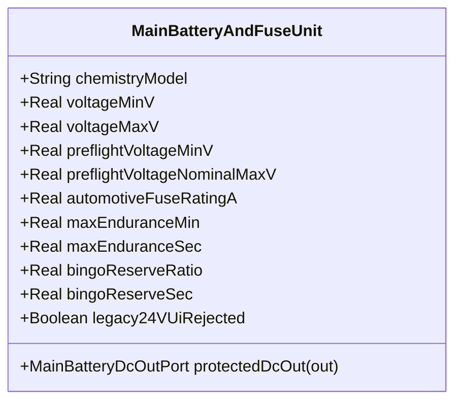

| Attribute | Specification Detail |
| :--- | :--- |
| **Issue ID** | #33 |
| **Title** | Feature 02: [Airframe Power And Propulsion] MainBatteryAndFuseUnit |
| **Type** | feature |
| **Parent Epic** | [EPIC-02-AirframePowerAndPropulsion](../epics/EPIC-02-AirframePowerAndPropulsion.md) |
| **Interface Type** | Physical / Structural / Internal Bus |
| **Schema Containers** | `AirframePowerAndPropulsion::MainBatteryAndFuseUnit` |
| **Generation Mode** | subagent |
| **Specification Source** | [schema/model.sysml](../../schema/model.sysml) |

# Feature 02: [Airframe Power And Propulsion] MainBatteryAndFuseUnit

## UML Class Diagram



## Interface Requirements
### 1. Test Data Shape
```json
{
  "$schema": "https://json-schema.org/draft/2020-12/schema",
  "title": "MainBatteryAndFuseUnitPayloadSchema",
  "type": "object",
  "properties": {
    "part": {
      "type": "string",
      "const": "MainBatteryAndFuseUnit"
    },
    "status": {
      "type": "string",
      "enum": ["nominal", "degraded", "fault"]
    },
    "chemistryModel": {
      "type": "string",
      "x-sysml-type": "String",
      "description": "Declared attribute chemistryModel (String)",
      "default": "12S2P Li metal BEI maximus20"
    },
    "voltageMinV": {
      "type": "number",
      "x-sysml-type": "Real",
      "description": "Declared attribute voltageMinV (Real)",
      "default": 36.0
    },
    "voltageMaxV": {
      "type": "number",
      "x-sysml-type": "Real",
      "description": "Declared attribute voltageMaxV (Real)",
      "default": 50.4
    },
    "preflightVoltageMinV": {
      "type": "number",
      "x-sysml-type": "Real",
      "description": "Declared attribute preflightVoltageMinV (Real)",
      "default": 49.0
    },
    "preflightVoltageNominalMaxV": {
      "type": "number",
      "x-sysml-type": "Real",
      "description": "Declared attribute preflightVoltageNominalMaxV (Real)",
      "default": 50.0
    },
    "automotiveFuseRatingA": {
      "type": "number",
      "x-sysml-type": "Real",
      "description": "Declared attribute automotiveFuseRatingA (Real)",
      "default": 200.0
    },
    "maxEnduranceMin": {
      "type": "number",
      "x-sysml-type": "Real",
      "description": "Declared attribute maxEnduranceMin (Real)",
      "default": 90.0
    },
    "maxEnduranceSec": {
      "type": "number",
      "x-sysml-type": "Real",
      "description": "Declared attribute maxEnduranceSec (Real)",
      "default": 5400.0
    },
    "bingoReserveRatio": {
      "type": "number",
      "x-sysml-type": "Real",
      "description": "Declared attribute bingoReserveRatio (Real)",
      "default": 0.2
    },
    "bingoReserveSec": {
      "type": "number",
      "x-sysml-type": "Real",
      "description": "Declared attribute bingoReserveSec (Real)",
      "default": 1080.0
    },
    "legacy24VUiRejected": {
      "type": "boolean",
      "x-sysml-type": "Boolean",
      "description": "Declared attribute legacy24VUiRejected (Boolean)",
      "default": true
    },
    "protectedDcOut": {
      "type": "object",
      "properties": {
        "direction": { "type": "string", "const": "out" },
        "port_type": { "type": "string", "const": "MainBatteryDcOutPort" }
      },
      "required": ["direction", "port_type"]
    }
  },
  "required": [
    "part",
    "status",
    "protectedDcOut"
  ],
  "additionalProperties": false
}
```

### 2. Validation & Constraints
Declared structural attributes, boundary ports, invariants, and allocated requirements for classifier `MainBatteryAndFuseUnit`:

| AST Member Kind | Identifier | Declared Type / Direction | Default / Invariant Contract |
| :--- | :--- | :--- | :--- |
| Attribute | `chemistryModel` | `String` | Default `"12S2P Li metal BEI maximus20"` |
| Attribute | `voltageMinV` | `Real` | Default `36.0` |
| Attribute | `voltageMaxV` | `Real` | Default `50.4` |
| Attribute | `preflightVoltageMinV` | `Real` | Default `49.0` |
| Attribute | `preflightVoltageNominalMaxV` | `Real` | Default `50.0` |
| Attribute | `automotiveFuseRatingA` | `Real` | Default `200.0` |
| Attribute | `maxEnduranceMin` | `Real` | Default `90.0` |
| Attribute | `maxEnduranceSec` | `Real` | Default `5400.0` |
| Attribute | `bingoReserveRatio` | `Real` | Default `0.2` |
| Attribute | `bingoReserveSec` | `Real` | Default `1080.0` |
| Attribute | `legacy24VUiRejected` | `Boolean` | Default `true` |
| Port | `protectedDcOut` | `out MainBatteryDcOutPort` | Boundary interface contract |
| Requirement | `REQ_L_01` | Allocated Requirement | Allocated requirement obligation |
| Requirement | `REQ_L_02` | Allocated Requirement | Allocated requirement obligation |
| Requirement | `REQ_H_01` | Allocated Requirement | Allocated requirement obligation |
| Requirement | `REQ_H_02` | Allocated Requirement | Allocated requirement obligation |
| Requirement | `REQ_UCA_01` | Allocated Requirement | Allocated requirement obligation |
| Requirement | `REQ_UCA_02` | Allocated Requirement | Allocated requirement obligation |
| Requirement | `REQ_SC_01` | Allocated Requirement | SC-01: Enforce ordered pre-flight interlock: ESD ground -> RBF #1 off -> prop fold rearward -> RBF #2 pull -> 49.0-50.0 V check -> lock both RBF and umbilical lids. |
| Requirement | `REQ_SC_02` | Allocated Requirement | Allocated requirement obligation |
| Requirement | `REQ_SC_03` | Allocated Requirement | SC-03: Inhibit optional 2x 50.0 V RnD recovery igniter outputs on production Avenger V2.5 (rndRecoveryOptionInstalled == false). |
| Requirement | `REQ_SC_04` | Allocated Requirement | Allocated requirement obligation |
| Requirement | `REQ_SAF_01` | Allocated Requirement | Allocated requirement obligation |
| Requirement | `REQ_SAF_02` | Allocated Requirement | Allocated requirement obligation |
| Requirement | `REQ_SAF_05` | Allocated Requirement | GAP-05 Mitigation: Anchor battery UI and health checks strictly to 12S2P 36.0-50.4 V (49.0-50.0 V pre-flight), rejecting legacy 23.9-25.0 V screenshots. |

### 3. Visual Layout & Arrangement
Structural composition and boundary topology for classifier `MainBatteryAndFuseUnit` organize no nested subparts declared in schema paired with boundary ports `out protectedDcOut : MainBatteryDcOutPort`.

### 4. Interactive Flow & States
Operational lifecycle events and discrete state transitions for MainBatteryAndFuseUnit.

### Layer 1: Domain State & Signal Model
Classifier `MainBatteryAndFuseUnit` encapsulates typed domain state attributes `chemistryModel : String`, `voltageMinV : Real`, `voltageMaxV : Real`, `preflightVoltageMinV : Real`, `preflightVoltageNominalMaxV : Real`, `automotiveFuseRatingA : Real`, `maxEnduranceMin : Real`, `maxEnduranceSec : Real`, `bingoReserveRatio : Real`, `bingoReserveSec : Real`, `legacy24VUiRejected : Boolean` alongside operational lifecycle status.

### Layer 2: Logic & Safety State Management
Classifier `MainBatteryAndFuseUnit` governs stateless structural transition evaluation enforcing invariant obligations `REQ_L_01`, `REQ_L_02`, `REQ_H_01`, `REQ_H_02`, `REQ_UCA_01`, `REQ_UCA_02`, `REQ_SC_01`, `REQ_SC_02`, `REQ_SC_03`, `REQ_SC_04`, `REQ_SAF_01`, `REQ_SAF_02`, `REQ_SAF_05`.

### Layer 3: Presentation & Actuator Interface Binding
Classifier `MainBatteryAndFuseUnit` binds external and behavioral interfaces across port `out protectedDcOut : MainBatteryDcOutPort`.

### Associated Use Cases & User Stories

#### Associated Use Cases
- [ ] #24 - [Use Case 01: Verify Preflight Power And Bit](../use-cases/UC-01-VerifyPreflightPowerAndBit.md)

#### Associated User Stories
- [ ] #5 - [User Story 01: Validate Battery And Power On Rbf2](../user-stories/US-01-ValidateBatteryAndPowerOnRbf2.md)
- [ ] #6 - [User Story 02: Command Pusher Throttle And Read Esc Telem](../user-stories/US-02-CommandPusherThrottleAndReadEscTelem.md)
- [ ] #7 - [User Story 03: Distribute Regulated Power Rails](../user-stories/US-03-DistributeRegulatedPowerRails.md)
- [ ] #8 - [User Story 04: Monitor Bingo Energy Reserve](../user-stories/US-04-MonitorBingoEnergyReserve.md)

## Acceptance Criteria (BDD)
- [ ] AC-01: Given valid `MainBatteryAndFuseUnit` inputs satisfying `REQ_L_01`, When `MainBatteryAndFuseUnit` evaluates invariant `REQ_L_01`, Then the invariant holds and verified state is committed.
- [ ] AC-02: Given boundary inputs that violate `REQ_L_01`, When `MainBatteryAndFuseUnit` evaluates invariant `REQ_L_01`, Then `MainBatteryAndFuseUnit` rejects the invalid transition and routes a diagnostic via diagnostic port `protectedDcOut`.
- [ ] AC-03: Given valid `MainBatteryAndFuseUnit` inputs satisfying `REQ_L_02`, When `MainBatteryAndFuseUnit` evaluates invariant `REQ_L_02`, Then the invariant holds and verified state is committed.
- [ ] AC-04: Given boundary inputs that violate `REQ_L_02`, When `MainBatteryAndFuseUnit` evaluates invariant `REQ_L_02`, Then `MainBatteryAndFuseUnit` rejects the invalid transition and routes a diagnostic via diagnostic port `protectedDcOut`.
- [ ] AC-05: Given valid `MainBatteryAndFuseUnit` inputs satisfying `REQ_H_01`, When `MainBatteryAndFuseUnit` evaluates invariant `REQ_H_01`, Then the invariant holds and verified state is committed.
- [ ] AC-06: Given boundary inputs that violate `REQ_H_01`, When `MainBatteryAndFuseUnit` evaluates invariant `REQ_H_01`, Then `MainBatteryAndFuseUnit` rejects the invalid transition and routes a diagnostic via diagnostic port `protectedDcOut`.
- [ ] AC-07: Given valid `MainBatteryAndFuseUnit` state satisfying composite invariants (`REQ_H_02`; `REQ_UCA_01`; `REQ_UCA_02`; `REQ_SC_01` (`SC-01: Enforce ordered pre-flight interlock: ESD ground -> RBF #1 off -> prop fold rearward -> RBF #2 pull -> 49.0-50.0 V check -> lock both RBF and umbilical lids.`); `REQ_SC_02`; `REQ_SC_03` (`SC-03: Inhibit optional 2x 50.0 V RnD recovery igniter outputs on production Avenger V2.5 (rndRecoveryOptionInstalled == false).`); `REQ_SC_04`; `REQ_SAF_01`; `REQ_SAF_02`; `REQ_SAF_05` (`GAP-05 Mitigation: Anchor battery UI and health checks strictly to 12S2P 36.0-50.4 V (49.0-50.0 V pre-flight), rejecting legacy 23.9-25.0 V screenshots.`)), When `MainBatteryAndFuseUnit` evaluates the remaining invariant conjunction, Then all declared invariants hold and verified state is committed.
- [ ] AC-08: Given input state that violates any invariant in (`REQ_H_02`; `REQ_UCA_01`; `REQ_UCA_02`; `REQ_SC_01` (`SC-01: Enforce ordered pre-flight interlock: ESD ground -> RBF #1 off -> prop fold rearward -> RBF #2 pull -> 49.0-50.0 V check -> lock both RBF and umbilical lids.`); `REQ_SC_02`; `REQ_SC_03` (`SC-03: Inhibit optional 2x 50.0 V RnD recovery igniter outputs on production Avenger V2.5 (rndRecoveryOptionInstalled == false).`); `REQ_SC_04`; `REQ_SAF_01`; `REQ_SAF_02`; `REQ_SAF_05` (`GAP-05 Mitigation: Anchor battery UI and health checks strictly to 12S2P 36.0-50.4 V (49.0-50.0 V pre-flight), rejecting legacy 23.9-25.0 V screenshots.`)), When `MainBatteryAndFuseUnit` evaluates the composite guard, Then `MainBatteryAndFuseUnit` rejects the invalid state transition and routes a diagnostic via diagnostic port `protectedDcOut`.
- [ ] AC-09: Given nominal typed values for `chemistryModel` (`String`), `voltageMinV` (`Real`), `voltageMaxV` (`Real`), `preflightVoltageMinV` (`Real`), `preflightVoltageNominalMaxV` (`Real`), `automotiveFuseRatingA` (`Real`), `maxEnduranceMin` (`Real`), `maxEnduranceSec` (`Real`), `bingoReserveRatio` (`Real`), `bingoReserveSec` (`Real`), `legacy24VUiRejected` (`Boolean`) across `protectedDcOut` (`out MainBatteryDcOutPort`), When `MainBatteryAndFuseUnit` executes structural interface processing, Then state and output ports conform to declared schema types.
- [ ] AC-10: Given malformed input frames across `chemistryModel` (`String`), `voltageMinV` (`Real`), `voltageMaxV` (`Real`), `preflightVoltageMinV` (`Real`), `preflightVoltageNominalMaxV` (`Real`), `automotiveFuseRatingA` (`Real`), `maxEnduranceMin` (`Real`), `maxEnduranceSec` (`Real`), `bingoReserveRatio` (`Real`), `bingoReserveSec` (`Real`), `legacy24VUiRejected` (`Boolean`) or `protectedDcOut` (`out MainBatteryDcOutPort`), When `MainBatteryAndFuseUnit` boundary validation executes, Then `MainBatteryAndFuseUnit` rejects the malformed input via diagnostic port `protectedDcOut`.

## Source References
Formal component specifications and normative systems engineering requirements:
- System Architecture Model: `schema/model.sysml`
- Normative Systems Engineering Standard: ISO/IEC/IEEE 15288:2023 §6.4.3 Architecture Definition Process

Component behavior and interface definitions derive from `schema/model.sysml` pursuant to ISO/IEC/IEEE 15288.
