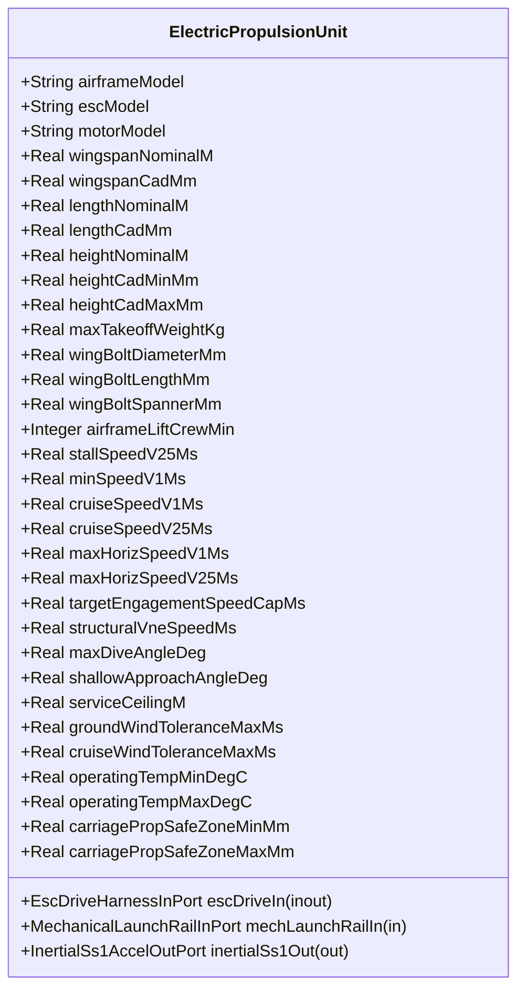

| Attribute | Specification Detail |
| :--- | :--- |
| **Issue ID** | #35 |
| **Title** | Feature 04: [Airframe Power And Propulsion] ElectricPropulsionUnit |
| **Type** | feature |
| **Parent Epic** | [EPIC-02-AirframePowerAndPropulsion](../epics/EPIC-02-AirframePowerAndPropulsion.md) |
| **Interface Type** | Physical / Structural / Internal Bus |
| **Schema Containers** | `AirframePowerAndPropulsion::ElectricPropulsionUnit` |
| **Generation Mode** | subagent |
| **Specification Source** | [schema/model.sysml](../../schema/model.sysml) |

# Feature 04: [Airframe Power And Propulsion] ElectricPropulsionUnit

## UML Class Diagram



## Interface Requirements
### 1. Test Data Shape
```json
{
  "$schema": "https://json-schema.org/draft/2020-12/schema",
  "title": "ElectricPropulsionUnitPayloadSchema",
  "type": "object",
  "properties": {
    "part": {
      "type": "string",
      "const": "ElectricPropulsionUnit"
    },
    "status": {
      "type": "string",
      "enum": ["nominal", "degraded", "fault"]
    },
    "airframeModel": {
      "type": "string",
      "x-sysml-type": "String",
      "description": "Declared attribute airframeModel (String)",
      "default": "AVENGER V2.5 / ASTK A5 V2.5"
    },
    "escModel": {
      "type": "string",
      "x-sysml-type": "String",
      "description": "Declared attribute escModel (String)",
      "default": "IBEX160"
    },
    "motorModel": {
      "type": "string",
      "x-sysml-type": "String",
      "description": "Declared attribute motorModel (String)",
      "default": "AXI 5345/16 HD GOLD LINE V3"
    },
    "wingspanNominalM": {
      "type": "number",
      "x-sysml-type": "Real",
      "description": "Declared attribute wingspanNominalM (Real)",
      "default": 1.8
    },
    "wingspanCadMm": {
      "type": "number",
      "x-sysml-type": "Real",
      "description": "Declared attribute wingspanCadMm (Real)",
      "default": 1803.0
    },
    "lengthNominalM": {
      "type": "number",
      "x-sysml-type": "Real",
      "description": "Declared attribute lengthNominalM (Real)",
      "default": 1.6
    },
    "lengthCadMm": {
      "type": "number",
      "x-sysml-type": "Real",
      "description": "Declared attribute lengthCadMm (Real)",
      "default": 1576.0
    },
    "heightNominalM": {
      "type": "number",
      "x-sysml-type": "Real",
      "description": "Declared attribute heightNominalM (Real)",
      "default": 1.1
    },
    "heightCadMinMm": {
      "type": "number",
      "x-sysml-type": "Real",
      "description": "Declared attribute heightCadMinMm (Real)",
      "default": 1095.0
    },
    "heightCadMaxMm": {
      "type": "number",
      "x-sysml-type": "Real",
      "description": "Declared attribute heightCadMaxMm (Real)",
      "default": 1112.0
    },
    "maxTakeoffWeightKg": {
      "type": "number",
      "x-sysml-type": "Real",
      "description": "Declared attribute maxTakeoffWeightKg (Real)",
      "default": 17.0
    },
    "wingBoltDiameterMm": {
      "type": "number",
      "x-sysml-type": "Real",
      "description": "Declared attribute wingBoltDiameterMm (Real)",
      "default": 6.0
    },
    "wingBoltLengthMm": {
      "type": "number",
      "x-sysml-type": "Real",
      "description": "Declared attribute wingBoltLengthMm (Real)",
      "default": 30.0
    },
    "wingBoltSpannerMm": {
      "type": "number",
      "x-sysml-type": "Real",
      "description": "Declared attribute wingBoltSpannerMm (Real)",
      "default": 10.0
    },
    "airframeLiftCrewMin": {
      "type": "integer",
      "x-sysml-type": "Integer",
      "description": "Declared attribute airframeLiftCrewMin (Integer)",
      "default": 2
    },
    "stallSpeedV25Ms": {
      "type": "number",
      "x-sysml-type": "Real",
      "description": "Declared attribute stallSpeedV25Ms (Real)",
      "default": 24.0
    },
    "minSpeedV1Ms": {
      "type": "number",
      "x-sysml-type": "Real",
      "description": "Declared attribute minSpeedV1Ms (Real)",
      "default": 26.0
    },
    "cruiseSpeedV1Ms": {
      "type": "number",
      "x-sysml-type": "Real",
      "description": "Declared attribute cruiseSpeedV1Ms (Real)",
      "default": 30.0
    },
    "cruiseSpeedV25Ms": {
      "type": "number",
      "x-sysml-type": "Real",
      "description": "Declared attribute cruiseSpeedV25Ms (Real)",
      "default": 31.0
    },
    "maxHorizSpeedV1Ms": {
      "type": "number",
      "x-sysml-type": "Real",
      "description": "Declared attribute maxHorizSpeedV1Ms (Real)",
      "default": 38.0
    },
    "maxHorizSpeedV25Ms": {
      "type": "number",
      "x-sysml-type": "Real",
      "description": "Declared attribute maxHorizSpeedV25Ms (Real)",
      "default": 42.0
    },
    "targetEngagementSpeedCapMs": {
      "type": "number",
      "x-sysml-type": "Real",
      "description": "Declared attribute targetEngagementSpeedCapMs (Real)",
      "default": 55.0
    },
    "structuralVneSpeedMs": {
      "type": "number",
      "x-sysml-type": "Real",
      "description": "Declared attribute structuralVneSpeedMs (Real)",
      "default": 80.0
    },
    "maxDiveAngleDeg": {
      "type": "number",
      "x-sysml-type": "Real",
      "description": "Declared attribute maxDiveAngleDeg (Real)",
      "default": 22.0
    },
    "shallowApproachAngleDeg": {
      "type": "number",
      "x-sysml-type": "Real",
      "description": "Declared attribute shallowApproachAngleDeg (Real)",
      "default": 15.0
    },
    "serviceCeilingM": {
      "type": "number",
      "x-sysml-type": "Real",
      "description": "Declared attribute serviceCeilingM (Real)",
      "default": 5000.0
    },
    "groundWindToleranceMaxMs": {
      "type": "number",
      "x-sysml-type": "Real",
      "description": "Declared attribute groundWindToleranceMaxMs (Real)",
      "default": 12.0
    },
    "cruiseWindToleranceMaxMs": {
      "type": "number",
      "x-sysml-type": "Real",
      "description": "Declared attribute cruiseWindToleranceMaxMs (Real)",
      "default": 28.0
    },
    "operatingTempMinDegC": {
      "type": "number",
      "x-sysml-type": "Real",
      "description": "Declared attribute operatingTempMinDegC (Real)",
      "default": -20.0
    },
    "operatingTempMaxDegC": {
      "type": "number",
      "x-sysml-type": "Real",
      "description": "Declared attribute operatingTempMaxDegC (Real)",
      "default": 50.0
    },
    "carriagePropSafeZoneMinMm": {
      "type": "number",
      "x-sysml-type": "Real",
      "description": "Declared attribute carriagePropSafeZoneMinMm (Real)",
      "default": 145.0
    },
    "carriagePropSafeZoneMaxMm": {
      "type": "number",
      "x-sysml-type": "Real",
      "description": "Declared attribute carriagePropSafeZoneMaxMm (Real)",
      "default": 155.5
    },
    "escDriveIn": {
      "type": "object",
      "properties": {
        "direction": { "type": "string", "const": "inout" },
        "port_type": { "type": "string", "const": "EscDriveHarnessInPort" }
      },
      "required": ["direction", "port_type"]
    },
    "mechLaunchRailIn": {
      "type": "object",
      "properties": {
        "direction": { "type": "string", "const": "in" },
        "port_type": { "type": "string", "const": "MechanicalLaunchRailInPort" }
      },
      "required": ["direction", "port_type"]
    },
    "inertialSs1Out": {
      "type": "object",
      "properties": {
        "direction": { "type": "string", "const": "out" },
        "port_type": { "type": "string", "const": "InertialSs1AccelOutPort" }
      },
      "required": ["direction", "port_type"]
    }
  },
  "required": [
    "part",
    "status",
    "escDriveIn",
    "mechLaunchRailIn",
    "inertialSs1Out"
  ],
  "additionalProperties": false
}
```

### 2. Validation & Constraints
Declared structural attributes, boundary ports, invariants, and allocated requirements for classifier `ElectricPropulsionUnit`:

| AST Member Kind | Identifier | Declared Type / Direction | Default / Invariant Contract |
| :--- | :--- | :--- | :--- |
| Attribute | `airframeModel` | `String` | Default `"AVENGER V2.5 / ASTK A5 V2.5"` |
| Attribute | `escModel` | `String` | Default `"IBEX160"` |
| Attribute | `motorModel` | `String` | Default `"AXI 5345/16 HD GOLD LINE V3"` |
| Attribute | `wingspanNominalM` | `Real` | Default `1.8` |
| Attribute | `wingspanCadMm` | `Real` | Default `1803.0` |
| Attribute | `lengthNominalM` | `Real` | Default `1.6` |
| Attribute | `lengthCadMm` | `Real` | Default `1576.0` |
| Attribute | `heightNominalM` | `Real` | Default `1.1` |
| Attribute | `heightCadMinMm` | `Real` | Default `1095.0` |
| Attribute | `heightCadMaxMm` | `Real` | Default `1112.0` |
| Attribute | `maxTakeoffWeightKg` | `Real` | Default `17.0` |
| Attribute | `wingBoltDiameterMm` | `Real` | Default `6.0` |
| Attribute | `wingBoltLengthMm` | `Real` | Default `30.0` |
| Attribute | `wingBoltSpannerMm` | `Real` | Default `10.0` |
| Attribute | `airframeLiftCrewMin` | `Integer` | Default `2` |
| Attribute | `stallSpeedV25Ms` | `Real` | Default `24.0` |
| Attribute | `minSpeedV1Ms` | `Real` | Default `26.0` |
| Attribute | `cruiseSpeedV1Ms` | `Real` | Default `30.0` |
| Attribute | `cruiseSpeedV25Ms` | `Real` | Default `31.0` |
| Attribute | `maxHorizSpeedV1Ms` | `Real` | Default `38.0` |
| Attribute | `maxHorizSpeedV25Ms` | `Real` | Default `42.0` |
| Attribute | `targetEngagementSpeedCapMs` | `Real` | Default `55.0` |
| Attribute | `structuralVneSpeedMs` | `Real` | Default `80.0` |
| Attribute | `maxDiveAngleDeg` | `Real` | Default `22.0` |
| Attribute | `shallowApproachAngleDeg` | `Real` | Default `15.0` |
| Attribute | `serviceCeilingM` | `Real` | Default `5000.0` |
| Attribute | `groundWindToleranceMaxMs` | `Real` | Default `12.0` |
| Attribute | `cruiseWindToleranceMaxMs` | `Real` | Default `28.0` |
| Attribute | `operatingTempMinDegC` | `Real` | Default `-20.0` |
| Attribute | `operatingTempMaxDegC` | `Real` | Default `50.0` |
| Attribute | `carriagePropSafeZoneMinMm` | `Real` | Default `145.0` |
| Attribute | `carriagePropSafeZoneMaxMm` | `Real` | Default `155.5` |
| Port | `escDriveIn` | `inout EscDriveHarnessInPort` | Boundary interface contract |
| Port | `mechLaunchRailIn` | `in MechanicalLaunchRailInPort` | Boundary interface contract |
| Port | `inertialSs1Out` | `out InertialSs1AccelOutPort` | Boundary interface contract |
| Requirement | `REQ_L_01` | Allocated Requirement | Allocated requirement obligation |
| Requirement | `REQ_L_02` | Allocated Requirement | Allocated requirement obligation |
| Requirement | `REQ_H_01` | Allocated Requirement | Allocated requirement obligation |
| Requirement | `REQ_H_02` | Allocated Requirement | Allocated requirement obligation |
| Requirement | `REQ_UCA_01` | Allocated Requirement | Allocated requirement obligation |
| Requirement | `REQ_UCA_02` | Allocated Requirement | Allocated requirement obligation |
| Requirement | `REQ_SC_01` | Allocated Requirement | SC-01: Enforce ordered pre-flight interlock: ESD ground -> RBF #1 off -> prop fold rearward -> RBF #2 pull -> 49.0-50.0 V check -> lock both RBF and umbilical lids. |
| Requirement | `REQ_SC_02` | Allocated Requirement | Allocated requirement obligation |
| Requirement | `REQ_SC_03` | Allocated Requirement | SC-03: Inhibit optional 2x 50.0 V RnD recovery igniter outputs on production Avenger V2.5 (rndRecoveryOptionInstalled == false). |
| Requirement | `REQ_SC_04` | Allocated Requirement | Allocated requirement obligation |
| Requirement | `REQ_SAF_01` | Allocated Requirement | Allocated requirement obligation |
| Requirement | `REQ_SAF_02` | Allocated Requirement | Allocated requirement obligation |
| Requirement | `REQ_SAF_05` | Allocated Requirement | GAP-05 Mitigation: Anchor battery UI and health checks strictly to 12S2P 36.0-50.4 V (49.0-50.0 V pre-flight), rejecting legacy 23.9-25.0 V screenshots. |

### 3. Visual Layout & Arrangement
Structural composition and boundary topology for classifier `ElectricPropulsionUnit` organize no nested subparts declared in schema paired with boundary ports `inout escDriveIn : EscDriveHarnessInPort`, `in mechLaunchRailIn : MechanicalLaunchRailInPort`, `out inertialSs1Out : InertialSs1AccelOutPort`.

### 4. Interactive Flow & States
Operational lifecycle events and discrete state transitions for ElectricPropulsionUnit.

### Layer 1: Domain State & Signal Model
Classifier `ElectricPropulsionUnit` encapsulates typed domain state attributes `airframeModel : String`, `escModel : String`, `motorModel : String`, `wingspanNominalM : Real`, `wingspanCadMm : Real`, `lengthNominalM : Real`, `lengthCadMm : Real`, `heightNominalM : Real`, `heightCadMinMm : Real`, `heightCadMaxMm : Real`, `maxTakeoffWeightKg : Real`, `wingBoltDiameterMm : Real`, `wingBoltLengthMm : Real`, `wingBoltSpannerMm : Real`, `airframeLiftCrewMin : Integer`, `stallSpeedV25Ms : Real`, `minSpeedV1Ms : Real`, `cruiseSpeedV1Ms : Real`, `cruiseSpeedV25Ms : Real`, `maxHorizSpeedV1Ms : Real`, `maxHorizSpeedV25Ms : Real`, `targetEngagementSpeedCapMs : Real`, `structuralVneSpeedMs : Real`, `maxDiveAngleDeg : Real`, `shallowApproachAngleDeg : Real`, `serviceCeilingM : Real`, `groundWindToleranceMaxMs : Real`, `cruiseWindToleranceMaxMs : Real`, `operatingTempMinDegC : Real`, `operatingTempMaxDegC : Real`, `carriagePropSafeZoneMinMm : Real`, `carriagePropSafeZoneMaxMm : Real` alongside operational lifecycle status.

### Layer 2: Logic & Safety State Management
Classifier `ElectricPropulsionUnit` governs stateless structural transition evaluation enforcing invariant obligations `REQ_L_01`, `REQ_L_02`, `REQ_H_01`, `REQ_H_02`, `REQ_UCA_01`, `REQ_UCA_02`, `REQ_SC_01`, `REQ_SC_02`, `REQ_SC_03`, `REQ_SC_04`, `REQ_SAF_01`, `REQ_SAF_02`, `REQ_SAF_05`.

### Layer 3: Presentation & Actuator Interface Binding
Classifier `ElectricPropulsionUnit` binds external and behavioral interfaces across port `inout escDriveIn : EscDriveHarnessInPort`, port `in mechLaunchRailIn : MechanicalLaunchRailInPort`, port `out inertialSs1Out : InertialSs1AccelOutPort`.

## Acceptance Criteria (BDD)
- [ ] AC-01: Given valid `ElectricPropulsionUnit` inputs satisfying `REQ_L_01`, When `ElectricPropulsionUnit` evaluates invariant `REQ_L_01`, Then the invariant holds and verified state is committed.
- [ ] AC-02: Given boundary inputs that violate `REQ_L_01`, When `ElectricPropulsionUnit` evaluates invariant `REQ_L_01`, Then `ElectricPropulsionUnit` rejects the invalid transition and routes a diagnostic via diagnostic port `escDriveIn`.
- [ ] AC-03: Given valid `ElectricPropulsionUnit` inputs satisfying `REQ_L_02`, When `ElectricPropulsionUnit` evaluates invariant `REQ_L_02`, Then the invariant holds and verified state is committed.
- [ ] AC-04: Given boundary inputs that violate `REQ_L_02`, When `ElectricPropulsionUnit` evaluates invariant `REQ_L_02`, Then `ElectricPropulsionUnit` rejects the invalid transition and routes a diagnostic via diagnostic port `escDriveIn`.
- [ ] AC-05: Given valid `ElectricPropulsionUnit` inputs satisfying `REQ_H_01`, When `ElectricPropulsionUnit` evaluates invariant `REQ_H_01`, Then the invariant holds and verified state is committed.
- [ ] AC-06: Given boundary inputs that violate `REQ_H_01`, When `ElectricPropulsionUnit` evaluates invariant `REQ_H_01`, Then `ElectricPropulsionUnit` rejects the invalid transition and routes a diagnostic via diagnostic port `escDriveIn`.
- [ ] AC-07: Given valid `ElectricPropulsionUnit` state satisfying composite invariants (`REQ_H_02`; `REQ_UCA_01`; `REQ_UCA_02`; `REQ_SC_01` (`SC-01: Enforce ordered pre-flight interlock: ESD ground -> RBF #1 off -> prop fold rearward -> RBF #2 pull -> 49.0-50.0 V check -> lock both RBF and umbilical lids.`); `REQ_SC_02`; `REQ_SC_03` (`SC-03: Inhibit optional 2x 50.0 V RnD recovery igniter outputs on production Avenger V2.5 (rndRecoveryOptionInstalled == false).`); `REQ_SC_04`; `REQ_SAF_01`; `REQ_SAF_02`; `REQ_SAF_05` (`GAP-05 Mitigation: Anchor battery UI and health checks strictly to 12S2P 36.0-50.4 V (49.0-50.0 V pre-flight), rejecting legacy 23.9-25.0 V screenshots.`)), When `ElectricPropulsionUnit` evaluates the remaining invariant conjunction, Then all declared invariants hold and verified state is committed.
- [ ] AC-08: Given input state that violates any invariant in (`REQ_H_02`; `REQ_UCA_01`; `REQ_UCA_02`; `REQ_SC_01` (`SC-01: Enforce ordered pre-flight interlock: ESD ground -> RBF #1 off -> prop fold rearward -> RBF #2 pull -> 49.0-50.0 V check -> lock both RBF and umbilical lids.`); `REQ_SC_02`; `REQ_SC_03` (`SC-03: Inhibit optional 2x 50.0 V RnD recovery igniter outputs on production Avenger V2.5 (rndRecoveryOptionInstalled == false).`); `REQ_SC_04`; `REQ_SAF_01`; `REQ_SAF_02`; `REQ_SAF_05` (`GAP-05 Mitigation: Anchor battery UI and health checks strictly to 12S2P 36.0-50.4 V (49.0-50.0 V pre-flight), rejecting legacy 23.9-25.0 V screenshots.`)), When `ElectricPropulsionUnit` evaluates the composite guard, Then `ElectricPropulsionUnit` rejects the invalid state transition and routes a diagnostic via diagnostic port `escDriveIn`.
- [ ] AC-09: Given nominal typed values for `airframeModel` (`String`), `escModel` (`String`), `motorModel` (`String`), `wingspanNominalM` (`Real`), `wingspanCadMm` (`Real`), `lengthNominalM` (`Real`), `lengthCadMm` (`Real`), `heightNominalM` (`Real`), `heightCadMinMm` (`Real`), `heightCadMaxMm` (`Real`), `maxTakeoffWeightKg` (`Real`), `wingBoltDiameterMm` (`Real`), `wingBoltLengthMm` (`Real`), `wingBoltSpannerMm` (`Real`), `airframeLiftCrewMin` (`Integer`), `stallSpeedV25Ms` (`Real`), `minSpeedV1Ms` (`Real`), `cruiseSpeedV1Ms` (`Real`), `cruiseSpeedV25Ms` (`Real`), `maxHorizSpeedV1Ms` (`Real`), `maxHorizSpeedV25Ms` (`Real`), `targetEngagementSpeedCapMs` (`Real`), `structuralVneSpeedMs` (`Real`), `maxDiveAngleDeg` (`Real`), `shallowApproachAngleDeg` (`Real`), `serviceCeilingM` (`Real`), `groundWindToleranceMaxMs` (`Real`), `cruiseWindToleranceMaxMs` (`Real`), `operatingTempMinDegC` (`Real`), `operatingTempMaxDegC` (`Real`), `carriagePropSafeZoneMinMm` (`Real`), `carriagePropSafeZoneMaxMm` (`Real`) across `escDriveIn` (`inout EscDriveHarnessInPort`), `mechLaunchRailIn` (`in MechanicalLaunchRailInPort`), `inertialSs1Out` (`out InertialSs1AccelOutPort`), When `ElectricPropulsionUnit` executes structural interface processing, Then state and output ports conform to declared schema types.
- [ ] AC-10: Given malformed input frames across `airframeModel` (`String`), `escModel` (`String`), `motorModel` (`String`), `wingspanNominalM` (`Real`), `wingspanCadMm` (`Real`), `lengthNominalM` (`Real`), `lengthCadMm` (`Real`), `heightNominalM` (`Real`), `heightCadMinMm` (`Real`), `heightCadMaxMm` (`Real`), `maxTakeoffWeightKg` (`Real`), `wingBoltDiameterMm` (`Real`), `wingBoltLengthMm` (`Real`), `wingBoltSpannerMm` (`Real`), `airframeLiftCrewMin` (`Integer`), `stallSpeedV25Ms` (`Real`), `minSpeedV1Ms` (`Real`), `cruiseSpeedV1Ms` (`Real`), `cruiseSpeedV25Ms` (`Real`), `maxHorizSpeedV1Ms` (`Real`), `maxHorizSpeedV25Ms` (`Real`), `targetEngagementSpeedCapMs` (`Real`), `structuralVneSpeedMs` (`Real`), `maxDiveAngleDeg` (`Real`), `shallowApproachAngleDeg` (`Real`), `serviceCeilingM` (`Real`), `groundWindToleranceMaxMs` (`Real`), `cruiseWindToleranceMaxMs` (`Real`), `operatingTempMinDegC` (`Real`), `operatingTempMaxDegC` (`Real`), `carriagePropSafeZoneMinMm` (`Real`), `carriagePropSafeZoneMaxMm` (`Real`) or `escDriveIn` (`inout EscDriveHarnessInPort`), `mechLaunchRailIn` (`in MechanicalLaunchRailInPort`), `inertialSs1Out` (`out InertialSs1AccelOutPort`), When `ElectricPropulsionUnit` boundary validation executes, Then `ElectricPropulsionUnit` rejects the malformed input via diagnostic port `escDriveIn`.

## Source References
Formal component specifications and normative systems engineering requirements:
- System Architecture Model: `schema/model.sysml`
- Normative Systems Engineering Standard: ISO/IEC/IEEE 15288:2023 §6.4.3 Architecture Definition Process

Component behavior and interface definitions derive from `schema/model.sysml` pursuant to ISO/IEC/IEEE 15288.
