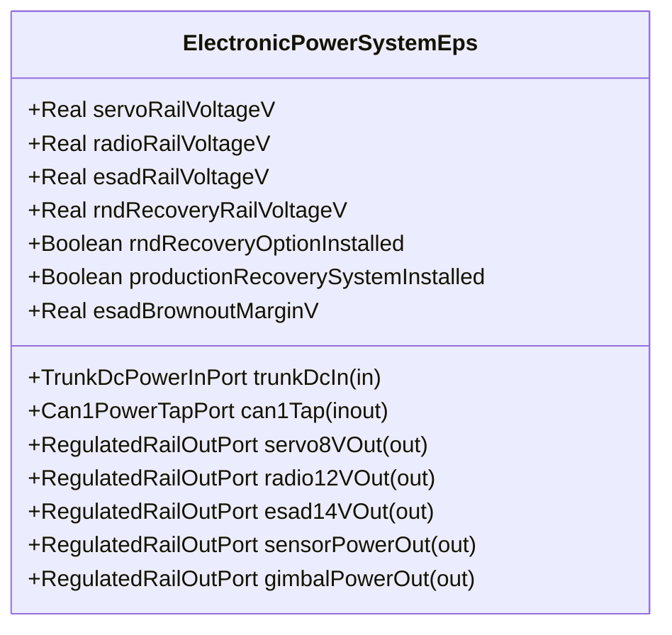

| Attribute | Specification Detail |
| :--- | :--- |
| **Issue ID** | #36 |
| **Title** | Feature 05: [Airframe Power And Propulsion] ElectronicPowerSystemEps |
| **Type** | feature |
| **Parent Epic** | [EPIC-02-AirframePowerAndPropulsion](../epics/EPIC-02-AirframePowerAndPropulsion.md) |
| **Interface Type** | Physical / Structural / Internal Bus |
| **Schema Containers** | `AirframePowerAndPropulsion::ElectronicPowerSystemEps` |
| **Generation Mode** | subagent |
| **Specification Source** | [schema/model.sysml](../../schema/model.sysml) |

# Feature 05: [Airframe Power And Propulsion] ElectronicPowerSystemEps

## UML Class Diagram



## Interface Requirements
### 1. Test Data Shape
```json
{
  "$schema": "https://json-schema.org/draft/2020-12/schema",
  "title": "ElectronicPowerSystemEpsPayloadSchema",
  "type": "object",
  "properties": {
    "part": {
      "type": "string",
      "const": "ElectronicPowerSystemEps"
    },
    "status": {
      "type": "string",
      "enum": ["nominal", "degraded", "fault"]
    },
    "servoRailVoltageV": {
      "type": "number",
      "x-sysml-type": "Real",
      "description": "Declared attribute servoRailVoltageV (Real)",
      "default": 8.0
    },
    "radioRailVoltageV": {
      "type": "number",
      "x-sysml-type": "Real",
      "description": "Declared attribute radioRailVoltageV (Real)",
      "default": 12.0
    },
    "esadRailVoltageV": {
      "type": "number",
      "x-sysml-type": "Real",
      "description": "Declared attribute esadRailVoltageV (Real)",
      "default": 14.0
    },
    "rndRecoveryRailVoltageV": {
      "type": "number",
      "x-sysml-type": "Real",
      "description": "Declared attribute rndRecoveryRailVoltageV (Real)",
      "default": 50.0
    },
    "rndRecoveryOptionInstalled": {
      "type": "boolean",
      "x-sysml-type": "Boolean",
      "description": "Declared attribute rndRecoveryOptionInstalled (Boolean)",
      "default": false
    },
    "productionRecoverySystemInstalled": {
      "type": "boolean",
      "x-sysml-type": "Boolean",
      "description": "Declared attribute productionRecoverySystemInstalled (Boolean)",
      "default": false
    },
    "esadBrownoutMarginV": {
      "type": "number",
      "x-sysml-type": "Real",
      "description": "Declared attribute esadBrownoutMarginV (Real)",
      "default": 0.0
    },
    "trunkDcIn": {
      "type": "object",
      "properties": {
        "direction": { "type": "string", "const": "in" },
        "port_type": { "type": "string", "const": "TrunkDcPowerInPort" }
      },
      "required": ["direction", "port_type"]
    },
    "can1Tap": {
      "type": "object",
      "properties": {
        "direction": { "type": "string", "const": "inout" },
        "port_type": { "type": "string", "const": "Can1PowerTapPort" }
      },
      "required": ["direction", "port_type"]
    },
    "servo8VOut": {
      "type": "object",
      "properties": {
        "direction": { "type": "string", "const": "out" },
        "port_type": { "type": "string", "const": "RegulatedRailOutPort" }
      },
      "required": ["direction", "port_type"]
    },
    "radio12VOut": {
      "type": "object",
      "properties": {
        "direction": { "type": "string", "const": "out" },
        "port_type": { "type": "string", "const": "RegulatedRailOutPort" }
      },
      "required": ["direction", "port_type"]
    },
    "esad14VOut": {
      "type": "object",
      "properties": {
        "direction": { "type": "string", "const": "out" },
        "port_type": { "type": "string", "const": "RegulatedRailOutPort" }
      },
      "required": ["direction", "port_type"]
    },
    "sensorPowerOut": {
      "type": "object",
      "properties": {
        "direction": { "type": "string", "const": "out" },
        "port_type": { "type": "string", "const": "RegulatedRailOutPort" }
      },
      "required": ["direction", "port_type"]
    },
    "gimbalPowerOut": {
      "type": "object",
      "properties": {
        "direction": { "type": "string", "const": "out" },
        "port_type": { "type": "string", "const": "RegulatedRailOutPort" }
      },
      "required": ["direction", "port_type"]
    }
  },
  "required": [
    "part",
    "status",
    "trunkDcIn",
    "can1Tap",
    "servo8VOut",
    "radio12VOut",
    "esad14VOut",
    "sensorPowerOut",
    "gimbalPowerOut"
  ],
  "additionalProperties": false
}
```

### 2. Validation & Constraints
Declared structural attributes, boundary ports, invariants, and allocated requirements for classifier `ElectronicPowerSystemEps`:

| AST Member Kind | Identifier | Declared Type / Direction | Default / Invariant Contract |
| :--- | :--- | :--- | :--- |
| Attribute | `servoRailVoltageV` | `Real` | Default `8.0` |
| Attribute | `radioRailVoltageV` | `Real` | Default `12.0` |
| Attribute | `esadRailVoltageV` | `Real` | Default `14.0` |
| Attribute | `rndRecoveryRailVoltageV` | `Real` | Default `50.0` |
| Attribute | `rndRecoveryOptionInstalled` | `Boolean` | Default `false` |
| Attribute | `productionRecoverySystemInstalled` | `Boolean` | Default `false` |
| Attribute | `esadBrownoutMarginV` | `Real` | Default `0.0` |
| Port | `trunkDcIn` | `in TrunkDcPowerInPort` | Boundary interface contract |
| Port | `can1Tap` | `inout Can1PowerTapPort` | Boundary interface contract |
| Port | `servo8VOut` | `out RegulatedRailOutPort` | Boundary interface contract |
| Port | `radio12VOut` | `out RegulatedRailOutPort` | Boundary interface contract |
| Port | `esad14VOut` | `out RegulatedRailOutPort` | Boundary interface contract |
| Port | `sensorPowerOut` | `out RegulatedRailOutPort` | Boundary interface contract |
| Port | `gimbalPowerOut` | `out RegulatedRailOutPort` | Boundary interface contract |
| Requirement | `REQ_L_01` | Allocated Requirement | Allocated requirement obligation |
| Requirement | `REQ_L_02` | Allocated Requirement | Allocated requirement obligation |
| Requirement | `REQ_H_01` | Allocated Requirement | Allocated requirement obligation |
| Requirement | `REQ_H_02` | Allocated Requirement | Allocated requirement obligation |
| Requirement | `REQ_UCA_01` | Allocated Requirement | Allocated requirement obligation |
| Requirement | `REQ_UCA_02` | Allocated Requirement | Allocated requirement obligation |
| Requirement | `REQ_SC_01` | Allocated Requirement | SC-01: Enforce ordered pre-flight interlock: ESD ground -> RBF #1 off -> prop fold rearward -> RBF #2 pull -> 49.0-50.0 V check -> lock both RBF and umbilical lids. |
| Requirement | `REQ_SC_02` | Allocated Requirement | Allocated requirement obligation |
| Requirement | `REQ_SC_03` | Allocated Requirement | SC-03: Inhibit optional 2x 50.0 V RnD recovery igniter outputs on production Avenger V2.5 (rndRecoveryOptionInstalled == false). |
| Requirement | `REQ_SC_04` | Allocated Requirement | Allocated requirement obligation |
| Requirement | `REQ_SAF_01` | Allocated Requirement | Allocated requirement obligation |
| Requirement | `REQ_SAF_02` | Allocated Requirement | Allocated requirement obligation |
| Requirement | `REQ_SAF_05` | Allocated Requirement | GAP-05 Mitigation: Anchor battery UI and health checks strictly to 12S2P 36.0-50.4 V (49.0-50.0 V pre-flight), rejecting legacy 23.9-25.0 V screenshots. |

### 3. Visual Layout & Arrangement
Structural composition and boundary topology for classifier `ElectronicPowerSystemEps` organize no nested subparts declared in schema paired with boundary ports `in trunkDcIn : TrunkDcPowerInPort`, `inout can1Tap : Can1PowerTapPort`, `out servo8VOut : RegulatedRailOutPort`, `out radio12VOut : RegulatedRailOutPort`, `out esad14VOut : RegulatedRailOutPort`, `out sensorPowerOut : RegulatedRailOutPort`, `out gimbalPowerOut : RegulatedRailOutPort`.

### 4. Interactive Flow & States
Operational lifecycle events and discrete state transitions for ElectronicPowerSystemEps.

### Layer 1: Domain State & Signal Model
Classifier `ElectronicPowerSystemEps` encapsulates typed domain state attributes `servoRailVoltageV : Real`, `radioRailVoltageV : Real`, `esadRailVoltageV : Real`, `rndRecoveryRailVoltageV : Real`, `rndRecoveryOptionInstalled : Boolean`, `productionRecoverySystemInstalled : Boolean`, `esadBrownoutMarginV : Real` alongside operational lifecycle status.

### Layer 2: Logic & Safety State Management
Classifier `ElectronicPowerSystemEps` governs stateless structural transition evaluation enforcing invariant obligations `REQ_L_01`, `REQ_L_02`, `REQ_H_01`, `REQ_H_02`, `REQ_UCA_01`, `REQ_UCA_02`, `REQ_SC_01`, `REQ_SC_02`, `REQ_SC_03`, `REQ_SC_04`, `REQ_SAF_01`, `REQ_SAF_02`, `REQ_SAF_05`.

### Layer 3: Presentation & Actuator Interface Binding
Classifier `ElectronicPowerSystemEps` binds external and behavioral interfaces across port `in trunkDcIn : TrunkDcPowerInPort`, port `inout can1Tap : Can1PowerTapPort`, port `out servo8VOut : RegulatedRailOutPort`, port `out radio12VOut : RegulatedRailOutPort`, port `out esad14VOut : RegulatedRailOutPort`, port `out sensorPowerOut : RegulatedRailOutPort`, port `out gimbalPowerOut : RegulatedRailOutPort`.

## Acceptance Criteria (BDD)
- [ ] AC-01: Given valid `ElectronicPowerSystemEps` inputs satisfying `REQ_L_01`, When `ElectronicPowerSystemEps` evaluates invariant `REQ_L_01`, Then the invariant holds and verified state is committed.
- [ ] AC-02: Given boundary inputs that violate `REQ_L_01`, When `ElectronicPowerSystemEps` evaluates invariant `REQ_L_01`, Then `ElectronicPowerSystemEps` rejects the invalid transition and routes a diagnostic via diagnostic port `can1Tap`.
- [ ] AC-03: Given valid `ElectronicPowerSystemEps` inputs satisfying `REQ_L_02`, When `ElectronicPowerSystemEps` evaluates invariant `REQ_L_02`, Then the invariant holds and verified state is committed.
- [ ] AC-04: Given boundary inputs that violate `REQ_L_02`, When `ElectronicPowerSystemEps` evaluates invariant `REQ_L_02`, Then `ElectronicPowerSystemEps` rejects the invalid transition and routes a diagnostic via diagnostic port `can1Tap`.
- [ ] AC-05: Given valid `ElectronicPowerSystemEps` inputs satisfying `REQ_H_01`, When `ElectronicPowerSystemEps` evaluates invariant `REQ_H_01`, Then the invariant holds and verified state is committed.
- [ ] AC-06: Given boundary inputs that violate `REQ_H_01`, When `ElectronicPowerSystemEps` evaluates invariant `REQ_H_01`, Then `ElectronicPowerSystemEps` rejects the invalid transition and routes a diagnostic via diagnostic port `can1Tap`.
- [ ] AC-07: Given valid `ElectronicPowerSystemEps` state satisfying composite invariants (`REQ_H_02`; `REQ_UCA_01`; `REQ_UCA_02`; `REQ_SC_01` (`SC-01: Enforce ordered pre-flight interlock: ESD ground -> RBF #1 off -> prop fold rearward -> RBF #2 pull -> 49.0-50.0 V check -> lock both RBF and umbilical lids.`); `REQ_SC_02`; `REQ_SC_03` (`SC-03: Inhibit optional 2x 50.0 V RnD recovery igniter outputs on production Avenger V2.5 (rndRecoveryOptionInstalled == false).`); `REQ_SC_04`; `REQ_SAF_01`; `REQ_SAF_02`; `REQ_SAF_05` (`GAP-05 Mitigation: Anchor battery UI and health checks strictly to 12S2P 36.0-50.4 V (49.0-50.0 V pre-flight), rejecting legacy 23.9-25.0 V screenshots.`)), When `ElectronicPowerSystemEps` evaluates the remaining invariant conjunction, Then all declared invariants hold and verified state is committed.
- [ ] AC-08: Given input state that violates any invariant in (`REQ_H_02`; `REQ_UCA_01`; `REQ_UCA_02`; `REQ_SC_01` (`SC-01: Enforce ordered pre-flight interlock: ESD ground -> RBF #1 off -> prop fold rearward -> RBF #2 pull -> 49.0-50.0 V check -> lock both RBF and umbilical lids.`); `REQ_SC_02`; `REQ_SC_03` (`SC-03: Inhibit optional 2x 50.0 V RnD recovery igniter outputs on production Avenger V2.5 (rndRecoveryOptionInstalled == false).`); `REQ_SC_04`; `REQ_SAF_01`; `REQ_SAF_02`; `REQ_SAF_05` (`GAP-05 Mitigation: Anchor battery UI and health checks strictly to 12S2P 36.0-50.4 V (49.0-50.0 V pre-flight), rejecting legacy 23.9-25.0 V screenshots.`)), When `ElectronicPowerSystemEps` evaluates the composite guard, Then `ElectronicPowerSystemEps` rejects the invalid state transition and routes a diagnostic via diagnostic port `can1Tap`.
- [ ] AC-09: Given nominal typed values for `servoRailVoltageV` (`Real`), `radioRailVoltageV` (`Real`), `esadRailVoltageV` (`Real`), `rndRecoveryRailVoltageV` (`Real`), `rndRecoveryOptionInstalled` (`Boolean`), `productionRecoverySystemInstalled` (`Boolean`), `esadBrownoutMarginV` (`Real`) across `trunkDcIn` (`in TrunkDcPowerInPort`), `can1Tap` (`inout Can1PowerTapPort`), `servo8VOut` (`out RegulatedRailOutPort`), `radio12VOut` (`out RegulatedRailOutPort`), `esad14VOut` (`out RegulatedRailOutPort`), `sensorPowerOut` (`out RegulatedRailOutPort`), `gimbalPowerOut` (`out RegulatedRailOutPort`), When `ElectronicPowerSystemEps` executes structural interface processing, Then state and output ports conform to declared schema types.
- [ ] AC-10: Given malformed input frames across `servoRailVoltageV` (`Real`), `radioRailVoltageV` (`Real`), `esadRailVoltageV` (`Real`), `rndRecoveryRailVoltageV` (`Real`), `rndRecoveryOptionInstalled` (`Boolean`), `productionRecoverySystemInstalled` (`Boolean`), `esadBrownoutMarginV` (`Real`) or `trunkDcIn` (`in TrunkDcPowerInPort`), `can1Tap` (`inout Can1PowerTapPort`), `servo8VOut` (`out RegulatedRailOutPort`), `radio12VOut` (`out RegulatedRailOutPort`), `esad14VOut` (`out RegulatedRailOutPort`), `sensorPowerOut` (`out RegulatedRailOutPort`), `gimbalPowerOut` (`out RegulatedRailOutPort`), When `ElectronicPowerSystemEps` boundary validation executes, Then `ElectronicPowerSystemEps` rejects the malformed input via diagnostic port `can1Tap`.

## Source References
Formal component specifications and normative systems engineering requirements:
- System Architecture Model: `schema/model.sysml`
- Normative Systems Engineering Standard: ISO/IEC/IEEE 15288:2023 §6.4.3 Architecture Definition Process

Component behavior and interface definitions derive from `schema/model.sysml` pursuant to ISO/IEC/IEEE 15288.
