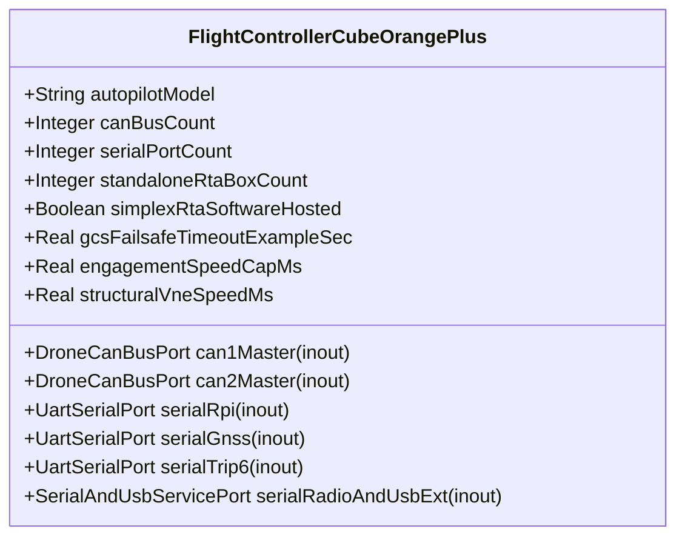

| Attribute | Specification Detail |
| :--- | :--- |
| **Issue ID** | #37 |
| **Title** | Feature 06: [Avionics Guidance And Control] FlightControllerCubeOrangePlus |
| **Type** | feature |
| **Parent Epic** | [EPIC-03-AvionicsGuidanceAndControl](../epics/EPIC-03-AvionicsGuidanceAndControl.md) |
| **Interface Type** | Physical / Structural / Internal Bus |
| **Schema Containers** | `AvionicsGuidanceAndControl::FlightControllerCubeOrangePlus` |
| **Generation Mode** | subagent |
| **Specification Source** | [schema/model.sysml](../../schema/model.sysml) |

# Feature 06: [Avionics Guidance And Control] FlightControllerCubeOrangePlus

## UML Class Diagram



## Interface Requirements
### 1. Test Data Shape
```json
{
  "$schema": "https://json-schema.org/draft/2020-12/schema",
  "title": "FlightControllerCubeOrangePlusPayloadSchema",
  "type": "object",
  "properties": {
    "part": {
      "type": "string",
      "const": "FlightControllerCubeOrangePlus"
    },
    "status": {
      "type": "string",
      "enum": ["nominal", "degraded", "fault"]
    },
    "autopilotModel": {
      "type": "string",
      "x-sysml-type": "String",
      "description": "Declared attribute autopilotModel (String)",
      "default": "Cube orange+"
    },
    "canBusCount": {
      "type": "integer",
      "x-sysml-type": "Integer",
      "description": "Declared attribute canBusCount (Integer)",
      "default": 2
    },
    "serialPortCount": {
      "type": "integer",
      "x-sysml-type": "Integer",
      "description": "Declared attribute serialPortCount (Integer)",
      "default": 4
    },
    "standaloneRtaBoxCount": {
      "type": "integer",
      "x-sysml-type": "Integer",
      "description": "Declared attribute standaloneRtaBoxCount (Integer)",
      "default": 0
    },
    "simplexRtaSoftwareHosted": {
      "type": "boolean",
      "x-sysml-type": "Boolean",
      "description": "Declared attribute simplexRtaSoftwareHosted (Boolean)",
      "default": true
    },
    "gcsFailsafeTimeoutExampleSec": {
      "type": "number",
      "x-sysml-type": "Real",
      "description": "Declared attribute gcsFailsafeTimeoutExampleSec (Real)",
      "default": 105.0
    },
    "engagementSpeedCapMs": {
      "type": "number",
      "x-sysml-type": "Real",
      "description": "Declared attribute engagementSpeedCapMs (Real)",
      "default": 55.0
    },
    "structuralVneSpeedMs": {
      "type": "number",
      "x-sysml-type": "Real",
      "description": "Declared attribute structuralVneSpeedMs (Real)",
      "default": 80.0
    },
    "can1Master": {
      "type": "object",
      "properties": {
        "direction": { "type": "string", "const": "inout" },
        "port_type": { "type": "string", "const": "DroneCanBusPort" }
      },
      "required": ["direction", "port_type"]
    },
    "can2Master": {
      "type": "object",
      "properties": {
        "direction": { "type": "string", "const": "inout" },
        "port_type": { "type": "string", "const": "DroneCanBusPort" }
      },
      "required": ["direction", "port_type"]
    },
    "serialRpi": {
      "type": "object",
      "properties": {
        "direction": { "type": "string", "const": "inout" },
        "port_type": { "type": "string", "const": "UartSerialPort" }
      },
      "required": ["direction", "port_type"]
    },
    "serialGnss": {
      "type": "object",
      "properties": {
        "direction": { "type": "string", "const": "inout" },
        "port_type": { "type": "string", "const": "UartSerialPort" }
      },
      "required": ["direction", "port_type"]
    },
    "serialTrip6": {
      "type": "object",
      "properties": {
        "direction": { "type": "string", "const": "inout" },
        "port_type": { "type": "string", "const": "UartSerialPort" }
      },
      "required": ["direction", "port_type"]
    },
    "serialRadioAndUsbExt": {
      "type": "object",
      "properties": {
        "direction": { "type": "string", "const": "inout" },
        "port_type": { "type": "string", "const": "SerialAndUsbServicePort" }
      },
      "required": ["direction", "port_type"]
    }
  },
  "required": [
    "part",
    "status",
    "can1Master",
    "can2Master",
    "serialRpi",
    "serialGnss",
    "serialTrip6",
    "serialRadioAndUsbExt"
  ],
  "additionalProperties": false
}
```

### 2. Validation & Constraints
Declared structural attributes, boundary ports, invariants, and allocated requirements for classifier `FlightControllerCubeOrangePlus`:

| AST Member Kind | Identifier | Declared Type / Direction | Default / Invariant Contract |
| :--- | :--- | :--- | :--- |
| Attribute | `autopilotModel` | `String` | Default `"Cube orange+"` |
| Attribute | `canBusCount` | `Integer` | Default `2` |
| Attribute | `serialPortCount` | `Integer` | Default `4` |
| Attribute | `standaloneRtaBoxCount` | `Integer` | Default `0` |
| Attribute | `simplexRtaSoftwareHosted` | `Boolean` | Default `true` |
| Attribute | `gcsFailsafeTimeoutExampleSec` | `Real` | Default `105.0` |
| Attribute | `engagementSpeedCapMs` | `Real` | Default `55.0` |
| Attribute | `structuralVneSpeedMs` | `Real` | Default `80.0` |
| Port | `can1Master` | `inout DroneCanBusPort` | Boundary interface contract |
| Port | `can2Master` | `inout DroneCanBusPort` | Boundary interface contract |
| Port | `serialRpi` | `inout UartSerialPort` | Boundary interface contract |
| Port | `serialGnss` | `inout UartSerialPort` | Boundary interface contract |
| Port | `serialTrip6` | `inout UartSerialPort` | Boundary interface contract |
| Port | `serialRadioAndUsbExt` | `inout SerialAndUsbServicePort` | Boundary interface contract |
| Requirement | `REQ_L_03` | Allocated Requirement | Allocated requirement obligation |
| Requirement | `REQ_H_03` | Allocated Requirement | Allocated requirement obligation |
| Requirement | `REQ_UCA_03` | Allocated Requirement | Allocated requirement obligation |
| Requirement | `REQ_UCA_04` | Allocated Requirement | Allocated requirement obligation |
| Requirement | `REQ_SC_05` | Allocated Requirement | SC-05: Execute software Simplex RTA supervisor inside Cube orange+ clamping engagement airspeed <= 55.0 m/s and VNE <= 80.0 m/s (zero standalone RTA box). |
| Requirement | `REQ_SC_06` | Allocated Requirement | Allocated requirement obligation |
| Requirement | `REQ_SC_07` | Allocated Requirement | SC-07: Enforce pre-flight SKYE2 pitot bounds (<= 3.0 m/s calm, >= 10.0 m/s airflow) and support GPS Failsafe / manual Disable GNSS INS/DR fallback. |
| Requirement | `REQ_SC_08` | Allocated Requirement | Allocated requirement obligation |
| Requirement | `REQ_SAF_08` | Allocated Requirement | GAP-WCET Disposition: Anchor deterministic timing around grounded 100 Hz (0.01 s) ESAD RS-485 cycle while tracking EKF2, CAN 1/2, and Trip6 WCET targets for bench verification. |
| Requirement | `REQ_SAF_09` | Allocated Requirement | GAP-REL Disposition: Parameterize FMECA/FTA piece-part failure rates (lambda/MTBF) using conservative baselines pending OEM supplier MTBF release. |

### 3. Visual Layout & Arrangement
Structural composition and boundary topology for classifier `FlightControllerCubeOrangePlus` organize no nested subparts declared in schema paired with boundary ports `inout can1Master : DroneCanBusPort`, `inout can2Master : DroneCanBusPort`, `inout serialRpi : UartSerialPort`, `inout serialGnss : UartSerialPort`, `inout serialTrip6 : UartSerialPort`, `inout serialRadioAndUsbExt : SerialAndUsbServicePort`.

### 4. Interactive Flow & States
Operational lifecycle events and discrete state transitions for FlightControllerCubeOrangePlus.

### Layer 1: Domain State & Signal Model
Classifier `FlightControllerCubeOrangePlus` encapsulates typed domain state attributes `autopilotModel : String`, `canBusCount : Integer`, `serialPortCount : Integer`, `standaloneRtaBoxCount : Integer`, `simplexRtaSoftwareHosted : Boolean`, `gcsFailsafeTimeoutExampleSec : Real`, `engagementSpeedCapMs : Real`, `structuralVneSpeedMs : Real` alongside operational lifecycle status.

### Layer 2: Logic & Safety State Management
Classifier `FlightControllerCubeOrangePlus` governs stateless structural transition evaluation enforcing invariant obligations `REQ_L_03`, `REQ_H_03`, `REQ_UCA_03`, `REQ_UCA_04`, `REQ_SC_05`, `REQ_SC_06`, `REQ_SC_07`, `REQ_SC_08`, `REQ_SAF_08`, `REQ_SAF_09`.

### Layer 3: Presentation & Actuator Interface Binding
Classifier `FlightControllerCubeOrangePlus` binds external and behavioral interfaces across port `inout can1Master : DroneCanBusPort`, port `inout can2Master : DroneCanBusPort`, port `inout serialRpi : UartSerialPort`, port `inout serialGnss : UartSerialPort`, port `inout serialTrip6 : UartSerialPort`, port `inout serialRadioAndUsbExt : SerialAndUsbServicePort`.

### Associated Use Cases & User Stories

#### Associated Use Cases
- [ ] #25 - [Use Case 02: Monitor Flight Envelope And Simplex Rta](../use-cases/UC-02-MonitorFlightEnvelopeAndSimplexRta.md)

#### Associated User Stories
- [ ] #9 - [User Story 05: Execute Simplex Rta Envelope Check](../user-stories/US-05-ExecuteSimplexRtaEnvelopeCheck.md)
- [ ] #10 - [User Story 06: Run Pitot And Mag Preflight Check](../user-stories/US-06-RunPitotAndMagPreflightCheck.md)
- [ ] #11 - [User Story 07: Switch To Gnss Denied Dead Reckoning](../user-stories/US-07-SwitchToGnssDeniedDeadReckoning.md)
- [ ] #12 - [User Story 08: Supervise Esad Oc Master Cycle](../user-stories/US-08-SuperviseEsadOcMasterCycle.md)
- [ ] #13 - [User Story 09: Actuate Tail And Wing Surfaces](../user-stories/US-09-ActuateTailAndWingSurfaces.md)

## Acceptance Criteria (BDD)
- [ ] AC-01: Given valid `FlightControllerCubeOrangePlus` inputs satisfying `REQ_L_03`, When `FlightControllerCubeOrangePlus` evaluates invariant `REQ_L_03`, Then the invariant holds and verified state is committed.
- [ ] AC-02: Given boundary inputs that violate `REQ_L_03`, When `FlightControllerCubeOrangePlus` evaluates invariant `REQ_L_03`, Then `FlightControllerCubeOrangePlus` rejects the invalid transition and routes a diagnostic via diagnostic port `can1Master`.
- [ ] AC-03: Given valid `FlightControllerCubeOrangePlus` inputs satisfying `REQ_H_03`, When `FlightControllerCubeOrangePlus` evaluates invariant `REQ_H_03`, Then the invariant holds and verified state is committed.
- [ ] AC-04: Given boundary inputs that violate `REQ_H_03`, When `FlightControllerCubeOrangePlus` evaluates invariant `REQ_H_03`, Then `FlightControllerCubeOrangePlus` rejects the invalid transition and routes a diagnostic via diagnostic port `can1Master`.
- [ ] AC-05: Given valid `FlightControllerCubeOrangePlus` inputs satisfying `REQ_UCA_03`, When `FlightControllerCubeOrangePlus` evaluates invariant `REQ_UCA_03`, Then the invariant holds and verified state is committed.
- [ ] AC-06: Given boundary inputs that violate `REQ_UCA_03`, When `FlightControllerCubeOrangePlus` evaluates invariant `REQ_UCA_03`, Then `FlightControllerCubeOrangePlus` rejects the invalid transition and routes a diagnostic via diagnostic port `can1Master`.
- [ ] AC-07: Given valid `FlightControllerCubeOrangePlus` state satisfying composite invariants (`REQ_UCA_04`; `REQ_SC_05` (`SC-05: Execute software Simplex RTA supervisor inside Cube orange+ clamping engagement airspeed <= 55.0 m/s and VNE <= 80.0 m/s (zero standalone RTA box).`); `REQ_SC_06`; `REQ_SC_07` (`SC-07: Enforce pre-flight SKYE2 pitot bounds (<= 3.0 m/s calm, >= 10.0 m/s airflow) and support GPS Failsafe / manual Disable GNSS INS/DR fallback.`); `REQ_SC_08`; `REQ_SAF_08` (`GAP-WCET Disposition: Anchor deterministic timing around grounded 100 Hz (0.01 s) ESAD RS-485 cycle while tracking EKF2, CAN 1/2, and Trip6 WCET targets for bench verification.`); `REQ_SAF_09` (`GAP-REL Disposition: Parameterize FMECA/FTA piece-part failure rates (lambda/MTBF) using conservative baselines pending OEM supplier MTBF release.`)), When `FlightControllerCubeOrangePlus` evaluates the remaining invariant conjunction, Then all declared invariants hold and verified state is committed.
- [ ] AC-08: Given input state that violates any invariant in (`REQ_UCA_04`; `REQ_SC_05` (`SC-05: Execute software Simplex RTA supervisor inside Cube orange+ clamping engagement airspeed <= 55.0 m/s and VNE <= 80.0 m/s (zero standalone RTA box).`); `REQ_SC_06`; `REQ_SC_07` (`SC-07: Enforce pre-flight SKYE2 pitot bounds (<= 3.0 m/s calm, >= 10.0 m/s airflow) and support GPS Failsafe / manual Disable GNSS INS/DR fallback.`); `REQ_SC_08`; `REQ_SAF_08` (`GAP-WCET Disposition: Anchor deterministic timing around grounded 100 Hz (0.01 s) ESAD RS-485 cycle while tracking EKF2, CAN 1/2, and Trip6 WCET targets for bench verification.`); `REQ_SAF_09` (`GAP-REL Disposition: Parameterize FMECA/FTA piece-part failure rates (lambda/MTBF) using conservative baselines pending OEM supplier MTBF release.`)), When `FlightControllerCubeOrangePlus` evaluates the composite guard, Then `FlightControllerCubeOrangePlus` rejects the invalid state transition and routes a diagnostic via diagnostic port `can1Master`.
- [ ] AC-09: Given nominal typed values for `autopilotModel` (`String`), `canBusCount` (`Integer`), `serialPortCount` (`Integer`), `standaloneRtaBoxCount` (`Integer`), `simplexRtaSoftwareHosted` (`Boolean`), `gcsFailsafeTimeoutExampleSec` (`Real`), `engagementSpeedCapMs` (`Real`), `structuralVneSpeedMs` (`Real`) across `can1Master` (`inout DroneCanBusPort`), `can2Master` (`inout DroneCanBusPort`), `serialRpi` (`inout UartSerialPort`), `serialGnss` (`inout UartSerialPort`), `serialTrip6` (`inout UartSerialPort`), `serialRadioAndUsbExt` (`inout SerialAndUsbServicePort`), When `FlightControllerCubeOrangePlus` executes structural interface processing, Then state and output ports conform to declared schema types.
- [ ] AC-10: Given malformed input frames across `autopilotModel` (`String`), `canBusCount` (`Integer`), `serialPortCount` (`Integer`), `standaloneRtaBoxCount` (`Integer`), `simplexRtaSoftwareHosted` (`Boolean`), `gcsFailsafeTimeoutExampleSec` (`Real`), `engagementSpeedCapMs` (`Real`), `structuralVneSpeedMs` (`Real`) or `can1Master` (`inout DroneCanBusPort`), `can2Master` (`inout DroneCanBusPort`), `serialRpi` (`inout UartSerialPort`), `serialGnss` (`inout UartSerialPort`), `serialTrip6` (`inout UartSerialPort`), `serialRadioAndUsbExt` (`inout SerialAndUsbServicePort`), When `FlightControllerCubeOrangePlus` boundary validation executes, Then `FlightControllerCubeOrangePlus` rejects the malformed input via diagnostic port `can1Master`.

## Source References
Formal component specifications and normative systems engineering requirements:
- System Architecture Model: `schema/model.sysml`
- Normative Systems Engineering Standard: ISO/IEC/IEEE 15288:2023 §6.4.3 Architecture Definition Process

Component behavior and interface definitions derive from `schema/model.sysml` pursuant to ISO/IEC/IEEE 15288.
