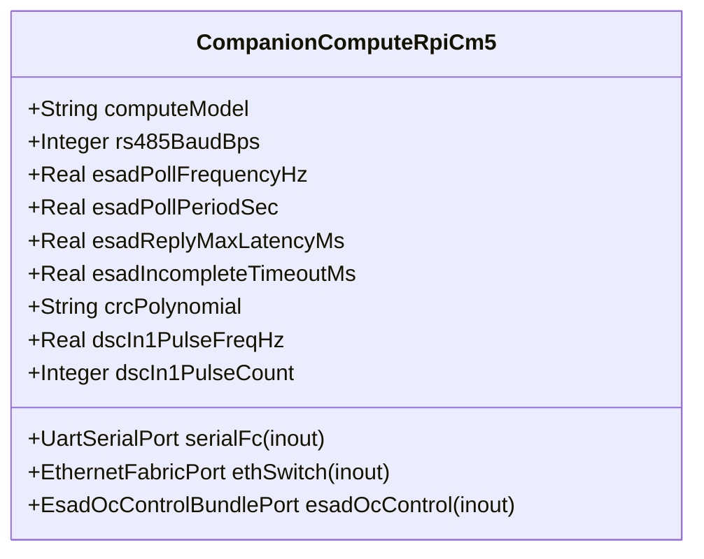

| Attribute | Specification Detail |
| :--- | :--- |
| **Issue ID** | #38 |
| **Title** | Feature 07: [Avionics Guidance And Control] CompanionComputeRpiCm5 |
| **Type** | feature |
| **Parent Epic** | [EPIC-03-AvionicsGuidanceAndControl](../epics/EPIC-03-AvionicsGuidanceAndControl.md) |
| **Interface Type** | Physical / Structural / Internal Bus |
| **Schema Containers** | `AvionicsGuidanceAndControl::CompanionComputeRpiCm5` |
| **Generation Mode** | subagent |
| **Specification Source** | [schema/model.sysml](../../schema/model.sysml) |

# Feature 07: [Avionics Guidance And Control] CompanionComputeRpiCm5

## UML Class Diagram



## Interface Requirements
### 1. Test Data Shape
```json
{
  "$schema": "https://json-schema.org/draft/2020-12/schema",
  "title": "CompanionComputeRpiCm5PayloadSchema",
  "type": "object",
  "properties": {
    "part": {
      "type": "string",
      "const": "CompanionComputeRpiCm5"
    },
    "status": {
      "type": "string",
      "enum": ["nominal", "degraded", "fault"]
    },
    "computeModel": {
      "type": "string",
      "x-sysml-type": "String",
      "description": "Declared attribute computeModel (String)",
      "default": "RPI CM5004032"
    },
    "rs485BaudBps": {
      "type": "integer",
      "x-sysml-type": "Integer",
      "description": "Declared attribute rs485BaudBps (Integer)",
      "default": 115200
    },
    "esadPollFrequencyHz": {
      "type": "number",
      "x-sysml-type": "Real",
      "description": "Declared attribute esadPollFrequencyHz (Real)",
      "default": 100.0
    },
    "esadPollPeriodSec": {
      "type": "number",
      "x-sysml-type": "Real",
      "description": "Declared attribute esadPollPeriodSec (Real)",
      "default": 0.01
    },
    "esadReplyMaxLatencyMs": {
      "type": "number",
      "x-sysml-type": "Real",
      "description": "Declared attribute esadReplyMaxLatencyMs (Real)",
      "default": 5.0
    },
    "esadIncompleteTimeoutMs": {
      "type": "number",
      "x-sysml-type": "Real",
      "description": "Declared attribute esadIncompleteTimeoutMs (Real)",
      "default": 10.0
    },
    "crcPolynomial": {
      "type": "string",
      "x-sysml-type": "String",
      "description": "Declared attribute crcPolynomial (String)",
      "default": "CRC-16 XModem (init 0x0000, poly 0x1021)"
    },
    "dscIn1PulseFreqHz": {
      "type": "number",
      "x-sysml-type": "Real",
      "description": "Declared attribute dscIn1PulseFreqHz (Real)",
      "default": 1000.0
    },
    "dscIn1PulseCount": {
      "type": "integer",
      "x-sysml-type": "Integer",
      "description": "Declared attribute dscIn1PulseCount (Integer)",
      "default": 2
    },
    "serialFc": {
      "type": "object",
      "properties": {
        "direction": { "type": "string", "const": "inout" },
        "port_type": { "type": "string", "const": "UartSerialPort" }
      },
      "required": ["direction", "port_type"]
    },
    "ethSwitch": {
      "type": "object",
      "properties": {
        "direction": { "type": "string", "const": "inout" },
        "port_type": { "type": "string", "const": "EthernetFabricPort" }
      },
      "required": ["direction", "port_type"]
    },
    "esadOcControl": {
      "type": "object",
      "properties": {
        "direction": { "type": "string", "const": "inout" },
        "port_type": { "type": "string", "const": "EsadOcControlBundlePort" }
      },
      "required": ["direction", "port_type"]
    }
  },
  "required": [
    "part",
    "status",
    "serialFc",
    "ethSwitch",
    "esadOcControl"
  ],
  "additionalProperties": false
}
```

### 2. Validation & Constraints
Declared structural attributes, boundary ports, invariants, and allocated requirements for classifier `CompanionComputeRpiCm5`:

| AST Member Kind | Identifier | Declared Type / Direction | Default / Invariant Contract |
| :--- | :--- | :--- | :--- |
| Attribute | `computeModel` | `String` | Default `"RPI CM5004032"` |
| Attribute | `rs485BaudBps` | `Integer` | Default `115200` |
| Attribute | `esadPollFrequencyHz` | `Real` | Default `100.0` |
| Attribute | `esadPollPeriodSec` | `Real` | Default `0.01` |
| Attribute | `esadReplyMaxLatencyMs` | `Real` | Default `5.0` |
| Attribute | `esadIncompleteTimeoutMs` | `Real` | Default `10.0` |
| Attribute | `crcPolynomial` | `String` | Default `"CRC-16 XModem (init 0x0000, poly 0x1021)"` |
| Attribute | `dscIn1PulseFreqHz` | `Real` | Default `1000.0` |
| Attribute | `dscIn1PulseCount` | `Integer` | Default `2` |
| Port | `serialFc` | `inout UartSerialPort` | Boundary interface contract |
| Port | `ethSwitch` | `inout EthernetFabricPort` | Boundary interface contract |
| Port | `esadOcControl` | `inout EsadOcControlBundlePort` | Boundary interface contract |
| Requirement | `REQ_L_03` | Allocated Requirement | Allocated requirement obligation |
| Requirement | `REQ_H_03` | Allocated Requirement | Allocated requirement obligation |
| Requirement | `REQ_UCA_03` | Allocated Requirement | Allocated requirement obligation |
| Requirement | `REQ_UCA_04` | Allocated Requirement | Allocated requirement obligation |
| Requirement | `REQ_SC_05` | Allocated Requirement | SC-05: Execute software Simplex RTA supervisor inside Cube orange+ clamping engagement airspeed <= 55.0 m/s and VNE <= 80.0 m/s (zero standalone RTA box). |
| Requirement | `REQ_SC_06` | Allocated Requirement | Allocated requirement obligation |
| Requirement | `REQ_SC_07` | Allocated Requirement | SC-07: Enforce pre-flight SKYE2 pitot bounds (<= 3.0 m/s calm, >= 10.0 m/s airflow) and support GPS Failsafe / manual Disable GNSS INS/DR fallback. |
| Requirement | `REQ_SC_08` | Allocated Requirement | Allocated requirement obligation |
| Requirement | `REQ_SAF_08` | Allocated Requirement | GAP-WCET Disposition: Anchor deterministic timing around grounded 100 Hz (0.01 s) ESAD RS-485 cycle while tracking EKF2, CAN 1/2, and Trip6 WCET targets for bench verification. |
| Requirement | `REQ_SAF_09` | Allocated Requirement | GAP-REL Disposition: Parameterize FMECA/FTA piece-part failure rates (lambda/MTBF) using conservative baselines pending OEM supplier MTBF release. |

### 3. Visual Layout & Arrangement
Structural composition and boundary topology for classifier `CompanionComputeRpiCm5` organize no nested subparts declared in schema paired with boundary ports `inout serialFc : UartSerialPort`, `inout ethSwitch : EthernetFabricPort`, `inout esadOcControl : EsadOcControlBundlePort`.

### 4. Interactive Flow & States
Operational lifecycle events and discrete state transitions for CompanionComputeRpiCm5.

### Layer 1: Domain State & Signal Model
Classifier `CompanionComputeRpiCm5` encapsulates typed domain state attributes `computeModel : String`, `rs485BaudBps : Integer`, `esadPollFrequencyHz : Real`, `esadPollPeriodSec : Real`, `esadReplyMaxLatencyMs : Real`, `esadIncompleteTimeoutMs : Real`, `crcPolynomial : String`, `dscIn1PulseFreqHz : Real`, `dscIn1PulseCount : Integer` alongside operational lifecycle status.

### Layer 2: Logic & Safety State Management
Classifier `CompanionComputeRpiCm5` governs stateless structural transition evaluation enforcing invariant obligations `REQ_L_03`, `REQ_H_03`, `REQ_UCA_03`, `REQ_UCA_04`, `REQ_SC_05`, `REQ_SC_06`, `REQ_SC_07`, `REQ_SC_08`, `REQ_SAF_08`, `REQ_SAF_09`.

### Layer 3: Presentation & Actuator Interface Binding
Classifier `CompanionComputeRpiCm5` binds external and behavioral interfaces across port `inout serialFc : UartSerialPort`, port `inout ethSwitch : EthernetFabricPort`, port `inout esadOcControl : EsadOcControlBundlePort`.

### Associated Use Cases & User Stories

#### Associated Use Cases
- None allocated (structural subsystem component)

#### Associated User Stories
- [ ] #9 - [User Story 05: Execute Simplex Rta Envelope Check](../user-stories/US-05-ExecuteSimplexRtaEnvelopeCheck.md)
- [ ] #10 - [User Story 06: Run Pitot And Mag Preflight Check](../user-stories/US-06-RunPitotAndMagPreflightCheck.md)
- [ ] #11 - [User Story 07: Switch To Gnss Denied Dead Reckoning](../user-stories/US-07-SwitchToGnssDeniedDeadReckoning.md)
- [ ] #12 - [User Story 08: Supervise Esad Oc Master Cycle](../user-stories/US-08-SuperviseEsadOcMasterCycle.md)
- [ ] #13 - [User Story 09: Actuate Tail And Wing Surfaces](../user-stories/US-09-ActuateTailAndWingSurfaces.md)

## Acceptance Criteria (BDD)
- [ ] AC-01: Given valid `CompanionComputeRpiCm5` inputs satisfying `REQ_L_03`, When `CompanionComputeRpiCm5` evaluates invariant `REQ_L_03`, Then the invariant holds and verified state is committed.
- [ ] AC-02: Given boundary inputs that violate `REQ_L_03`, When `CompanionComputeRpiCm5` evaluates invariant `REQ_L_03`, Then `CompanionComputeRpiCm5` rejects the invalid transition and routes a diagnostic via diagnostic port `serialFc`.
- [ ] AC-03: Given valid `CompanionComputeRpiCm5` inputs satisfying `REQ_H_03`, When `CompanionComputeRpiCm5` evaluates invariant `REQ_H_03`, Then the invariant holds and verified state is committed.
- [ ] AC-04: Given boundary inputs that violate `REQ_H_03`, When `CompanionComputeRpiCm5` evaluates invariant `REQ_H_03`, Then `CompanionComputeRpiCm5` rejects the invalid transition and routes a diagnostic via diagnostic port `serialFc`.
- [ ] AC-05: Given valid `CompanionComputeRpiCm5` inputs satisfying `REQ_UCA_03`, When `CompanionComputeRpiCm5` evaluates invariant `REQ_UCA_03`, Then the invariant holds and verified state is committed.
- [ ] AC-06: Given boundary inputs that violate `REQ_UCA_03`, When `CompanionComputeRpiCm5` evaluates invariant `REQ_UCA_03`, Then `CompanionComputeRpiCm5` rejects the invalid transition and routes a diagnostic via diagnostic port `serialFc`.
- [ ] AC-07: Given valid `CompanionComputeRpiCm5` state satisfying composite invariants (`REQ_UCA_04`; `REQ_SC_05` (`SC-05: Execute software Simplex RTA supervisor inside Cube orange+ clamping engagement airspeed <= 55.0 m/s and VNE <= 80.0 m/s (zero standalone RTA box).`); `REQ_SC_06`; `REQ_SC_07` (`SC-07: Enforce pre-flight SKYE2 pitot bounds (<= 3.0 m/s calm, >= 10.0 m/s airflow) and support GPS Failsafe / manual Disable GNSS INS/DR fallback.`); `REQ_SC_08`; `REQ_SAF_08` (`GAP-WCET Disposition: Anchor deterministic timing around grounded 100 Hz (0.01 s) ESAD RS-485 cycle while tracking EKF2, CAN 1/2, and Trip6 WCET targets for bench verification.`); `REQ_SAF_09` (`GAP-REL Disposition: Parameterize FMECA/FTA piece-part failure rates (lambda/MTBF) using conservative baselines pending OEM supplier MTBF release.`)), When `CompanionComputeRpiCm5` evaluates the remaining invariant conjunction, Then all declared invariants hold and verified state is committed.
- [ ] AC-08: Given input state that violates any invariant in (`REQ_UCA_04`; `REQ_SC_05` (`SC-05: Execute software Simplex RTA supervisor inside Cube orange+ clamping engagement airspeed <= 55.0 m/s and VNE <= 80.0 m/s (zero standalone RTA box).`); `REQ_SC_06`; `REQ_SC_07` (`SC-07: Enforce pre-flight SKYE2 pitot bounds (<= 3.0 m/s calm, >= 10.0 m/s airflow) and support GPS Failsafe / manual Disable GNSS INS/DR fallback.`); `REQ_SC_08`; `REQ_SAF_08` (`GAP-WCET Disposition: Anchor deterministic timing around grounded 100 Hz (0.01 s) ESAD RS-485 cycle while tracking EKF2, CAN 1/2, and Trip6 WCET targets for bench verification.`); `REQ_SAF_09` (`GAP-REL Disposition: Parameterize FMECA/FTA piece-part failure rates (lambda/MTBF) using conservative baselines pending OEM supplier MTBF release.`)), When `CompanionComputeRpiCm5` evaluates the composite guard, Then `CompanionComputeRpiCm5` rejects the invalid state transition and routes a diagnostic via diagnostic port `serialFc`.
- [ ] AC-09: Given nominal typed values for `computeModel` (`String`), `rs485BaudBps` (`Integer`), `esadPollFrequencyHz` (`Real`), `esadPollPeriodSec` (`Real`), `esadReplyMaxLatencyMs` (`Real`), `esadIncompleteTimeoutMs` (`Real`), `crcPolynomial` (`String`), `dscIn1PulseFreqHz` (`Real`), `dscIn1PulseCount` (`Integer`) across `serialFc` (`inout UartSerialPort`), `ethSwitch` (`inout EthernetFabricPort`), `esadOcControl` (`inout EsadOcControlBundlePort`), When `CompanionComputeRpiCm5` executes structural interface processing, Then state and output ports conform to declared schema types.
- [ ] AC-10: Given malformed input frames across `computeModel` (`String`), `rs485BaudBps` (`Integer`), `esadPollFrequencyHz` (`Real`), `esadPollPeriodSec` (`Real`), `esadReplyMaxLatencyMs` (`Real`), `esadIncompleteTimeoutMs` (`Real`), `crcPolynomial` (`String`), `dscIn1PulseFreqHz` (`Real`), `dscIn1PulseCount` (`Integer`) or `serialFc` (`inout UartSerialPort`), `ethSwitch` (`inout EthernetFabricPort`), `esadOcControl` (`inout EsadOcControlBundlePort`), When `CompanionComputeRpiCm5` boundary validation executes, Then `CompanionComputeRpiCm5` rejects the malformed input via diagnostic port `serialFc`.

## Source References
Formal component specifications and normative systems engineering requirements:
- System Architecture Model: `schema/model.sysml`
- Normative Systems Engineering Standard: ISO/IEC/IEEE 15288:2023 §6.4.3 Architecture Definition Process

Component behavior and interface definitions derive from `schema/model.sysml` pursuant to ISO/IEC/IEEE 15288.
