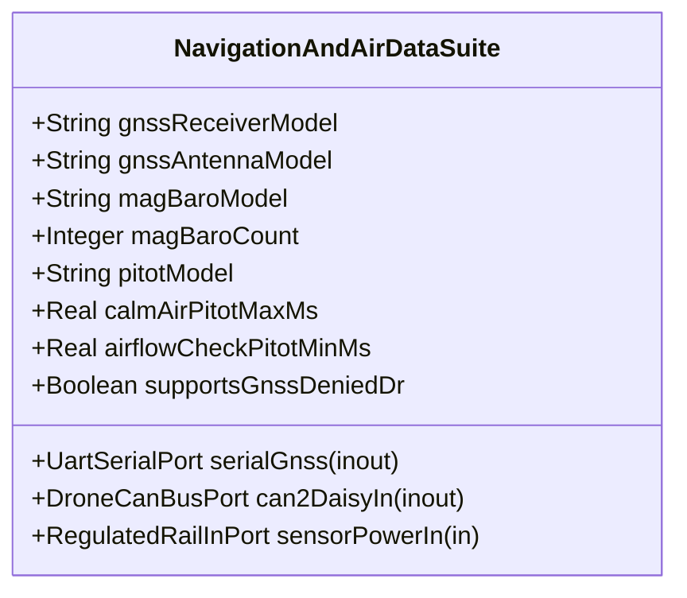

| Attribute | Specification Detail |
| :--- | :--- |
| **Issue ID** | #39 |
| **Title** | Feature 08: [Avionics Guidance And Control] NavigationAndAirDataSuite |
| **Type** | feature |
| **Parent Epic** | [EPIC-03-AvionicsGuidanceAndControl](../epics/EPIC-03-AvionicsGuidanceAndControl.md) |
| **Interface Type** | Physical / Structural / Internal Bus |
| **Schema Containers** | `AvionicsGuidanceAndControl::NavigationAndAirDataSuite` |
| **Generation Mode** | subagent |
| **Specification Source** | [schema/model.sysml](../../schema/model.sysml) |

# Feature 08: [Avionics Guidance And Control] NavigationAndAirDataSuite

## UML Class Diagram



## Interface Requirements
### 1. Test Data Shape
```json
{
  "$schema": "https://json-schema.org/draft/2020-12/schema",
  "title": "NavigationAndAirDataSuitePayloadSchema",
  "type": "object",
  "properties": {
    "part": {
      "type": "string",
      "const": "NavigationAndAirDataSuite"
    },
    "status": {
      "type": "string",
      "enum": ["nominal", "degraded", "fault"]
    },
    "gnssReceiverModel": {
      "type": "string",
      "x-sysml-type": "String",
      "description": "Declared attribute gnssReceiverModel (String)",
      "default": "Septentrio Asterx-m3 pro"
    },
    "gnssAntennaModel": {
      "type": "string",
      "x-sysml-type": "String",
      "description": "Declared attribute gnssAntennaModel (String)",
      "default": "Talysman TW3972EXF"
    },
    "magBaroModel": {
      "type": "string",
      "x-sysml-type": "String",
      "description": "Declared attribute magBaroModel (String)",
      "default": "mRo RM3100"
    },
    "magBaroCount": {
      "type": "integer",
      "x-sysml-type": "Integer",
      "description": "Declared attribute magBaroCount (Integer)",
      "default": 2
    },
    "pitotModel": {
      "type": "string",
      "x-sysml-type": "String",
      "description": "Declared attribute pitotModel (String)",
      "default": "CUAV SKYE2 heated pitot"
    },
    "calmAirPitotMaxMs": {
      "type": "number",
      "x-sysml-type": "Real",
      "description": "Declared attribute calmAirPitotMaxMs (Real)",
      "default": 3.0
    },
    "airflowCheckPitotMinMs": {
      "type": "number",
      "x-sysml-type": "Real",
      "description": "Declared attribute airflowCheckPitotMinMs (Real)",
      "default": 10.0
    },
    "supportsGnssDeniedDr": {
      "type": "boolean",
      "x-sysml-type": "Boolean",
      "description": "Declared attribute supportsGnssDeniedDr (Boolean)",
      "default": true
    },
    "serialGnss": {
      "type": "object",
      "properties": {
        "direction": { "type": "string", "const": "inout" },
        "port_type": { "type": "string", "const": "UartSerialPort" }
      },
      "required": ["direction", "port_type"]
    },
    "can2DaisyIn": {
      "type": "object",
      "properties": {
        "direction": { "type": "string", "const": "inout" },
        "port_type": { "type": "string", "const": "DroneCanBusPort" }
      },
      "required": ["direction", "port_type"]
    },
    "sensorPowerIn": {
      "type": "object",
      "properties": {
        "direction": { "type": "string", "const": "in" },
        "port_type": { "type": "string", "const": "RegulatedRailInPort" }
      },
      "required": ["direction", "port_type"]
    }
  },
  "required": [
    "part",
    "status",
    "serialGnss",
    "can2DaisyIn",
    "sensorPowerIn"
  ],
  "additionalProperties": false
}
```

### 2. Validation & Constraints
Declared structural attributes, boundary ports, invariants, and allocated requirements for classifier `NavigationAndAirDataSuite`:

| AST Member Kind | Identifier | Declared Type / Direction | Default / Invariant Contract |
| :--- | :--- | :--- | :--- |
| Attribute | `gnssReceiverModel` | `String` | Default `"Septentrio Asterx-m3 pro"` |
| Attribute | `gnssAntennaModel` | `String` | Default `"Talysman TW3972EXF"` |
| Attribute | `magBaroModel` | `String` | Default `"mRo RM3100"` |
| Attribute | `magBaroCount` | `Integer` | Default `2` |
| Attribute | `pitotModel` | `String` | Default `"CUAV SKYE2 heated pitot"` |
| Attribute | `calmAirPitotMaxMs` | `Real` | Default `3.0` |
| Attribute | `airflowCheckPitotMinMs` | `Real` | Default `10.0` |
| Attribute | `supportsGnssDeniedDr` | `Boolean` | Default `true` |
| Port | `serialGnss` | `inout UartSerialPort` | Boundary interface contract |
| Port | `can2DaisyIn` | `inout DroneCanBusPort` | Boundary interface contract |
| Port | `sensorPowerIn` | `in RegulatedRailInPort` | Boundary interface contract |
| Requirement | `REQ_L_03` | Allocated Requirement | Allocated requirement obligation |
| Requirement | `REQ_H_03` | Allocated Requirement | Allocated requirement obligation |
| Requirement | `REQ_UCA_03` | Allocated Requirement | Allocated requirement obligation |
| Requirement | `REQ_UCA_04` | Allocated Requirement | Allocated requirement obligation |
| Requirement | `REQ_SC_05` | Allocated Requirement | SC-05: Execute software Simplex RTA supervisor inside Cube orange+ clamping engagement airspeed <= 55.0 m/s and VNE <= 80.0 m/s (zero standalone RTA box). |
| Requirement | `REQ_SC_06` | Allocated Requirement | Allocated requirement obligation |
| Requirement | `REQ_SC_07` | Allocated Requirement | SC-07: Enforce pre-flight SKYE2 pitot bounds (<= 3.0 m/s calm, >= 10.0 m/s airflow) and support GPS Failsafe / manual Disable GNSS INS/DR fallback. |
| Requirement | `REQ_SC_08` | Allocated Requirement | Allocated requirement obligation |
| Requirement | `REQ_SAF_08` | Allocated Requirement | GAP-WCET Disposition: Anchor deterministic timing around grounded 100 Hz (0.01 s) ESAD RS-485 cycle while tracking EKF2, CAN 1/2, and Trip6 WCET targets for bench verification. |
| Requirement | `REQ_SAF_09` | Allocated Requirement | GAP-REL Disposition: Parameterize FMECA/FTA piece-part failure rates (lambda/MTBF) using conservative baselines pending OEM supplier MTBF release. |

### 3. Visual Layout & Arrangement
Structural composition and boundary topology for classifier `NavigationAndAirDataSuite` organize no nested subparts declared in schema paired with boundary ports `inout serialGnss : UartSerialPort`, `inout can2DaisyIn : DroneCanBusPort`, `in sensorPowerIn : RegulatedRailInPort`.

### 4. Interactive Flow & States
Operational lifecycle events and discrete state transitions for NavigationAndAirDataSuite.

### Layer 1: Domain State & Signal Model
Classifier `NavigationAndAirDataSuite` encapsulates typed domain state attributes `gnssReceiverModel : String`, `gnssAntennaModel : String`, `magBaroModel : String`, `magBaroCount : Integer`, `pitotModel : String`, `calmAirPitotMaxMs : Real`, `airflowCheckPitotMinMs : Real`, `supportsGnssDeniedDr : Boolean` alongside operational lifecycle status.

### Layer 2: Logic & Safety State Management
Classifier `NavigationAndAirDataSuite` governs stateless structural transition evaluation enforcing invariant obligations `REQ_L_03`, `REQ_H_03`, `REQ_UCA_03`, `REQ_UCA_04`, `REQ_SC_05`, `REQ_SC_06`, `REQ_SC_07`, `REQ_SC_08`, `REQ_SAF_08`, `REQ_SAF_09`.

### Layer 3: Presentation & Actuator Interface Binding
Classifier `NavigationAndAirDataSuite` binds external and behavioral interfaces across port `inout serialGnss : UartSerialPort`, port `inout can2DaisyIn : DroneCanBusPort`, port `in sensorPowerIn : RegulatedRailInPort`.

### Associated Use Cases & User Stories

#### Associated Use Cases
- [ ] #26 - [Use Case 03: Execute Gnss Denied And Lost Link Failsafe](../use-cases/UC-03-ExecuteGnssDeniedAndLostLinkFailsafe.md)

#### Associated User Stories
- None allocated (structural subsystem component)

## Acceptance Criteria (BDD)
- [ ] AC-01: Given valid `NavigationAndAirDataSuite` inputs satisfying `REQ_L_03`, When `NavigationAndAirDataSuite` evaluates invariant `REQ_L_03`, Then the invariant holds and verified state is committed.
- [ ] AC-02: Given boundary inputs that violate `REQ_L_03`, When `NavigationAndAirDataSuite` evaluates invariant `REQ_L_03`, Then `NavigationAndAirDataSuite` rejects the invalid transition and routes a diagnostic via diagnostic port `serialGnss`.
- [ ] AC-03: Given valid `NavigationAndAirDataSuite` inputs satisfying `REQ_H_03`, When `NavigationAndAirDataSuite` evaluates invariant `REQ_H_03`, Then the invariant holds and verified state is committed.
- [ ] AC-04: Given boundary inputs that violate `REQ_H_03`, When `NavigationAndAirDataSuite` evaluates invariant `REQ_H_03`, Then `NavigationAndAirDataSuite` rejects the invalid transition and routes a diagnostic via diagnostic port `serialGnss`.
- [ ] AC-05: Given valid `NavigationAndAirDataSuite` inputs satisfying `REQ_UCA_03`, When `NavigationAndAirDataSuite` evaluates invariant `REQ_UCA_03`, Then the invariant holds and verified state is committed.
- [ ] AC-06: Given boundary inputs that violate `REQ_UCA_03`, When `NavigationAndAirDataSuite` evaluates invariant `REQ_UCA_03`, Then `NavigationAndAirDataSuite` rejects the invalid transition and routes a diagnostic via diagnostic port `serialGnss`.
- [ ] AC-07: Given valid `NavigationAndAirDataSuite` state satisfying composite invariants (`REQ_UCA_04`; `REQ_SC_05` (`SC-05: Execute software Simplex RTA supervisor inside Cube orange+ clamping engagement airspeed <= 55.0 m/s and VNE <= 80.0 m/s (zero standalone RTA box).`); `REQ_SC_06`; `REQ_SC_07` (`SC-07: Enforce pre-flight SKYE2 pitot bounds (<= 3.0 m/s calm, >= 10.0 m/s airflow) and support GPS Failsafe / manual Disable GNSS INS/DR fallback.`); `REQ_SC_08`; `REQ_SAF_08` (`GAP-WCET Disposition: Anchor deterministic timing around grounded 100 Hz (0.01 s) ESAD RS-485 cycle while tracking EKF2, CAN 1/2, and Trip6 WCET targets for bench verification.`); `REQ_SAF_09` (`GAP-REL Disposition: Parameterize FMECA/FTA piece-part failure rates (lambda/MTBF) using conservative baselines pending OEM supplier MTBF release.`)), When `NavigationAndAirDataSuite` evaluates the remaining invariant conjunction, Then all declared invariants hold and verified state is committed.
- [ ] AC-08: Given input state that violates any invariant in (`REQ_UCA_04`; `REQ_SC_05` (`SC-05: Execute software Simplex RTA supervisor inside Cube orange+ clamping engagement airspeed <= 55.0 m/s and VNE <= 80.0 m/s (zero standalone RTA box).`); `REQ_SC_06`; `REQ_SC_07` (`SC-07: Enforce pre-flight SKYE2 pitot bounds (<= 3.0 m/s calm, >= 10.0 m/s airflow) and support GPS Failsafe / manual Disable GNSS INS/DR fallback.`); `REQ_SC_08`; `REQ_SAF_08` (`GAP-WCET Disposition: Anchor deterministic timing around grounded 100 Hz (0.01 s) ESAD RS-485 cycle while tracking EKF2, CAN 1/2, and Trip6 WCET targets for bench verification.`); `REQ_SAF_09` (`GAP-REL Disposition: Parameterize FMECA/FTA piece-part failure rates (lambda/MTBF) using conservative baselines pending OEM supplier MTBF release.`)), When `NavigationAndAirDataSuite` evaluates the composite guard, Then `NavigationAndAirDataSuite` rejects the invalid state transition and routes a diagnostic via diagnostic port `serialGnss`.
- [ ] AC-09: Given nominal typed values for `gnssReceiverModel` (`String`), `gnssAntennaModel` (`String`), `magBaroModel` (`String`), `magBaroCount` (`Integer`), `pitotModel` (`String`), `calmAirPitotMaxMs` (`Real`), `airflowCheckPitotMinMs` (`Real`), `supportsGnssDeniedDr` (`Boolean`) across `serialGnss` (`inout UartSerialPort`), `can2DaisyIn` (`inout DroneCanBusPort`), `sensorPowerIn` (`in RegulatedRailInPort`), When `NavigationAndAirDataSuite` executes structural interface processing, Then state and output ports conform to declared schema types.
- [ ] AC-10: Given malformed input frames across `gnssReceiverModel` (`String`), `gnssAntennaModel` (`String`), `magBaroModel` (`String`), `magBaroCount` (`Integer`), `pitotModel` (`String`), `calmAirPitotMaxMs` (`Real`), `airflowCheckPitotMinMs` (`Real`), `supportsGnssDeniedDr` (`Boolean`) or `serialGnss` (`inout UartSerialPort`), `can2DaisyIn` (`inout DroneCanBusPort`), `sensorPowerIn` (`in RegulatedRailInPort`), When `NavigationAndAirDataSuite` boundary validation executes, Then `NavigationAndAirDataSuite` rejects the malformed input via diagnostic port `serialGnss`.

## Source References
Formal component specifications and normative systems engineering requirements:
- System Architecture Model: `schema/model.sysml`
- Normative Systems Engineering Standard: ISO/IEC/IEEE 15288:2023 §6.4.3 Architecture Definition Process

Component behavior and interface definitions derive from `schema/model.sysml` pursuant to ISO/IEC/IEEE 15288.
