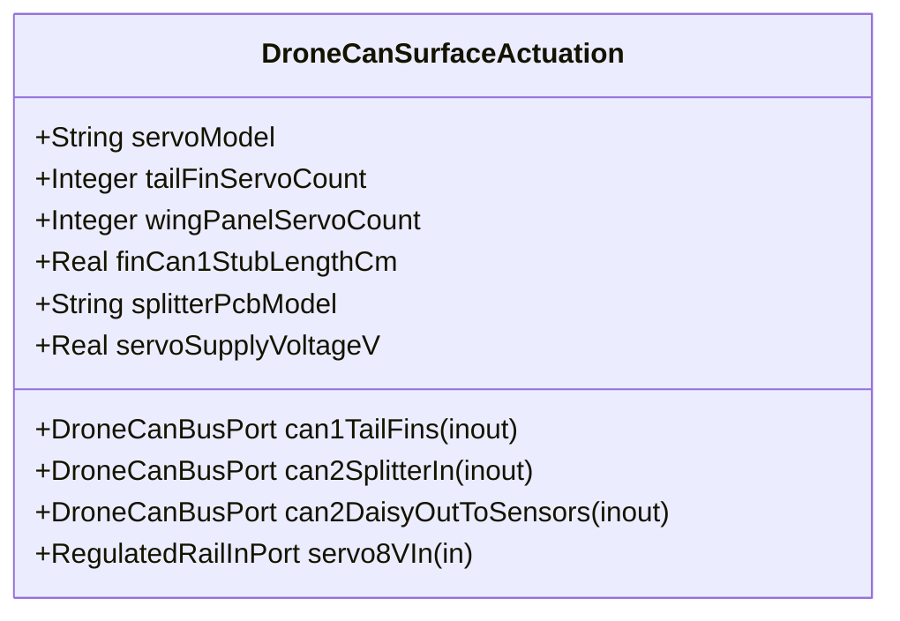

| Attribute | Specification Detail |
| :--- | :--- |
| **Issue ID** | #40 |
| **Title** | Feature 09: [Avionics Guidance And Control] DroneCanSurfaceActuation |
| **Type** | feature |
| **Parent Epic** | [EPIC-03-AvionicsGuidanceAndControl](../epics/EPIC-03-AvionicsGuidanceAndControl.md) |
| **Interface Type** | Physical / Structural / Internal Bus |
| **Schema Containers** | `AvionicsGuidanceAndControl::DroneCanSurfaceActuation` |
| **Generation Mode** | subagent |
| **Specification Source** | [schema/model.sysml](../../schema/model.sysml) |

# Feature 09: [Avionics Guidance And Control] DroneCanSurfaceActuation

## UML Class Diagram



## Interface Requirements
### 1. Test Data Shape
```json
{
  "$schema": "https://json-schema.org/draft/2020-12/schema",
  "title": "DroneCanSurfaceActuationPayloadSchema",
  "type": "object",
  "properties": {
    "part": {
      "type": "string",
      "const": "DroneCanSurfaceActuation"
    },
    "status": {
      "type": "string",
      "enum": ["nominal", "degraded", "fault"]
    },
    "servoModel": {
      "type": "string",
      "x-sysml-type": "String",
      "description": "Declared attribute servoModel (String)",
      "default": "HV6160-DroneCAN"
    },
    "tailFinServoCount": {
      "type": "integer",
      "x-sysml-type": "Integer",
      "description": "Declared attribute tailFinServoCount (Integer)",
      "default": 4
    },
    "wingPanelServoCount": {
      "type": "integer",
      "x-sysml-type": "Integer",
      "description": "Declared attribute wingPanelServoCount (Integer)",
      "default": 4
    },
    "finCan1StubLengthCm": {
      "type": "number",
      "x-sysml-type": "Real",
      "description": "Declared attribute finCan1StubLengthCm (Real)",
      "default": 120.0
    },
    "splitterPcbModel": {
      "type": "string",
      "x-sysml-type": "String",
      "description": "Declared attribute splitterPcbModel (String)",
      "default": "CAN/power splitter PCB"
    },
    "servoSupplyVoltageV": {
      "type": "number",
      "x-sysml-type": "Real",
      "description": "Declared attribute servoSupplyVoltageV (Real)",
      "default": 8.0
    },
    "can1TailFins": {
      "type": "object",
      "properties": {
        "direction": { "type": "string", "const": "inout" },
        "port_type": { "type": "string", "const": "DroneCanBusPort" }
      },
      "required": ["direction", "port_type"]
    },
    "can2SplitterIn": {
      "type": "object",
      "properties": {
        "direction": { "type": "string", "const": "inout" },
        "port_type": { "type": "string", "const": "DroneCanBusPort" }
      },
      "required": ["direction", "port_type"]
    },
    "can2DaisyOutToSensors": {
      "type": "object",
      "properties": {
        "direction": { "type": "string", "const": "inout" },
        "port_type": { "type": "string", "const": "DroneCanBusPort" }
      },
      "required": ["direction", "port_type"]
    },
    "servo8VIn": {
      "type": "object",
      "properties": {
        "direction": { "type": "string", "const": "in" },
        "port_type": { "type": "string", "const": "RegulatedRailInPort" }
      },
      "required": ["direction", "port_type"]
    }
  },
  "required": [
    "part",
    "status",
    "can1TailFins",
    "can2SplitterIn",
    "can2DaisyOutToSensors",
    "servo8VIn"
  ],
  "additionalProperties": false
}
```

### 2. Validation & Constraints
Declared structural attributes, boundary ports, invariants, and allocated requirements for classifier `DroneCanSurfaceActuation`:

| AST Member Kind | Identifier | Declared Type / Direction | Default / Invariant Contract |
| :--- | :--- | :--- | :--- |
| Attribute | `servoModel` | `String` | Default `"HV6160-DroneCAN"` |
| Attribute | `tailFinServoCount` | `Integer` | Default `4` |
| Attribute | `wingPanelServoCount` | `Integer` | Default `4` |
| Attribute | `finCan1StubLengthCm` | `Real` | Default `120.0` |
| Attribute | `splitterPcbModel` | `String` | Default `"CAN/power splitter PCB"` |
| Attribute | `servoSupplyVoltageV` | `Real` | Default `8.0` |
| Port | `can1TailFins` | `inout DroneCanBusPort` | Boundary interface contract |
| Port | `can2SplitterIn` | `inout DroneCanBusPort` | Boundary interface contract |
| Port | `can2DaisyOutToSensors` | `inout DroneCanBusPort` | Boundary interface contract |
| Port | `servo8VIn` | `in RegulatedRailInPort` | Boundary interface contract |
| Requirement | `REQ_L_03` | Allocated Requirement | Allocated requirement obligation |
| Requirement | `REQ_H_03` | Allocated Requirement | Allocated requirement obligation |
| Requirement | `REQ_UCA_03` | Allocated Requirement | Allocated requirement obligation |
| Requirement | `REQ_UCA_04` | Allocated Requirement | Allocated requirement obligation |
| Requirement | `REQ_SC_05` | Allocated Requirement | SC-05: Execute software Simplex RTA supervisor inside Cube orange+ clamping engagement airspeed <= 55.0 m/s and VNE <= 80.0 m/s (zero standalone RTA box). |
| Requirement | `REQ_SC_06` | Allocated Requirement | Allocated requirement obligation |
| Requirement | `REQ_SC_07` | Allocated Requirement | SC-07: Enforce pre-flight SKYE2 pitot bounds (<= 3.0 m/s calm, >= 10.0 m/s airflow) and support GPS Failsafe / manual Disable GNSS INS/DR fallback. |
| Requirement | `REQ_SC_08` | Allocated Requirement | Allocated requirement obligation |
| Requirement | `REQ_SAF_08` | Allocated Requirement | GAP-WCET Disposition: Anchor deterministic timing around grounded 100 Hz (0.01 s) ESAD RS-485 cycle while tracking EKF2, CAN 1/2, and Trip6 WCET targets for bench verification. |
| Requirement | `REQ_SAF_09` | Allocated Requirement | GAP-REL Disposition: Parameterize FMECA/FTA piece-part failure rates (lambda/MTBF) using conservative baselines pending OEM supplier MTBF release. |

### 3. Visual Layout & Arrangement
Structural composition and boundary topology for classifier `DroneCanSurfaceActuation` organize no nested subparts declared in schema paired with boundary ports `inout can1TailFins : DroneCanBusPort`, `inout can2SplitterIn : DroneCanBusPort`, `inout can2DaisyOutToSensors : DroneCanBusPort`, `in servo8VIn : RegulatedRailInPort`.

### 4. Interactive Flow & States
Operational lifecycle events and discrete state transitions for DroneCanSurfaceActuation.

### Layer 1: Domain State & Signal Model
Classifier `DroneCanSurfaceActuation` encapsulates typed domain state attributes `servoModel : String`, `tailFinServoCount : Integer`, `wingPanelServoCount : Integer`, `finCan1StubLengthCm : Real`, `splitterPcbModel : String`, `servoSupplyVoltageV : Real` alongside operational lifecycle status.

### Layer 2: Logic & Safety State Management
Classifier `DroneCanSurfaceActuation` governs stateless structural transition evaluation enforcing invariant obligations `REQ_L_03`, `REQ_H_03`, `REQ_UCA_03`, `REQ_UCA_04`, `REQ_SC_05`, `REQ_SC_06`, `REQ_SC_07`, `REQ_SC_08`, `REQ_SAF_08`, `REQ_SAF_09`.

### Layer 3: Presentation & Actuator Interface Binding
Classifier `DroneCanSurfaceActuation` binds external and behavioral interfaces across port `inout can1TailFins : DroneCanBusPort`, port `inout can2SplitterIn : DroneCanBusPort`, port `inout can2DaisyOutToSensors : DroneCanBusPort`, port `in servo8VIn : RegulatedRailInPort`.

## Acceptance Criteria (BDD)
- [ ] AC-01: Given valid `DroneCanSurfaceActuation` inputs satisfying `REQ_L_03`, When `DroneCanSurfaceActuation` evaluates invariant `REQ_L_03`, Then the invariant holds and verified state is committed.
- [ ] AC-02: Given boundary inputs that violate `REQ_L_03`, When `DroneCanSurfaceActuation` evaluates invariant `REQ_L_03`, Then `DroneCanSurfaceActuation` rejects the invalid transition and routes a diagnostic via diagnostic port `can1TailFins`.
- [ ] AC-03: Given valid `DroneCanSurfaceActuation` inputs satisfying `REQ_H_03`, When `DroneCanSurfaceActuation` evaluates invariant `REQ_H_03`, Then the invariant holds and verified state is committed.
- [ ] AC-04: Given boundary inputs that violate `REQ_H_03`, When `DroneCanSurfaceActuation` evaluates invariant `REQ_H_03`, Then `DroneCanSurfaceActuation` rejects the invalid transition and routes a diagnostic via diagnostic port `can1TailFins`.
- [ ] AC-05: Given valid `DroneCanSurfaceActuation` inputs satisfying `REQ_UCA_03`, When `DroneCanSurfaceActuation` evaluates invariant `REQ_UCA_03`, Then the invariant holds and verified state is committed.
- [ ] AC-06: Given boundary inputs that violate `REQ_UCA_03`, When `DroneCanSurfaceActuation` evaluates invariant `REQ_UCA_03`, Then `DroneCanSurfaceActuation` rejects the invalid transition and routes a diagnostic via diagnostic port `can1TailFins`.
- [ ] AC-07: Given valid `DroneCanSurfaceActuation` state satisfying composite invariants (`REQ_UCA_04`; `REQ_SC_05` (`SC-05: Execute software Simplex RTA supervisor inside Cube orange+ clamping engagement airspeed <= 55.0 m/s and VNE <= 80.0 m/s (zero standalone RTA box).`); `REQ_SC_06`; `REQ_SC_07` (`SC-07: Enforce pre-flight SKYE2 pitot bounds (<= 3.0 m/s calm, >= 10.0 m/s airflow) and support GPS Failsafe / manual Disable GNSS INS/DR fallback.`); `REQ_SC_08`; `REQ_SAF_08` (`GAP-WCET Disposition: Anchor deterministic timing around grounded 100 Hz (0.01 s) ESAD RS-485 cycle while tracking EKF2, CAN 1/2, and Trip6 WCET targets for bench verification.`); `REQ_SAF_09` (`GAP-REL Disposition: Parameterize FMECA/FTA piece-part failure rates (lambda/MTBF) using conservative baselines pending OEM supplier MTBF release.`)), When `DroneCanSurfaceActuation` evaluates the remaining invariant conjunction, Then all declared invariants hold and verified state is committed.
- [ ] AC-08: Given input state that violates any invariant in (`REQ_UCA_04`; `REQ_SC_05` (`SC-05: Execute software Simplex RTA supervisor inside Cube orange+ clamping engagement airspeed <= 55.0 m/s and VNE <= 80.0 m/s (zero standalone RTA box).`); `REQ_SC_06`; `REQ_SC_07` (`SC-07: Enforce pre-flight SKYE2 pitot bounds (<= 3.0 m/s calm, >= 10.0 m/s airflow) and support GPS Failsafe / manual Disable GNSS INS/DR fallback.`); `REQ_SC_08`; `REQ_SAF_08` (`GAP-WCET Disposition: Anchor deterministic timing around grounded 100 Hz (0.01 s) ESAD RS-485 cycle while tracking EKF2, CAN 1/2, and Trip6 WCET targets for bench verification.`); `REQ_SAF_09` (`GAP-REL Disposition: Parameterize FMECA/FTA piece-part failure rates (lambda/MTBF) using conservative baselines pending OEM supplier MTBF release.`)), When `DroneCanSurfaceActuation` evaluates the composite guard, Then `DroneCanSurfaceActuation` rejects the invalid state transition and routes a diagnostic via diagnostic port `can1TailFins`.
- [ ] AC-09: Given nominal typed values for `servoModel` (`String`), `tailFinServoCount` (`Integer`), `wingPanelServoCount` (`Integer`), `finCan1StubLengthCm` (`Real`), `splitterPcbModel` (`String`), `servoSupplyVoltageV` (`Real`) across `can1TailFins` (`inout DroneCanBusPort`), `can2SplitterIn` (`inout DroneCanBusPort`), `can2DaisyOutToSensors` (`inout DroneCanBusPort`), `servo8VIn` (`in RegulatedRailInPort`), When `DroneCanSurfaceActuation` executes structural interface processing, Then state and output ports conform to declared schema types.
- [ ] AC-10: Given malformed input frames across `servoModel` (`String`), `tailFinServoCount` (`Integer`), `wingPanelServoCount` (`Integer`), `finCan1StubLengthCm` (`Real`), `splitterPcbModel` (`String`), `servoSupplyVoltageV` (`Real`) or `can1TailFins` (`inout DroneCanBusPort`), `can2SplitterIn` (`inout DroneCanBusPort`), `can2DaisyOutToSensors` (`inout DroneCanBusPort`), `servo8VIn` (`in RegulatedRailInPort`), When `DroneCanSurfaceActuation` boundary validation executes, Then `DroneCanSurfaceActuation` rejects the malformed input via diagnostic port `can1TailFins`.

## Source References
Formal component specifications and normative systems engineering requirements:
- System Architecture Model: `schema/model.sysml`
- Normative Systems Engineering Standard: ISO/IEC/IEEE 15288:2023 §6.4.3 Architecture Definition Process

Component behavior and interface definitions derive from `schema/model.sysml` pursuant to ISO/IEC/IEEE 15288.
