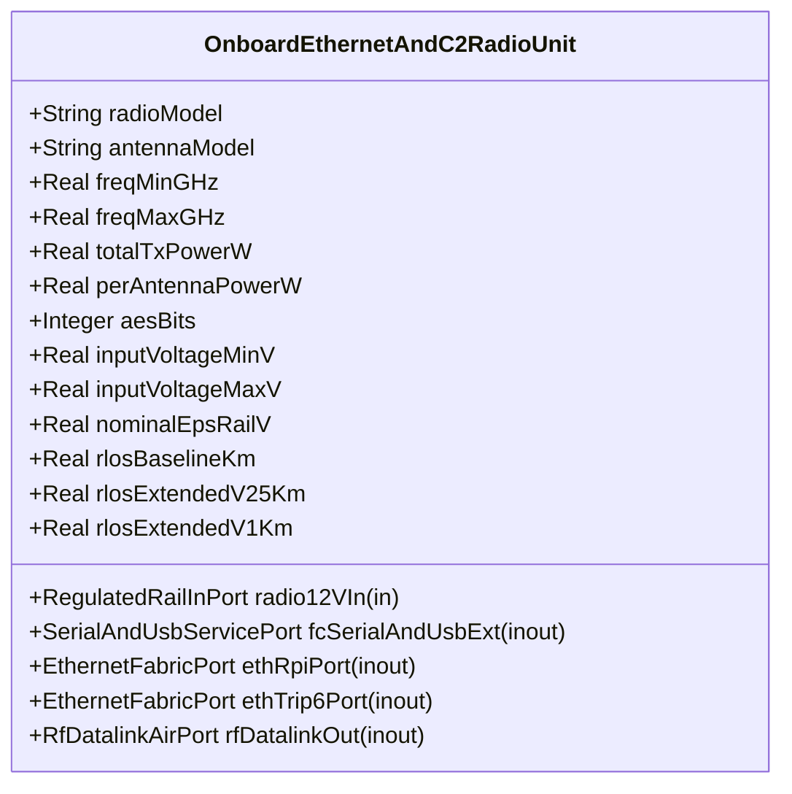

| Attribute | Specification Detail |
| :--- | :--- |
| **Issue ID** | #41 |
| **Title** | Feature 10: [Mission Payloads Comms And Ordnance Safety] OnboardEthernetAndC2RadioUnit |
| **Type** | feature |
| **Parent Epic** | [EPIC-04-MissionPayloadsCommsAndOrdnanceSafety](../epics/EPIC-04-MissionPayloadsCommsAndOrdnanceSafety.md) |
| **Interface Type** | Physical / Structural / Internal Bus |
| **Schema Containers** | `MissionPayloadsCommsAndOrdnanceSafety::OnboardEthernetAndC2RadioUnit` |
| **Generation Mode** | subagent |
| **Specification Source** | [schema/model.sysml](../../schema/model.sysml) |

# Feature 10: [Mission Payloads Comms And Ordnance Safety] OnboardEthernetAndC2RadioUnit

## UML Class Diagram



## Interface Requirements
### 1. Test Data Shape
```json
{
  "$schema": "https://json-schema.org/draft/2020-12/schema",
  "title": "OnboardEthernetAndC2RadioUnitPayloadSchema",
  "type": "object",
  "properties": {
    "part": {
      "type": "string",
      "const": "OnboardEthernetAndC2RadioUnit"
    },
    "status": {
      "type": "string",
      "enum": ["nominal", "degraded", "fault"]
    },
    "radioModel": {
      "type": "string",
      "x-sysml-type": "String",
      "description": "Declared attribute radioModel (String)",
      "default": "DTC 4.4-5.0 GHz AES-256 FHSS"
    },
    "antennaModel": {
      "type": "string",
      "x-sysml-type": "String",
      "description": "Declared attribute antennaModel (String)",
      "default": "2x MPSL4400"
    },
    "freqMinGHz": {
      "type": "number",
      "x-sysml-type": "Real",
      "description": "Declared attribute freqMinGHz (Real)",
      "default": 4.4
    },
    "freqMaxGHz": {
      "type": "number",
      "x-sysml-type": "Real",
      "description": "Declared attribute freqMaxGHz (Real)",
      "default": 5.0
    },
    "totalTxPowerW": {
      "type": "number",
      "x-sysml-type": "Real",
      "description": "Declared attribute totalTxPowerW (Real)",
      "default": 2.0
    },
    "perAntennaPowerW": {
      "type": "number",
      "x-sysml-type": "Real",
      "description": "Declared attribute perAntennaPowerW (Real)",
      "default": 1.0
    },
    "aesBits": {
      "type": "integer",
      "x-sysml-type": "Integer",
      "description": "Declared attribute aesBits (Integer)",
      "default": 256
    },
    "inputVoltageMinV": {
      "type": "number",
      "x-sysml-type": "Real",
      "description": "Declared attribute inputVoltageMinV (Real)",
      "default": 8.0
    },
    "inputVoltageMaxV": {
      "type": "number",
      "x-sysml-type": "Real",
      "description": "Declared attribute inputVoltageMaxV (Real)",
      "default": 17.0
    },
    "nominalEpsRailV": {
      "type": "number",
      "x-sysml-type": "Real",
      "description": "Declared attribute nominalEpsRailV (Real)",
      "default": 12.0
    },
    "rlosBaselineKm": {
      "type": "number",
      "x-sysml-type": "Real",
      "description": "Declared attribute rlosBaselineKm (Real)",
      "default": 60.0
    },
    "rlosExtendedV25Km": {
      "type": "number",
      "x-sysml-type": "Real",
      "description": "Declared attribute rlosExtendedV25Km (Real)",
      "default": 90.0
    },
    "rlosExtendedV1Km": {
      "type": "number",
      "x-sysml-type": "Real",
      "description": "Declared attribute rlosExtendedV1Km (Real)",
      "default": 180.0
    },
    "radio12VIn": {
      "type": "object",
      "properties": {
        "direction": { "type": "string", "const": "in" },
        "port_type": { "type": "string", "const": "RegulatedRailInPort" }
      },
      "required": ["direction", "port_type"]
    },
    "fcSerialAndUsbExt": {
      "type": "object",
      "properties": {
        "direction": { "type": "string", "const": "inout" },
        "port_type": { "type": "string", "const": "SerialAndUsbServicePort" }
      },
      "required": ["direction", "port_type"]
    },
    "ethRpiPort": {
      "type": "object",
      "properties": {
        "direction": { "type": "string", "const": "inout" },
        "port_type": { "type": "string", "const": "EthernetFabricPort" }
      },
      "required": ["direction", "port_type"]
    },
    "ethTrip6Port": {
      "type": "object",
      "properties": {
        "direction": { "type": "string", "const": "inout" },
        "port_type": { "type": "string", "const": "EthernetFabricPort" }
      },
      "required": ["direction", "port_type"]
    },
    "rfDatalinkOut": {
      "type": "object",
      "properties": {
        "direction": { "type": "string", "const": "inout" },
        "port_type": { "type": "string", "const": "RfDatalinkAirPort" }
      },
      "required": ["direction", "port_type"]
    }
  },
  "required": [
    "part",
    "status",
    "radio12VIn",
    "fcSerialAndUsbExt",
    "ethRpiPort",
    "ethTrip6Port",
    "rfDatalinkOut"
  ],
  "additionalProperties": false
}
```

### 2. Validation & Constraints
Declared structural attributes, boundary ports, invariants, and allocated requirements for classifier `OnboardEthernetAndC2RadioUnit`:

| AST Member Kind | Identifier | Declared Type / Direction | Default / Invariant Contract |
| :--- | :--- | :--- | :--- |
| Attribute | `radioModel` | `String` | Default `"DTC 4.4-5.0 GHz AES-256 FHSS"` |
| Attribute | `antennaModel` | `String` | Default `"2x MPSL4400"` |
| Attribute | `freqMinGHz` | `Real` | Default `4.4` |
| Attribute | `freqMaxGHz` | `Real` | Default `5.0` |
| Attribute | `totalTxPowerW` | `Real` | Default `2.0` |
| Attribute | `perAntennaPowerW` | `Real` | Default `1.0` |
| Attribute | `aesBits` | `Integer` | Default `256` |
| Attribute | `inputVoltageMinV` | `Real` | Default `8.0` |
| Attribute | `inputVoltageMaxV` | `Real` | Default `17.0` |
| Attribute | `nominalEpsRailV` | `Real` | Default `12.0` |
| Attribute | `rlosBaselineKm` | `Real` | Default `60.0` |
| Attribute | `rlosExtendedV25Km` | `Real` | Default `90.0` |
| Attribute | `rlosExtendedV1Km` | `Real` | Default `180.0` |
| Port | `radio12VIn` | `in RegulatedRailInPort` | Boundary interface contract |
| Port | `fcSerialAndUsbExt` | `inout SerialAndUsbServicePort` | Boundary interface contract |
| Port | `ethRpiPort` | `inout EthernetFabricPort` | Boundary interface contract |
| Port | `ethTrip6Port` | `inout EthernetFabricPort` | Boundary interface contract |
| Port | `rfDatalinkOut` | `inout RfDatalinkAirPort` | Boundary interface contract |
| Requirement | `REQ_L_04` | Allocated Requirement | Allocated requirement obligation |
| Requirement | `REQ_H_04` | Allocated Requirement | Allocated requirement obligation |
| Requirement | `REQ_H_05` | Allocated Requirement | Allocated requirement obligation |
| Requirement | `REQ_UCA_05` | Allocated Requirement | Allocated requirement obligation |
| Requirement | `REQ_UCA_06` | Allocated Requirement | Allocated requirement obligation |
| Requirement | `REQ_UCA_07` | Allocated Requirement | Allocated requirement obligation |
| Requirement | `REQ_SC_09` | Allocated Requirement | Allocated requirement obligation |
| Requirement | `REQ_SC_10` | Allocated Requirement | SC-10: Verify J100 UMB continuity < 0.5 Ohm at 20 mA and lock out ESAD (FaultStates bit 4) if DSC_IN1 1 kHz 2-pulse arrives before Arm Stage 2. |
| Requirement | `REQ_SC_11` | Allocated Requirement | SC-11: Gate 0x12 HIGHVOLTAGE charging (0-1800 V) and J401 fire strictly behind SS1 launch accel, SS2 Safe Distance Exceed == 1 (GAP-07), Sensor Board IRQ_L, and OC Arm Enable. |
| Requirement | `REQ_SC_12` | Allocated Requirement | Allocated requirement obligation |
| Requirement | `REQ_SAF_04` | Allocated Requirement | Allocated requirement obligation |
| Requirement | `REQ_SAF_06` | Allocated Requirement | Allocated requirement obligation |
| Requirement | `REQ_SAF_07` | Allocated Requirement | GAP-07 Mitigation: Align SwarmC2 UI wording strictly with ESAD ICD Safe Distance Exceed == 1 (SS2 Active) requirement prior to arming. |
| Requirement | `REQ_SAF_10` | Allocated Requirement | Allocated requirement obligation |

### 3. Visual Layout & Arrangement
Structural composition and boundary topology for classifier `OnboardEthernetAndC2RadioUnit` organize no nested subparts declared in schema paired with boundary ports `in radio12VIn : RegulatedRailInPort`, `inout fcSerialAndUsbExt : SerialAndUsbServicePort`, `inout ethRpiPort : EthernetFabricPort`, `inout ethTrip6Port : EthernetFabricPort`, `inout rfDatalinkOut : RfDatalinkAirPort`.

### 4. Interactive Flow & States
Operational lifecycle events and discrete state transitions for OnboardEthernetAndC2RadioUnit.

### Layer 1: Domain State & Signal Model
Classifier `OnboardEthernetAndC2RadioUnit` encapsulates typed domain state attributes `radioModel : String`, `antennaModel : String`, `freqMinGHz : Real`, `freqMaxGHz : Real`, `totalTxPowerW : Real`, `perAntennaPowerW : Real`, `aesBits : Integer`, `inputVoltageMinV : Real`, `inputVoltageMaxV : Real`, `nominalEpsRailV : Real`, `rlosBaselineKm : Real`, `rlosExtendedV25Km : Real`, `rlosExtendedV1Km : Real` alongside operational lifecycle status.

### Layer 2: Logic & Safety State Management
Classifier `OnboardEthernetAndC2RadioUnit` governs stateless structural transition evaluation enforcing invariant obligations `REQ_L_04`, `REQ_H_04`, `REQ_H_05`, `REQ_UCA_05`, `REQ_UCA_06`, `REQ_UCA_07`, `REQ_SC_09`, `REQ_SC_10`, `REQ_SC_11`, `REQ_SC_12`, `REQ_SAF_04`, `REQ_SAF_06`, `REQ_SAF_07`, `REQ_SAF_10`.

### Layer 3: Presentation & Actuator Interface Binding
Classifier `OnboardEthernetAndC2RadioUnit` binds external and behavioral interfaces across port `in radio12VIn : RegulatedRailInPort`, port `inout fcSerialAndUsbExt : SerialAndUsbServicePort`, port `inout ethRpiPort : EthernetFabricPort`, port `inout ethTrip6Port : EthernetFabricPort`, port `inout rfDatalinkOut : RfDatalinkAirPort`.

### Associated Use Cases & User Stories

#### Associated Use Cases
- None allocated (structural subsystem component)

#### Associated User Stories
- [ ] #14 - [User Story 10: Execute Esad Boot And Pbit](../user-stories/US-10-ExecuteEsadBootAndPbit.md)
- [ ] #15 - [User Story 11: Transition Esad Arming Sequence](../user-stories/US-11-TransitionEsadArmingSequence.md)
- [ ] #16 - [User Story 12: Command Esad Abort And Self Destruct](../user-stories/US-12-CommandEsadAbortAndSelfDestruct.md)
- [ ] #17 - [User Story 13: Acquire And Track Terminal Target](../user-stories/US-13-AcquireAndTrackTerminalTarget.md)
- [ ] #18 - [User Story 14: Reboot Gimbal And Bridge Ethernet](../user-stories/US-14-RebootGimbalAndBridgeEthernet.md)

## Acceptance Criteria (BDD)
- [ ] AC-01: Given valid `OnboardEthernetAndC2RadioUnit` inputs satisfying `REQ_L_04`, When `OnboardEthernetAndC2RadioUnit` evaluates invariant `REQ_L_04`, Then the invariant holds and verified state is committed.
- [ ] AC-02: Given boundary inputs that violate `REQ_L_04`, When `OnboardEthernetAndC2RadioUnit` evaluates invariant `REQ_L_04`, Then `OnboardEthernetAndC2RadioUnit` rejects the invalid transition and routes a diagnostic via diagnostic port `fcSerialAndUsbExt`.
- [ ] AC-03: Given valid `OnboardEthernetAndC2RadioUnit` inputs satisfying `REQ_H_04`, When `OnboardEthernetAndC2RadioUnit` evaluates invariant `REQ_H_04`, Then the invariant holds and verified state is committed.
- [ ] AC-04: Given boundary inputs that violate `REQ_H_04`, When `OnboardEthernetAndC2RadioUnit` evaluates invariant `REQ_H_04`, Then `OnboardEthernetAndC2RadioUnit` rejects the invalid transition and routes a diagnostic via diagnostic port `fcSerialAndUsbExt`.
- [ ] AC-05: Given valid `OnboardEthernetAndC2RadioUnit` inputs satisfying `REQ_H_05`, When `OnboardEthernetAndC2RadioUnit` evaluates invariant `REQ_H_05`, Then the invariant holds and verified state is committed.
- [ ] AC-06: Given boundary inputs that violate `REQ_H_05`, When `OnboardEthernetAndC2RadioUnit` evaluates invariant `REQ_H_05`, Then `OnboardEthernetAndC2RadioUnit` rejects the invalid transition and routes a diagnostic via diagnostic port `fcSerialAndUsbExt`.
- [ ] AC-07: Given valid `OnboardEthernetAndC2RadioUnit` state satisfying composite invariants (`REQ_UCA_05`; `REQ_UCA_06`; `REQ_UCA_07`; `REQ_SC_09`; `REQ_SC_10` (`SC-10: Verify J100 UMB continuity < 0.5 Ohm at 20 mA and lock out ESAD (FaultStates bit 4) if DSC_IN1 1 kHz 2-pulse arrives before Arm Stage 2.`); `REQ_SC_11` (`SC-11: Gate 0x12 HIGHVOLTAGE charging (0-1800 V) and J401 fire strictly behind SS1 launch accel, SS2 Safe Distance Exceed == 1 (GAP-07), Sensor Board IRQ_L, and OC Arm Enable.`); `REQ_SC_12`; `REQ_SAF_04`; `REQ_SAF_06`; `REQ_SAF_07` (`GAP-07 Mitigation: Align SwarmC2 UI wording strictly with ESAD ICD Safe Distance Exceed == 1 (SS2 Active) requirement prior to arming.`); `REQ_SAF_10`), When `OnboardEthernetAndC2RadioUnit` evaluates the remaining invariant conjunction, Then all declared invariants hold and verified state is committed.
- [ ] AC-08: Given input state that violates any invariant in (`REQ_UCA_05`; `REQ_UCA_06`; `REQ_UCA_07`; `REQ_SC_09`; `REQ_SC_10` (`SC-10: Verify J100 UMB continuity < 0.5 Ohm at 20 mA and lock out ESAD (FaultStates bit 4) if DSC_IN1 1 kHz 2-pulse arrives before Arm Stage 2.`); `REQ_SC_11` (`SC-11: Gate 0x12 HIGHVOLTAGE charging (0-1800 V) and J401 fire strictly behind SS1 launch accel, SS2 Safe Distance Exceed == 1 (GAP-07), Sensor Board IRQ_L, and OC Arm Enable.`); `REQ_SC_12`; `REQ_SAF_04`; `REQ_SAF_06`; `REQ_SAF_07` (`GAP-07 Mitigation: Align SwarmC2 UI wording strictly with ESAD ICD Safe Distance Exceed == 1 (SS2 Active) requirement prior to arming.`); `REQ_SAF_10`), When `OnboardEthernetAndC2RadioUnit` evaluates the composite guard, Then `OnboardEthernetAndC2RadioUnit` rejects the invalid state transition and routes a diagnostic via diagnostic port `fcSerialAndUsbExt`.
- [ ] AC-09: Given nominal typed values for `radioModel` (`String`), `antennaModel` (`String`), `freqMinGHz` (`Real`), `freqMaxGHz` (`Real`), `totalTxPowerW` (`Real`), `perAntennaPowerW` (`Real`), `aesBits` (`Integer`), `inputVoltageMinV` (`Real`), `inputVoltageMaxV` (`Real`), `nominalEpsRailV` (`Real`), `rlosBaselineKm` (`Real`), `rlosExtendedV25Km` (`Real`), `rlosExtendedV1Km` (`Real`) across `radio12VIn` (`in RegulatedRailInPort`), `fcSerialAndUsbExt` (`inout SerialAndUsbServicePort`), `ethRpiPort` (`inout EthernetFabricPort`), `ethTrip6Port` (`inout EthernetFabricPort`), `rfDatalinkOut` (`inout RfDatalinkAirPort`), When `OnboardEthernetAndC2RadioUnit` executes structural interface processing, Then state and output ports conform to declared schema types.
- [ ] AC-10: Given malformed input frames across `radioModel` (`String`), `antennaModel` (`String`), `freqMinGHz` (`Real`), `freqMaxGHz` (`Real`), `totalTxPowerW` (`Real`), `perAntennaPowerW` (`Real`), `aesBits` (`Integer`), `inputVoltageMinV` (`Real`), `inputVoltageMaxV` (`Real`), `nominalEpsRailV` (`Real`), `rlosBaselineKm` (`Real`), `rlosExtendedV25Km` (`Real`), `rlosExtendedV1Km` (`Real`) or `radio12VIn` (`in RegulatedRailInPort`), `fcSerialAndUsbExt` (`inout SerialAndUsbServicePort`), `ethRpiPort` (`inout EthernetFabricPort`), `ethTrip6Port` (`inout EthernetFabricPort`), `rfDatalinkOut` (`inout RfDatalinkAirPort`), When `OnboardEthernetAndC2RadioUnit` boundary validation executes, Then `OnboardEthernetAndC2RadioUnit` rejects the malformed input via diagnostic port `fcSerialAndUsbExt`.

## Source References
Formal component specifications and normative systems engineering requirements:
- System Architecture Model: `schema/model.sysml`
- Normative Systems Engineering Standard: ISO/IEC/IEEE 15288:2023 §6.4.3 Architecture Definition Process

Component behavior and interface definitions derive from `schema/model.sysml` pursuant to ISO/IEC/IEEE 15288.
