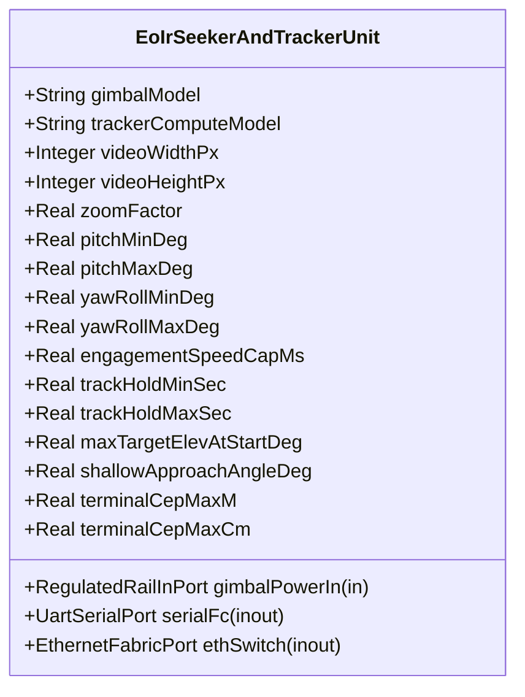

| Attribute | Specification Detail |
| :--- | :--- |
| **Issue ID** | #42 |
| **Title** | Feature 11: [Mission Payloads Comms And Ordnance Safety] EoIrSeekerAndTrackerUnit |
| **Type** | feature |
| **Parent Epic** | [EPIC-04-MissionPayloadsCommsAndOrdnanceSafety](../epics/EPIC-04-MissionPayloadsCommsAndOrdnanceSafety.md) |
| **Interface Type** | Physical / Structural / Internal Bus |
| **Schema Containers** | `MissionPayloadsCommsAndOrdnanceSafety::EoIrSeekerAndTrackerUnit` |
| **Generation Mode** | subagent |
| **Specification Source** | [schema/model.sysml](../../schema/model.sysml) |

# Feature 11: [Mission Payloads Comms And Ordnance Safety] EoIrSeekerAndTrackerUnit

## UML Class Diagram



## Interface Requirements
### 1. Test Data Shape
```json
{
  "$schema": "https://json-schema.org/draft/2020-12/schema",
  "title": "EoIrSeekerAndTrackerUnitPayloadSchema",
  "type": "object",
  "properties": {
    "part": {
      "type": "string",
      "const": "EoIrSeekerAndTrackerUnit"
    },
    "status": {
      "type": "string",
      "enum": ["nominal", "degraded", "fault"]
    },
    "gimbalModel": {
      "type": "string",
      "x-sysml-type": "String",
      "description": "Declared attribute gimbalModel (String)",
      "default": "Nighthawk2UZ"
    },
    "trackerComputeModel": {
      "type": "string",
      "x-sysml-type": "String",
      "description": "Declared attribute trackerComputeModel (String)",
      "default": "Trip6"
    },
    "videoWidthPx": {
      "type": "integer",
      "x-sysml-type": "Integer",
      "description": "Declared attribute videoWidthPx (Integer)",
      "default": 1280
    },
    "videoHeightPx": {
      "type": "integer",
      "x-sysml-type": "Integer",
      "description": "Declared attribute videoHeightPx (Integer)",
      "default": 720
    },
    "zoomFactor": {
      "type": "number",
      "x-sysml-type": "Real",
      "description": "Declared attribute zoomFactor (Real)",
      "default": 40.0
    },
    "pitchMinDeg": {
      "type": "number",
      "x-sysml-type": "Real",
      "description": "Declared attribute pitchMinDeg (Real)",
      "default": -45.0
    },
    "pitchMaxDeg": {
      "type": "number",
      "x-sysml-type": "Real",
      "description": "Declared attribute pitchMaxDeg (Real)",
      "default": 135.0
    },
    "yawRollMinDeg": {
      "type": "number",
      "x-sysml-type": "Real",
      "description": "Declared attribute yawRollMinDeg (Real)",
      "default": -165.0
    },
    "yawRollMaxDeg": {
      "type": "number",
      "x-sysml-type": "Real",
      "description": "Declared attribute yawRollMaxDeg (Real)",
      "default": 165.0
    },
    "engagementSpeedCapMs": {
      "type": "number",
      "x-sysml-type": "Real",
      "description": "Declared attribute engagementSpeedCapMs (Real)",
      "default": 55.0
    },
    "trackHoldMinSec": {
      "type": "number",
      "x-sysml-type": "Real",
      "description": "Declared attribute trackHoldMinSec (Real)",
      "default": 2.0
    },
    "trackHoldMaxSec": {
      "type": "number",
      "x-sysml-type": "Real",
      "description": "Declared attribute trackHoldMaxSec (Real)",
      "default": 5.0
    },
    "maxTargetElevAtStartDeg": {
      "type": "number",
      "x-sysml-type": "Real",
      "description": "Declared attribute maxTargetElevAtStartDeg (Real)",
      "default": 15.0
    },
    "shallowApproachAngleDeg": {
      "type": "number",
      "x-sysml-type": "Real",
      "description": "Declared attribute shallowApproachAngleDeg (Real)",
      "default": 15.0
    },
    "terminalCepMaxM": {
      "type": "number",
      "x-sysml-type": "Real",
      "description": "Declared attribute terminalCepMaxM (Real)",
      "default": 0.5
    },
    "terminalCepMaxCm": {
      "type": "number",
      "x-sysml-type": "Real",
      "description": "Declared attribute terminalCepMaxCm (Real)",
      "default": 50.0
    },
    "gimbalPowerIn": {
      "type": "object",
      "properties": {
        "direction": { "type": "string", "const": "in" },
        "port_type": { "type": "string", "const": "RegulatedRailInPort" }
      },
      "required": ["direction", "port_type"]
    },
    "serialFc": {
      "type": "object",
      "properties": {
        "direction": { "type": "string", "const": "inout" },
        "port_type": { "type": "string", "const": "UartSerialPort" }
      },
      "required": ["direction", "port_type"]
    },
    "ethSwitch": {
      "type": "object",
      "properties": {
        "direction": { "type": "string", "const": "inout" },
        "port_type": { "type": "string", "const": "EthernetFabricPort" }
      },
      "required": ["direction", "port_type"]
    }
  },
  "required": [
    "part",
    "status",
    "gimbalPowerIn",
    "serialFc",
    "ethSwitch"
  ],
  "additionalProperties": false
}
```

### 2. Validation & Constraints
Declared structural attributes, boundary ports, invariants, and allocated requirements for classifier `EoIrSeekerAndTrackerUnit`:

| AST Member Kind | Identifier | Declared Type / Direction | Default / Invariant Contract |
| :--- | :--- | :--- | :--- |
| Attribute | `gimbalModel` | `String` | Default `"Nighthawk2UZ"` |
| Attribute | `trackerComputeModel` | `String` | Default `"Trip6"` |
| Attribute | `videoWidthPx` | `Integer` | Default `1280` |
| Attribute | `videoHeightPx` | `Integer` | Default `720` |
| Attribute | `zoomFactor` | `Real` | Default `40.0` |
| Attribute | `pitchMinDeg` | `Real` | Default `-45.0` |
| Attribute | `pitchMaxDeg` | `Real` | Default `135.0` |
| Attribute | `yawRollMinDeg` | `Real` | Default `-165.0` |
| Attribute | `yawRollMaxDeg` | `Real` | Default `165.0` |
| Attribute | `engagementSpeedCapMs` | `Real` | Default `55.0` |
| Attribute | `trackHoldMinSec` | `Real` | Default `2.0` |
| Attribute | `trackHoldMaxSec` | `Real` | Default `5.0` |
| Attribute | `maxTargetElevAtStartDeg` | `Real` | Default `15.0` |
| Attribute | `shallowApproachAngleDeg` | `Real` | Default `15.0` |
| Attribute | `terminalCepMaxM` | `Real` | Default `0.5` |
| Attribute | `terminalCepMaxCm` | `Real` | Default `50.0` |
| Port | `gimbalPowerIn` | `in RegulatedRailInPort` | Boundary interface contract |
| Port | `serialFc` | `inout UartSerialPort` | Boundary interface contract |
| Port | `ethSwitch` | `inout EthernetFabricPort` | Boundary interface contract |
| Requirement | `REQ_L_04` | Allocated Requirement | Allocated requirement obligation |
| Requirement | `REQ_H_04` | Allocated Requirement | Allocated requirement obligation |
| Requirement | `REQ_H_05` | Allocated Requirement | Allocated requirement obligation |
| Requirement | `REQ_UCA_05` | Allocated Requirement | Allocated requirement obligation |
| Requirement | `REQ_UCA_06` | Allocated Requirement | Allocated requirement obligation |
| Requirement | `REQ_UCA_07` | Allocated Requirement | Allocated requirement obligation |
| Requirement | `REQ_SC_09` | Allocated Requirement | Allocated requirement obligation |
| Requirement | `REQ_SC_10` | Allocated Requirement | SC-10: Verify J100 UMB continuity < 0.5 Ohm at 20 mA and lock out ESAD (FaultStates bit 4) if DSC_IN1 1 kHz 2-pulse arrives before Arm Stage 2. |
| Requirement | `REQ_SC_11` | Allocated Requirement | SC-11: Gate 0x12 HIGHVOLTAGE charging (0-1800 V) and J401 fire strictly behind SS1 launch accel, SS2 Safe Distance Exceed == 1 (GAP-07), Sensor Board IRQ_L, and OC Arm Enable. |
| Requirement | `REQ_SC_12` | Allocated Requirement | Allocated requirement obligation |
| Requirement | `REQ_SAF_04` | Allocated Requirement | Allocated requirement obligation |
| Requirement | `REQ_SAF_06` | Allocated Requirement | Allocated requirement obligation |
| Requirement | `REQ_SAF_07` | Allocated Requirement | GAP-07 Mitigation: Align SwarmC2 UI wording strictly with ESAD ICD Safe Distance Exceed == 1 (SS2 Active) requirement prior to arming. |
| Requirement | `REQ_SAF_10` | Allocated Requirement | Allocated requirement obligation |

### 3. Visual Layout & Arrangement
Structural composition and boundary topology for classifier `EoIrSeekerAndTrackerUnit` organize no nested subparts declared in schema paired with boundary ports `in gimbalPowerIn : RegulatedRailInPort`, `inout serialFc : UartSerialPort`, `inout ethSwitch : EthernetFabricPort`.

### 4. Interactive Flow & States
Operational lifecycle events and discrete state transitions for EoIrSeekerAndTrackerUnit.

### Layer 1: Domain State & Signal Model
Classifier `EoIrSeekerAndTrackerUnit` encapsulates typed domain state attributes `gimbalModel : String`, `trackerComputeModel : String`, `videoWidthPx : Integer`, `videoHeightPx : Integer`, `zoomFactor : Real`, `pitchMinDeg : Real`, `pitchMaxDeg : Real`, `yawRollMinDeg : Real`, `yawRollMaxDeg : Real`, `engagementSpeedCapMs : Real`, `trackHoldMinSec : Real`, `trackHoldMaxSec : Real`, `maxTargetElevAtStartDeg : Real`, `shallowApproachAngleDeg : Real`, `terminalCepMaxM : Real`, `terminalCepMaxCm : Real` alongside operational lifecycle status.

### Layer 2: Logic & Safety State Management
Classifier `EoIrSeekerAndTrackerUnit` governs stateless structural transition evaluation enforcing invariant obligations `REQ_L_04`, `REQ_H_04`, `REQ_H_05`, `REQ_UCA_05`, `REQ_UCA_06`, `REQ_UCA_07`, `REQ_SC_09`, `REQ_SC_10`, `REQ_SC_11`, `REQ_SC_12`, `REQ_SAF_04`, `REQ_SAF_06`, `REQ_SAF_07`, `REQ_SAF_10`.

### Layer 3: Presentation & Actuator Interface Binding
Classifier `EoIrSeekerAndTrackerUnit` binds external and behavioral interfaces across port `in gimbalPowerIn : RegulatedRailInPort`, port `inout serialFc : UartSerialPort`, port `inout ethSwitch : EthernetFabricPort`.

### Associated Use Cases & User Stories

#### Associated Use Cases
- [ ] #27 - [Use Case 04: Track And Engage Target With Eo Ir](../use-cases/UC-04-TrackAndEngageTargetWithEoIr.md)

#### Associated User Stories
- [ ] #14 - [User Story 10: Execute Esad Boot And Pbit](../user-stories/US-10-ExecuteEsadBootAndPbit.md)
- [ ] #15 - [User Story 11: Transition Esad Arming Sequence](../user-stories/US-11-TransitionEsadArmingSequence.md)
- [ ] #16 - [User Story 12: Command Esad Abort And Self Destruct](../user-stories/US-12-CommandEsadAbortAndSelfDestruct.md)
- [ ] #17 - [User Story 13: Acquire And Track Terminal Target](../user-stories/US-13-AcquireAndTrackTerminalTarget.md)
- [ ] #18 - [User Story 14: Reboot Gimbal And Bridge Ethernet](../user-stories/US-14-RebootGimbalAndBridgeEthernet.md)

## Acceptance Criteria (BDD)
- [ ] AC-01: Given valid `EoIrSeekerAndTrackerUnit` inputs satisfying `REQ_L_04`, When `EoIrSeekerAndTrackerUnit` evaluates invariant `REQ_L_04`, Then the invariant holds and verified state is committed.
- [ ] AC-02: Given boundary inputs that violate `REQ_L_04`, When `EoIrSeekerAndTrackerUnit` evaluates invariant `REQ_L_04`, Then `EoIrSeekerAndTrackerUnit` rejects the invalid transition and routes a diagnostic via diagnostic port `serialFc`.
- [ ] AC-03: Given valid `EoIrSeekerAndTrackerUnit` inputs satisfying `REQ_H_04`, When `EoIrSeekerAndTrackerUnit` evaluates invariant `REQ_H_04`, Then the invariant holds and verified state is committed.
- [ ] AC-04: Given boundary inputs that violate `REQ_H_04`, When `EoIrSeekerAndTrackerUnit` evaluates invariant `REQ_H_04`, Then `EoIrSeekerAndTrackerUnit` rejects the invalid transition and routes a diagnostic via diagnostic port `serialFc`.
- [ ] AC-05: Given valid `EoIrSeekerAndTrackerUnit` inputs satisfying `REQ_H_05`, When `EoIrSeekerAndTrackerUnit` evaluates invariant `REQ_H_05`, Then the invariant holds and verified state is committed.
- [ ] AC-06: Given boundary inputs that violate `REQ_H_05`, When `EoIrSeekerAndTrackerUnit` evaluates invariant `REQ_H_05`, Then `EoIrSeekerAndTrackerUnit` rejects the invalid transition and routes a diagnostic via diagnostic port `serialFc`.
- [ ] AC-07: Given valid `EoIrSeekerAndTrackerUnit` state satisfying composite invariants (`REQ_UCA_05`; `REQ_UCA_06`; `REQ_UCA_07`; `REQ_SC_09`; `REQ_SC_10` (`SC-10: Verify J100 UMB continuity < 0.5 Ohm at 20 mA and lock out ESAD (FaultStates bit 4) if DSC_IN1 1 kHz 2-pulse arrives before Arm Stage 2.`); `REQ_SC_11` (`SC-11: Gate 0x12 HIGHVOLTAGE charging (0-1800 V) and J401 fire strictly behind SS1 launch accel, SS2 Safe Distance Exceed == 1 (GAP-07), Sensor Board IRQ_L, and OC Arm Enable.`); `REQ_SC_12`; `REQ_SAF_04`; `REQ_SAF_06`; `REQ_SAF_07` (`GAP-07 Mitigation: Align SwarmC2 UI wording strictly with ESAD ICD Safe Distance Exceed == 1 (SS2 Active) requirement prior to arming.`); `REQ_SAF_10`), When `EoIrSeekerAndTrackerUnit` evaluates the remaining invariant conjunction, Then all declared invariants hold and verified state is committed.
- [ ] AC-08: Given input state that violates any invariant in (`REQ_UCA_05`; `REQ_UCA_06`; `REQ_UCA_07`; `REQ_SC_09`; `REQ_SC_10` (`SC-10: Verify J100 UMB continuity < 0.5 Ohm at 20 mA and lock out ESAD (FaultStates bit 4) if DSC_IN1 1 kHz 2-pulse arrives before Arm Stage 2.`); `REQ_SC_11` (`SC-11: Gate 0x12 HIGHVOLTAGE charging (0-1800 V) and J401 fire strictly behind SS1 launch accel, SS2 Safe Distance Exceed == 1 (GAP-07), Sensor Board IRQ_L, and OC Arm Enable.`); `REQ_SC_12`; `REQ_SAF_04`; `REQ_SAF_06`; `REQ_SAF_07` (`GAP-07 Mitigation: Align SwarmC2 UI wording strictly with ESAD ICD Safe Distance Exceed == 1 (SS2 Active) requirement prior to arming.`); `REQ_SAF_10`), When `EoIrSeekerAndTrackerUnit` evaluates the composite guard, Then `EoIrSeekerAndTrackerUnit` rejects the invalid state transition and routes a diagnostic via diagnostic port `serialFc`.
- [ ] AC-09: Given nominal typed values for `gimbalModel` (`String`), `trackerComputeModel` (`String`), `videoWidthPx` (`Integer`), `videoHeightPx` (`Integer`), `zoomFactor` (`Real`), `pitchMinDeg` (`Real`), `pitchMaxDeg` (`Real`), `yawRollMinDeg` (`Real`), `yawRollMaxDeg` (`Real`), `engagementSpeedCapMs` (`Real`), `trackHoldMinSec` (`Real`), `trackHoldMaxSec` (`Real`), `maxTargetElevAtStartDeg` (`Real`), `shallowApproachAngleDeg` (`Real`), `terminalCepMaxM` (`Real`), `terminalCepMaxCm` (`Real`) across `gimbalPowerIn` (`in RegulatedRailInPort`), `serialFc` (`inout UartSerialPort`), `ethSwitch` (`inout EthernetFabricPort`), When `EoIrSeekerAndTrackerUnit` executes structural interface processing, Then state and output ports conform to declared schema types.
- [ ] AC-10: Given malformed input frames across `gimbalModel` (`String`), `trackerComputeModel` (`String`), `videoWidthPx` (`Integer`), `videoHeightPx` (`Integer`), `zoomFactor` (`Real`), `pitchMinDeg` (`Real`), `pitchMaxDeg` (`Real`), `yawRollMinDeg` (`Real`), `yawRollMaxDeg` (`Real`), `engagementSpeedCapMs` (`Real`), `trackHoldMinSec` (`Real`), `trackHoldMaxSec` (`Real`), `maxTargetElevAtStartDeg` (`Real`), `shallowApproachAngleDeg` (`Real`), `terminalCepMaxM` (`Real`), `terminalCepMaxCm` (`Real`) or `gimbalPowerIn` (`in RegulatedRailInPort`), `serialFc` (`inout UartSerialPort`), `ethSwitch` (`inout EthernetFabricPort`), When `EoIrSeekerAndTrackerUnit` boundary validation executes, Then `EoIrSeekerAndTrackerUnit` rejects the malformed input via diagnostic port `serialFc`.

## Source References
Formal component specifications and normative systems engineering requirements:
- System Architecture Model: `schema/model.sysml`
- Normative Systems Engineering Standard: ISO/IEC/IEEE 15288:2023 §6.4.3 Architecture Definition Process

Component behavior and interface definitions derive from `schema/model.sysml` pursuant to ISO/IEC/IEEE 15288.
