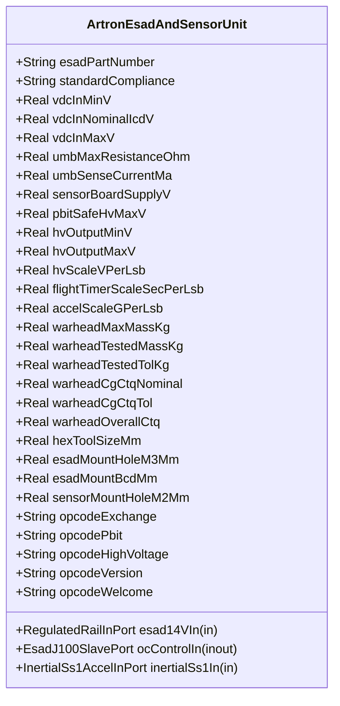

| Attribute | Specification Detail |
| :--- | :--- |
| **Issue ID** | #43 |
| **Title** | Feature 12: [Mission Payloads Comms And Ordnance Safety] ArtronEsadAndSensorUnit |
| **Type** | feature |
| **Parent Epic** | [EPIC-04-MissionPayloadsCommsAndOrdnanceSafety](../epics/EPIC-04-MissionPayloadsCommsAndOrdnanceSafety.md) |
| **Interface Type** | Physical / Structural / Internal Bus |
| **Schema Containers** | `MissionPayloadsCommsAndOrdnanceSafety::ArtronEsadAndSensorUnit` |
| **Generation Mode** | subagent |
| **Specification Source** | [schema/model.sysml](../../schema/model.sysml) |

# Feature 12: [Mission Payloads Comms And Ordnance Safety] ArtronEsadAndSensorUnit

## UML Class Diagram



## Interface Requirements
### 1. Test Data Shape
```json
{
  "$schema": "https://json-schema.org/draft/2020-12/schema",
  "title": "ArtronEsadAndSensorUnitPayloadSchema",
  "type": "object",
  "properties": {
    "part": {
      "type": "string",
      "const": "ArtronEsadAndSensorUnit"
    },
    "status": {
      "type": "string",
      "enum": ["nominal", "degraded", "fault"]
    },
    "esadPartNumber": {
      "type": "string",
      "x-sysml-type": "String",
      "description": "Declared attribute esadPartNumber (String)",
      "default": "AB00-0054-01AA-0005"
    },
    "standardCompliance": {
      "type": "string",
      "x-sysml-type": "String",
      "description": "Declared attribute standardCompliance (String)",
      "default": "STANAG 4187 / MIL-STD-461"
    },
    "vdcInMinV": {
      "type": "number",
      "x-sysml-type": "Real",
      "description": "Declared attribute vdcInMinV (Real)",
      "default": 14.0
    },
    "vdcInNominalIcdV": {
      "type": "number",
      "x-sysml-type": "Real",
      "description": "Declared attribute vdcInNominalIcdV (Real)",
      "default": 28.0
    },
    "vdcInMaxV": {
      "type": "number",
      "x-sysml-type": "Real",
      "description": "Declared attribute vdcInMaxV (Real)",
      "default": 32.0
    },
    "umbMaxResistanceOhm": {
      "type": "number",
      "x-sysml-type": "Real",
      "description": "Declared attribute umbMaxResistanceOhm (Real)",
      "default": 0.5
    },
    "umbSenseCurrentMa": {
      "type": "number",
      "x-sysml-type": "Real",
      "description": "Declared attribute umbSenseCurrentMa (Real)",
      "default": 20.0
    },
    "sensorBoardSupplyV": {
      "type": "number",
      "x-sysml-type": "Real",
      "description": "Declared attribute sensorBoardSupplyV (Real)",
      "default": 5.0
    },
    "pbitSafeHvMaxV": {
      "type": "number",
      "x-sysml-type": "Real",
      "description": "Declared attribute pbitSafeHvMaxV (Real)",
      "default": 50.0
    },
    "hvOutputMinV": {
      "type": "number",
      "x-sysml-type": "Real",
      "description": "Declared attribute hvOutputMinV (Real)",
      "default": 0.0
    },
    "hvOutputMaxV": {
      "type": "number",
      "x-sysml-type": "Real",
      "description": "Declared attribute hvOutputMaxV (Real)",
      "default": 1800.0
    },
    "hvScaleVPerLsb": {
      "type": "number",
      "x-sysml-type": "Real",
      "description": "Declared attribute hvScaleVPerLsb (Real)",
      "default": 1.0
    },
    "flightTimerScaleSecPerLsb": {
      "type": "number",
      "x-sysml-type": "Real",
      "description": "Declared attribute flightTimerScaleSecPerLsb (Real)",
      "default": 1.0
    },
    "accelScaleGPerLsb": {
      "type": "number",
      "x-sysml-type": "Real",
      "description": "Declared attribute accelScaleGPerLsb (Real)",
      "default": 0.0039
    },
    "warheadMaxMassKg": {
      "type": "number",
      "x-sysml-type": "Real",
      "description": "Declared attribute warheadMaxMassKg (Real)",
      "default": 5.0
    },
    "warheadTestedMassKg": {
      "type": "number",
      "x-sysml-type": "Real",
      "description": "Declared attribute warheadTestedMassKg (Real)",
      "default": 4.98
    },
    "warheadTestedTolKg": {
      "type": "number",
      "x-sysml-type": "Real",
      "description": "Declared attribute warheadTestedTolKg (Real)",
      "default": 0.02
    },
    "warheadCgCtqNominal": {
      "type": "number",
      "x-sysml-type": "Real",
      "description": "Declared attribute warheadCgCtqNominal (Real)",
      "default": 30.57
    },
    "warheadCgCtqTol": {
      "type": "number",
      "x-sysml-type": "Real",
      "description": "Declared attribute warheadCgCtqTol (Real)",
      "default": 1.0
    },
    "warheadOverallCtq": {
      "type": "number",
      "x-sysml-type": "Real",
      "description": "Declared attribute warheadOverallCtq (Real)",
      "default": 173.0
    },
    "hexToolSizeMm": {
      "type": "number",
      "x-sysml-type": "Real",
      "description": "Declared attribute hexToolSizeMm (Real)",
      "default": 1.5
    },
    "esadMountHoleM3Mm": {
      "type": "number",
      "x-sysml-type": "Real",
      "description": "Declared attribute esadMountHoleM3Mm (Real)",
      "default": 3.0
    },
    "esadMountBcdMm": {
      "type": "number",
      "x-sysml-type": "Real",
      "description": "Declared attribute esadMountBcdMm (Real)",
      "default": 75.0
    },
    "sensorMountHoleM2Mm": {
      "type": "number",
      "x-sysml-type": "Real",
      "description": "Declared attribute sensorMountHoleM2Mm (Real)",
      "default": 2.0
    },
    "opcodeExchange": {
      "type": "string",
      "x-sysml-type": "String",
      "description": "Declared attribute opcodeExchange (String)",
      "default": "0x10 (req 8B, resp 14B)"
    },
    "opcodePbit": {
      "type": "string",
      "x-sysml-type": "String",
      "description": "Declared attribute opcodePbit (String)",
      "default": "0x11 (req 5B, resp 7B)"
    },
    "opcodeHighVoltage": {
      "type": "string",
      "x-sysml-type": "String",
      "description": "Declared attribute opcodeHighVoltage (String)",
      "default": "0x12 (req 5B, resp 8B)"
    },
    "opcodeVersion": {
      "type": "string",
      "x-sysml-type": "String",
      "description": "Declared attribute opcodeVersion (String)",
      "default": "0x13"
    },
    "opcodeWelcome": {
      "type": "string",
      "x-sysml-type": "String",
      "description": "Declared attribute opcodeWelcome (String)",
      "default": "0xB0"
    },
    "esad14VIn": {
      "type": "object",
      "properties": {
        "direction": { "type": "string", "const": "in" },
        "port_type": { "type": "string", "const": "RegulatedRailInPort" }
      },
      "required": ["direction", "port_type"]
    },
    "ocControlIn": {
      "type": "object",
      "properties": {
        "direction": { "type": "string", "const": "inout" },
        "port_type": { "type": "string", "const": "EsadJ100SlavePort" }
      },
      "required": ["direction", "port_type"]
    },
    "inertialSs1In": {
      "type": "object",
      "properties": {
        "direction": { "type": "string", "const": "in" },
        "port_type": { "type": "string", "const": "InertialSs1AccelInPort" }
      },
      "required": ["direction", "port_type"]
    }
  },
  "required": [
    "part",
    "status",
    "esad14VIn",
    "ocControlIn",
    "inertialSs1In"
  ],
  "additionalProperties": false
}
```

### 2. Validation & Constraints
Declared structural attributes, boundary ports, invariants, and allocated requirements for classifier `ArtronEsadAndSensorUnit`:

| AST Member Kind | Identifier | Declared Type / Direction | Default / Invariant Contract |
| :--- | :--- | :--- | :--- |
| Attribute | `esadPartNumber` | `String` | Default `"AB00-0054-01AA-0005"` |
| Attribute | `standardCompliance` | `String` | Default `"STANAG 4187 / MIL-STD-461"` |
| Attribute | `vdcInMinV` | `Real` | Default `14.0` |
| Attribute | `vdcInNominalIcdV` | `Real` | Default `28.0` |
| Attribute | `vdcInMaxV` | `Real` | Default `32.0` |
| Attribute | `umbMaxResistanceOhm` | `Real` | Default `0.5` |
| Attribute | `umbSenseCurrentMa` | `Real` | Default `20.0` |
| Attribute | `sensorBoardSupplyV` | `Real` | Default `5.0` |
| Attribute | `pbitSafeHvMaxV` | `Real` | Default `50.0` |
| Attribute | `hvOutputMinV` | `Real` | Default `0.0` |
| Attribute | `hvOutputMaxV` | `Real` | Default `1800.0` |
| Attribute | `hvScaleVPerLsb` | `Real` | Default `1.0` |
| Attribute | `flightTimerScaleSecPerLsb` | `Real` | Default `1.0` |
| Attribute | `accelScaleGPerLsb` | `Real` | Default `0.0039` |
| Attribute | `warheadMaxMassKg` | `Real` | Default `5.0` |
| Attribute | `warheadTestedMassKg` | `Real` | Default `4.98` |
| Attribute | `warheadTestedTolKg` | `Real` | Default `0.02` |
| Attribute | `warheadCgCtqNominal` | `Real` | Default `30.57` |
| Attribute | `warheadCgCtqTol` | `Real` | Default `1.0` |
| Attribute | `warheadOverallCtq` | `Real` | Default `173.0` |
| Attribute | `hexToolSizeMm` | `Real` | Default `1.5` |
| Attribute | `esadMountHoleM3Mm` | `Real` | Default `3.0` |
| Attribute | `esadMountBcdMm` | `Real` | Default `75.0` |
| Attribute | `sensorMountHoleM2Mm` | `Real` | Default `2.0` |
| Attribute | `opcodeExchange` | `String` | Default `"0x10 (req 8B, resp 14B)"` |
| Attribute | `opcodePbit` | `String` | Default `"0x11 (req 5B, resp 7B)"` |
| Attribute | `opcodeHighVoltage` | `String` | Default `"0x12 (req 5B, resp 8B)"` |
| Attribute | `opcodeVersion` | `String` | Default `"0x13"` |
| Attribute | `opcodeWelcome` | `String` | Default `"0xB0"` |
| Port | `esad14VIn` | `in RegulatedRailInPort` | Boundary interface contract |
| Port | `ocControlIn` | `inout EsadJ100SlavePort` | Boundary interface contract |
| Port | `inertialSs1In` | `in InertialSs1AccelInPort` | Boundary interface contract |
| Requirement | `REQ_L_04` | Allocated Requirement | Allocated requirement obligation |
| Requirement | `REQ_H_04` | Allocated Requirement | Allocated requirement obligation |
| Requirement | `REQ_H_05` | Allocated Requirement | Allocated requirement obligation |
| Requirement | `REQ_UCA_05` | Allocated Requirement | Allocated requirement obligation |
| Requirement | `REQ_UCA_06` | Allocated Requirement | Allocated requirement obligation |
| Requirement | `REQ_UCA_07` | Allocated Requirement | Allocated requirement obligation |
| Requirement | `REQ_SC_09` | Allocated Requirement | Allocated requirement obligation |
| Requirement | `REQ_SC_10` | Allocated Requirement | SC-10: Verify J100 UMB continuity < 0.5 Ohm at 20 mA and lock out ESAD (FaultStates bit 4) if DSC_IN1 1 kHz 2-pulse arrives before Arm Stage 2. |
| Requirement | `REQ_SC_11` | Allocated Requirement | SC-11: Gate 0x12 HIGHVOLTAGE charging (0-1800 V) and J401 fire strictly behind SS1 launch accel, SS2 Safe Distance Exceed == 1 (GAP-07), Sensor Board IRQ_L, and OC Arm Enable. |
| Requirement | `REQ_SC_12` | Allocated Requirement | Allocated requirement obligation |
| Requirement | `REQ_SAF_04` | Allocated Requirement | Allocated requirement obligation |
| Requirement | `REQ_SAF_06` | Allocated Requirement | Allocated requirement obligation |
| Requirement | `REQ_SAF_07` | Allocated Requirement | GAP-07 Mitigation: Align SwarmC2 UI wording strictly with ESAD ICD Safe Distance Exceed == 1 (SS2 Active) requirement prior to arming. |
| Requirement | `REQ_SAF_10` | Allocated Requirement | Allocated requirement obligation |

### 3. Visual Layout & Arrangement
Structural composition and boundary topology for classifier `ArtronEsadAndSensorUnit` organize no nested subparts declared in schema paired with boundary ports `in esad14VIn : RegulatedRailInPort`, `inout ocControlIn : EsadJ100SlavePort`, `in inertialSs1In : InertialSs1AccelInPort`.

### 4. Interactive Flow & States
Operational lifecycle events and discrete state transitions for ArtronEsadAndSensorUnit.

### Layer 1: Domain State & Signal Model
Classifier `ArtronEsadAndSensorUnit` encapsulates typed domain state attributes `esadPartNumber : String`, `standardCompliance : String`, `vdcInMinV : Real`, `vdcInNominalIcdV : Real`, `vdcInMaxV : Real`, `umbMaxResistanceOhm : Real`, `umbSenseCurrentMa : Real`, `sensorBoardSupplyV : Real`, `pbitSafeHvMaxV : Real`, `hvOutputMinV : Real`, `hvOutputMaxV : Real`, `hvScaleVPerLsb : Real`, `flightTimerScaleSecPerLsb : Real`, `accelScaleGPerLsb : Real`, `warheadMaxMassKg : Real`, `warheadTestedMassKg : Real`, `warheadTestedTolKg : Real`, `warheadCgCtqNominal : Real`, `warheadCgCtqTol : Real`, `warheadOverallCtq : Real`, `hexToolSizeMm : Real`, `esadMountHoleM3Mm : Real`, `esadMountBcdMm : Real`, `sensorMountHoleM2Mm : Real`, `opcodeExchange : String`, `opcodePbit : String`, `opcodeHighVoltage : String`, `opcodeVersion : String`, `opcodeWelcome : String` alongside operational lifecycle status.

### Layer 2: Logic & Safety State Management
Classifier `ArtronEsadAndSensorUnit` governs stateless structural transition evaluation enforcing invariant obligations `REQ_L_04`, `REQ_H_04`, `REQ_H_05`, `REQ_UCA_05`, `REQ_UCA_06`, `REQ_UCA_07`, `REQ_SC_09`, `REQ_SC_10`, `REQ_SC_11`, `REQ_SC_12`, `REQ_SAF_04`, `REQ_SAF_06`, `REQ_SAF_07`, `REQ_SAF_10`.

### Layer 3: Presentation & Actuator Interface Binding
Classifier `ArtronEsadAndSensorUnit` binds external and behavioral interfaces across port `in esad14VIn : RegulatedRailInPort`, port `inout ocControlIn : EsadJ100SlavePort`, port `in inertialSs1In : InertialSs1AccelInPort`.

### Associated Use Cases & User Stories

#### Associated Use Cases
- [ ] #28 - [Use Case 05: Supervise Esad Arm And Detonation](../use-cases/UC-05-SuperviseEsadArmAndDetonation.md)

#### Associated User Stories
- None allocated (structural subsystem component)

## Acceptance Criteria (BDD)
- [ ] AC-01: Given valid `ArtronEsadAndSensorUnit` inputs satisfying `REQ_L_04`, When `ArtronEsadAndSensorUnit` evaluates invariant `REQ_L_04`, Then the invariant holds and verified state is committed.
- [ ] AC-02: Given boundary inputs that violate `REQ_L_04`, When `ArtronEsadAndSensorUnit` evaluates invariant `REQ_L_04`, Then `ArtronEsadAndSensorUnit` rejects the invalid transition and routes a diagnostic via diagnostic port `ocControlIn`.
- [ ] AC-03: Given valid `ArtronEsadAndSensorUnit` inputs satisfying `REQ_H_04`, When `ArtronEsadAndSensorUnit` evaluates invariant `REQ_H_04`, Then the invariant holds and verified state is committed.
- [ ] AC-04: Given boundary inputs that violate `REQ_H_04`, When `ArtronEsadAndSensorUnit` evaluates invariant `REQ_H_04`, Then `ArtronEsadAndSensorUnit` rejects the invalid transition and routes a diagnostic via diagnostic port `ocControlIn`.
- [ ] AC-05: Given valid `ArtronEsadAndSensorUnit` inputs satisfying `REQ_H_05`, When `ArtronEsadAndSensorUnit` evaluates invariant `REQ_H_05`, Then the invariant holds and verified state is committed.
- [ ] AC-06: Given boundary inputs that violate `REQ_H_05`, When `ArtronEsadAndSensorUnit` evaluates invariant `REQ_H_05`, Then `ArtronEsadAndSensorUnit` rejects the invalid transition and routes a diagnostic via diagnostic port `ocControlIn`.
- [ ] AC-07: Given valid `ArtronEsadAndSensorUnit` state satisfying composite invariants (`REQ_UCA_05`; `REQ_UCA_06`; `REQ_UCA_07`; `REQ_SC_09`; `REQ_SC_10` (`SC-10: Verify J100 UMB continuity < 0.5 Ohm at 20 mA and lock out ESAD (FaultStates bit 4) if DSC_IN1 1 kHz 2-pulse arrives before Arm Stage 2.`); `REQ_SC_11` (`SC-11: Gate 0x12 HIGHVOLTAGE charging (0-1800 V) and J401 fire strictly behind SS1 launch accel, SS2 Safe Distance Exceed == 1 (GAP-07), Sensor Board IRQ_L, and OC Arm Enable.`); `REQ_SC_12`; `REQ_SAF_04`; `REQ_SAF_06`; `REQ_SAF_07` (`GAP-07 Mitigation: Align SwarmC2 UI wording strictly with ESAD ICD Safe Distance Exceed == 1 (SS2 Active) requirement prior to arming.`); `REQ_SAF_10`), When `ArtronEsadAndSensorUnit` evaluates the remaining invariant conjunction, Then all declared invariants hold and verified state is committed.
- [ ] AC-08: Given input state that violates any invariant in (`REQ_UCA_05`; `REQ_UCA_06`; `REQ_UCA_07`; `REQ_SC_09`; `REQ_SC_10` (`SC-10: Verify J100 UMB continuity < 0.5 Ohm at 20 mA and lock out ESAD (FaultStates bit 4) if DSC_IN1 1 kHz 2-pulse arrives before Arm Stage 2.`); `REQ_SC_11` (`SC-11: Gate 0x12 HIGHVOLTAGE charging (0-1800 V) and J401 fire strictly behind SS1 launch accel, SS2 Safe Distance Exceed == 1 (GAP-07), Sensor Board IRQ_L, and OC Arm Enable.`); `REQ_SC_12`; `REQ_SAF_04`; `REQ_SAF_06`; `REQ_SAF_07` (`GAP-07 Mitigation: Align SwarmC2 UI wording strictly with ESAD ICD Safe Distance Exceed == 1 (SS2 Active) requirement prior to arming.`); `REQ_SAF_10`), When `ArtronEsadAndSensorUnit` evaluates the composite guard, Then `ArtronEsadAndSensorUnit` rejects the invalid state transition and routes a diagnostic via diagnostic port `ocControlIn`.
- [ ] AC-09: Given nominal typed values for `esadPartNumber` (`String`), `standardCompliance` (`String`), `vdcInMinV` (`Real`), `vdcInNominalIcdV` (`Real`), `vdcInMaxV` (`Real`), `umbMaxResistanceOhm` (`Real`), `umbSenseCurrentMa` (`Real`), `sensorBoardSupplyV` (`Real`), `pbitSafeHvMaxV` (`Real`), `hvOutputMinV` (`Real`), `hvOutputMaxV` (`Real`), `hvScaleVPerLsb` (`Real`), `flightTimerScaleSecPerLsb` (`Real`), `accelScaleGPerLsb` (`Real`), `warheadMaxMassKg` (`Real`), `warheadTestedMassKg` (`Real`), `warheadTestedTolKg` (`Real`), `warheadCgCtqNominal` (`Real`), `warheadCgCtqTol` (`Real`), `warheadOverallCtq` (`Real`), `hexToolSizeMm` (`Real`), `esadMountHoleM3Mm` (`Real`), `esadMountBcdMm` (`Real`), `sensorMountHoleM2Mm` (`Real`), `opcodeExchange` (`String`), `opcodePbit` (`String`), `opcodeHighVoltage` (`String`), `opcodeVersion` (`String`), `opcodeWelcome` (`String`) across `esad14VIn` (`in RegulatedRailInPort`), `ocControlIn` (`inout EsadJ100SlavePort`), `inertialSs1In` (`in InertialSs1AccelInPort`), When `ArtronEsadAndSensorUnit` executes structural interface processing, Then state and output ports conform to declared schema types.
- [ ] AC-10: Given malformed input frames across `esadPartNumber` (`String`), `standardCompliance` (`String`), `vdcInMinV` (`Real`), `vdcInNominalIcdV` (`Real`), `vdcInMaxV` (`Real`), `umbMaxResistanceOhm` (`Real`), `umbSenseCurrentMa` (`Real`), `sensorBoardSupplyV` (`Real`), `pbitSafeHvMaxV` (`Real`), `hvOutputMinV` (`Real`), `hvOutputMaxV` (`Real`), `hvScaleVPerLsb` (`Real`), `flightTimerScaleSecPerLsb` (`Real`), `accelScaleGPerLsb` (`Real`), `warheadMaxMassKg` (`Real`), `warheadTestedMassKg` (`Real`), `warheadTestedTolKg` (`Real`), `warheadCgCtqNominal` (`Real`), `warheadCgCtqTol` (`Real`), `warheadOverallCtq` (`Real`), `hexToolSizeMm` (`Real`), `esadMountHoleM3Mm` (`Real`), `esadMountBcdMm` (`Real`), `sensorMountHoleM2Mm` (`Real`), `opcodeExchange` (`String`), `opcodePbit` (`String`), `opcodeHighVoltage` (`String`), `opcodeVersion` (`String`), `opcodeWelcome` (`String`) or `esad14VIn` (`in RegulatedRailInPort`), `ocControlIn` (`inout EsadJ100SlavePort`), `inertialSs1In` (`in InertialSs1AccelInPort`), When `ArtronEsadAndSensorUnit` boundary validation executes, Then `ArtronEsadAndSensorUnit` rejects the malformed input via diagnostic port `ocControlIn`.

## Source References
Formal component specifications and normative systems engineering requirements:
- System Architecture Model: `schema/model.sysml`
- Normative Systems Engineering Standard: ISO/IEC/IEEE 15288:2023 §6.4.3 Architecture Definition Process

Component behavior and interface definitions derive from `schema/model.sysml` pursuant to ISO/IEC/IEEE 15288.
