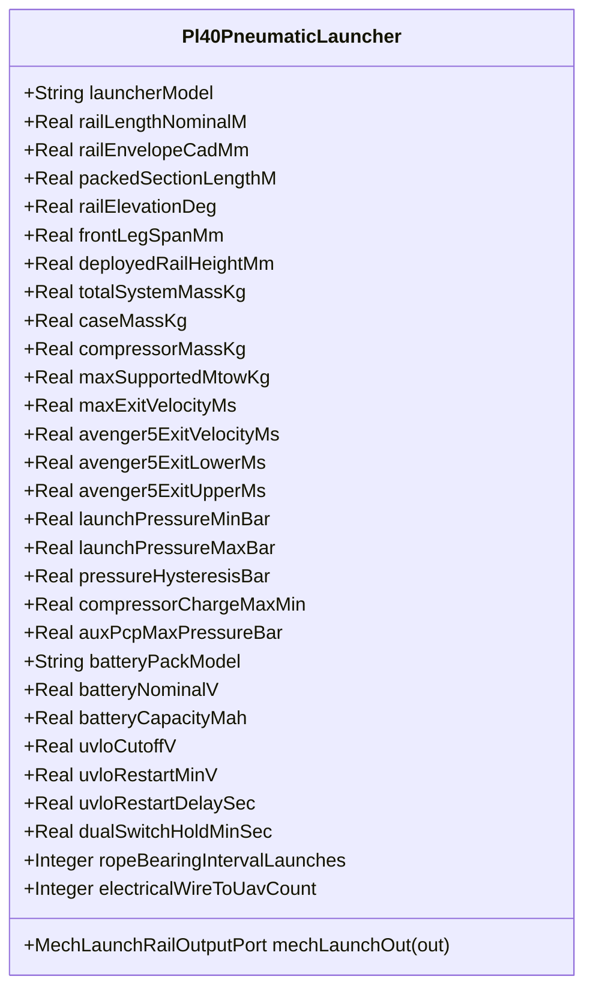

| Attribute | Specification Detail |
| :--- | :--- |
| **Issue ID** | #44 |
| **Title** | Feature 13: [Ground Launch And Command Segment] Pl40PneumaticLauncher |
| **Type** | feature |
| **Parent Epic** | [EPIC-05-GroundLaunchAndCommandSegment](../epics/EPIC-05-GroundLaunchAndCommandSegment.md) |
| **Interface Type** | Physical / Structural / Internal Bus |
| **Schema Containers** | `GroundLaunchAndCommandSegment::Pl40PneumaticLauncher` |
| **Generation Mode** | subagent |
| **Specification Source** | [schema/model.sysml](../../schema/model.sysml) |

# Feature 13: [Ground Launch And Command Segment] Pl40PneumaticLauncher

## UML Class Diagram



## Interface Requirements
### 1. Test Data Shape
```json
{
  "$schema": "https://json-schema.org/draft/2020-12/schema",
  "title": "Pl40PneumaticLauncherPayloadSchema",
  "type": "object",
  "properties": {
    "part": {
      "type": "string",
      "const": "Pl40PneumaticLauncher"
    },
    "status": {
      "type": "string",
      "enum": ["nominal", "degraded", "fault"]
    },
    "launcherModel": {
      "type": "string",
      "x-sysml-type": "String",
      "description": "Declared attribute launcherModel (String)",
      "default": "ELI Military Simulations PL-40 Rev 2.6"
    },
    "railLengthNominalM": {
      "type": "number",
      "x-sysml-type": "Real",
      "description": "Declared attribute railLengthNominalM (Real)",
      "default": 5.0
    },
    "railEnvelopeCadMm": {
      "type": "number",
      "x-sysml-type": "Real",
      "description": "Declared attribute railEnvelopeCadMm (Real)",
      "default": 4938.0
    },
    "packedSectionLengthM": {
      "type": "number",
      "x-sysml-type": "Real",
      "description": "Declared attribute packedSectionLengthM (Real)",
      "default": 1.28
    },
    "railElevationDeg": {
      "type": "number",
      "x-sysml-type": "Real",
      "description": "Declared attribute railElevationDeg (Real)",
      "default": 12.0
    },
    "frontLegSpanMm": {
      "type": "number",
      "x-sysml-type": "Real",
      "description": "Declared attribute frontLegSpanMm (Real)",
      "default": 602.0
    },
    "deployedRailHeightMm": {
      "type": "number",
      "x-sysml-type": "Real",
      "description": "Declared attribute deployedRailHeightMm (Real)",
      "default": 1116.0
    },
    "totalSystemMassKg": {
      "type": "number",
      "x-sysml-type": "Real",
      "description": "Declared attribute totalSystemMassKg (Real)",
      "default": 68.0
    },
    "caseMassKg": {
      "type": "number",
      "x-sysml-type": "Real",
      "description": "Declared attribute caseMassKg (Real)",
      "default": 43.0
    },
    "compressorMassKg": {
      "type": "number",
      "x-sysml-type": "Real",
      "description": "Declared attribute compressorMassKg (Real)",
      "default": 25.0
    },
    "maxSupportedMtowKg": {
      "type": "number",
      "x-sysml-type": "Real",
      "description": "Declared attribute maxSupportedMtowKg (Real)",
      "default": 30.0
    },
    "maxExitVelocityMs": {
      "type": "number",
      "x-sysml-type": "Real",
      "description": "Declared attribute maxExitVelocityMs (Real)",
      "default": 25.0
    },
    "avenger5ExitVelocityMs": {
      "type": "number",
      "x-sysml-type": "Real",
      "description": "Declared attribute avenger5ExitVelocityMs (Real)",
      "default": 23.0
    },
    "avenger5ExitLowerMs": {
      "type": "number",
      "x-sysml-type": "Real",
      "description": "Declared attribute avenger5ExitLowerMs (Real)",
      "default": 22.7
    },
    "avenger5ExitUpperMs": {
      "type": "number",
      "x-sysml-type": "Real",
      "description": "Declared attribute avenger5ExitUpperMs (Real)",
      "default": 23.5
    },
    "launchPressureMinBar": {
      "type": "number",
      "x-sysml-type": "Real",
      "description": "Declared attribute launchPressureMinBar (Real)",
      "default": 13.0
    },
    "launchPressureMaxBar": {
      "type": "number",
      "x-sysml-type": "Real",
      "description": "Declared attribute launchPressureMaxBar (Real)",
      "default": 14.0
    },
    "pressureHysteresisBar": {
      "type": "number",
      "x-sysml-type": "Real",
      "description": "Declared attribute pressureHysteresisBar (Real)",
      "default": 0.05
    },
    "compressorChargeMaxMin": {
      "type": "number",
      "x-sysml-type": "Real",
      "description": "Declared attribute compressorChargeMaxMin (Real)",
      "default": 8.0
    },
    "auxPcpMaxPressureBar": {
      "type": "number",
      "x-sysml-type": "Real",
      "description": "Declared attribute auxPcpMaxPressureBar (Real)",
      "default": 16.0
    },
    "batteryPackModel": {
      "type": "string",
      "x-sysml-type": "String",
      "description": "Declared attribute batteryPackModel (String)",
      "default": "2x Makita BL1860B 18V 6000 mAh"
    },
    "batteryNominalV": {
      "type": "number",
      "x-sysml-type": "Real",
      "description": "Declared attribute batteryNominalV (Real)",
      "default": 18.0
    },
    "batteryCapacityMah": {
      "type": "number",
      "x-sysml-type": "Real",
      "description": "Declared attribute batteryCapacityMah (Real)",
      "default": 6000.0
    },
    "uvloCutoffV": {
      "type": "number",
      "x-sysml-type": "Real",
      "description": "Declared attribute uvloCutoffV (Real)",
      "default": 14.5
    },
    "uvloRestartMinV": {
      "type": "number",
      "x-sysml-type": "Real",
      "description": "Declared attribute uvloRestartMinV (Real)",
      "default": 16.0
    },
    "uvloRestartDelaySec": {
      "type": "number",
      "x-sysml-type": "Real",
      "description": "Declared attribute uvloRestartDelaySec (Real)",
      "default": 5.0
    },
    "dualSwitchHoldMinSec": {
      "type": "number",
      "x-sysml-type": "Real",
      "description": "Declared attribute dualSwitchHoldMinSec (Real)",
      "default": 2.0
    },
    "ropeBearingIntervalLaunches": {
      "type": "integer",
      "x-sysml-type": "Integer",
      "description": "Declared attribute ropeBearingIntervalLaunches (Integer)",
      "default": 100
    },
    "electricalWireToUavCount": {
      "type": "integer",
      "x-sysml-type": "Integer",
      "description": "Declared attribute electricalWireToUavCount (Integer)",
      "default": 0
    },
    "mechLaunchOut": {
      "type": "object",
      "properties": {
        "direction": { "type": "string", "const": "out" },
        "port_type": { "type": "string", "const": "MechLaunchRailOutputPort" }
      },
      "required": ["direction", "port_type"]
    }
  },
  "required": [
    "part",
    "status",
    "mechLaunchOut"
  ],
  "additionalProperties": false
}
```

### 2. Validation & Constraints
Declared structural attributes, boundary ports, invariants, and allocated requirements for classifier `Pl40PneumaticLauncher`:

| AST Member Kind | Identifier | Declared Type / Direction | Default / Invariant Contract |
| :--- | :--- | :--- | :--- |
| Attribute | `launcherModel` | `String` | Default `"ELI Military Simulations PL-40 Rev 2.6"` |
| Attribute | `railLengthNominalM` | `Real` | Default `5.0` |
| Attribute | `railEnvelopeCadMm` | `Real` | Default `4938.0` |
| Attribute | `packedSectionLengthM` | `Real` | Default `1.28` |
| Attribute | `railElevationDeg` | `Real` | Default `12.0` |
| Attribute | `frontLegSpanMm` | `Real` | Default `602.0` |
| Attribute | `deployedRailHeightMm` | `Real` | Default `1116.0` |
| Attribute | `totalSystemMassKg` | `Real` | Default `68.0` |
| Attribute | `caseMassKg` | `Real` | Default `43.0` |
| Attribute | `compressorMassKg` | `Real` | Default `25.0` |
| Attribute | `maxSupportedMtowKg` | `Real` | Default `30.0` |
| Attribute | `maxExitVelocityMs` | `Real` | Default `25.0` |
| Attribute | `avenger5ExitVelocityMs` | `Real` | Default `23.0` |
| Attribute | `avenger5ExitLowerMs` | `Real` | Default `22.7` |
| Attribute | `avenger5ExitUpperMs` | `Real` | Default `23.5` |
| Attribute | `launchPressureMinBar` | `Real` | Default `13.0` |
| Attribute | `launchPressureMaxBar` | `Real` | Default `14.0` |
| Attribute | `pressureHysteresisBar` | `Real` | Default `0.05` |
| Attribute | `compressorChargeMaxMin` | `Real` | Default `8.0` |
| Attribute | `auxPcpMaxPressureBar` | `Real` | Default `16.0` |
| Attribute | `batteryPackModel` | `String` | Default `"2x Makita BL1860B 18V 6000 mAh"` |
| Attribute | `batteryNominalV` | `Real` | Default `18.0` |
| Attribute | `batteryCapacityMah` | `Real` | Default `6000.0` |
| Attribute | `uvloCutoffV` | `Real` | Default `14.5` |
| Attribute | `uvloRestartMinV` | `Real` | Default `16.0` |
| Attribute | `uvloRestartDelaySec` | `Real` | Default `5.0` |
| Attribute | `dualSwitchHoldMinSec` | `Real` | Default `2.0` |
| Attribute | `ropeBearingIntervalLaunches` | `Integer` | Default `100` |
| Attribute | `electricalWireToUavCount` | `Integer` | Default `0` |
| Port | `mechLaunchOut` | `out MechLaunchRailOutputPort` | Boundary interface contract |
| Requirement | `REQ_H_06` | Allocated Requirement | Allocated requirement obligation |
| Requirement | `REQ_UCA_08` | Allocated Requirement | Allocated requirement obligation |
| Requirement | `REQ_SC_13` | Allocated Requirement | SC-13: Enforce red carriage safety pin, Main Valve 4 interlock, simultaneous >= 2.0 s dual firing switch hold, and zero electrical/CAN cable between PL-40 and UAV (IF-MECH-001). |
| Requirement | `REQ_SC_14` | Allocated Requirement | SC-14: Enforce 13.0-14.0 bar operating range, <= 25.0 m/s exit limit (GAP-03), 14.5 V compressor UVLO cutoff (> 16.0 V after 5.0 s restart), and 100-launch rope/bearing service interval. |
| Requirement | `REQ_SC_15` | Allocated Requirement | Allocated requirement obligation |
| Requirement | `REQ_SC_16` | Allocated Requirement | Allocated requirement obligation |
| Requirement | `REQ_SAF_03` | Allocated Requirement | Allocated requirement obligation |
| Requirement | `REQ_SAF_11` | Allocated Requirement | GAP-ENV Disposition: Track unprinted battery energy (Wh/Ah), SoC floor, ESC/motor current/thermal cutoffs, tank volume (L), relief pressure (bar), IP/rain/icing, and standoff distance as explicit calibration limits. |
| Requirement | `REQ_SAF_12` | Allocated Requirement | GAP-SCRUB Mitigation: Formalize SAFE_SCRUB_ABORT hangfire wait, tank depressurization, carriage pin restore, and post-RBF #3 ordnance safing sequence. |

### 3. Visual Layout & Arrangement
Structural composition and boundary topology for classifier `Pl40PneumaticLauncher` organize no nested subparts declared in schema paired with boundary ports `out mechLaunchOut : MechLaunchRailOutputPort`.

### 4. Interactive Flow & States
Operational lifecycle events and discrete state transitions for Pl40PneumaticLauncher.

### Layer 1: Domain State & Signal Model
Classifier `Pl40PneumaticLauncher` encapsulates typed domain state attributes `launcherModel : String`, `railLengthNominalM : Real`, `railEnvelopeCadMm : Real`, `packedSectionLengthM : Real`, `railElevationDeg : Real`, `frontLegSpanMm : Real`, `deployedRailHeightMm : Real`, `totalSystemMassKg : Real`, `caseMassKg : Real`, `compressorMassKg : Real`, `maxSupportedMtowKg : Real`, `maxExitVelocityMs : Real`, `avenger5ExitVelocityMs : Real`, `avenger5ExitLowerMs : Real`, `avenger5ExitUpperMs : Real`, `launchPressureMinBar : Real`, `launchPressureMaxBar : Real`, `pressureHysteresisBar : Real`, `compressorChargeMaxMin : Real`, `auxPcpMaxPressureBar : Real`, `batteryPackModel : String`, `batteryNominalV : Real`, `batteryCapacityMah : Real`, `uvloCutoffV : Real`, `uvloRestartMinV : Real`, `uvloRestartDelaySec : Real`, `dualSwitchHoldMinSec : Real`, `ropeBearingIntervalLaunches : Integer`, `electricalWireToUavCount : Integer` alongside operational lifecycle status.

### Layer 2: Logic & Safety State Management
Classifier `Pl40PneumaticLauncher` governs stateless structural transition evaluation enforcing invariant obligations `REQ_H_06`, `REQ_UCA_08`, `REQ_SC_13`, `REQ_SC_14`, `REQ_SC_15`, `REQ_SC_16`, `REQ_SAF_03`, `REQ_SAF_11`, `REQ_SAF_12`.

### Layer 3: Presentation & Actuator Interface Binding
Classifier `Pl40PneumaticLauncher` binds external and behavioral interfaces across port `out mechLaunchOut : MechLaunchRailOutputPort`.

### Associated Use Cases & User Stories

#### Associated Use Cases
- [ ] #29 - [Use Case 06: Execute Pl40 Rail Launch](../use-cases/UC-06-ExecutePl40RailLaunch.md)
- [ ] #31 - [Use Case 08: Execute Safe Scrub And Hangfire Recovery](../use-cases/UC-08-ExecuteSafeScrubAndHangfireRecovery.md)

#### Associated User Stories
- [ ] #19 - [User Story 15: Charge Pl40 Compressor With Uvlo Check](../user-stories/US-15-ChargePl40CompressorWithUvloCheck.md)
- [ ] #20 - [User Story 16: Execute Launch Go No Go And Dual Trigger](../user-stories/US-16-ExecuteLaunchGoNoGoAndDualTrigger.md)
- [ ] #21 - [User Story 17: Depressurize And Scrub Pl40 Launcher](../user-stories/US-17-DepressurizeAndScrubPl40Launcher.md)
- [ ] #22 - [User Story 18: Authenticate Operator And Calibrate Rotator](../user-stories/US-18-AuthenticateOperatorAndCalibrateRotator.md)
- [ ] #23 - [User Story 19: Export Target Report5 w Cff](../user-stories/US-19-ExportTargetReport5wCff.md)

## Acceptance Criteria (BDD)
- [ ] AC-01: Given valid `Pl40PneumaticLauncher` inputs satisfying `REQ_H_06`, When `Pl40PneumaticLauncher` evaluates invariant `REQ_H_06`, Then the invariant holds and verified state is committed.
- [ ] AC-02: Given boundary inputs that violate `REQ_H_06`, When `Pl40PneumaticLauncher` evaluates invariant `REQ_H_06`, Then `Pl40PneumaticLauncher` rejects the invalid transition and routes a diagnostic via diagnostic port `mechLaunchOut`.
- [ ] AC-03: Given valid `Pl40PneumaticLauncher` inputs satisfying `REQ_UCA_08`, When `Pl40PneumaticLauncher` evaluates invariant `REQ_UCA_08`, Then the invariant holds and verified state is committed.
- [ ] AC-04: Given boundary inputs that violate `REQ_UCA_08`, When `Pl40PneumaticLauncher` evaluates invariant `REQ_UCA_08`, Then `Pl40PneumaticLauncher` rejects the invalid transition and routes a diagnostic via diagnostic port `mechLaunchOut`.
- [ ] AC-05: Given valid `Pl40PneumaticLauncher` inputs satisfying `REQ_SC_13` (`SC-13: Enforce red carriage safety pin, Main Valve 4 interlock, simultaneous >= 2.0 s dual firing switch hold, and zero electrical/CAN cable between PL-40 and UAV (IF-MECH-001).`), When `Pl40PneumaticLauncher` evaluates invariant `REQ_SC_13`, Then the invariant holds and verified state is committed.
- [ ] AC-06: Given boundary inputs that violate `REQ_SC_13` (`SC-13: Enforce red carriage safety pin, Main Valve 4 interlock, simultaneous >= 2.0 s dual firing switch hold, and zero electrical/CAN cable between PL-40 and UAV (IF-MECH-001).`), When `Pl40PneumaticLauncher` evaluates invariant `REQ_SC_13`, Then `Pl40PneumaticLauncher` rejects the invalid transition and routes a diagnostic via diagnostic port `mechLaunchOut`.
- [ ] AC-07: Given valid `Pl40PneumaticLauncher` state satisfying composite invariants (`REQ_SC_14` (`SC-14: Enforce 13.0-14.0 bar operating range, <= 25.0 m/s exit limit (GAP-03), 14.5 V compressor UVLO cutoff (> 16.0 V after 5.0 s restart), and 100-launch rope/bearing service interval.`); `REQ_SC_15`; `REQ_SC_16`; `REQ_SAF_03`; `REQ_SAF_11` (`GAP-ENV Disposition: Track unprinted battery energy (Wh/Ah), SoC floor, ESC/motor current/thermal cutoffs, tank volume (L), relief pressure (bar), IP/rain/icing, and standoff distance as explicit calibration limits.`); `REQ_SAF_12` (`GAP-SCRUB Mitigation: Formalize SAFE_SCRUB_ABORT hangfire wait, tank depressurization, carriage pin restore, and post-RBF #3 ordnance safing sequence.`)), When `Pl40PneumaticLauncher` evaluates the remaining invariant conjunction, Then all declared invariants hold and verified state is committed.
- [ ] AC-08: Given input state that violates any invariant in (`REQ_SC_14` (`SC-14: Enforce 13.0-14.0 bar operating range, <= 25.0 m/s exit limit (GAP-03), 14.5 V compressor UVLO cutoff (> 16.0 V after 5.0 s restart), and 100-launch rope/bearing service interval.`); `REQ_SC_15`; `REQ_SC_16`; `REQ_SAF_03`; `REQ_SAF_11` (`GAP-ENV Disposition: Track unprinted battery energy (Wh/Ah), SoC floor, ESC/motor current/thermal cutoffs, tank volume (L), relief pressure (bar), IP/rain/icing, and standoff distance as explicit calibration limits.`); `REQ_SAF_12` (`GAP-SCRUB Mitigation: Formalize SAFE_SCRUB_ABORT hangfire wait, tank depressurization, carriage pin restore, and post-RBF #3 ordnance safing sequence.`)), When `Pl40PneumaticLauncher` evaluates the composite guard, Then `Pl40PneumaticLauncher` rejects the invalid state transition and routes a diagnostic via diagnostic port `mechLaunchOut`.
- [ ] AC-09: Given nominal typed values for `launcherModel` (`String`), `railLengthNominalM` (`Real`), `railEnvelopeCadMm` (`Real`), `packedSectionLengthM` (`Real`), `railElevationDeg` (`Real`), `frontLegSpanMm` (`Real`), `deployedRailHeightMm` (`Real`), `totalSystemMassKg` (`Real`), `caseMassKg` (`Real`), `compressorMassKg` (`Real`), `maxSupportedMtowKg` (`Real`), `maxExitVelocityMs` (`Real`), `avenger5ExitVelocityMs` (`Real`), `avenger5ExitLowerMs` (`Real`), `avenger5ExitUpperMs` (`Real`), `launchPressureMinBar` (`Real`), `launchPressureMaxBar` (`Real`), `pressureHysteresisBar` (`Real`), `compressorChargeMaxMin` (`Real`), `auxPcpMaxPressureBar` (`Real`), `batteryPackModel` (`String`), `batteryNominalV` (`Real`), `batteryCapacityMah` (`Real`), `uvloCutoffV` (`Real`), `uvloRestartMinV` (`Real`), `uvloRestartDelaySec` (`Real`), `dualSwitchHoldMinSec` (`Real`), `ropeBearingIntervalLaunches` (`Integer`), `electricalWireToUavCount` (`Integer`) across `mechLaunchOut` (`out MechLaunchRailOutputPort`), When `Pl40PneumaticLauncher` executes structural interface processing, Then state and output ports conform to declared schema types.
- [ ] AC-10: Given malformed input frames across `launcherModel` (`String`), `railLengthNominalM` (`Real`), `railEnvelopeCadMm` (`Real`), `packedSectionLengthM` (`Real`), `railElevationDeg` (`Real`), `frontLegSpanMm` (`Real`), `deployedRailHeightMm` (`Real`), `totalSystemMassKg` (`Real`), `caseMassKg` (`Real`), `compressorMassKg` (`Real`), `maxSupportedMtowKg` (`Real`), `maxExitVelocityMs` (`Real`), `avenger5ExitVelocityMs` (`Real`), `avenger5ExitLowerMs` (`Real`), `avenger5ExitUpperMs` (`Real`), `launchPressureMinBar` (`Real`), `launchPressureMaxBar` (`Real`), `pressureHysteresisBar` (`Real`), `compressorChargeMaxMin` (`Real`), `auxPcpMaxPressureBar` (`Real`), `batteryPackModel` (`String`), `batteryNominalV` (`Real`), `batteryCapacityMah` (`Real`), `uvloCutoffV` (`Real`), `uvloRestartMinV` (`Real`), `uvloRestartDelaySec` (`Real`), `dualSwitchHoldMinSec` (`Real`), `ropeBearingIntervalLaunches` (`Integer`), `electricalWireToUavCount` (`Integer`) or `mechLaunchOut` (`out MechLaunchRailOutputPort`), When `Pl40PneumaticLauncher` boundary validation executes, Then `Pl40PneumaticLauncher` rejects the malformed input via diagnostic port `mechLaunchOut`.

## Source References
Formal component specifications and normative systems engineering requirements:
- System Architecture Model: `schema/model.sysml`
- Normative Systems Engineering Standard: ISO/IEC/IEEE 15288:2023 §6.4.3 Architecture Definition Process

Component behavior and interface definitions derive from `schema/model.sysml` pursuant to ISO/IEC/IEEE 15288.
