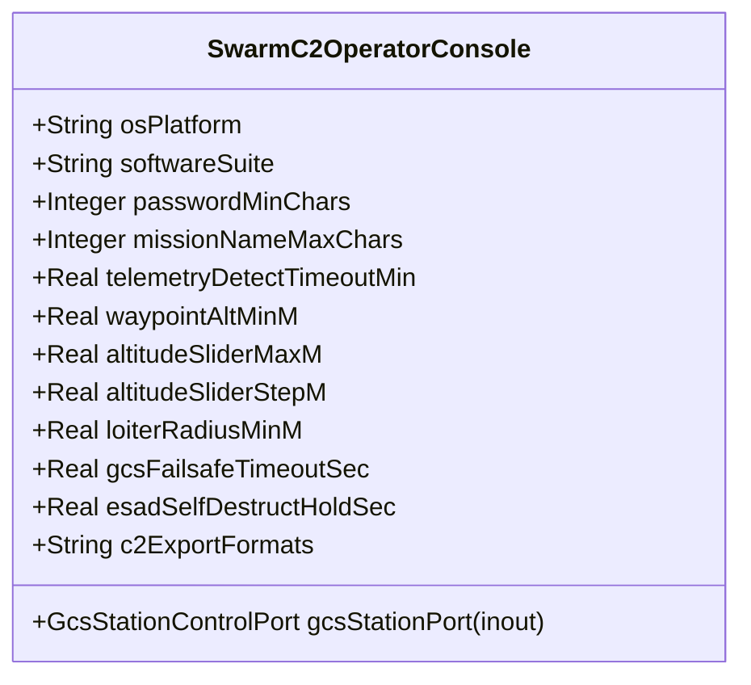

| Attribute | Specification Detail |
| :--- | :--- |
| **Issue ID** | #45 |
| **Title** | Feature 14: [Ground Launch And Command Segment] SwarmC2OperatorConsole |
| **Type** | feature |
| **Parent Epic** | [EPIC-05-GroundLaunchAndCommandSegment](../epics/EPIC-05-GroundLaunchAndCommandSegment.md) |
| **Interface Type** | Physical / Structural / Internal Bus |
| **Schema Containers** | `GroundLaunchAndCommandSegment::SwarmC2OperatorConsole` |
| **Generation Mode** | subagent |
| **Specification Source** | [schema/model.sysml](../../schema/model.sysml) |

# Feature 14: [Ground Launch And Command Segment] SwarmC2OperatorConsole

## UML Class Diagram



## Interface Requirements
### 1. Test Data Shape
```json
{
  "$schema": "https://json-schema.org/draft/2020-12/schema",
  "title": "SwarmC2OperatorConsolePayloadSchema",
  "type": "object",
  "properties": {
    "part": {
      "type": "string",
      "const": "SwarmC2OperatorConsole"
    },
    "status": {
      "type": "string",
      "enum": ["nominal", "degraded", "fault"]
    },
    "osPlatform": {
      "type": "string",
      "x-sysml-type": "String",
      "description": "Declared attribute osPlatform (String)",
      "default": "Windows 11 Rugged Tablet"
    },
    "softwareSuite": {
      "type": "string",
      "x-sysml-type": "String",
      "description": "Declared attribute softwareSuite (String)",
      "default": "SwarmC2"
    },
    "passwordMinChars": {
      "type": "integer",
      "x-sysml-type": "Integer",
      "description": "Declared attribute passwordMinChars (Integer)",
      "default": 8
    },
    "missionNameMaxChars": {
      "type": "integer",
      "x-sysml-type": "Integer",
      "description": "Declared attribute missionNameMaxChars (Integer)",
      "default": 24
    },
    "telemetryDetectTimeoutMin": {
      "type": "number",
      "x-sysml-type": "Real",
      "description": "Declared attribute telemetryDetectTimeoutMin (Real)",
      "default": 2.0
    },
    "waypointAltMinM": {
      "type": "number",
      "x-sysml-type": "Real",
      "description": "Declared attribute waypointAltMinM (Real)",
      "default": 50.0
    },
    "altitudeSliderMaxM": {
      "type": "number",
      "x-sysml-type": "Real",
      "description": "Declared attribute altitudeSliderMaxM (Real)",
      "default": 3000.0
    },
    "altitudeSliderStepM": {
      "type": "number",
      "x-sysml-type": "Real",
      "description": "Declared attribute altitudeSliderStepM (Real)",
      "default": 250.0
    },
    "loiterRadiusMinM": {
      "type": "number",
      "x-sysml-type": "Real",
      "description": "Declared attribute loiterRadiusMinM (Real)",
      "default": 300.0
    },
    "gcsFailsafeTimeoutSec": {
      "type": "number",
      "x-sysml-type": "Real",
      "description": "Declared attribute gcsFailsafeTimeoutSec (Real)",
      "default": 105.0
    },
    "esadSelfDestructHoldSec": {
      "type": "number",
      "x-sysml-type": "Real",
      "description": "Declared attribute esadSelfDestructHoldSec (Real)",
      "default": 5.0
    },
    "c2ExportFormats": {
      "type": "string",
      "x-sysml-type": "String",
      "description": "Declared attribute c2ExportFormats (String)",
      "default": "5W / CFF -> ATAK, SitaWare HQ, DELTA"
    },
    "gcsStationPort": {
      "type": "object",
      "properties": {
        "direction": { "type": "string", "const": "inout" },
        "port_type": { "type": "string", "const": "GcsStationControlPort" }
      },
      "required": ["direction", "port_type"]
    }
  },
  "required": [
    "part",
    "status",
    "gcsStationPort"
  ],
  "additionalProperties": false
}
```

### 2. Validation & Constraints
Declared structural attributes, boundary ports, invariants, and allocated requirements for classifier `SwarmC2OperatorConsole`:

| AST Member Kind | Identifier | Declared Type / Direction | Default / Invariant Contract |
| :--- | :--- | :--- | :--- |
| Attribute | `osPlatform` | `String` | Default `"Windows 11 Rugged Tablet"` |
| Attribute | `softwareSuite` | `String` | Default `"SwarmC2"` |
| Attribute | `passwordMinChars` | `Integer` | Default `8` |
| Attribute | `missionNameMaxChars` | `Integer` | Default `24` |
| Attribute | `telemetryDetectTimeoutMin` | `Real` | Default `2.0` |
| Attribute | `waypointAltMinM` | `Real` | Default `50.0` |
| Attribute | `altitudeSliderMaxM` | `Real` | Default `3000.0` |
| Attribute | `altitudeSliderStepM` | `Real` | Default `250.0` |
| Attribute | `loiterRadiusMinM` | `Real` | Default `300.0` |
| Attribute | `gcsFailsafeTimeoutSec` | `Real` | Default `105.0` |
| Attribute | `esadSelfDestructHoldSec` | `Real` | Default `5.0` |
| Attribute | `c2ExportFormats` | `String` | Default `"5W / CFF -> ATAK, SitaWare HQ, DELTA"` |
| Port | `gcsStationPort` | `inout GcsStationControlPort` | Boundary interface contract |
| Requirement | `REQ_H_06` | Allocated Requirement | Allocated requirement obligation |
| Requirement | `REQ_UCA_08` | Allocated Requirement | Allocated requirement obligation |
| Requirement | `REQ_SC_13` | Allocated Requirement | SC-13: Enforce red carriage safety pin, Main Valve 4 interlock, simultaneous >= 2.0 s dual firing switch hold, and zero electrical/CAN cable between PL-40 and UAV (IF-MECH-001). |
| Requirement | `REQ_SC_14` | Allocated Requirement | SC-14: Enforce 13.0-14.0 bar operating range, <= 25.0 m/s exit limit (GAP-03), 14.5 V compressor UVLO cutoff (> 16.0 V after 5.0 s restart), and 100-launch rope/bearing service interval. |
| Requirement | `REQ_SC_15` | Allocated Requirement | Allocated requirement obligation |
| Requirement | `REQ_SC_16` | Allocated Requirement | Allocated requirement obligation |
| Requirement | `REQ_SAF_03` | Allocated Requirement | Allocated requirement obligation |
| Requirement | `REQ_SAF_11` | Allocated Requirement | GAP-ENV Disposition: Track unprinted battery energy (Wh/Ah), SoC floor, ESC/motor current/thermal cutoffs, tank volume (L), relief pressure (bar), IP/rain/icing, and standoff distance as explicit calibration limits. |
| Requirement | `REQ_SAF_12` | Allocated Requirement | GAP-SCRUB Mitigation: Formalize SAFE_SCRUB_ABORT hangfire wait, tank depressurization, carriage pin restore, and post-RBF #3 ordnance safing sequence. |

### 3. Visual Layout & Arrangement
Structural composition and boundary topology for classifier `SwarmC2OperatorConsole` organize no nested subparts declared in schema paired with boundary ports `inout gcsStationPort : GcsStationControlPort`.

### 4. Interactive Flow & States
Operational lifecycle events and discrete state transitions for SwarmC2OperatorConsole.

### Layer 1: Domain State & Signal Model
Classifier `SwarmC2OperatorConsole` encapsulates typed domain state attributes `osPlatform : String`, `softwareSuite : String`, `passwordMinChars : Integer`, `missionNameMaxChars : Integer`, `telemetryDetectTimeoutMin : Real`, `waypointAltMinM : Real`, `altitudeSliderMaxM : Real`, `altitudeSliderStepM : Real`, `loiterRadiusMinM : Real`, `gcsFailsafeTimeoutSec : Real`, `esadSelfDestructHoldSec : Real`, `c2ExportFormats : String` alongside operational lifecycle status.

### Layer 2: Logic & Safety State Management
Classifier `SwarmC2OperatorConsole` governs stateless structural transition evaluation enforcing invariant obligations `REQ_H_06`, `REQ_UCA_08`, `REQ_SC_13`, `REQ_SC_14`, `REQ_SC_15`, `REQ_SC_16`, `REQ_SAF_03`, `REQ_SAF_11`, `REQ_SAF_12`.

### Layer 3: Presentation & Actuator Interface Binding
Classifier `SwarmC2OperatorConsole` binds external and behavioral interfaces across port `inout gcsStationPort : GcsStationControlPort`.

### Associated Use Cases & User Stories

#### Associated Use Cases
- [ ] #30 - [Use Case 07: Manage Ground C2 Rotator And Data Export](../use-cases/UC-07-ManageGroundC2RotatorAndDataExport.md)

#### Associated User Stories
- [ ] #19 - [User Story 15: Charge Pl40 Compressor With Uvlo Check](../user-stories/US-15-ChargePl40CompressorWithUvloCheck.md)
- [ ] #20 - [User Story 16: Execute Launch Go No Go And Dual Trigger](../user-stories/US-16-ExecuteLaunchGoNoGoAndDualTrigger.md)
- [ ] #21 - [User Story 17: Depressurize And Scrub Pl40 Launcher](../user-stories/US-17-DepressurizeAndScrubPl40Launcher.md)
- [ ] #22 - [User Story 18: Authenticate Operator And Calibrate Rotator](../user-stories/US-18-AuthenticateOperatorAndCalibrateRotator.md)
- [ ] #23 - [User Story 19: Export Target Report5 w Cff](../user-stories/US-19-ExportTargetReport5wCff.md)

## Acceptance Criteria (BDD)
- [ ] AC-01: Given valid `SwarmC2OperatorConsole` inputs satisfying `REQ_H_06`, When `SwarmC2OperatorConsole` evaluates invariant `REQ_H_06`, Then the invariant holds and verified state is committed.
- [ ] AC-02: Given boundary inputs that violate `REQ_H_06`, When `SwarmC2OperatorConsole` evaluates invariant `REQ_H_06`, Then `SwarmC2OperatorConsole` rejects the invalid transition and routes a diagnostic via diagnostic port `gcsStationPort`.
- [ ] AC-03: Given valid `SwarmC2OperatorConsole` inputs satisfying `REQ_UCA_08`, When `SwarmC2OperatorConsole` evaluates invariant `REQ_UCA_08`, Then the invariant holds and verified state is committed.
- [ ] AC-04: Given boundary inputs that violate `REQ_UCA_08`, When `SwarmC2OperatorConsole` evaluates invariant `REQ_UCA_08`, Then `SwarmC2OperatorConsole` rejects the invalid transition and routes a diagnostic via diagnostic port `gcsStationPort`.
- [ ] AC-05: Given valid `SwarmC2OperatorConsole` inputs satisfying `REQ_SC_13` (`SC-13: Enforce red carriage safety pin, Main Valve 4 interlock, simultaneous >= 2.0 s dual firing switch hold, and zero electrical/CAN cable between PL-40 and UAV (IF-MECH-001).`), When `SwarmC2OperatorConsole` evaluates invariant `REQ_SC_13`, Then the invariant holds and verified state is committed.
- [ ] AC-06: Given boundary inputs that violate `REQ_SC_13` (`SC-13: Enforce red carriage safety pin, Main Valve 4 interlock, simultaneous >= 2.0 s dual firing switch hold, and zero electrical/CAN cable between PL-40 and UAV (IF-MECH-001).`), When `SwarmC2OperatorConsole` evaluates invariant `REQ_SC_13`, Then `SwarmC2OperatorConsole` rejects the invalid transition and routes a diagnostic via diagnostic port `gcsStationPort`.
- [ ] AC-07: Given valid `SwarmC2OperatorConsole` state satisfying composite invariants (`REQ_SC_14` (`SC-14: Enforce 13.0-14.0 bar operating range, <= 25.0 m/s exit limit (GAP-03), 14.5 V compressor UVLO cutoff (> 16.0 V after 5.0 s restart), and 100-launch rope/bearing service interval.`); `REQ_SC_15`; `REQ_SC_16`; `REQ_SAF_03`; `REQ_SAF_11` (`GAP-ENV Disposition: Track unprinted battery energy (Wh/Ah), SoC floor, ESC/motor current/thermal cutoffs, tank volume (L), relief pressure (bar), IP/rain/icing, and standoff distance as explicit calibration limits.`); `REQ_SAF_12` (`GAP-SCRUB Mitigation: Formalize SAFE_SCRUB_ABORT hangfire wait, tank depressurization, carriage pin restore, and post-RBF #3 ordnance safing sequence.`)), When `SwarmC2OperatorConsole` evaluates the remaining invariant conjunction, Then all declared invariants hold and verified state is committed.
- [ ] AC-08: Given input state that violates any invariant in (`REQ_SC_14` (`SC-14: Enforce 13.0-14.0 bar operating range, <= 25.0 m/s exit limit (GAP-03), 14.5 V compressor UVLO cutoff (> 16.0 V after 5.0 s restart), and 100-launch rope/bearing service interval.`); `REQ_SC_15`; `REQ_SC_16`; `REQ_SAF_03`; `REQ_SAF_11` (`GAP-ENV Disposition: Track unprinted battery energy (Wh/Ah), SoC floor, ESC/motor current/thermal cutoffs, tank volume (L), relief pressure (bar), IP/rain/icing, and standoff distance as explicit calibration limits.`); `REQ_SAF_12` (`GAP-SCRUB Mitigation: Formalize SAFE_SCRUB_ABORT hangfire wait, tank depressurization, carriage pin restore, and post-RBF #3 ordnance safing sequence.`)), When `SwarmC2OperatorConsole` evaluates the composite guard, Then `SwarmC2OperatorConsole` rejects the invalid state transition and routes a diagnostic via diagnostic port `gcsStationPort`.
- [ ] AC-09: Given nominal typed values for `osPlatform` (`String`), `softwareSuite` (`String`), `passwordMinChars` (`Integer`), `missionNameMaxChars` (`Integer`), `telemetryDetectTimeoutMin` (`Real`), `waypointAltMinM` (`Real`), `altitudeSliderMaxM` (`Real`), `altitudeSliderStepM` (`Real`), `loiterRadiusMinM` (`Real`), `gcsFailsafeTimeoutSec` (`Real`), `esadSelfDestructHoldSec` (`Real`), `c2ExportFormats` (`String`) across `gcsStationPort` (`inout GcsStationControlPort`), When `SwarmC2OperatorConsole` executes structural interface processing, Then state and output ports conform to declared schema types.
- [ ] AC-10: Given malformed input frames across `osPlatform` (`String`), `softwareSuite` (`String`), `passwordMinChars` (`Integer`), `missionNameMaxChars` (`Integer`), `telemetryDetectTimeoutMin` (`Real`), `waypointAltMinM` (`Real`), `altitudeSliderMaxM` (`Real`), `altitudeSliderStepM` (`Real`), `loiterRadiusMinM` (`Real`), `gcsFailsafeTimeoutSec` (`Real`), `esadSelfDestructHoldSec` (`Real`), `c2ExportFormats` (`String`) or `gcsStationPort` (`inout GcsStationControlPort`), When `SwarmC2OperatorConsole` boundary validation executes, Then `SwarmC2OperatorConsole` rejects the malformed input via diagnostic port `gcsStationPort`.

## Source References
Formal component specifications and normative systems engineering requirements:
- System Architecture Model: `schema/model.sysml`
- Normative Systems Engineering Standard: ISO/IEC/IEEE 15288:2023 §6.4.3 Architecture Definition Process

Component behavior and interface definitions derive from `schema/model.sysml` pursuant to ISO/IEC/IEEE 15288.
