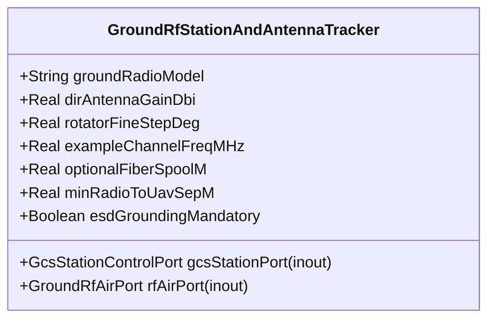

| Attribute | Specification Detail |
| :--- | :--- |
| **Issue ID** | #46 |
| **Title** | Feature 15: [Ground Launch And Command Segment] GroundRfStationAndAntennaTracker |
| **Type** | feature |
| **Parent Epic** | [EPIC-05-GroundLaunchAndCommandSegment](../epics/EPIC-05-GroundLaunchAndCommandSegment.md) |
| **Interface Type** | Physical / Structural / Internal Bus |
| **Schema Containers** | `GroundLaunchAndCommandSegment::GroundRfStationAndAntennaTracker` |
| **Generation Mode** | subagent |
| **Specification Source** | [schema/model.sysml](../../schema/model.sysml) |

# Feature 15: [Ground Launch And Command Segment] GroundRfStationAndAntennaTracker

## UML Class Diagram



## Interface Requirements
### 1. Test Data Shape
```json
{
  "$schema": "https://json-schema.org/draft/2020-12/schema",
  "title": "GroundRfStationAndAntennaTrackerPayloadSchema",
  "type": "object",
  "properties": {
    "part": {
      "type": "string",
      "const": "GroundRfStationAndAntennaTracker"
    },
    "status": {
      "type": "string",
      "enum": ["nominal", "degraded", "fault"]
    },
    "groundRadioModel": {
      "type": "string",
      "x-sysml-type": "String",
      "description": "Declared attribute groundRadioModel (String)",
      "default": "DTC 4.4-5.0 GHz Ground Radio Box"
    },
    "dirAntennaGainDbi": {
      "type": "number",
      "x-sysml-type": "Real",
      "description": "Declared attribute dirAntennaGainDbi (Real)",
      "default": 23.0
    },
    "rotatorFineStepDeg": {
      "type": "number",
      "x-sysml-type": "Real",
      "description": "Declared attribute rotatorFineStepDeg (Real)",
      "default": 0.5
    },
    "exampleChannelFreqMHz": {
      "type": "number",
      "x-sysml-type": "Real",
      "description": "Declared attribute exampleChannelFreqMHz (Real)",
      "default": 4510.0
    },
    "optionalFiberSpoolM": {
      "type": "number",
      "x-sysml-type": "Real",
      "description": "Declared attribute optionalFiberSpoolM (Real)",
      "default": 200.0
    },
    "minRadioToUavSepM": {
      "type": "number",
      "x-sysml-type": "Real",
      "description": "Declared attribute minRadioToUavSepM (Real)",
      "default": 10.0
    },
    "esdGroundingMandatory": {
      "type": "boolean",
      "x-sysml-type": "Boolean",
      "description": "Declared attribute esdGroundingMandatory (Boolean)",
      "default": true
    },
    "gcsStationPort": {
      "type": "object",
      "properties": {
        "direction": { "type": "string", "const": "inout" },
        "port_type": { "type": "string", "const": "GcsStationControlPort" }
      },
      "required": ["direction", "port_type"]
    },
    "rfAirPort": {
      "type": "object",
      "properties": {
        "direction": { "type": "string", "const": "inout" },
        "port_type": { "type": "string", "const": "GroundRfAirPort" }
      },
      "required": ["direction", "port_type"]
    }
  },
  "required": [
    "part",
    "status",
    "gcsStationPort",
    "rfAirPort"
  ],
  "additionalProperties": false
}
```

### 2. Validation & Constraints
Declared structural attributes, boundary ports, invariants, and allocated requirements for classifier `GroundRfStationAndAntennaTracker`:

| AST Member Kind | Identifier | Declared Type / Direction | Default / Invariant Contract |
| :--- | :--- | :--- | :--- |
| Attribute | `groundRadioModel` | `String` | Default `"DTC 4.4-5.0 GHz Ground Radio Box"` |
| Attribute | `dirAntennaGainDbi` | `Real` | Default `23.0` |
| Attribute | `rotatorFineStepDeg` | `Real` | Default `0.5` |
| Attribute | `exampleChannelFreqMHz` | `Real` | Default `4510.0` |
| Attribute | `optionalFiberSpoolM` | `Real` | Default `200.0` |
| Attribute | `minRadioToUavSepM` | `Real` | Default `10.0` |
| Attribute | `esdGroundingMandatory` | `Boolean` | Default `true` |
| Port | `gcsStationPort` | `inout GcsStationControlPort` | Boundary interface contract |
| Port | `rfAirPort` | `inout GroundRfAirPort` | Boundary interface contract |
| Requirement | `REQ_H_06` | Allocated Requirement | Allocated requirement obligation |
| Requirement | `REQ_UCA_08` | Allocated Requirement | Allocated requirement obligation |
| Requirement | `REQ_SC_13` | Allocated Requirement | SC-13: Enforce red carriage safety pin, Main Valve 4 interlock, simultaneous >= 2.0 s dual firing switch hold, and zero electrical/CAN cable between PL-40 and UAV (IF-MECH-001). |
| Requirement | `REQ_SC_14` | Allocated Requirement | SC-14: Enforce 13.0-14.0 bar operating range, <= 25.0 m/s exit limit (GAP-03), 14.5 V compressor UVLO cutoff (> 16.0 V after 5.0 s restart), and 100-launch rope/bearing service interval. |
| Requirement | `REQ_SC_15` | Allocated Requirement | Allocated requirement obligation |
| Requirement | `REQ_SC_16` | Allocated Requirement | Allocated requirement obligation |
| Requirement | `REQ_SAF_03` | Allocated Requirement | Allocated requirement obligation |
| Requirement | `REQ_SAF_11` | Allocated Requirement | GAP-ENV Disposition: Track unprinted battery energy (Wh/Ah), SoC floor, ESC/motor current/thermal cutoffs, tank volume (L), relief pressure (bar), IP/rain/icing, and standoff distance as explicit calibration limits. |
| Requirement | `REQ_SAF_12` | Allocated Requirement | GAP-SCRUB Mitigation: Formalize SAFE_SCRUB_ABORT hangfire wait, tank depressurization, carriage pin restore, and post-RBF #3 ordnance safing sequence. |

### 3. Visual Layout & Arrangement
Structural composition and boundary topology for classifier `GroundRfStationAndAntennaTracker` organize no nested subparts declared in schema paired with boundary ports `inout gcsStationPort : GcsStationControlPort`, `inout rfAirPort : GroundRfAirPort`.

### 4. Interactive Flow & States
Operational lifecycle events and discrete state transitions for GroundRfStationAndAntennaTracker.

### Layer 1: Domain State & Signal Model
Classifier `GroundRfStationAndAntennaTracker` encapsulates typed domain state attributes `groundRadioModel : String`, `dirAntennaGainDbi : Real`, `rotatorFineStepDeg : Real`, `exampleChannelFreqMHz : Real`, `optionalFiberSpoolM : Real`, `minRadioToUavSepM : Real`, `esdGroundingMandatory : Boolean` alongside operational lifecycle status.

### Layer 2: Logic & Safety State Management
Classifier `GroundRfStationAndAntennaTracker` governs stateless structural transition evaluation enforcing invariant obligations `REQ_H_06`, `REQ_UCA_08`, `REQ_SC_13`, `REQ_SC_14`, `REQ_SC_15`, `REQ_SC_16`, `REQ_SAF_03`, `REQ_SAF_11`, `REQ_SAF_12`.

### Layer 3: Presentation & Actuator Interface Binding
Classifier `GroundRfStationAndAntennaTracker` binds external and behavioral interfaces across port `inout gcsStationPort : GcsStationControlPort`, port `inout rfAirPort : GroundRfAirPort`.

## Acceptance Criteria (BDD)
- [ ] AC-01: Given valid `GroundRfStationAndAntennaTracker` inputs satisfying `REQ_H_06`, When `GroundRfStationAndAntennaTracker` evaluates invariant `REQ_H_06`, Then the invariant holds and verified state is committed.
- [ ] AC-02: Given boundary inputs that violate `REQ_H_06`, When `GroundRfStationAndAntennaTracker` evaluates invariant `REQ_H_06`, Then `GroundRfStationAndAntennaTracker` rejects the invalid transition and routes a diagnostic via diagnostic port `gcsStationPort`.
- [ ] AC-03: Given valid `GroundRfStationAndAntennaTracker` inputs satisfying `REQ_UCA_08`, When `GroundRfStationAndAntennaTracker` evaluates invariant `REQ_UCA_08`, Then the invariant holds and verified state is committed.
- [ ] AC-04: Given boundary inputs that violate `REQ_UCA_08`, When `GroundRfStationAndAntennaTracker` evaluates invariant `REQ_UCA_08`, Then `GroundRfStationAndAntennaTracker` rejects the invalid transition and routes a diagnostic via diagnostic port `gcsStationPort`.
- [ ] AC-05: Given valid `GroundRfStationAndAntennaTracker` inputs satisfying `REQ_SC_13` (`SC-13: Enforce red carriage safety pin, Main Valve 4 interlock, simultaneous >= 2.0 s dual firing switch hold, and zero electrical/CAN cable between PL-40 and UAV (IF-MECH-001).`), When `GroundRfStationAndAntennaTracker` evaluates invariant `REQ_SC_13`, Then the invariant holds and verified state is committed.
- [ ] AC-06: Given boundary inputs that violate `REQ_SC_13` (`SC-13: Enforce red carriage safety pin, Main Valve 4 interlock, simultaneous >= 2.0 s dual firing switch hold, and zero electrical/CAN cable between PL-40 and UAV (IF-MECH-001).`), When `GroundRfStationAndAntennaTracker` evaluates invariant `REQ_SC_13`, Then `GroundRfStationAndAntennaTracker` rejects the invalid transition and routes a diagnostic via diagnostic port `gcsStationPort`.
- [ ] AC-07: Given valid `GroundRfStationAndAntennaTracker` state satisfying composite invariants (`REQ_SC_14` (`SC-14: Enforce 13.0-14.0 bar operating range, <= 25.0 m/s exit limit (GAP-03), 14.5 V compressor UVLO cutoff (> 16.0 V after 5.0 s restart), and 100-launch rope/bearing service interval.`); `REQ_SC_15`; `REQ_SC_16`; `REQ_SAF_03`; `REQ_SAF_11` (`GAP-ENV Disposition: Track unprinted battery energy (Wh/Ah), SoC floor, ESC/motor current/thermal cutoffs, tank volume (L), relief pressure (bar), IP/rain/icing, and standoff distance as explicit calibration limits.`); `REQ_SAF_12` (`GAP-SCRUB Mitigation: Formalize SAFE_SCRUB_ABORT hangfire wait, tank depressurization, carriage pin restore, and post-RBF #3 ordnance safing sequence.`)), When `GroundRfStationAndAntennaTracker` evaluates the remaining invariant conjunction, Then all declared invariants hold and verified state is committed.
- [ ] AC-08: Given input state that violates any invariant in (`REQ_SC_14` (`SC-14: Enforce 13.0-14.0 bar operating range, <= 25.0 m/s exit limit (GAP-03), 14.5 V compressor UVLO cutoff (> 16.0 V after 5.0 s restart), and 100-launch rope/bearing service interval.`); `REQ_SC_15`; `REQ_SC_16`; `REQ_SAF_03`; `REQ_SAF_11` (`GAP-ENV Disposition: Track unprinted battery energy (Wh/Ah), SoC floor, ESC/motor current/thermal cutoffs, tank volume (L), relief pressure (bar), IP/rain/icing, and standoff distance as explicit calibration limits.`); `REQ_SAF_12` (`GAP-SCRUB Mitigation: Formalize SAFE_SCRUB_ABORT hangfire wait, tank depressurization, carriage pin restore, and post-RBF #3 ordnance safing sequence.`)), When `GroundRfStationAndAntennaTracker` evaluates the composite guard, Then `GroundRfStationAndAntennaTracker` rejects the invalid state transition and routes a diagnostic via diagnostic port `gcsStationPort`.
- [ ] AC-09: Given nominal typed values for `groundRadioModel` (`String`), `dirAntennaGainDbi` (`Real`), `rotatorFineStepDeg` (`Real`), `exampleChannelFreqMHz` (`Real`), `optionalFiberSpoolM` (`Real`), `minRadioToUavSepM` (`Real`), `esdGroundingMandatory` (`Boolean`) across `gcsStationPort` (`inout GcsStationControlPort`), `rfAirPort` (`inout GroundRfAirPort`), When `GroundRfStationAndAntennaTracker` executes structural interface processing, Then state and output ports conform to declared schema types.
- [ ] AC-10: Given malformed input frames across `groundRadioModel` (`String`), `dirAntennaGainDbi` (`Real`), `rotatorFineStepDeg` (`Real`), `exampleChannelFreqMHz` (`Real`), `optionalFiberSpoolM` (`Real`), `minRadioToUavSepM` (`Real`), `esdGroundingMandatory` (`Boolean`) or `gcsStationPort` (`inout GcsStationControlPort`), `rfAirPort` (`inout GroundRfAirPort`), When `GroundRfStationAndAntennaTracker` boundary validation executes, Then `GroundRfStationAndAntennaTracker` rejects the malformed input via diagnostic port `gcsStationPort`.

## Source References
Formal component specifications and normative systems engineering requirements:
- System Architecture Model: `schema/model.sysml`
- Normative Systems Engineering Standard: ISO/IEC/IEEE 15288:2023 §6.4.3 Architecture Definition Process

Component behavior and interface definitions derive from `schema/model.sysml` pursuant to ISO/IEC/IEEE 15288.
