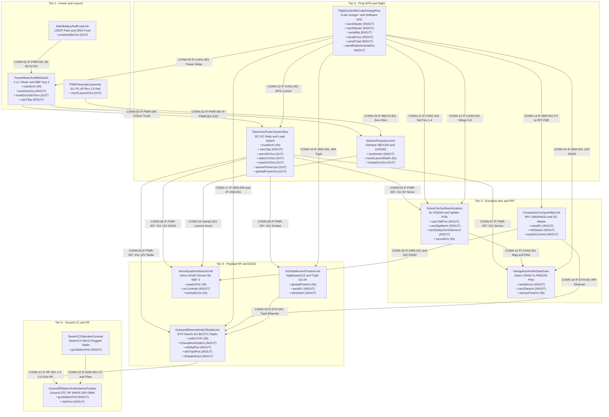

| Attribute | Specification Detail |
| :--- | :--- |
| **Issue ID** | #3 |
| **Title** | System Interface Matrix and Topological Connectivity |
| **Type** | icd |
| **Interface Level** | Level 1C Logical Interface |
| **Generation Mode** | subagent |
| **Date** | 2026-11-16 |
| **Specification Source** | [../../.pipeline/schema.sysml](../../.pipeline/schema.sysml) |

# Level 1C: System Interface Matrix & Topological Connectivity

## 1. Executive Summary & Interface Scope

This Level 1C Logical Interface Specification defines the topological subsystem boundaries, port roster, and connection bindings for the **Avenger 5 V2.5 Uncrewed Aircraft System** (`Avenger5V25IntegratedSystem`: `ASTK A5 V2.5`, `ELI PL-40 Rev 2.6`, `Artron ESAD`, and `SwarmC2`), derived strictly from the compiled SysML v2 Abstract Syntax Tree in [../../.pipeline/schema.sysml](../../.pipeline/schema.sysml) and grounded against the OEM interface ledger in [../../schema/extracted/interface_table.md](../../schema/extracted/interface_table.md) and the normative baseline in [../../docs/research/RESEARCH_INVENTORY.md](../../docs/research/RESEARCH_INVENTORY.md).

The root composition `Avenger5V25IntegratedSystem` instantiates `14` hardware-faithful constituent subsystem assemblies (forming `15` total SysML `part def` entities with the root composition), exposes `46` boundary port instances typed by `24` `port def` contracts, and binds `24` logical connections (`CONN-01` through `CONN-24`) conveying `29` `item def` payload and interface abstractions. Downstream signal-level metrology resides in `docs/interfaces/ICD_02_MASTER_SIGNAL_DICTIONARY.md`.

### Architectural & Physical Invariants
- **Zero Standalone RTA Hardware Box (`standaloneRtaBoxCount == 0`):** In compliance with ASTM F3269-17 and `SimplexRtaSoftwareHostingConstraint` (`REQ_SC_05`), the Simplex Run-Time Assurance (RTA) envelope supervisor executes strictly in software inside `FlightControllerCubeOrangePlus` (`Cube orange+`), while the STANAG 4187 Artron ESAD polling bridge executes inside `CompanionComputeRpiCm5` (`RPI CM5004032`). No standalone RTA hardware box exists in the vehicle architecture.
- **Zero Electrical or CAN Wires Across Launch Rail Interface (`IF-MECH-001`, `CONN-23`, `electricalWireToUavCount == 0`):** `Pl40PneumaticLauncher` engages `ElectricPropulsionUnit` hardpoints strictly as a mechanical catapult impulse (`~23.0 m/s` exit at `17.0 kg` MTOW, `<= 25.0 m/s` rail ceiling, `12.0 deg` elevation) with zero electrical, power, discrete, or CAN conductors between launcher and airframe. Onboard launch acceleration (`SS1`) is coupled mechanically through `CONN-24` (`ElectricPropulsionUnit.inertialSs1Out` to `ArtronEsadAndSensorUnit.inertialSs1In`).
- **Zero Production Recovery Parachutes (`productionRecoverySystemInstalled == false`, `rndRecoveryOptionInstalled == false`, `REQ_SC_03`):** Production `Avenger V2.5` omits any recovery parachute system. Optional `50.0 V` dual RnD pyrotechnic igniter outputs on `ElectronicPowerSystemEps` remain permanently disabled and unconnected.
- **Physical CAN Topology Partitioning & Power Interlock Sequencing:** `FlightControllerCubeOrangePlus` isolates `CAN 1` (`PowerMeterAndRbfSwitch`, `ElectronicPowerSystemEps`, and `4x` `HV6160-DroneCAN` tail ruddervators `#1` through `#4` on `120.0 cm` stubs) from `CAN 2` (`CAN/power splitter PCB`, `4x` `HV6160-DroneCAN` wing roll servos `#5` through `#8`, `2x` `mRo RM3100` mag/baro, and `CUAV SKYE2` heated pitot) (`CanTopologyIsolationConstraint`, `REQ_SC_06`). `MainBatteryAndFuseUnit` operates within `36.0` to `50.4 V` DC (`49.0` to `50.0 V` pre-flight check, `200.0 A` fuse, `0.20` Bingo reserve across `5400.0 s`). `ElectronicPowerSystemEps` supplies `14.0 V` to `ArtronEsadAndSensorUnit` (`0.0 V` brownout margin against `14.0` to `32.0 V` `VDC_IN`, `GAP-01`), and `RBF #3` must remain installed until UAV Power `RBF #2` energization and ESAD PBIT (`< 50.0 V`) pass cleanly (`GAP-06`).
- **Internal Subsystem & External Environment Encapsulation:** OEM internal assemblies -- `IF-PWR-005` (IBEX160 ESC to AXI 5345/16 BLDC motor inside `ElectricPropulsionUnit`), `IF-VID-001` (Nighthawk2UZ to Trip6 inside `EoIrSeekerAndTrackerUnit`), `IF-ORD-003` through `IF-ORD-005` (RBF #3 umbilical loop, ESAD Sensor Board, and high-voltage warhead holder fire circuit inside `ArtronEsadAndSensorUnit`), `IF-MECH-002` (PL-40 compressor/PCP fill inside `Pl40PneumaticLauncher`), and `IF-RF-002` (GNSS constellation RF into Talysman TW3972EXF inside `NavigationAndAirDataSuite`) -- are encapsulated cleanly within their respective `part def` boundaries with zero unallocated boundary ports.

## 2. Subsystem Topological Connectivity Graph

The following Mermaid `flowchart TD` diagram from [../../docs/architecture/views/icd_system_interface_matrix.mmd](../../docs/architecture/views/icd_system_interface_matrix.mmd) captures the vertical 5-tier partition across the `14` constituent LRU subsystems and all `24` logical connections (`CONN-01` through `CONN-24`):

## 3. Canonical N² Subsystem Interface Matrix

Rows denote transmitting subsystems (`Tx`) and columns denote receiving subsystems (`Rx`) across all `15` SysML `part def`s in [../../.pipeline/schema.sysml](../../.pipeline/schema.sysml). `Avenger5V25IntegratedSystem` (index `1`) is the root system composition hosting all `24` internal bindings (`CONN-01` through `CONN-24`) among constituent assemblies `2` through `15` with zero external boundary ports. Cell counts indicate distinct SysML `item def` types transmitted in that direction (`INOUT` links populate both directions; unidirectional `OUT` to `IN` links populate the forward cell only).

| Subsystem | 1. Avenger5V25IntegratedSystem | 2. MainBatteryAndFuseUnit | 3. PowerMeterAndRbfSwitch | 4. ElectricPropulsionUnit | 5. ElectronicPowerSystemEps | 6. FlightControllerCubeOrangePlus | 7. CompanionComputeRpiCm5 | 8. NavigationAndAirDataSuite | 9. DroneCanSurfaceActuation | 10. OnboardEthernetAndC2RadioUnit | 11. EoIrSeekerAndTrackerUnit | 12. ArtronEsadAndSensorUnit | 13. Pl40PneumaticLauncher | 14. SwarmC2OperatorConsole | 15. GroundRfStationAndAntennaTracker |
| :--- | :--- | :--- | :--- | :--- | :--- | :--- | :--- | :--- | :--- | :--- | :--- | :--- | :--- | :--- | :--- |
| **1. Avenger5V25IntegratedSystem** | **[ Avenger5V25IntegratedSystem ]** | -- | -- | -- | -- | -- | -- | -- | -- | -- | -- | -- | -- | -- | -- |
| **2. MainBatteryAndFuseUnit** | -- | **[ MainBatteryAndFuseUnit ]** | CONN-01 (1 Item) | -- | -- | -- | -- | -- | -- | -- | -- | -- | -- | -- | -- |
| **3. PowerMeterAndRbfSwitch** | -- | -- | **[ PowerMeterAndRbfSwitch ]** | CONN-02 (2 Items) | CONN-03 (1 Item) | CONN-09 (1 Item) | -- | -- | -- | -- | -- | -- | -- | -- | -- |
| **4. ElectricPropulsionUnit** | -- | -- | CONN-02 (1 Item) | **[ ElectricPropulsionUnit ]** | -- | -- | -- | -- | -- | -- | -- | CONN-24 (1 Item) | -- | -- | -- |
| **5. ElectronicPowerSystemEps** | -- | -- | -- | -- | **[ ElectronicPowerSystemEps ]** | CONN-10 (1 Item) | -- | CONN-07 (1 Item) | CONN-04 (1 Item) | CONN-05 (1 Item) | CONN-08 (1 Item) | CONN-06 (1 Item) | -- | -- | -- |
| **6. FlightControllerCubeOrangePlus** | -- | -- | CONN-09 (1 Item) | -- | CONN-10 (1 Item) | **[ FlightControllerCubeOrangePlus ]** | CONN-14 (1 Item) | CONN-15 (1 Item) | CONN-11 (2 Items), CONN-12 (2 Items) | CONN-17 (2 Items) | CONN-16 (1 Item) | -- | -- | -- | -- |
| **7. CompanionComputeRpiCm5** | -- | -- | -- | -- | -- | CONN-14 (1 Item) | **[ CompanionComputeRpiCm5 ]** | -- | -- | CONN-18 (1 Item) | -- | CONN-20 (2 Items) | -- | -- | -- |
| **8. NavigationAndAirDataSuite** | -- | -- | -- | -- | -- | CONN-15 (1 Item) | -- | **[ NavigationAndAirDataSuite ]** | CONN-13 (1 Item) | -- | -- | -- | -- | -- | -- |
| **9. DroneCanSurfaceActuation** | -- | -- | -- | -- | -- | CONN-11 (2 Items), CONN-12 (2 Items) | -- | CONN-13 (1 Item) | **[ DroneCanSurfaceActuation ]** | -- | -- | -- | -- | -- | -- |
| **10. OnboardEthernetAndC2RadioUnit** | -- | -- | -- | -- | -- | CONN-17 (2 Items) | CONN-18 (1 Item) | -- | -- | **[ OnboardEthernetAndC2RadioUnit ]** | CONN-19 (1 Item) | -- | -- | -- | CONN-21 (1 Item) |
| **11. EoIrSeekerAndTrackerUnit** | -- | -- | -- | -- | -- | CONN-16 (1 Item) | -- | -- | -- | CONN-19 (1 Item) | **[ EoIrSeekerAndTrackerUnit ]** | -- | -- | -- | -- |
| **12. ArtronEsadAndSensorUnit** | -- | -- | -- | -- | -- | -- | CONN-20 (1 Item) | -- | -- | -- | -- | **[ ArtronEsadAndSensorUnit ]** | -- | -- | -- |
| **13. Pl40PneumaticLauncher** | -- | -- | -- | CONN-23 (1 Item) | -- | -- | -- | -- | -- | -- | -- | -- | **[ Pl40PneumaticLauncher ]** | -- | -- |
| **14. SwarmC2OperatorConsole** | -- | -- | -- | -- | -- | -- | -- | -- | -- | -- | -- | -- | -- | **[ SwarmC2OperatorConsole ]** | CONN-22 (2 Items) |
| **15. GroundRfStationAndAntennaTracker** | -- | -- | -- | -- | -- | -- | -- | -- | -- | CONN-21 (1 Item) | -- | -- | -- | CONN-22 (1 Item) | **[ GroundRfStationAndAntennaTracker ]** |

## 4. Port Definition Roster Table

Every boundary port instance declared across the `14` constituent SysML `part def` assemblies (`46` ports total) is cataloged below with exact AST names and standard classification.

| Port ID | Subsystem | Port Name | Direction | Port Type | Multiplicity | Protocol Profile |
| :--- | :--- | :--- | :--- | :--- | :--- | :--- |
| `PORT-BAT-PROTECTED_DC_OUT` | MainBatteryAndFuseUnit | protectedDcOut | OUT | DataPort | 1 | PeriodicStream |
| `PORT-PWRMTR-MAIN_DC_IN` | PowerMeterAndRbfSwitch | mainDcIn | IN | DataPort | 1 | PeriodicStream |
| `PORT-PWRMTR-ESC_DRIVE_OUT` | PowerMeterAndRbfSwitch | escDriveOut | INOUT | CommandPort | 1 | RealTimeSync |
| `PORT-PWRMTR-TRUNK_DC_OUT` | PowerMeterAndRbfSwitch | trunkDcOut970cm | OUT | DataPort | 1 | PeriodicStream |
| `PORT-PWRMTR-CAN1_TAP` | PowerMeterAndRbfSwitch | can1Tap | INOUT | TelemetryPort | 1 | RealTimeSync |
| `PORT-PROP-ESC_DRIVE_IN` | ElectricPropulsionUnit | escDriveIn | INOUT | CommandPort | 1 | RealTimeSync |
| `PORT-PROP-MECH_LAUNCH_IN` | ElectricPropulsionUnit | mechLaunchRailIn | IN | EventPort | 1 | AsyncEvent |
| `PORT-PROP-INERTIAL_SS1_OUT` | ElectricPropulsionUnit | inertialSs1Out | OUT | EventPort | 1 | AsyncEvent |
| `PORT-EPS-TRUNK_DC_IN` | ElectronicPowerSystemEps | trunkDcIn | IN | DataPort | 1 | PeriodicStream |
| `PORT-EPS-CAN1_TAP` | ElectronicPowerSystemEps | can1Tap | INOUT | CommandPort | 1 | RealTimeSync |
| `PORT-EPS-SERVO_8V_OUT` | ElectronicPowerSystemEps | servo8VOut | OUT | DataPort | 1 | PeriodicStream |
| `PORT-EPS-RADIO_12V_OUT` | ElectronicPowerSystemEps | radio12VOut | OUT | DataPort | 1 | PeriodicStream |
| `PORT-EPS-ESAD_14V_OUT` | ElectronicPowerSystemEps | esad14VOut | OUT | DataPort | 1 | PeriodicStream |
| `PORT-EPS-SENSOR_PWR_OUT` | ElectronicPowerSystemEps | sensorPowerOut | OUT | DataPort | 1 | PeriodicStream |
| `PORT-EPS-GIMBAL_PWR_OUT` | ElectronicPowerSystemEps | gimbalPowerOut | OUT | DataPort | 1 | PeriodicStream |
| `PORT-FC-CAN1_MASTER` | FlightControllerCubeOrangePlus | can1Master | INOUT | CommandPort | 1 | RealTimeSync |
| `PORT-FC-CAN2_MASTER` | FlightControllerCubeOrangePlus | can2Master | INOUT | CommandPort | 1 | RealTimeSync |
| `PORT-FC-SERIAL_RPI` | FlightControllerCubeOrangePlus | serialRpi | INOUT | DataPort | 1 | RealTimeSync |
| `PORT-FC-SERIAL_GNSS` | FlightControllerCubeOrangePlus | serialGnss | INOUT | TelemetryPort | 1 | PeriodicStream |
| `PORT-FC-SERIAL_TRIP6` | FlightControllerCubeOrangePlus | serialTrip6 | INOUT | CommandPort | 1 | RealTimeSync |
| `PORT-FC-SERIAL_RADIO_USB` | FlightControllerCubeOrangePlus | serialRadioAndUsbExt | INOUT | DataPort | 1 | PeriodicStream |
| `PORT-RPI-SERIAL_FC` | CompanionComputeRpiCm5 | serialFc | INOUT | DataPort | 1 | RealTimeSync |
| `PORT-RPI-ETH_SWITCH` | CompanionComputeRpiCm5 | ethSwitch | INOUT | DataPort | 1 | PeriodicStream |
| `PORT-RPI-ESAD_OC_CTRL` | CompanionComputeRpiCm5 | esadOcControl | INOUT | CommandPort | 1 | RealTimeSync |
| `PORT-NAV-SERIAL_GNSS` | NavigationAndAirDataSuite | serialGnss | INOUT | TelemetryPort | 1 | PeriodicStream |
| `PORT-NAV-CAN2_DAISY_IN` | NavigationAndAirDataSuite | can2DaisyIn | INOUT | TelemetryPort | 1 | RealTimeSync |
| `PORT-NAV-SENSOR_PWR_IN` | NavigationAndAirDataSuite | sensorPowerIn | IN | DataPort | 1 | PeriodicStream |
| `PORT-ACT-CAN1_TAIL_FINS` | DroneCanSurfaceActuation | can1TailFins | INOUT | CommandPort | 1 | RealTimeSync |
| `PORT-ACT-CAN2_SPLITTER_IN` | DroneCanSurfaceActuation | can2SplitterIn | INOUT | CommandPort | 1 | RealTimeSync |
| `PORT-ACT-CAN2_DAISY_OUT` | DroneCanSurfaceActuation | can2DaisyOutToSensors | INOUT | DataPort | 1 | RealTimeSync |
| `PORT-ACT-SERVO_8V_IN` | DroneCanSurfaceActuation | servo8VIn | IN | DataPort | 1 | PeriodicStream |
| `PORT-COMMS-RADIO_12V_IN` | OnboardEthernetAndC2RadioUnit | radio12VIn | IN | DataPort | 1 | PeriodicStream |
| `PORT-COMMS-FC_SERIAL_USB` | OnboardEthernetAndC2RadioUnit | fcSerialAndUsbExt | INOUT | DataPort | 1 | PeriodicStream |
| `PORT-COMMS-ETH_RPI` | OnboardEthernetAndC2RadioUnit | ethRpiPort | INOUT | DataPort | 1 | PeriodicStream |
| `PORT-COMMS-ETH_TRIP6` | OnboardEthernetAndC2RadioUnit | ethTrip6Port | INOUT | DataPort | 1 | PeriodicStream |
| `PORT-COMMS-RF_DATALINK_OUT` | OnboardEthernetAndC2RadioUnit | rfDatalinkOut | INOUT | DataPort | 1 | PeriodicStream |
| `PORT-EOIR-GIMBAL_PWR_IN` | EoIrSeekerAndTrackerUnit | gimbalPowerIn | IN | DataPort | 1 | PeriodicStream |
| `PORT-EOIR-SERIAL_FC` | EoIrSeekerAndTrackerUnit | serialFc | INOUT | TelemetryPort | 1 | RealTimeSync |
| `PORT-EOIR-ETH_SWITCH` | EoIrSeekerAndTrackerUnit | ethSwitch | INOUT | DataPort | 1 | PeriodicStream |
| `PORT-ESAD-ESAD_14V_IN` | ArtronEsadAndSensorUnit | esad14VIn | IN | DataPort | 1 | PeriodicStream |
| `PORT-ESAD-OC_CTRL_IN` | ArtronEsadAndSensorUnit | ocControlIn | INOUT | CommandPort | 1 | RealTimeSync |
| `PORT-ESAD-INERTIAL_SS1_IN` | ArtronEsadAndSensorUnit | inertialSs1In | IN | EventPort | 1 | AsyncEvent |
| `PORT-PL40-MECH_LAUNCH_OUT` | Pl40PneumaticLauncher | mechLaunchOut | OUT | EventPort | 1 | AsyncEvent |
| `PORT-GCS-STATION_PORT` | SwarmC2OperatorConsole | gcsStationPort | INOUT | CommandPort | 1 | RealTimeSync |
| `PORT-GRF-GCS_STATION_PORT` | GroundRfStationAndAntennaTracker | gcsStationPort | INOUT | CommandPort | 1 | RealTimeSync |
| `PORT-GRF-RF_AIR_PORT` | GroundRfStationAndAntennaTracker | rfAirPort | INOUT | DataPort | 1 | PeriodicStream |

## 5. Connection Binding Roster Table

All `24` logical bindings (`CONN-01` through `CONN-24`) declared inside `Avenger5V25IntegratedSystem` are specified below with qualified `PORT-ID (SysmlPart.portName)` references matching exact `.pipeline/schema.sysml` identifiers. Worst-case digital timing latencies not printed in OEM documentation are marked `UNPRINTED` per `REQ_SAF_08` (`GAP-WCET`); continuous passive DC conduction and rigid-body mechanical launch/inertial couplings carry `0.0` ms digital protocol latency.

| Connection ID | Source Port | Dest Port | Flow Behavior | Latency Max ms | Reliability Req | Item Flows Conveyed |
| :--- | :--- | :--- | :--- | :--- | :--- | :--- |
| `CONN-01` | `PORT-BAT-PROTECTED_DC_OUT (MainBatteryAndFuseUnit.protectedDcOut)` | `PORT-PWRMTR-MAIN_DC_IN (PowerMeterAndRbfSwitch.mainDcIn)` | IF-PWR-001, IF-PWR-002, IF-PWR-003: Continuous 12S2P DC rail (36.0 to 50.4 V, 200.0 A fuse, 49.0 to 50.0 V pre-flight) gated by RBF Key #2 | 0.0 | Critical | MainDcBusPower |
| `CONN-02` | `PORT-PWRMTR-ESC_DRIVE_OUT (PowerMeterAndRbfSwitch.escDriveOut)` | `PORT-PROP-ESC_DRIVE_IN (ElectricPropulsionUnit.escDriveIn)` | IF-PWR-004, IF-PWM-001, IF-SER-005: Switched main DC (36.0 to 50.4 V), unidirectional PWM throttle to IBEX160 ESC, and ESC UART telemetry return | UNPRINTED | Critical | MainDcBusPower, EscThrottlePwmSignal, EscTelemetryFrame |
| `CONN-03` | `PORT-PWRMTR-TRUNK_DC_OUT (PowerMeterAndRbfSwitch.trunkDcOut970cm)` | `PORT-EPS-TRUNK_DC_IN (ElectronicPowerSystemEps.trunkDcIn)` | IF-PWR-006: Continuous 970.0 cm main DC trunk (36.0 to 50.4 V) feeding EPS converters | 0.0 | Critical | MainDcBusPower |
| `CONN-04` | `PORT-EPS-SERVO_8V_OUT (ElectronicPowerSystemEps.servo8VOut)` | `PORT-ACT-SERVO_8V_IN (DroneCanSurfaceActuation.servo8VIn)` | IF-PWR-007: Continuous regulated 8.0 V DC actuator rail feeding 8x HV6160 tail and wing servos | 0.0 | Critical | RegulatedRailPower |
| `CONN-05` | `PORT-EPS-RADIO_12V_OUT (ElectronicPowerSystemEps.radio12VOut)` | `PORT-COMMS-RADIO_12V_IN (OnboardEthernetAndC2RadioUnit.radio12VIn)` | IF-PWR-008: Continuous regulated 12.0 V DC rail (8.0 to 17.0 V radio input envelope) feeding DTC transceiver | 0.0 | Critical | RegulatedRailPower |
| `CONN-06` | `PORT-EPS-ESAD_14V_OUT (ElectronicPowerSystemEps.esad14VOut)` | `PORT-ESAD-ESAD_14V_IN (ArtronEsadAndSensorUnit.esad14VIn)` | IF-PWR-009: Regulated 14.0 V DC GE_POW rail (14.0 to 32.0 V ICD range, 0.0 V margin GAP-01); cut by irreversible Power Off ESAD | 0.0 | Critical | RegulatedRailPower |
| `CONN-07` | `PORT-EPS-SENSOR_PWR_OUT (ElectronicPowerSystemEps.sensorPowerOut)` | `PORT-NAV-SENSOR_PWR_IN (NavigationAndAirDataSuite.sensorPowerIn)` | IF-PWR-011: Continuous regulated sensor DC rail feeding CUAV SKYE2 heated pitot and 2x mRo RM3100 mag/baro units | 0.0 | Critical | RegulatedRailPower |
| `CONN-08` | `PORT-EPS-GIMBAL_PWR_OUT (ElectronicPowerSystemEps.gimbalPowerOut)` | `PORT-EOIR-GIMBAL_PWR_IN (EoIrSeekerAndTrackerUnit.gimbalPowerIn)` | IF-PWR-011: Continuous regulated payload DC rail feeding Trip6 camera compute and Nighthawk2UZ gimbal | 0.0 | High | RegulatedRailPower |
| `CONN-09` | `PORT-FC-CAN1_MASTER (FlightControllerCubeOrangePlus.can1Master)` | `PORT-PWRMTR-CAN1_TAP (PowerMeterAndRbfSwitch.can1Tap)` | IF-CAN1-001: Bidirectional DroneCAN multi-drop tap carrying 12S2P V/I, 0.20 Bingo reserve state, and bridged ESC telemetry | UNPRINTED | Critical | CanBusMessageFrame |
| `CONN-10` | `PORT-FC-CAN1_MASTER (FlightControllerCubeOrangePlus.can1Master)` | `PORT-EPS-CAN1_TAP (ElectronicPowerSystemEps.can1Tap)` | IF-CAN1-001: Bidirectional DroneCAN multi-drop tap carrying EPS load-switch control, 14.0 V brownout alert, and disabled RnD rail state | UNPRINTED | Critical | CanBusMessageFrame |
| `CONN-11` | `PORT-FC-CAN1_MASTER (FlightControllerCubeOrangePlus.can1Master)` | `PORT-ACT-CAN1_TAIL_FINS (DroneCanSurfaceActuation.can1TailFins)` | IF-CAN1-001: Bidirectional DroneCAN 4x 120.0 cm stubs commanding 4x HV6160 tail ruddervators (#1 through #4) and actuator feedback | UNPRINTED | Critical | CanBusMessageFrame, SurfaceDeflectionCommand |
| `CONN-12` | `PORT-FC-CAN2_MASTER (FlightControllerCubeOrangePlus.can2Master)` | `PORT-ACT-CAN2_SPLITTER_IN (DroneCanSurfaceActuation.can2SplitterIn)` | IF-CAN2-001: Bidirectional DroneCAN series feed through CAN/power splitter PCB commanding 4x HV6160 wing roll servos (#5 through #8) | UNPRINTED | Critical | CanBusMessageFrame, SurfaceDeflectionCommand |
| `CONN-13` | `PORT-ACT-CAN2_DAISY_OUT (DroneCanSurfaceActuation.can2DaisyOutToSensors)` | `PORT-NAV-CAN2_DAISY_IN (NavigationAndAirDataSuite.can2DaisyIn)` | IF-CAN2-001: Bidirectional DroneCAN series daisy-chain tail linking wing servos #5 through #8 to Mag #2, Mag #1, and SKYE2 pitot | UNPRINTED | Critical | CanBusMessageFrame |
| `CONN-14` | `PORT-FC-SERIAL_RPI (FlightControllerCubeOrangePlus.serialRpi)` | `PORT-RPI-SERIAL_FC (CompanionComputeRpiCm5.serialFc)` | IF-SER-001: Bidirectional internal point-to-point UART exchanging EKF2/RTA flight state, mission commands, and ESAD watchdog events | UNPRINTED | Critical | UartSerialPacket |
| `CONN-15` | `PORT-FC-SERIAL_GNSS (FlightControllerCubeOrangePlus.serialGnss)` | `PORT-NAV-SERIAL_GNSS (NavigationAndAirDataSuite.serialGnss)` | IF-SER-002: Bidirectional point-to-point UART conveying Septentrio Asterx-m3 pro RTK/PVT navigation stream and Disable GNSS control | UNPRINTED | Critical | UartSerialPacket |
| `CONN-16` | `PORT-FC-SERIAL_TRIP6 (FlightControllerCubeOrangePlus.serialTrip6)` | `PORT-EOIR-SERIAL_FC (EoIrSeekerAndTrackerUnit.serialFc)` | IF-SER-003: Bidirectional point-to-point UART exchanging Trip6 auto-tracker cues, gimbal steering, and INS state (<= 55.0 m/s dive cap) | UNPRINTED | High | UartSerialPacket |
| `CONN-17` | `PORT-FC-SERIAL_RADIO_USB (FlightControllerCubeOrangePlus.serialRadioAndUsbExt)` | `PORT-COMMS-FC_SERIAL_USB (OnboardEthernetAndC2RadioUnit.fcSerialAndUsbExt)` | IF-SER-004, IF-USB-001: Bidirectional C2 UART serial telemetry/command stream to DTC radio and locked umbilical USB maintenance port | UNPRINTED | Critical | UartSerialPacket, UsbServicePacket |
| `CONN-18` | `PORT-RPI-ETH_SWITCH (CompanionComputeRpiCm5.ethSwitch)` | `PORT-COMMS-ETH_RPI (OnboardEthernetAndC2RadioUnit.ethRpiPort)` | IF-ETH-001: Bidirectional switched onboard Ethernet IP link bridging SwarmC2 mission/ESAD supervision and ground service access | UNPRINTED | High | EthernetIpPacket |
| `CONN-19` | `PORT-EOIR-ETH_SWITCH (EoIrSeekerAndTrackerUnit.ethSwitch)` | `PORT-COMMS-ETH_TRIP6 (OnboardEthernetAndC2RadioUnit.ethTrip6Port)` | IF-ETH-001, IF-VID-001: Bidirectional switched onboard Ethernet IP link conveying 1280x720 Day/Thermal video and Reboot Gimbal commands | UNPRINTED | High | EthernetIpPacket |
| `CONN-20` | `PORT-RPI-ESAD_OC_CTRL (CompanionComputeRpiCm5.esadOcControl)` | `PORT-ESAD-OC_CTRL_IN (ArtronEsadAndSensorUnit.ocControlIn)` | IF-ORD-001, IF-ORD-002: Half-duplex 100 Hz (0.01 s) 115200 bps RS-485 OC Master poll (<= 5.0 ms reply, <= 10.0 ms timeout) and Stage 2 DSC_IN1 1000.0 Hz dual-pulse arm discrete | 10.0 | Critical | Rs485EsadProtocolFrame, DscIn1ArmPulseTrain |
| `CONN-21` | `PORT-COMMS-RF_DATALINK_OUT (OnboardEthernetAndC2RadioUnit.rfDatalinkOut)` | `PORT-GRF-RF_AIR_PORT (GroundRfStationAndAntennaTracker.rfAirPort)` | IF-RF-001: Bidirectional 4.4 to 5.0 GHz AES-256 FHSS RF datalink (2.0 W total, 60.0 or 90.0 km RLOS, >= 10.0 m separation, 105.0 s failsafe trigger) | UNPRINTED | Critical | RfC2DatalinkSignal |
| `CONN-22` | `PORT-GCS-STATION_PORT (SwarmC2OperatorConsole.gcsStationPort)` | `PORT-GRF-GCS_STATION_PORT (GroundRfStationAndAntennaTracker.gcsStationPort)` | IF-GND-001: Bidirectional wired C2 or 200.0 m tactical fiber IP link carrying SwarmC2 commands, 0.5 deg Auto Follow rotator control, and telemetry | UNPRINTED | High | GroundC2TelemetryAndCommandStream, RotatorAzimuthControlSignal |
| `CONN-23` | `PORT-PL40-MECH_LAUNCH_OUT (Pl40PneumaticLauncher.mechLaunchOut)` | `PORT-PROP-MECH_LAUNCH_IN (ElectricPropulsionUnit.mechLaunchRailIn)` | IF-MECH-001: Unidirectional strictly mechanical 5.0 m (12.0 deg) rail catapult load (~23.0 m/s exit at 17.0 kg, <= 25.0 m/s ceiling) with 0 electrical or CAN wires | 0.0 | Critical | MechanicalThrustAndLaunchLoad |
| `CONN-24` | `PORT-PROP-INERTIAL_SS1_OUT (ElectricPropulsionUnit.inertialSs1Out)` | `PORT-ESAD-INERTIAL_SS1_IN (ArtronEsadAndSensorUnit.inertialSs1In)` | Unidirectional rigid-body inertial launch acceleration pulse triggering onboard Artron ESAD SS1 safety barrier (0 electrical wires) | 0.0 | Critical | InertialLaunchAccelPulse |

## 6. Source References

- Structural SysML v2 Schema: [../../.pipeline/schema.sysml](../../.pipeline/schema.sysml)
- Grounded Interface Table: [../../schema/extracted/interface_table.md](../../schema/extracted/interface_table.md)
- Subsystem Topological Graph View: [../../docs/architecture/views/icd_system_interface_matrix.mmd](../../docs/architecture/views/icd_system_interface_matrix.mmd)
- Cited Normative Research Inventory: [../../docs/research/RESEARCH_INVENTORY.md](../../docs/research/RESEARCH_INVENTORY.md)

/// ObligationWitness: [OBL-02]
/// ObligationWitness: [EXT-01]
