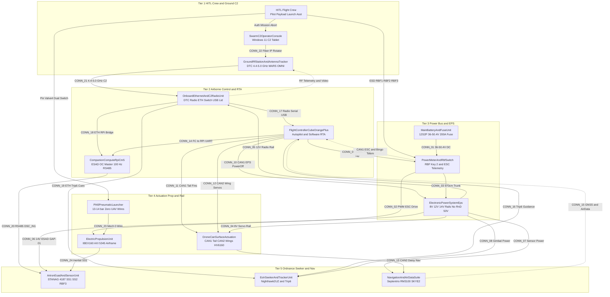

# System Losses, Hazards & Control Structure Topology

## System Losses

### Normative System Losses (`REQ_L_01..04`)

| Requirement ID | Loss Description | Severity | Triggered By Hazards | Primary `RESEARCH_INVENTORY.md` Anchor |
| :--- | :--- | :--- | :--- | :--- |
| `REQ_L_01` | Loss L1: Human fatality or severe crew injury from unintended warhead detonation or unrestrained PL-40 launch discharge. | Catastrophic | `REQ_H_01`, `REQ_H_04`, `REQ_H_06` | `SAF-01`, `SAF-02`, `MET-04`, `EXT-01`, `EXT-02` |
| `REQ_L_02` | Loss L2: Uncontrolled airframe crash or hull destruction outside authorized engagement corridor. | Catastrophic | `REQ_H_01`, `REQ_H_02`, `REQ_H_03`, `REQ_H_06` | `SAF-02`, `SAF-03`, `MET-01`, `MET-02`, `CTL-01`, `CTL-04` |
| `REQ_L_03` | Loss L3: Unrecoverable loss of navigation or C2 mission control resulting in flyaway or inability to verify safe abort. | Hazardous | `REQ_H_02`, `REQ_H_03`, `REQ_H_05` | `OBL-04`, `SAF-02`, `CTL-02`, `CTL-03` |
| `REQ_L_04` | Loss L4: Unintended warhead detonation during ground handling/launch or collateral impact outside authorized target. | Catastrophic | `REQ_H_04`, `REQ_H_05` | `SAF-01`, `SAF-02`, `MET-03`, `CTL-03` |

### Root Composition Loss (`L-1`)

| Loss ID | Description |
| :--- | :--- |
| L-1 | Loss of safe function of Avenger5V25IntegratedSystem |

## System Hazards

### Normative System Hazards (`REQ_H_01..06`)

| Requirement ID | Hazard Description | Severity | Linked System Losses | Governing Engineering Gaps & Constraints |
| :--- | :--- | :--- | :--- | :--- |
| `REQ_H_01` | Hazard H1: Premature propulsion energization, reversed RBF sequencing, or insufficient launch airspeed (`< 24.0-26.0 m/s`) during handling or launch. | Catastrophic | `REQ_L_01`, `REQ_L_02` | `GAP-03`, `GAP-05`, `GAP-06`, `MainBatteryPreFlightVoltageConstraint`, `ProductionNoParachuteConstraint` |
| `REQ_H_02` | Hazard H2: In-flight propulsion loss, main bus sag below `36.0 V`, EPS `14.0 V` ESAD brownout (`GAP-01`), or Bingo reserve exhaustion (`< 0.20`). | Hazardous | `REQ_L_02`, `REQ_L_03` | `GAP-01`, `GAP-05`, `GAP-ENV`, `BingoEnergyReserveConstraint`, `EpsEsadZeroBrownoutMarginConstraint` |
| `REQ_H_03` | Hazard H3: Loss of flight control authority due to RTA envelope exceedance (`> 55.0/80.0 m/s`), `CAN 1`/`CAN 2` bus saturation, or unflagged pitot/mag corruption. | Catastrophic | `REQ_L_02`, `REQ_L_03` | `GAP-02`, `GAP-04`, `GAP-WCET`, `SimplexRtaSoftwareHostingConstraint`, `CanTopologyIsolationConstraint` |
| `REQ_H_04` | Hazard H4: Artron ESAD premature arming, HV `>= 50.0 V` during PBIT, premature `DSC_IN1` fault, or out-of-order `RBF #3` removal. | Catastrophic | `REQ_L_01`, `REQ_L_04` | `GAP-04`, `GAP-06`, `GAP-07`, `EsadRbf3PowerBeforePullConstraint`, `EsadSafeDistanceExceedConstraint` |
| `REQ_H_05` | Hazard H5: EO/IR gimbal saturation above `55.0 m/s` dive speed or prolonged C2 link loss while warhead is armed. | Catastrophic | `REQ_L_03`, `REQ_L_04` | `GAP-02`, `GAP-WCET`, `EngagementSpeedAndTrackHoldConstraint`, `FlightEnvelopeSpeedConstraint` |
| `REQ_H_06` | Hazard H6: Uncontrolled PL-40 rail discharge, `> 25.0 m/s` over-velocity (`< 15 kg` at `14 bar`), sub-stall exit (`< 24.0-26.0 m/s`), or unbleed hangfire crew approach. | Catastrophic | `REQ_L_01`, `REQ_L_02` | `GAP-03`, `GAP-SEPDIST`, `GAP-SCRUB`, `Pl40MassAndExitVelocityConstraint`, `Pl40UvloAndDualSwitchConstraint` |

### AST Action-Bound System Hazards (`H-1..19`)

| Hazard ID | Associated Control Action | Controller |
| :--- | :--- | :--- |
| H-1 | ValidateBatteryAndPowerOnRbf2 | Avenger5V25IntegratedSystem |
| H-2 | CommandPusherThrottleAndReadEscTelem | Avenger5V25IntegratedSystem |
| H-3 | DistributeRegulatedPowerRails | Avenger5V25IntegratedSystem |
| H-4 | MonitorBingoEnergyReserve | Avenger5V25IntegratedSystem |
| H-5 | ExecuteSimplexRtaEnvelopeCheck | Avenger5V25IntegratedSystem |
| H-6 | RunPitotAndMagPreflightCheck | Avenger5V25IntegratedSystem |
| H-7 | SwitchToGnssDeniedDeadReckoning | Avenger5V25IntegratedSystem |
| H-8 | SuperviseEsadOcMasterCycle | Avenger5V25IntegratedSystem |
| H-9 | ActuateTailAndWingSurfaces | Avenger5V25IntegratedSystem |
| H-10 | ExecuteEsadBootAndPbit | Avenger5V25IntegratedSystem |
| H-11 | TransitionEsadArmingSequence | Avenger5V25IntegratedSystem |
| H-12 | CommandEsadAbortAndSelfDestruct | Avenger5V25IntegratedSystem |
| H-13 | AcquireAndTrackTerminalTarget | Avenger5V25IntegratedSystem |
| H-14 | RebootGimbalAndBridgeEthernet | Avenger5V25IntegratedSystem |
| H-15 | ChargePl40CompressorWithUvloCheck | Avenger5V25IntegratedSystem |
| H-16 | ExecuteLaunchGoNoGoAndDualTrigger | Avenger5V25IntegratedSystem |
| H-17 | DepressurizeAndScrubPl40Launcher | Avenger5V25IntegratedSystem |
| H-18 | AuthenticateOperatorAndCalibrateRotator | Avenger5V25IntegratedSystem |
| H-19 | ExportTargetReport5wCff | Avenger5V25IntegratedSystem |

## Hierarchical Control Structure Topology

The Avenger 5 V2.5 hierarchical safety control structure enforces strict architectural separation: ASTM F3269-17 Simplex Run-Time Assurance executes strictly in software on `FlightControllerCubeOrangePlus` (`standaloneRtaBoxCount == 0`, `rtaHostedOnCubeOrangePlus == true`), `CompanionComputeRpiCm5` acts as sole `100 Hz` RS-485 `OC Master` for `ArtronEsadAndSensorUnit`, `Pl40PneumaticLauncher` couples purely mechanically across `IF-MECH-001` (`CONN_23`) with zero electrical or CAN wires to the UAV, and production `ElectronicPowerSystemEps` inhibits optional RnD `2x 50.0 V` recovery igniters (`rndRecoveryOptionInstalled == false`).

