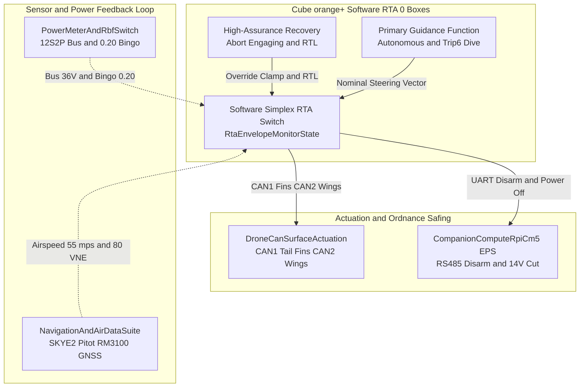

# Run-Time Assurance Architecture & Formal Proof Suite

## Software-Hosted Simplex Run-Time Assurance Topology (`ASTM F3269-17 §5.2`)

Avenger 5 V2.5 hosts its ASTM F3269-17 Simplex Run-Time Assurance (RTA) supervisor strictly in software inside `FlightControllerCubeOrangePlus` (`Cube orange+`), enforcing `SimplexRtaSoftwareHostingConstraint` (`standaloneRtaBoxCount == 0`, `rtaHostedOnCubeOrangePlus == true`). Zero standalone hardware RTA boxes exist on the aircraft, `Pl40PneumaticLauncher` maintains a strictly zero-wire mechanical interface (`IF-MECH-001`), and production `ElectronicPowerSystemEps` inhibits optional RnD `2x 50.0 V` recovery igniters (`rndRecoveryOptionInstalled == false`).



## Formal Proof Suite

## Theorem T-01 -- MainBatteryPreFlightVoltageConstraint

### Formal Theorem Statement

$$
\begin{aligned}
    \mathrm{MainBatteryPreFlightVoltageConstraint} &: \mathrm{in} \mathrm{packVoltageV} : \mathrm{Real} \land \mathrm{in} \mathrm{busVoltageV} : \mathrm{Real} \land \mathrm{attribute} \mathrm{invariantExpr} : \mathrm{String} = \text{"packVoltageV >= 49.0 and packVoltageV <= 50.0 and busVoltageV >= 36.0 and busVoltageV <= 50.4"}
\end{aligned}
$$

### Symbolic Derivation

$$
\begin{aligned}
    \mathrm{MainBatteryPreFlightVoltageConstraint} &\iff \mathrm{in} \mathrm{packVoltageV} : \mathrm{Real} \land \mathrm{in} \mathrm{busVoltageV} : \mathrm{Real} \land \mathrm{attribute} \mathrm{invariantExpr} : \mathrm{String} = \text{"packVoltageV >= 49.0 and packVoltageV <= 50.0 and busVoltageV >= 36.0 and busVoltageV <= 50.4"} \\
\end{aligned}
$$

### Parameter Definitions & Engineering Units Table

| Symbol | Description | Value | Engineering Unit |
| :--- | :--- | :--- | :--- |
| `MainBatteryPreFlightVoltageConstraint` | AST Constraint Invariant | `in packVoltageV : Real && in busVoltageV : Real && attribute invariantExpr : String = "packVoltageV >= 49.0 and packVoltageV <= 50.0 and busVoltageV >= 36.0 and busVoltageV <= 50.4"` | boolean |

### Step-by-Step Numerical Proof Evaluation

$$
\begin{aligned}
    \mathrm{MainBatteryPreFlightVoltageConstraint} &\implies \mathrm{in} \mathrm{packVoltageV} : \mathrm{Real} \land \mathrm{in} \mathrm{busVoltageV} : \mathrm{Real} \land \mathrm{attribute} \mathrm{invariantExpr} : \mathrm{String} = \text{"packVoltageV >= 49.0 and packVoltageV <= 50.0 and busVoltageV >= 36.0 and busVoltageV <= 50.4"} \\
\end{aligned}
$$

### SLDV Temporal Assertion Binding

```matlab
sldv.assert( (in packVoltageV Real && in busVoltageV Real && attribute invariantExpr String == 'packVoltageV >= 49.0 and packVoltageV <= 50.0 and busVoltageV >= 36.0 and busVoltageV <= 50.4'), 'Bind_MAINBATTERYPREFLIGHTVOLTAGECONSTRAINT_ASSERTION' );
```

## Theorem T-02 -- BingoEnergyReserveConstraint

### Formal Theorem Statement

$$
\begin{aligned}
    \mathrm{BingoEnergyReserveConstraint} &: \mathrm{in} \mathrm{reserveRatio} : \mathrm{Real} \land \mathrm{attribute} \mathrm{invariantExpr} : \mathrm{String} = \text{"reserveRatio >= 0.20"}
\end{aligned}
$$

### Symbolic Derivation

$$
\begin{aligned}
    \mathrm{BingoEnergyReserveConstraint} &\iff \mathrm{in} \mathrm{reserveRatio} : \mathrm{Real} \land \mathrm{attribute} \mathrm{invariantExpr} : \mathrm{String} = \text{"reserveRatio >= 0.20"} \\
\end{aligned}
$$

### Parameter Definitions & Engineering Units Table

| Symbol | Description | Value | Engineering Unit |
| :--- | :--- | :--- | :--- |
| `BingoEnergyReserveConstraint` | AST Constraint Invariant | `in reserveRatio : Real && attribute invariantExpr : String = "reserveRatio >= 0.20"` | boolean |

### Step-by-Step Numerical Proof Evaluation

$$
\begin{aligned}
    \mathrm{BingoEnergyReserveConstraint} &\implies \mathrm{in} \mathrm{reserveRatio} : \mathrm{Real} \land \mathrm{attribute} \mathrm{invariantExpr} : \mathrm{String} = \text{"reserveRatio >= 0.20"} \\
\end{aligned}
$$

### SLDV Temporal Assertion Binding

```matlab
sldv.assert( (in reserveRatio Real && attribute invariantExpr String == 'reserveRatio >= 0.20'), 'Bind_BINGOENERGYRESERVECONSTRAINT_ASSERTION' );
```

## Theorem T-03 -- FlightEnvelopeSpeedConstraint

### Formal Theorem Statement

$$
\begin{aligned}
    \mathrm{FlightEnvelopeSpeedConstraint} &: \mathrm{in} \mathrm{airspeedMs} : \mathrm{Real} \land \mathrm{in} \mathrm{engagementActive} : \mathrm{Boolean} \land \mathrm{attribute} \mathrm{invariantExpr} : \mathrm{String} = \text{"airspeedMs >= 24.0 and airspeedMs <= 80.0 and (not engagementActive or airspeedMs <= 55.0)"}
\end{aligned}
$$

### Symbolic Derivation

$$
\begin{aligned}
    \mathrm{FlightEnvelopeSpeedConstraint} &\iff \mathrm{in} \mathrm{airspeedMs} : \mathrm{Real} \land \mathrm{in} \mathrm{engagementActive} : \mathrm{Boolean} \land \mathrm{attribute} \mathrm{invariantExpr} : \mathrm{String} = \text{"airspeedMs >= 24.0 and airspeedMs <= 80.0 and (not engagementActive or airspeedMs <= 55.0)"} \\
\end{aligned}
$$

### Parameter Definitions & Engineering Units Table

| Symbol | Description | Value | Engineering Unit |
| :--- | :--- | :--- | :--- |
| `FlightEnvelopeSpeedConstraint` | AST Constraint Invariant | `in airspeedMs : Real && in engagementActive : Boolean && attribute invariantExpr : String = "airspeedMs >= 24.0 and airspeedMs <= 80.0 and (not engagementActive or airspeedMs <= 55.0)"` | boolean |

### Step-by-Step Numerical Proof Evaluation

$$
\begin{aligned}
    \mathrm{FlightEnvelopeSpeedConstraint} &\implies \mathrm{in} \mathrm{airspeedMs} : \mathrm{Real} \land \mathrm{in} \mathrm{engagementActive} : \mathrm{Boolean} \land \mathrm{attribute} \mathrm{invariantExpr} : \mathrm{String} = \text{"airspeedMs >= 24.0 and airspeedMs <= 80.0 and (not engagementActive or airspeedMs <= 55.0)"} \\
\end{aligned}
$$

### SLDV Temporal Assertion Binding

```matlab
sldv.assert( (in airspeedMs Real && in engagementActive Boolean && attribute invariantExpr String == 'airspeedMs >= 24.0 and airspeedMs <= 80.0 and (not engagementActive or airspeedMs <= 55.0)'), 'Bind_FLIGHTENVELOPESPEEDCONSTRAINT_ASSERTION' );
```

## Theorem T-04 -- EpsEsadZeroBrownoutMarginConstraint

### Formal Theorem Statement

$$
\begin{aligned}
    \mathrm{EpsEsadZeroBrownoutMarginConstraint} &: \mathrm{in} \mathrm{epsEsadOutV} : \mathrm{Real} \land \mathrm{attribute} \mathrm{invariantExpr} : \mathrm{String} = \text{"epsEsadOutV >= 14.0 and epsEsadOutV <= 32.0"}
\end{aligned}
$$

### Symbolic Derivation

$$
\begin{aligned}
    \mathrm{EpsEsadZeroBrownoutMarginConstraint} &\iff \mathrm{in} \mathrm{epsEsadOutV} : \mathrm{Real} \land \mathrm{attribute} \mathrm{invariantExpr} : \mathrm{String} = \text{"epsEsadOutV >= 14.0 and epsEsadOutV <= 32.0"} \\
\end{aligned}
$$

### Parameter Definitions & Engineering Units Table

| Symbol | Description | Value | Engineering Unit |
| :--- | :--- | :--- | :--- |
| `EpsEsadZeroBrownoutMarginConstraint` | AST Constraint Invariant | `in epsEsadOutV : Real && attribute invariantExpr : String = "epsEsadOutV >= 14.0 and epsEsadOutV <= 32.0"` | boolean |

### Step-by-Step Numerical Proof Evaluation

$$
\begin{aligned}
    \mathrm{EpsEsadZeroBrownoutMarginConstraint} &\implies \mathrm{in} \mathrm{epsEsadOutV} : \mathrm{Real} \land \mathrm{attribute} \mathrm{invariantExpr} : \mathrm{String} = \text{"epsEsadOutV >= 14.0 and epsEsadOutV <= 32.0"} \\
\end{aligned}
$$

### SLDV Temporal Assertion Binding

```matlab
sldv.assert( (in epsEsadOutV Real && attribute invariantExpr String == 'epsEsadOutV >= 14.0 and epsEsadOutV <= 32.0'), 'Bind_EPSESADZEROBROWNOUTMARGINCONSTRAINT_ASSERTION' );
```

## Theorem T-05 -- ProductionNoParachuteConstraint

### Formal Theorem Statement

$$
\begin{aligned}
    \mathrm{ProductionNoParachuteConstraint} &: \mathrm{in} \mathrm{rndRecoveryOptionInstalled} : \mathrm{Boolean} \land \mathrm{attribute} \mathrm{invariantExpr} : \mathrm{String} = \text{"rndRecoveryOptionInstalled == false"}
\end{aligned}
$$

### Symbolic Derivation

$$
\begin{aligned}
    \mathrm{ProductionNoParachuteConstraint} &\iff \mathrm{in} \mathrm{rndRecoveryOptionInstalled} : \mathrm{Boolean} \land \mathrm{attribute} \mathrm{invariantExpr} : \mathrm{String} = \text{"rndRecoveryOptionInstalled == false"} \\
\end{aligned}
$$

### Parameter Definitions & Engineering Units Table

| Symbol | Description | Value | Engineering Unit |
| :--- | :--- | :--- | :--- |
| `ProductionNoParachuteConstraint` | AST Constraint Invariant | `in rndRecoveryOptionInstalled : Boolean && attribute invariantExpr : String = "rndRecoveryOptionInstalled == false"` | boolean |

### Step-by-Step Numerical Proof Evaluation

$$
\begin{aligned}
    \mathrm{ProductionNoParachuteConstraint} &\implies \mathrm{in} \mathrm{rndRecoveryOptionInstalled} : \mathrm{Boolean} \land \mathrm{attribute} \mathrm{invariantExpr} : \mathrm{String} = \text{"rndRecoveryOptionInstalled == false"} \\
\end{aligned}
$$

### SLDV Temporal Assertion Binding

```matlab
sldv.assert( (in rndRecoveryOptionInstalled Boolean && attribute invariantExpr String == 'rndRecoveryOptionInstalled == false'), 'Bind_PRODUCTIONNOPARACHUTECONSTRAINT_ASSERTION' );
```

## Theorem T-06 -- PitotPreflightCalibrationConstraint

### Formal Theorem Statement

$$
\begin{aligned}
    \mathrm{PitotPreflightCalibrationConstraint} &: \mathrm{in} \mathrm{calmAirMs} : \mathrm{Real} \land \mathrm{in} \mathrm{blownAirMs} : \mathrm{Real} \land \mathrm{attribute} \mathrm{invariantExpr} : \mathrm{String} = \text{"calmAirMs <= 3.0 and blownAirMs >= 10.0"}
\end{aligned}
$$

### Symbolic Derivation

$$
\begin{aligned}
    \mathrm{PitotPreflightCalibrationConstraint} &\iff \mathrm{in} \mathrm{calmAirMs} : \mathrm{Real} \land \mathrm{in} \mathrm{blownAirMs} : \mathrm{Real} \land \mathrm{attribute} \mathrm{invariantExpr} : \mathrm{String} = \text{"calmAirMs <= 3.0 and blownAirMs >= 10.0"} \\
\end{aligned}
$$

### Parameter Definitions & Engineering Units Table

| Symbol | Description | Value | Engineering Unit |
| :--- | :--- | :--- | :--- |
| `PitotPreflightCalibrationConstraint` | AST Constraint Invariant | `in calmAirMs : Real && in blownAirMs : Real && attribute invariantExpr : String = "calmAirMs <= 3.0 and blownAirMs >= 10.0"` | boolean |

### Step-by-Step Numerical Proof Evaluation

$$
\begin{aligned}
    \mathrm{PitotPreflightCalibrationConstraint} &\implies \mathrm{in} \mathrm{calmAirMs} : \mathrm{Real} \land \mathrm{in} \mathrm{blownAirMs} : \mathrm{Real} \land \mathrm{attribute} \mathrm{invariantExpr} : \mathrm{String} = \text{"calmAirMs <= 3.0 and blownAirMs >= 10.0"} \\
\end{aligned}
$$

### SLDV Temporal Assertion Binding

```matlab
sldv.assert( (in calmAirMs Real && in blownAirMs Real && attribute invariantExpr String == 'calmAirMs <= 3.0 and blownAirMs >= 10.0'), 'Bind_PITOTPREFLIGHTCALIBRATIONCONSTRAINT_ASSERTION' );
```

## Theorem T-07 -- CanTopologyIsolationConstraint

### Formal Theorem Statement

$$
\begin{aligned}
    \mathrm{CanTopologyIsolationConstraint} &: \mathrm{in} \mathrm{finCount} : \mathrm{Integer} \land \mathrm{in} \mathrm{wingCount} : \mathrm{Integer} \land \mathrm{in} \mathrm{magCount} : \mathrm{Integer} \land \mathrm{in} \mathrm{stubLenCm} : \mathrm{Real} \land \mathrm{attribute} \mathrm{invariantExpr} : \mathrm{String} = \text{"finCount == 4 and wingCount == 4 and magCount == 2 and stubLenCm == 120.0"}
\end{aligned}
$$

### Symbolic Derivation

$$
\begin{aligned}
    \mathrm{CanTopologyIsolationConstraint} &\iff \mathrm{in} \mathrm{finCount} : \mathrm{Integer} \land \mathrm{in} \mathrm{wingCount} : \mathrm{Integer} \land \mathrm{in} \mathrm{magCount} : \mathrm{Integer} \land \mathrm{in} \mathrm{stubLenCm} : \mathrm{Real} \land \mathrm{attribute} \mathrm{invariantExpr} : \mathrm{String} = \text{"finCount == 4 and wingCount == 4 and magCount == 2 and stubLenCm == 120.0"} \\
\end{aligned}
$$

### Parameter Definitions & Engineering Units Table

| Symbol | Description | Value | Engineering Unit |
| :--- | :--- | :--- | :--- |
| `CanTopologyIsolationConstraint` | AST Constraint Invariant | `in finCount : Integer && in wingCount : Integer && in magCount : Integer && in stubLenCm : Real && attribute invariantExpr : String = "finCount == 4 and wingCount == 4 and magCount == 2 and stubLenCm == 120.0"` | boolean |

### Step-by-Step Numerical Proof Evaluation

$$
\begin{aligned}
    \mathrm{CanTopologyIsolationConstraint} &\implies \mathrm{in} \mathrm{finCount} : \mathrm{Integer} \land \mathrm{in} \mathrm{wingCount} : \mathrm{Integer} \land \mathrm{in} \mathrm{magCount} : \mathrm{Integer} \land \mathrm{in} \mathrm{stubLenCm} : \mathrm{Real} \land \mathrm{attribute} \mathrm{invariantExpr} : \mathrm{String} = \text{"finCount == 4 and wingCount == 4 and magCount == 2 and stubLenCm == 120.0"} \\
\end{aligned}
$$

### SLDV Temporal Assertion Binding

```matlab
sldv.assert( (in finCount Integer && in wingCount Integer && in magCount Integer && in stubLenCm Real && attribute invariantExpr String == 'finCount == 4 and wingCount == 4 and magCount == 2 and stubLenCm == 120.0'), 'Bind_CANTOPOLOGYISOLATIONCONSTRAINT_ASSERTION' );
```

## Theorem T-08 -- SimplexRtaSoftwareHostingConstraint

### Formal Theorem Statement

$$
\begin{aligned}
    \mathrm{SimplexRtaSoftwareHostingConstraint} &: \mathrm{in} \mathrm{standaloneRtaBoxCount} : \mathrm{Integer} \land \mathrm{in} \mathrm{rtaHostedOnCubeOrangePlus} : \mathrm{Boolean} \land \mathrm{attribute} \mathrm{invariantExpr} : \mathrm{String} = \text{"standaloneRtaBoxCount == 0 and rtaHostedOnCubeOrangePlus == true"}
\end{aligned}
$$

### Symbolic Derivation

$$
\begin{aligned}
    \mathrm{SimplexRtaSoftwareHostingConstraint} &\iff \mathrm{in} \mathrm{standaloneRtaBoxCount} : \mathrm{Integer} \land \mathrm{in} \mathrm{rtaHostedOnCubeOrangePlus} : \mathrm{Boolean} \land \mathrm{attribute} \mathrm{invariantExpr} : \mathrm{String} = \text{"standaloneRtaBoxCount == 0 and rtaHostedOnCubeOrangePlus == true"} \\
\end{aligned}
$$

### Parameter Definitions & Engineering Units Table

| Symbol | Description | Value | Engineering Unit |
| :--- | :--- | :--- | :--- |
| `SimplexRtaSoftwareHostingConstraint` | AST Constraint Invariant | `in standaloneRtaBoxCount : Integer && in rtaHostedOnCubeOrangePlus : Boolean && attribute invariantExpr : String = "standaloneRtaBoxCount == 0 and rtaHostedOnCubeOrangePlus == true"` | boolean |

### Step-by-Step Numerical Proof Evaluation

$$
\begin{aligned}
    \mathrm{SimplexRtaSoftwareHostingConstraint} &\implies \mathrm{in} \mathrm{standaloneRtaBoxCount} : \mathrm{Integer} \land \mathrm{in} \mathrm{rtaHostedOnCubeOrangePlus} : \mathrm{Boolean} \land \mathrm{attribute} \mathrm{invariantExpr} : \mathrm{String} = \text{"standaloneRtaBoxCount == 0 and rtaHostedOnCubeOrangePlus == true"} \\
\end{aligned}
$$

### SLDV Temporal Assertion Binding

```matlab
sldv.assert( (in standaloneRtaBoxCount Integer && in rtaHostedOnCubeOrangePlus Boolean && attribute invariantExpr String == 'standaloneRtaBoxCount == 0 and rtaHostedOnCubeOrangePlus == true'), 'Bind_SIMPLEXRTASOFTWAREHOSTINGCONSTRAINT_ASSERTION' );
```

## Theorem T-09 -- EsadInputVoltageAndBrownoutConstraint

### Formal Theorem Statement

$$
\begin{aligned}
    \mathrm{EsadInputVoltageAndBrownoutConstraint} &: \mathrm{in} \mathrm{vdcInV} : \mathrm{Real} \land \mathrm{attribute} \mathrm{invariantExpr} : \mathrm{String} = \text{"vdcInV >= 14.0 and vdcInV <= 32.0"}
\end{aligned}
$$

### Symbolic Derivation

$$
\begin{aligned}
    \mathrm{EsadInputVoltageAndBrownoutConstraint} &\iff \mathrm{in} \mathrm{vdcInV} : \mathrm{Real} \land \mathrm{attribute} \mathrm{invariantExpr} : \mathrm{String} = \text{"vdcInV >= 14.0 and vdcInV <= 32.0"} \\
\end{aligned}
$$

### Parameter Definitions & Engineering Units Table

| Symbol | Description | Value | Engineering Unit |
| :--- | :--- | :--- | :--- |
| `EsadInputVoltageAndBrownoutConstraint` | AST Constraint Invariant | `in vdcInV : Real && attribute invariantExpr : String = "vdcInV >= 14.0 and vdcInV <= 32.0"` | boolean |

### Step-by-Step Numerical Proof Evaluation

$$
\begin{aligned}
    \mathrm{EsadInputVoltageAndBrownoutConstraint} &\implies \mathrm{in} \mathrm{vdcInV} : \mathrm{Real} \land \mathrm{attribute} \mathrm{invariantExpr} : \mathrm{String} = \text{"vdcInV >= 14.0 and vdcInV <= 32.0"} \\
\end{aligned}
$$

### SLDV Temporal Assertion Binding

```matlab
sldv.assert( (in vdcInV Real && attribute invariantExpr String == 'vdcInV >= 14.0 and vdcInV <= 32.0'), 'Bind_ESADINPUTVOLTAGEANDBROWNOUTCONSTRAINT_ASSERTION' );
```

## Theorem T-10 -- EsadRs485ProtocolTimingConstraint

### Formal Theorem Statement

$$
\begin{aligned}
    \mathrm{EsadRs485ProtocolTimingConstraint} &: \mathrm{in} \mathrm{baudBps} : \mathrm{Integer} \land \mathrm{in} \mathrm{pollHz} : \mathrm{Real} \land \mathrm{in} \mathrm{replyMs} : \mathrm{Real} \land \mathrm{in} \mathrm{timeoutMs} : \mathrm{Real} \land \mathrm{attribute} \mathrm{invariantExpr} : \mathrm{String} = \text{"baudBps == 115200 and pollHz == 100.0 and replyMs <= 5.0 and timeoutMs <= 10.0"}
\end{aligned}
$$

### Symbolic Derivation

$$
\begin{aligned}
    \mathrm{EsadRs485ProtocolTimingConstraint} &\iff \mathrm{in} \mathrm{baudBps} : \mathrm{Integer} \land \mathrm{in} \mathrm{pollHz} : \mathrm{Real} \land \mathrm{in} \mathrm{replyMs} : \mathrm{Real} \land \mathrm{in} \mathrm{timeoutMs} : \mathrm{Real} \land \mathrm{attribute} \mathrm{invariantExpr} : \mathrm{String} = \text{"baudBps == 115200 and pollHz == 100.0 and replyMs <= 5.0 and timeoutMs <= 10.0"} \\
\end{aligned}
$$

### Parameter Definitions & Engineering Units Table

| Symbol | Description | Value | Engineering Unit |
| :--- | :--- | :--- | :--- |
| `EsadRs485ProtocolTimingConstraint` | AST Constraint Invariant | `in baudBps : Integer && in pollHz : Real && in replyMs : Real && in timeoutMs : Real && attribute invariantExpr : String = "baudBps == 115200 and pollHz == 100.0 and replyMs <= 5.0 and timeoutMs <= 10.0"` | boolean |

### Step-by-Step Numerical Proof Evaluation

$$
\begin{aligned}
    \mathrm{EsadRs485ProtocolTimingConstraint} &\implies \mathrm{in} \mathrm{baudBps} : \mathrm{Integer} \land \mathrm{in} \mathrm{pollHz} : \mathrm{Real} \land \mathrm{in} \mathrm{replyMs} : \mathrm{Real} \land \mathrm{in} \mathrm{timeoutMs} : \mathrm{Real} \land \mathrm{attribute} \mathrm{invariantExpr} : \mathrm{String} = \text{"baudBps == 115200 and pollHz == 100.0 and replyMs <= 5.0 and timeoutMs <= 10.0"} \\
\end{aligned}
$$

### SLDV Temporal Assertion Binding

```matlab
sldv.assert( (in baudBps Integer && in pollHz Real && in replyMs Real && in timeoutMs Real && attribute invariantExpr String == 'baudBps == 115200 and pollHz == 100.0 and replyMs <= 5.0 and timeoutMs <= 10.0'), 'Bind_ESADRS485PROTOCOLTIMINGCONSTRAINT_ASSERTION' );
```

## Theorem T-11 -- EsadRbf3PowerBeforePullConstraint

### Formal Theorem Statement

$$
\begin{aligned}
    \mathrm{EsadRbf3PowerBeforePullConstraint} &: \mathrm{in} \mathrm{uavPoweredBeforeRbf3Pull} : \mathrm{Boolean} \land \mathrm{in} \mathrm{umbResistanceOhm} : \mathrm{Real} \land \mathrm{attribute} \mathrm{invariantExpr} : \mathrm{String} = \text{"uavPoweredBeforeRbf3Pull == true and umbResistanceOhm < 0.5"}
\end{aligned}
$$

### Symbolic Derivation

$$
\begin{aligned}
    \mathrm{EsadRbf3PowerBeforePullConstraint} &\iff \mathrm{in} \mathrm{uavPoweredBeforeRbf3Pull} : \mathrm{Boolean} \land \mathrm{in} \mathrm{umbResistanceOhm} : \mathrm{Real} \land \mathrm{attribute} \mathrm{invariantExpr} : \mathrm{String} = \text{"uavPoweredBeforeRbf3Pull == true and umbResistanceOhm < 0.5"} \\
\end{aligned}
$$

### Parameter Definitions & Engineering Units Table

| Symbol | Description | Value | Engineering Unit |
| :--- | :--- | :--- | :--- |
| `EsadRbf3PowerBeforePullConstraint` | AST Constraint Invariant | `in uavPoweredBeforeRbf3Pull : Boolean && in umbResistanceOhm : Real && attribute invariantExpr : String = "uavPoweredBeforeRbf3Pull == true and umbResistanceOhm < 0.5"` | boolean |

### Step-by-Step Numerical Proof Evaluation

$$
\begin{aligned}
    \mathrm{EsadRbf3PowerBeforePullConstraint} &\implies \mathrm{in} \mathrm{uavPoweredBeforeRbf3Pull} : \mathrm{Boolean} \land \mathrm{in} \mathrm{umbResistanceOhm} : \mathrm{Real} \land \mathrm{attribute} \mathrm{invariantExpr} : \mathrm{String} = \text{"uavPoweredBeforeRbf3Pull == true and umbResistanceOhm < 0.5"} \\
\end{aligned}
$$

### SLDV Temporal Assertion Binding

```matlab
sldv.assert( (in uavPoweredBeforeRbf3Pull Boolean && in umbResistanceOhm Real && attribute invariantExpr String == 'uavPoweredBeforeRbf3Pull == true and umbResistanceOhm < 0.5'), 'Bind_ESADRBF3POWERBEFOREPULLCONSTRAINT_ASSERTION' );
```

## Theorem T-12 -- EsadSafeDistanceExceedConstraint

### Formal Theorem Statement

$$
\begin{aligned}
    \mathrm{EsadSafeDistanceExceedConstraint} &: \mathrm{in} \mathrm{safeDistanceExceeded} : \mathrm{Boolean} \land \mathrm{in} \mathrm{ss1Sensed} : \mathrm{Boolean} \land \mathrm{attribute} \mathrm{invariantExpr} : \mathrm{String} = \text{"safeDistanceExceeded == true and ss1Sensed == true"}
\end{aligned}
$$

### Symbolic Derivation

$$
\begin{aligned}
    \mathrm{EsadSafeDistanceExceedConstraint} &\iff \mathrm{in} \mathrm{safeDistanceExceeded} : \mathrm{Boolean} \land \mathrm{in} \mathrm{ss1Sensed} : \mathrm{Boolean} \land \mathrm{attribute} \mathrm{invariantExpr} : \mathrm{String} = \text{"safeDistanceExceeded == true and ss1Sensed == true"} \\
\end{aligned}
$$

### Parameter Definitions & Engineering Units Table

| Symbol | Description | Value | Engineering Unit |
| :--- | :--- | :--- | :--- |
| `EsadSafeDistanceExceedConstraint` | AST Constraint Invariant | `in safeDistanceExceeded : Boolean && in ss1Sensed : Boolean && attribute invariantExpr : String = "safeDistanceExceeded == true and ss1Sensed == true"` | boolean |

### Step-by-Step Numerical Proof Evaluation

$$
\begin{aligned}
    \mathrm{EsadSafeDistanceExceedConstraint} &\implies \mathrm{in} \mathrm{safeDistanceExceeded} : \mathrm{Boolean} \land \mathrm{in} \mathrm{ss1Sensed} : \mathrm{Boolean} \land \mathrm{attribute} \mathrm{invariantExpr} : \mathrm{String} = \text{"safeDistanceExceeded == true and ss1Sensed == true"} \\
\end{aligned}
$$

### SLDV Temporal Assertion Binding

```matlab
sldv.assert( (in safeDistanceExceeded Boolean && in ss1Sensed Boolean && attribute invariantExpr String == 'safeDistanceExceeded == true and ss1Sensed == true'), 'Bind_ESADSAFEDISTANCEEXCEEDCONSTRAINT_ASSERTION' );
```

## Theorem T-13 -- WarheadMassAndPbitHvSafetyConstraint

### Formal Theorem Statement

$$
\begin{aligned}
    \mathrm{WarheadMassAndPbitHvSafetyConstraint} &: \mathrm{in} \mathrm{warheadMassKg} : \mathrm{Real} \land \mathrm{in} \mathrm{pbitHvV} : \mathrm{Real} \land \mathrm{in} \mathrm{fireHvV} : \mathrm{Real} \land \mathrm{attribute} \mathrm{invariantExpr} : \mathrm{String} = \text{"warheadMassKg <= 5.0 and pbitHvV < 50.0 and fireHvV >= 0.0 and fireHvV <= 1800.0"}
\end{aligned}
$$

### Symbolic Derivation

$$
\begin{aligned}
    \mathrm{WarheadMassAndPbitHvSafetyConstraint} &\iff \mathrm{in} \mathrm{warheadMassKg} : \mathrm{Real} \land \mathrm{in} \mathrm{pbitHvV} : \mathrm{Real} \land \mathrm{in} \mathrm{fireHvV} : \mathrm{Real} \land \mathrm{attribute} \mathrm{invariantExpr} : \mathrm{String} = \text{"warheadMassKg <= 5.0 and pbitHvV < 50.0 and fireHvV >= 0.0 and fireHvV <= 1800.0"} \\
\end{aligned}
$$

### Parameter Definitions & Engineering Units Table

| Symbol | Description | Value | Engineering Unit |
| :--- | :--- | :--- | :--- |
| `WarheadMassAndPbitHvSafetyConstraint` | AST Constraint Invariant | `in warheadMassKg : Real && in pbitHvV : Real && in fireHvV : Real && attribute invariantExpr : String = "warheadMassKg <= 5.0 and pbitHvV < 50.0 and fireHvV >= 0.0 and fireHvV <= 1800.0"` | boolean |

### Step-by-Step Numerical Proof Evaluation

$$
\begin{aligned}
    \mathrm{WarheadMassAndPbitHvSafetyConstraint} &\implies \mathrm{in} \mathrm{warheadMassKg} : \mathrm{Real} \land \mathrm{in} \mathrm{pbitHvV} : \mathrm{Real} \land \mathrm{in} \mathrm{fireHvV} : \mathrm{Real} \land \mathrm{attribute} \mathrm{invariantExpr} : \mathrm{String} = \text{"warheadMassKg <= 5.0 and pbitHvV < 50.0 and fireHvV >= 0.0 and fireHvV <= 1800.0"} \\
\end{aligned}
$$

### SLDV Temporal Assertion Binding

```matlab
sldv.assert( (in warheadMassKg Real && in pbitHvV Real && in fireHvV Real && attribute invariantExpr String == 'warheadMassKg <= 5.0 and pbitHvV < 50.0 and fireHvV >= 0.0 and fireHvV <= 1800.0'), 'Bind_WARHEADMASSANDPBITHVSAFETYCONSTRAINT_ASSERTION' );
```

## Theorem T-14 -- EngagementSpeedAndTrackHoldConstraint

### Formal Theorem Statement

$$
\begin{aligned}
    \mathrm{EngagementSpeedAndTrackHoldConstraint} &: \mathrm{in} \mathrm{airspeedMs} : \mathrm{Real} \land \mathrm{in} \mathrm{trackHoldSec} : \mathrm{Real} \land \mathrm{in} \mathrm{cepM} : \mathrm{Real} \land \mathrm{attribute} \mathrm{invariantExpr} : \mathrm{String} = \text{"airspeedMs <= 55.0 and trackHoldSec >= 2.0 and trackHoldSec <= 5.0 and cepM <= 0.5"}
\end{aligned}
$$

### Symbolic Derivation

$$
\begin{aligned}
    \mathrm{EngagementSpeedAndTrackHoldConstraint} &\iff \mathrm{in} \mathrm{airspeedMs} : \mathrm{Real} \land \mathrm{in} \mathrm{trackHoldSec} : \mathrm{Real} \land \mathrm{in} \mathrm{cepM} : \mathrm{Real} \land \mathrm{attribute} \mathrm{invariantExpr} : \mathrm{String} = \text{"airspeedMs <= 55.0 and trackHoldSec >= 2.0 and trackHoldSec <= 5.0 and cepM <= 0.5"} \\
\end{aligned}
$$

### Parameter Definitions & Engineering Units Table

| Symbol | Description | Value | Engineering Unit |
| :--- | :--- | :--- | :--- |
| `EngagementSpeedAndTrackHoldConstraint` | AST Constraint Invariant | `in airspeedMs : Real && in trackHoldSec : Real && in cepM : Real && attribute invariantExpr : String = "airspeedMs <= 55.0 and trackHoldSec >= 2.0 and trackHoldSec <= 5.0 and cepM <= 0.5"` | boolean |

### Step-by-Step Numerical Proof Evaluation

$$
\begin{aligned}
    \mathrm{EngagementSpeedAndTrackHoldConstraint} &\implies \mathrm{in} \mathrm{airspeedMs} : \mathrm{Real} \land \mathrm{in} \mathrm{trackHoldSec} : \mathrm{Real} \land \mathrm{in} \mathrm{cepM} : \mathrm{Real} \land \mathrm{attribute} \mathrm{invariantExpr} : \mathrm{String} = \text{"airspeedMs <= 55.0 and trackHoldSec >= 2.0 and trackHoldSec <= 5.0 and cepM <= 0.5"} \\
\end{aligned}
$$

### SLDV Temporal Assertion Binding

```matlab
sldv.assert( (in airspeedMs Real && in trackHoldSec Real && in cepM Real && attribute invariantExpr String == 'airspeedMs <= 55.0 and trackHoldSec >= 2.0 and trackHoldSec <= 5.0 and cepM <= 0.5'), 'Bind_ENGAGEMENTSPEEDANDTRACKHOLDCONSTRAINT_ASSERTION' );
```

## Theorem T-15 -- Pl40MassAndExitVelocityConstraint

### Formal Theorem Statement

$$
\begin{aligned}
    \mathrm{Pl40MassAndExitVelocityConstraint} &: \mathrm{in} \mathrm{uavMassKg} : \mathrm{Real} \land \mathrm{in} \mathrm{pressureBar} : \mathrm{Real} \land \mathrm{in} \mathrm{exitVelMs} : \mathrm{Real} \land \mathrm{in} \mathrm{windMs} : \mathrm{Real} \land \mathrm{attribute} \mathrm{invariantExpr} : \mathrm{String} = \text{"uavMassKg <= 30.0 and pressureBar >= 13.0 and pressureBar <= 14.0 and exitVelMs <= 25.0 and windMs <= 12.0"}
\end{aligned}
$$

### Symbolic Derivation

$$
\begin{aligned}
    \mathrm{Pl40MassAndExitVelocityConstraint} &\iff \mathrm{in} \mathrm{uavMassKg} : \mathrm{Real} \land \mathrm{in} \mathrm{pressureBar} : \mathrm{Real} \land \mathrm{in} \mathrm{exitVelMs} : \mathrm{Real} \land \mathrm{in} \mathrm{windMs} : \mathrm{Real} \land \mathrm{attribute} \mathrm{invariantExpr} : \mathrm{String} = \text{"uavMassKg <= 30.0 and pressureBar >= 13.0 and pressureBar <= 14.0 and exitVelMs <= 25.0 and windMs <= 12.0"} \\
\end{aligned}
$$

### Parameter Definitions & Engineering Units Table

| Symbol | Description | Value | Engineering Unit |
| :--- | :--- | :--- | :--- |
| `Pl40MassAndExitVelocityConstraint` | AST Constraint Invariant | `in uavMassKg : Real && in pressureBar : Real && in exitVelMs : Real && in windMs : Real && attribute invariantExpr : String = "uavMassKg <= 30.0 and pressureBar >= 13.0 and pressureBar <= 14.0 and exitVelMs <= 25.0 and windMs <= 12.0"` | boolean |

### Step-by-Step Numerical Proof Evaluation

$$
\begin{aligned}
    \mathrm{Pl40MassAndExitVelocityConstraint} &\implies \mathrm{in} \mathrm{uavMassKg} : \mathrm{Real} \land \mathrm{in} \mathrm{pressureBar} : \mathrm{Real} \land \mathrm{in} \mathrm{exitVelMs} : \mathrm{Real} \land \mathrm{in} \mathrm{windMs} : \mathrm{Real} \land \mathrm{attribute} \mathrm{invariantExpr} : \mathrm{String} = \text{"uavMassKg <= 30.0 and pressureBar >= 13.0 and pressureBar <= 14.0 and exitVelMs <= 25.0 and windMs <= 12.0"} \\
\end{aligned}
$$

### SLDV Temporal Assertion Binding

```matlab
sldv.assert( (in uavMassKg Real && in pressureBar Real && in exitVelMs Real && in windMs Real && attribute invariantExpr String == 'uavMassKg <= 30.0 and pressureBar >= 13.0 and pressureBar <= 14.0 and exitVelMs <= 25.0 and windMs <= 12.0'), 'Bind_PL40MASSANDEXITVELOCITYCONSTRAINT_ASSERTION' );
```

## Theorem T-16 -- Pl40UvloAndDualSwitchConstraint

### Formal Theorem Statement

$$
\begin{aligned}
    \mathrm{Pl40UvloAndDualSwitchConstraint} &: \mathrm{in} \mathrm{packVoltageV} : \mathrm{Real} \land \mathrm{in} \mathrm{dualHoldSec} : \mathrm{Real} \land \mathrm{attribute} \mathrm{invariantExpr} : \mathrm{String} = \text{"packVoltageV > 14.5 and dualHoldSec >= 2.0"}
\end{aligned}
$$

### Symbolic Derivation

$$
\begin{aligned}
    \mathrm{Pl40UvloAndDualSwitchConstraint} &\iff \mathrm{in} \mathrm{packVoltageV} : \mathrm{Real} \land \mathrm{in} \mathrm{dualHoldSec} : \mathrm{Real} \land \mathrm{attribute} \mathrm{invariantExpr} : \mathrm{String} = \text{"packVoltageV > 14.5 and dualHoldSec >= 2.0"} \\
\end{aligned}
$$

### Parameter Definitions & Engineering Units Table

| Symbol | Description | Value | Engineering Unit |
| :--- | :--- | :--- | :--- |
| `Pl40UvloAndDualSwitchConstraint` | AST Constraint Invariant | `in packVoltageV : Real && in dualHoldSec : Real && attribute invariantExpr : String = "packVoltageV > 14.5 and dualHoldSec >= 2.0"` | boolean |

### Step-by-Step Numerical Proof Evaluation

$$
\begin{aligned}
    \mathrm{Pl40UvloAndDualSwitchConstraint} &\implies \mathrm{in} \mathrm{packVoltageV} : \mathrm{Real} \land \mathrm{in} \mathrm{dualHoldSec} : \mathrm{Real} \land \mathrm{attribute} \mathrm{invariantExpr} : \mathrm{String} = \text{"packVoltageV > 14.5 and dualHoldSec >= 2.0"} \\
\end{aligned}
$$

### SLDV Temporal Assertion Binding

```matlab
sldv.assert( (in packVoltageV Real && in dualHoldSec Real && attribute invariantExpr String == 'packVoltageV > 14.5 and dualHoldSec >= 2.0'), 'Bind_PL40UVLOANDDUALSWITCHCONSTRAINT_ASSERTION' );
```

## Theorem T-17 -- SwarmC2AuthAndMissionBoundsConstraint

### Formal Theorem Statement

$$
\begin{aligned}
    \mathrm{SwarmC2AuthAndMissionBoundsConstraint} &: \mathrm{in} \mathrm{passwordLen} : \mathrm{Integer} \land \mathrm{in} \mathrm{missionNameLen} : \mathrm{Integer} \land \mathrm{in} \mathrm{waypointAltM} : \mathrm{Real} \land \mathrm{in} \mathrm{loiterRadiusM} : \mathrm{Real} \land \mathrm{attribute} \mathrm{invariantExpr} : \mathrm{String} = \text{"passwordLen >= 8 and missionNameLen <= 24 and waypointAltM >= 50.0 and waypointAltM <= 3000.0 and loiterRadiusM >= 300.0"}
\end{aligned}
$$

### Symbolic Derivation

$$
\begin{aligned}
    \mathrm{SwarmC2AuthAndMissionBoundsConstraint} &\iff \mathrm{in} \mathrm{passwordLen} : \mathrm{Integer} \land \mathrm{in} \mathrm{missionNameLen} : \mathrm{Integer} \land \mathrm{in} \mathrm{waypointAltM} : \mathrm{Real} \land \mathrm{in} \mathrm{loiterRadiusM} : \mathrm{Real} \land \mathrm{attribute} \mathrm{invariantExpr} : \mathrm{String} = \text{"passwordLen >= 8 and missionNameLen <= 24 and waypointAltM >= 50.0 and waypointAltM <= 3000.0 and loiterRadiusM >= 300.0"} \\
\end{aligned}
$$

### Parameter Definitions & Engineering Units Table

| Symbol | Description | Value | Engineering Unit |
| :--- | :--- | :--- | :--- |
| `SwarmC2AuthAndMissionBoundsConstraint` | AST Constraint Invariant | `in passwordLen : Integer && in missionNameLen : Integer && in waypointAltM : Real && in loiterRadiusM : Real && attribute invariantExpr : String = "passwordLen >= 8 and missionNameLen <= 24 and waypointAltM >= 50.0 and waypointAltM <= 3000.0 and loiterRadiusM >= 300.0"` | boolean |

### Step-by-Step Numerical Proof Evaluation

$$
\begin{aligned}
    \mathrm{SwarmC2AuthAndMissionBoundsConstraint} &\implies \mathrm{in} \mathrm{passwordLen} : \mathrm{Integer} \land \mathrm{in} \mathrm{missionNameLen} : \mathrm{Integer} \land \mathrm{in} \mathrm{waypointAltM} : \mathrm{Real} \land \mathrm{in} \mathrm{loiterRadiusM} : \mathrm{Real} \land \mathrm{attribute} \mathrm{invariantExpr} : \mathrm{String} = \text{"passwordLen >= 8 and missionNameLen <= 24 and waypointAltM >= 50.0 and waypointAltM <= 3000.0 and loiterRadiusM >= 300.0"} \\
\end{aligned}
$$

### SLDV Temporal Assertion Binding

```matlab
sldv.assert( (in passwordLen Integer && in missionNameLen Integer && in waypointAltM Real && in loiterRadiusM Real && attribute invariantExpr String == 'passwordLen >= 8 and missionNameLen <= 24 and waypointAltM >= 50.0 and waypointAltM <= 3000.0 and loiterRadiusM >= 300.0'), 'Bind_SWARMC2AUTHANDMISSIONBOUNDSCONSTRAINT_ASSERTION' );
```

## Theorem T-18 -- GroundCrewSeparationAndEsdConstraint

### Formal Theorem Statement

$$
\begin{aligned}
    \mathrm{GroundCrewSeparationAndEsdConstraint} &: \mathrm{in} \mathrm{esdGrounded} : \mathrm{Boolean} \land \mathrm{in} \mathrm{separationM} : \mathrm{Real} \land \mathrm{attribute} \mathrm{invariantExpr} : \mathrm{String} = \text{"esdGrounded == true and separationM >= 10.0"}
\end{aligned}
$$

### Symbolic Derivation

$$
\begin{aligned}
    \mathrm{GroundCrewSeparationAndEsdConstraint} &\iff \mathrm{in} \mathrm{esdGrounded} : \mathrm{Boolean} \land \mathrm{in} \mathrm{separationM} : \mathrm{Real} \land \mathrm{attribute} \mathrm{invariantExpr} : \mathrm{String} = \text{"esdGrounded == true and separationM >= 10.0"} \\
\end{aligned}
$$

### Parameter Definitions & Engineering Units Table

| Symbol | Description | Value | Engineering Unit |
| :--- | :--- | :--- | :--- |
| `GroundCrewSeparationAndEsdConstraint` | AST Constraint Invariant | `in esdGrounded : Boolean && in separationM : Real && attribute invariantExpr : String = "esdGrounded == true and separationM >= 10.0"` | boolean |

### Step-by-Step Numerical Proof Evaluation

$$
\begin{aligned}
    \mathrm{GroundCrewSeparationAndEsdConstraint} &\implies \mathrm{in} \mathrm{esdGrounded} : \mathrm{Boolean} \land \mathrm{in} \mathrm{separationM} : \mathrm{Real} \land \mathrm{attribute} \mathrm{invariantExpr} : \mathrm{String} = \text{"esdGrounded == true and separationM >= 10.0"} \\
\end{aligned}
$$

### SLDV Temporal Assertion Binding

```matlab
sldv.assert( (in esdGrounded Boolean && in separationM Real && attribute invariantExpr String == 'esdGrounded == true and separationM >= 10.0'), 'Bind_GROUNDCREWSEPARATIONANDESDCONSTRAINT_ASSERTION' );
```

