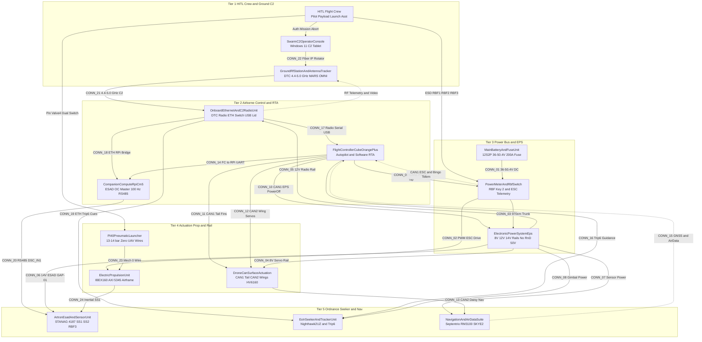
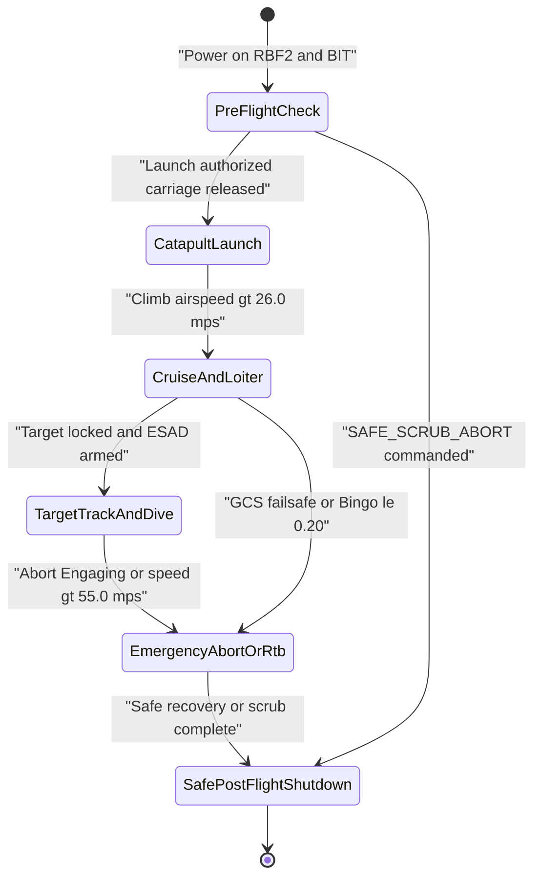
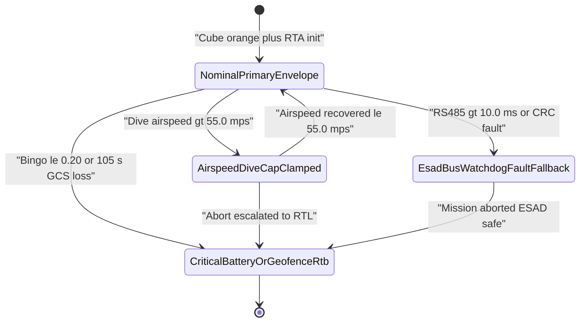
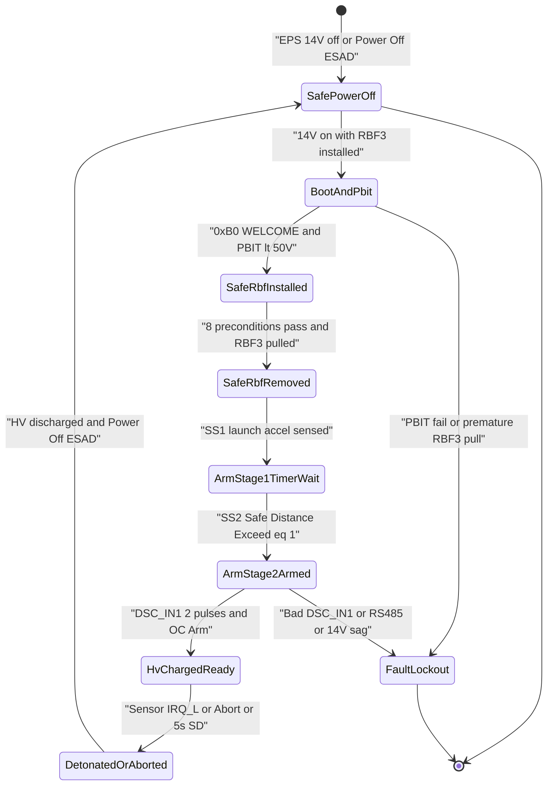
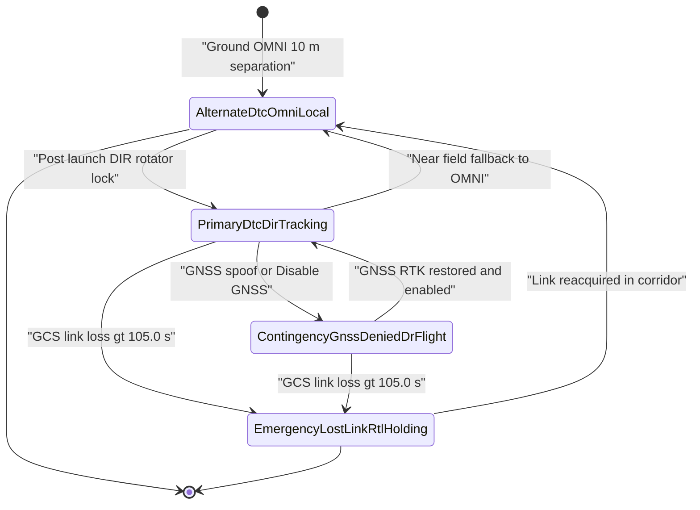
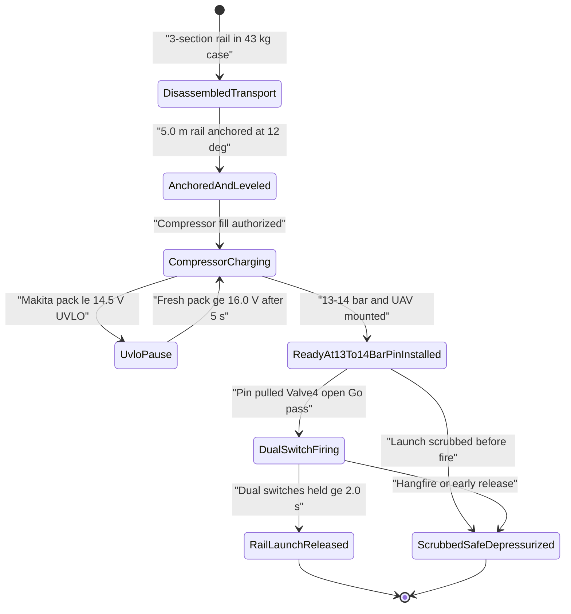
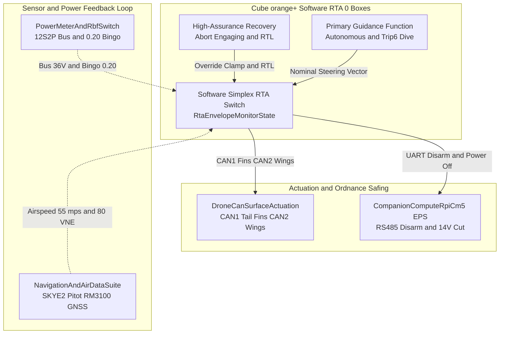

| Attribute | Value |
| :--- | :--- |
| **Title** | Unified 8-Pillar STPA Safety and Risk Analysis Matrix: Avenger 5 V2.5 UAS |
| **Version** | 1.0.0 |
| **Date** | 2026-11-16 |
| **System Baseline** | Avenger5V25UasSystem |

# Unified 8-Pillar STPA Safety & Risk Analysis Matrix: Avenger 5 V2.5 UAS

> **Primary Commercial Toolchain Integration Context:** MATLAB / Simulink / Stateflow / Embedded Coder / Simulink Design Verifier (SLDV)
> **Safety & Normative Standards:** ISO/IEC/IEEE 15026-3 | ASTM F3269-17 RTA (§5.2) | MIL-STD-882E (Tasks 202/205/206) | MIL-STD-1629A (Methods 101/102) | NATO STANAG 4187 Ed. 5 | MIL-STD-331D | MIL-STD-461G | MIL-STD-810H | RTCA DO-178C / DO-254 / DO-362A | SAE ARP4754A / ARP4761 | JARUS SORA v2.5 | NIST SP 800-82r3 | DoD Directive 3000.09
> **Architectural Truth Invariants:** Software-hosted ASTM F3269-17 Simplex RTA on `FlightControllerCubeOrangePlus` (`standaloneRtaBoxCount == 0`, `rtaHostedOnCubeOrangePlus == true`); strictly mechanical zero-wire `Pl40PneumaticLauncher` launch interface (`IF-MECH-001`, `CONN_23`); production exclusion of `Optional RnD 2x 50.0 V` recovery igniters (`rndRecoveryOptionInstalled == false`); `12S2P` `36.0-50.4 V` (`49.0-50.0 V` pre-flight) DC bus baseline (`GAP-05`).

---

## 1. System-Level Losses (**REQ_L_01..04** & **L-1**)

### 1.1 Normative System Losses (`REQ_L_01..04`)

| Requirement ID | Loss Description | Severity | Triggered By Hazards | Primary `RESEARCH_INVENTORY.md` Anchor |
| :--- | :--- | :--- | :--- | :--- |
| `REQ_L_01` | Loss L1: Human fatality or severe crew injury from unintended warhead detonation or unrestrained PL-40 launch discharge. | Catastrophic | `REQ_H_01`, `REQ_H_04`, `REQ_H_06` | `SAF-01`, `SAF-02`, `MET-04`, `EXT-01`, `EXT-02` |
| `REQ_L_02` | Loss L2: Uncontrolled airframe crash or hull destruction outside authorized engagement corridor. | Catastrophic | `REQ_H_01`, `REQ_H_02`, `REQ_H_03`, `REQ_H_06` | `SAF-02`, `SAF-03`, `MET-01`, `MET-02`, `CTL-01`, `CTL-04` |
| `REQ_L_03` | Loss L3: Unrecoverable loss of navigation or C2 mission control resulting in flyaway or inability to verify safe abort. | Hazardous | `REQ_H_02`, `REQ_H_03`, `REQ_H_05` | `OBL-04`, `SAF-02`, `CTL-02`, `CTL-03` |
| `REQ_L_04` | Loss L4: Unintended warhead detonation during ground handling/launch or collateral impact outside authorized target. | Catastrophic | `REQ_H_04`, `REQ_H_05` | `SAF-01`, `SAF-02`, `MET-03`, `CTL-03` |

### 1.2 Root Composition Loss (`L-1`)

| Loss ID | Description |
| :--- | :--- |
| L-1 | Loss of safe function of Avenger5V25IntegratedSystem |

---

## 2. System-Level Hazards (**REQ_H_01..06** & **H-1..19**)

### 2.1 Normative System Hazards (`REQ_H_01..06`)

| Requirement ID | Hazard Description | Severity | Linked System Losses | Governing Engineering Gaps & Constraints |
| :--- | :--- | :--- | :--- | :--- |
| `REQ_H_01` | Hazard H1: Premature propulsion energization, reversed RBF sequencing, or insufficient launch airspeed (`< 24.0-26.0 m/s`) during handling or launch. | Catastrophic | `REQ_L_01`, `REQ_L_02` | `GAP-03`, `GAP-05`, `GAP-06`, `MainBatteryPreFlightVoltageConstraint`, `ProductionNoParachuteConstraint` |
| `REQ_H_02` | Hazard H2: In-flight propulsion loss, main bus sag below `36.0 V`, EPS `14.0 V` ESAD brownout (`GAP-01`), or Bingo reserve exhaustion (`< 0.20`). | Hazardous | `REQ_L_02`, `REQ_L_03` | `GAP-01`, `GAP-05`, `GAP-ENV`, `BingoEnergyReserveConstraint`, `EpsEsadZeroBrownoutMarginConstraint` |
| `REQ_H_03` | Hazard H3: Loss of flight control authority due to RTA envelope exceedance (`> 55.0/80.0 m/s`), `CAN 1`/`CAN 2` bus saturation, or unflagged pitot/mag corruption. | Catastrophic | `REQ_L_02`, `REQ_L_03` | `GAP-02`, `GAP-04`, `GAP-WCET`, `SimplexRtaSoftwareHostingConstraint`, `CanTopologyIsolationConstraint` |
| `REQ_H_04` | Hazard H4: Artron ESAD premature arming, HV `>= 50.0 V` during PBIT, premature `DSC_IN1` fault, or out-of-order `RBF #3` removal. | Catastrophic | `REQ_L_01`, `REQ_L_04` | `GAP-04`, `GAP-06`, `GAP-07`, `EsadRbf3PowerBeforePullConstraint`, `EsadSafeDistanceExceedConstraint` |
| `REQ_H_05` | Hazard H5: EO/IR gimbal saturation above `55.0 m/s` dive speed or prolonged C2 link loss while warhead is armed. | Catastrophic | `REQ_L_03`, `REQ_L_04` | `GAP-02`, `GAP-WCET`, `EngagementSpeedAndTrackHoldConstraint`, `FlightEnvelopeSpeedConstraint` |
| `REQ_H_06` | Hazard H6: Uncontrolled PL-40 rail discharge, `> 25.0 m/s` over-velocity (`< 15 kg` at `14 bar`), sub-stall exit (`< 24.0-26.0 m/s`), or unbleed hangfire crew approach. | Catastrophic | `REQ_L_01`, `REQ_L_02` | `GAP-03`, `GAP-SEPDIST`, `GAP-SCRUB`, `Pl40MassAndExitVelocityConstraint`, `Pl40UvloAndDualSwitchConstraint` |

### 2.2 AST Action-Bound System Hazards (`H-1..19`)

| Hazard ID | Associated Control Action | Controller |
| :--- | :--- | :--- |
| H-1 | ValidateBatteryAndPowerOnRbf2 | Avenger5V25IntegratedSystem |
| H-2 | CommandPusherThrottleAndReadEscTelem | Avenger5V25IntegratedSystem |
| H-3 | DistributeRegulatedPowerRails | Avenger5V25IntegratedSystem |
| H-4 | MonitorBingoEnergyReserve | Avenger5V25IntegratedSystem |
| H-5 | ExecuteSimplexRtaEnvelopeCheck | Avenger5V25IntegratedSystem |
| H-6 | RunPitotAndMagPreflightCheck | Avenger5V25IntegratedSystem |
| H-7 | SwitchToGnssDeniedDeadReckoning | Avenger5V25IntegratedSystem |
| H-8 | SuperviseEsadOcMasterCycle | Avenger5V25IntegratedSystem |
| H-9 | ActuateTailAndWingSurfaces | Avenger5V25IntegratedSystem |
| H-10 | ExecuteEsadBootAndPbit | Avenger5V25IntegratedSystem |
| H-11 | TransitionEsadArmingSequence | Avenger5V25IntegratedSystem |
| H-12 | CommandEsadAbortAndSelfDestruct | Avenger5V25IntegratedSystem |
| H-13 | AcquireAndTrackTerminalTarget | Avenger5V25IntegratedSystem |
| H-14 | RebootGimbalAndBridgeEthernet | Avenger5V25IntegratedSystem |
| H-15 | ChargePl40CompressorWithUvloCheck | Avenger5V25IntegratedSystem |
| H-16 | ExecuteLaunchGoNoGoAndDualTrigger | Avenger5V25IntegratedSystem |
| H-17 | DepressurizeAndScrubPl40Launcher | Avenger5V25IntegratedSystem |
| H-18 | AuthenticateOperatorAndCalibrateRotator | Avenger5V25IntegratedSystem |
| H-19 | ExportTargetReport5wCff | Avenger5V25IntegratedSystem |

---

## 3. Hierarchical Control Structure Topology & Interface Provenance

The Avenger 5 V2.5 control hierarchy spans five vertical control tiers across all `15` SysML `part def` assemblies and `24` `connection def` interfaces (`CONN_01..24`): (1) HITL Flight Crew and `SwarmC2OperatorConsole` / `GroundRfStationAndAntennaTracker` (`IF-GND-001`, `IF-RF-001`); (2) Airborne supervisory controllers `FlightControllerCubeOrangePlus` (Autopilot + Software ASTM F3269-17 Simplex RTA) and `CompanionComputeRpiCm5` (sole `100 Hz` RS-485 `OC Master`, `IF-ORD-001/002`) behind `OnboardEthernetAndC2RadioUnit`; (3) `MainBatteryAndFuseUnit`, `PowerMeterAndRbfSwitch`, and `ElectronicPowerSystemEps` (physically partitioned `CAN 1` vs `CAN 2`); (4) Effectors `DroneCanSurfaceActuation`, `ElectricPropulsionUnit`, and zero-wire `Pl40PneumaticLauncher` (`IF-MECH-001`); and (5) `ArtronEsadAndSensorUnit`, `EoIrSeekerAndTrackerUnit`, and `NavigationAndAirDataSuite` closed-loop sensor/air-data feedback.




---

## 4. Unsafe Control Actions (**REQ_UCA_01..08** & **UCA-001..076**)

### 4.1 Normative Unsafe Control Actions (`REQ_UCA_01..08`)

| Requirement ID | Controller / Operator | Guide Word (`ucaType`) | Unsafe Control Action Specification (`@TriggersHazard`) | Triggered Hazard | Realized By Safety Constraints |
| :--- | :--- | :--- | :--- | :--- | :--- |
| `REQ_UCA_01` | `HitlFlightCrew` / `PowerMeterAndRbfSwitch` | `Provided Out of Sequence` | Operator removes UAV Power `RBF #2` before `RBF #1` cover removal / rear prop folding, or before ESAD pre-arm sequence permits power-on (`GAP-06`). | `REQ_H_01` | `REQ_SC_01`, `REQ_SC_03` |
| `REQ_UCA_02` | `ElectronicPowerSystemEps` / `PowerMeterAndRbfSwitch` | `Not Provided` | EPS fails to sustain `14.0 V` ESAD supply under load (`GAP-01`) or Power Meter fails to signal Bingo reserve depletion below `0.20` (`1080.0 s` of `5400.0 s`). | `REQ_H_02` | `REQ_SC_02`, `REQ_SC_04` |
| `REQ_UCA_03` | `FlightControllerCubeOrangePlus` | `Not Provided` | `Cube orange+` Simplex RTA fails to abort dive above `55.0 m/s` (`GAP-02`) or fails to isolate corrupted airspeed/GNSS sensor data (`Disable GNSS` DR). | `REQ_H_03` | `REQ_SC_05`, `REQ_SC_06`, `REQ_SC_07` |
| `REQ_UCA_04` | `CompanionComputeRpiCm5` | `Provided Too Late` | `RPI CM5004032` stops `100 Hz` RS-485 ESAD heartbeat or exceeds `10.0 ms` frame timeout (`GAP-04`) without commanding safe ESAD disarm. | `REQ_H_03` | `REQ_SC_08` |
| `REQ_UCA_05` | `HitlFlightCrew` / `CompanionComputeRpiCm5` | `Provided Out of Sequence` | Operator removes `ESAD RBF #3` before UAV+ESAD power-on (`GAP-06`), or `RPI CM5` asserts `DSC_IN1` prior to `Arm Stage 2` (`FaultStates` bit 4). | `REQ_H_04` | `REQ_SC_09`, `REQ_SC_10` |
| `REQ_UCA_06` | `SwarmC2OperatorConsole` / `CompanionComputeRpiCm5` | `Provided Too Early` | `SwarmC2` or OC Master commands ESAD HV charging (`0x12 HIGHVOLTAGE`) before `SS1` launch acceleration and `SS2 Safe Distance Exceed == 1` (`GAP-07`). | `REQ_H_04` | `REQ_SC_11` |
| `REQ_UCA_07` | `FlightControllerCubeOrangePlus` / `EoIrSeekerAndTrackerUnit` | `Provided Unsafely` | Autopilot continues terminal engagement above `55.0 m/s` without `Abort Engaging`, or retains ESAD armed across `105.0 s` GCS failsafe timeout. | `REQ_H_05` | `REQ_SC_12` |
| `REQ_UCA_08` | `HitlFlightCrew` / `Pl40PneumaticLauncher` | `Provided Unsafely` | Crew triggers PL-40 outside `13.0-14.0 bar` / `<= 12.0 m/s` wind / `<= 25.0 m/s` exit bounds (`GAP-03`), or approaches hangfire rail without `SAFE_SCRUB_ABORT` (`GAP-SCRUB`). | `REQ_H_06` | `REQ_SC_13`, `REQ_SC_14`, `REQ_SC_15`, `REQ_SC_16` |

### 4.2 AST Combinatorial UCA Matrix (`UCA-001..076`)

Systematic identification across the 4 STPA guide word / failure mode categories:

1. **Not providing causes hazard**
2. **Providing causes hazard**
3. **Too early, too late, or out of order**
4. **Stopped too soon or applied too long**

Cartesian product of controlling part-def control actions across the
four canonical STPA guide-word categories.

| UCA ID | Controller | Control Action | Guide Word | Context | Hazard | Safety Constraint | Severity | Integrity Level |
| :--- | :--- | :--- | :--- | :--- | :--- | :--- | :--- | :--- |
| UCA-001 | Avenger5V25IntegratedSystem | ValidateBatteryAndPowerOnRbf2 | Not providing | Avenger5V25IntegratedSystem omits ValidateBatteryAndPowerOnRbf2 in active operational state across control interface while constraint MainBatteryPreFlightVoltageConstraint (in packVoltageV : Real && in busVoltageV : Real && attribute invariantExpr : String = "packVoltageV >= 49.0 and packVoltageV <= 50.0 and busVoltageV >= 36.0 and busVoltageV <= 50.4") demands intervention | H-1 | SC-001 | Catastrophic (Derived) | SIL-3 (Derived) |
| UCA-002 | Avenger5V25IntegratedSystem | ValidateBatteryAndPowerOnRbf2 | Providing | Avenger5V25IntegratedSystem issues ValidateBatteryAndPowerOnRbf2 in active operational state across control interface violating constraint BingoEnergyReserveConstraint (in reserveRatio : Real && attribute invariantExpr : String = "reserveRatio >= 0.20") | H-1 | SC-002 | Catastrophic (Derived) | SIL-3 (Derived) |
| UCA-003 | Avenger5V25IntegratedSystem | ValidateBatteryAndPowerOnRbf2 | Too early / Too late / Out of order | Avenger5V25IntegratedSystem dispatches ValidateBatteryAndPowerOnRbf2 out of temporal sequence in active operational state via control interface relative to constraint FlightEnvelopeSpeedConstraint (in airspeedMs : Real && in engagementActive : Boolean && attribute invariantExpr : String = "airspeedMs >= 24.0 and airspeedMs <= 80.0 and (not engagementActive or airspeedMs <= 55.0)") | H-1 | SC-003 | Critical (Derived) | SIL-2 (Derived) |
| UCA-004 | Avenger5V25IntegratedSystem | ValidateBatteryAndPowerOnRbf2 | Stopped too soon / Applied too long | Avenger5V25IntegratedSystem prematurely halts or latches ValidateBatteryAndPowerOnRbf2 in active operational state on control interface against constraint EpsEsadZeroBrownoutMarginConstraint (in epsEsadOutV : Real && attribute invariantExpr : String = "epsEsadOutV >= 14.0 and epsEsadOutV <= 32.0") | H-1 | SC-004 | Critical (Derived) | SIL-2 (Derived) |
| UCA-005 | Avenger5V25IntegratedSystem | CommandPusherThrottleAndReadEscTelem | Not providing | Avenger5V25IntegratedSystem omits CommandPusherThrottleAndReadEscTelem in active operational state across control interface while constraint ProductionNoParachuteConstraint (in rndRecoveryOptionInstalled : Boolean && attribute invariantExpr : String = "rndRecoveryOptionInstalled == false") demands intervention | H-2 | SC-005 | Catastrophic (Derived) | SIL-3 (Derived) |
| UCA-006 | Avenger5V25IntegratedSystem | CommandPusherThrottleAndReadEscTelem | Providing | Avenger5V25IntegratedSystem issues CommandPusherThrottleAndReadEscTelem in active operational state across control interface violating constraint PitotPreflightCalibrationConstraint (in calmAirMs : Real && in blownAirMs : Real && attribute invariantExpr : String = "calmAirMs <= 3.0 and blownAirMs >= 10.0") | H-2 | SC-006 | Catastrophic (Derived) | SIL-3 (Derived) |
| UCA-007 | Avenger5V25IntegratedSystem | CommandPusherThrottleAndReadEscTelem | Too early / Too late / Out of order | Avenger5V25IntegratedSystem dispatches CommandPusherThrottleAndReadEscTelem out of temporal sequence in active operational state via control interface relative to constraint CanTopologyIsolationConstraint (in finCount : Integer && in wingCount : Integer && in magCount : Integer && in stubLenCm : Real && attribute invariantExpr : String = "finCount == 4 and wingCount == 4 and magCount == 2 and stubLenCm == 120.0") | H-2 | SC-007 | Critical (Derived) | SIL-2 (Derived) |
| UCA-008 | Avenger5V25IntegratedSystem | CommandPusherThrottleAndReadEscTelem | Stopped too soon / Applied too long | Avenger5V25IntegratedSystem prematurely halts or latches CommandPusherThrottleAndReadEscTelem in active operational state on control interface against constraint SimplexRtaSoftwareHostingConstraint (in standaloneRtaBoxCount : Integer && in rtaHostedOnCubeOrangePlus : Boolean && attribute invariantExpr : String = "standaloneRtaBoxCount == 0 and rtaHostedOnCubeOrangePlus == true") | H-2 | SC-008 | Critical (Derived) | SIL-2 (Derived) |
| UCA-009 | Avenger5V25IntegratedSystem | DistributeRegulatedPowerRails | Not providing | Avenger5V25IntegratedSystem omits DistributeRegulatedPowerRails in active operational state across control interface while constraint EsadInputVoltageAndBrownoutConstraint (in vdcInV : Real && attribute invariantExpr : String = "vdcInV >= 14.0 and vdcInV <= 32.0") demands intervention | H-3 | SC-009 | Catastrophic (Derived) | SIL-3 (Derived) |
| UCA-010 | Avenger5V25IntegratedSystem | DistributeRegulatedPowerRails | Providing | Avenger5V25IntegratedSystem issues DistributeRegulatedPowerRails in active operational state across control interface violating constraint EsadRs485ProtocolTimingConstraint (in baudBps : Integer && in pollHz : Real && in replyMs : Real && in timeoutMs : Real && attribute invariantExpr : String = "baudBps == 115200 and pollHz == 100.0 and replyMs <= 5.0 and timeoutMs <= 10.0") | H-3 | SC-010 | Catastrophic (Derived) | SIL-3 (Derived) |
| UCA-011 | Avenger5V25IntegratedSystem | DistributeRegulatedPowerRails | Too early / Too late / Out of order | Avenger5V25IntegratedSystem dispatches DistributeRegulatedPowerRails out of temporal sequence in active operational state via control interface relative to constraint EsadRbf3PowerBeforePullConstraint (in uavPoweredBeforeRbf3Pull : Boolean && in umbResistanceOhm : Real && attribute invariantExpr : String = "uavPoweredBeforeRbf3Pull == true and umbResistanceOhm < 0.5") | H-3 | SC-011 | Critical (Derived) | SIL-2 (Derived) |
| UCA-012 | Avenger5V25IntegratedSystem | DistributeRegulatedPowerRails | Stopped too soon / Applied too long | Avenger5V25IntegratedSystem prematurely halts or latches DistributeRegulatedPowerRails in active operational state on control interface against constraint EsadSafeDistanceExceedConstraint (in safeDistanceExceeded : Boolean && in ss1Sensed : Boolean && attribute invariantExpr : String = "safeDistanceExceeded == true and ss1Sensed == true") | H-3 | SC-012 | Critical (Derived) | SIL-2 (Derived) |
| UCA-013 | Avenger5V25IntegratedSystem | MonitorBingoEnergyReserve | Not providing | Avenger5V25IntegratedSystem omits MonitorBingoEnergyReserve in active operational state across control interface while constraint WarheadMassAndPbitHvSafetyConstraint (in warheadMassKg : Real && in pbitHvV : Real && in fireHvV : Real && attribute invariantExpr : String = "warheadMassKg <= 5.0 and pbitHvV < 50.0 and fireHvV >= 0.0 and fireHvV <= 1800.0") demands intervention | H-4 | SC-013 | Catastrophic (Derived) | SIL-3 (Derived) |
| UCA-014 | Avenger5V25IntegratedSystem | MonitorBingoEnergyReserve | Providing | Avenger5V25IntegratedSystem issues MonitorBingoEnergyReserve in active operational state across control interface violating constraint EngagementSpeedAndTrackHoldConstraint (in airspeedMs : Real && in trackHoldSec : Real && in cepM : Real && attribute invariantExpr : String = "airspeedMs <= 55.0 and trackHoldSec >= 2.0 and trackHoldSec <= 5.0 and cepM <= 0.5") | H-4 | SC-014 | Catastrophic (Derived) | SIL-3 (Derived) |
| UCA-015 | Avenger5V25IntegratedSystem | MonitorBingoEnergyReserve | Too early / Too late / Out of order | Avenger5V25IntegratedSystem dispatches MonitorBingoEnergyReserve out of temporal sequence in active operational state via control interface relative to constraint Pl40MassAndExitVelocityConstraint (in uavMassKg : Real && in pressureBar : Real && in exitVelMs : Real && in windMs : Real && attribute invariantExpr : String = "uavMassKg <= 30.0 and pressureBar >= 13.0 and pressureBar <= 14.0 and exitVelMs <= 25.0 and windMs <= 12.0") | H-4 | SC-015 | Critical (Derived) | SIL-2 (Derived) |
| UCA-016 | Avenger5V25IntegratedSystem | MonitorBingoEnergyReserve | Stopped too soon / Applied too long | Avenger5V25IntegratedSystem prematurely halts or latches MonitorBingoEnergyReserve in active operational state on control interface against constraint Pl40UvloAndDualSwitchConstraint (in packVoltageV : Real && in dualHoldSec : Real && attribute invariantExpr : String = "packVoltageV > 14.5 and dualHoldSec >= 2.0") | H-4 | SC-016 | Critical (Derived) | SIL-2 (Derived) |
| UCA-017 | Avenger5V25IntegratedSystem | ExecuteSimplexRtaEnvelopeCheck | Not providing | Avenger5V25IntegratedSystem omits ExecuteSimplexRtaEnvelopeCheck in active operational state across control interface while constraint SwarmC2AuthAndMissionBoundsConstraint (in passwordLen : Integer && in missionNameLen : Integer && in waypointAltM : Real && in loiterRadiusM : Real && attribute invariantExpr : String = "passwordLen >= 8 and missionNameLen <= 24 and waypointAltM >= 50.0 and waypointAltM <= 3000.0 and loiterRadiusM >= 300.0") demands intervention | H-5 | SC-017 | Catastrophic (Derived) | SIL-3 (Derived) |
| UCA-018 | Avenger5V25IntegratedSystem | ExecuteSimplexRtaEnvelopeCheck | Providing | Avenger5V25IntegratedSystem issues ExecuteSimplexRtaEnvelopeCheck in active operational state across control interface violating constraint GroundCrewSeparationAndEsdConstraint (in esdGrounded : Boolean && in separationM : Real && attribute invariantExpr : String = "esdGrounded == true and separationM >= 10.0") | H-5 | SC-018 | Catastrophic (Derived) | SIL-3 (Derived) |
| UCA-019 | Avenger5V25IntegratedSystem | ExecuteSimplexRtaEnvelopeCheck | Too early / Too late / Out of order | Avenger5V25IntegratedSystem dispatches ExecuteSimplexRtaEnvelopeCheck out of temporal sequence in active operational state via control interface relative to constraint MainBatteryPreFlightVoltageConstraint (in packVoltageV : Real && in busVoltageV : Real && attribute invariantExpr : String = "packVoltageV >= 49.0 and packVoltageV <= 50.0 and busVoltageV >= 36.0 and busVoltageV <= 50.4") | H-5 | SC-019 | Critical (Derived) | SIL-2 (Derived) |
| UCA-020 | Avenger5V25IntegratedSystem | ExecuteSimplexRtaEnvelopeCheck | Stopped too soon / Applied too long | Avenger5V25IntegratedSystem prematurely halts or latches ExecuteSimplexRtaEnvelopeCheck in active operational state on control interface against constraint BingoEnergyReserveConstraint (in reserveRatio : Real && attribute invariantExpr : String = "reserveRatio >= 0.20") | H-5 | SC-020 | Critical (Derived) | SIL-2 (Derived) |
| UCA-021 | Avenger5V25IntegratedSystem | RunPitotAndMagPreflightCheck | Not providing | Avenger5V25IntegratedSystem omits RunPitotAndMagPreflightCheck in active operational state across control interface while constraint FlightEnvelopeSpeedConstraint (in airspeedMs : Real && in engagementActive : Boolean && attribute invariantExpr : String = "airspeedMs >= 24.0 and airspeedMs <= 80.0 and (not engagementActive or airspeedMs <= 55.0)") demands intervention | H-6 | SC-021 | Catastrophic (Derived) | SIL-3 (Derived) |
| UCA-022 | Avenger5V25IntegratedSystem | RunPitotAndMagPreflightCheck | Providing | Avenger5V25IntegratedSystem issues RunPitotAndMagPreflightCheck in active operational state across control interface violating constraint EpsEsadZeroBrownoutMarginConstraint (in epsEsadOutV : Real && attribute invariantExpr : String = "epsEsadOutV >= 14.0 and epsEsadOutV <= 32.0") | H-6 | SC-022 | Catastrophic (Derived) | SIL-3 (Derived) |
| UCA-023 | Avenger5V25IntegratedSystem | RunPitotAndMagPreflightCheck | Too early / Too late / Out of order | Avenger5V25IntegratedSystem dispatches RunPitotAndMagPreflightCheck out of temporal sequence in active operational state via control interface relative to constraint ProductionNoParachuteConstraint (in rndRecoveryOptionInstalled : Boolean && attribute invariantExpr : String = "rndRecoveryOptionInstalled == false") | H-6 | SC-023 | Critical (Derived) | SIL-2 (Derived) |
| UCA-024 | Avenger5V25IntegratedSystem | RunPitotAndMagPreflightCheck | Stopped too soon / Applied too long | Avenger5V25IntegratedSystem prematurely halts or latches RunPitotAndMagPreflightCheck in active operational state on control interface against constraint PitotPreflightCalibrationConstraint (in calmAirMs : Real && in blownAirMs : Real && attribute invariantExpr : String = "calmAirMs <= 3.0 and blownAirMs >= 10.0") | H-6 | SC-024 | Critical (Derived) | SIL-2 (Derived) |
| UCA-025 | Avenger5V25IntegratedSystem | SwitchToGnssDeniedDeadReckoning | Not providing | Avenger5V25IntegratedSystem omits SwitchToGnssDeniedDeadReckoning in active operational state across control interface while constraint CanTopologyIsolationConstraint (in finCount : Integer && in wingCount : Integer && in magCount : Integer && in stubLenCm : Real && attribute invariantExpr : String = "finCount == 4 and wingCount == 4 and magCount == 2 and stubLenCm == 120.0") demands intervention | H-7 | SC-025 | Catastrophic (Derived) | SIL-3 (Derived) |
| UCA-026 | Avenger5V25IntegratedSystem | SwitchToGnssDeniedDeadReckoning | Providing | Avenger5V25IntegratedSystem issues SwitchToGnssDeniedDeadReckoning in active operational state across control interface violating constraint SimplexRtaSoftwareHostingConstraint (in standaloneRtaBoxCount : Integer && in rtaHostedOnCubeOrangePlus : Boolean && attribute invariantExpr : String = "standaloneRtaBoxCount == 0 and rtaHostedOnCubeOrangePlus == true") | H-7 | SC-026 | Catastrophic (Derived) | SIL-3 (Derived) |
| UCA-027 | Avenger5V25IntegratedSystem | SwitchToGnssDeniedDeadReckoning | Too early / Too late / Out of order | Avenger5V25IntegratedSystem dispatches SwitchToGnssDeniedDeadReckoning out of temporal sequence in active operational state via control interface relative to constraint EsadInputVoltageAndBrownoutConstraint (in vdcInV : Real && attribute invariantExpr : String = "vdcInV >= 14.0 and vdcInV <= 32.0") | H-7 | SC-027 | Critical (Derived) | SIL-2 (Derived) |
| UCA-028 | Avenger5V25IntegratedSystem | SwitchToGnssDeniedDeadReckoning | Stopped too soon / Applied too long | Avenger5V25IntegratedSystem prematurely halts or latches SwitchToGnssDeniedDeadReckoning in active operational state on control interface against constraint EsadRs485ProtocolTimingConstraint (in baudBps : Integer && in pollHz : Real && in replyMs : Real && in timeoutMs : Real && attribute invariantExpr : String = "baudBps == 115200 and pollHz == 100.0 and replyMs <= 5.0 and timeoutMs <= 10.0") | H-7 | SC-028 | Critical (Derived) | SIL-2 (Derived) |
| UCA-029 | Avenger5V25IntegratedSystem | SuperviseEsadOcMasterCycle | Not providing | Avenger5V25IntegratedSystem omits SuperviseEsadOcMasterCycle in active operational state across control interface while constraint EsadRbf3PowerBeforePullConstraint (in uavPoweredBeforeRbf3Pull : Boolean && in umbResistanceOhm : Real && attribute invariantExpr : String = "uavPoweredBeforeRbf3Pull == true and umbResistanceOhm < 0.5") demands intervention | H-8 | SC-029 | Catastrophic (Derived) | SIL-3 (Derived) |
| UCA-030 | Avenger5V25IntegratedSystem | SuperviseEsadOcMasterCycle | Providing | Avenger5V25IntegratedSystem issues SuperviseEsadOcMasterCycle in active operational state across control interface violating constraint EsadSafeDistanceExceedConstraint (in safeDistanceExceeded : Boolean && in ss1Sensed : Boolean && attribute invariantExpr : String = "safeDistanceExceeded == true and ss1Sensed == true") | H-8 | SC-030 | Catastrophic (Derived) | SIL-3 (Derived) |
| UCA-031 | Avenger5V25IntegratedSystem | SuperviseEsadOcMasterCycle | Too early / Too late / Out of order | Avenger5V25IntegratedSystem dispatches SuperviseEsadOcMasterCycle out of temporal sequence in active operational state via control interface relative to constraint WarheadMassAndPbitHvSafetyConstraint (in warheadMassKg : Real && in pbitHvV : Real && in fireHvV : Real && attribute invariantExpr : String = "warheadMassKg <= 5.0 and pbitHvV < 50.0 and fireHvV >= 0.0 and fireHvV <= 1800.0") | H-8 | SC-031 | Critical (Derived) | SIL-2 (Derived) |
| UCA-032 | Avenger5V25IntegratedSystem | SuperviseEsadOcMasterCycle | Stopped too soon / Applied too long | Avenger5V25IntegratedSystem prematurely halts or latches SuperviseEsadOcMasterCycle in active operational state on control interface against constraint EngagementSpeedAndTrackHoldConstraint (in airspeedMs : Real && in trackHoldSec : Real && in cepM : Real && attribute invariantExpr : String = "airspeedMs <= 55.0 and trackHoldSec >= 2.0 and trackHoldSec <= 5.0 and cepM <= 0.5") | H-8 | SC-032 | Critical (Derived) | SIL-2 (Derived) |
| UCA-033 | Avenger5V25IntegratedSystem | ActuateTailAndWingSurfaces | Not providing | Avenger5V25IntegratedSystem omits ActuateTailAndWingSurfaces in active operational state across control interface while constraint Pl40MassAndExitVelocityConstraint (in uavMassKg : Real && in pressureBar : Real && in exitVelMs : Real && in windMs : Real && attribute invariantExpr : String = "uavMassKg <= 30.0 and pressureBar >= 13.0 and pressureBar <= 14.0 and exitVelMs <= 25.0 and windMs <= 12.0") demands intervention | H-9 | SC-033 | Catastrophic (Derived) | SIL-3 (Derived) |
| UCA-034 | Avenger5V25IntegratedSystem | ActuateTailAndWingSurfaces | Providing | Avenger5V25IntegratedSystem issues ActuateTailAndWingSurfaces in active operational state across control interface violating constraint Pl40UvloAndDualSwitchConstraint (in packVoltageV : Real && in dualHoldSec : Real && attribute invariantExpr : String = "packVoltageV > 14.5 and dualHoldSec >= 2.0") | H-9 | SC-034 | Catastrophic (Derived) | SIL-3 (Derived) |
| UCA-035 | Avenger5V25IntegratedSystem | ActuateTailAndWingSurfaces | Too early / Too late / Out of order | Avenger5V25IntegratedSystem dispatches ActuateTailAndWingSurfaces out of temporal sequence in active operational state via control interface relative to constraint SwarmC2AuthAndMissionBoundsConstraint (in passwordLen : Integer && in missionNameLen : Integer && in waypointAltM : Real && in loiterRadiusM : Real && attribute invariantExpr : String = "passwordLen >= 8 and missionNameLen <= 24 and waypointAltM >= 50.0 and waypointAltM <= 3000.0 and loiterRadiusM >= 300.0") | H-9 | SC-035 | Critical (Derived) | SIL-2 (Derived) |
| UCA-036 | Avenger5V25IntegratedSystem | ActuateTailAndWingSurfaces | Stopped too soon / Applied too long | Avenger5V25IntegratedSystem prematurely halts or latches ActuateTailAndWingSurfaces in active operational state on control interface against constraint GroundCrewSeparationAndEsdConstraint (in esdGrounded : Boolean && in separationM : Real && attribute invariantExpr : String = "esdGrounded == true and separationM >= 10.0") | H-9 | SC-036 | Critical (Derived) | SIL-2 (Derived) |
| UCA-037 | Avenger5V25IntegratedSystem | ExecuteEsadBootAndPbit | Not providing | Avenger5V25IntegratedSystem omits ExecuteEsadBootAndPbit in active operational state across control interface while constraint MainBatteryPreFlightVoltageConstraint (in packVoltageV : Real && in busVoltageV : Real && attribute invariantExpr : String = "packVoltageV >= 49.0 and packVoltageV <= 50.0 and busVoltageV >= 36.0 and busVoltageV <= 50.4") demands intervention | H-10 | SC-037 | Catastrophic (Derived) | SIL-3 (Derived) |
| UCA-038 | Avenger5V25IntegratedSystem | ExecuteEsadBootAndPbit | Providing | Avenger5V25IntegratedSystem issues ExecuteEsadBootAndPbit in active operational state across control interface violating constraint BingoEnergyReserveConstraint (in reserveRatio : Real && attribute invariantExpr : String = "reserveRatio >= 0.20") | H-10 | SC-038 | Catastrophic (Derived) | SIL-3 (Derived) |
| UCA-039 | Avenger5V25IntegratedSystem | ExecuteEsadBootAndPbit | Too early / Too late / Out of order | Avenger5V25IntegratedSystem dispatches ExecuteEsadBootAndPbit out of temporal sequence in active operational state via control interface relative to constraint FlightEnvelopeSpeedConstraint (in airspeedMs : Real && in engagementActive : Boolean && attribute invariantExpr : String = "airspeedMs >= 24.0 and airspeedMs <= 80.0 and (not engagementActive or airspeedMs <= 55.0)") | H-10 | SC-039 | Critical (Derived) | SIL-2 (Derived) |
| UCA-040 | Avenger5V25IntegratedSystem | ExecuteEsadBootAndPbit | Stopped too soon / Applied too long | Avenger5V25IntegratedSystem prematurely halts or latches ExecuteEsadBootAndPbit in active operational state on control interface against constraint EpsEsadZeroBrownoutMarginConstraint (in epsEsadOutV : Real && attribute invariantExpr : String = "epsEsadOutV >= 14.0 and epsEsadOutV <= 32.0") | H-10 | SC-040 | Critical (Derived) | SIL-2 (Derived) |
| UCA-041 | Avenger5V25IntegratedSystem | TransitionEsadArmingSequence | Not providing | Avenger5V25IntegratedSystem omits TransitionEsadArmingSequence in active operational state across control interface while constraint ProductionNoParachuteConstraint (in rndRecoveryOptionInstalled : Boolean && attribute invariantExpr : String = "rndRecoveryOptionInstalled == false") demands intervention | H-11 | SC-041 | Catastrophic (Derived) | SIL-3 (Derived) |
| UCA-042 | Avenger5V25IntegratedSystem | TransitionEsadArmingSequence | Providing | Avenger5V25IntegratedSystem issues TransitionEsadArmingSequence in active operational state across control interface violating constraint PitotPreflightCalibrationConstraint (in calmAirMs : Real && in blownAirMs : Real && attribute invariantExpr : String = "calmAirMs <= 3.0 and blownAirMs >= 10.0") | H-11 | SC-042 | Catastrophic (Derived) | SIL-3 (Derived) |
| UCA-043 | Avenger5V25IntegratedSystem | TransitionEsadArmingSequence | Too early / Too late / Out of order | Avenger5V25IntegratedSystem dispatches TransitionEsadArmingSequence out of temporal sequence in active operational state via control interface relative to constraint CanTopologyIsolationConstraint (in finCount : Integer && in wingCount : Integer && in magCount : Integer && in stubLenCm : Real && attribute invariantExpr : String = "finCount == 4 and wingCount == 4 and magCount == 2 and stubLenCm == 120.0") | H-11 | SC-043 | Critical (Derived) | SIL-2 (Derived) |
| UCA-044 | Avenger5V25IntegratedSystem | TransitionEsadArmingSequence | Stopped too soon / Applied too long | Avenger5V25IntegratedSystem prematurely halts or latches TransitionEsadArmingSequence in active operational state on control interface against constraint SimplexRtaSoftwareHostingConstraint (in standaloneRtaBoxCount : Integer && in rtaHostedOnCubeOrangePlus : Boolean && attribute invariantExpr : String = "standaloneRtaBoxCount == 0 and rtaHostedOnCubeOrangePlus == true") | H-11 | SC-044 | Critical (Derived) | SIL-2 (Derived) |
| UCA-045 | Avenger5V25IntegratedSystem | CommandEsadAbortAndSelfDestruct | Not providing | Avenger5V25IntegratedSystem omits CommandEsadAbortAndSelfDestruct in active operational state across control interface while constraint EsadInputVoltageAndBrownoutConstraint (in vdcInV : Real && attribute invariantExpr : String = "vdcInV >= 14.0 and vdcInV <= 32.0") demands intervention | H-12 | SC-045 | Catastrophic (Derived) | SIL-3 (Derived) |
| UCA-046 | Avenger5V25IntegratedSystem | CommandEsadAbortAndSelfDestruct | Providing | Avenger5V25IntegratedSystem issues CommandEsadAbortAndSelfDestruct in active operational state across control interface violating constraint EsadRs485ProtocolTimingConstraint (in baudBps : Integer && in pollHz : Real && in replyMs : Real && in timeoutMs : Real && attribute invariantExpr : String = "baudBps == 115200 and pollHz == 100.0 and replyMs <= 5.0 and timeoutMs <= 10.0") | H-12 | SC-046 | Catastrophic (Derived) | SIL-3 (Derived) |
| UCA-047 | Avenger5V25IntegratedSystem | CommandEsadAbortAndSelfDestruct | Too early / Too late / Out of order | Avenger5V25IntegratedSystem dispatches CommandEsadAbortAndSelfDestruct out of temporal sequence in active operational state via control interface relative to constraint EsadRbf3PowerBeforePullConstraint (in uavPoweredBeforeRbf3Pull : Boolean && in umbResistanceOhm : Real && attribute invariantExpr : String = "uavPoweredBeforeRbf3Pull == true and umbResistanceOhm < 0.5") | H-12 | SC-047 | Critical (Derived) | SIL-2 (Derived) |
| UCA-048 | Avenger5V25IntegratedSystem | CommandEsadAbortAndSelfDestruct | Stopped too soon / Applied too long | Avenger5V25IntegratedSystem prematurely halts or latches CommandEsadAbortAndSelfDestruct in active operational state on control interface against constraint EsadSafeDistanceExceedConstraint (in safeDistanceExceeded : Boolean && in ss1Sensed : Boolean && attribute invariantExpr : String = "safeDistanceExceeded == true and ss1Sensed == true") | H-12 | SC-048 | Critical (Derived) | SIL-2 (Derived) |
| UCA-049 | Avenger5V25IntegratedSystem | AcquireAndTrackTerminalTarget | Not providing | Avenger5V25IntegratedSystem omits AcquireAndTrackTerminalTarget in active operational state across control interface while constraint WarheadMassAndPbitHvSafetyConstraint (in warheadMassKg : Real && in pbitHvV : Real && in fireHvV : Real && attribute invariantExpr : String = "warheadMassKg <= 5.0 and pbitHvV < 50.0 and fireHvV >= 0.0 and fireHvV <= 1800.0") demands intervention | H-13 | SC-049 | Catastrophic (Derived) | SIL-3 (Derived) |
| UCA-050 | Avenger5V25IntegratedSystem | AcquireAndTrackTerminalTarget | Providing | Avenger5V25IntegratedSystem issues AcquireAndTrackTerminalTarget in active operational state across control interface violating constraint EngagementSpeedAndTrackHoldConstraint (in airspeedMs : Real && in trackHoldSec : Real && in cepM : Real && attribute invariantExpr : String = "airspeedMs <= 55.0 and trackHoldSec >= 2.0 and trackHoldSec <= 5.0 and cepM <= 0.5") | H-13 | SC-050 | Catastrophic (Derived) | SIL-3 (Derived) |
| UCA-051 | Avenger5V25IntegratedSystem | AcquireAndTrackTerminalTarget | Too early / Too late / Out of order | Avenger5V25IntegratedSystem dispatches AcquireAndTrackTerminalTarget out of temporal sequence in active operational state via control interface relative to constraint Pl40MassAndExitVelocityConstraint (in uavMassKg : Real && in pressureBar : Real && in exitVelMs : Real && in windMs : Real && attribute invariantExpr : String = "uavMassKg <= 30.0 and pressureBar >= 13.0 and pressureBar <= 14.0 and exitVelMs <= 25.0 and windMs <= 12.0") | H-13 | SC-051 | Critical (Derived) | SIL-2 (Derived) |
| UCA-052 | Avenger5V25IntegratedSystem | AcquireAndTrackTerminalTarget | Stopped too soon / Applied too long | Avenger5V25IntegratedSystem prematurely halts or latches AcquireAndTrackTerminalTarget in active operational state on control interface against constraint Pl40UvloAndDualSwitchConstraint (in packVoltageV : Real && in dualHoldSec : Real && attribute invariantExpr : String = "packVoltageV > 14.5 and dualHoldSec >= 2.0") | H-13 | SC-052 | Critical (Derived) | SIL-2 (Derived) |
| UCA-053 | Avenger5V25IntegratedSystem | RebootGimbalAndBridgeEthernet | Not providing | Avenger5V25IntegratedSystem omits RebootGimbalAndBridgeEthernet in active operational state across control interface while constraint SwarmC2AuthAndMissionBoundsConstraint (in passwordLen : Integer && in missionNameLen : Integer && in waypointAltM : Real && in loiterRadiusM : Real && attribute invariantExpr : String = "passwordLen >= 8 and missionNameLen <= 24 and waypointAltM >= 50.0 and waypointAltM <= 3000.0 and loiterRadiusM >= 300.0") demands intervention | H-14 | SC-053 | Catastrophic (Derived) | SIL-3 (Derived) |
| UCA-054 | Avenger5V25IntegratedSystem | RebootGimbalAndBridgeEthernet | Providing | Avenger5V25IntegratedSystem issues RebootGimbalAndBridgeEthernet in active operational state across control interface violating constraint GroundCrewSeparationAndEsdConstraint (in esdGrounded : Boolean && in separationM : Real && attribute invariantExpr : String = "esdGrounded == true and separationM >= 10.0") | H-14 | SC-054 | Catastrophic (Derived) | SIL-3 (Derived) |
| UCA-055 | Avenger5V25IntegratedSystem | RebootGimbalAndBridgeEthernet | Too early / Too late / Out of order | Avenger5V25IntegratedSystem dispatches RebootGimbalAndBridgeEthernet out of temporal sequence in active operational state via control interface relative to constraint MainBatteryPreFlightVoltageConstraint (in packVoltageV : Real && in busVoltageV : Real && attribute invariantExpr : String = "packVoltageV >= 49.0 and packVoltageV <= 50.0 and busVoltageV >= 36.0 and busVoltageV <= 50.4") | H-14 | SC-055 | Critical (Derived) | SIL-2 (Derived) |
| UCA-056 | Avenger5V25IntegratedSystem | RebootGimbalAndBridgeEthernet | Stopped too soon / Applied too long | Avenger5V25IntegratedSystem prematurely halts or latches RebootGimbalAndBridgeEthernet in active operational state on control interface against constraint BingoEnergyReserveConstraint (in reserveRatio : Real && attribute invariantExpr : String = "reserveRatio >= 0.20") | H-14 | SC-056 | Critical (Derived) | SIL-2 (Derived) |
| UCA-057 | Avenger5V25IntegratedSystem | ChargePl40CompressorWithUvloCheck | Not providing | Avenger5V25IntegratedSystem omits ChargePl40CompressorWithUvloCheck in active operational state across control interface while constraint FlightEnvelopeSpeedConstraint (in airspeedMs : Real && in engagementActive : Boolean && attribute invariantExpr : String = "airspeedMs >= 24.0 and airspeedMs <= 80.0 and (not engagementActive or airspeedMs <= 55.0)") demands intervention | H-15 | SC-057 | Catastrophic (Derived) | SIL-3 (Derived) |
| UCA-058 | Avenger5V25IntegratedSystem | ChargePl40CompressorWithUvloCheck | Providing | Avenger5V25IntegratedSystem issues ChargePl40CompressorWithUvloCheck in active operational state across control interface violating constraint EpsEsadZeroBrownoutMarginConstraint (in epsEsadOutV : Real && attribute invariantExpr : String = "epsEsadOutV >= 14.0 and epsEsadOutV <= 32.0") | H-15 | SC-058 | Catastrophic (Derived) | SIL-3 (Derived) |
| UCA-059 | Avenger5V25IntegratedSystem | ChargePl40CompressorWithUvloCheck | Too early / Too late / Out of order | Avenger5V25IntegratedSystem dispatches ChargePl40CompressorWithUvloCheck out of temporal sequence in active operational state via control interface relative to constraint ProductionNoParachuteConstraint (in rndRecoveryOptionInstalled : Boolean && attribute invariantExpr : String = "rndRecoveryOptionInstalled == false") | H-15 | SC-059 | Critical (Derived) | SIL-2 (Derived) |
| UCA-060 | Avenger5V25IntegratedSystem | ChargePl40CompressorWithUvloCheck | Stopped too soon / Applied too long | Avenger5V25IntegratedSystem prematurely halts or latches ChargePl40CompressorWithUvloCheck in active operational state on control interface against constraint PitotPreflightCalibrationConstraint (in calmAirMs : Real && in blownAirMs : Real && attribute invariantExpr : String = "calmAirMs <= 3.0 and blownAirMs >= 10.0") | H-15 | SC-060 | Critical (Derived) | SIL-2 (Derived) |
| UCA-061 | Avenger5V25IntegratedSystem | ExecuteLaunchGoNoGoAndDualTrigger | Not providing | Avenger5V25IntegratedSystem omits ExecuteLaunchGoNoGoAndDualTrigger in active operational state across control interface while constraint CanTopologyIsolationConstraint (in finCount : Integer && in wingCount : Integer && in magCount : Integer && in stubLenCm : Real && attribute invariantExpr : String = "finCount == 4 and wingCount == 4 and magCount == 2 and stubLenCm == 120.0") demands intervention | H-16 | SC-061 | Catastrophic (Derived) | SIL-3 (Derived) |
| UCA-062 | Avenger5V25IntegratedSystem | ExecuteLaunchGoNoGoAndDualTrigger | Providing | Avenger5V25IntegratedSystem issues ExecuteLaunchGoNoGoAndDualTrigger in active operational state across control interface violating constraint SimplexRtaSoftwareHostingConstraint (in standaloneRtaBoxCount : Integer && in rtaHostedOnCubeOrangePlus : Boolean && attribute invariantExpr : String = "standaloneRtaBoxCount == 0 and rtaHostedOnCubeOrangePlus == true") | H-16 | SC-062 | Catastrophic (Derived) | SIL-3 (Derived) |
| UCA-063 | Avenger5V25IntegratedSystem | ExecuteLaunchGoNoGoAndDualTrigger | Too early / Too late / Out of order | Avenger5V25IntegratedSystem dispatches ExecuteLaunchGoNoGoAndDualTrigger out of temporal sequence in active operational state via control interface relative to constraint EsadInputVoltageAndBrownoutConstraint (in vdcInV : Real && attribute invariantExpr : String = "vdcInV >= 14.0 and vdcInV <= 32.0") | H-16 | SC-063 | Critical (Derived) | SIL-2 (Derived) |
| UCA-064 | Avenger5V25IntegratedSystem | ExecuteLaunchGoNoGoAndDualTrigger | Stopped too soon / Applied too long | Avenger5V25IntegratedSystem prematurely halts or latches ExecuteLaunchGoNoGoAndDualTrigger in active operational state on control interface against constraint EsadRs485ProtocolTimingConstraint (in baudBps : Integer && in pollHz : Real && in replyMs : Real && in timeoutMs : Real && attribute invariantExpr : String = "baudBps == 115200 and pollHz == 100.0 and replyMs <= 5.0 and timeoutMs <= 10.0") | H-16 | SC-064 | Critical (Derived) | SIL-2 (Derived) |
| UCA-065 | Avenger5V25IntegratedSystem | DepressurizeAndScrubPl40Launcher | Not providing | Avenger5V25IntegratedSystem omits DepressurizeAndScrubPl40Launcher in active operational state across control interface while constraint EsadRbf3PowerBeforePullConstraint (in uavPoweredBeforeRbf3Pull : Boolean && in umbResistanceOhm : Real && attribute invariantExpr : String = "uavPoweredBeforeRbf3Pull == true and umbResistanceOhm < 0.5") demands intervention | H-17 | SC-065 | Catastrophic (Derived) | SIL-3 (Derived) |
| UCA-066 | Avenger5V25IntegratedSystem | DepressurizeAndScrubPl40Launcher | Providing | Avenger5V25IntegratedSystem issues DepressurizeAndScrubPl40Launcher in active operational state across control interface violating constraint EsadSafeDistanceExceedConstraint (in safeDistanceExceeded : Boolean && in ss1Sensed : Boolean && attribute invariantExpr : String = "safeDistanceExceeded == true and ss1Sensed == true") | H-17 | SC-066 | Catastrophic (Derived) | SIL-3 (Derived) |
| UCA-067 | Avenger5V25IntegratedSystem | DepressurizeAndScrubPl40Launcher | Too early / Too late / Out of order | Avenger5V25IntegratedSystem dispatches DepressurizeAndScrubPl40Launcher out of temporal sequence in active operational state via control interface relative to constraint WarheadMassAndPbitHvSafetyConstraint (in warheadMassKg : Real && in pbitHvV : Real && in fireHvV : Real && attribute invariantExpr : String = "warheadMassKg <= 5.0 and pbitHvV < 50.0 and fireHvV >= 0.0 and fireHvV <= 1800.0") | H-17 | SC-067 | Critical (Derived) | SIL-2 (Derived) |
| UCA-068 | Avenger5V25IntegratedSystem | DepressurizeAndScrubPl40Launcher | Stopped too soon / Applied too long | Avenger5V25IntegratedSystem prematurely halts or latches DepressurizeAndScrubPl40Launcher in active operational state on control interface against constraint EngagementSpeedAndTrackHoldConstraint (in airspeedMs : Real && in trackHoldSec : Real && in cepM : Real && attribute invariantExpr : String = "airspeedMs <= 55.0 and trackHoldSec >= 2.0 and trackHoldSec <= 5.0 and cepM <= 0.5") | H-17 | SC-068 | Critical (Derived) | SIL-2 (Derived) |
| UCA-069 | Avenger5V25IntegratedSystem | AuthenticateOperatorAndCalibrateRotator | Not providing | Avenger5V25IntegratedSystem omits AuthenticateOperatorAndCalibrateRotator in active operational state across control interface while constraint Pl40MassAndExitVelocityConstraint (in uavMassKg : Real && in pressureBar : Real && in exitVelMs : Real && in windMs : Real && attribute invariantExpr : String = "uavMassKg <= 30.0 and pressureBar >= 13.0 and pressureBar <= 14.0 and exitVelMs <= 25.0 and windMs <= 12.0") demands intervention | H-18 | SC-069 | Catastrophic (Derived) | SIL-3 (Derived) |
| UCA-070 | Avenger5V25IntegratedSystem | AuthenticateOperatorAndCalibrateRotator | Providing | Avenger5V25IntegratedSystem issues AuthenticateOperatorAndCalibrateRotator in active operational state across control interface violating constraint Pl40UvloAndDualSwitchConstraint (in packVoltageV : Real && in dualHoldSec : Real && attribute invariantExpr : String = "packVoltageV > 14.5 and dualHoldSec >= 2.0") | H-18 | SC-070 | Catastrophic (Derived) | SIL-3 (Derived) |
| UCA-071 | Avenger5V25IntegratedSystem | AuthenticateOperatorAndCalibrateRotator | Too early / Too late / Out of order | Avenger5V25IntegratedSystem dispatches AuthenticateOperatorAndCalibrateRotator out of temporal sequence in active operational state via control interface relative to constraint SwarmC2AuthAndMissionBoundsConstraint (in passwordLen : Integer && in missionNameLen : Integer && in waypointAltM : Real && in loiterRadiusM : Real && attribute invariantExpr : String = "passwordLen >= 8 and missionNameLen <= 24 and waypointAltM >= 50.0 and waypointAltM <= 3000.0 and loiterRadiusM >= 300.0") | H-18 | SC-071 | Critical (Derived) | SIL-2 (Derived) |
| UCA-072 | Avenger5V25IntegratedSystem | AuthenticateOperatorAndCalibrateRotator | Stopped too soon / Applied too long | Avenger5V25IntegratedSystem prematurely halts or latches AuthenticateOperatorAndCalibrateRotator in active operational state on control interface against constraint GroundCrewSeparationAndEsdConstraint (in esdGrounded : Boolean && in separationM : Real && attribute invariantExpr : String = "esdGrounded == true and separationM >= 10.0") | H-18 | SC-072 | Critical (Derived) | SIL-2 (Derived) |
| UCA-073 | Avenger5V25IntegratedSystem | ExportTargetReport5wCff | Not providing | Avenger5V25IntegratedSystem omits ExportTargetReport5wCff in active operational state across control interface while constraint MainBatteryPreFlightVoltageConstraint (in packVoltageV : Real && in busVoltageV : Real && attribute invariantExpr : String = "packVoltageV >= 49.0 and packVoltageV <= 50.0 and busVoltageV >= 36.0 and busVoltageV <= 50.4") demands intervention | H-19 | SC-073 | Catastrophic (Derived) | SIL-3 (Derived) |
| UCA-074 | Avenger5V25IntegratedSystem | ExportTargetReport5wCff | Providing | Avenger5V25IntegratedSystem issues ExportTargetReport5wCff in active operational state across control interface violating constraint BingoEnergyReserveConstraint (in reserveRatio : Real && attribute invariantExpr : String = "reserveRatio >= 0.20") | H-19 | SC-074 | Catastrophic (Derived) | SIL-3 (Derived) |
| UCA-075 | Avenger5V25IntegratedSystem | ExportTargetReport5wCff | Too early / Too late / Out of order | Avenger5V25IntegratedSystem dispatches ExportTargetReport5wCff out of temporal sequence in active operational state via control interface relative to constraint FlightEnvelopeSpeedConstraint (in airspeedMs : Real && in engagementActive : Boolean && attribute invariantExpr : String = "airspeedMs >= 24.0 and airspeedMs <= 80.0 and (not engagementActive or airspeedMs <= 55.0)") | H-19 | SC-075 | Critical (Derived) | SIL-2 (Derived) |
| UCA-076 | Avenger5V25IntegratedSystem | ExportTargetReport5wCff | Stopped too soon / Applied too long | Avenger5V25IntegratedSystem prematurely halts or latches ExportTargetReport5wCff in active operational state on control interface against constraint EpsEsadZeroBrownoutMarginConstraint (in epsEsadOutV : Real && attribute invariantExpr : String = "epsEsadOutV >= 14.0 and epsEsadOutV <= 32.0") | H-19 | SC-076 | Critical (Derived) | SIL-2 (Derived) |


---

## 5. Loss Scenarios (**LS-001..152**) & Causal Factors

STPA control-loop loss scenario analysis synthesizing `152` Class-1 controller process-model flaws and Class-2 control-path, feedback, and execution degradations from the `.pipeline/schema.sysml` AST structure (`19` action defs x `4` guide words x `2` scenario classes), grounded against OEM causal drivers `GAP-01` (`14.0 V` ESAD zero brownout margin), `GAP-02` (speed/RLOS discrepancies), `GAP-03` (`~23.0 m/s` launch vs `24.0-26.0 m/s` stall), `GAP-04` (`100 Hz` RS-485 timing), `GAP-05` (`12S2P` `49.0-50.0 V` vs legacy UI), `GAP-06` (`RBF #2` before `RBF #3`), `GAP-07` (`Safe Distance Exceed == 1`), `GAP-WCET`, `GAP-REL`, `GAP-SEPDIST`, `GAP-ENV`, and `GAP-SCRUB`.

| Loss Scenario ID | UCA ID | Scenario Class | Controller | Control Action | Scenario | Causal Factor | Safety Constraint Mitigation |
| :--- | :--- | :--- | :--- | :--- | :--- | :--- | :--- |
| LS-001 | UCA-001 | Class-1 (Controller / Process-Model Flaw) | Avenger5V25IntegratedSystem | ValidateBatteryAndPowerOnRbf2 | Avenger5V25IntegratedSystem omits ValidateBatteryAndPowerOnRbf2 while in active operational mode with process-model state variable under constraint MainBatteryPreFlightVoltageConstraint (in packVoltageV : Real && in busVoltageV : Real && attribute invariantExpr : String = "packVoltageV >= 49.0 and packVoltageV <= 50.0 and busVoltageV >= 36.0 and busVoltageV <= 50.4") | Stale process-model belief in Avenger5V25IntegratedSystem during active operational mode due to unrefreshed process-model state variable on controller input boundary (Derived: STPA Class-1) | Enforce SC-001 and constraint MainBatteryPreFlightVoltageConstraint (in packVoltageV : Real && in busVoltageV : Real && attribute invariantExpr : String = "packVoltageV >= 49.0 and packVoltageV <= 50.0 and busVoltageV >= 36.0 and busVoltageV <= 50.4") with state-consistency check on controller input boundary before suppressing ValidateBatteryAndPowerOnRbf2 |
| LS-002 | UCA-001 | Class-2 (Control-Path / Feedback / Execution Degradation) | Avenger5V25IntegratedSystem | ValidateBatteryAndPowerOnRbf2 | Avenger5V25IntegratedSystem command or feedback for ValidateBatteryAndPowerOnRbf2 drops across actuation output channel and connection CONN_01 (CONN_01) while constraint MainBatteryPreFlightVoltageConstraint (in packVoltageV : Real && in busVoltageV : Real && attribute invariantExpr : String = "packVoltageV >= 49.0 and packVoltageV <= 50.0 and busVoltageV >= 36.0 and busVoltageV <= 50.4") requires dispatch | Feedback dropout or execution path stall across actuation output channel and connection CONN_01 (CONN_01) masking process-model state variable threshold (Derived: STPA Class-2) | Enforce SC-001 and constraint MainBatteryPreFlightVoltageConstraint (in packVoltageV : Real && in busVoltageV : Real && attribute invariantExpr : String = "packVoltageV >= 49.0 and packVoltageV <= 50.0 and busVoltageV >= 36.0 and busVoltageV <= 50.4") via closed-loop delivery confirmation across actuation output channel |
| LS-003 | UCA-002 | Class-1 (Controller / Process-Model Flaw) | Avenger5V25IntegratedSystem | ValidateBatteryAndPowerOnRbf2 | Avenger5V25IntegratedSystem erroneously issues ValidateBatteryAndPowerOnRbf2 while in active operational mode violating process-model state variable and constraint BingoEnergyReserveConstraint (in reserveRatio : Real && attribute invariantExpr : String = "reserveRatio >= 0.20") | Corrupted process-model transition into active operational mode or invalid process-model state variable evaluation on controller input boundary in Avenger5V25IntegratedSystem (Derived: STPA Class-1) | Enforce SC-002 precondition gate on constraint BingoEnergyReserveConstraint (in reserveRatio : Real && attribute invariantExpr : String = "reserveRatio >= 0.20") and active operational mode prior to ValidateBatteryAndPowerOnRbf2 |
| LS-004 | UCA-002 | Class-2 (Control-Path / Feedback / Execution Degradation) | Avenger5V25IntegratedSystem | ValidateBatteryAndPowerOnRbf2 | Spurious or corrupted ValidateBatteryAndPowerOnRbf2 execution propagates from Avenger5V25IntegratedSystem across actuation output channel and connection CONN_02 (CONN_02) against constraint BingoEnergyReserveConstraint (in reserveRatio : Real && attribute invariantExpr : String = "reserveRatio >= 0.20") | Corrupted ingress feedback on controller input boundary or unguarded channel transit over connection CONN_02 (CONN_02) distorting process-model state variable (Derived: STPA Class-2) | Enforce SC-002 runtime boundary monitor for constraint BingoEnergyReserveConstraint (in reserveRatio : Real && attribute invariantExpr : String = "reserveRatio >= 0.20") across actuation output channel |
| LS-005 | UCA-003 | Class-1 (Controller / Process-Model Flaw) | Avenger5V25IntegratedSystem | ValidateBatteryAndPowerOnRbf2 | Avenger5V25IntegratedSystem dispatches ValidateBatteryAndPowerOnRbf2 out of temporal sequence relative to active operational mode and process-model state variable under constraint FlightEnvelopeSpeedConstraint (in airspeedMs : Real && in engagementActive : Boolean && attribute invariantExpr : String = "airspeedMs >= 24.0 and airspeedMs <= 80.0 and (not engagementActive or airspeedMs <= 55.0)") | Premature or delayed mode transition across active operational mode and process-model state variable triggered by out-of-order input on controller input boundary (Derived: STPA Class-1) | Enforce SC-003 temporal ordering invariant from constraint FlightEnvelopeSpeedConstraint (in airspeedMs : Real && in engagementActive : Boolean && attribute invariantExpr : String = "airspeedMs >= 24.0 and airspeedMs <= 80.0 and (not engagementActive or airspeedMs <= 55.0)") in Avenger5V25IntegratedSystem |
| LS-006 | UCA-003 | Class-2 (Control-Path / Feedback / Execution Degradation) | Avenger5V25IntegratedSystem | ValidateBatteryAndPowerOnRbf2 | Avenger5V25IntegratedSystem dispatch of ValidateBatteryAndPowerOnRbf2 experiences transport skew across actuation output channel and connection CONN_03 (CONN_03) violating constraint FlightEnvelopeSpeedConstraint (in airspeedMs : Real && in engagementActive : Boolean && attribute invariantExpr : String = "airspeedMs >= 24.0 and airspeedMs <= 80.0 and (not engagementActive or airspeedMs <= 55.0)") | Queueing delay, jitter, or message reordering across actuation output channel and connection CONN_03 (CONN_03) exceeding process-model state variable (Derived: STPA Class-2) | Enforce SC-003 bounded-skew interlock for constraint FlightEnvelopeSpeedConstraint (in airspeedMs : Real && in engagementActive : Boolean && attribute invariantExpr : String = "airspeedMs >= 24.0 and airspeedMs <= 80.0 and (not engagementActive or airspeedMs <= 55.0)") across actuation output channel |
| LS-007 | UCA-004 | Class-1 (Controller / Process-Model Flaw) | Avenger5V25IntegratedSystem | ValidateBatteryAndPowerOnRbf2 | Avenger5V25IntegratedSystem terminates ValidateBatteryAndPowerOnRbf2 prematurely or latches execution in active operational mode against process-model state variable and constraint EpsEsadZeroBrownoutMarginConstraint (in epsEsadOutV : Real && attribute invariantExpr : String = "epsEsadOutV >= 14.0 and epsEsadOutV <= 32.0") | Miscalibrated completion predicate on process-model state variable in active operational mode due to stale feedback on controller input boundary (Derived: STPA Class-1) | Enforce SC-004 duration and termination predicate bound via constraint EpsEsadZeroBrownoutMarginConstraint (in epsEsadOutV : Real && attribute invariantExpr : String = "epsEsadOutV >= 14.0 and epsEsadOutV <= 32.0") in Avenger5V25IntegratedSystem |
| LS-008 | UCA-004 | Class-2 (Control-Path / Feedback / Execution Degradation) | Avenger5V25IntegratedSystem | ValidateBatteryAndPowerOnRbf2 | Avenger5V25IntegratedSystem execution of ValidateBatteryAndPowerOnRbf2 stalls early or remains latched across actuation output channel and connection CONN_04 (CONN_04) beyond constraint EpsEsadZeroBrownoutMarginConstraint (in epsEsadOutV : Real && attribute invariantExpr : String = "epsEsadOutV >= 14.0 and epsEsadOutV <= 32.0") | Lost completion acknowledgment or stuck execution channel on actuation output channel and connection CONN_04 (CONN_04) drifting process-model state variable (Derived: STPA Class-2) | Enforce SC-004 bounded-hold cutoff monitor for constraint EpsEsadZeroBrownoutMarginConstraint (in epsEsadOutV : Real && attribute invariantExpr : String = "epsEsadOutV >= 14.0 and epsEsadOutV <= 32.0") on actuation output channel |
| LS-009 | UCA-005 | Class-1 (Controller / Process-Model Flaw) | Avenger5V25IntegratedSystem | CommandPusherThrottleAndReadEscTelem | Avenger5V25IntegratedSystem omits CommandPusherThrottleAndReadEscTelem while in active operational mode with process-model state variable under constraint ProductionNoParachuteConstraint (in rndRecoveryOptionInstalled : Boolean && attribute invariantExpr : String = "rndRecoveryOptionInstalled == false") | Stale process-model belief in Avenger5V25IntegratedSystem during active operational mode due to unrefreshed process-model state variable on controller input boundary (Derived: STPA Class-1) | Enforce SC-005 and constraint ProductionNoParachuteConstraint (in rndRecoveryOptionInstalled : Boolean && attribute invariantExpr : String = "rndRecoveryOptionInstalled == false") with state-consistency check on controller input boundary before suppressing CommandPusherThrottleAndReadEscTelem |
| LS-010 | UCA-005 | Class-2 (Control-Path / Feedback / Execution Degradation) | Avenger5V25IntegratedSystem | CommandPusherThrottleAndReadEscTelem | Avenger5V25IntegratedSystem command or feedback for CommandPusherThrottleAndReadEscTelem drops across actuation output channel and connection CONN_05 (CONN_05) while constraint ProductionNoParachuteConstraint (in rndRecoveryOptionInstalled : Boolean && attribute invariantExpr : String = "rndRecoveryOptionInstalled == false") requires dispatch | Feedback dropout or execution path stall across actuation output channel and connection CONN_05 (CONN_05) masking process-model state variable threshold (Derived: STPA Class-2) | Enforce SC-005 and constraint ProductionNoParachuteConstraint (in rndRecoveryOptionInstalled : Boolean && attribute invariantExpr : String = "rndRecoveryOptionInstalled == false") via closed-loop delivery confirmation across actuation output channel |
| LS-011 | UCA-006 | Class-1 (Controller / Process-Model Flaw) | Avenger5V25IntegratedSystem | CommandPusherThrottleAndReadEscTelem | Avenger5V25IntegratedSystem erroneously issues CommandPusherThrottleAndReadEscTelem while in active operational mode violating process-model state variable and constraint PitotPreflightCalibrationConstraint (in calmAirMs : Real && in blownAirMs : Real && attribute invariantExpr : String = "calmAirMs <= 3.0 and blownAirMs >= 10.0") | Corrupted process-model transition into active operational mode or invalid process-model state variable evaluation on controller input boundary in Avenger5V25IntegratedSystem (Derived: STPA Class-1) | Enforce SC-006 precondition gate on constraint PitotPreflightCalibrationConstraint (in calmAirMs : Real && in blownAirMs : Real && attribute invariantExpr : String = "calmAirMs <= 3.0 and blownAirMs >= 10.0") and active operational mode prior to CommandPusherThrottleAndReadEscTelem |
| LS-012 | UCA-006 | Class-2 (Control-Path / Feedback / Execution Degradation) | Avenger5V25IntegratedSystem | CommandPusherThrottleAndReadEscTelem | Spurious or corrupted CommandPusherThrottleAndReadEscTelem execution propagates from Avenger5V25IntegratedSystem across actuation output channel and connection CONN_06 (CONN_06) against constraint PitotPreflightCalibrationConstraint (in calmAirMs : Real && in blownAirMs : Real && attribute invariantExpr : String = "calmAirMs <= 3.0 and blownAirMs >= 10.0") | Corrupted ingress feedback on controller input boundary or unguarded channel transit over connection CONN_06 (CONN_06) distorting process-model state variable (Derived: STPA Class-2) | Enforce SC-006 runtime boundary monitor for constraint PitotPreflightCalibrationConstraint (in calmAirMs : Real && in blownAirMs : Real && attribute invariantExpr : String = "calmAirMs <= 3.0 and blownAirMs >= 10.0") across actuation output channel |
| LS-013 | UCA-007 | Class-1 (Controller / Process-Model Flaw) | Avenger5V25IntegratedSystem | CommandPusherThrottleAndReadEscTelem | Avenger5V25IntegratedSystem dispatches CommandPusherThrottleAndReadEscTelem out of temporal sequence relative to active operational mode and process-model state variable under constraint CanTopologyIsolationConstraint (in finCount : Integer && in wingCount : Integer && in magCount : Integer && in stubLenCm : Real && attribute invariantExpr : String = "finCount == 4 and wingCount == 4 and magCount == 2 and stubLenCm == 120.0") | Premature or delayed mode transition across active operational mode and process-model state variable triggered by out-of-order input on controller input boundary (Derived: STPA Class-1) | Enforce SC-007 temporal ordering invariant from constraint CanTopologyIsolationConstraint (in finCount : Integer && in wingCount : Integer && in magCount : Integer && in stubLenCm : Real && attribute invariantExpr : String = "finCount == 4 and wingCount == 4 and magCount == 2 and stubLenCm == 120.0") in Avenger5V25IntegratedSystem |
| LS-014 | UCA-007 | Class-2 (Control-Path / Feedback / Execution Degradation) | Avenger5V25IntegratedSystem | CommandPusherThrottleAndReadEscTelem | Avenger5V25IntegratedSystem dispatch of CommandPusherThrottleAndReadEscTelem experiences transport skew across actuation output channel and connection CONN_07 (CONN_07) violating constraint CanTopologyIsolationConstraint (in finCount : Integer && in wingCount : Integer && in magCount : Integer && in stubLenCm : Real && attribute invariantExpr : String = "finCount == 4 and wingCount == 4 and magCount == 2 and stubLenCm == 120.0") | Queueing delay, jitter, or message reordering across actuation output channel and connection CONN_07 (CONN_07) exceeding process-model state variable (Derived: STPA Class-2) | Enforce SC-007 bounded-skew interlock for constraint CanTopologyIsolationConstraint (in finCount : Integer && in wingCount : Integer && in magCount : Integer && in stubLenCm : Real && attribute invariantExpr : String = "finCount == 4 and wingCount == 4 and magCount == 2 and stubLenCm == 120.0") across actuation output channel |
| LS-015 | UCA-008 | Class-1 (Controller / Process-Model Flaw) | Avenger5V25IntegratedSystem | CommandPusherThrottleAndReadEscTelem | Avenger5V25IntegratedSystem terminates CommandPusherThrottleAndReadEscTelem prematurely or latches execution in active operational mode against process-model state variable and constraint SimplexRtaSoftwareHostingConstraint (in standaloneRtaBoxCount : Integer && in rtaHostedOnCubeOrangePlus : Boolean && attribute invariantExpr : String = "standaloneRtaBoxCount == 0 and rtaHostedOnCubeOrangePlus == true") | Miscalibrated completion predicate on process-model state variable in active operational mode due to stale feedback on controller input boundary (Derived: STPA Class-1) | Enforce SC-008 duration and termination predicate bound via constraint SimplexRtaSoftwareHostingConstraint (in standaloneRtaBoxCount : Integer && in rtaHostedOnCubeOrangePlus : Boolean && attribute invariantExpr : String = "standaloneRtaBoxCount == 0 and rtaHostedOnCubeOrangePlus == true") in Avenger5V25IntegratedSystem |
| LS-016 | UCA-008 | Class-2 (Control-Path / Feedback / Execution Degradation) | Avenger5V25IntegratedSystem | CommandPusherThrottleAndReadEscTelem | Avenger5V25IntegratedSystem execution of CommandPusherThrottleAndReadEscTelem stalls early or remains latched across actuation output channel and connection CONN_08 (CONN_08) beyond constraint SimplexRtaSoftwareHostingConstraint (in standaloneRtaBoxCount : Integer && in rtaHostedOnCubeOrangePlus : Boolean && attribute invariantExpr : String = "standaloneRtaBoxCount == 0 and rtaHostedOnCubeOrangePlus == true") | Lost completion acknowledgment or stuck execution channel on actuation output channel and connection CONN_08 (CONN_08) drifting process-model state variable (Derived: STPA Class-2) | Enforce SC-008 bounded-hold cutoff monitor for constraint SimplexRtaSoftwareHostingConstraint (in standaloneRtaBoxCount : Integer && in rtaHostedOnCubeOrangePlus : Boolean && attribute invariantExpr : String = "standaloneRtaBoxCount == 0 and rtaHostedOnCubeOrangePlus == true") on actuation output channel |
| LS-017 | UCA-009 | Class-1 (Controller / Process-Model Flaw) | Avenger5V25IntegratedSystem | DistributeRegulatedPowerRails | Avenger5V25IntegratedSystem omits DistributeRegulatedPowerRails while in active operational mode with process-model state variable under constraint EsadInputVoltageAndBrownoutConstraint (in vdcInV : Real && attribute invariantExpr : String = "vdcInV >= 14.0 and vdcInV <= 32.0") | Stale process-model belief in Avenger5V25IntegratedSystem during active operational mode due to unrefreshed process-model state variable on controller input boundary (Derived: STPA Class-1) | Enforce SC-009 and constraint EsadInputVoltageAndBrownoutConstraint (in vdcInV : Real && attribute invariantExpr : String = "vdcInV >= 14.0 and vdcInV <= 32.0") with state-consistency check on controller input boundary before suppressing DistributeRegulatedPowerRails |
| LS-018 | UCA-009 | Class-2 (Control-Path / Feedback / Execution Degradation) | Avenger5V25IntegratedSystem | DistributeRegulatedPowerRails | Avenger5V25IntegratedSystem command or feedback for DistributeRegulatedPowerRails drops across actuation output channel and connection CONN_09 (CONN_09) while constraint EsadInputVoltageAndBrownoutConstraint (in vdcInV : Real && attribute invariantExpr : String = "vdcInV >= 14.0 and vdcInV <= 32.0") requires dispatch | Feedback dropout or execution path stall across actuation output channel and connection CONN_09 (CONN_09) masking process-model state variable threshold (Derived: STPA Class-2) | Enforce SC-009 and constraint EsadInputVoltageAndBrownoutConstraint (in vdcInV : Real && attribute invariantExpr : String = "vdcInV >= 14.0 and vdcInV <= 32.0") via closed-loop delivery confirmation across actuation output channel |
| LS-019 | UCA-010 | Class-1 (Controller / Process-Model Flaw) | Avenger5V25IntegratedSystem | DistributeRegulatedPowerRails | Avenger5V25IntegratedSystem erroneously issues DistributeRegulatedPowerRails while in active operational mode violating process-model state variable and constraint EsadRs485ProtocolTimingConstraint (in baudBps : Integer && in pollHz : Real && in replyMs : Real && in timeoutMs : Real && attribute invariantExpr : String = "baudBps == 115200 and pollHz == 100.0 and replyMs <= 5.0 and timeoutMs <= 10.0") | Corrupted process-model transition into active operational mode or invalid process-model state variable evaluation on controller input boundary in Avenger5V25IntegratedSystem (Derived: STPA Class-1) | Enforce SC-010 precondition gate on constraint EsadRs485ProtocolTimingConstraint (in baudBps : Integer && in pollHz : Real && in replyMs : Real && in timeoutMs : Real && attribute invariantExpr : String = "baudBps == 115200 and pollHz == 100.0 and replyMs <= 5.0 and timeoutMs <= 10.0") and active operational mode prior to DistributeRegulatedPowerRails |
| LS-020 | UCA-010 | Class-2 (Control-Path / Feedback / Execution Degradation) | Avenger5V25IntegratedSystem | DistributeRegulatedPowerRails | Spurious or corrupted DistributeRegulatedPowerRails execution propagates from Avenger5V25IntegratedSystem across actuation output channel and connection CONN_10 (CONN_10) against constraint EsadRs485ProtocolTimingConstraint (in baudBps : Integer && in pollHz : Real && in replyMs : Real && in timeoutMs : Real && attribute invariantExpr : String = "baudBps == 115200 and pollHz == 100.0 and replyMs <= 5.0 and timeoutMs <= 10.0") | Corrupted ingress feedback on controller input boundary or unguarded channel transit over connection CONN_10 (CONN_10) distorting process-model state variable (Derived: STPA Class-2) | Enforce SC-010 runtime boundary monitor for constraint EsadRs485ProtocolTimingConstraint (in baudBps : Integer && in pollHz : Real && in replyMs : Real && in timeoutMs : Real && attribute invariantExpr : String = "baudBps == 115200 and pollHz == 100.0 and replyMs <= 5.0 and timeoutMs <= 10.0") across actuation output channel |
| LS-021 | UCA-011 | Class-1 (Controller / Process-Model Flaw) | Avenger5V25IntegratedSystem | DistributeRegulatedPowerRails | Avenger5V25IntegratedSystem dispatches DistributeRegulatedPowerRails out of temporal sequence relative to active operational mode and process-model state variable under constraint EsadRbf3PowerBeforePullConstraint (in uavPoweredBeforeRbf3Pull : Boolean && in umbResistanceOhm : Real && attribute invariantExpr : String = "uavPoweredBeforeRbf3Pull == true and umbResistanceOhm < 0.5") | Premature or delayed mode transition across active operational mode and process-model state variable triggered by out-of-order input on controller input boundary (Derived: STPA Class-1) | Enforce SC-011 temporal ordering invariant from constraint EsadRbf3PowerBeforePullConstraint (in uavPoweredBeforeRbf3Pull : Boolean && in umbResistanceOhm : Real && attribute invariantExpr : String = "uavPoweredBeforeRbf3Pull == true and umbResistanceOhm < 0.5") in Avenger5V25IntegratedSystem |
| LS-022 | UCA-011 | Class-2 (Control-Path / Feedback / Execution Degradation) | Avenger5V25IntegratedSystem | DistributeRegulatedPowerRails | Avenger5V25IntegratedSystem dispatch of DistributeRegulatedPowerRails experiences transport skew across actuation output channel and connection CONN_11 (CONN_11) violating constraint EsadRbf3PowerBeforePullConstraint (in uavPoweredBeforeRbf3Pull : Boolean && in umbResistanceOhm : Real && attribute invariantExpr : String = "uavPoweredBeforeRbf3Pull == true and umbResistanceOhm < 0.5") | Queueing delay, jitter, or message reordering across actuation output channel and connection CONN_11 (CONN_11) exceeding process-model state variable (Derived: STPA Class-2) | Enforce SC-011 bounded-skew interlock for constraint EsadRbf3PowerBeforePullConstraint (in uavPoweredBeforeRbf3Pull : Boolean && in umbResistanceOhm : Real && attribute invariantExpr : String = "uavPoweredBeforeRbf3Pull == true and umbResistanceOhm < 0.5") across actuation output channel |
| LS-023 | UCA-012 | Class-1 (Controller / Process-Model Flaw) | Avenger5V25IntegratedSystem | DistributeRegulatedPowerRails | Avenger5V25IntegratedSystem terminates DistributeRegulatedPowerRails prematurely or latches execution in active operational mode against process-model state variable and constraint EsadSafeDistanceExceedConstraint (in safeDistanceExceeded : Boolean && in ss1Sensed : Boolean && attribute invariantExpr : String = "safeDistanceExceeded == true and ss1Sensed == true") | Miscalibrated completion predicate on process-model state variable in active operational mode due to stale feedback on controller input boundary (Derived: STPA Class-1) | Enforce SC-012 duration and termination predicate bound via constraint EsadSafeDistanceExceedConstraint (in safeDistanceExceeded : Boolean && in ss1Sensed : Boolean && attribute invariantExpr : String = "safeDistanceExceeded == true and ss1Sensed == true") in Avenger5V25IntegratedSystem |
| LS-024 | UCA-012 | Class-2 (Control-Path / Feedback / Execution Degradation) | Avenger5V25IntegratedSystem | DistributeRegulatedPowerRails | Avenger5V25IntegratedSystem execution of DistributeRegulatedPowerRails stalls early or remains latched across actuation output channel and connection CONN_12 (CONN_12) beyond constraint EsadSafeDistanceExceedConstraint (in safeDistanceExceeded : Boolean && in ss1Sensed : Boolean && attribute invariantExpr : String = "safeDistanceExceeded == true and ss1Sensed == true") | Lost completion acknowledgment or stuck execution channel on actuation output channel and connection CONN_12 (CONN_12) drifting process-model state variable (Derived: STPA Class-2) | Enforce SC-012 bounded-hold cutoff monitor for constraint EsadSafeDistanceExceedConstraint (in safeDistanceExceeded : Boolean && in ss1Sensed : Boolean && attribute invariantExpr : String = "safeDistanceExceeded == true and ss1Sensed == true") on actuation output channel |
| LS-025 | UCA-013 | Class-1 (Controller / Process-Model Flaw) | Avenger5V25IntegratedSystem | MonitorBingoEnergyReserve | Avenger5V25IntegratedSystem omits MonitorBingoEnergyReserve while in active operational mode with process-model state variable under constraint WarheadMassAndPbitHvSafetyConstraint (in warheadMassKg : Real && in pbitHvV : Real && in fireHvV : Real && attribute invariantExpr : String = "warheadMassKg <= 5.0 and pbitHvV < 50.0 and fireHvV >= 0.0 and fireHvV <= 1800.0") | Stale process-model belief in Avenger5V25IntegratedSystem during active operational mode due to unrefreshed process-model state variable on controller input boundary (Derived: STPA Class-1) | Enforce SC-013 and constraint WarheadMassAndPbitHvSafetyConstraint (in warheadMassKg : Real && in pbitHvV : Real && in fireHvV : Real && attribute invariantExpr : String = "warheadMassKg <= 5.0 and pbitHvV < 50.0 and fireHvV >= 0.0 and fireHvV <= 1800.0") with state-consistency check on controller input boundary before suppressing MonitorBingoEnergyReserve |
| LS-026 | UCA-013 | Class-2 (Control-Path / Feedback / Execution Degradation) | Avenger5V25IntegratedSystem | MonitorBingoEnergyReserve | Avenger5V25IntegratedSystem command or feedback for MonitorBingoEnergyReserve drops across actuation output channel and connection CONN_13 (CONN_13) while constraint WarheadMassAndPbitHvSafetyConstraint (in warheadMassKg : Real && in pbitHvV : Real && in fireHvV : Real && attribute invariantExpr : String = "warheadMassKg <= 5.0 and pbitHvV < 50.0 and fireHvV >= 0.0 and fireHvV <= 1800.0") requires dispatch | Feedback dropout or execution path stall across actuation output channel and connection CONN_13 (CONN_13) masking process-model state variable threshold (Derived: STPA Class-2) | Enforce SC-013 and constraint WarheadMassAndPbitHvSafetyConstraint (in warheadMassKg : Real && in pbitHvV : Real && in fireHvV : Real && attribute invariantExpr : String = "warheadMassKg <= 5.0 and pbitHvV < 50.0 and fireHvV >= 0.0 and fireHvV <= 1800.0") via closed-loop delivery confirmation across actuation output channel |
| LS-027 | UCA-014 | Class-1 (Controller / Process-Model Flaw) | Avenger5V25IntegratedSystem | MonitorBingoEnergyReserve | Avenger5V25IntegratedSystem erroneously issues MonitorBingoEnergyReserve while in active operational mode violating process-model state variable and constraint EngagementSpeedAndTrackHoldConstraint (in airspeedMs : Real && in trackHoldSec : Real && in cepM : Real && attribute invariantExpr : String = "airspeedMs <= 55.0 and trackHoldSec >= 2.0 and trackHoldSec <= 5.0 and cepM <= 0.5") | Corrupted process-model transition into active operational mode or invalid process-model state variable evaluation on controller input boundary in Avenger5V25IntegratedSystem (Derived: STPA Class-1) | Enforce SC-014 precondition gate on constraint EngagementSpeedAndTrackHoldConstraint (in airspeedMs : Real && in trackHoldSec : Real && in cepM : Real && attribute invariantExpr : String = "airspeedMs <= 55.0 and trackHoldSec >= 2.0 and trackHoldSec <= 5.0 and cepM <= 0.5") and active operational mode prior to MonitorBingoEnergyReserve |
| LS-028 | UCA-014 | Class-2 (Control-Path / Feedback / Execution Degradation) | Avenger5V25IntegratedSystem | MonitorBingoEnergyReserve | Spurious or corrupted MonitorBingoEnergyReserve execution propagates from Avenger5V25IntegratedSystem across actuation output channel and connection CONN_14 (CONN_14) against constraint EngagementSpeedAndTrackHoldConstraint (in airspeedMs : Real && in trackHoldSec : Real && in cepM : Real && attribute invariantExpr : String = "airspeedMs <= 55.0 and trackHoldSec >= 2.0 and trackHoldSec <= 5.0 and cepM <= 0.5") | Corrupted ingress feedback on controller input boundary or unguarded channel transit over connection CONN_14 (CONN_14) distorting process-model state variable (Derived: STPA Class-2) | Enforce SC-014 runtime boundary monitor for constraint EngagementSpeedAndTrackHoldConstraint (in airspeedMs : Real && in trackHoldSec : Real && in cepM : Real && attribute invariantExpr : String = "airspeedMs <= 55.0 and trackHoldSec >= 2.0 and trackHoldSec <= 5.0 and cepM <= 0.5") across actuation output channel |
| LS-029 | UCA-015 | Class-1 (Controller / Process-Model Flaw) | Avenger5V25IntegratedSystem | MonitorBingoEnergyReserve | Avenger5V25IntegratedSystem dispatches MonitorBingoEnergyReserve out of temporal sequence relative to active operational mode and process-model state variable under constraint Pl40MassAndExitVelocityConstraint (in uavMassKg : Real && in pressureBar : Real && in exitVelMs : Real && in windMs : Real && attribute invariantExpr : String = "uavMassKg <= 30.0 and pressureBar >= 13.0 and pressureBar <= 14.0 and exitVelMs <= 25.0 and windMs <= 12.0") | Premature or delayed mode transition across active operational mode and process-model state variable triggered by out-of-order input on controller input boundary (Derived: STPA Class-1) | Enforce SC-015 temporal ordering invariant from constraint Pl40MassAndExitVelocityConstraint (in uavMassKg : Real && in pressureBar : Real && in exitVelMs : Real && in windMs : Real && attribute invariantExpr : String = "uavMassKg <= 30.0 and pressureBar >= 13.0 and pressureBar <= 14.0 and exitVelMs <= 25.0 and windMs <= 12.0") in Avenger5V25IntegratedSystem |
| LS-030 | UCA-015 | Class-2 (Control-Path / Feedback / Execution Degradation) | Avenger5V25IntegratedSystem | MonitorBingoEnergyReserve | Avenger5V25IntegratedSystem dispatch of MonitorBingoEnergyReserve experiences transport skew across actuation output channel and connection CONN_15 (CONN_15) violating constraint Pl40MassAndExitVelocityConstraint (in uavMassKg : Real && in pressureBar : Real && in exitVelMs : Real && in windMs : Real && attribute invariantExpr : String = "uavMassKg <= 30.0 and pressureBar >= 13.0 and pressureBar <= 14.0 and exitVelMs <= 25.0 and windMs <= 12.0") | Queueing delay, jitter, or message reordering across actuation output channel and connection CONN_15 (CONN_15) exceeding process-model state variable (Derived: STPA Class-2) | Enforce SC-015 bounded-skew interlock for constraint Pl40MassAndExitVelocityConstraint (in uavMassKg : Real && in pressureBar : Real && in exitVelMs : Real && in windMs : Real && attribute invariantExpr : String = "uavMassKg <= 30.0 and pressureBar >= 13.0 and pressureBar <= 14.0 and exitVelMs <= 25.0 and windMs <= 12.0") across actuation output channel |
| LS-031 | UCA-016 | Class-1 (Controller / Process-Model Flaw) | Avenger5V25IntegratedSystem | MonitorBingoEnergyReserve | Avenger5V25IntegratedSystem terminates MonitorBingoEnergyReserve prematurely or latches execution in active operational mode against process-model state variable and constraint Pl40UvloAndDualSwitchConstraint (in packVoltageV : Real && in dualHoldSec : Real && attribute invariantExpr : String = "packVoltageV > 14.5 and dualHoldSec >= 2.0") | Miscalibrated completion predicate on process-model state variable in active operational mode due to stale feedback on controller input boundary (Derived: STPA Class-1) | Enforce SC-016 duration and termination predicate bound via constraint Pl40UvloAndDualSwitchConstraint (in packVoltageV : Real && in dualHoldSec : Real && attribute invariantExpr : String = "packVoltageV > 14.5 and dualHoldSec >= 2.0") in Avenger5V25IntegratedSystem |
| LS-032 | UCA-016 | Class-2 (Control-Path / Feedback / Execution Degradation) | Avenger5V25IntegratedSystem | MonitorBingoEnergyReserve | Avenger5V25IntegratedSystem execution of MonitorBingoEnergyReserve stalls early or remains latched across actuation output channel and connection CONN_16 (CONN_16) beyond constraint Pl40UvloAndDualSwitchConstraint (in packVoltageV : Real && in dualHoldSec : Real && attribute invariantExpr : String = "packVoltageV > 14.5 and dualHoldSec >= 2.0") | Lost completion acknowledgment or stuck execution channel on actuation output channel and connection CONN_16 (CONN_16) drifting process-model state variable (Derived: STPA Class-2) | Enforce SC-016 bounded-hold cutoff monitor for constraint Pl40UvloAndDualSwitchConstraint (in packVoltageV : Real && in dualHoldSec : Real && attribute invariantExpr : String = "packVoltageV > 14.5 and dualHoldSec >= 2.0") on actuation output channel |
| LS-033 | UCA-017 | Class-1 (Controller / Process-Model Flaw) | Avenger5V25IntegratedSystem | ExecuteSimplexRtaEnvelopeCheck | Avenger5V25IntegratedSystem omits ExecuteSimplexRtaEnvelopeCheck while in active operational mode with process-model state variable under constraint SwarmC2AuthAndMissionBoundsConstraint (in passwordLen : Integer && in missionNameLen : Integer && in waypointAltM : Real && in loiterRadiusM : Real && attribute invariantExpr : String = "passwordLen >= 8 and missionNameLen <= 24 and waypointAltM >= 50.0 and waypointAltM <= 3000.0 and loiterRadiusM >= 300.0") | Stale process-model belief in Avenger5V25IntegratedSystem during active operational mode due to unrefreshed process-model state variable on controller input boundary (Derived: STPA Class-1) | Enforce SC-017 and constraint SwarmC2AuthAndMissionBoundsConstraint (in passwordLen : Integer && in missionNameLen : Integer && in waypointAltM : Real && in loiterRadiusM : Real && attribute invariantExpr : String = "passwordLen >= 8 and missionNameLen <= 24 and waypointAltM >= 50.0 and waypointAltM <= 3000.0 and loiterRadiusM >= 300.0") with state-consistency check on controller input boundary before suppressing ExecuteSimplexRtaEnvelopeCheck |
| LS-034 | UCA-017 | Class-2 (Control-Path / Feedback / Execution Degradation) | Avenger5V25IntegratedSystem | ExecuteSimplexRtaEnvelopeCheck | Avenger5V25IntegratedSystem command or feedback for ExecuteSimplexRtaEnvelopeCheck drops across actuation output channel and connection CONN_17 (CONN_17) while constraint SwarmC2AuthAndMissionBoundsConstraint (in passwordLen : Integer && in missionNameLen : Integer && in waypointAltM : Real && in loiterRadiusM : Real && attribute invariantExpr : String = "passwordLen >= 8 and missionNameLen <= 24 and waypointAltM >= 50.0 and waypointAltM <= 3000.0 and loiterRadiusM >= 300.0") requires dispatch | Feedback dropout or execution path stall across actuation output channel and connection CONN_17 (CONN_17) masking process-model state variable threshold (Derived: STPA Class-2) | Enforce SC-017 and constraint SwarmC2AuthAndMissionBoundsConstraint (in passwordLen : Integer && in missionNameLen : Integer && in waypointAltM : Real && in loiterRadiusM : Real && attribute invariantExpr : String = "passwordLen >= 8 and missionNameLen <= 24 and waypointAltM >= 50.0 and waypointAltM <= 3000.0 and loiterRadiusM >= 300.0") via closed-loop delivery confirmation across actuation output channel |
| LS-035 | UCA-018 | Class-1 (Controller / Process-Model Flaw) | Avenger5V25IntegratedSystem | ExecuteSimplexRtaEnvelopeCheck | Avenger5V25IntegratedSystem erroneously issues ExecuteSimplexRtaEnvelopeCheck while in active operational mode violating process-model state variable and constraint GroundCrewSeparationAndEsdConstraint (in esdGrounded : Boolean && in separationM : Real && attribute invariantExpr : String = "esdGrounded == true and separationM >= 10.0") | Corrupted process-model transition into active operational mode or invalid process-model state variable evaluation on controller input boundary in Avenger5V25IntegratedSystem (Derived: STPA Class-1) | Enforce SC-018 precondition gate on constraint GroundCrewSeparationAndEsdConstraint (in esdGrounded : Boolean && in separationM : Real && attribute invariantExpr : String = "esdGrounded == true and separationM >= 10.0") and active operational mode prior to ExecuteSimplexRtaEnvelopeCheck |
| LS-036 | UCA-018 | Class-2 (Control-Path / Feedback / Execution Degradation) | Avenger5V25IntegratedSystem | ExecuteSimplexRtaEnvelopeCheck | Spurious or corrupted ExecuteSimplexRtaEnvelopeCheck execution propagates from Avenger5V25IntegratedSystem across actuation output channel and connection CONN_18 (CONN_18) against constraint GroundCrewSeparationAndEsdConstraint (in esdGrounded : Boolean && in separationM : Real && attribute invariantExpr : String = "esdGrounded == true and separationM >= 10.0") | Corrupted ingress feedback on controller input boundary or unguarded channel transit over connection CONN_18 (CONN_18) distorting process-model state variable (Derived: STPA Class-2) | Enforce SC-018 runtime boundary monitor for constraint GroundCrewSeparationAndEsdConstraint (in esdGrounded : Boolean && in separationM : Real && attribute invariantExpr : String = "esdGrounded == true and separationM >= 10.0") across actuation output channel |
| LS-037 | UCA-019 | Class-1 (Controller / Process-Model Flaw) | Avenger5V25IntegratedSystem | ExecuteSimplexRtaEnvelopeCheck | Avenger5V25IntegratedSystem dispatches ExecuteSimplexRtaEnvelopeCheck out of temporal sequence relative to active operational mode and process-model state variable under constraint MainBatteryPreFlightVoltageConstraint (in packVoltageV : Real && in busVoltageV : Real && attribute invariantExpr : String = "packVoltageV >= 49.0 and packVoltageV <= 50.0 and busVoltageV >= 36.0 and busVoltageV <= 50.4") | Premature or delayed mode transition across active operational mode and process-model state variable triggered by out-of-order input on controller input boundary (Derived: STPA Class-1) | Enforce SC-019 temporal ordering invariant from constraint MainBatteryPreFlightVoltageConstraint (in packVoltageV : Real && in busVoltageV : Real && attribute invariantExpr : String = "packVoltageV >= 49.0 and packVoltageV <= 50.0 and busVoltageV >= 36.0 and busVoltageV <= 50.4") in Avenger5V25IntegratedSystem |
| LS-038 | UCA-019 | Class-2 (Control-Path / Feedback / Execution Degradation) | Avenger5V25IntegratedSystem | ExecuteSimplexRtaEnvelopeCheck | Avenger5V25IntegratedSystem dispatch of ExecuteSimplexRtaEnvelopeCheck experiences transport skew across actuation output channel and connection CONN_19 (CONN_19) violating constraint MainBatteryPreFlightVoltageConstraint (in packVoltageV : Real && in busVoltageV : Real && attribute invariantExpr : String = "packVoltageV >= 49.0 and packVoltageV <= 50.0 and busVoltageV >= 36.0 and busVoltageV <= 50.4") | Queueing delay, jitter, or message reordering across actuation output channel and connection CONN_19 (CONN_19) exceeding process-model state variable (Derived: STPA Class-2) | Enforce SC-019 bounded-skew interlock for constraint MainBatteryPreFlightVoltageConstraint (in packVoltageV : Real && in busVoltageV : Real && attribute invariantExpr : String = "packVoltageV >= 49.0 and packVoltageV <= 50.0 and busVoltageV >= 36.0 and busVoltageV <= 50.4") across actuation output channel |
| LS-039 | UCA-020 | Class-1 (Controller / Process-Model Flaw) | Avenger5V25IntegratedSystem | ExecuteSimplexRtaEnvelopeCheck | Avenger5V25IntegratedSystem terminates ExecuteSimplexRtaEnvelopeCheck prematurely or latches execution in active operational mode against process-model state variable and constraint BingoEnergyReserveConstraint (in reserveRatio : Real && attribute invariantExpr : String = "reserveRatio >= 0.20") | Miscalibrated completion predicate on process-model state variable in active operational mode due to stale feedback on controller input boundary (Derived: STPA Class-1) | Enforce SC-020 duration and termination predicate bound via constraint BingoEnergyReserveConstraint (in reserveRatio : Real && attribute invariantExpr : String = "reserveRatio >= 0.20") in Avenger5V25IntegratedSystem |
| LS-040 | UCA-020 | Class-2 (Control-Path / Feedback / Execution Degradation) | Avenger5V25IntegratedSystem | ExecuteSimplexRtaEnvelopeCheck | Avenger5V25IntegratedSystem execution of ExecuteSimplexRtaEnvelopeCheck stalls early or remains latched across actuation output channel and connection CONN_20 (CONN_20) beyond constraint BingoEnergyReserveConstraint (in reserveRatio : Real && attribute invariantExpr : String = "reserveRatio >= 0.20") | Lost completion acknowledgment or stuck execution channel on actuation output channel and connection CONN_20 (CONN_20) drifting process-model state variable (Derived: STPA Class-2) | Enforce SC-020 bounded-hold cutoff monitor for constraint BingoEnergyReserveConstraint (in reserveRatio : Real && attribute invariantExpr : String = "reserveRatio >= 0.20") on actuation output channel |
| LS-041 | UCA-021 | Class-1 (Controller / Process-Model Flaw) | Avenger5V25IntegratedSystem | RunPitotAndMagPreflightCheck | Avenger5V25IntegratedSystem omits RunPitotAndMagPreflightCheck while in active operational mode with process-model state variable under constraint FlightEnvelopeSpeedConstraint (in airspeedMs : Real && in engagementActive : Boolean && attribute invariantExpr : String = "airspeedMs >= 24.0 and airspeedMs <= 80.0 and (not engagementActive or airspeedMs <= 55.0)") | Stale process-model belief in Avenger5V25IntegratedSystem during active operational mode due to unrefreshed process-model state variable on controller input boundary (Derived: STPA Class-1) | Enforce SC-021 and constraint FlightEnvelopeSpeedConstraint (in airspeedMs : Real && in engagementActive : Boolean && attribute invariantExpr : String = "airspeedMs >= 24.0 and airspeedMs <= 80.0 and (not engagementActive or airspeedMs <= 55.0)") with state-consistency check on controller input boundary before suppressing RunPitotAndMagPreflightCheck |
| LS-042 | UCA-021 | Class-2 (Control-Path / Feedback / Execution Degradation) | Avenger5V25IntegratedSystem | RunPitotAndMagPreflightCheck | Avenger5V25IntegratedSystem command or feedback for RunPitotAndMagPreflightCheck drops across actuation output channel and connection CONN_21 (CONN_21) while constraint FlightEnvelopeSpeedConstraint (in airspeedMs : Real && in engagementActive : Boolean && attribute invariantExpr : String = "airspeedMs >= 24.0 and airspeedMs <= 80.0 and (not engagementActive or airspeedMs <= 55.0)") requires dispatch | Feedback dropout or execution path stall across actuation output channel and connection CONN_21 (CONN_21) masking process-model state variable threshold (Derived: STPA Class-2) | Enforce SC-021 and constraint FlightEnvelopeSpeedConstraint (in airspeedMs : Real && in engagementActive : Boolean && attribute invariantExpr : String = "airspeedMs >= 24.0 and airspeedMs <= 80.0 and (not engagementActive or airspeedMs <= 55.0)") via closed-loop delivery confirmation across actuation output channel |
| LS-043 | UCA-022 | Class-1 (Controller / Process-Model Flaw) | Avenger5V25IntegratedSystem | RunPitotAndMagPreflightCheck | Avenger5V25IntegratedSystem erroneously issues RunPitotAndMagPreflightCheck while in active operational mode violating process-model state variable and constraint EpsEsadZeroBrownoutMarginConstraint (in epsEsadOutV : Real && attribute invariantExpr : String = "epsEsadOutV >= 14.0 and epsEsadOutV <= 32.0") | Corrupted process-model transition into active operational mode or invalid process-model state variable evaluation on controller input boundary in Avenger5V25IntegratedSystem (Derived: STPA Class-1) | Enforce SC-022 precondition gate on constraint EpsEsadZeroBrownoutMarginConstraint (in epsEsadOutV : Real && attribute invariantExpr : String = "epsEsadOutV >= 14.0 and epsEsadOutV <= 32.0") and active operational mode prior to RunPitotAndMagPreflightCheck |
| LS-044 | UCA-022 | Class-2 (Control-Path / Feedback / Execution Degradation) | Avenger5V25IntegratedSystem | RunPitotAndMagPreflightCheck | Spurious or corrupted RunPitotAndMagPreflightCheck execution propagates from Avenger5V25IntegratedSystem across actuation output channel and connection CONN_22 (CONN_22) against constraint EpsEsadZeroBrownoutMarginConstraint (in epsEsadOutV : Real && attribute invariantExpr : String = "epsEsadOutV >= 14.0 and epsEsadOutV <= 32.0") | Corrupted ingress feedback on controller input boundary or unguarded channel transit over connection CONN_22 (CONN_22) distorting process-model state variable (Derived: STPA Class-2) | Enforce SC-022 runtime boundary monitor for constraint EpsEsadZeroBrownoutMarginConstraint (in epsEsadOutV : Real && attribute invariantExpr : String = "epsEsadOutV >= 14.0 and epsEsadOutV <= 32.0") across actuation output channel |
| LS-045 | UCA-023 | Class-1 (Controller / Process-Model Flaw) | Avenger5V25IntegratedSystem | RunPitotAndMagPreflightCheck | Avenger5V25IntegratedSystem dispatches RunPitotAndMagPreflightCheck out of temporal sequence relative to active operational mode and process-model state variable under constraint ProductionNoParachuteConstraint (in rndRecoveryOptionInstalled : Boolean && attribute invariantExpr : String = "rndRecoveryOptionInstalled == false") | Premature or delayed mode transition across active operational mode and process-model state variable triggered by out-of-order input on controller input boundary (Derived: STPA Class-1) | Enforce SC-023 temporal ordering invariant from constraint ProductionNoParachuteConstraint (in rndRecoveryOptionInstalled : Boolean && attribute invariantExpr : String = "rndRecoveryOptionInstalled == false") in Avenger5V25IntegratedSystem |
| LS-046 | UCA-023 | Class-2 (Control-Path / Feedback / Execution Degradation) | Avenger5V25IntegratedSystem | RunPitotAndMagPreflightCheck | Avenger5V25IntegratedSystem dispatch of RunPitotAndMagPreflightCheck experiences transport skew across actuation output channel and connection CONN_23 (CONN_23) violating constraint ProductionNoParachuteConstraint (in rndRecoveryOptionInstalled : Boolean && attribute invariantExpr : String = "rndRecoveryOptionInstalled == false") | Queueing delay, jitter, or message reordering across actuation output channel and connection CONN_23 (CONN_23) exceeding process-model state variable (Derived: STPA Class-2) | Enforce SC-023 bounded-skew interlock for constraint ProductionNoParachuteConstraint (in rndRecoveryOptionInstalled : Boolean && attribute invariantExpr : String = "rndRecoveryOptionInstalled == false") across actuation output channel |
| LS-047 | UCA-024 | Class-1 (Controller / Process-Model Flaw) | Avenger5V25IntegratedSystem | RunPitotAndMagPreflightCheck | Avenger5V25IntegratedSystem terminates RunPitotAndMagPreflightCheck prematurely or latches execution in active operational mode against process-model state variable and constraint PitotPreflightCalibrationConstraint (in calmAirMs : Real && in blownAirMs : Real && attribute invariantExpr : String = "calmAirMs <= 3.0 and blownAirMs >= 10.0") | Miscalibrated completion predicate on process-model state variable in active operational mode due to stale feedback on controller input boundary (Derived: STPA Class-1) | Enforce SC-024 duration and termination predicate bound via constraint PitotPreflightCalibrationConstraint (in calmAirMs : Real && in blownAirMs : Real && attribute invariantExpr : String = "calmAirMs <= 3.0 and blownAirMs >= 10.0") in Avenger5V25IntegratedSystem |
| LS-048 | UCA-024 | Class-2 (Control-Path / Feedback / Execution Degradation) | Avenger5V25IntegratedSystem | RunPitotAndMagPreflightCheck | Avenger5V25IntegratedSystem execution of RunPitotAndMagPreflightCheck stalls early or remains latched across actuation output channel and connection CONN_24 (CONN_24) beyond constraint PitotPreflightCalibrationConstraint (in calmAirMs : Real && in blownAirMs : Real && attribute invariantExpr : String = "calmAirMs <= 3.0 and blownAirMs >= 10.0") | Lost completion acknowledgment or stuck execution channel on actuation output channel and connection CONN_24 (CONN_24) drifting process-model state variable (Derived: STPA Class-2) | Enforce SC-024 bounded-hold cutoff monitor for constraint PitotPreflightCalibrationConstraint (in calmAirMs : Real && in blownAirMs : Real && attribute invariantExpr : String = "calmAirMs <= 3.0 and blownAirMs >= 10.0") on actuation output channel |
| LS-049 | UCA-025 | Class-1 (Controller / Process-Model Flaw) | Avenger5V25IntegratedSystem | SwitchToGnssDeniedDeadReckoning | Avenger5V25IntegratedSystem omits SwitchToGnssDeniedDeadReckoning while in active operational mode with process-model state variable under constraint CanTopologyIsolationConstraint (in finCount : Integer && in wingCount : Integer && in magCount : Integer && in stubLenCm : Real && attribute invariantExpr : String = "finCount == 4 and wingCount == 4 and magCount == 2 and stubLenCm == 120.0") | Stale process-model belief in Avenger5V25IntegratedSystem during active operational mode due to unrefreshed process-model state variable on controller input boundary (Derived: STPA Class-1) | Enforce SC-025 and constraint CanTopologyIsolationConstraint (in finCount : Integer && in wingCount : Integer && in magCount : Integer && in stubLenCm : Real && attribute invariantExpr : String = "finCount == 4 and wingCount == 4 and magCount == 2 and stubLenCm == 120.0") with state-consistency check on controller input boundary before suppressing SwitchToGnssDeniedDeadReckoning |
| LS-050 | UCA-025 | Class-2 (Control-Path / Feedback / Execution Degradation) | Avenger5V25IntegratedSystem | SwitchToGnssDeniedDeadReckoning | Avenger5V25IntegratedSystem command or feedback for SwitchToGnssDeniedDeadReckoning drops across actuation output channel and connection CONN_01 (CONN_01) while constraint CanTopologyIsolationConstraint (in finCount : Integer && in wingCount : Integer && in magCount : Integer && in stubLenCm : Real && attribute invariantExpr : String = "finCount == 4 and wingCount == 4 and magCount == 2 and stubLenCm == 120.0") requires dispatch | Feedback dropout or execution path stall across actuation output channel and connection CONN_01 (CONN_01) masking process-model state variable threshold (Derived: STPA Class-2) | Enforce SC-025 and constraint CanTopologyIsolationConstraint (in finCount : Integer && in wingCount : Integer && in magCount : Integer && in stubLenCm : Real && attribute invariantExpr : String = "finCount == 4 and wingCount == 4 and magCount == 2 and stubLenCm == 120.0") via closed-loop delivery confirmation across actuation output channel |
| LS-051 | UCA-026 | Class-1 (Controller / Process-Model Flaw) | Avenger5V25IntegratedSystem | SwitchToGnssDeniedDeadReckoning | Avenger5V25IntegratedSystem erroneously issues SwitchToGnssDeniedDeadReckoning while in active operational mode violating process-model state variable and constraint SimplexRtaSoftwareHostingConstraint (in standaloneRtaBoxCount : Integer && in rtaHostedOnCubeOrangePlus : Boolean && attribute invariantExpr : String = "standaloneRtaBoxCount == 0 and rtaHostedOnCubeOrangePlus == true") | Corrupted process-model transition into active operational mode or invalid process-model state variable evaluation on controller input boundary in Avenger5V25IntegratedSystem (Derived: STPA Class-1) | Enforce SC-026 precondition gate on constraint SimplexRtaSoftwareHostingConstraint (in standaloneRtaBoxCount : Integer && in rtaHostedOnCubeOrangePlus : Boolean && attribute invariantExpr : String = "standaloneRtaBoxCount == 0 and rtaHostedOnCubeOrangePlus == true") and active operational mode prior to SwitchToGnssDeniedDeadReckoning |
| LS-052 | UCA-026 | Class-2 (Control-Path / Feedback / Execution Degradation) | Avenger5V25IntegratedSystem | SwitchToGnssDeniedDeadReckoning | Spurious or corrupted SwitchToGnssDeniedDeadReckoning execution propagates from Avenger5V25IntegratedSystem across actuation output channel and connection CONN_02 (CONN_02) against constraint SimplexRtaSoftwareHostingConstraint (in standaloneRtaBoxCount : Integer && in rtaHostedOnCubeOrangePlus : Boolean && attribute invariantExpr : String = "standaloneRtaBoxCount == 0 and rtaHostedOnCubeOrangePlus == true") | Corrupted ingress feedback on controller input boundary or unguarded channel transit over connection CONN_02 (CONN_02) distorting process-model state variable (Derived: STPA Class-2) | Enforce SC-026 runtime boundary monitor for constraint SimplexRtaSoftwareHostingConstraint (in standaloneRtaBoxCount : Integer && in rtaHostedOnCubeOrangePlus : Boolean && attribute invariantExpr : String = "standaloneRtaBoxCount == 0 and rtaHostedOnCubeOrangePlus == true") across actuation output channel |
| LS-053 | UCA-027 | Class-1 (Controller / Process-Model Flaw) | Avenger5V25IntegratedSystem | SwitchToGnssDeniedDeadReckoning | Avenger5V25IntegratedSystem dispatches SwitchToGnssDeniedDeadReckoning out of temporal sequence relative to active operational mode and process-model state variable under constraint EsadInputVoltageAndBrownoutConstraint (in vdcInV : Real && attribute invariantExpr : String = "vdcInV >= 14.0 and vdcInV <= 32.0") | Premature or delayed mode transition across active operational mode and process-model state variable triggered by out-of-order input on controller input boundary (Derived: STPA Class-1) | Enforce SC-027 temporal ordering invariant from constraint EsadInputVoltageAndBrownoutConstraint (in vdcInV : Real && attribute invariantExpr : String = "vdcInV >= 14.0 and vdcInV <= 32.0") in Avenger5V25IntegratedSystem |
| LS-054 | UCA-027 | Class-2 (Control-Path / Feedback / Execution Degradation) | Avenger5V25IntegratedSystem | SwitchToGnssDeniedDeadReckoning | Avenger5V25IntegratedSystem dispatch of SwitchToGnssDeniedDeadReckoning experiences transport skew across actuation output channel and connection CONN_03 (CONN_03) violating constraint EsadInputVoltageAndBrownoutConstraint (in vdcInV : Real && attribute invariantExpr : String = "vdcInV >= 14.0 and vdcInV <= 32.0") | Queueing delay, jitter, or message reordering across actuation output channel and connection CONN_03 (CONN_03) exceeding process-model state variable (Derived: STPA Class-2) | Enforce SC-027 bounded-skew interlock for constraint EsadInputVoltageAndBrownoutConstraint (in vdcInV : Real && attribute invariantExpr : String = "vdcInV >= 14.0 and vdcInV <= 32.0") across actuation output channel |
| LS-055 | UCA-028 | Class-1 (Controller / Process-Model Flaw) | Avenger5V25IntegratedSystem | SwitchToGnssDeniedDeadReckoning | Avenger5V25IntegratedSystem terminates SwitchToGnssDeniedDeadReckoning prematurely or latches execution in active operational mode against process-model state variable and constraint EsadRs485ProtocolTimingConstraint (in baudBps : Integer && in pollHz : Real && in replyMs : Real && in timeoutMs : Real && attribute invariantExpr : String = "baudBps == 115200 and pollHz == 100.0 and replyMs <= 5.0 and timeoutMs <= 10.0") | Miscalibrated completion predicate on process-model state variable in active operational mode due to stale feedback on controller input boundary (Derived: STPA Class-1) | Enforce SC-028 duration and termination predicate bound via constraint EsadRs485ProtocolTimingConstraint (in baudBps : Integer && in pollHz : Real && in replyMs : Real && in timeoutMs : Real && attribute invariantExpr : String = "baudBps == 115200 and pollHz == 100.0 and replyMs <= 5.0 and timeoutMs <= 10.0") in Avenger5V25IntegratedSystem |
| LS-056 | UCA-028 | Class-2 (Control-Path / Feedback / Execution Degradation) | Avenger5V25IntegratedSystem | SwitchToGnssDeniedDeadReckoning | Avenger5V25IntegratedSystem execution of SwitchToGnssDeniedDeadReckoning stalls early or remains latched across actuation output channel and connection CONN_04 (CONN_04) beyond constraint EsadRs485ProtocolTimingConstraint (in baudBps : Integer && in pollHz : Real && in replyMs : Real && in timeoutMs : Real && attribute invariantExpr : String = "baudBps == 115200 and pollHz == 100.0 and replyMs <= 5.0 and timeoutMs <= 10.0") | Lost completion acknowledgment or stuck execution channel on actuation output channel and connection CONN_04 (CONN_04) drifting process-model state variable (Derived: STPA Class-2) | Enforce SC-028 bounded-hold cutoff monitor for constraint EsadRs485ProtocolTimingConstraint (in baudBps : Integer && in pollHz : Real && in replyMs : Real && in timeoutMs : Real && attribute invariantExpr : String = "baudBps == 115200 and pollHz == 100.0 and replyMs <= 5.0 and timeoutMs <= 10.0") on actuation output channel |
| LS-057 | UCA-029 | Class-1 (Controller / Process-Model Flaw) | Avenger5V25IntegratedSystem | SuperviseEsadOcMasterCycle | Avenger5V25IntegratedSystem omits SuperviseEsadOcMasterCycle while in active operational mode with process-model state variable under constraint EsadRbf3PowerBeforePullConstraint (in uavPoweredBeforeRbf3Pull : Boolean && in umbResistanceOhm : Real && attribute invariantExpr : String = "uavPoweredBeforeRbf3Pull == true and umbResistanceOhm < 0.5") | Stale process-model belief in Avenger5V25IntegratedSystem during active operational mode due to unrefreshed process-model state variable on controller input boundary (Derived: STPA Class-1) | Enforce SC-029 and constraint EsadRbf3PowerBeforePullConstraint (in uavPoweredBeforeRbf3Pull : Boolean && in umbResistanceOhm : Real && attribute invariantExpr : String = "uavPoweredBeforeRbf3Pull == true and umbResistanceOhm < 0.5") with state-consistency check on controller input boundary before suppressing SuperviseEsadOcMasterCycle |
| LS-058 | UCA-029 | Class-2 (Control-Path / Feedback / Execution Degradation) | Avenger5V25IntegratedSystem | SuperviseEsadOcMasterCycle | Avenger5V25IntegratedSystem command or feedback for SuperviseEsadOcMasterCycle drops across actuation output channel and connection CONN_05 (CONN_05) while constraint EsadRbf3PowerBeforePullConstraint (in uavPoweredBeforeRbf3Pull : Boolean && in umbResistanceOhm : Real && attribute invariantExpr : String = "uavPoweredBeforeRbf3Pull == true and umbResistanceOhm < 0.5") requires dispatch | Feedback dropout or execution path stall across actuation output channel and connection CONN_05 (CONN_05) masking process-model state variable threshold (Derived: STPA Class-2) | Enforce SC-029 and constraint EsadRbf3PowerBeforePullConstraint (in uavPoweredBeforeRbf3Pull : Boolean && in umbResistanceOhm : Real && attribute invariantExpr : String = "uavPoweredBeforeRbf3Pull == true and umbResistanceOhm < 0.5") via closed-loop delivery confirmation across actuation output channel |
| LS-059 | UCA-030 | Class-1 (Controller / Process-Model Flaw) | Avenger5V25IntegratedSystem | SuperviseEsadOcMasterCycle | Avenger5V25IntegratedSystem erroneously issues SuperviseEsadOcMasterCycle while in active operational mode violating process-model state variable and constraint EsadSafeDistanceExceedConstraint (in safeDistanceExceeded : Boolean && in ss1Sensed : Boolean && attribute invariantExpr : String = "safeDistanceExceeded == true and ss1Sensed == true") | Corrupted process-model transition into active operational mode or invalid process-model state variable evaluation on controller input boundary in Avenger5V25IntegratedSystem (Derived: STPA Class-1) | Enforce SC-030 precondition gate on constraint EsadSafeDistanceExceedConstraint (in safeDistanceExceeded : Boolean && in ss1Sensed : Boolean && attribute invariantExpr : String = "safeDistanceExceeded == true and ss1Sensed == true") and active operational mode prior to SuperviseEsadOcMasterCycle |
| LS-060 | UCA-030 | Class-2 (Control-Path / Feedback / Execution Degradation) | Avenger5V25IntegratedSystem | SuperviseEsadOcMasterCycle | Spurious or corrupted SuperviseEsadOcMasterCycle execution propagates from Avenger5V25IntegratedSystem across actuation output channel and connection CONN_06 (CONN_06) against constraint EsadSafeDistanceExceedConstraint (in safeDistanceExceeded : Boolean && in ss1Sensed : Boolean && attribute invariantExpr : String = "safeDistanceExceeded == true and ss1Sensed == true") | Corrupted ingress feedback on controller input boundary or unguarded channel transit over connection CONN_06 (CONN_06) distorting process-model state variable (Derived: STPA Class-2) | Enforce SC-030 runtime boundary monitor for constraint EsadSafeDistanceExceedConstraint (in safeDistanceExceeded : Boolean && in ss1Sensed : Boolean && attribute invariantExpr : String = "safeDistanceExceeded == true and ss1Sensed == true") across actuation output channel |
| LS-061 | UCA-031 | Class-1 (Controller / Process-Model Flaw) | Avenger5V25IntegratedSystem | SuperviseEsadOcMasterCycle | Avenger5V25IntegratedSystem dispatches SuperviseEsadOcMasterCycle out of temporal sequence relative to active operational mode and process-model state variable under constraint WarheadMassAndPbitHvSafetyConstraint (in warheadMassKg : Real && in pbitHvV : Real && in fireHvV : Real && attribute invariantExpr : String = "warheadMassKg <= 5.0 and pbitHvV < 50.0 and fireHvV >= 0.0 and fireHvV <= 1800.0") | Premature or delayed mode transition across active operational mode and process-model state variable triggered by out-of-order input on controller input boundary (Derived: STPA Class-1) | Enforce SC-031 temporal ordering invariant from constraint WarheadMassAndPbitHvSafetyConstraint (in warheadMassKg : Real && in pbitHvV : Real && in fireHvV : Real && attribute invariantExpr : String = "warheadMassKg <= 5.0 and pbitHvV < 50.0 and fireHvV >= 0.0 and fireHvV <= 1800.0") in Avenger5V25IntegratedSystem |
| LS-062 | UCA-031 | Class-2 (Control-Path / Feedback / Execution Degradation) | Avenger5V25IntegratedSystem | SuperviseEsadOcMasterCycle | Avenger5V25IntegratedSystem dispatch of SuperviseEsadOcMasterCycle experiences transport skew across actuation output channel and connection CONN_07 (CONN_07) violating constraint WarheadMassAndPbitHvSafetyConstraint (in warheadMassKg : Real && in pbitHvV : Real && in fireHvV : Real && attribute invariantExpr : String = "warheadMassKg <= 5.0 and pbitHvV < 50.0 and fireHvV >= 0.0 and fireHvV <= 1800.0") | Queueing delay, jitter, or message reordering across actuation output channel and connection CONN_07 (CONN_07) exceeding process-model state variable (Derived: STPA Class-2) | Enforce SC-031 bounded-skew interlock for constraint WarheadMassAndPbitHvSafetyConstraint (in warheadMassKg : Real && in pbitHvV : Real && in fireHvV : Real && attribute invariantExpr : String = "warheadMassKg <= 5.0 and pbitHvV < 50.0 and fireHvV >= 0.0 and fireHvV <= 1800.0") across actuation output channel |
| LS-063 | UCA-032 | Class-1 (Controller / Process-Model Flaw) | Avenger5V25IntegratedSystem | SuperviseEsadOcMasterCycle | Avenger5V25IntegratedSystem terminates SuperviseEsadOcMasterCycle prematurely or latches execution in active operational mode against process-model state variable and constraint EngagementSpeedAndTrackHoldConstraint (in airspeedMs : Real && in trackHoldSec : Real && in cepM : Real && attribute invariantExpr : String = "airspeedMs <= 55.0 and trackHoldSec >= 2.0 and trackHoldSec <= 5.0 and cepM <= 0.5") | Miscalibrated completion predicate on process-model state variable in active operational mode due to stale feedback on controller input boundary (Derived: STPA Class-1) | Enforce SC-032 duration and termination predicate bound via constraint EngagementSpeedAndTrackHoldConstraint (in airspeedMs : Real && in trackHoldSec : Real && in cepM : Real && attribute invariantExpr : String = "airspeedMs <= 55.0 and trackHoldSec >= 2.0 and trackHoldSec <= 5.0 and cepM <= 0.5") in Avenger5V25IntegratedSystem |
| LS-064 | UCA-032 | Class-2 (Control-Path / Feedback / Execution Degradation) | Avenger5V25IntegratedSystem | SuperviseEsadOcMasterCycle | Avenger5V25IntegratedSystem execution of SuperviseEsadOcMasterCycle stalls early or remains latched across actuation output channel and connection CONN_08 (CONN_08) beyond constraint EngagementSpeedAndTrackHoldConstraint (in airspeedMs : Real && in trackHoldSec : Real && in cepM : Real && attribute invariantExpr : String = "airspeedMs <= 55.0 and trackHoldSec >= 2.0 and trackHoldSec <= 5.0 and cepM <= 0.5") | Lost completion acknowledgment or stuck execution channel on actuation output channel and connection CONN_08 (CONN_08) drifting process-model state variable (Derived: STPA Class-2) | Enforce SC-032 bounded-hold cutoff monitor for constraint EngagementSpeedAndTrackHoldConstraint (in airspeedMs : Real && in trackHoldSec : Real && in cepM : Real && attribute invariantExpr : String = "airspeedMs <= 55.0 and trackHoldSec >= 2.0 and trackHoldSec <= 5.0 and cepM <= 0.5") on actuation output channel |
| LS-065 | UCA-033 | Class-1 (Controller / Process-Model Flaw) | Avenger5V25IntegratedSystem | ActuateTailAndWingSurfaces | Avenger5V25IntegratedSystem omits ActuateTailAndWingSurfaces while in active operational mode with process-model state variable under constraint Pl40MassAndExitVelocityConstraint (in uavMassKg : Real && in pressureBar : Real && in exitVelMs : Real && in windMs : Real && attribute invariantExpr : String = "uavMassKg <= 30.0 and pressureBar >= 13.0 and pressureBar <= 14.0 and exitVelMs <= 25.0 and windMs <= 12.0") | Stale process-model belief in Avenger5V25IntegratedSystem during active operational mode due to unrefreshed process-model state variable on controller input boundary (Derived: STPA Class-1) | Enforce SC-033 and constraint Pl40MassAndExitVelocityConstraint (in uavMassKg : Real && in pressureBar : Real && in exitVelMs : Real && in windMs : Real && attribute invariantExpr : String = "uavMassKg <= 30.0 and pressureBar >= 13.0 and pressureBar <= 14.0 and exitVelMs <= 25.0 and windMs <= 12.0") with state-consistency check on controller input boundary before suppressing ActuateTailAndWingSurfaces |
| LS-066 | UCA-033 | Class-2 (Control-Path / Feedback / Execution Degradation) | Avenger5V25IntegratedSystem | ActuateTailAndWingSurfaces | Avenger5V25IntegratedSystem command or feedback for ActuateTailAndWingSurfaces drops across actuation output channel and connection CONN_09 (CONN_09) while constraint Pl40MassAndExitVelocityConstraint (in uavMassKg : Real && in pressureBar : Real && in exitVelMs : Real && in windMs : Real && attribute invariantExpr : String = "uavMassKg <= 30.0 and pressureBar >= 13.0 and pressureBar <= 14.0 and exitVelMs <= 25.0 and windMs <= 12.0") requires dispatch | Feedback dropout or execution path stall across actuation output channel and connection CONN_09 (CONN_09) masking process-model state variable threshold (Derived: STPA Class-2) | Enforce SC-033 and constraint Pl40MassAndExitVelocityConstraint (in uavMassKg : Real && in pressureBar : Real && in exitVelMs : Real && in windMs : Real && attribute invariantExpr : String = "uavMassKg <= 30.0 and pressureBar >= 13.0 and pressureBar <= 14.0 and exitVelMs <= 25.0 and windMs <= 12.0") via closed-loop delivery confirmation across actuation output channel |
| LS-067 | UCA-034 | Class-1 (Controller / Process-Model Flaw) | Avenger5V25IntegratedSystem | ActuateTailAndWingSurfaces | Avenger5V25IntegratedSystem erroneously issues ActuateTailAndWingSurfaces while in active operational mode violating process-model state variable and constraint Pl40UvloAndDualSwitchConstraint (in packVoltageV : Real && in dualHoldSec : Real && attribute invariantExpr : String = "packVoltageV > 14.5 and dualHoldSec >= 2.0") | Corrupted process-model transition into active operational mode or invalid process-model state variable evaluation on controller input boundary in Avenger5V25IntegratedSystem (Derived: STPA Class-1) | Enforce SC-034 precondition gate on constraint Pl40UvloAndDualSwitchConstraint (in packVoltageV : Real && in dualHoldSec : Real && attribute invariantExpr : String = "packVoltageV > 14.5 and dualHoldSec >= 2.0") and active operational mode prior to ActuateTailAndWingSurfaces |
| LS-068 | UCA-034 | Class-2 (Control-Path / Feedback / Execution Degradation) | Avenger5V25IntegratedSystem | ActuateTailAndWingSurfaces | Spurious or corrupted ActuateTailAndWingSurfaces execution propagates from Avenger5V25IntegratedSystem across actuation output channel and connection CONN_10 (CONN_10) against constraint Pl40UvloAndDualSwitchConstraint (in packVoltageV : Real && in dualHoldSec : Real && attribute invariantExpr : String = "packVoltageV > 14.5 and dualHoldSec >= 2.0") | Corrupted ingress feedback on controller input boundary or unguarded channel transit over connection CONN_10 (CONN_10) distorting process-model state variable (Derived: STPA Class-2) | Enforce SC-034 runtime boundary monitor for constraint Pl40UvloAndDualSwitchConstraint (in packVoltageV : Real && in dualHoldSec : Real && attribute invariantExpr : String = "packVoltageV > 14.5 and dualHoldSec >= 2.0") across actuation output channel |
| LS-069 | UCA-035 | Class-1 (Controller / Process-Model Flaw) | Avenger5V25IntegratedSystem | ActuateTailAndWingSurfaces | Avenger5V25IntegratedSystem dispatches ActuateTailAndWingSurfaces out of temporal sequence relative to active operational mode and process-model state variable under constraint SwarmC2AuthAndMissionBoundsConstraint (in passwordLen : Integer && in missionNameLen : Integer && in waypointAltM : Real && in loiterRadiusM : Real && attribute invariantExpr : String = "passwordLen >= 8 and missionNameLen <= 24 and waypointAltM >= 50.0 and waypointAltM <= 3000.0 and loiterRadiusM >= 300.0") | Premature or delayed mode transition across active operational mode and process-model state variable triggered by out-of-order input on controller input boundary (Derived: STPA Class-1) | Enforce SC-035 temporal ordering invariant from constraint SwarmC2AuthAndMissionBoundsConstraint (in passwordLen : Integer && in missionNameLen : Integer && in waypointAltM : Real && in loiterRadiusM : Real && attribute invariantExpr : String = "passwordLen >= 8 and missionNameLen <= 24 and waypointAltM >= 50.0 and waypointAltM <= 3000.0 and loiterRadiusM >= 300.0") in Avenger5V25IntegratedSystem |
| LS-070 | UCA-035 | Class-2 (Control-Path / Feedback / Execution Degradation) | Avenger5V25IntegratedSystem | ActuateTailAndWingSurfaces | Avenger5V25IntegratedSystem dispatch of ActuateTailAndWingSurfaces experiences transport skew across actuation output channel and connection CONN_11 (CONN_11) violating constraint SwarmC2AuthAndMissionBoundsConstraint (in passwordLen : Integer && in missionNameLen : Integer && in waypointAltM : Real && in loiterRadiusM : Real && attribute invariantExpr : String = "passwordLen >= 8 and missionNameLen <= 24 and waypointAltM >= 50.0 and waypointAltM <= 3000.0 and loiterRadiusM >= 300.0") | Queueing delay, jitter, or message reordering across actuation output channel and connection CONN_11 (CONN_11) exceeding process-model state variable (Derived: STPA Class-2) | Enforce SC-035 bounded-skew interlock for constraint SwarmC2AuthAndMissionBoundsConstraint (in passwordLen : Integer && in missionNameLen : Integer && in waypointAltM : Real && in loiterRadiusM : Real && attribute invariantExpr : String = "passwordLen >= 8 and missionNameLen <= 24 and waypointAltM >= 50.0 and waypointAltM <= 3000.0 and loiterRadiusM >= 300.0") across actuation output channel |
| LS-071 | UCA-036 | Class-1 (Controller / Process-Model Flaw) | Avenger5V25IntegratedSystem | ActuateTailAndWingSurfaces | Avenger5V25IntegratedSystem terminates ActuateTailAndWingSurfaces prematurely or latches execution in active operational mode against process-model state variable and constraint GroundCrewSeparationAndEsdConstraint (in esdGrounded : Boolean && in separationM : Real && attribute invariantExpr : String = "esdGrounded == true and separationM >= 10.0") | Miscalibrated completion predicate on process-model state variable in active operational mode due to stale feedback on controller input boundary (Derived: STPA Class-1) | Enforce SC-036 duration and termination predicate bound via constraint GroundCrewSeparationAndEsdConstraint (in esdGrounded : Boolean && in separationM : Real && attribute invariantExpr : String = "esdGrounded == true and separationM >= 10.0") in Avenger5V25IntegratedSystem |
| LS-072 | UCA-036 | Class-2 (Control-Path / Feedback / Execution Degradation) | Avenger5V25IntegratedSystem | ActuateTailAndWingSurfaces | Avenger5V25IntegratedSystem execution of ActuateTailAndWingSurfaces stalls early or remains latched across actuation output channel and connection CONN_12 (CONN_12) beyond constraint GroundCrewSeparationAndEsdConstraint (in esdGrounded : Boolean && in separationM : Real && attribute invariantExpr : String = "esdGrounded == true and separationM >= 10.0") | Lost completion acknowledgment or stuck execution channel on actuation output channel and connection CONN_12 (CONN_12) drifting process-model state variable (Derived: STPA Class-2) | Enforce SC-036 bounded-hold cutoff monitor for constraint GroundCrewSeparationAndEsdConstraint (in esdGrounded : Boolean && in separationM : Real && attribute invariantExpr : String = "esdGrounded == true and separationM >= 10.0") on actuation output channel |
| LS-073 | UCA-037 | Class-1 (Controller / Process-Model Flaw) | Avenger5V25IntegratedSystem | ExecuteEsadBootAndPbit | Avenger5V25IntegratedSystem omits ExecuteEsadBootAndPbit while in active operational mode with process-model state variable under constraint MainBatteryPreFlightVoltageConstraint (in packVoltageV : Real && in busVoltageV : Real && attribute invariantExpr : String = "packVoltageV >= 49.0 and packVoltageV <= 50.0 and busVoltageV >= 36.0 and busVoltageV <= 50.4") | Stale process-model belief in Avenger5V25IntegratedSystem during active operational mode due to unrefreshed process-model state variable on controller input boundary (Derived: STPA Class-1) | Enforce SC-037 and constraint MainBatteryPreFlightVoltageConstraint (in packVoltageV : Real && in busVoltageV : Real && attribute invariantExpr : String = "packVoltageV >= 49.0 and packVoltageV <= 50.0 and busVoltageV >= 36.0 and busVoltageV <= 50.4") with state-consistency check on controller input boundary before suppressing ExecuteEsadBootAndPbit |
| LS-074 | UCA-037 | Class-2 (Control-Path / Feedback / Execution Degradation) | Avenger5V25IntegratedSystem | ExecuteEsadBootAndPbit | Avenger5V25IntegratedSystem command or feedback for ExecuteEsadBootAndPbit drops across actuation output channel and connection CONN_13 (CONN_13) while constraint MainBatteryPreFlightVoltageConstraint (in packVoltageV : Real && in busVoltageV : Real && attribute invariantExpr : String = "packVoltageV >= 49.0 and packVoltageV <= 50.0 and busVoltageV >= 36.0 and busVoltageV <= 50.4") requires dispatch | Feedback dropout or execution path stall across actuation output channel and connection CONN_13 (CONN_13) masking process-model state variable threshold (Derived: STPA Class-2) | Enforce SC-037 and constraint MainBatteryPreFlightVoltageConstraint (in packVoltageV : Real && in busVoltageV : Real && attribute invariantExpr : String = "packVoltageV >= 49.0 and packVoltageV <= 50.0 and busVoltageV >= 36.0 and busVoltageV <= 50.4") via closed-loop delivery confirmation across actuation output channel |
| LS-075 | UCA-038 | Class-1 (Controller / Process-Model Flaw) | Avenger5V25IntegratedSystem | ExecuteEsadBootAndPbit | Avenger5V25IntegratedSystem erroneously issues ExecuteEsadBootAndPbit while in active operational mode violating process-model state variable and constraint BingoEnergyReserveConstraint (in reserveRatio : Real && attribute invariantExpr : String = "reserveRatio >= 0.20") | Corrupted process-model transition into active operational mode or invalid process-model state variable evaluation on controller input boundary in Avenger5V25IntegratedSystem (Derived: STPA Class-1) | Enforce SC-038 precondition gate on constraint BingoEnergyReserveConstraint (in reserveRatio : Real && attribute invariantExpr : String = "reserveRatio >= 0.20") and active operational mode prior to ExecuteEsadBootAndPbit |
| LS-076 | UCA-038 | Class-2 (Control-Path / Feedback / Execution Degradation) | Avenger5V25IntegratedSystem | ExecuteEsadBootAndPbit | Spurious or corrupted ExecuteEsadBootAndPbit execution propagates from Avenger5V25IntegratedSystem across actuation output channel and connection CONN_14 (CONN_14) against constraint BingoEnergyReserveConstraint (in reserveRatio : Real && attribute invariantExpr : String = "reserveRatio >= 0.20") | Corrupted ingress feedback on controller input boundary or unguarded channel transit over connection CONN_14 (CONN_14) distorting process-model state variable (Derived: STPA Class-2) | Enforce SC-038 runtime boundary monitor for constraint BingoEnergyReserveConstraint (in reserveRatio : Real && attribute invariantExpr : String = "reserveRatio >= 0.20") across actuation output channel |
| LS-077 | UCA-039 | Class-1 (Controller / Process-Model Flaw) | Avenger5V25IntegratedSystem | ExecuteEsadBootAndPbit | Avenger5V25IntegratedSystem dispatches ExecuteEsadBootAndPbit out of temporal sequence relative to active operational mode and process-model state variable under constraint FlightEnvelopeSpeedConstraint (in airspeedMs : Real && in engagementActive : Boolean && attribute invariantExpr : String = "airspeedMs >= 24.0 and airspeedMs <= 80.0 and (not engagementActive or airspeedMs <= 55.0)") | Premature or delayed mode transition across active operational mode and process-model state variable triggered by out-of-order input on controller input boundary (Derived: STPA Class-1) | Enforce SC-039 temporal ordering invariant from constraint FlightEnvelopeSpeedConstraint (in airspeedMs : Real && in engagementActive : Boolean && attribute invariantExpr : String = "airspeedMs >= 24.0 and airspeedMs <= 80.0 and (not engagementActive or airspeedMs <= 55.0)") in Avenger5V25IntegratedSystem |
| LS-078 | UCA-039 | Class-2 (Control-Path / Feedback / Execution Degradation) | Avenger5V25IntegratedSystem | ExecuteEsadBootAndPbit | Avenger5V25IntegratedSystem dispatch of ExecuteEsadBootAndPbit experiences transport skew across actuation output channel and connection CONN_15 (CONN_15) violating constraint FlightEnvelopeSpeedConstraint (in airspeedMs : Real && in engagementActive : Boolean && attribute invariantExpr : String = "airspeedMs >= 24.0 and airspeedMs <= 80.0 and (not engagementActive or airspeedMs <= 55.0)") | Queueing delay, jitter, or message reordering across actuation output channel and connection CONN_15 (CONN_15) exceeding process-model state variable (Derived: STPA Class-2) | Enforce SC-039 bounded-skew interlock for constraint FlightEnvelopeSpeedConstraint (in airspeedMs : Real && in engagementActive : Boolean && attribute invariantExpr : String = "airspeedMs >= 24.0 and airspeedMs <= 80.0 and (not engagementActive or airspeedMs <= 55.0)") across actuation output channel |
| LS-079 | UCA-040 | Class-1 (Controller / Process-Model Flaw) | Avenger5V25IntegratedSystem | ExecuteEsadBootAndPbit | Avenger5V25IntegratedSystem terminates ExecuteEsadBootAndPbit prematurely or latches execution in active operational mode against process-model state variable and constraint EpsEsadZeroBrownoutMarginConstraint (in epsEsadOutV : Real && attribute invariantExpr : String = "epsEsadOutV >= 14.0 and epsEsadOutV <= 32.0") | Miscalibrated completion predicate on process-model state variable in active operational mode due to stale feedback on controller input boundary (Derived: STPA Class-1) | Enforce SC-040 duration and termination predicate bound via constraint EpsEsadZeroBrownoutMarginConstraint (in epsEsadOutV : Real && attribute invariantExpr : String = "epsEsadOutV >= 14.0 and epsEsadOutV <= 32.0") in Avenger5V25IntegratedSystem |
| LS-080 | UCA-040 | Class-2 (Control-Path / Feedback / Execution Degradation) | Avenger5V25IntegratedSystem | ExecuteEsadBootAndPbit | Avenger5V25IntegratedSystem execution of ExecuteEsadBootAndPbit stalls early or remains latched across actuation output channel and connection CONN_16 (CONN_16) beyond constraint EpsEsadZeroBrownoutMarginConstraint (in epsEsadOutV : Real && attribute invariantExpr : String = "epsEsadOutV >= 14.0 and epsEsadOutV <= 32.0") | Lost completion acknowledgment or stuck execution channel on actuation output channel and connection CONN_16 (CONN_16) drifting process-model state variable (Derived: STPA Class-2) | Enforce SC-040 bounded-hold cutoff monitor for constraint EpsEsadZeroBrownoutMarginConstraint (in epsEsadOutV : Real && attribute invariantExpr : String = "epsEsadOutV >= 14.0 and epsEsadOutV <= 32.0") on actuation output channel |
| LS-081 | UCA-041 | Class-1 (Controller / Process-Model Flaw) | Avenger5V25IntegratedSystem | TransitionEsadArmingSequence | Avenger5V25IntegratedSystem omits TransitionEsadArmingSequence while in active operational mode with process-model state variable under constraint ProductionNoParachuteConstraint (in rndRecoveryOptionInstalled : Boolean && attribute invariantExpr : String = "rndRecoveryOptionInstalled == false") | Stale process-model belief in Avenger5V25IntegratedSystem during active operational mode due to unrefreshed process-model state variable on controller input boundary (Derived: STPA Class-1) | Enforce SC-041 and constraint ProductionNoParachuteConstraint (in rndRecoveryOptionInstalled : Boolean && attribute invariantExpr : String = "rndRecoveryOptionInstalled == false") with state-consistency check on controller input boundary before suppressing TransitionEsadArmingSequence |
| LS-082 | UCA-041 | Class-2 (Control-Path / Feedback / Execution Degradation) | Avenger5V25IntegratedSystem | TransitionEsadArmingSequence | Avenger5V25IntegratedSystem command or feedback for TransitionEsadArmingSequence drops across actuation output channel and connection CONN_17 (CONN_17) while constraint ProductionNoParachuteConstraint (in rndRecoveryOptionInstalled : Boolean && attribute invariantExpr : String = "rndRecoveryOptionInstalled == false") requires dispatch | Feedback dropout or execution path stall across actuation output channel and connection CONN_17 (CONN_17) masking process-model state variable threshold (Derived: STPA Class-2) | Enforce SC-041 and constraint ProductionNoParachuteConstraint (in rndRecoveryOptionInstalled : Boolean && attribute invariantExpr : String = "rndRecoveryOptionInstalled == false") via closed-loop delivery confirmation across actuation output channel |
| LS-083 | UCA-042 | Class-1 (Controller / Process-Model Flaw) | Avenger5V25IntegratedSystem | TransitionEsadArmingSequence | Avenger5V25IntegratedSystem erroneously issues TransitionEsadArmingSequence while in active operational mode violating process-model state variable and constraint PitotPreflightCalibrationConstraint (in calmAirMs : Real && in blownAirMs : Real && attribute invariantExpr : String = "calmAirMs <= 3.0 and blownAirMs >= 10.0") | Corrupted process-model transition into active operational mode or invalid process-model state variable evaluation on controller input boundary in Avenger5V25IntegratedSystem (Derived: STPA Class-1) | Enforce SC-042 precondition gate on constraint PitotPreflightCalibrationConstraint (in calmAirMs : Real && in blownAirMs : Real && attribute invariantExpr : String = "calmAirMs <= 3.0 and blownAirMs >= 10.0") and active operational mode prior to TransitionEsadArmingSequence |
| LS-084 | UCA-042 | Class-2 (Control-Path / Feedback / Execution Degradation) | Avenger5V25IntegratedSystem | TransitionEsadArmingSequence | Spurious or corrupted TransitionEsadArmingSequence execution propagates from Avenger5V25IntegratedSystem across actuation output channel and connection CONN_18 (CONN_18) against constraint PitotPreflightCalibrationConstraint (in calmAirMs : Real && in blownAirMs : Real && attribute invariantExpr : String = "calmAirMs <= 3.0 and blownAirMs >= 10.0") | Corrupted ingress feedback on controller input boundary or unguarded channel transit over connection CONN_18 (CONN_18) distorting process-model state variable (Derived: STPA Class-2) | Enforce SC-042 runtime boundary monitor for constraint PitotPreflightCalibrationConstraint (in calmAirMs : Real && in blownAirMs : Real && attribute invariantExpr : String = "calmAirMs <= 3.0 and blownAirMs >= 10.0") across actuation output channel |
| LS-085 | UCA-043 | Class-1 (Controller / Process-Model Flaw) | Avenger5V25IntegratedSystem | TransitionEsadArmingSequence | Avenger5V25IntegratedSystem dispatches TransitionEsadArmingSequence out of temporal sequence relative to active operational mode and process-model state variable under constraint CanTopologyIsolationConstraint (in finCount : Integer && in wingCount : Integer && in magCount : Integer && in stubLenCm : Real && attribute invariantExpr : String = "finCount == 4 and wingCount == 4 and magCount == 2 and stubLenCm == 120.0") | Premature or delayed mode transition across active operational mode and process-model state variable triggered by out-of-order input on controller input boundary (Derived: STPA Class-1) | Enforce SC-043 temporal ordering invariant from constraint CanTopologyIsolationConstraint (in finCount : Integer && in wingCount : Integer && in magCount : Integer && in stubLenCm : Real && attribute invariantExpr : String = "finCount == 4 and wingCount == 4 and magCount == 2 and stubLenCm == 120.0") in Avenger5V25IntegratedSystem |
| LS-086 | UCA-043 | Class-2 (Control-Path / Feedback / Execution Degradation) | Avenger5V25IntegratedSystem | TransitionEsadArmingSequence | Avenger5V25IntegratedSystem dispatch of TransitionEsadArmingSequence experiences transport skew across actuation output channel and connection CONN_19 (CONN_19) violating constraint CanTopologyIsolationConstraint (in finCount : Integer && in wingCount : Integer && in magCount : Integer && in stubLenCm : Real && attribute invariantExpr : String = "finCount == 4 and wingCount == 4 and magCount == 2 and stubLenCm == 120.0") | Queueing delay, jitter, or message reordering across actuation output channel and connection CONN_19 (CONN_19) exceeding process-model state variable (Derived: STPA Class-2) | Enforce SC-043 bounded-skew interlock for constraint CanTopologyIsolationConstraint (in finCount : Integer && in wingCount : Integer && in magCount : Integer && in stubLenCm : Real && attribute invariantExpr : String = "finCount == 4 and wingCount == 4 and magCount == 2 and stubLenCm == 120.0") across actuation output channel |
| LS-087 | UCA-044 | Class-1 (Controller / Process-Model Flaw) | Avenger5V25IntegratedSystem | TransitionEsadArmingSequence | Avenger5V25IntegratedSystem terminates TransitionEsadArmingSequence prematurely or latches execution in active operational mode against process-model state variable and constraint SimplexRtaSoftwareHostingConstraint (in standaloneRtaBoxCount : Integer && in rtaHostedOnCubeOrangePlus : Boolean && attribute invariantExpr : String = "standaloneRtaBoxCount == 0 and rtaHostedOnCubeOrangePlus == true") | Miscalibrated completion predicate on process-model state variable in active operational mode due to stale feedback on controller input boundary (Derived: STPA Class-1) | Enforce SC-044 duration and termination predicate bound via constraint SimplexRtaSoftwareHostingConstraint (in standaloneRtaBoxCount : Integer && in rtaHostedOnCubeOrangePlus : Boolean && attribute invariantExpr : String = "standaloneRtaBoxCount == 0 and rtaHostedOnCubeOrangePlus == true") in Avenger5V25IntegratedSystem |
| LS-088 | UCA-044 | Class-2 (Control-Path / Feedback / Execution Degradation) | Avenger5V25IntegratedSystem | TransitionEsadArmingSequence | Avenger5V25IntegratedSystem execution of TransitionEsadArmingSequence stalls early or remains latched across actuation output channel and connection CONN_20 (CONN_20) beyond constraint SimplexRtaSoftwareHostingConstraint (in standaloneRtaBoxCount : Integer && in rtaHostedOnCubeOrangePlus : Boolean && attribute invariantExpr : String = "standaloneRtaBoxCount == 0 and rtaHostedOnCubeOrangePlus == true") | Lost completion acknowledgment or stuck execution channel on actuation output channel and connection CONN_20 (CONN_20) drifting process-model state variable (Derived: STPA Class-2) | Enforce SC-044 bounded-hold cutoff monitor for constraint SimplexRtaSoftwareHostingConstraint (in standaloneRtaBoxCount : Integer && in rtaHostedOnCubeOrangePlus : Boolean && attribute invariantExpr : String = "standaloneRtaBoxCount == 0 and rtaHostedOnCubeOrangePlus == true") on actuation output channel |
| LS-089 | UCA-045 | Class-1 (Controller / Process-Model Flaw) | Avenger5V25IntegratedSystem | CommandEsadAbortAndSelfDestruct | Avenger5V25IntegratedSystem omits CommandEsadAbortAndSelfDestruct while in active operational mode with process-model state variable under constraint EsadInputVoltageAndBrownoutConstraint (in vdcInV : Real && attribute invariantExpr : String = "vdcInV >= 14.0 and vdcInV <= 32.0") | Stale process-model belief in Avenger5V25IntegratedSystem during active operational mode due to unrefreshed process-model state variable on controller input boundary (Derived: STPA Class-1) | Enforce SC-045 and constraint EsadInputVoltageAndBrownoutConstraint (in vdcInV : Real && attribute invariantExpr : String = "vdcInV >= 14.0 and vdcInV <= 32.0") with state-consistency check on controller input boundary before suppressing CommandEsadAbortAndSelfDestruct |
| LS-090 | UCA-045 | Class-2 (Control-Path / Feedback / Execution Degradation) | Avenger5V25IntegratedSystem | CommandEsadAbortAndSelfDestruct | Avenger5V25IntegratedSystem command or feedback for CommandEsadAbortAndSelfDestruct drops across actuation output channel and connection CONN_21 (CONN_21) while constraint EsadInputVoltageAndBrownoutConstraint (in vdcInV : Real && attribute invariantExpr : String = "vdcInV >= 14.0 and vdcInV <= 32.0") requires dispatch | Feedback dropout or execution path stall across actuation output channel and connection CONN_21 (CONN_21) masking process-model state variable threshold (Derived: STPA Class-2) | Enforce SC-045 and constraint EsadInputVoltageAndBrownoutConstraint (in vdcInV : Real && attribute invariantExpr : String = "vdcInV >= 14.0 and vdcInV <= 32.0") via closed-loop delivery confirmation across actuation output channel |
| LS-091 | UCA-046 | Class-1 (Controller / Process-Model Flaw) | Avenger5V25IntegratedSystem | CommandEsadAbortAndSelfDestruct | Avenger5V25IntegratedSystem erroneously issues CommandEsadAbortAndSelfDestruct while in active operational mode violating process-model state variable and constraint EsadRs485ProtocolTimingConstraint (in baudBps : Integer && in pollHz : Real && in replyMs : Real && in timeoutMs : Real && attribute invariantExpr : String = "baudBps == 115200 and pollHz == 100.0 and replyMs <= 5.0 and timeoutMs <= 10.0") | Corrupted process-model transition into active operational mode or invalid process-model state variable evaluation on controller input boundary in Avenger5V25IntegratedSystem (Derived: STPA Class-1) | Enforce SC-046 precondition gate on constraint EsadRs485ProtocolTimingConstraint (in baudBps : Integer && in pollHz : Real && in replyMs : Real && in timeoutMs : Real && attribute invariantExpr : String = "baudBps == 115200 and pollHz == 100.0 and replyMs <= 5.0 and timeoutMs <= 10.0") and active operational mode prior to CommandEsadAbortAndSelfDestruct |
| LS-092 | UCA-046 | Class-2 (Control-Path / Feedback / Execution Degradation) | Avenger5V25IntegratedSystem | CommandEsadAbortAndSelfDestruct | Spurious or corrupted CommandEsadAbortAndSelfDestruct execution propagates from Avenger5V25IntegratedSystem across actuation output channel and connection CONN_22 (CONN_22) against constraint EsadRs485ProtocolTimingConstraint (in baudBps : Integer && in pollHz : Real && in replyMs : Real && in timeoutMs : Real && attribute invariantExpr : String = "baudBps == 115200 and pollHz == 100.0 and replyMs <= 5.0 and timeoutMs <= 10.0") | Corrupted ingress feedback on controller input boundary or unguarded channel transit over connection CONN_22 (CONN_22) distorting process-model state variable (Derived: STPA Class-2) | Enforce SC-046 runtime boundary monitor for constraint EsadRs485ProtocolTimingConstraint (in baudBps : Integer && in pollHz : Real && in replyMs : Real && in timeoutMs : Real && attribute invariantExpr : String = "baudBps == 115200 and pollHz == 100.0 and replyMs <= 5.0 and timeoutMs <= 10.0") across actuation output channel |
| LS-093 | UCA-047 | Class-1 (Controller / Process-Model Flaw) | Avenger5V25IntegratedSystem | CommandEsadAbortAndSelfDestruct | Avenger5V25IntegratedSystem dispatches CommandEsadAbortAndSelfDestruct out of temporal sequence relative to active operational mode and process-model state variable under constraint EsadRbf3PowerBeforePullConstraint (in uavPoweredBeforeRbf3Pull : Boolean && in umbResistanceOhm : Real && attribute invariantExpr : String = "uavPoweredBeforeRbf3Pull == true and umbResistanceOhm < 0.5") | Premature or delayed mode transition across active operational mode and process-model state variable triggered by out-of-order input on controller input boundary (Derived: STPA Class-1) | Enforce SC-047 temporal ordering invariant from constraint EsadRbf3PowerBeforePullConstraint (in uavPoweredBeforeRbf3Pull : Boolean && in umbResistanceOhm : Real && attribute invariantExpr : String = "uavPoweredBeforeRbf3Pull == true and umbResistanceOhm < 0.5") in Avenger5V25IntegratedSystem |
| LS-094 | UCA-047 | Class-2 (Control-Path / Feedback / Execution Degradation) | Avenger5V25IntegratedSystem | CommandEsadAbortAndSelfDestruct | Avenger5V25IntegratedSystem dispatch of CommandEsadAbortAndSelfDestruct experiences transport skew across actuation output channel and connection CONN_23 (CONN_23) violating constraint EsadRbf3PowerBeforePullConstraint (in uavPoweredBeforeRbf3Pull : Boolean && in umbResistanceOhm : Real && attribute invariantExpr : String = "uavPoweredBeforeRbf3Pull == true and umbResistanceOhm < 0.5") | Queueing delay, jitter, or message reordering across actuation output channel and connection CONN_23 (CONN_23) exceeding process-model state variable (Derived: STPA Class-2) | Enforce SC-047 bounded-skew interlock for constraint EsadRbf3PowerBeforePullConstraint (in uavPoweredBeforeRbf3Pull : Boolean && in umbResistanceOhm : Real && attribute invariantExpr : String = "uavPoweredBeforeRbf3Pull == true and umbResistanceOhm < 0.5") across actuation output channel |
| LS-095 | UCA-048 | Class-1 (Controller / Process-Model Flaw) | Avenger5V25IntegratedSystem | CommandEsadAbortAndSelfDestruct | Avenger5V25IntegratedSystem terminates CommandEsadAbortAndSelfDestruct prematurely or latches execution in active operational mode against process-model state variable and constraint EsadSafeDistanceExceedConstraint (in safeDistanceExceeded : Boolean && in ss1Sensed : Boolean && attribute invariantExpr : String = "safeDistanceExceeded == true and ss1Sensed == true") | Miscalibrated completion predicate on process-model state variable in active operational mode due to stale feedback on controller input boundary (Derived: STPA Class-1) | Enforce SC-048 duration and termination predicate bound via constraint EsadSafeDistanceExceedConstraint (in safeDistanceExceeded : Boolean && in ss1Sensed : Boolean && attribute invariantExpr : String = "safeDistanceExceeded == true and ss1Sensed == true") in Avenger5V25IntegratedSystem |
| LS-096 | UCA-048 | Class-2 (Control-Path / Feedback / Execution Degradation) | Avenger5V25IntegratedSystem | CommandEsadAbortAndSelfDestruct | Avenger5V25IntegratedSystem execution of CommandEsadAbortAndSelfDestruct stalls early or remains latched across actuation output channel and connection CONN_24 (CONN_24) beyond constraint EsadSafeDistanceExceedConstraint (in safeDistanceExceeded : Boolean && in ss1Sensed : Boolean && attribute invariantExpr : String = "safeDistanceExceeded == true and ss1Sensed == true") | Lost completion acknowledgment or stuck execution channel on actuation output channel and connection CONN_24 (CONN_24) drifting process-model state variable (Derived: STPA Class-2) | Enforce SC-048 bounded-hold cutoff monitor for constraint EsadSafeDistanceExceedConstraint (in safeDistanceExceeded : Boolean && in ss1Sensed : Boolean && attribute invariantExpr : String = "safeDistanceExceeded == true and ss1Sensed == true") on actuation output channel |
| LS-097 | UCA-049 | Class-1 (Controller / Process-Model Flaw) | Avenger5V25IntegratedSystem | AcquireAndTrackTerminalTarget | Avenger5V25IntegratedSystem omits AcquireAndTrackTerminalTarget while in active operational mode with process-model state variable under constraint WarheadMassAndPbitHvSafetyConstraint (in warheadMassKg : Real && in pbitHvV : Real && in fireHvV : Real && attribute invariantExpr : String = "warheadMassKg <= 5.0 and pbitHvV < 50.0 and fireHvV >= 0.0 and fireHvV <= 1800.0") | Stale process-model belief in Avenger5V25IntegratedSystem during active operational mode due to unrefreshed process-model state variable on controller input boundary (Derived: STPA Class-1) | Enforce SC-049 and constraint WarheadMassAndPbitHvSafetyConstraint (in warheadMassKg : Real && in pbitHvV : Real && in fireHvV : Real && attribute invariantExpr : String = "warheadMassKg <= 5.0 and pbitHvV < 50.0 and fireHvV >= 0.0 and fireHvV <= 1800.0") with state-consistency check on controller input boundary before suppressing AcquireAndTrackTerminalTarget |
| LS-098 | UCA-049 | Class-2 (Control-Path / Feedback / Execution Degradation) | Avenger5V25IntegratedSystem | AcquireAndTrackTerminalTarget | Avenger5V25IntegratedSystem command or feedback for AcquireAndTrackTerminalTarget drops across actuation output channel and connection CONN_01 (CONN_01) while constraint WarheadMassAndPbitHvSafetyConstraint (in warheadMassKg : Real && in pbitHvV : Real && in fireHvV : Real && attribute invariantExpr : String = "warheadMassKg <= 5.0 and pbitHvV < 50.0 and fireHvV >= 0.0 and fireHvV <= 1800.0") requires dispatch | Feedback dropout or execution path stall across actuation output channel and connection CONN_01 (CONN_01) masking process-model state variable threshold (Derived: STPA Class-2) | Enforce SC-049 and constraint WarheadMassAndPbitHvSafetyConstraint (in warheadMassKg : Real && in pbitHvV : Real && in fireHvV : Real && attribute invariantExpr : String = "warheadMassKg <= 5.0 and pbitHvV < 50.0 and fireHvV >= 0.0 and fireHvV <= 1800.0") via closed-loop delivery confirmation across actuation output channel |
| LS-099 | UCA-050 | Class-1 (Controller / Process-Model Flaw) | Avenger5V25IntegratedSystem | AcquireAndTrackTerminalTarget | Avenger5V25IntegratedSystem erroneously issues AcquireAndTrackTerminalTarget while in active operational mode violating process-model state variable and constraint EngagementSpeedAndTrackHoldConstraint (in airspeedMs : Real && in trackHoldSec : Real && in cepM : Real && attribute invariantExpr : String = "airspeedMs <= 55.0 and trackHoldSec >= 2.0 and trackHoldSec <= 5.0 and cepM <= 0.5") | Corrupted process-model transition into active operational mode or invalid process-model state variable evaluation on controller input boundary in Avenger5V25IntegratedSystem (Derived: STPA Class-1) | Enforce SC-050 precondition gate on constraint EngagementSpeedAndTrackHoldConstraint (in airspeedMs : Real && in trackHoldSec : Real && in cepM : Real && attribute invariantExpr : String = "airspeedMs <= 55.0 and trackHoldSec >= 2.0 and trackHoldSec <= 5.0 and cepM <= 0.5") and active operational mode prior to AcquireAndTrackTerminalTarget |
| LS-100 | UCA-050 | Class-2 (Control-Path / Feedback / Execution Degradation) | Avenger5V25IntegratedSystem | AcquireAndTrackTerminalTarget | Spurious or corrupted AcquireAndTrackTerminalTarget execution propagates from Avenger5V25IntegratedSystem across actuation output channel and connection CONN_02 (CONN_02) against constraint EngagementSpeedAndTrackHoldConstraint (in airspeedMs : Real && in trackHoldSec : Real && in cepM : Real && attribute invariantExpr : String = "airspeedMs <= 55.0 and trackHoldSec >= 2.0 and trackHoldSec <= 5.0 and cepM <= 0.5") | Corrupted ingress feedback on controller input boundary or unguarded channel transit over connection CONN_02 (CONN_02) distorting process-model state variable (Derived: STPA Class-2) | Enforce SC-050 runtime boundary monitor for constraint EngagementSpeedAndTrackHoldConstraint (in airspeedMs : Real && in trackHoldSec : Real && in cepM : Real && attribute invariantExpr : String = "airspeedMs <= 55.0 and trackHoldSec >= 2.0 and trackHoldSec <= 5.0 and cepM <= 0.5") across actuation output channel |
| LS-101 | UCA-051 | Class-1 (Controller / Process-Model Flaw) | Avenger5V25IntegratedSystem | AcquireAndTrackTerminalTarget | Avenger5V25IntegratedSystem dispatches AcquireAndTrackTerminalTarget out of temporal sequence relative to active operational mode and process-model state variable under constraint Pl40MassAndExitVelocityConstraint (in uavMassKg : Real && in pressureBar : Real && in exitVelMs : Real && in windMs : Real && attribute invariantExpr : String = "uavMassKg <= 30.0 and pressureBar >= 13.0 and pressureBar <= 14.0 and exitVelMs <= 25.0 and windMs <= 12.0") | Premature or delayed mode transition across active operational mode and process-model state variable triggered by out-of-order input on controller input boundary (Derived: STPA Class-1) | Enforce SC-051 temporal ordering invariant from constraint Pl40MassAndExitVelocityConstraint (in uavMassKg : Real && in pressureBar : Real && in exitVelMs : Real && in windMs : Real && attribute invariantExpr : String = "uavMassKg <= 30.0 and pressureBar >= 13.0 and pressureBar <= 14.0 and exitVelMs <= 25.0 and windMs <= 12.0") in Avenger5V25IntegratedSystem |
| LS-102 | UCA-051 | Class-2 (Control-Path / Feedback / Execution Degradation) | Avenger5V25IntegratedSystem | AcquireAndTrackTerminalTarget | Avenger5V25IntegratedSystem dispatch of AcquireAndTrackTerminalTarget experiences transport skew across actuation output channel and connection CONN_03 (CONN_03) violating constraint Pl40MassAndExitVelocityConstraint (in uavMassKg : Real && in pressureBar : Real && in exitVelMs : Real && in windMs : Real && attribute invariantExpr : String = "uavMassKg <= 30.0 and pressureBar >= 13.0 and pressureBar <= 14.0 and exitVelMs <= 25.0 and windMs <= 12.0") | Queueing delay, jitter, or message reordering across actuation output channel and connection CONN_03 (CONN_03) exceeding process-model state variable (Derived: STPA Class-2) | Enforce SC-051 bounded-skew interlock for constraint Pl40MassAndExitVelocityConstraint (in uavMassKg : Real && in pressureBar : Real && in exitVelMs : Real && in windMs : Real && attribute invariantExpr : String = "uavMassKg <= 30.0 and pressureBar >= 13.0 and pressureBar <= 14.0 and exitVelMs <= 25.0 and windMs <= 12.0") across actuation output channel |
| LS-103 | UCA-052 | Class-1 (Controller / Process-Model Flaw) | Avenger5V25IntegratedSystem | AcquireAndTrackTerminalTarget | Avenger5V25IntegratedSystem terminates AcquireAndTrackTerminalTarget prematurely or latches execution in active operational mode against process-model state variable and constraint Pl40UvloAndDualSwitchConstraint (in packVoltageV : Real && in dualHoldSec : Real && attribute invariantExpr : String = "packVoltageV > 14.5 and dualHoldSec >= 2.0") | Miscalibrated completion predicate on process-model state variable in active operational mode due to stale feedback on controller input boundary (Derived: STPA Class-1) | Enforce SC-052 duration and termination predicate bound via constraint Pl40UvloAndDualSwitchConstraint (in packVoltageV : Real && in dualHoldSec : Real && attribute invariantExpr : String = "packVoltageV > 14.5 and dualHoldSec >= 2.0") in Avenger5V25IntegratedSystem |
| LS-104 | UCA-052 | Class-2 (Control-Path / Feedback / Execution Degradation) | Avenger5V25IntegratedSystem | AcquireAndTrackTerminalTarget | Avenger5V25IntegratedSystem execution of AcquireAndTrackTerminalTarget stalls early or remains latched across actuation output channel and connection CONN_04 (CONN_04) beyond constraint Pl40UvloAndDualSwitchConstraint (in packVoltageV : Real && in dualHoldSec : Real && attribute invariantExpr : String = "packVoltageV > 14.5 and dualHoldSec >= 2.0") | Lost completion acknowledgment or stuck execution channel on actuation output channel and connection CONN_04 (CONN_04) drifting process-model state variable (Derived: STPA Class-2) | Enforce SC-052 bounded-hold cutoff monitor for constraint Pl40UvloAndDualSwitchConstraint (in packVoltageV : Real && in dualHoldSec : Real && attribute invariantExpr : String = "packVoltageV > 14.5 and dualHoldSec >= 2.0") on actuation output channel |
| LS-105 | UCA-053 | Class-1 (Controller / Process-Model Flaw) | Avenger5V25IntegratedSystem | RebootGimbalAndBridgeEthernet | Avenger5V25IntegratedSystem omits RebootGimbalAndBridgeEthernet while in active operational mode with process-model state variable under constraint SwarmC2AuthAndMissionBoundsConstraint (in passwordLen : Integer && in missionNameLen : Integer && in waypointAltM : Real && in loiterRadiusM : Real && attribute invariantExpr : String = "passwordLen >= 8 and missionNameLen <= 24 and waypointAltM >= 50.0 and waypointAltM <= 3000.0 and loiterRadiusM >= 300.0") | Stale process-model belief in Avenger5V25IntegratedSystem during active operational mode due to unrefreshed process-model state variable on controller input boundary (Derived: STPA Class-1) | Enforce SC-053 and constraint SwarmC2AuthAndMissionBoundsConstraint (in passwordLen : Integer && in missionNameLen : Integer && in waypointAltM : Real && in loiterRadiusM : Real && attribute invariantExpr : String = "passwordLen >= 8 and missionNameLen <= 24 and waypointAltM >= 50.0 and waypointAltM <= 3000.0 and loiterRadiusM >= 300.0") with state-consistency check on controller input boundary before suppressing RebootGimbalAndBridgeEthernet |
| LS-106 | UCA-053 | Class-2 (Control-Path / Feedback / Execution Degradation) | Avenger5V25IntegratedSystem | RebootGimbalAndBridgeEthernet | Avenger5V25IntegratedSystem command or feedback for RebootGimbalAndBridgeEthernet drops across actuation output channel and connection CONN_05 (CONN_05) while constraint SwarmC2AuthAndMissionBoundsConstraint (in passwordLen : Integer && in missionNameLen : Integer && in waypointAltM : Real && in loiterRadiusM : Real && attribute invariantExpr : String = "passwordLen >= 8 and missionNameLen <= 24 and waypointAltM >= 50.0 and waypointAltM <= 3000.0 and loiterRadiusM >= 300.0") requires dispatch | Feedback dropout or execution path stall across actuation output channel and connection CONN_05 (CONN_05) masking process-model state variable threshold (Derived: STPA Class-2) | Enforce SC-053 and constraint SwarmC2AuthAndMissionBoundsConstraint (in passwordLen : Integer && in missionNameLen : Integer && in waypointAltM : Real && in loiterRadiusM : Real && attribute invariantExpr : String = "passwordLen >= 8 and missionNameLen <= 24 and waypointAltM >= 50.0 and waypointAltM <= 3000.0 and loiterRadiusM >= 300.0") via closed-loop delivery confirmation across actuation output channel |
| LS-107 | UCA-054 | Class-1 (Controller / Process-Model Flaw) | Avenger5V25IntegratedSystem | RebootGimbalAndBridgeEthernet | Avenger5V25IntegratedSystem erroneously issues RebootGimbalAndBridgeEthernet while in active operational mode violating process-model state variable and constraint GroundCrewSeparationAndEsdConstraint (in esdGrounded : Boolean && in separationM : Real && attribute invariantExpr : String = "esdGrounded == true and separationM >= 10.0") | Corrupted process-model transition into active operational mode or invalid process-model state variable evaluation on controller input boundary in Avenger5V25IntegratedSystem (Derived: STPA Class-1) | Enforce SC-054 precondition gate on constraint GroundCrewSeparationAndEsdConstraint (in esdGrounded : Boolean && in separationM : Real && attribute invariantExpr : String = "esdGrounded == true and separationM >= 10.0") and active operational mode prior to RebootGimbalAndBridgeEthernet |
| LS-108 | UCA-054 | Class-2 (Control-Path / Feedback / Execution Degradation) | Avenger5V25IntegratedSystem | RebootGimbalAndBridgeEthernet | Spurious or corrupted RebootGimbalAndBridgeEthernet execution propagates from Avenger5V25IntegratedSystem across actuation output channel and connection CONN_06 (CONN_06) against constraint GroundCrewSeparationAndEsdConstraint (in esdGrounded : Boolean && in separationM : Real && attribute invariantExpr : String = "esdGrounded == true and separationM >= 10.0") | Corrupted ingress feedback on controller input boundary or unguarded channel transit over connection CONN_06 (CONN_06) distorting process-model state variable (Derived: STPA Class-2) | Enforce SC-054 runtime boundary monitor for constraint GroundCrewSeparationAndEsdConstraint (in esdGrounded : Boolean && in separationM : Real && attribute invariantExpr : String = "esdGrounded == true and separationM >= 10.0") across actuation output channel |
| LS-109 | UCA-055 | Class-1 (Controller / Process-Model Flaw) | Avenger5V25IntegratedSystem | RebootGimbalAndBridgeEthernet | Avenger5V25IntegratedSystem dispatches RebootGimbalAndBridgeEthernet out of temporal sequence relative to active operational mode and process-model state variable under constraint MainBatteryPreFlightVoltageConstraint (in packVoltageV : Real && in busVoltageV : Real && attribute invariantExpr : String = "packVoltageV >= 49.0 and packVoltageV <= 50.0 and busVoltageV >= 36.0 and busVoltageV <= 50.4") | Premature or delayed mode transition across active operational mode and process-model state variable triggered by out-of-order input on controller input boundary (Derived: STPA Class-1) | Enforce SC-055 temporal ordering invariant from constraint MainBatteryPreFlightVoltageConstraint (in packVoltageV : Real && in busVoltageV : Real && attribute invariantExpr : String = "packVoltageV >= 49.0 and packVoltageV <= 50.0 and busVoltageV >= 36.0 and busVoltageV <= 50.4") in Avenger5V25IntegratedSystem |
| LS-110 | UCA-055 | Class-2 (Control-Path / Feedback / Execution Degradation) | Avenger5V25IntegratedSystem | RebootGimbalAndBridgeEthernet | Avenger5V25IntegratedSystem dispatch of RebootGimbalAndBridgeEthernet experiences transport skew across actuation output channel and connection CONN_07 (CONN_07) violating constraint MainBatteryPreFlightVoltageConstraint (in packVoltageV : Real && in busVoltageV : Real && attribute invariantExpr : String = "packVoltageV >= 49.0 and packVoltageV <= 50.0 and busVoltageV >= 36.0 and busVoltageV <= 50.4") | Queueing delay, jitter, or message reordering across actuation output channel and connection CONN_07 (CONN_07) exceeding process-model state variable (Derived: STPA Class-2) | Enforce SC-055 bounded-skew interlock for constraint MainBatteryPreFlightVoltageConstraint (in packVoltageV : Real && in busVoltageV : Real && attribute invariantExpr : String = "packVoltageV >= 49.0 and packVoltageV <= 50.0 and busVoltageV >= 36.0 and busVoltageV <= 50.4") across actuation output channel |
| LS-111 | UCA-056 | Class-1 (Controller / Process-Model Flaw) | Avenger5V25IntegratedSystem | RebootGimbalAndBridgeEthernet | Avenger5V25IntegratedSystem terminates RebootGimbalAndBridgeEthernet prematurely or latches execution in active operational mode against process-model state variable and constraint BingoEnergyReserveConstraint (in reserveRatio : Real && attribute invariantExpr : String = "reserveRatio >= 0.20") | Miscalibrated completion predicate on process-model state variable in active operational mode due to stale feedback on controller input boundary (Derived: STPA Class-1) | Enforce SC-056 duration and termination predicate bound via constraint BingoEnergyReserveConstraint (in reserveRatio : Real && attribute invariantExpr : String = "reserveRatio >= 0.20") in Avenger5V25IntegratedSystem |
| LS-112 | UCA-056 | Class-2 (Control-Path / Feedback / Execution Degradation) | Avenger5V25IntegratedSystem | RebootGimbalAndBridgeEthernet | Avenger5V25IntegratedSystem execution of RebootGimbalAndBridgeEthernet stalls early or remains latched across actuation output channel and connection CONN_08 (CONN_08) beyond constraint BingoEnergyReserveConstraint (in reserveRatio : Real && attribute invariantExpr : String = "reserveRatio >= 0.20") | Lost completion acknowledgment or stuck execution channel on actuation output channel and connection CONN_08 (CONN_08) drifting process-model state variable (Derived: STPA Class-2) | Enforce SC-056 bounded-hold cutoff monitor for constraint BingoEnergyReserveConstraint (in reserveRatio : Real && attribute invariantExpr : String = "reserveRatio >= 0.20") on actuation output channel |
| LS-113 | UCA-057 | Class-1 (Controller / Process-Model Flaw) | Avenger5V25IntegratedSystem | ChargePl40CompressorWithUvloCheck | Avenger5V25IntegratedSystem omits ChargePl40CompressorWithUvloCheck while in active operational mode with process-model state variable under constraint FlightEnvelopeSpeedConstraint (in airspeedMs : Real && in engagementActive : Boolean && attribute invariantExpr : String = "airspeedMs >= 24.0 and airspeedMs <= 80.0 and (not engagementActive or airspeedMs <= 55.0)") | Stale process-model belief in Avenger5V25IntegratedSystem during active operational mode due to unrefreshed process-model state variable on controller input boundary (Derived: STPA Class-1) | Enforce SC-057 and constraint FlightEnvelopeSpeedConstraint (in airspeedMs : Real && in engagementActive : Boolean && attribute invariantExpr : String = "airspeedMs >= 24.0 and airspeedMs <= 80.0 and (not engagementActive or airspeedMs <= 55.0)") with state-consistency check on controller input boundary before suppressing ChargePl40CompressorWithUvloCheck |
| LS-114 | UCA-057 | Class-2 (Control-Path / Feedback / Execution Degradation) | Avenger5V25IntegratedSystem | ChargePl40CompressorWithUvloCheck | Avenger5V25IntegratedSystem command or feedback for ChargePl40CompressorWithUvloCheck drops across actuation output channel and connection CONN_09 (CONN_09) while constraint FlightEnvelopeSpeedConstraint (in airspeedMs : Real && in engagementActive : Boolean && attribute invariantExpr : String = "airspeedMs >= 24.0 and airspeedMs <= 80.0 and (not engagementActive or airspeedMs <= 55.0)") requires dispatch | Feedback dropout or execution path stall across actuation output channel and connection CONN_09 (CONN_09) masking process-model state variable threshold (Derived: STPA Class-2) | Enforce SC-057 and constraint FlightEnvelopeSpeedConstraint (in airspeedMs : Real && in engagementActive : Boolean && attribute invariantExpr : String = "airspeedMs >= 24.0 and airspeedMs <= 80.0 and (not engagementActive or airspeedMs <= 55.0)") via closed-loop delivery confirmation across actuation output channel |
| LS-115 | UCA-058 | Class-1 (Controller / Process-Model Flaw) | Avenger5V25IntegratedSystem | ChargePl40CompressorWithUvloCheck | Avenger5V25IntegratedSystem erroneously issues ChargePl40CompressorWithUvloCheck while in active operational mode violating process-model state variable and constraint EpsEsadZeroBrownoutMarginConstraint (in epsEsadOutV : Real && attribute invariantExpr : String = "epsEsadOutV >= 14.0 and epsEsadOutV <= 32.0") | Corrupted process-model transition into active operational mode or invalid process-model state variable evaluation on controller input boundary in Avenger5V25IntegratedSystem (Derived: STPA Class-1) | Enforce SC-058 precondition gate on constraint EpsEsadZeroBrownoutMarginConstraint (in epsEsadOutV : Real && attribute invariantExpr : String = "epsEsadOutV >= 14.0 and epsEsadOutV <= 32.0") and active operational mode prior to ChargePl40CompressorWithUvloCheck |
| LS-116 | UCA-058 | Class-2 (Control-Path / Feedback / Execution Degradation) | Avenger5V25IntegratedSystem | ChargePl40CompressorWithUvloCheck | Spurious or corrupted ChargePl40CompressorWithUvloCheck execution propagates from Avenger5V25IntegratedSystem across actuation output channel and connection CONN_10 (CONN_10) against constraint EpsEsadZeroBrownoutMarginConstraint (in epsEsadOutV : Real && attribute invariantExpr : String = "epsEsadOutV >= 14.0 and epsEsadOutV <= 32.0") | Corrupted ingress feedback on controller input boundary or unguarded channel transit over connection CONN_10 (CONN_10) distorting process-model state variable (Derived: STPA Class-2) | Enforce SC-058 runtime boundary monitor for constraint EpsEsadZeroBrownoutMarginConstraint (in epsEsadOutV : Real && attribute invariantExpr : String = "epsEsadOutV >= 14.0 and epsEsadOutV <= 32.0") across actuation output channel |
| LS-117 | UCA-059 | Class-1 (Controller / Process-Model Flaw) | Avenger5V25IntegratedSystem | ChargePl40CompressorWithUvloCheck | Avenger5V25IntegratedSystem dispatches ChargePl40CompressorWithUvloCheck out of temporal sequence relative to active operational mode and process-model state variable under constraint ProductionNoParachuteConstraint (in rndRecoveryOptionInstalled : Boolean && attribute invariantExpr : String = "rndRecoveryOptionInstalled == false") | Premature or delayed mode transition across active operational mode and process-model state variable triggered by out-of-order input on controller input boundary (Derived: STPA Class-1) | Enforce SC-059 temporal ordering invariant from constraint ProductionNoParachuteConstraint (in rndRecoveryOptionInstalled : Boolean && attribute invariantExpr : String = "rndRecoveryOptionInstalled == false") in Avenger5V25IntegratedSystem |
| LS-118 | UCA-059 | Class-2 (Control-Path / Feedback / Execution Degradation) | Avenger5V25IntegratedSystem | ChargePl40CompressorWithUvloCheck | Avenger5V25IntegratedSystem dispatch of ChargePl40CompressorWithUvloCheck experiences transport skew across actuation output channel and connection CONN_11 (CONN_11) violating constraint ProductionNoParachuteConstraint (in rndRecoveryOptionInstalled : Boolean && attribute invariantExpr : String = "rndRecoveryOptionInstalled == false") | Queueing delay, jitter, or message reordering across actuation output channel and connection CONN_11 (CONN_11) exceeding process-model state variable (Derived: STPA Class-2) | Enforce SC-059 bounded-skew interlock for constraint ProductionNoParachuteConstraint (in rndRecoveryOptionInstalled : Boolean && attribute invariantExpr : String = "rndRecoveryOptionInstalled == false") across actuation output channel |
| LS-119 | UCA-060 | Class-1 (Controller / Process-Model Flaw) | Avenger5V25IntegratedSystem | ChargePl40CompressorWithUvloCheck | Avenger5V25IntegratedSystem terminates ChargePl40CompressorWithUvloCheck prematurely or latches execution in active operational mode against process-model state variable and constraint PitotPreflightCalibrationConstraint (in calmAirMs : Real && in blownAirMs : Real && attribute invariantExpr : String = "calmAirMs <= 3.0 and blownAirMs >= 10.0") | Miscalibrated completion predicate on process-model state variable in active operational mode due to stale feedback on controller input boundary (Derived: STPA Class-1) | Enforce SC-060 duration and termination predicate bound via constraint PitotPreflightCalibrationConstraint (in calmAirMs : Real && in blownAirMs : Real && attribute invariantExpr : String = "calmAirMs <= 3.0 and blownAirMs >= 10.0") in Avenger5V25IntegratedSystem |
| LS-120 | UCA-060 | Class-2 (Control-Path / Feedback / Execution Degradation) | Avenger5V25IntegratedSystem | ChargePl40CompressorWithUvloCheck | Avenger5V25IntegratedSystem execution of ChargePl40CompressorWithUvloCheck stalls early or remains latched across actuation output channel and connection CONN_12 (CONN_12) beyond constraint PitotPreflightCalibrationConstraint (in calmAirMs : Real && in blownAirMs : Real && attribute invariantExpr : String = "calmAirMs <= 3.0 and blownAirMs >= 10.0") | Lost completion acknowledgment or stuck execution channel on actuation output channel and connection CONN_12 (CONN_12) drifting process-model state variable (Derived: STPA Class-2) | Enforce SC-060 bounded-hold cutoff monitor for constraint PitotPreflightCalibrationConstraint (in calmAirMs : Real && in blownAirMs : Real && attribute invariantExpr : String = "calmAirMs <= 3.0 and blownAirMs >= 10.0") on actuation output channel |
| LS-121 | UCA-061 | Class-1 (Controller / Process-Model Flaw) | Avenger5V25IntegratedSystem | ExecuteLaunchGoNoGoAndDualTrigger | Avenger5V25IntegratedSystem omits ExecuteLaunchGoNoGoAndDualTrigger while in active operational mode with process-model state variable under constraint CanTopologyIsolationConstraint (in finCount : Integer && in wingCount : Integer && in magCount : Integer && in stubLenCm : Real && attribute invariantExpr : String = "finCount == 4 and wingCount == 4 and magCount == 2 and stubLenCm == 120.0") | Stale process-model belief in Avenger5V25IntegratedSystem during active operational mode due to unrefreshed process-model state variable on controller input boundary (Derived: STPA Class-1) | Enforce SC-061 and constraint CanTopologyIsolationConstraint (in finCount : Integer && in wingCount : Integer && in magCount : Integer && in stubLenCm : Real && attribute invariantExpr : String = "finCount == 4 and wingCount == 4 and magCount == 2 and stubLenCm == 120.0") with state-consistency check on controller input boundary before suppressing ExecuteLaunchGoNoGoAndDualTrigger |
| LS-122 | UCA-061 | Class-2 (Control-Path / Feedback / Execution Degradation) | Avenger5V25IntegratedSystem | ExecuteLaunchGoNoGoAndDualTrigger | Avenger5V25IntegratedSystem command or feedback for ExecuteLaunchGoNoGoAndDualTrigger drops across actuation output channel and connection CONN_13 (CONN_13) while constraint CanTopologyIsolationConstraint (in finCount : Integer && in wingCount : Integer && in magCount : Integer && in stubLenCm : Real && attribute invariantExpr : String = "finCount == 4 and wingCount == 4 and magCount == 2 and stubLenCm == 120.0") requires dispatch | Feedback dropout or execution path stall across actuation output channel and connection CONN_13 (CONN_13) masking process-model state variable threshold (Derived: STPA Class-2) | Enforce SC-061 and constraint CanTopologyIsolationConstraint (in finCount : Integer && in wingCount : Integer && in magCount : Integer && in stubLenCm : Real && attribute invariantExpr : String = "finCount == 4 and wingCount == 4 and magCount == 2 and stubLenCm == 120.0") via closed-loop delivery confirmation across actuation output channel |
| LS-123 | UCA-062 | Class-1 (Controller / Process-Model Flaw) | Avenger5V25IntegratedSystem | ExecuteLaunchGoNoGoAndDualTrigger | Avenger5V25IntegratedSystem erroneously issues ExecuteLaunchGoNoGoAndDualTrigger while in active operational mode violating process-model state variable and constraint SimplexRtaSoftwareHostingConstraint (in standaloneRtaBoxCount : Integer && in rtaHostedOnCubeOrangePlus : Boolean && attribute invariantExpr : String = "standaloneRtaBoxCount == 0 and rtaHostedOnCubeOrangePlus == true") | Corrupted process-model transition into active operational mode or invalid process-model state variable evaluation on controller input boundary in Avenger5V25IntegratedSystem (Derived: STPA Class-1) | Enforce SC-062 precondition gate on constraint SimplexRtaSoftwareHostingConstraint (in standaloneRtaBoxCount : Integer && in rtaHostedOnCubeOrangePlus : Boolean && attribute invariantExpr : String = "standaloneRtaBoxCount == 0 and rtaHostedOnCubeOrangePlus == true") and active operational mode prior to ExecuteLaunchGoNoGoAndDualTrigger |
| LS-124 | UCA-062 | Class-2 (Control-Path / Feedback / Execution Degradation) | Avenger5V25IntegratedSystem | ExecuteLaunchGoNoGoAndDualTrigger | Spurious or corrupted ExecuteLaunchGoNoGoAndDualTrigger execution propagates from Avenger5V25IntegratedSystem across actuation output channel and connection CONN_14 (CONN_14) against constraint SimplexRtaSoftwareHostingConstraint (in standaloneRtaBoxCount : Integer && in rtaHostedOnCubeOrangePlus : Boolean && attribute invariantExpr : String = "standaloneRtaBoxCount == 0 and rtaHostedOnCubeOrangePlus == true") | Corrupted ingress feedback on controller input boundary or unguarded channel transit over connection CONN_14 (CONN_14) distorting process-model state variable (Derived: STPA Class-2) | Enforce SC-062 runtime boundary monitor for constraint SimplexRtaSoftwareHostingConstraint (in standaloneRtaBoxCount : Integer && in rtaHostedOnCubeOrangePlus : Boolean && attribute invariantExpr : String = "standaloneRtaBoxCount == 0 and rtaHostedOnCubeOrangePlus == true") across actuation output channel |
| LS-125 | UCA-063 | Class-1 (Controller / Process-Model Flaw) | Avenger5V25IntegratedSystem | ExecuteLaunchGoNoGoAndDualTrigger | Avenger5V25IntegratedSystem dispatches ExecuteLaunchGoNoGoAndDualTrigger out of temporal sequence relative to active operational mode and process-model state variable under constraint EsadInputVoltageAndBrownoutConstraint (in vdcInV : Real && attribute invariantExpr : String = "vdcInV >= 14.0 and vdcInV <= 32.0") | Premature or delayed mode transition across active operational mode and process-model state variable triggered by out-of-order input on controller input boundary (Derived: STPA Class-1) | Enforce SC-063 temporal ordering invariant from constraint EsadInputVoltageAndBrownoutConstraint (in vdcInV : Real && attribute invariantExpr : String = "vdcInV >= 14.0 and vdcInV <= 32.0") in Avenger5V25IntegratedSystem |
| LS-126 | UCA-063 | Class-2 (Control-Path / Feedback / Execution Degradation) | Avenger5V25IntegratedSystem | ExecuteLaunchGoNoGoAndDualTrigger | Avenger5V25IntegratedSystem dispatch of ExecuteLaunchGoNoGoAndDualTrigger experiences transport skew across actuation output channel and connection CONN_15 (CONN_15) violating constraint EsadInputVoltageAndBrownoutConstraint (in vdcInV : Real && attribute invariantExpr : String = "vdcInV >= 14.0 and vdcInV <= 32.0") | Queueing delay, jitter, or message reordering across actuation output channel and connection CONN_15 (CONN_15) exceeding process-model state variable (Derived: STPA Class-2) | Enforce SC-063 bounded-skew interlock for constraint EsadInputVoltageAndBrownoutConstraint (in vdcInV : Real && attribute invariantExpr : String = "vdcInV >= 14.0 and vdcInV <= 32.0") across actuation output channel |
| LS-127 | UCA-064 | Class-1 (Controller / Process-Model Flaw) | Avenger5V25IntegratedSystem | ExecuteLaunchGoNoGoAndDualTrigger | Avenger5V25IntegratedSystem terminates ExecuteLaunchGoNoGoAndDualTrigger prematurely or latches execution in active operational mode against process-model state variable and constraint EsadRs485ProtocolTimingConstraint (in baudBps : Integer && in pollHz : Real && in replyMs : Real && in timeoutMs : Real && attribute invariantExpr : String = "baudBps == 115200 and pollHz == 100.0 and replyMs <= 5.0 and timeoutMs <= 10.0") | Miscalibrated completion predicate on process-model state variable in active operational mode due to stale feedback on controller input boundary (Derived: STPA Class-1) | Enforce SC-064 duration and termination predicate bound via constraint EsadRs485ProtocolTimingConstraint (in baudBps : Integer && in pollHz : Real && in replyMs : Real && in timeoutMs : Real && attribute invariantExpr : String = "baudBps == 115200 and pollHz == 100.0 and replyMs <= 5.0 and timeoutMs <= 10.0") in Avenger5V25IntegratedSystem |
| LS-128 | UCA-064 | Class-2 (Control-Path / Feedback / Execution Degradation) | Avenger5V25IntegratedSystem | ExecuteLaunchGoNoGoAndDualTrigger | Avenger5V25IntegratedSystem execution of ExecuteLaunchGoNoGoAndDualTrigger stalls early or remains latched across actuation output channel and connection CONN_16 (CONN_16) beyond constraint EsadRs485ProtocolTimingConstraint (in baudBps : Integer && in pollHz : Real && in replyMs : Real && in timeoutMs : Real && attribute invariantExpr : String = "baudBps == 115200 and pollHz == 100.0 and replyMs <= 5.0 and timeoutMs <= 10.0") | Lost completion acknowledgment or stuck execution channel on actuation output channel and connection CONN_16 (CONN_16) drifting process-model state variable (Derived: STPA Class-2) | Enforce SC-064 bounded-hold cutoff monitor for constraint EsadRs485ProtocolTimingConstraint (in baudBps : Integer && in pollHz : Real && in replyMs : Real && in timeoutMs : Real && attribute invariantExpr : String = "baudBps == 115200 and pollHz == 100.0 and replyMs <= 5.0 and timeoutMs <= 10.0") on actuation output channel |
| LS-129 | UCA-065 | Class-1 (Controller / Process-Model Flaw) | Avenger5V25IntegratedSystem | DepressurizeAndScrubPl40Launcher | Avenger5V25IntegratedSystem omits DepressurizeAndScrubPl40Launcher while in active operational mode with process-model state variable under constraint EsadRbf3PowerBeforePullConstraint (in uavPoweredBeforeRbf3Pull : Boolean && in umbResistanceOhm : Real && attribute invariantExpr : String = "uavPoweredBeforeRbf3Pull == true and umbResistanceOhm < 0.5") | Stale process-model belief in Avenger5V25IntegratedSystem during active operational mode due to unrefreshed process-model state variable on controller input boundary (Derived: STPA Class-1) | Enforce SC-065 and constraint EsadRbf3PowerBeforePullConstraint (in uavPoweredBeforeRbf3Pull : Boolean && in umbResistanceOhm : Real && attribute invariantExpr : String = "uavPoweredBeforeRbf3Pull == true and umbResistanceOhm < 0.5") with state-consistency check on controller input boundary before suppressing DepressurizeAndScrubPl40Launcher |
| LS-130 | UCA-065 | Class-2 (Control-Path / Feedback / Execution Degradation) | Avenger5V25IntegratedSystem | DepressurizeAndScrubPl40Launcher | Avenger5V25IntegratedSystem command or feedback for DepressurizeAndScrubPl40Launcher drops across actuation output channel and connection CONN_17 (CONN_17) while constraint EsadRbf3PowerBeforePullConstraint (in uavPoweredBeforeRbf3Pull : Boolean && in umbResistanceOhm : Real && attribute invariantExpr : String = "uavPoweredBeforeRbf3Pull == true and umbResistanceOhm < 0.5") requires dispatch | Feedback dropout or execution path stall across actuation output channel and connection CONN_17 (CONN_17) masking process-model state variable threshold (Derived: STPA Class-2) | Enforce SC-065 and constraint EsadRbf3PowerBeforePullConstraint (in uavPoweredBeforeRbf3Pull : Boolean && in umbResistanceOhm : Real && attribute invariantExpr : String = "uavPoweredBeforeRbf3Pull == true and umbResistanceOhm < 0.5") via closed-loop delivery confirmation across actuation output channel |
| LS-131 | UCA-066 | Class-1 (Controller / Process-Model Flaw) | Avenger5V25IntegratedSystem | DepressurizeAndScrubPl40Launcher | Avenger5V25IntegratedSystem erroneously issues DepressurizeAndScrubPl40Launcher while in active operational mode violating process-model state variable and constraint EsadSafeDistanceExceedConstraint (in safeDistanceExceeded : Boolean && in ss1Sensed : Boolean && attribute invariantExpr : String = "safeDistanceExceeded == true and ss1Sensed == true") | Corrupted process-model transition into active operational mode or invalid process-model state variable evaluation on controller input boundary in Avenger5V25IntegratedSystem (Derived: STPA Class-1) | Enforce SC-066 precondition gate on constraint EsadSafeDistanceExceedConstraint (in safeDistanceExceeded : Boolean && in ss1Sensed : Boolean && attribute invariantExpr : String = "safeDistanceExceeded == true and ss1Sensed == true") and active operational mode prior to DepressurizeAndScrubPl40Launcher |
| LS-132 | UCA-066 | Class-2 (Control-Path / Feedback / Execution Degradation) | Avenger5V25IntegratedSystem | DepressurizeAndScrubPl40Launcher | Spurious or corrupted DepressurizeAndScrubPl40Launcher execution propagates from Avenger5V25IntegratedSystem across actuation output channel and connection CONN_18 (CONN_18) against constraint EsadSafeDistanceExceedConstraint (in safeDistanceExceeded : Boolean && in ss1Sensed : Boolean && attribute invariantExpr : String = "safeDistanceExceeded == true and ss1Sensed == true") | Corrupted ingress feedback on controller input boundary or unguarded channel transit over connection CONN_18 (CONN_18) distorting process-model state variable (Derived: STPA Class-2) | Enforce SC-066 runtime boundary monitor for constraint EsadSafeDistanceExceedConstraint (in safeDistanceExceeded : Boolean && in ss1Sensed : Boolean && attribute invariantExpr : String = "safeDistanceExceeded == true and ss1Sensed == true") across actuation output channel |
| LS-133 | UCA-067 | Class-1 (Controller / Process-Model Flaw) | Avenger5V25IntegratedSystem | DepressurizeAndScrubPl40Launcher | Avenger5V25IntegratedSystem dispatches DepressurizeAndScrubPl40Launcher out of temporal sequence relative to active operational mode and process-model state variable under constraint WarheadMassAndPbitHvSafetyConstraint (in warheadMassKg : Real && in pbitHvV : Real && in fireHvV : Real && attribute invariantExpr : String = "warheadMassKg <= 5.0 and pbitHvV < 50.0 and fireHvV >= 0.0 and fireHvV <= 1800.0") | Premature or delayed mode transition across active operational mode and process-model state variable triggered by out-of-order input on controller input boundary (Derived: STPA Class-1) | Enforce SC-067 temporal ordering invariant from constraint WarheadMassAndPbitHvSafetyConstraint (in warheadMassKg : Real && in pbitHvV : Real && in fireHvV : Real && attribute invariantExpr : String = "warheadMassKg <= 5.0 and pbitHvV < 50.0 and fireHvV >= 0.0 and fireHvV <= 1800.0") in Avenger5V25IntegratedSystem |
| LS-134 | UCA-067 | Class-2 (Control-Path / Feedback / Execution Degradation) | Avenger5V25IntegratedSystem | DepressurizeAndScrubPl40Launcher | Avenger5V25IntegratedSystem dispatch of DepressurizeAndScrubPl40Launcher experiences transport skew across actuation output channel and connection CONN_19 (CONN_19) violating constraint WarheadMassAndPbitHvSafetyConstraint (in warheadMassKg : Real && in pbitHvV : Real && in fireHvV : Real && attribute invariantExpr : String = "warheadMassKg <= 5.0 and pbitHvV < 50.0 and fireHvV >= 0.0 and fireHvV <= 1800.0") | Queueing delay, jitter, or message reordering across actuation output channel and connection CONN_19 (CONN_19) exceeding process-model state variable (Derived: STPA Class-2) | Enforce SC-067 bounded-skew interlock for constraint WarheadMassAndPbitHvSafetyConstraint (in warheadMassKg : Real && in pbitHvV : Real && in fireHvV : Real && attribute invariantExpr : String = "warheadMassKg <= 5.0 and pbitHvV < 50.0 and fireHvV >= 0.0 and fireHvV <= 1800.0") across actuation output channel |
| LS-135 | UCA-068 | Class-1 (Controller / Process-Model Flaw) | Avenger5V25IntegratedSystem | DepressurizeAndScrubPl40Launcher | Avenger5V25IntegratedSystem terminates DepressurizeAndScrubPl40Launcher prematurely or latches execution in active operational mode against process-model state variable and constraint EngagementSpeedAndTrackHoldConstraint (in airspeedMs : Real && in trackHoldSec : Real && in cepM : Real && attribute invariantExpr : String = "airspeedMs <= 55.0 and trackHoldSec >= 2.0 and trackHoldSec <= 5.0 and cepM <= 0.5") | Miscalibrated completion predicate on process-model state variable in active operational mode due to stale feedback on controller input boundary (Derived: STPA Class-1) | Enforce SC-068 duration and termination predicate bound via constraint EngagementSpeedAndTrackHoldConstraint (in airspeedMs : Real && in trackHoldSec : Real && in cepM : Real && attribute invariantExpr : String = "airspeedMs <= 55.0 and trackHoldSec >= 2.0 and trackHoldSec <= 5.0 and cepM <= 0.5") in Avenger5V25IntegratedSystem |
| LS-136 | UCA-068 | Class-2 (Control-Path / Feedback / Execution Degradation) | Avenger5V25IntegratedSystem | DepressurizeAndScrubPl40Launcher | Avenger5V25IntegratedSystem execution of DepressurizeAndScrubPl40Launcher stalls early or remains latched across actuation output channel and connection CONN_20 (CONN_20) beyond constraint EngagementSpeedAndTrackHoldConstraint (in airspeedMs : Real && in trackHoldSec : Real && in cepM : Real && attribute invariantExpr : String = "airspeedMs <= 55.0 and trackHoldSec >= 2.0 and trackHoldSec <= 5.0 and cepM <= 0.5") | Lost completion acknowledgment or stuck execution channel on actuation output channel and connection CONN_20 (CONN_20) drifting process-model state variable (Derived: STPA Class-2) | Enforce SC-068 bounded-hold cutoff monitor for constraint EngagementSpeedAndTrackHoldConstraint (in airspeedMs : Real && in trackHoldSec : Real && in cepM : Real && attribute invariantExpr : String = "airspeedMs <= 55.0 and trackHoldSec >= 2.0 and trackHoldSec <= 5.0 and cepM <= 0.5") on actuation output channel |
| LS-137 | UCA-069 | Class-1 (Controller / Process-Model Flaw) | Avenger5V25IntegratedSystem | AuthenticateOperatorAndCalibrateRotator | Avenger5V25IntegratedSystem omits AuthenticateOperatorAndCalibrateRotator while in active operational mode with process-model state variable under constraint Pl40MassAndExitVelocityConstraint (in uavMassKg : Real && in pressureBar : Real && in exitVelMs : Real && in windMs : Real && attribute invariantExpr : String = "uavMassKg <= 30.0 and pressureBar >= 13.0 and pressureBar <= 14.0 and exitVelMs <= 25.0 and windMs <= 12.0") | Stale process-model belief in Avenger5V25IntegratedSystem during active operational mode due to unrefreshed process-model state variable on controller input boundary (Derived: STPA Class-1) | Enforce SC-069 and constraint Pl40MassAndExitVelocityConstraint (in uavMassKg : Real && in pressureBar : Real && in exitVelMs : Real && in windMs : Real && attribute invariantExpr : String = "uavMassKg <= 30.0 and pressureBar >= 13.0 and pressureBar <= 14.0 and exitVelMs <= 25.0 and windMs <= 12.0") with state-consistency check on controller input boundary before suppressing AuthenticateOperatorAndCalibrateRotator |
| LS-138 | UCA-069 | Class-2 (Control-Path / Feedback / Execution Degradation) | Avenger5V25IntegratedSystem | AuthenticateOperatorAndCalibrateRotator | Avenger5V25IntegratedSystem command or feedback for AuthenticateOperatorAndCalibrateRotator drops across actuation output channel and connection CONN_21 (CONN_21) while constraint Pl40MassAndExitVelocityConstraint (in uavMassKg : Real && in pressureBar : Real && in exitVelMs : Real && in windMs : Real && attribute invariantExpr : String = "uavMassKg <= 30.0 and pressureBar >= 13.0 and pressureBar <= 14.0 and exitVelMs <= 25.0 and windMs <= 12.0") requires dispatch | Feedback dropout or execution path stall across actuation output channel and connection CONN_21 (CONN_21) masking process-model state variable threshold (Derived: STPA Class-2) | Enforce SC-069 and constraint Pl40MassAndExitVelocityConstraint (in uavMassKg : Real && in pressureBar : Real && in exitVelMs : Real && in windMs : Real && attribute invariantExpr : String = "uavMassKg <= 30.0 and pressureBar >= 13.0 and pressureBar <= 14.0 and exitVelMs <= 25.0 and windMs <= 12.0") via closed-loop delivery confirmation across actuation output channel |
| LS-139 | UCA-070 | Class-1 (Controller / Process-Model Flaw) | Avenger5V25IntegratedSystem | AuthenticateOperatorAndCalibrateRotator | Avenger5V25IntegratedSystem erroneously issues AuthenticateOperatorAndCalibrateRotator while in active operational mode violating process-model state variable and constraint Pl40UvloAndDualSwitchConstraint (in packVoltageV : Real && in dualHoldSec : Real && attribute invariantExpr : String = "packVoltageV > 14.5 and dualHoldSec >= 2.0") | Corrupted process-model transition into active operational mode or invalid process-model state variable evaluation on controller input boundary in Avenger5V25IntegratedSystem (Derived: STPA Class-1) | Enforce SC-070 precondition gate on constraint Pl40UvloAndDualSwitchConstraint (in packVoltageV : Real && in dualHoldSec : Real && attribute invariantExpr : String = "packVoltageV > 14.5 and dualHoldSec >= 2.0") and active operational mode prior to AuthenticateOperatorAndCalibrateRotator |
| LS-140 | UCA-070 | Class-2 (Control-Path / Feedback / Execution Degradation) | Avenger5V25IntegratedSystem | AuthenticateOperatorAndCalibrateRotator | Spurious or corrupted AuthenticateOperatorAndCalibrateRotator execution propagates from Avenger5V25IntegratedSystem across actuation output channel and connection CONN_22 (CONN_22) against constraint Pl40UvloAndDualSwitchConstraint (in packVoltageV : Real && in dualHoldSec : Real && attribute invariantExpr : String = "packVoltageV > 14.5 and dualHoldSec >= 2.0") | Corrupted ingress feedback on controller input boundary or unguarded channel transit over connection CONN_22 (CONN_22) distorting process-model state variable (Derived: STPA Class-2) | Enforce SC-070 runtime boundary monitor for constraint Pl40UvloAndDualSwitchConstraint (in packVoltageV : Real && in dualHoldSec : Real && attribute invariantExpr : String = "packVoltageV > 14.5 and dualHoldSec >= 2.0") across actuation output channel |
| LS-141 | UCA-071 | Class-1 (Controller / Process-Model Flaw) | Avenger5V25IntegratedSystem | AuthenticateOperatorAndCalibrateRotator | Avenger5V25IntegratedSystem dispatches AuthenticateOperatorAndCalibrateRotator out of temporal sequence relative to active operational mode and process-model state variable under constraint SwarmC2AuthAndMissionBoundsConstraint (in passwordLen : Integer && in missionNameLen : Integer && in waypointAltM : Real && in loiterRadiusM : Real && attribute invariantExpr : String = "passwordLen >= 8 and missionNameLen <= 24 and waypointAltM >= 50.0 and waypointAltM <= 3000.0 and loiterRadiusM >= 300.0") | Premature or delayed mode transition across active operational mode and process-model state variable triggered by out-of-order input on controller input boundary (Derived: STPA Class-1) | Enforce SC-071 temporal ordering invariant from constraint SwarmC2AuthAndMissionBoundsConstraint (in passwordLen : Integer && in missionNameLen : Integer && in waypointAltM : Real && in loiterRadiusM : Real && attribute invariantExpr : String = "passwordLen >= 8 and missionNameLen <= 24 and waypointAltM >= 50.0 and waypointAltM <= 3000.0 and loiterRadiusM >= 300.0") in Avenger5V25IntegratedSystem |
| LS-142 | UCA-071 | Class-2 (Control-Path / Feedback / Execution Degradation) | Avenger5V25IntegratedSystem | AuthenticateOperatorAndCalibrateRotator | Avenger5V25IntegratedSystem dispatch of AuthenticateOperatorAndCalibrateRotator experiences transport skew across actuation output channel and connection CONN_23 (CONN_23) violating constraint SwarmC2AuthAndMissionBoundsConstraint (in passwordLen : Integer && in missionNameLen : Integer && in waypointAltM : Real && in loiterRadiusM : Real && attribute invariantExpr : String = "passwordLen >= 8 and missionNameLen <= 24 and waypointAltM >= 50.0 and waypointAltM <= 3000.0 and loiterRadiusM >= 300.0") | Queueing delay, jitter, or message reordering across actuation output channel and connection CONN_23 (CONN_23) exceeding process-model state variable (Derived: STPA Class-2) | Enforce SC-071 bounded-skew interlock for constraint SwarmC2AuthAndMissionBoundsConstraint (in passwordLen : Integer && in missionNameLen : Integer && in waypointAltM : Real && in loiterRadiusM : Real && attribute invariantExpr : String = "passwordLen >= 8 and missionNameLen <= 24 and waypointAltM >= 50.0 and waypointAltM <= 3000.0 and loiterRadiusM >= 300.0") across actuation output channel |
| LS-143 | UCA-072 | Class-1 (Controller / Process-Model Flaw) | Avenger5V25IntegratedSystem | AuthenticateOperatorAndCalibrateRotator | Avenger5V25IntegratedSystem terminates AuthenticateOperatorAndCalibrateRotator prematurely or latches execution in active operational mode against process-model state variable and constraint GroundCrewSeparationAndEsdConstraint (in esdGrounded : Boolean && in separationM : Real && attribute invariantExpr : String = "esdGrounded == true and separationM >= 10.0") | Miscalibrated completion predicate on process-model state variable in active operational mode due to stale feedback on controller input boundary (Derived: STPA Class-1) | Enforce SC-072 duration and termination predicate bound via constraint GroundCrewSeparationAndEsdConstraint (in esdGrounded : Boolean && in separationM : Real && attribute invariantExpr : String = "esdGrounded == true and separationM >= 10.0") in Avenger5V25IntegratedSystem |
| LS-144 | UCA-072 | Class-2 (Control-Path / Feedback / Execution Degradation) | Avenger5V25IntegratedSystem | AuthenticateOperatorAndCalibrateRotator | Avenger5V25IntegratedSystem execution of AuthenticateOperatorAndCalibrateRotator stalls early or remains latched across actuation output channel and connection CONN_24 (CONN_24) beyond constraint GroundCrewSeparationAndEsdConstraint (in esdGrounded : Boolean && in separationM : Real && attribute invariantExpr : String = "esdGrounded == true and separationM >= 10.0") | Lost completion acknowledgment or stuck execution channel on actuation output channel and connection CONN_24 (CONN_24) drifting process-model state variable (Derived: STPA Class-2) | Enforce SC-072 bounded-hold cutoff monitor for constraint GroundCrewSeparationAndEsdConstraint (in esdGrounded : Boolean && in separationM : Real && attribute invariantExpr : String = "esdGrounded == true and separationM >= 10.0") on actuation output channel |
| LS-145 | UCA-073 | Class-1 (Controller / Process-Model Flaw) | Avenger5V25IntegratedSystem | ExportTargetReport5wCff | Avenger5V25IntegratedSystem omits ExportTargetReport5wCff while in active operational mode with process-model state variable under constraint MainBatteryPreFlightVoltageConstraint (in packVoltageV : Real && in busVoltageV : Real && attribute invariantExpr : String = "packVoltageV >= 49.0 and packVoltageV <= 50.0 and busVoltageV >= 36.0 and busVoltageV <= 50.4") | Stale process-model belief in Avenger5V25IntegratedSystem during active operational mode due to unrefreshed process-model state variable on controller input boundary (Derived: STPA Class-1) | Enforce SC-073 and constraint MainBatteryPreFlightVoltageConstraint (in packVoltageV : Real && in busVoltageV : Real && attribute invariantExpr : String = "packVoltageV >= 49.0 and packVoltageV <= 50.0 and busVoltageV >= 36.0 and busVoltageV <= 50.4") with state-consistency check on controller input boundary before suppressing ExportTargetReport5wCff |
| LS-146 | UCA-073 | Class-2 (Control-Path / Feedback / Execution Degradation) | Avenger5V25IntegratedSystem | ExportTargetReport5wCff | Avenger5V25IntegratedSystem command or feedback for ExportTargetReport5wCff drops across actuation output channel and connection CONN_01 (CONN_01) while constraint MainBatteryPreFlightVoltageConstraint (in packVoltageV : Real && in busVoltageV : Real && attribute invariantExpr : String = "packVoltageV >= 49.0 and packVoltageV <= 50.0 and busVoltageV >= 36.0 and busVoltageV <= 50.4") requires dispatch | Feedback dropout or execution path stall across actuation output channel and connection CONN_01 (CONN_01) masking process-model state variable threshold (Derived: STPA Class-2) | Enforce SC-073 and constraint MainBatteryPreFlightVoltageConstraint (in packVoltageV : Real && in busVoltageV : Real && attribute invariantExpr : String = "packVoltageV >= 49.0 and packVoltageV <= 50.0 and busVoltageV >= 36.0 and busVoltageV <= 50.4") via closed-loop delivery confirmation across actuation output channel |
| LS-147 | UCA-074 | Class-1 (Controller / Process-Model Flaw) | Avenger5V25IntegratedSystem | ExportTargetReport5wCff | Avenger5V25IntegratedSystem erroneously issues ExportTargetReport5wCff while in active operational mode violating process-model state variable and constraint BingoEnergyReserveConstraint (in reserveRatio : Real && attribute invariantExpr : String = "reserveRatio >= 0.20") | Corrupted process-model transition into active operational mode or invalid process-model state variable evaluation on controller input boundary in Avenger5V25IntegratedSystem (Derived: STPA Class-1) | Enforce SC-074 precondition gate on constraint BingoEnergyReserveConstraint (in reserveRatio : Real && attribute invariantExpr : String = "reserveRatio >= 0.20") and active operational mode prior to ExportTargetReport5wCff |
| LS-148 | UCA-074 | Class-2 (Control-Path / Feedback / Execution Degradation) | Avenger5V25IntegratedSystem | ExportTargetReport5wCff | Spurious or corrupted ExportTargetReport5wCff execution propagates from Avenger5V25IntegratedSystem across actuation output channel and connection CONN_02 (CONN_02) against constraint BingoEnergyReserveConstraint (in reserveRatio : Real && attribute invariantExpr : String = "reserveRatio >= 0.20") | Corrupted ingress feedback on controller input boundary or unguarded channel transit over connection CONN_02 (CONN_02) distorting process-model state variable (Derived: STPA Class-2) | Enforce SC-074 runtime boundary monitor for constraint BingoEnergyReserveConstraint (in reserveRatio : Real && attribute invariantExpr : String = "reserveRatio >= 0.20") across actuation output channel |
| LS-149 | UCA-075 | Class-1 (Controller / Process-Model Flaw) | Avenger5V25IntegratedSystem | ExportTargetReport5wCff | Avenger5V25IntegratedSystem dispatches ExportTargetReport5wCff out of temporal sequence relative to active operational mode and process-model state variable under constraint FlightEnvelopeSpeedConstraint (in airspeedMs : Real && in engagementActive : Boolean && attribute invariantExpr : String = "airspeedMs >= 24.0 and airspeedMs <= 80.0 and (not engagementActive or airspeedMs <= 55.0)") | Premature or delayed mode transition across active operational mode and process-model state variable triggered by out-of-order input on controller input boundary (Derived: STPA Class-1) | Enforce SC-075 temporal ordering invariant from constraint FlightEnvelopeSpeedConstraint (in airspeedMs : Real && in engagementActive : Boolean && attribute invariantExpr : String = "airspeedMs >= 24.0 and airspeedMs <= 80.0 and (not engagementActive or airspeedMs <= 55.0)") in Avenger5V25IntegratedSystem |
| LS-150 | UCA-075 | Class-2 (Control-Path / Feedback / Execution Degradation) | Avenger5V25IntegratedSystem | ExportTargetReport5wCff | Avenger5V25IntegratedSystem dispatch of ExportTargetReport5wCff experiences transport skew across actuation output channel and connection CONN_03 (CONN_03) violating constraint FlightEnvelopeSpeedConstraint (in airspeedMs : Real && in engagementActive : Boolean && attribute invariantExpr : String = "airspeedMs >= 24.0 and airspeedMs <= 80.0 and (not engagementActive or airspeedMs <= 55.0)") | Queueing delay, jitter, or message reordering across actuation output channel and connection CONN_03 (CONN_03) exceeding process-model state variable (Derived: STPA Class-2) | Enforce SC-075 bounded-skew interlock for constraint FlightEnvelopeSpeedConstraint (in airspeedMs : Real && in engagementActive : Boolean && attribute invariantExpr : String = "airspeedMs >= 24.0 and airspeedMs <= 80.0 and (not engagementActive or airspeedMs <= 55.0)") across actuation output channel |
| LS-151 | UCA-076 | Class-1 (Controller / Process-Model Flaw) | Avenger5V25IntegratedSystem | ExportTargetReport5wCff | Avenger5V25IntegratedSystem terminates ExportTargetReport5wCff prematurely or latches execution in active operational mode against process-model state variable and constraint EpsEsadZeroBrownoutMarginConstraint (in epsEsadOutV : Real && attribute invariantExpr : String = "epsEsadOutV >= 14.0 and epsEsadOutV <= 32.0") | Miscalibrated completion predicate on process-model state variable in active operational mode due to stale feedback on controller input boundary (Derived: STPA Class-1) | Enforce SC-076 duration and termination predicate bound via constraint EpsEsadZeroBrownoutMarginConstraint (in epsEsadOutV : Real && attribute invariantExpr : String = "epsEsadOutV >= 14.0 and epsEsadOutV <= 32.0") in Avenger5V25IntegratedSystem |
| LS-152 | UCA-076 | Class-2 (Control-Path / Feedback / Execution Degradation) | Avenger5V25IntegratedSystem | ExportTargetReport5wCff | Avenger5V25IntegratedSystem execution of ExportTargetReport5wCff stalls early or remains latched across actuation output channel and connection CONN_04 (CONN_04) beyond constraint EpsEsadZeroBrownoutMarginConstraint (in epsEsadOutV : Real && attribute invariantExpr : String = "epsEsadOutV >= 14.0 and epsEsadOutV <= 32.0") | Lost completion acknowledgment or stuck execution channel on actuation output channel and connection CONN_04 (CONN_04) drifting process-model state variable (Derived: STPA Class-2) | Enforce SC-076 bounded-hold cutoff monitor for constraint EpsEsadZeroBrownoutMarginConstraint (in epsEsadOutV : Real && attribute invariantExpr : String = "epsEsadOutV >= 14.0 and epsEsadOutV <= 32.0") on actuation output channel |


---

## 6. Formal Safety Constraints (**REQ_SC_01..16**, **REQ_SAF_01..12**, **SC-001..076**) & Stateflow Synthesis Hooks

The formal safety constraints and Run-Time Assurance supervisory monitors (`RTA`) are synthesized directly into **MATLAB / Simulink / Stateflow** charts hosted in software on `FlightControllerCubeOrangePlus` (`standaloneRtaBoxCount == 0`) and `CompanionComputeRpiCm5` / `Pl40PneumaticLauncher` interlocks for closed-loop SLDV verification (`docs/safety/SLDV_FORMAL_PROOFS.m`).

### 6.1 Stateflow Synthesis Hooks & Safety Statecharts

All `5 / 5` finite state machines (`state def`) declared in `.pipeline/schema.sysml` are synthesized below into `stateDiagram-v2` Stateflow monitors and bound directly to formal SLDV assertion hooks.

#### Figure 6.1.1: `UavFlightLifecycleState` (Air Vehicle Operational Lifecycle)



#### Figure 6.1.2: `RtaEnvelopeMonitorState` (Software ASTM F3269-17 Simplex RTA on `Cube orange+`)



#### Figure 6.1.3: `EsadSafeArmState` (STANAG 4187 Artron ESAD Safe/Arm Finite State Machine)



#### Figure 6.1.4: `PaceC2LinkState` (PACE 4.4-5.0 GHz C2 & GNSS-Denied Degradation)



#### Figure 6.1.5: `Pl40LauncherState` (ELI PL-40 Rev 2.6 Pneumatic Launcher Interlock)



#### Stateflow Synthesis Hook & SLDV Proof Obligation Binding Table

| AST State Machine (`state def`) | Target Execution Host | Guarded Stateflow Transitions & Critical Invariants | Bound `constraint def` & `SLDV_FORMAL_PROOFS.m` Hooks | Verification Test Cases |
| :--- | :--- | :--- | :--- | :--- |
| `UavFlightLifecycleState` | `FlightControllerCubeOrangePlus` | `PreFlightCheck` (`49.0-50.0 V`, `RBF #1 -> #2 -> #3`), `CatapultLaunch` (`> 26.0 m/s`), `TargetTrackAndDive` (`<= 55.0 m/s`, `2.0-5.0 s` track), `EmergencyAbortOrRtb`, `SafePostFlightShutdown` (`RBF #3` before `RBF #2`) | `Bind_MAINBATTERYPREFLIGHTVOLTAGECONSTRAINT_ASSERTION`, `Bind_FLIGHTENVELOPESPEEDCONSTRAINT_ASSERTION`, `Bind_PRODUCTIONNOPARACHUTECONSTRAINT_ASSERTION`, `Bind_ENGAGEMENTSPEEDANDTRACKHOLDCONSTRAINT_ASSERTION` | `TC_01`, `TC_03`, `TC_05`, `TC_08` |
| `RtaEnvelopeMonitorState` | `FlightControllerCubeOrangePlus` (Software Simplex RTA, `0` boxes) | `NominalPrimaryEnvelope` <-> `AirspeedDiveCapClamped` (`55.0 m/s` cap / `80.0 m/s` VNE), `EsadBusWatchdogFaultFallback` (`> 10.0 ms` RS-485 / `14.0 V` sag), `CriticalBatteryOrGeofenceRtb` (`<= 0.20` Bingo / `< 36.0 V` / `105.0 s` GCS loss) | `Bind_SIMPLEXRTASOFTWAREHOSTINGCONSTRAINT_ASSERTION`, `Bind_FLIGHTENVELOPESPEEDCONSTRAINT_ASSERTION`, `Bind_BINGOENERGYRESERVECONSTRAINT_ASSERTION`, `Bind_EPSESADZEROBROWNOUTMARGINCONSTRAINT_ASSERTION`, `Bind_CANTOPOLOGYISOLATIONCONSTRAINT_ASSERTION` | `TC_02`, `TC_03`, `TC_04`, `TC_05` |
| `EsadSafeArmState` | `ArtronEsadAndSensorUnit` + `CompanionComputeRpiCm5` (`OC Master`) | `SafePowerOff -> BootAndPbit` (`< 50.0 V`), `SafeRbfInstalled -> SafeRbfRemoved` (`UMB < 0.5 Ohm` after power), `ArmStage1TimerWait` (`SS1`), `ArmStage2Armed` (`SS2 Safe Distance Exceed == 1`), `HvChargedReady` (`DSC_IN1` `1 kHz` 2-pulse, `0-1800 V`), `FaultLockout` | `Bind_ESADINPUTVOLTAGEANDBROWNOUTCONSTRAINT_ASSERTION`, `Bind_ESADRS485PROTOCOLTIMINGCONSTRAINT_ASSERTION`, `Bind_ESADRBF3POWERBEFOREPULLCONSTRAINT_ASSERTION`, `Bind_ESADSAFEDISTANCEEXCEEDCONSTRAINT_ASSERTION`, `Bind_WARHEADMASSANDPBITHVSAFETYCONSTRAINT_ASSERTION` | `TC_01`, `TC_04`, `TC_06`, `TC_08` |
| `PaceC2LinkState` | `FlightControllerCubeOrangePlus` + `OnboardEthernetAndC2RadioUnit` | `AlternateDtcOmniLocal` (`>= 10.0 m` ground sep) <-> `PrimaryDtcDirTracking` (`4.4-5.0 GHz` MARS `23 dBi`), `ContingencyGnssDeniedDrFlight` (`Disable GNSS`, dual `RM3100` + `SKYE2`), `EmergencyLostLinkRtlHolding` (`>= 105.0 s` RTL + `Disarm ESAD`) | `Bind_PITOTPREFLIGHTCALIBRATIONCONSTRAINT_ASSERTION`, `Bind_SWARMC2AUTHANDMISSIONBOUNDSCONSTRAINT_ASSERTION`, `Bind_GROUNDCREWSEPARATIONANDESDCONSTRAINT_ASSERTION` | `TC_04`, `TC_07`, `TC_08` |
| `Pl40LauncherState` | `Pl40PneumaticLauncher` (Zero UAV Electrical Wires `IF-MECH-001`) | `CompressorCharging` <-> `UvloPause` (`<= 14.5 V` cutoff / `>= 16.0 V` after `5.0 s`), `ReadyAt13To14BarPinInstalled -> DualSwitchFiring` (`>= 2.0 s` hold), `RailLaunchReleased` (`~23.0 m/s`, `<= 25.0 m/s`), `ScrubbedSafeDepressurized` (`SAFE_SCRUB_ABORT`) | `Bind_PL40MASSANDEXITVELOCITYCONSTRAINT_ASSERTION`, `Bind_PL40UVLOANDDUALSWITCHCONSTRAINT_ASSERTION`, `Bind_GROUNDCREWSEPARATIONANDESDCONSTRAINT_ASSERTION` | `TC_01`, `TC_07`, `TC_08` |

### 6.2 Normative Safety Constraints (`REQ_SC_01..16`) & Gap Mitigations (`REQ_SAF_01..12`)

| Requirement ID | Category & Realized UCA | Normative Safety Requirement Text (`.pipeline/schema.sysml` SSOT) | Bound `constraint def` & Test Case |
| :--- | :--- | :--- | :--- |
| `REQ_SC_01` | Safety Constraint (`REQ_UCA_01`) | Enforce ordered pre-flight interlock: ESD ground -> `RBF #1` off -> prop fold rearward -> `RBF #2` pull -> `49.0-50.0 V` check -> lock both RBF and umbilical lids. | `MainBatteryPreFlightVoltageConstraint`, `GroundCrewSeparationAndEsdConstraint` (`TC_01`) |
| `REQ_SC_02` | Safety Constraint (`REQ_UCA_02`) | Monitor `12S2P` voltage (`36.0-50.4 V`) and `0.20` Bingo reserve continuously on `CAN 1` and trigger RTL before reserve depletion or `14.0 V` ESAD brownout. | `BingoEnergyReserveConstraint`, `EpsEsadZeroBrownoutMarginConstraint` (`TC_02`) |
| `REQ_SC_03` | Safety Constraint (`REQ_UCA_01`) | Inhibit optional `2x 50.0 V` RnD recovery igniter outputs on production Avenger V2.5 (`rndRecoveryOptionInstalled == false`). | `ProductionNoParachuteConstraint` (`TC_01`, `TC_03`) |
| `REQ_SC_04` | Safety Constraint (`REQ_UCA_02`) | Protect main DC bus with `200.0 A` automotive fuse and monitor IBEX160 ESC UART RPM, ESC/motor temperature, voltage, and current via `CAN 1`. | `MainBatteryPreFlightVoltageConstraint` (`TC_01`, `TC_02`) |
| `REQ_SC_05` | Safety Constraint (`REQ_UCA_03`) | Execute software Simplex RTA supervisor inside `Cube orange+` clamping engagement airspeed `<= 55.0 m/s` and `VNE <= 80.0 m/s` (zero standalone RTA box). | `SimplexRtaSoftwareHostingConstraint`, `FlightEnvelopeSpeedConstraint` (`TC_03`) |
| `REQ_SC_06` | Safety Constraint (`REQ_UCA_03`) | Maintain physical bus separation between `CAN 1` (EPS, Power Meter, `4x` tail fins) and `CAN 2` (splitter, `4x` wing panels, `2x` RM3100, SKYE2 pitot). | `CanTopologyIsolationConstraint` (`TC_03`) |
| `REQ_SC_07` | Safety Constraint (`REQ_UCA_03`) | Enforce pre-flight SKYE2 pitot bounds (`<= 3.0 m/s` calm, `>= 10.0 m/s` airflow) and support GPS Failsafe / manual Disable GNSS INS/DR fallback. | `PitotPreflightCalibrationConstraint` (`TC_04`) |
| `REQ_SC_08` | Safety Constraint (`REQ_UCA_04`) | `RPI CM5004032` shall poll Artron ESAD as sole OC Master at `100 Hz` (`0.01 s`, `115200 bps` `8N1`, `CRC-16 XModem`) with `5.0 ms` reply and `10.0 ms` timeout enforcement. | `EsadRs485ProtocolTimingConstraint` (`TC_04`, `TC_06`) |
| `REQ_SC_09` | Safety Constraint (`REQ_UCA_05`) | Enforce power-before-pull ordering (`RBF #2` ON -> `0xB0 WELCOME` -> `0x11 PBIT < 50.0 V` -> 8 preconditions pass -> SwarmC2 prompt to remove `RBF #3`, `GAP-06`). | `EsadRbf3PowerBeforePullConstraint` (`TC_01`, `TC_06`) |
| `REQ_SC_10` | Safety Constraint (`REQ_UCA_05`) | Verify `J100` UMB continuity `< 0.5 Ohm` at `20 mA` and lock out ESAD (`FaultStates` bit 4) if `DSC_IN1` `1 kHz` 2-pulse arrives before `Arm Stage 2`. | `EsadRbf3PowerBeforePullConstraint` (`TC_06`) |
| `REQ_SC_11` | Safety Constraint (`REQ_UCA_06`) | Gate `0x12 HIGHVOLTAGE` charging (`0-1800 V`) and `J401` fire strictly behind `SS1` launch accel, `SS2 Safe Distance Exceed == 1` (`GAP-07`), Sensor Board `IRQ_L`, and OC Arm Enable. | `EsadSafeDistanceExceedConstraint`, `WarheadMassAndPbitHvSafetyConstraint` (`TC_06`) |
| `REQ_SC_12` | Safety Constraint (`REQ_UCA_07`) | Require `2.0-5.0 s` EO track hold, enforce `<= 55.0 m/s` dive `Abort Engaging` cap, `<= 0.5 m` CEP, `<= 5.0 kg` warhead holder mass, and `Disarm ESAD On GCS Timeout`. | `EngagementSpeedAndTrackHoldConstraint`, `WarheadMassAndPbitHvSafetyConstraint` (`TC_05`) |
| `REQ_SC_13` | Safety Constraint (`REQ_UCA_08`) | Enforce red carriage safety pin, Main Valve 4 interlock, simultaneous `>= 2.0 s` dual firing switch hold, and zero electrical/CAN cable between PL-40 and UAV (`IF-MECH-001`). | `Pl40MassAndExitVelocityConstraint`, `Pl40UvloAndDualSwitchConstraint` (`TC_07`) |
| `REQ_SC_14` | Safety Constraint (`REQ_UCA_08`) | Enforce `13.0-14.0 bar` operating range, `<= 25.0 m/s` exit limit (`GAP-03`), `14.5 V` compressor UVLO cutoff (`> 16.0 V` after `5.0 s` restart), and 100-launch rope/bearing service interval. | `Pl40MassAndExitVelocityConstraint`, `Pl40UvloAndDualSwitchConstraint` (`TC_07`) |
| `REQ_SC_15` | Safety Constraint (`REQ_UCA_08`) | Enforce `>= 8` char role auth, ESD ground touch, rotator calibration before touching UAV, `>= 10.0 m` radio separation, `50.0-3000.0 m` altitude, `>= 300.0 m` loiter, and `105.0 s` GCS failsafe. | `SwarmC2AuthAndMissionBoundsConstraint`, `GroundCrewSeparationAndEsdConstraint` (`TC_08`) |
| `REQ_SC_16` | Safety Constraint (`REQ_UCA_08`) | Enforce `SAFE_SCRUB_ABORT` (`GAP-SCRUB`): `5.0 s` ESAD self-destruct/abort hold + irreversible `Power Off ESAD`, PL-40 Main Valve 4 close & bleed, red pin reinsertion, and `RBF #3` before `RBF #2` safing. | `Pl40UvloAndDualSwitchConstraint`, `EsadRbf3PowerBeforePullConstraint` (`TC_08`) |
| `REQ_SAF_01` | Gap Mitigation (`GAP-01`) | EPS `14.0 V` nominal output has `0.0 V` margin above ESAD `14.0 V` minimum `VDC_IN`; enforce brownout telemetry alarm and irreversible `Power Off ESAD` safing on sag. | `EpsEsadZeroBrownoutMarginConstraint`, `EsadInputVoltageAndBrownoutConstraint` (`TC_02`) |
| `REQ_SAF_02` | Gap Mitigation (`GAP-02`) | Adopt conservative control envelope across V1/V2.5 specs (`24.0-42.0 m/s` airspeed, `55.0 m/s` engagement speed cap, `80.0 m/s` structural `VNE`, `60.0/90.0 km` RLOS). | `FlightEnvelopeSpeedConstraint` (`TC_03`) |
| `REQ_SAF_03` | Gap Mitigation (`GAP-03`) | Require Go/No-Go launch check validating pusher thrust readiness, `13.0-14.0 bar` tank pressure, headwind margin, and `<= 25.0 m/s` exit limit (`~23.0 m/s` at `17.0 kg`). | `Pl40MassAndExitVelocityConstraint` (`TC_07`) |
| `REQ_SAF_04` | Gap Mitigation (`GAP-04`) | Bridge `RPI CM5004032` (Ring 2) to `Artron ESAD` (Ring 3) via `100 Hz` (`0.01 s`) `115200 bps` RS-485 `CRC-16 XModem` with `10.0 ms` watchdog timeout. | `EsadRs485ProtocolTimingConstraint` (`TC_06`) |
| `REQ_SAF_05` | Gap Mitigation (`GAP-05`) | Anchor battery UI and health checks strictly to `12S2P` `36.0-50.4 V` (`49.0-50.0 V` pre-flight), rejecting legacy `23.9-25.0 V` screenshots. | `MainBatteryPreFlightVoltageConstraint` (`TC_01`) |
| `REQ_SAF_06` | Gap Mitigation (`GAP-06`) | Prevent ESAD boot fault by keeping `ESAD RBF #3` installed until UAV Power `RBF #2` and ESAD PBIT complete cleanly. | `EsadRbf3PowerBeforePullConstraint` (`TC_01`) |
| `REQ_SAF_07` | Gap Mitigation (`GAP-07`) | Align SwarmC2 UI wording strictly with ESAD ICD `Safe Distance Exceed == 1` (`SS2` Active) requirement prior to arming. | `EsadSafeDistanceExceedConstraint` (`TC_06`) |
| `REQ_SAF_08` | Gap Disposition (`GAP-WCET`) | Anchor deterministic timing around grounded `100 Hz` (`0.01 s`) ESAD RS-485 cycle while tracking EKF2, `CAN 1/2`, and Trip6 WCET targets for bench verification. | `EsadRs485ProtocolTimingConstraint` (`TC_03`, `TC_04`) |
| `REQ_SAF_09` | Gap Disposition (`GAP-REL`) | Parameterize FMECA/FTA piece-part failure rates (`lambda`/MTBF) using conservative baselines pending OEM supplier MTBF release. | `MIL-STD-1629A` Registry (`TC_03`) |
| `REQ_SAF_10` | Gap Disposition (`GAP-SEPDIST`) | Parameterize unprinted safe-separation distance (`m`), launch `g` threshold, arming timer (`s`), `M3`/`M6` torque, and `4980 g` holder datum units pending field calibration sign-off. | `WarheadMassAndPbitHvSafetyConstraint` (`TC_06`) |
| `REQ_SAF_11` | Gap Disposition (`GAP-ENV`) | Track unprinted battery energy (`Wh`/`Ah`), `SoC` floor, ESC/motor current/thermal cutoffs, tank volume (`L`), relief pressure (`bar`), IP/rain/icing, and standoff distance as explicit calibration limits. | `BingoEnergyReserveConstraint`, `Pl40MassAndExitVelocityConstraint` (`TC_02`, `TC_07`) |
| `REQ_SAF_12` | Gap Mitigation (`GAP-SCRUB`) | Formalize `SAFE_SCRUB_ABORT` hangfire wait, tank depressurization, carriage pin restore, and post-`RBF #3` ordnance safing sequence. | `Pl40UvloAndDualSwitchConstraint` (`TC_08`) |

### 6.3 Derivation-Annotation Contract Matrix (4-Column SSOT Provenance Contract)

Per the Phase 0 / Level 1B Safety Derivation-Annotation Contract, every derived analytical relationship below binds: **(1) Input Anchors** (OEM / `.pipeline/schema.sysml` SSOT citations), **(2) Methodology Citation** (Leveson STPA, MIL-STD-882E, MIL-STD-1629A, SAE ARP4754A/4761, NATO STANAG 4187 Ed. 5, ASTM F3269-17, RTCA DO-178C/362A, DoD Dir 3000.09, JARUS SORA v2.5), **(3) Derivation Grade** (`Directly Evidenced`, `Analytically Derived`, or `Declared Assumption`), and **(4) Caveat** identifying any silent OEM source sets (`GAP-*`) and required bench/field verification gates.

| Loss / Hazard Source | UCA & Trigger Context | Derived Safety Constraint / AST Rule | Verification Case & Failure Mode Link |
| :--- | :--- | :--- | :--- |
| `REQ_L_01`, `REQ_L_02`, `REQ_H_01` (Premature propulsion or reversed RBF sequencing) [Anchor: `A5_prep and safety_rev7.pdf#p19-#p23`, `schema.sysml#L164`; Method: Leveson STPA & MIL-STD-882E Task 206; Grade: `Directly Evidenced` (`SSOT`)] | `REQ_UCA_01` (`Provided Out of Sequence`), `UCA-001..004`: Operator pulls `RBF #2` before `RBF #1` removal / rear prop fold or misreads `23.9-25.0 V` legacy UI (`GAP-05`, `GAP-06`). [Caveat: OEM PDFs show legacy `24-25 V` screenshots; strict `12S2P` `49.0-50.0 V` check enforced.] | `REQ_SC_01`, `REQ_SC_03`, `REQ_SAF_05`, `MainBatteryPreFlightVoltageConstraint` (`49.0-50.0 V` check, `36.0-50.4 V` bus), `ProductionNoParachuteConstraint` (`rndRecoveryOptionInstalled == false`). | `TC_01_PreflightPowerAndRbfSequence` (`FM-01-02`, `FM-02-02`, `FM-03-02`, `FM-04-02`, `FM-15-02` / `FMECA-002`, `006`, `010`, `014`, `018`) |
| `REQ_L_02`, `REQ_L_03`, `REQ_H_02` (Bus sag, ESAD `14.0 V` brownout, Bingo exhaustion) [Anchor: `Avenger5_V2.5_block_diagram_rev5.pdf#p1`, `ESAD ICD#p8`; Method: SAE ARP4761 PSSA & MIL-STD-1629A; Grade: `Analytically Derived`] | `REQ_UCA_02` (`Not Provided`), `UCA-005..016`: EPS `14.0 V` rail sags `< 14.0 V` under load (`0.0 V` margin `GAP-01`) or Power Meter fails to flag `< 0.20` Bingo (`1080.0 s`). [Caveat: `Wh`/`Ah`, `SoC` floor, and ESC/EPS thermal cutoffs unprinted (`GAP-ENV`).] | `REQ_SC_02`, `REQ_SC_04`, `REQ_SAF_01`, `REQ_SAF_11`, `BingoEnergyReserveConstraint` (`>= 0.20`), `EpsEsadZeroBrownoutMarginConstraint` (`14.0-32.0 V`), `200.0 A` fuse + `CAN 1` brownout alarm / `Power Off ESAD`. | `TC_02_BingoReserveAndEpsBrownoutMonitor` (`FM-01-01..04`, `FM-02-01..04`, `FM-04-01`, `FM-04-04`, `FM-11-01`, `FM-15-04` / `FMECA-004`, `005`, `008`, `012`, `017`, `020`, `049`) |
| `REQ_L_02`, `REQ_L_03`, `REQ_H_03` (Dive overspeed `> 55/80 m/s`, CAN saturation, GNSS spoof) [Anchor: `A5-user-manual 2.pdf#s3`, `AVENGER 5 Spec sheet_rev3.pdf#p1`; Method: ASTM F3269-17 §5.2 & RTCA DO-178C; Grade: `Directly Evidenced` (`SSOT`)] | `REQ_UCA_03` (`Not Provided`), `UCA-017..036`: `Cube orange+` Simplex RTA fails to clamp `> 55.0 m/s` dive (`GAP-02`) or isolate spoofed GNSS / pitot failure; `CAN 1/2` bus contention (`GAP-WCET`). [Caveat: EKF2/CAN bitrates & MTBF unprinted (`GAP-WCET`, `GAP-REL`).] | `REQ_SC_05`, `REQ_SC_06`, `REQ_SC_07`, `REQ_SAF_02`, `REQ_SAF_08`, `REQ_SAF_09`, `SimplexRtaSoftwareHostingConstraint` (`standaloneRtaBoxCount == 0`), `FlightEnvelopeSpeedConstraint` (`24.0-80.0 m/s`, `<= 55.0 m/s` dive), `CanTopologyIsolationConstraint`, `PitotPreflightCalibrationConstraint`. | `TC_03_SimplexRtaEnvelopeAndActuation`, `TC_04_GnssDeniedDrAndPaceLinkFailsafe` (`FM-05-01..04`, `FM-07-01..04`, `FM-08-01..04` / `FMECA-021..024`, `029..036`) |
| `REQ_L_03`, `REQ_L_04`, `REQ_H_03` (ESAD RS-485 `100 Hz` watchdog loss) [Anchor: `ESAD ICD#p14-#p23`, `schema.sysml#L629`; Method: RTCA DO-178C & Leveson STPA; Grade: `Directly Evidenced` (`SSOT`)] | `REQ_UCA_04` (`Provided Too Late`), `UCA-029..048`: `RPI CM5004032` Linux scheduling jitter drops `100 Hz` (`0.01 s`) RS-485 `0x10 EXCHANGE` frame beyond `10.0 ms` (`GAP-04`, `GAP-WCET`). [Caveat: `100 Hz` vs `100 ms` poll text ambiguity and CM5 WCET require bench profiling.] | `REQ_SC_08`, `REQ_SAF_04`, `REQ_SAF_08`, `EsadRs485ProtocolTimingConstraint` (`115200 bps` `8N1`, `CRC-16 XModem`, `<= 5.0 ms` reply, `<= 10.0 ms` timeout), `RtaEnvelopeMonitorState::EsadBusWatchdogFaultFallback`. | `TC_04_GnssDeniedDrAndPaceLinkFailsafe`, `TC_06_EsadProtocolInterlockAndHvFireGate` (`FM-06-01`, `FM-06-04`, `FM-11-02`, `FM-15-03` / `FMECA-003`, `025`, `028`, `045`) |
| `REQ_L_01`, `REQ_L_04`, `REQ_H_04` (Premature `RBF #3` pull, `DSC_IN1`, or early HV charge) [Anchor: `ESAD ICD#p5-#p27`, `A5-user-manual 2.pdf#p84`; Method: NATO STANAG 4187 Ch. 2-3 & MIL-STD-331D; Grade: `Directly Evidenced` (`SSOT`)] | `REQ_UCA_05` (`Provided Out of Sequence`), `REQ_UCA_06` (`Provided Too Early`), `UCA-037..048`: `RBF #3` pulled before `RBF #2` (`GAP-06`), premature `DSC_IN1` before `Arm Stage 2`, or `0x12 HIGHVOLTAGE` without `SS1`+`SS2` (`GAP-07`). [Caveat: Numeric safe-sep distance & `M3` torque unprinted (`GAP-SEPDIST`).] | `REQ_SC_09`, `REQ_SC_10`, `REQ_SC_11`, `REQ_SAF_06`, `REQ_SAF_07`, `REQ_SAF_10`, `EsadRbf3PowerBeforePullConstraint` (`UMB < 0.5 Ohm`), `EsadSafeDistanceExceedConstraint` (`Safe Distance Exceed == 1`), `WarheadMassAndPbitHvSafetyConstraint` (`PBIT < 50.0 V`, `J401 0-1800 V`), `FaultStates` bit 4 lockout. | `TC_01_PreflightPowerAndRbfSequence`, `TC_06_EsadProtocolInterlockAndHvFireGate` (`FM-06-02`, `FM-11-03..05`, `FM-13-02`, `FM-15-02` / `FMECA-002`, `026`, `046..048`, `055`) |
| `REQ_L_03`, `REQ_L_04`, `REQ_H_05` (Gimbal saturation `> 55 m/s` or armed lost-link dive) [Anchor: `A5-user-manual 2.pdf#s3`, `schema.sysml#L931`; Method: DoD Directive 3000.09 §4.1.a & RTCA DO-362A; Grade: `Analytically Derived`] | `REQ_UCA_07` (`Provided Unsafely`), `UCA-049..056`: `Trip6` / `Cube orange+` drives `Nighthawk2UZ` past `55.0 m/s` cap (`0.5 m` CEP loss) or keeps ESAD armed across `>= 105.0 s` C2 timeout (`GAP-02`). [Caveat: `Trip6` tracking WCET & `OBS` joystick variance (`GAP-WCET`, `GAP-05`).] | `REQ_SC_12`, `REQ_SAF_02`, `EngagementSpeedAndTrackHoldConstraint` (`<= 55.0 m/s`, `2.0-5.0 s` hold, `<= 0.5 m` CEP), `PaceC2LinkState::EmergencyLostLinkRtlHolding` (`105.0 s` RTL + `Disarm ESAD On GCS Timeout`). | `TC_05_EoIrTargetTrackAndSpeedCapAbort`, `TC_04_GnssDeniedDrAndPaceLinkFailsafe` (`FM-05-02..03`, `FM-06-03`, `FM-09-01..04`, `FM-10-01..04`, `FM-14-01..04` / `FMECA-022`, `023`, `027`, `037..044`, `058..061`) |
| `REQ_L_01`, `REQ_L_02`, `REQ_H_06` (PL-40 sub-stall/overspeed launch, RF/ESD proximity, unbleed hangfire) [Anchor: `PL-40_user_manual_rev_2.6.pdf#p3-#p45`, `A5_prep#p7-#p9`; Method: MIL-STD-882E Task 206 & JARUS SORA v2.5; Grade: `Analytically Derived`] | `REQ_UCA_08` (`Provided Unsafely`), `UCA-057..076`: `17.0 kg` exit `~23.0 m/s` below `24-26 m/s` stall (`GAP-03`), `<= 14.5 V` Makita UVLO stall, `< 10.0 m` RF/ESD violation, or hangfire approach without bleed (`GAP-SCRUB`). [Caveat: Tank relief pressure (`bar`) & scrub wait time unprinted (`GAP-ENV`, `GAP-SCRUB`).] | `REQ_SC_13`, `REQ_SC_14`, `REQ_SC_15`, `REQ_SC_16`, `REQ_SAF_03`, `REQ_SAF_12`, `Pl40MassAndExitVelocityConstraint` (`<= 30.0 kg`, `13.0-14.0 bar`, `<= 25.0 m/s`, `<= 12.0 m/s` wind), `Pl40UvloAndDualSwitchConstraint` (`> 14.5 V`, `>= 2.0 s` dual hold), `SwarmC2AuthAndMissionBoundsConstraint`, `GroundCrewSeparationAndEsdConstraint` (`>= 10.0 m`), zero UAV wires (`IF-MECH-001`). | `TC_07_Pl40RailChargeLaunchAndZeroWire`, `TC_08_EmergencyScrubHangfireAndC2Auth` (`FM-03-03`, `FM-12-01..04`, `FM-13-01..04`, `FM-14-03`, `FM-15-01..02` / `FMECA-001`, `002`, `015`, `050..057`, `060`) |

### 6.4 AST Combinatorial Safety Constraints (`SC-001..076`) & Formal Invariants

#### Derived Safety Constraints per Unsafe Control Action

| Safety Constraint ID | UCA ID | Constraint Statement |
| :--- | :--- | :--- |
| SC-001 | UCA-001 | ValidateBatteryAndPowerOnRbf2 shall remain within safe bounds under Not providing |
| SC-002 | UCA-002 | ValidateBatteryAndPowerOnRbf2 shall remain within safe bounds under Providing |
| SC-003 | UCA-003 | ValidateBatteryAndPowerOnRbf2 shall remain within safe bounds under Too early / Too late / Out of order |
| SC-004 | UCA-004 | ValidateBatteryAndPowerOnRbf2 shall remain within safe bounds under Stopped too soon / Applied too long |
| SC-005 | UCA-005 | CommandPusherThrottleAndReadEscTelem shall remain within safe bounds under Not providing |
| SC-006 | UCA-006 | CommandPusherThrottleAndReadEscTelem shall remain within safe bounds under Providing |
| SC-007 | UCA-007 | CommandPusherThrottleAndReadEscTelem shall remain within safe bounds under Too early / Too late / Out of order |
| SC-008 | UCA-008 | CommandPusherThrottleAndReadEscTelem shall remain within safe bounds under Stopped too soon / Applied too long |
| SC-009 | UCA-009 | DistributeRegulatedPowerRails shall remain within safe bounds under Not providing |
| SC-010 | UCA-010 | DistributeRegulatedPowerRails shall remain within safe bounds under Providing |
| SC-011 | UCA-011 | DistributeRegulatedPowerRails shall remain within safe bounds under Too early / Too late / Out of order |
| SC-012 | UCA-012 | DistributeRegulatedPowerRails shall remain within safe bounds under Stopped too soon / Applied too long |
| SC-013 | UCA-013 | MonitorBingoEnergyReserve shall remain within safe bounds under Not providing |
| SC-014 | UCA-014 | MonitorBingoEnergyReserve shall remain within safe bounds under Providing |
| SC-015 | UCA-015 | MonitorBingoEnergyReserve shall remain within safe bounds under Too early / Too late / Out of order |
| SC-016 | UCA-016 | MonitorBingoEnergyReserve shall remain within safe bounds under Stopped too soon / Applied too long |
| SC-017 | UCA-017 | ExecuteSimplexRtaEnvelopeCheck shall remain within safe bounds under Not providing |
| SC-018 | UCA-018 | ExecuteSimplexRtaEnvelopeCheck shall remain within safe bounds under Providing |
| SC-019 | UCA-019 | ExecuteSimplexRtaEnvelopeCheck shall remain within safe bounds under Too early / Too late / Out of order |
| SC-020 | UCA-020 | ExecuteSimplexRtaEnvelopeCheck shall remain within safe bounds under Stopped too soon / Applied too long |
| SC-021 | UCA-021 | RunPitotAndMagPreflightCheck shall remain within safe bounds under Not providing |
| SC-022 | UCA-022 | RunPitotAndMagPreflightCheck shall remain within safe bounds under Providing |
| SC-023 | UCA-023 | RunPitotAndMagPreflightCheck shall remain within safe bounds under Too early / Too late / Out of order |
| SC-024 | UCA-024 | RunPitotAndMagPreflightCheck shall remain within safe bounds under Stopped too soon / Applied too long |
| SC-025 | UCA-025 | SwitchToGnssDeniedDeadReckoning shall remain within safe bounds under Not providing |
| SC-026 | UCA-026 | SwitchToGnssDeniedDeadReckoning shall remain within safe bounds under Providing |
| SC-027 | UCA-027 | SwitchToGnssDeniedDeadReckoning shall remain within safe bounds under Too early / Too late / Out of order |
| SC-028 | UCA-028 | SwitchToGnssDeniedDeadReckoning shall remain within safe bounds under Stopped too soon / Applied too long |
| SC-029 | UCA-029 | SuperviseEsadOcMasterCycle shall remain within safe bounds under Not providing |
| SC-030 | UCA-030 | SuperviseEsadOcMasterCycle shall remain within safe bounds under Providing |
| SC-031 | UCA-031 | SuperviseEsadOcMasterCycle shall remain within safe bounds under Too early / Too late / Out of order |
| SC-032 | UCA-032 | SuperviseEsadOcMasterCycle shall remain within safe bounds under Stopped too soon / Applied too long |
| SC-033 | UCA-033 | ActuateTailAndWingSurfaces shall remain within safe bounds under Not providing |
| SC-034 | UCA-034 | ActuateTailAndWingSurfaces shall remain within safe bounds under Providing |
| SC-035 | UCA-035 | ActuateTailAndWingSurfaces shall remain within safe bounds under Too early / Too late / Out of order |
| SC-036 | UCA-036 | ActuateTailAndWingSurfaces shall remain within safe bounds under Stopped too soon / Applied too long |
| SC-037 | UCA-037 | ExecuteEsadBootAndPbit shall remain within safe bounds under Not providing |
| SC-038 | UCA-038 | ExecuteEsadBootAndPbit shall remain within safe bounds under Providing |
| SC-039 | UCA-039 | ExecuteEsadBootAndPbit shall remain within safe bounds under Too early / Too late / Out of order |
| SC-040 | UCA-040 | ExecuteEsadBootAndPbit shall remain within safe bounds under Stopped too soon / Applied too long |
| SC-041 | UCA-041 | TransitionEsadArmingSequence shall remain within safe bounds under Not providing |
| SC-042 | UCA-042 | TransitionEsadArmingSequence shall remain within safe bounds under Providing |
| SC-043 | UCA-043 | TransitionEsadArmingSequence shall remain within safe bounds under Too early / Too late / Out of order |
| SC-044 | UCA-044 | TransitionEsadArmingSequence shall remain within safe bounds under Stopped too soon / Applied too long |
| SC-045 | UCA-045 | CommandEsadAbortAndSelfDestruct shall remain within safe bounds under Not providing |
| SC-046 | UCA-046 | CommandEsadAbortAndSelfDestruct shall remain within safe bounds under Providing |
| SC-047 | UCA-047 | CommandEsadAbortAndSelfDestruct shall remain within safe bounds under Too early / Too late / Out of order |
| SC-048 | UCA-048 | CommandEsadAbortAndSelfDestruct shall remain within safe bounds under Stopped too soon / Applied too long |
| SC-049 | UCA-049 | AcquireAndTrackTerminalTarget shall remain within safe bounds under Not providing |
| SC-050 | UCA-050 | AcquireAndTrackTerminalTarget shall remain within safe bounds under Providing |
| SC-051 | UCA-051 | AcquireAndTrackTerminalTarget shall remain within safe bounds under Too early / Too late / Out of order |
| SC-052 | UCA-052 | AcquireAndTrackTerminalTarget shall remain within safe bounds under Stopped too soon / Applied too long |
| SC-053 | UCA-053 | RebootGimbalAndBridgeEthernet shall remain within safe bounds under Not providing |
| SC-054 | UCA-054 | RebootGimbalAndBridgeEthernet shall remain within safe bounds under Providing |
| SC-055 | UCA-055 | RebootGimbalAndBridgeEthernet shall remain within safe bounds under Too early / Too late / Out of order |
| SC-056 | UCA-056 | RebootGimbalAndBridgeEthernet shall remain within safe bounds under Stopped too soon / Applied too long |
| SC-057 | UCA-057 | ChargePl40CompressorWithUvloCheck shall remain within safe bounds under Not providing |
| SC-058 | UCA-058 | ChargePl40CompressorWithUvloCheck shall remain within safe bounds under Providing |
| SC-059 | UCA-059 | ChargePl40CompressorWithUvloCheck shall remain within safe bounds under Too early / Too late / Out of order |
| SC-060 | UCA-060 | ChargePl40CompressorWithUvloCheck shall remain within safe bounds under Stopped too soon / Applied too long |
| SC-061 | UCA-061 | ExecuteLaunchGoNoGoAndDualTrigger shall remain within safe bounds under Not providing |
| SC-062 | UCA-062 | ExecuteLaunchGoNoGoAndDualTrigger shall remain within safe bounds under Providing |
| SC-063 | UCA-063 | ExecuteLaunchGoNoGoAndDualTrigger shall remain within safe bounds under Too early / Too late / Out of order |
| SC-064 | UCA-064 | ExecuteLaunchGoNoGoAndDualTrigger shall remain within safe bounds under Stopped too soon / Applied too long |
| SC-065 | UCA-065 | DepressurizeAndScrubPl40Launcher shall remain within safe bounds under Not providing |
| SC-066 | UCA-066 | DepressurizeAndScrubPl40Launcher shall remain within safe bounds under Providing |
| SC-067 | UCA-067 | DepressurizeAndScrubPl40Launcher shall remain within safe bounds under Too early / Too late / Out of order |
| SC-068 | UCA-068 | DepressurizeAndScrubPl40Launcher shall remain within safe bounds under Stopped too soon / Applied too long |
| SC-069 | UCA-069 | AuthenticateOperatorAndCalibrateRotator shall remain within safe bounds under Not providing |
| SC-070 | UCA-070 | AuthenticateOperatorAndCalibrateRotator shall remain within safe bounds under Providing |
| SC-071 | UCA-071 | AuthenticateOperatorAndCalibrateRotator shall remain within safe bounds under Too early / Too late / Out of order |
| SC-072 | UCA-072 | AuthenticateOperatorAndCalibrateRotator shall remain within safe bounds under Stopped too soon / Applied too long |
| SC-073 | UCA-073 | ExportTargetReport5wCff shall remain within safe bounds under Not providing |
| SC-074 | UCA-074 | ExportTargetReport5wCff shall remain within safe bounds under Providing |
| SC-075 | UCA-075 | ExportTargetReport5wCff shall remain within safe bounds under Too early / Too late / Out of order |
| SC-076 | UCA-076 | ExportTargetReport5wCff shall remain within safe bounds under Stopped too soon / Applied too long |

## Schema-Declared Constraint Defs (SysML v2 SSOT)

| Constraint Def | Expression |
| :--- | :--- |
| MainBatteryPreFlightVoltageConstraint | in packVoltageV : Real && in busVoltageV : Real && attribute invariantExpr : String = "packVoltageV >= 49.0 and packVoltageV <= 50.0 and busVoltageV >= 36.0 and busVoltageV <= 50.4" |
| BingoEnergyReserveConstraint | in reserveRatio : Real && attribute invariantExpr : String = "reserveRatio >= 0.20" |
| FlightEnvelopeSpeedConstraint | in airspeedMs : Real && in engagementActive : Boolean && attribute invariantExpr : String = "airspeedMs >= 24.0 and airspeedMs <= 80.0 and (not engagementActive or airspeedMs <= 55.0)" |
| EpsEsadZeroBrownoutMarginConstraint | in epsEsadOutV : Real && attribute invariantExpr : String = "epsEsadOutV >= 14.0 and epsEsadOutV <= 32.0" |
| ProductionNoParachuteConstraint | in rndRecoveryOptionInstalled : Boolean && attribute invariantExpr : String = "rndRecoveryOptionInstalled == false" |
| PitotPreflightCalibrationConstraint | in calmAirMs : Real && in blownAirMs : Real && attribute invariantExpr : String = "calmAirMs <= 3.0 and blownAirMs >= 10.0" |
| CanTopologyIsolationConstraint | in finCount : Integer && in wingCount : Integer && in magCount : Integer && in stubLenCm : Real && attribute invariantExpr : String = "finCount == 4 and wingCount == 4 and magCount == 2 and stubLenCm == 120.0" |
| SimplexRtaSoftwareHostingConstraint | in standaloneRtaBoxCount : Integer && in rtaHostedOnCubeOrangePlus : Boolean && attribute invariantExpr : String = "standaloneRtaBoxCount == 0 and rtaHostedOnCubeOrangePlus == true" |
| EsadInputVoltageAndBrownoutConstraint | in vdcInV : Real && attribute invariantExpr : String = "vdcInV >= 14.0 and vdcInV <= 32.0" |
| EsadRs485ProtocolTimingConstraint | in baudBps : Integer && in pollHz : Real && in replyMs : Real && in timeoutMs : Real && attribute invariantExpr : String = "baudBps == 115200 and pollHz == 100.0 and replyMs <= 5.0 and timeoutMs <= 10.0" |
| EsadRbf3PowerBeforePullConstraint | in uavPoweredBeforeRbf3Pull : Boolean && in umbResistanceOhm : Real && attribute invariantExpr : String = "uavPoweredBeforeRbf3Pull == true and umbResistanceOhm < 0.5" |
| EsadSafeDistanceExceedConstraint | in safeDistanceExceeded : Boolean && in ss1Sensed : Boolean && attribute invariantExpr : String = "safeDistanceExceeded == true and ss1Sensed == true" |
| WarheadMassAndPbitHvSafetyConstraint | in warheadMassKg : Real && in pbitHvV : Real && in fireHvV : Real && attribute invariantExpr : String = "warheadMassKg <= 5.0 and pbitHvV < 50.0 and fireHvV >= 0.0 and fireHvV <= 1800.0" |
| EngagementSpeedAndTrackHoldConstraint | in airspeedMs : Real && in trackHoldSec : Real && in cepM : Real && attribute invariantExpr : String = "airspeedMs <= 55.0 and trackHoldSec >= 2.0 and trackHoldSec <= 5.0 and cepM <= 0.5" |
| Pl40MassAndExitVelocityConstraint | in uavMassKg : Real && in pressureBar : Real && in exitVelMs : Real && in windMs : Real && attribute invariantExpr : String = "uavMassKg <= 30.0 and pressureBar >= 13.0 and pressureBar <= 14.0 and exitVelMs <= 25.0 and windMs <= 12.0" |
| Pl40UvloAndDualSwitchConstraint | in packVoltageV : Real && in dualHoldSec : Real && attribute invariantExpr : String = "packVoltageV > 14.5 and dualHoldSec >= 2.0" |
| SwarmC2AuthAndMissionBoundsConstraint | in passwordLen : Integer && in missionNameLen : Integer && in waypointAltM : Real && in loiterRadiusM : Real && attribute invariantExpr : String = "passwordLen >= 8 and missionNameLen <= 24 and waypointAltM >= 50.0 and waypointAltM <= 3000.0 and loiterRadiusM >= 300.0" |
| GroundCrewSeparationAndEsdConstraint | in esdGrounded : Boolean && in separationM : Real && attribute invariantExpr : String = "esdGrounded == true and separationM >= 10.0" |

## Schema-Declared Calculation Obligations (SysML v2 SSOT)

No `calc def` expressions declared in package `Avenger5V25UasSystem`.

## Schema-Declared Safety Requirement Obligations (SysML v2 SSOT)

| Requirement Def | Specification |
| :--- | :--- |
| REQ_L_01 | Schema-declared safety requirement obligation |
| REQ_L_02 | Schema-declared safety requirement obligation |
| REQ_H_01 | Schema-declared safety requirement obligation |
| REQ_H_02 | Schema-declared safety requirement obligation |
| REQ_UCA_01 | Schema-declared safety requirement obligation |
| REQ_UCA_02 | Schema-declared safety requirement obligation |
| REQ_SC_01 | Schema-declared safety requirement obligation |
| REQ_SC_02 | Schema-declared safety requirement obligation |
| REQ_SC_03 | Schema-declared safety requirement obligation |
| REQ_SC_04 | Schema-declared safety requirement obligation |
| REQ_SAF_01 | Schema-declared safety requirement obligation |
| REQ_SAF_02 | Schema-declared safety requirement obligation |
| REQ_SAF_05 | Schema-declared safety requirement obligation |
| REQ_L_03 | Schema-declared safety requirement obligation |
| REQ_H_03 | Schema-declared safety requirement obligation |
| REQ_UCA_03 | Schema-declared safety requirement obligation |
| REQ_UCA_04 | Schema-declared safety requirement obligation |
| REQ_SC_05 | Schema-declared safety requirement obligation |
| REQ_SC_06 | Schema-declared safety requirement obligation |
| REQ_SC_07 | Schema-declared safety requirement obligation |
| REQ_SC_08 | Schema-declared safety requirement obligation |
| REQ_SAF_08 | Schema-declared safety requirement obligation |
| REQ_SAF_09 | Schema-declared safety requirement obligation |
| REQ_L_04 | Schema-declared safety requirement obligation |
| REQ_H_04 | Schema-declared safety requirement obligation |
| REQ_H_05 | Schema-declared safety requirement obligation |
| REQ_UCA_05 | Schema-declared safety requirement obligation |
| REQ_UCA_06 | Schema-declared safety requirement obligation |
| REQ_UCA_07 | Schema-declared safety requirement obligation |
| REQ_SC_09 | Schema-declared safety requirement obligation |
| REQ_SC_10 | Schema-declared safety requirement obligation |
| REQ_SC_11 | Schema-declared safety requirement obligation |
| REQ_SC_12 | Schema-declared safety requirement obligation |
| REQ_SAF_04 | Schema-declared safety requirement obligation |
| REQ_SAF_06 | Schema-declared safety requirement obligation |
| REQ_SAF_07 | Schema-declared safety requirement obligation |
| REQ_SAF_10 | Schema-declared safety requirement obligation |
| REQ_H_06 | Schema-declared safety requirement obligation |
| REQ_UCA_08 | Schema-declared safety requirement obligation |
| REQ_SC_13 | Schema-declared safety requirement obligation |
| REQ_SC_14 | Schema-declared safety requirement obligation |
| REQ_SC_15 | Schema-declared safety requirement obligation |
| REQ_SC_16 | Schema-declared safety requirement obligation |
| REQ_SAF_03 | Schema-declared safety requirement obligation |
| REQ_SAF_11 | Schema-declared safety requirement obligation |
| REQ_SAF_12 | Schema-declared safety requirement obligation |


---

## 7. FMECA Criticality Matrix

All `61` component failure modes (`39 SSOT / 22 Derived`) across `15 / 15` SysML v2 `part def` assemblies (`FMECA-001..FMECA-061`) are synchronized 1:1 with `docs/research/FAILURE_MODE_REGISTRY.md` (`FM-01-01..FM-15-04`) and `docs/safety/05_FMECA_MATRIX.md`. Every Risk Priority Number is the exact integer product `RPN = S * O * D` (`Peak RPN = 192`).

| FMECA ID | Component | Failure Mode | Potential Effect | Severity (S) | Occurrence (O) | Detection (D) | RPN (S x O x D) | Mitigation | Derivation Basis |
| :--- | :--- | :--- | :--- | :--- | :--- | :--- | :--- | :--- | :--- |
| FMECA-001 | Avenger5V25IntegratedSystem | Cross-segment mechanical launch and inertial coupling mismatch across zero-wire `IF-MECH-001` (`CONN_23`: `pl40Launcher.mechLaunchOut -> propulsionAndAirframe.mechLaunchRailIn`) and `CONN_24` (`propulsionAndAirframe.inertialSs1Out -> esadUnit.inertialSs1In`): `PL-40` releases `17.0 kg` UAV at `22.7-23.5 m/s` (`~23.0 m/s` at `13.0-14.0 bar`) below `24.0-26.0 m/s` stall without headwind/pusher thrust (`GAP-03`), OR releases `< 15.0 kg` configuration `> 25.0 m/s` while unprinted `SS1` g-threshold/torque (`GAP-SEPDIST`) degrades launch accel transfer. | Sub-stall departure or delayed `CatapultLaunch -> CruiseAndLoiter` climb drops `17.0 kg` armed airframe (`5.0 kg` warhead, zero parachute) ahead of the `5.0 m` rail (`REQ_H_01`, `REQ_H_06`, `REQ_L_01`, `REQ_L_02`), whereas attenuated `CONN_24` shock blocks `Artron ESAD` `SS1` transition to `ArmStage1TimerWait` or overstresses carriage hardpoints. | 9 | 4 | 4 | 144 | `[FM-15-01]` `Pl40MassAndExitVelocityConstraint` (`<= 30.0 kg`, `13.0-14.0 bar`, `<= 25.0 m/s`, `<= 12.0 m/s` wind), `FlightEnvelopeSpeedConstraint` (`>= 24.0 m/s`), `REQ_SAF_03` pre-launch `Go/No-Go` gate, `REQ_SAF_10` (`GAP-SEPDIST` calibration), `CUAV SKYE2` pre-flight check (`REQ_SC_07`), and `TC_07`; zero wired feedback crosses `IF-MECH-001`. | SSOT |
| FMECA-002 | Avenger5V25IntegratedSystem | Cross-subsystem safety state deadlock or out-of-order transition across `SwarmC2OperatorConsole`, `PowerMeterAndRbfSwitch`, `ArtronEsadAndSensorUnit`, and `Pl40PneumaticLauncher`: violating `ESD touch -> RBF #1 off -> prop fold -> RBF #2 ON (49.0-50.0 V) -> 0xB0/0x11 PBIT (< 50.0 V) -> 8 preconditions -> RBF #3 pull -> red pin pull -> Main Valve 4 open` (`GAP-06`, `GAP-07`), or reversing `SAFE_SCRUB_ABORT` after post-`RBF #3` abort/hangfire (`GAP-SCRUB`). | Out-of-order `RBF #2` energizes unfolded pusher prop (`REQ_H_01`), premature `RBF #3` latches `ESAD FaultLockout` (`GAP-06`), misread `SS2` wording obscures arming readiness (`GAP-07`), and cutting `RBF #2` or approaching `13.0-14.0 bar` rail prior to ESAD `Power Off`, Main Valve `4` bleed, and `RBF #3` restore exposes crew to live `0-1800 V` `J401` and catapult energy (`REQ_L_01`, `REQ_L_04`, `REQ_H_04`, `REQ_H_06`). | 10 | 3 | 4 | 120 | `[FM-15-02]` Ordered `PreFlightCheck` and `SAFE_SCRUB_ABORT` interlocks (`REQ_SC_01`, `REQ_SC_09`, `REQ_SC_13`, `REQ_SC_16`), `EsadRbf3PowerBeforePullConstraint` (`UMB < 0.5 Ohm @ 20 mA`, `GAP-06`), `EsadSafeDistanceExceedConstraint` (`Safe Distance Exceed == 1`, `GAP-07`), `REQ_SAF_06`, `REQ_SAF_07`, `REQ_SAF_12`, and `TC_01` / `TC_08`. | SSOT |
| FMECA-003 | Avenger5V25IntegratedSystem | End-to-end dual-path abort and envelope protection coordination failure across multi-hop C2/avionics/ordnance chain (`SwarmC2` -> `CONN_22` -> `GroundRfStation` -> `CONN_21` -> `CommsUnit` -> `CONN_17/18` -> `Cube orange+` Simplex RTA / `RPI CM5` OC Master -> `CONN_14/20` -> `ESAD` & `CONN_10` -> `EPS Power Off ESAD` + `CONN_09/11/12` `HV6160` servos): compounded latency/jitter (`GAP-WCET`, `GAP-04`) fails to coordinate dive pull-up (`> 55.0 m/s` / `80.0 m/s` `VNE`, `GAP-02`) with simultaneous `ESAD` HV discharge and `14.0 V` rail cut during `Abort Engaging`, `>= 105.0 s` `GCS Failsafe`, or `>= 5.0 s` `SELF DESTRUCT`/`ABORT`. | `Nighthawk2UZ`/`Trip6` saturates past `55.0 m/s` (`> 0.5 m` CEP or `> 80.0 m/s` structural overload, `REQ_H_03`, `REQ_H_05`) or airframe enters lost-link `RTL` / pull-up with `J401` charged (`0-1800 V`), risking collateral detonation (`REQ_L_04`) or unrecoverable hull/C2 loss (`REQ_L_02`, `REQ_L_03`). | 10 | 3 | 5 | 150 | `[FM-15-03]` Local software Simplex RTA inside `FlightControllerCubeOrangePlus` (`SimplexRtaSoftwareHostingConstraint`, `REQ_SC_05`) commands `Abort Engaging` and `105.0 s` `GCS Failsafe` `RTL` autonomously; `RPI CM5` enforces `100 Hz` `RS-485` `<= 10.0 ms` watchdog (`REQ_SC_08`, `REQ_SAF_04`); `EPS` provides independent backup `Power Off ESAD` over `CAN 1` (`REQ_SAF_01`); `GAP-WCET` (`REQ_SAF_08`). | Derived |
| FMECA-004 | Avenger5V25IntegratedSystem | Integrated system energy, power-bus, and thermal margin collapse across `MainBatteryAndFuseUnit` (`CONN_01`), `PowerMeterAndRbfSwitch` (`CONN_02`, `CONN_03`), and `ElectronicPowerSystemEps` (`CONN_04..08`) across launch, `28.0 m/s` cruise wind, `-20.0 to +50.0 degC` thermal soak, `5000.0 m` ceiling, and `5400.0 s` / `0.20` Bingo endurance: cumulative `970.0 cm` trunk + `22-28 AWG` harness `I * R` sag collapses `EPS` `14.0 V` `esad14VOut` below `14.0 V` `Artron ESAD` `GE_POW` (`0.0 V` brownout margin, `GAP-01`) prior to `36.0 V` / `0.20` Bingo RTL, compounded by unprinted `Wh`/`Ah`, `SoC` floor, ESC/EPS thermal cutoffs (`GAP-ENV`), and MTBF (`GAP-REL`). | `Artron ESAD` resets/latches `FaultLockout` mid-sortie (forcing ordnance mission abort even while flight endurance remains), or cascading `12S2P` sag under peak propulsion/pitot-heater/servo/gimbal load simultaneously starves `8.0 V` servos, `12.0 V` radio, `sensorPowerIn`, and `gimbalPowerIn`, causing unpowered hull loss (`REQ_H_02`, `REQ_L_02`, `REQ_L_03`). | 8 | 6 | 4 | 192 | `[FM-15-04]` `MainBatteryPreFlightVoltageConstraint` (`49.0-50.0 V` pre-flight rejecting `24-25 V` per `REQ_SAF_05`), `BingoEnergyReserveConstraint` (`>= 0.20` / `1080.0 s` floor, `REQ_SC_02`), `EpsEsadZeroBrownoutMarginConstraint` (`>= 14.0 V`, `REQ_SAF_01` alarm + irreversible `Power Off ESAD`), `CAN 1` telemetry to `RtaEnvelopeMonitorState::CriticalBatteryOrGeofenceRtb`, `REQ_SAF_09`/`REQ_SAF_11` (`TC_02`). | Derived |
| FMECA-005 | MainBatteryAndFuseUnit | Open circuit, high-resistance contact, or intermittent mating on `protectedDcOut` (`IF-PWR-001`/`IF-PWR-002` red `Batt Power` harness, `200.0 A` fuse holder, or `CONN_01` to `PowerMeterAndRbfSwitch.mainDcIn`), or mismatched pack QR/ID insertion | Local resistive heating, voltage drop, or abrupt loss of `36.0-50.4 V` DC continuity; total loss of propulsion (`IF-PWR-004`) and `970.0 cm` `EPS` trunk (`IF-PWR-006`), collapsing `14.0 V` `ESAD` rail (`GAP-01`), `Cube orange+` / `RPI CM5` / `DTC Radio`, causing crash (`REQ_H_02`, `REQ_L_02`) or `GAP-06` power-before-pull fault on ground | 9 | 3 | 5 | 135 | `[FM-01-01]` Pre-flight fuselage QR/ID match and `49.0-50.0 V` check (`ValidateBatteryAndPowerOnRbf2`, `TC_01_PreflightPowerAndRbfSequence`); in-flight `PowerMeterAndRbfSwitch` V/I telemetry on `CAN 1` (`REQ_SC_02`, `REQ_SC_04`) feeding `FlightControllerCubeOrangePlus` `RtaEnvelopeMonitorState` (`bus < 36.0 V` -> `CriticalBatteryOrGeofenceRtb`). | SSOT |
| FMECA-006 | MainBatteryAndFuseUnit | Pack energized in undercharged or degraded voltage state (`< 49.0 V` at `PreFlightCheck` or sagging `< 36.0 V` in flight), or operator/UI validation accepting legacy `23.9-25.0 V` voltage figures (`GAP-05`) | Premature cell collapse under launch/climb load causing propulsion loss below `24.0-26.0 m/s` stall (`REQ_H_01`), `EPS` `14.0 V` `ESAD` undervoltage brownout (`GAP-01`, `0.0 V` margin), or uncommanded loss of aircraft (`REQ_H_02`, `REQ_L_02`) | 8 | 4 | 3 | 96 | `[FM-01-02]` `MainBatteryPreFlightVoltageConstraint` (`49.0-50.0 V` pre-flight, `36.0-50.4 V` bus), `REQ_SAF_05` (`legacy24VUiRejected == true`, rejecting `23.9-25.0 V` UI), `UavFlightLifecycleState.PreFlightCheck` / `UC_02_VerifyPreflightPowerAndBit`, and `RtaEnvelopeMonitorState` (`bus < 36.0 V` -> `CriticalBatteryOrGeofenceRtb`). | SSOT |
| FMECA-007 | MainBatteryAndFuseUnit | Inline `200.0 A` automotive fuse (`BOM-AV-003`) fails to clear a sustained downstream short (`> 200.0 A`) OR clears prematurely (nuisance open) during peak propulsion/actuator transient | Fail-to-open during `IBEX160` or `970.0 cm` `EPS` trunk fault drives `12S2P Li metal` thermal runaway/fire (`REQ_L_01`); nuisance clearing in flight instantaneously disconnects `protectedDcOut`, causing unpowered hull loss and `14.0 V` `ESAD` blackout (`REQ_H_02`, `REQ_L_02`) | 9 | 2 | 6 | 108 | `[FM-01-03]` Passive `200.0 A` fuse protection (`REQ_SC_04`, `IF-PWR-002`); `PowerMeterAndRbfSwitch` V/I and `IBEX160` ESC `UART` telemetry bridged on `CAN 1` (`IF-SER-005`, `CommandPusherThrottleAndReadEscTelem`); unprinted ESC/motor cutoffs tracked under `GAP-ENV` (`REQ_SAF_11`). | Derived |
| FMECA-008 | MainBatteryAndFuseUnit | Premature energy exhaustion or cold-soak impedance droop of `12S2P Li metal BEI maximus20` cells (`-20.0 degC` ambient, `28.0 m/s` cruise wind, or aged pack) below `5400.0 s` (`90.0 min`) endurance / `0.20` (`1080.0 s`) Bingo reserve, compounded by unprinted `Wh`/`Ah` and `SoC` floor (`GAP-ENV`) | Bus voltage droops rapidly toward `36.0 V` floor, violating `BingoEnergyReserveConstraint`, forcing `CriticalBatteryOrGeofenceRtb` short of landing corridor or mid-air propulsion loss and `EPS` `14.0 V` `ESAD` brownout (`REQ_H_02`, `REQ_L_02`, `GAP-01`) | 8 | 4 | 4 | 128 | `[FM-01-04]` `BingoEnergyReserveConstraint` (`reserveRatio >= 0.20`), `MonitorBingoEnergyReserve` (`REQ_SC_02`, `TC_02_BingoReserveAndEpsBrownoutMonitor`), continuous `CAN 1` voltage/current monitoring triggering `FlightControllerCubeOrangePlus` `RtaEnvelopeMonitorState` `CriticalBatteryOrGeofenceRtb`, and `-20.0 to +50.0 degC` envelope. | Derived |
| FMECA-009 | PowerMeterAndRbfSwitch | Loss, corruption, or excessive bridge latency on `can1Tap` (`IF-CAN1-001`) or `escDriveOut` (`IF-PWM-001`, `IF-SER-005`) caused by multi-drop `CAN 1` tap fault or `Power Meter` `UART`-to-`CAN 1` MCU hang (`GAP-WCET`) | `FlightControllerCubeOrangePlus` loses `IBEX160` `EscTelemetryFrame` (RPM, ESC/motor temp, V, I) and `0.20` Bingo reserve visibility, or `IBEX160` loses `EscThrottlePwmSignal`, causing uncommanded pusher thrust loss, climb stall risk (`< 24.0-26.0 m/s`), or undetected `< 36.0 V` sag (`REQ_H_02`, `REQ_L_02`) | 8 | 4 | 4 | 128 | `[FM-02-01]` `Cube orange+` `CAN 1` telemetry/RPM watchdog, `SwarmC2` `2.0 min` power-on telemetry timeout (`PRM-GCS-002`), pre-flight BIT (`TC_01_PreflightPowerAndRbfSequence`), and `REQ_SC_04` / `REQ_SAF_08` (`GAP-WCET`). | Derived |
| FMECA-010 | PowerMeterAndRbfSwitch | Out-of-sequence `UAV Power RBF Key #2 (XT60E-F)` transition: `RBF #2` pulled before `RBF #1` removal / rearward prop fold (`UCA-01`), `ESAD RBF #3` pulled before `RBF #2` ON (`GAP-06`), or `RBF #2` disconnected during `SAFE_SCRUB_ABORT` before `ESAD` safing and `RBF #3` reinsertion (`GAP-SCRUB`) | Premature propulsion bus energization with unfolded prop blades colliding with trolley/crew (`REQ_H_01`), immediate `Artron ESAD` boot `FaultLockout` (`GAP-06`), or cutting `RPI CM5` / `ESAD` abort power while `ESAD` remains armed/charged (`REQ_L_01`) | 10 | 3 | 3 | 90 | `[FM-02-02]` Ordered `PreFlightCheck` / `SafePostFlightShutdown` interlock (`REQ_SC_01`, `REQ_SC_09`, `REQ_SC_16`), locking both RBF and umbilical lids after `RBF #2` pull, `SwarmC2` 8-precondition gate prior to `RBF #3` prompt, and `ESAD` `0xB0 WELCOME` / `0x11 PBIT` (`< 50.0 V`) check. | SSOT |
| FMECA-011 | PowerMeterAndRbfSwitch | V/I sensing or pre-flight validation fault during `ValidateBatteryAndPowerOnRbf2` / `MonitorBingoEnergyReserve`: shunt/ADC voltage bias, acceptance of legacy `23.9-25.0 V` UI threshold (`GAP-05`) instead of `49.0-50.0 V`, or failure to flag `0.20` Bingo reserve (`1080.0 s` of `5400.0 s`) | Aircraft cleared for launch on undercharged `12S2P` pack (`< 49.0 V`), or fails to trigger `EmergencyAbortOrRtb` (`RTL`) prior to `< 0.20` Bingo exhaustion / `< 36.0 V` bus collapse, causing forced mid-flight propulsion and `EPS` blackout (`REQ_H_02`, `REQ_L_02`) | 8 | 3 | 3 | 72 | `[FM-02-03]` `MainBatteryPreFlightVoltageConstraint` (`49.0-50.0 V` pass, `24-25 V` rejected per `REQ_SAF_05`), `BingoEnergyReserveConstraint` (`>= 0.20` per `REQ_SC_02`), and `CAN 1` cross-check against `IBEX160` `UART` `busVoltageV` (`EscTelemetryFrame`, `IF-SER-005`). | SSOT |
| FMECA-012 | PowerMeterAndRbfSwitch | High contact resistance, thermal degradation, or intermittent open/short in `XT60E-F` `RBF #2` housing (`IF-PWR-003`), main switch, or `970.0 cm` trunk feed (`trunkDcOut970cm`, `IF-PWR-006`) under high current (`<= 200.0 A` fuse), `PL-40` `~23.0 m/s` launch shock, and `-20.0` to `+50.0 degC` envelope | Ohmic heating, contact arcing, or bus sag below `36.0 V` at `IBEX160` (`IF-PWR-004`) and `EPS` (`IF-PWR-006`); downstream `EPS` `14.0 V` `ESAD` rail (`0.0 V` brownout margin, `GAP-01`) drops `< 14.0 V`, triggering `ESAD` `FaultLockout`, `8.0 V` servo / `12.0 V` radio loss, or total propulsion/avionics loss (`REQ_H_02`, `REQ_L_02`) | 9 | 3 | 5 | 135 | `[FM-02-04]` Upstream `200.0 A` automotive fuse (`IF-PWR-002`, `PRM-AV-005`), `EPS` brownout telemetry monitor (`TC_02_BingoReserveAndEpsBrownoutMonitor`, `REQ_SAF_01`), and `Power Meter` vs `IBEX160` voltage delta on `CAN 1`; `GAP-ENV` and `GAP-REL` tracked under `REQ_SAF_11` / `REQ_SAF_09`. | Derived |
| FMECA-013 | ElectricPropulsionUnit | Open circuit, short, or intermittent disconnect on `escDriveIn` (`IF-PWM-001` PWM throttle, `IF-SER-005` ESC UART telemetry, `IF-PWR-004` `36.0-50.4 V` feed, or `IF-PWR-005` 3-phase `IBEX160` to `AXI 5345/16` leads) | Local loss of motor torque response or loss of RPM, temperature, voltage, and current feedback; in-flight thrust loss forces unpowered glide (`Recovery System: No`) and risks hull loss outside corridor (`REQ_H_02`, `REQ_L_02`) | 8 | 3 | 4 | 96 | `[FM-03-01]` `PowerMeterAndRbfSwitch` bridges `IF-SER-005` UART telemetry onto `CAN 1` (`IF-CAN1-001`) for `FlightControllerCubeOrangePlus` monitoring (`REQ_SC_04`, `CommandPusherThrottleAndReadEscTelem`); `200.0 A` main fuse (`BOM-AV-003`) isolates hard DC bus shorts; `GAP-WCET` (`REQ_SAF_08`). | SSOT |
| FMECA-014 | ElectricPropulsionUnit | Out-of-sequence pre-flight physical state prior to `RBF #2` energization or rail seating: rear folding pusher propeller (`BOM-AV-008`) left unfolded outside `145.0-155.5 mm` `PL-40` prop-safe zone, or `RBF #1` pitot/sensor covers and gimbal strap (`BOM-AV-025`) left installed | Unfolded propeller collides mechanically with `PL-40` carriage/trolley causing blade fracture or crew strike hazard (`REQ_H_01`, `REQ_L_01`); retained `RBF #1` pitot cover corrupts `CUAV SKYE2` airspeed data (`< 3.0 m/s` false reading) and stalls gimbal servos | 9 | 3 | 5 | 135 | `[FM-03-02]` Ordered pre-flight interlock (`REQ_SC_01`, `ValidateBatteryAndPowerOnRbf2`, `TC_01_PreflightPowerAndRbfSequence`) mandates `RBF #1` removal and manual verification of rearward prop fold before `RBF #2` pull (`GAP-06`), verified by `SKYE2` airflow check (`>= 10.0 m/s`, `REQ_SC_07`). | SSOT |
| FMECA-015 | ElectricPropulsionUnit | Delayed or insufficient pusher climb thrust execution upon `PL-40` rail release (`~23.0 m/s` exit at `17.0 kg` MTOW and `13.0-14.0 bar`, `GAP-03`), leaving airframe below `24.0 m/s` V2.5 stall (`26.0 m/s` V1 min speed) without headwind margin | Immediate post-launch aerodynamic stall and terrain impact near launch zone (`REQ_H_01`, `REQ_H_06`, `REQ_L_02`) with `17.0 kg` airframe (`5.0 kg` warhead, zero recovery parachute), or premature `CatapultLaunch` abort | 9 | 4 | 3 | 108 | `[FM-03-03]` Pre-launch `Go/No-Go` gate (`REQ_SAF_03`) verifies pusher thrust readiness, `13.0-14.0 bar` rail pressure, `<= 12.0 m/s` headwind margin, and `<= 25.0 m/s` exit cap; `FlightControllerCubeOrangePlus` software Simplex RTA (`REQ_SC_05`, `FlightEnvelopeSpeedConstraint`) monitors `CUAV SKYE2` airspeed vs `24.0 m/s` stall floor. | SSOT |
| FMECA-016 | ElectricPropulsionUnit | `IBEX160` ESC (`BOM-AV-006`) or `AXI 5345/16` motor (`BOM-AV-007`) thermal or overcurrent margin exhaustion under sustained high-load climb (`5000.0 m` ceiling) at `+50.0 degC` max ambient (`PRM-PERF-019`) without defined OEM thermal/current cutoff limits (`GAP-ENV`) | Thermal derating, winding/MOSFET over-temperature shutdown below the `200.0 A` main fuse rating, and uncommanded loss of thrust forcing unpowered glide or crash (`REQ_H_02`, `REQ_L_02`), compounded by unprinted `M6 x 30 mm` wing-bolt torque margins (`GAP-SEPDIST`) and MTBF (`GAP-REL`) | 8 | 3 | 4 | 96 | `[FM-03-04]` `PowerMeterAndRbfSwitch` bridges ESC temp, motor temp, voltage, and current over `IF-SER-005` onto `CAN 1` (`REQ_SC_04`), enabling `FlightControllerCubeOrangePlus` threshold alerting and `RTL` failsafe (`EmergencyAbortOrRtb`) pending `GAP-ENV` calibration sign-off (`REQ_SAF_11`). | Derived |
| FMECA-017 | ElectronicPowerSystemEps | `esad14VOut` (`GE_POW`, `IF-PWR-009`, `J100` pins 1-4 `22-28 AWG`) drops below `14.0 V` under load or cable `I * R` sag due to `0.0 V` brownout margin (`esadBrownoutMarginV = 0.0` vs `14.0-32.0 V` ESAD `VDC_IN` and `28.0 V` ICD nom). | `Artron ESAD` resets or latches `FaultLockout` in flight, forcing mission/ordnance abort and loss of target engagement capability (`REQ_H_02`, `REQ_UCA_02`). | 8 | 6 | 4 | 192 | `[FM-04-01]` `DistributeRegulatedPowerRails` raises `esadBrownoutAlert` over `can1Tap` (`IF-CAN1-001`) to `FlightControllerCubeOrangePlus` (software RTA) and `RPI CM5004032`, triggering `TC_02` brownout alarm, irreversible `Power Off ESAD` safing, and `RTL` (`REQ_SC_02`, `REQ_SAF_01`). | SSOT |
| FMECA-018 | ElectronicPowerSystemEps | EPS MCU / load-switch state machine fails to hold inhibited `OFF` state on non-production `Optional RnD 2x 50.0 V` recovery igniter lines (`BOM-AV-026`, `IF-PWR-010`, `rndRecoveryOptionInstalled == false`). | Energizes `50.0 V` lines on production airframe (`Recovery System: No`) creating harness short/arc hazard, or fires pyrotechnic parachute cover prematurely if RnD hardware is fitted (`REQ_H_01`, `REQ_L_01`, `REQ_L_02`). | 9 | 2 | 5 | 90 | `[FM-04-02]` `ProductionNoParachuteConstraint` and `REQ_SC_03` enforce `rndRecoveryOptionInstalled == false` and hardware/firmware load-switch inhibit; monitored via `can1Tap` EPS switch-state telemetry (`GAP-REL` tracked under `REQ_SAF_09`). | SSOT |
| FMECA-019 | ElectronicPowerSystemEps | `DistributeRegulatedPowerRails` DC/DC converter or load-switch action fails to regulate `8.0 V` (`servo8VOut`), `12.0 V` (`radio12VOut` outside `8.0-17.0 V`), or `sensorPowerOut`/`gimbalPowerOut`, or fails to isolate `esad14VOut` on `esadPowerOffCmd`. | Single-point `8.0 V` rail collapse simultaneously disables all 8 `HV6160-DroneCAN` tail/wing servos causing uncontrolled crash (`REQ_L_02`); `12.0 V` loss drops `DTC` C2 link; failed `esadPowerOffCmd` blocks `SAFE_SCRUB_ABORT` ESAD power isolation (`GAP-SCRUB`). | 10 | 3 | 5 | 150 | `[FM-04-03]` `can1Tap` (`IF-CAN1-001`) EPS telemetry to `Cube orange+` RTA, `CAN 1/2` servo/sensor heartbeat loss, `105.0 s` `GCS Failsafe`, and `100 Hz` ESAD `0x10 EXCHANGE` polling (`REQ_SC_16`, `REQ_SAF_08`, `REQ_SAF_09`, `REQ_SAF_12`). | Derived |
| FMECA-020 | ElectronicPowerSystemEps | `970.0 cm` `trunkDcIn` (`IF-PWR-006`) input headroom sag near `36.0 V` `12S2P` floor or DC/DC converter thermal/overcurrent saturation across `-20.0 to +50.0 degC` ambient (`GAP-ENV`) degrades converter and MCU `CAN 1` bus resources (`GAP-WCET`). | Input under-voltage or unmodeled EPS thermal/current foldback first browns out `14.0 V` ESAD (`0.0 V` margin, `GAP-01`) and cascades across `8.0 V` actuator, `12.0 V` radio, and sensor/gimbal rails (`REQ_H_02`). | 8 | 4 | 6 | 192 | `[FM-04-04]` `PowerMeterAndRbfSwitch` monitors `36.0-50.4 V` main bus and `0.20` Bingo reserve (`1080.0 s` / `5400.0 s`) on `CAN 1` (`REQ_SC_02`, `TC_02`); internal EPS thermal/overcurrent thresholds require bench sign-off (`GAP-ENV`, `REQ_SAF_11`). | Derived |
| FMECA-021 | FlightControllerCubeOrangePlus | `DroneCAN` bus fault, frame drop, or uncharacterized bitrate saturation (`GAP-WCET`) on `can1Master` (`IF-CAN1-001`: `970.0 cm` trunk + `4x 120.0 cm` fin stubs) or strict series daisy-chain `can2Master` (`IF-CAN2-001`: `Splitter -> Wings #5-#8 -> 2x RM3100 -> SKYE2 Pitot`). | `CAN 1` loss severs tail ruddervator `#1-#4` pitch/yaw authority, `Power Meter` ESC/bus telemetry, and `EPS` status; upstream `CAN 2` daisy-chain break drops roll wings `#5-#8`, dual `RM3100` mag/baro, and `SKYE2` airspeed simultaneously (`REQ_H_03` Catastrophic / `REQ_L_03` Hazardous). | 9 | 3 | 4 | 108 | `[FM-05-01]` Physical `CAN 1`/`CAN 2` separation (`CanTopologyIsolationConstraint`, `REQ_SC_06`, `TC_03`); dual `RM3100` redundancy (`magBaroCount == 2`); pre-flight pitot checks (`<= 3.0 m/s` calm, `>= 10.0 m/s` airflow, `REQ_SC_07`); DroneCAN heartbeat + EKF2 innovation checks; `GAP-WCET` (`REQ_SAF_08`). | SSOT |
| FMECA-022 | FlightControllerCubeOrangePlus | Failsafe state-machine latch or transition failure across `RtaEnvelopeMonitorState` / `PaceC2LinkState` / `UavFlightLifecycleState`: failure to enter `ContingencyGnssDeniedDrFlight` (`SwitchToGnssDeniedDeadReckoning`) during GNSS spoofing, failure to enter `EmergencyLostLinkRtlHolding` after `105.0 s` C2 loss while disarming ESAD, or uncommanded state reset (`Reboot Vehicle` while armed). | Aircraft continues navigating on spoofed/corrupted `Septentrio` GNSS (`IF-SER-002`), fails to execute autonomous `RTL` on extended link loss, or retains `ESAD` armed past `ESAD GCS Timeout` (`REQ_UCA_07`, `REQ_L_03`). | 9 | 2 | 5 | 90 | `[FM-05-02]` `GPS Failsafe` timeout + `SwarmC2` `Disable GNSS` INS/DR fallback (`RM3100` + `SKYE2`, `UC_04`, `TC_04`); `105.0 s` `GCS Failsafe` `RTL` + `Disarm ESAD On GCS Timeout` (`REQ_SC_12`); `SwarmC2` armed lockout of `Reboot Vehicle`; `RPI CM5` `100 Hz` RS-485 watchdog (`<= 10.0 ms`, `REQ_SC_08`). | SSOT |
| FMECA-023 | FlightControllerCubeOrangePlus | Software ASTM F3269-17 Simplex RTA action `ExecuteSimplexRtaEnvelopeCheck` fails to clamp engagement airspeed at `<= 55.0 m/s` (`engagementSpeedCapMs = 55.0`) or structural `VNE <= 80.0 m/s` (`structuralVneSpeedMs = 80.0`) during `TargetTrackAndDive`, or `ActuateTailAndWingSurfaces` saturates under `Trip6` terminal dive cues (`IF-SER-003`, `GAP-02`). | Exceeding `55.0 m/s` saturates `Nighthawk2UZ` gimbal stabilization (`PRM-PERF-010`), causing track loss and miss beyond `0.5 m` CEP (`PRM-PERF-020`), while exceedance past `80.0 m/s` VNE (`PRM-PERF-011`) causes aerodynamic overload and loss of control authority (`REQ_H_03`, `REQ_UCA_03`). | 10 | 2 | 3 | 60 | `[FM-05-03]` Software-hosted Simplex RTA monitor (`SimplexRtaSoftwareHostingConstraint`: `standaloneRtaBoxCount == 0`, `rtaHostedOnCubeOrangePlus == true`) overrides `Trip6` guidance into `AirspeedDiveCapClamped` (`Abort Engaging`: climb to `Takeoff altitude` -> `GUIDED` loiter or `RTL`, no auto re-track) per `REQ_SC_05`, `REQ_SAF_02`, `UC_03`, and `TC_03`. | SSOT |
| FMECA-024 | FlightControllerCubeOrangePlus | Single-string `Cube orange+` CPU/EKF2 scheduling overrun across concurrent `CAN 1`/`CAN 2`/`4x Serial`/Simplex RTA loops (`GAP-WCET`), internal power brownout or hardware fault (`GAP-REL`), or moisture/FOD ingress via unsealed `IF-USB-001` umbilical service port (`serialRadioAndUsbExt`). | Total loss of single-string `ASTK A5 V2.5` autopilot stabilization, EKF2 navigation, and software-hosted Simplex RTA supervision simultaneously (no secondary hardware RTA box), halting surface actuation on `CAN 1`/`CAN 2` and dropping `IF-SER-001` heartbeat to `RPI CM5004032`. | 10 | 2 | 5 | 100 | `[FM-05-04]` `Power Meter` (`CAN 1`, `CONN_09`) monitors `12S2P` `36.0-50.4 V` DC bus (`49.0-50.0 V` pre-flight, `GAP-05`) and drives `CriticalBatteryOrGeofenceRtb`; `RPI CM5` (`IF-SER-001`) supervises FC heartbeat; prep locks RBF/umbilical lids (`IF-USB-001`); `REQ_SAF_08` / `REQ_SAF_09`. | Derived |
| FMECA-025 | CompanionComputeRpiCm5 | `esadOcControl` (`IF-ORD-001`, `CONN_20`) `RS-485` half-duplex frame corruption (`CRC-16 XModem` init `0x0000`, poly `0x1021` mismatch), `> 5.0 ms` reply violation, or `> 10.0 ms` incomplete packet/heartbeat drop on `J100` pins 9-10 (`115200 bps` `8N1` `100 Hz` / `0.01 s`; `GAP-04` `100 Hz` vs `100 ms` driver timing discrepancy). | Local: `RPI CM5004032` loses deterministic `0x10 EXCHANGE` polling and visibility of `ArmState` (`0..5`), `FaultStates` (`UINT16` bits 0-8), `0x12 HIGHVOLTAGE` (`0-1800 V`), and `14.0 V` brownout (`GAP-01`). System: `UCA-04` (`Provided Too Late`) triggers `REQ_H_03` / `REQ_L_03` -- failure to command timely ESAD disarm during abort or link loss, risking armed ordnance persistence (`REQ_L_04`). | 9 | 4 | 3 | 108 | `[FM-06-01]` `CRC-16 XModem` checksum check (`[0x10..0x19] -> 0xB987`); `10.0 ms` incomplete-packet watchdog; `Cube orange+` Simplex RTA `T_NomToEsadFault -> EsadBusWatchdogFaultFallback`; `EsadSafeArmState` `FaultLockout` + irreversible `Power Off ESAD` (`IF-PWR-009`, `REQ_SC_08`, `REQ_SAF_04`). | SSOT |
| FMECA-026 | CompanionComputeRpiCm5 | `RPI CM5004032` OC Master arming state desynchronizes from `EsadSafeArmState` (e.g., misinterpreting `SwarmC2` `"within safe distance"` `GAP-07` ambiguity or `RBF #3` boot sequence `GAP-06`) and drives `DSC_IN1` (`J100` pin 13, `1 kHz`, `50%` duty, `2` pulses, `2.5..3.3 VDC`) or `OC_Status` `Arm Enable` (bit 2) before `Arm Stage 2`. | Local: `Artron ESAD` detects out-of-sequence discrete arm signal and latches `FaultStates` bit 4 (`Discrete Arm Received Before Arm Stage 2`), forcing irreversible `FaultLockout` (similarly on premature `RBF #3` removal). System: `UCA-05` (`Provided Out of Sequence`) / `UCA-06` (`Provided Too Early`) causes mission scrub (`GAP-SCRUB`) or, if downstream mechanical `SS1`/`SS2` barriers were defeated, risks premature `0-1800 V` `HV` charge (`REQ_H_04`, `REQ_L_04`). | 10 | 3 | 2 | 60 | `[FM-06-02]` Dual-path STANAG 4187 barrier gating (`INT_07_EsadDualBarrierArmAndDetonation`): `ESAD` hardware latches `FaultStates` bit 4 (`FaultLockout`) on premature `DSC_IN1`; `0x11 PBIT` bit 12 verifies `< 50.0 V` with `J100` `UMB` `< 0.5 Ohm` at `20 mA` installed (`GAP-06`); `SS1` accel + `SS2 Safe Distance Exceed == 1` (`GAP-07`) gate `ArmStage2Armed`. | SSOT |
| FMECA-027 | CompanionComputeRpiCm5 | `SuperviseEsadOcMasterCycle` / `CommandEsadAbortAndSelfDestruct` fails to relay `Cube orange+` Simplex RTA dive-cap aborts (`> 55.0 m/s` cap / `80.0 m/s` VNE under `GAP-02`, `>= 105.0 s` GCS link loss) via `serialFc` (`IF-SER-001`) or `SwarmC2` `>= 5.0 s` abort over `ethSwitch` (`IF-ETH-001`) into `0x10 EXCHANGE` Abort bits 3-4, OR spuriously asserts `OC Trigger Enable` (bit 5) / `Simulation Mode` (bit 1) / malformed `DSC_IN1` pulse count (`!= 2`). | Local: Dual-path ordnance supervision action omits protective HV discharge command during envelope exceedance or passes corrupted `OC_Status` / `DSC_IN1` control outputs to `ESAD`. System: Violates `REQ_UCA_07` / `REQ_SC_12` (`REQ_H_05`, `REQ_L_03`, `REQ_L_04`), leaving warhead (`<= 5.0 kg`) armed across lost-link RTL or overspeed pull-up, or commanding unintended `J401` (`0-1800 V`) fire when `SS1`/`SS2` and `IRQ_L` permit. | 10 | 3 | 4 | 120 | `[FM-06-03]` `Cube orange+` Simplex RTA (`REQ_SC_05`) retains independent flight-envelope abort authority (`RTL`); `SwarmC2` enforces `>= 5.0 s` hold + `Slide-to-Confirm` (`PRM-GCS-010`) and backup `EPS` hardware cut via `Power Off ESAD` over `CAN 1`; `ESAD` validates exact `DSC_IN1` `1 kHz` `2-pulse` waveform and `J102 -> J1` `IRQ_L` gate. | SSOT |
| FMECA-028 | CompanionComputeRpiCm5 | COTS `RPI CM5004032` OS preemption/Linux scheduling jitter (`GAP-WCET`), CPU/ETH bandwidth contention with concurrent `Trip6` / `SwarmC2` traffic (`IF-ETH-001`), thermal throttling inside sealed fuselage near `+50.0 degC` ambient (`PRM-PERF-019`), or uncharacterized hardware fault (`GAP-REL` unprinted `lambda`/MTBF; `BOM-AV-011` mass/rail unprinted) stalls the `0.01 s` (`100 Hz`) `RS-485` loop or `1.0 ms` `DSC_IN1` pulse generation. | Local: `RPI CM5004032` misses `<= 10.0 ms` `EXCHANGE` poll window, distorts `DSC_IN1` `1 kHz` `50%` duty pulse train, or drops `IF-SER-001` UART bridge to `Cube orange+`. System: `ESAD` enters `FaultLockout` on `> 10.0 ms` bus timeout and `Cube orange+` transitions to `EsadBusWatchdogFaultFallback` -> `RTL`; autonomous stabilization remains intact on `Cube orange+`, while ordnance mission capability is lost (`REQ_H_03`) and `GAP-WCET` obscures WCET margin. | 8 | 4 | 4 | 128 | `[FM-06-04]` Architectural isolation hosts inner-loop stabilization and Simplex RTA strictly on `Cube orange+` (`SimplexRtaSoftwareHostingConstraint`); `ESAD` hardware `10.0 ms` timeout and `DSC_IN1` pulse decoder fail safe to `FaultLockout`; `EPS` `Power Off ESAD` cuts `14.0 V` independently; `REQ_SAF_08` & `REQ_SAF_09`. | Derived |
| FMECA-029 | NavigationAndAirDataSuite | Open circuit, connector unseating, or dominant-bit CAN bus short/jabber along the strictly series `CAN 2` daisy-chain (`can2DaisyIn`: `Cube orange+ -> Splitter -> Wings #5-#8 -> Mag #2 -> Mag #1 -> CUAV SKYE2 Pitot`). | Series break isolates downstream `mRo RM3100` (`BOM-AV-016`) and `CUAV SKYE2` (`BOM-AV-017`) air-data/mag/baro telemetry; bus-off or jabber saturates shared `CAN 2` carrying `Wings #5-#8` roll servos, degrading flight control authority (`REQ_H_03`, `REQ_L_03`). `CAN 1` tail fins remain physically isolated (`REQ_SC_06`). | 9 | 3 | 2 | 54 | `[FM-07-01]` `Cube orange+` DroneCAN heartbeat and bus-error counters flag offline `RM3100` / `SKYE2` node IDs; `RunPitotAndMagPreflightCheck` enforces `onlineMagCount == 2` and pitot response pre-flight (`REQ_SC_06`, `REQ_SC_07`, `GAP-WCET`). | SSOT |
| FMECA-030 | NavigationAndAirDataSuite | GNSS RF jamming/spoofing at `Talysman TW3972EXF` (`BOM-AV-015`) or corrupted RTK/PVT state in `Septentrio Asterx-m3 pro` (`BOM-AV-014`) over `serialGnss` fails to enter `ContingencyGnssDeniedDrFlight` promptly, or auto-re-enables spoofed GNSS upon `EmergencyLostLinkRtlHolding` (`>= 105.0 s` C2 loss). | `Cube orange+` EKF2 fuses false position/velocity, causing navigation divergence, geofence breach, or flyaway (`REQ_L_03`, `REQ_UCA_03`); re-enabling spoofed GNSS during lost-link RTL defeats `Disable GNSS` INS/DR isolation while `ESAD` is disarmed on GCS timeout. | 8 | 5 | 4 | 160 | `[FM-07-02]` `GPS Failsafe` monitors lost/poor GNSS over `GPS Failsafe Timeout`; operator `Disable GNSS` invokes `SwitchToGnssDeniedDeadReckoning` (`RM3100` + `SKYE2` + `SwarmC2` fixes, `UC_04`, `TC_04`); `REQ_SAF_08` tracks EKF2 innovation bounds (`GAP-WCET`). | SSOT |
| FMECA-031 | NavigationAndAirDataSuite | `CUAV SKYE2` heated pitot (`BOM-AV-017`) port obstruction (retained `RBF #1` cover, water ingress, or icing down to `-20.0 degC`), heater actuation fault, or skipped `RunPitotAndMagPreflightCheck` produces biased/frozen indicated airspeed (violating `<= 3.0 m/s` calm or `>= 10.0 m/s` airflow bounds). | Under-indicated airspeed prevents `ExecuteSimplexRtaEnvelopeCheck` from clamping dives above `55.0 m/s` (`PRM-PERF-010`) or `80.0 m/s` VNE (`PRM-PERF-011`), causing gimbal saturation or structural overspeed (`REQ_H_03`); over-indicated airspeed risks stall below `24.0-26.0 m/s` (`GAP-02`, `GAP-03` at `~23.0 m/s` exit) and corrupts DR wind/velocity (`REQ_UCA_03`). | 9 | 4 | 5 | 180 | `[FM-07-03]` Pre-flight `RBF #1` cover removal checklist and `SwarmC2` `RunPitotAndMagPreflightCheck` (`calmAirMs <= 3.0 m/s`, `blownAirMs >= 10.0 m/s`, `onlineMagCount == 2`, `REQ_SC_07`); in-flight detection relies on EKF2 airspeed-IMU residual checks (`GAP-ENV` under `REQ_SAF_11`). | SSOT |
| FMECA-032 | NavigationAndAirDataSuite | Common-cause `sensorPowerIn` (`Pito power` / `Mag power` via `CONN_07` / `IF-PWR-011`) rail brownout, EPS load-switch trip from pitot heater current surge in cold ambient (`-20.0 degC`) or main bus sag (`< 36.0 V`), or uncharacterized component wearout (`GAP-REL`). | Shared `Mag power` rail brownout disables both redundant `mRo RM3100` (`BOM-AV-016`) mag/baro units simultaneously (common-cause loss of heading/baro redundancy), while `Pito power` loss disables `CUAV SKYE2` (`BOM-AV-017`) heating and airspeed output, degrading `SwitchToGnssDeniedDeadReckoning` and Simplex RTA air-data authority. | 8 | 3 | 3 | 72 | `[FM-07-04]` `Cube orange+` detects simultaneous `CAN 2` telemetry timeout from `RM3100` #1/#2 and `SKYE2`, and `EPS` reports rail/converter fault over `CAN 1`; `GAP-REL` and `GAP-ENV` rail/heater margins tracked under `REQ_SAF_09` / `REQ_SAF_11`. | Derived |
| FMECA-033 | DroneCanSurfaceActuation | `CAN 2` series daisy-chain open-circuit, harness pinch during field wing assembly, or `CAN/power splitter PCB` (`BOM-AV-020`) discontinuity across `can2SplitterIn` -> Wings `#5-#8` -> `can2DaisyOutToSensors` (`IF-CAN2-001`). | Severs DroneCAN roll commands to downstream wing servos (`#5-#8`) and simultaneously isolates `2x mRo RM3100` mag/baro and `CUAV SKYE2` pitot (`NavigationAndAirDataSuite`) from `Cube orange+`, causing loss of roll stabilization and air-data degradation (`REQ_H_03`, `REQ_L_02`, `REQ_L_03`). | 8 | 4 | 3 | 96 | `[FM-08-01]` Pre-flight `HV6160` sweep and pitot/mag BIT (`INT_01_PreflightPowerAndBit`, `RunPitotAndMagPreflightCheck`); in-flight `Cube orange+` DroneCAN heartbeat timeout and EKF2 innovation monitor; `REQ_SC_06` physical `CAN 1`/`CAN 2` separation preserves tail pitch/yaw control. | Derived |
| FMECA-034 | DroneCanSurfaceActuation | `HV6160-DroneCAN` servo locks in stale deflection or `INIT`/fault-reset state after power-on/transient glitch, or field-fitted X-tail ruddervator (`#1-#4`) / wing panel (`#5-#8`) mis-indexes on control horn or slips under un-torqued fastener (`GAP-SEPDIST`). | Persistent uncommanded aerodynamic trim bias or frozen control surface during `CatapultLaunch` (`~23.0 m/s` vs `24.0-26.0 m/s` stall, `GAP-03`) or `TargetTrackAndDive`, exceeding inner-loop trim authority and risking departure or crash (`REQ_L_02`, `REQ_H_03`). | 9 | 3 | 4 | 108 | `[FM-08-02]` Pre-flight `HV6160` full-deflection sweep (`INT_01`) and manual assembly check of `8x` wing `M6 x 30 mm` bolts (`10 mm` spanner) and tail captive screws; in-flight `Cube orange+` EKF2 attitude-rate residual monitoring (`GAP-SEPDIST`, `GAP-WCET`). | Derived |
| FMECA-035 | DroneCanSurfaceActuation | `ActuateTailAndWingSurfaces` actuation lag, `CAN 1`/`CAN 2` bus saturation (including `CAN 1` `4x 120.0 cm` stub reflections), or hinge-moment blowdown above `55.0 m/s` engagement speed cap / approaching `80.0 m/s` VNE (`GAP-02`, `GAP-WCET`). | Delayed or authority-limited pitch/yaw skid-turn and active roll stabilization during dive pull-up or `28.0 m/s` cruise wind gusts (`PRM-PERF-017`), causing dive overspeed (`> 55.0 m/s`), `> 0.5 m` terminal CEP degradation, or structural VNE exceedance (`> 80.0 m/s`, `REQ_H_03`, `REQ_L_02`). | 9 | 4 | 5 | 180 | `[FM-08-03]` Software Simplex RTA hosted in `FlightControllerCubeOrangePlus` (`REQ_SC_05`, `ExecuteSimplexRtaEnvelopeCheck`) clamps engagement airspeed `<= 55.0 m/s` and triggers `Abort Engaging` pull-up; `REQ_SC_06` isolates `CAN 1` and `CAN 2`; `REQ_SAF_08` tracks bench `CAN 1/2` WCET. | SSOT |
| FMECA-036 | DroneCanSurfaceActuation | Overcurrent/stall on a single `HV6160-DroneCAN` servo or short on `servo8VIn` / `CAN/power splitter PCB` (`BOM-AV-020`) / `120.0 cm` stub collapses the single shared `8.0 V` EPS servo rail (`IF-PWR-007`, `PRM-AV-006`). | Common-cause power loss across all 8 tail ruddervators (`#1-#4`) and wing roll actuators (`#5-#8`) simultaneously, bypassing `CAN 1`/`CAN 2` bus separation (`REQ_SC_06`) and causing unrecoverable loss of flight control (`REQ_H_03`, `REQ_L_02`). | 10 | 3 | 5 | 150 | `[FM-08-04]` `EPS` MCU telemetry on `CAN 1` (`IF-CAN1-001`) and `Power Meter` bus telemetry (`REQ_SC_02`); pre-flight `HV6160` sweep verifies free travel (`INT_01_PreflightPowerAndBit`); `REQ_SAF_09` tracks missing `8.0 V` current/MTBF budget (`GAP-REL`). | Derived |
| FMECA-037 | OnboardEthernetAndC2RadioUnit | Pinched, unseated, or open `2x MPSL4400` RF coax feed (`BOM-AV-022`) during wing/tail assembly or `IF-RF-001` / `IF-SER-004` link disconnect on `rfDatalinkOut` / `fcSerialAndUsbExt`. | Single-coax fault halves `DTC` TX output (`1.0 W` vs `2.0 W`) and erodes `60.0/90.0 km` RLOS link margin (`GAP-02`); dual-coax or `IF-RF-001` / `IF-SER-004` break severs `4.4-5.0 GHz` `AES-256` FHSS C2 telemetry, `RPI CM5` ESAD supervision, and `Trip6` EO/IR video, causing `REQ_L_03` loss of C2 control / manual abort verification. | 7 | 4 | 4 | 112 | `[FM-09-01]` Step 7 wing-assembly RF cable routing inspection; pre-flight `SwarmC2` telemetry check within `2.0 min` (`PRM-GCS-002`); in-flight `GCS Failsafe` after `105.0 s` (`PRM-GCS-008`) commands `RTL` + `Disarm ESAD On GCS Timeout` (`PaceC2LinkState::EmergencyLostLinkRtlHolding`). | SSOT |
| FMECA-038 | OnboardEthernetAndC2RadioUnit | Unlatched `External Interface Board (USB/ETH)` umbilical/service lid (`umbilicalLidLocked == false`, `BOM-AV-013`) or unremoved ground service plug after `RBF #2` power-on. | Unlocked lid opens under `~23.0 m/s` `PL-40` launch / `24.0-55.0 m/s` flight airflow, exposing `IF-USB-001` (`Cube orange+`) and `IF-ETH-001` (`ETH Switch`) to moisture/FOD ingress (`GAP-ENV` unprinted IP limit) or electrical short/debug perturbation across `RPI CM5`, `Trip6`, `DTC Radio`, and `Cube orange+` (`REQ_L_03`). | 6 | 3 | 6 | 108 | `[FM-09-02]` Procedural Step 9 dual-lid lock verification (`RBF` and umbilical lids closed/locked prior to flight checks, `REQ_SC_01`) and `RebootGimbalAndBridgeEthernet` precondition (`externalLidLocked == true`); `GAP-ENV` IP ingress tracked under `REQ_SAF_11`. | SSOT |
| FMECA-039 | OnboardEthernetAndC2RadioUnit | Onboard `Internal Ethernet Switch` (`BOM-AV-012`) packet-forwarding hang / port lockup or `DTC` (`BOM-AV-021`) IP-to-FHSS bridging stall (`IF-ETH-001`, `RebootGimbalAndBridgeEthernet`) under unbounded network latency/jitter (`GAP-WCET`). | Drops bidirectional `IF-ETH-001` IP traffic across `ethRpiPort` (`RPI CM5004032`) and `ethTrip6Port` (`Trip6`), freezing `1280x720` Day/Thermal EO/IR video, blocking `Reboot Gimbal` recovery, and severing `SwarmC2` `ESAD` status and `5.0 s` `SELF DESTRUCT`/`ABORT` command path while `Reboot Vehicle` is locked out once armed (`02#s3`); if `DTC` RF TX also stalls, full C2 loss occurs (`REQ_H_05`, `REQ_L_03`). | 8 | 3 | 5 | 120 | `[FM-09-03]` `SwarmC2` video freeze detection triggers operator `Reboot Gimbal` over `ETH Switch`; total RF silence `>= 105.0 s` (`PRM-GCS-008`) activates `Cube orange+` `GCS Failsafe` `RTL` + `Disarm ESAD On GCS Timeout` (`REQ_SC_12`, `REQ_SAF_08`). | Derived |
| FMECA-040 | OnboardEthernetAndC2RadioUnit | `EPS` `12.0 V` radio rail (`IF-PWR-008`) sag below `8.0 V` (`PRM-AV-008`) or surge above `17.0 V` (`PRM-AV-009`), or `DTC` `2.0 W` (`2x 1.0 W`) RF PA thermal/near-field derating across `-20.0 to +50.0 degC` (`GAP-ENV`). | Voltage droop `< 8.0 V` resets or drops `DTC` `4.4-5.0 GHz` transceiver output; surge `> 17.0 V` damages input regulator/PA; thermal throttling near `+50.0 degC` (`PRM-PERF-019`) or `< 10.0 m` ground RF saturation (`PRM-GCS-001`) collapses `60.0/90.0 km` RLOS link budget, forcing lost-link `RTL` and aborting mission (`REQ_L_03`). | 7 | 3 | 4 | 84 | `[FM-09-04]` `EPS` and `Power Meter` monitor main `36.0-50.4 V` DC bus and `0.20` Bingo reserve over `CAN 1` (`REQ_SC_02`); `SwarmC2` checks `2.0 min` link up (`PRM-GCS-002`) and `>= 10.0 m` radio separation (`REQ_SC_15`); `105.0 s` RF loss triggers `GCS Failsafe` `RTL` + `Disarm ESAD`. | Derived |
| FMECA-041 | EoIrSeekerAndTrackerUnit | Loss, freeze, or framing/latency fault across `IF-VID-001` (`Power + HDMI` between `Nighthawk2UZ` and `Trip6`), `IF-ETH-001` (`CONN_19` switched IP video/control), or `IF-SER-003` (`CONN_16` point-to-point UART serial to `Cube orange+`), compounded by unprinted `Trip6` WCET / UART baud (`GAP-WCET`) or `OBS` joystick mismatch (`GAP-05`). | `Trip6` loses `1280x720` Day/Thermal frames or stops/corrupts `IF-SER-003` auto-tracker steering cues to `FlightControllerCubeOrangePlus`, breaking `2.0-5.0 s` target lock or degrading terminal CEP beyond `0.5 m` (`REQ_L_04`). | 8 | 4 | 4 | 128 | `[FM-10-01]` Pre-flight `SwarmC2` `Video Checks`; in-flight `Reboot Gimbal` (`RebootGimbalAndBridgeEthernet`) over `IF-ETH-001` with external umbilical lid locked; lost track forces immediate `Abort Engaging` climb to Takeoff altitude / `GUIDED` loiter with zero auto re-track. | SSOT |
| FMECA-042 | EoIrSeekerAndTrackerUnit | Premature or invalid entry/retention in `TargetTrackAndDive` (`ATTACK`) while any of the 6 engagement preconditions is unsatisfied (warhead not `ARMED`, non-`EO` track, track hold outside `2.0-5.0 s`, target elevation `> 15.0 deg`, unclear LOS, or insufficient `GCS Failsafe` timeout), or armed dive continuation after C2 timeout (`REQ_H_05`, `REQ_UCA_07`). | `Trip6` + `Cube orange+` lock onto `Shallow` (`15.0 deg`) or `Direct` (`<= 22.0 deg`) terminal dive on an unverified target or retain armed ordnance across prolonged C2 link loss, risking unintended off-target collateral impact (`REQ_L_04`). | 9 | 3 | 3 | 81 | `[FM-10-02]` `SwarmC2` + `FlightControllerCubeOrangePlus` 6-precondition `ATTACK` lock gate (`EngagementSpeedAndTrackHoldConstraint`, `REQ_SC_12`), software Simplex RTA (`RtaEnvelopeMonitorState`), `Disarm ESAD On GCS Timeout` (`105.0 s` baseline), and `Abort Engaging` -> `GUIDED` loiter / `RTL`. | SSOT |
| FMECA-043 | EoIrSeekerAndTrackerUnit | `Nighthawk2UZ` 2-axis gimbal mechanical stop/rate saturation (`P -45..+135 deg`, `Y/R +/-165 deg`) or `Trip6` tracker divergence during terminal dive when airspeed exceeds `55.0 m/s` cap (accelerating toward `80.0 m/s` `VNE` under `GAP-02`) without timely `Abort Engaging` pull-up (`AcquireAndTrackTerminalTarget`). | Gimbal hits travel/rate limits and drops target lock during dive, causing loss of terminal precision (`> 0.5 m` CEP) or uncontrolled high-speed armed dive (`REQ_H_05`, `REQ_L_04`). | 9 | 4 | 3 | 108 | `[FM-10-03]` `FlightControllerCubeOrangePlus` software Simplex RTA (`RtaEnvelopeMonitorState::AirspeedDiveCapClamped`, `ExecuteSimplexRtaEnvelopeCheck`) monitors `CUAV SKYE2` airspeed against `55.0 m/s` (`FlightEnvelopeSpeedConstraint`) and overrides guidance to `Abort Engaging`; verified by `TC_05_EoIrTargetTrackAndSpeedCapAbort`. | SSOT |
| FMECA-044 | EoIrSeekerAndTrackerUnit | Brownout/loss of `EPS` regulated `Gimbal power` rail (`IF-PWR-011`, `CONN_08`) or `Power + HDMI` supply (`IF-VID-001`), thermal/weather/optical obscuration (`1280x720` / `X40` zoom beyond `-20..+50 degC` or unprinted rain/icing limits per `GAP-ENV`), or actuator stall if `RBF #1` gimbal strap (`BOM-AV-025`) remains installed at power-on (`GAP-REL`). | `Trip6` or `Nighthawk2UZ` suffers power reset, jammed gimbal torque overload, or degraded Day/Thermal contrast, denying `UC_05` target acquisition/tracking and forcing mission abort. | 7 | 4 | 4 | 112 | `[FM-10-04]` Pre-flight `RBF #1` removal gate (`REQ_SC_01`), `SwarmC2` `Video Checks` and `12S2P` `49.0-50.0 V` / `CAN 1` EPS health monitoring (`REQ_SC_02`), in-flight `Reboot Gimbal` (`RebootGimbalAndBridgeEthernet`), and `Abort Engaging` -> `GUIDED` / `RTL` fallback on persistent video loss. | Derived |
| FMECA-045 | ArtronEsadAndSensorUnit | Half-duplex `RS-485` bus (`IF-ORD-001`, `J100` pins 9-10) experiences `CRC-16 XModem` (`poly 0x1021`) corruption, `> 5.0 ms` slave reply lag, or `> 10.0 ms` incomplete-frame timeout from EMI or `OC Master` jitter (`GAP-04`). | Dropped `0x10 EXCHANGE` / `0x11 PBIT` / `0x12 HIGHVOLTAGE` frames latch `FaultStates` bit 3 (`OC Fault`) or bit 0 (`ESAD Fault`), blocking arm/abort/GCS-timeout disarm commands across Ring 2 -> Ring 3 boundary. | 9 | 3 | 2 | 54 | `[FM-11-02]` `CRC-16 XModem` validation (`init 0x0000`), `100 Hz` (`0.01 s`) `OC` watchdog (`<= 5.0 ms` reply / `<= 10.0 ms` timeout), `MIL-STD-461` compliance, `EsadBusWatchdogFaultFallback` -> `FaultLockout`, and `Disarm ESAD On GCS Timeout` (`REQ_SC_08`, `REQ_SAF_04`, `TC_06`). | SSOT |
| FMECA-046 | ArtronEsadAndSensorUnit | `Warhead Holder` exceeds `5.0 kg` limit (`4.98 +/- 0.02 kg` tested) or `CG 30.57 +/- 1.00` / `173.00` unprinted CTQ units, or `3x M3` (`75.0 mm` BCD) / `2x M2` / `1.5 mm` HEX / `J401` couplings loosen under `~23.0 m/s` `PL-40` launch shock (`GAP-SEPDIST`). | Structural CG/mass shift violates `17.0 kg` MTOW / `PL-40` carriage envelope causing launch/flight loss (`REQ_L_02`); `3x M3` decoupling corrupts `inertialSs1In` (`CONN_24`) launch sensing; loose `1.5 mm` HEX or `J401` pins cause open/arcing HV fire failure. | 9 | 3 | 5 | 135 | `[FM-11-05]` `WarheadMassAndPbitHvSafetyConstraint` (`<= 5.0 kg`), pre-flight mass/CG inspection and `RED FACE TO TOUCH HOLDER` visual verification, custom keyed `J401` (pins 4, 8 removed), and `REQ_SAF_10` pending calibrated torque and datum-unit sign-off (`GAP-SEPDIST`). | Derived |
| FMECA-047 | ArtronEsadAndSensorUnit | Out-of-sequence `EsadSafeArmState` trigger: `RBF #3` (`UMB` `< 0.5 Ohm` @ `20.0 mA`) pulled prior to `RBF #2` power-on (`GAP-06`), premature `DSC_IN1` (`1.0 kHz` 2-pulse) before `ArmStage2Armed`, or arming attempted before `SS1` + `SS2` `Safe Distance Exceed == 1` (`GAP-07`). | Premature `RBF #3` pull triggers immediate ESAD boot fault (`FaultLockout`); premature `DSC_IN1` latches `FaultStates` bit 4; `SS1`/`SS2` bypass risks catastrophic premature arming/detonation near launch crew or rail (`REQ_L_04`). | 10 | 3 | 2 | 60 | `[FM-11-03]` Hardware `J100` `UMB` continuity loop (`< 0.5 Ohm`), dual `STANAG 4187` physical switches (`SS1` inertial accel + `SS2` `Safe Distance Exceed == 1`), `0x11 PBIT` bit 12 (`< 50.0 V`), `FaultStates` bits 1/2/4/5/6 lockout, and `SwarmC2` 8-precondition `RBF #3` gate (`REQ_SC_09..11`). | SSOT |
| FMECA-048 | ArtronEsadAndSensorUnit | `ESAD Sensor Board` (`J102 -> J1`) fails to deliver ORed proximity/impact `IRQ_L` trigger (`5V0` / `DIST_COMM1_2` fault) or experiences glitch, OR `J401` (`0.0-1800.0 V`) fails to discharge `< 50.0 V` during `5.0 s` self-destruct, GCS timeout, or `SAFE_SCRUB_ABORT` (`GAP-SCRUB`). | Loss of `IRQ_L` causes dud impact in `HvChargedReady`; failure to bleed `J401` capacitor (`>= 50.0 V` up to `1800.0 V`) leaves live ordnance hazard on `J401` / `1.5 mm` HEX terminals during post-flight handling or `PL-40` hangfire approach. | 10 | 2 | 3 | 60 | `[FM-11-04]` `0x12 HIGHVOLTAGE` `1.0 V/LSB` readback + `SS1/SS2/DS` flags, `0x11 PBIT` bit 12 (`< 50.0 V` safe check), `FaultStates` bits 7-8 (`Dynamic Switch` / `HV Error`), epoxy-potted `J102 -> J1` lock, and `SAFE_SCRUB_ABORT` (`5.0 s` abort + irreversible `Power Off ESAD` + `RBF #3` before `RBF #2`). | SSOT |
| FMECA-049 | ArtronEsadAndSensorUnit | `GE_POW` (`J100` pins 1-2 `VDC_IN`) brownout below `14.0 V` ICD minimum under harness `I * R` drop or bus transient from `EPS` `14.0 V` rail (`0.0 V` margin per `GAP-01`). | ESAD resets or latches `FaultStates` bit 0 (`ESAD Fault`), drops `5.0 V` `VOUT` to `ESAD Sensor Board`, disables `0x12 HIGHVOLTAGE` charging, or blinds `OC Master` status during `SAFE_SCRUB_ABORT`. | 8 | 5 | 4 | 160 | `[FM-11-01]` `EPS` `CAN 1` rail monitoring, `RPI CM5` `100 Hz` `RS-485` watchdog (`10.0 ms` timeout) driving `RtaEnvelopeMonitorState` `EsadBusWatchdogFaultFallback`, brownout telemetry alarm, and irreversible `Power Off ESAD` (`REQ_SAF_01`, `GAP-01`). | SSOT |
| FMECA-050 | Pl40PneumaticLauncher | Mechanical launch transfer failure or sub-stall / overspeed release across zero-wire `IF-MECH-001` (`MechLaunchRailOutputPort` -> `CONN_23` -> `MechanicalLaunchRailInPort`): loose carriage lock-pads trigger internal piston over-accel inlet air shutoff, hardpoints (`6061-T6` hooks / `225.0 mm` bar / `M8` pins) misalign or foul prop outside `145.0-155.5 mm` zone, or `17.0 kg` UAV exits at `22.7-23.5 m/s` (`~23.0 m/s`) below `24.0-26.0 m/s` stall (`GAP-03`) or `> 25.0 m/s` at `< 15.0 kg`. | Premature piston shutoff, structural hardpoint separation, or insufficient exit kinetic energy drops UAV into forward `DANGER ZONE`, fails pusher climb transition above `26.0 m/s`, or fails onboard `ESAD` `SS1` acceleration gate (`REQ_H_06`). | 9 | 4 | 4 | 144 | `[FM-12-01]` `Pl40MassAndExitVelocityConstraint` (`<= 30.0 kg`, `13.0-14.0 bar`, `<= 25.0 m/s`, `<= 12.0 m/s` wind), `ExecuteLaunchGoNoGoAndDualTrigger` pusher/prop-fold verification, internal piston over-accel air shutoff valve, and onboard `SS1` acceleration check (`TC_07_Pl40RailChargeLaunchAndZeroWire`). | SSOT |
| FMECA-051 | Pl40PneumaticLauncher | Unsafe state progression or unbleed hangfire in `Pl40LauncherState`: dual firing switches pressed with red carriage safety pin still installed (forcing full mechanical reset), hangfire on open Main Valve `4` inside `DualSwitchFiring`, or crew approaching `13.0-14.0 bar` energized rail with `ESAD RBF #3` removed without executing `SAFE_SCRUB_ABORT` (`GAP-SCRUB`). | Stored pneumatic energy (`13.0-14.0 bar`, up to `16.0 bar` aux) and live armed-state UAV (`Power RBF #2` + `ESAD RBF #3` already pulled) expose ground crew to uncommanded carriage release or delayed hangfire discharge (`REQ_H_06`, `REQ_UCA_08`). | 10 | 3 | 5 | 150 | `[FM-12-02]` Red carriage safety pin + Main Valve `4` mechanical interlock (`REQ_SC_13`), `Pl40LauncherState` abort transitions (`T_ReadyToScrub`, `T_FireToScrub`), and `DepressurizeAndScrubPl40Launcher` (`SAFE_SCRUB_ABORT` `REQ_SC_16`: `5.0 s` ESAD abort + irreversible Power Off ESAD, close Main Valve `4`, bleed tank to `0 bar`, reinsert red pin, restore `RBF #3` before `RBF #2`). | SSOT |
| FMECA-052 | Pl40PneumaticLauncher | Faulty pressurization or trigger actuation in `ChargePl40CompressorWithUvloCheck` / `ExecuteLaunchGoNoGoAndDualTrigger`: external `DIN 8 mm PCP` aux fill exceeds `14.0 bar` (up to `16.0 bar` max) without onboard auto-cutoff protection (`0.05 bar` hysteresis) and with unprinted relief valve cracking pressure (`GAP-ENV`), or operator releases dual safety-covered firing switches before `>= 2.0 s` rail clearance. | Aux over-pressurization risks `> 25.0 m/s` overspeed or pneumatic vessel overstress under unverified relief cracking limits (`GAP-ENV`); premature `< 2.0 s` switch release induces partial-stroke launch abort or sub-stall departure requiring `SAFE_SCRUB_ABORT`. | 8 | 4 | 4 | 128 | `[FM-12-03]` `14.0 bar` compressor auto-cutoff (`0.05 bar` hysteresis, `<= 8.0 min` fill), dual safety covers requiring simultaneous `>= 2.0 s` hold until UAV clears `5.0 m` rail (`Pl40UvloAndDualSwitchConstraint`), `REQ_SC_13`, `REQ_SC_14`, and `REQ_SAF_11` (`GAP-ENV` calibration bounds). | SSOT |
| FMECA-053 | Pl40PneumaticLauncher | Energy or mechanical wear resource depletion: `2x Makita BL1860B` (`18.0 V`, `6000 mAh`) packs sag to `<= 14.5 V` UVLO during charging (or suffer thermal derating outside `+10.0 to +40.0 degC` charge / `-20.0 to +50.0 degC` operating limits), OR pulling rope / carriage wheel bearings fatigue and fracture/seize beyond `100`-launch interval with unprinted piece-part `lambda`/MTBF (`GAP-REL`). | `<= 14.5 V` UVLO halts compressor in `UvloPause` mid-prep (stalling launch readiness on an armed rail and forcing `SAFE_SCRUB_ABORT`), whereas pulling rope rupture or bearing seizure during firing causes violent carriage arrest and airframe impact along the `5.0 m` rail. | 8 | 3 | 4 | 96 | `[FM-12-04]` Compressor `<= 14.5 V` UVLO cutoff (`PWR` LED flashes) requiring pack swap and `> 16.0 V` after `5.0 s` wait (`Pl40UvloAndDualSwitchConstraint`), mandatory pack swap after 1st launch and every 2 launches, preventive `100`-launch rope & wheel bearing overhaul (`REQ_SC_14`, `GAP-REL`). | SSOT |
| FMECA-054 | SwarmC2OperatorConsole | Loss, physical disconnect, or corruption of `IF-GND-001` (`GcsStationControlPort` / `CONN_22`) wired IP or `200.0 m` fiber spool link to `GroundRfStationAndAntennaTracker`, uncalibrated rotator azimuth steps (`0.5 deg` / `Auto Follow`), or malformed `5W`/`CFF` export to `ATAK` / `SitaWare HQ` / `DELTA`. | Operator loses live airframe telemetry, EO/IR video, and `Auto Follow` directional tracking across `4.4-5.0 GHz` RLOS (`60.0/90.0 km`), or pushes invalid `5W`/`CFF` targeting reports to external C2 nodes; outages exceeding `2.0 min` block pre-flight launch readiness and flight outages reaching `105.0 s` trigger `EmergencyLostLinkRtlHolding` (`RTL` + `Disarm ESAD On GCS Timeout`). | 8 | 4 | 3 | 96 | `[FM-13-01]` Pre-flight `2.0 min` telemetry detection check (`PRM-GCS-002`); mandatory Antenna Rotator calibration before UAV handling (`REQ_SC_15`); airborne `105.0 s` `GCS Failsafe` `RTL` + ESAD disarm (`REQ_SC_12`, `PaceC2LinkState`); `ExportTargetReport5wCff` gating (`UC_07`); `SAFE_SCRUB_ABORT` (`REQ_SC_16`). | SSOT |
| FMECA-055 | SwarmC2OperatorConsole | Desynchronized or ambiguous `SwarmC2` UI safety state: accepting `23.9/25.0 V` legacy thresholds instead of normative `12S2P` `49.0-50.0 V` pre-flight / `36.0-50.4 V` bounds (`GAP-05`), prompting `ESAD Remove-Before-Flight Key #3` removal prior to `RBF #2` power-on / `0xB0 WELCOME` / `0x11 PBIT < 50.0 V` + 8 preconditions (`GAP-06`), or misstating `SS2` safe-distance readiness (`GAP-07`). | Crew clears a depleted/under-voltage `12S2P` battery for flight, triggers immediate `EsadSafeArmState.FaultLockout` via premature `Remove-Before-Flight Key #3` pull (`GAP-06`), or misinterprets ordnance `ARM STAGE 2` status ("within safe distance" vs `Safe Distance Exceed == 1`, `GAP-07`), creating premature arming hazard (`REQ_H_04`) or armed-rail scrub requiring `SAFE_SCRUB_ABORT`. | 9 | 4 | 4 | 144 | `[FM-13-02]` `REQ_SAF_05` (`GAP-05`) anchors battery checks strictly to `36.0-50.4 V` (`49.0-50.0 V` pre-flight); `REQ_SC_09` & `REQ_SAF_06` (`GAP-06`) gate `SwarmC2` `Remove-Before-Flight Key #3` prompt behind `RBF #2` ON, `0xB0`, `0x11 PBIT < 50.0 V`, and 8 preconditions; `REQ_SAF_07` (`GAP-07`) enforces `Safe Distance Exceed == 1` UI text. | SSOT |
| FMECA-056 | SwarmC2OperatorConsole | Unauthenticated or invalid operator command execution: bypassed `< 8` char `Pilot`/`Payload`/`Launch Assistant` login, mission exceeding `24` chars or violating `50.0-3000.0 m` altitude (`250.0 m` step) / `>= 300.0 m` loiter bounds, unguarded `Power Off ESAD` / `SELF DESTRUCT` / `ABORT` command, conflicting `OBS` joystick input (`GAP-05`), or omitted `SAFE_SCRUB_ABORT` sequence on rail hangfire/abort (`GAP-SCRUB`). | Invalid waypoints cause CFIT (`< 50.0 m`), tight-loiter stall (`< 300.0 m`), or geofence breach; accidental `Power Off ESAD` permanently disables warhead in flight; `OBS` joystick mismatch degrades seeker control; missing `SAFE_SCRUB_ABORT` exposes ground crew to unbleed `PL-40` (`13.0-14.0 bar`) and armed/enabled ESAD (`REQ_H_06`, `REQ_UCA_08`). | 9 | 3 | 3 | 81 | `[FM-13-03]` `SwarmC2AuthAndMissionBoundsConstraint` enforces `>= 8` char auth, `<= 24` char name, `50.0-3000.0 m` altitude, `>= 300.0 m` loiter; `SELF DESTRUCT` and `ABORT` enforce `>= 5.0 s` hold + `Slide to confirm` (`PRM-GCS-010`); `Reboot Vehicle` inhibited while armed; `REQ_SC_15`, `REQ_SC_16`, `REQ_SAF_12`, and `TC_08`. | SSOT |
| FMECA-057 | SwarmC2OperatorConsole | `Windows 11` rugged tablet compute freeze, OS scheduling latency spike, display failure, or internal battery depletion/thermal shutdown across `-20.0 to +50.0 degC` field operations and `90.0 min` UAV sorties (compounded by unprinted tablet MTBF/`lambda` in `GAP-REL` and unprinted C2 round-trip WCET in `GAP-WCET`). | Complete loss of ground operator console UI, mission retasking, EO/IR seeker display, and manual `SELF DESTRUCT` / `ABORT` / `Disable GNSS` commands mid-flight; once heartbeat outage reaches `105.0 s` (`gcsFailsafeTimeoutSec`), airframe enters `EmergencyLostLinkRtlHolding`, aborts engagement, initiates autonomous `RTL`, and disarms ESAD (`Disarm ESAD On GCS Timeout`). | 7 | 4 | 4 | 112 | `[FM-13-04]` Airborne `Cube orange+` `GCS Failsafe` (`105.0 s` baseline) + `Disarm ESAD On GCS Timeout` autonomously secure flight path and warhead without GCS input (`REQ_SC_12`, `PaceC2LinkState`); Windows OS battery/thermal alerts and pre-flight `SwarmC2` readiness checks (`REQ_SC_15`); `GAP-REL` and `GAP-WCET`. | Derived |
| FMECA-058 | GroundRfStationAndAntennaTracker | Physical break, tight-bend attenuation, or connector contamination on `gcsStationPort` (`IF-GND-001`) wired IP link or optional `200.0 m` tactical fiber optic spool (`BOM-GCS-005`) between `SwarmC2OperatorConsole` and `GroundRfStationAndAntennaTracker`. | Loss of `GroundC2TelemetryAndCommandStream` and `RotatorAzimuthControlSignal` (`Auto Follow` / `0.5 deg` step); pre-flight link check fails (`> 2.0 min` timeout), and in-flight disconnection triggers `105.0 s` `GCS Failsafe` `RTL` (`EmergencyLostLinkRtlHolding`), `Disarm ESAD On GCS Timeout`, and loss of `5W`/`CFF` export (`UC_07`). | 7 | 4 | 2 | 56 | `[FM-14-01]` `SwarmC2` `2.0 min` post-power-on telemetry detection timeout (`PRM-GCS-002`), live C2 link heartbeat loss warning, `105.0 s` `GCS Failsafe` `RTL` + `Disarm ESAD On GCS Timeout` (`PRM-GCS-008`), and `REQ_SC_15` pre-flight `System checks` / `Video Checks`. | Derived |
| FMECA-059 | GroundRfStationAndAntennaTracker | Directional antenna rotator (`BOM-GCS-003`) uncalibrated (skipped or done after touching UAV), stuck in frozen `Auto Follow` / `0.5 deg` trim state, or `MARS 23 dBi DIR` (`BOM-GCS-004`) selected on ground/launch instead of `OMNI` (`AlternateDtcOmniLocal` vs `PrimaryDtcDirTracking` mismatch). | Narrow `23.0 dBi` `MARS` directional beam misaligns from airborne `2x MPSL4400` antennas during launch climb or cruise, causing severe `4.4-5.0 GHz` RSSI collapse, video dropout, and unplanned escalation to `EmergencyLostLinkRtlHolding` (`RTL` + ESAD disarm) or aborted `ATTACK` (`UC_05`). | 7 | 4 | 3 | 84 | `[FM-14-02]` Mandatory Step 2 pre-flight gate calibrating rotator BEFORE touching UAV (`REQ_SC_15`, `AuthenticateOperatorAndCalibrateRotator`), `OMNI` required for ground/launch (`PaceC2LinkState`), `SwarmC2` RSSI/link-quality alert with `0.5 deg` CCW/CW manual trim or `T_DirToOmni` fallback, and `105.0 s` `GCS Failsafe`. | SSOT |
| FMECA-060 | GroundRfStationAndAntennaTracker | Pre-flight crew omits touching Transport Box yellow `EARTH / GROUNDING POINT` (`BOM-GCS-006`) prior to hardware handling and/or energizes `2.0 W` `4.4-5.0 GHz` Ground Radio Box (`BOM-GCS-002`) inside `< 10.0 m` UAV separation zone (`PRM-GCS-001`). | Un-equalized ESD discharge during `ASTK`/`ESAD` handling risks latent semiconductor damage, premature `ESAD` fault lockout, or ordnance handling hazard (`REQ_L_01`); `< 10.0 m` `2.0 W` RF proximity can saturate airborne receiver front-end during `2.0 min` check and violate unprinted RF standoff margins (`GAP-ENV`). | 8 | 4 | 6 | 192 | `[FM-14-03]` Procedural Step 3 ESD touch and Step 10 `>= 10.0 m` separation checklist (`GroundCrewSeparationAndEsdConstraint`, `REQ_SC_15`); `ESAD` `RBF #3` `< 0.5 Ohm` `J100` shorting loop and `MIL-STD-461` hardening provide secondary protection (`GAP-ENV` tracked under `REQ_SAF_11`). | SSOT |
| FMECA-061 | GroundRfStationAndAntennaTracker | `DTC 4.4-5.0 GHz` `2.0 W` Ground Radio Box (`BOM-GCS-002`) TX power/thermal sag, unprinted ground power depletion (`GAP-ENV`), rain/icing/RF band attenuation, or operating beyond V2.5 `60.0/90.0 km` RLOS based on conflicting V1 `180.0 km` figure (`GAP-02`) under unprinted MTBF (`GAP-REL`). | Link-budget exhaustion degrades `IF-RF-001` (`rfAirPort`) SNR below `AES-256` `FHSS` demodulation threshold, causing telemetry/video loss, transition to `EmergencyLostLinkRtlHolding` (`105.0 s` `GCS Failsafe` `RTL` + `Disarm ESAD On GCS Timeout`), and loss of operator `5.0 s` `ESAD` self-destruct abort authority. | 7 | 4 | 4 | 112 | `[FM-14-04]` `GAP-02` conservative `60.0/90.0 km` V2.5 RLOS mission planning envelope (`REQ_SAF_02`), `SwarmC2` inclusion geofence and live RSSI telemetry, `105.0 s` `GCS Failsafe` `RTL` + `Disarm ESAD On GCS Timeout`, and `GAP-ENV`/`GAP-REL` tracking (`REQ_SAF_11`, `REQ_SAF_09`). | Derived |


---

## 8. Domain Regulatory Objectives & Integrity Level Mapping

| Assessment Field | Value |
| :--- | :--- |
| Target System Package | Avenger5V25UasSystem |
| Declared Architectural Components | 15 |
| Declared Formal Constraints & Calculations | 18 constraints, 0 calculations |

## Declared Regulatory Safety Objectives

| Objective ID | Objective | Robustness | Integrity | Assurance Level | Evidence |
| :--- | :--- | :--- | :--- | :--- | :--- |
| OBJ-01 | Satisfy requirement REQ_L_01 | Verified | Requirement Bound | SIL-2 / Elevated Assurance (Derived: AST Formal Bound) | RequirementDef(REQ_L_01) |
| OBJ-02 | Satisfy requirement REQ_L_02 | Verified | Requirement Bound | SIL-2 / Elevated Assurance (Derived: AST Formal Bound) | RequirementDef(REQ_L_02) |
| OBJ-03 | Satisfy requirement REQ_H_01 | Verified | Requirement Bound | SIL-2 / Elevated Assurance (Derived: AST Formal Bound) | RequirementDef(REQ_H_01) |
| OBJ-04 | Satisfy requirement REQ_H_02 | Verified | Requirement Bound | SIL-2 / Elevated Assurance (Derived: AST Formal Bound) | RequirementDef(REQ_H_02) |
| OBJ-05 | Satisfy requirement REQ_UCA_01 | Verified | Requirement Bound | SIL-2 / Elevated Assurance (Derived: AST Formal Bound) | RequirementDef(REQ_UCA_01) |
| OBJ-06 | Satisfy requirement REQ_UCA_02 | Verified | Requirement Bound | SIL-2 / Elevated Assurance (Derived: AST Formal Bound) | RequirementDef(REQ_UCA_02) |
| OBJ-07 | Satisfy requirement REQ_SC_01 | Verified | Requirement Bound | SIL-2 / Elevated Assurance (Derived: AST Formal Bound) | RequirementDef(REQ_SC_01) |
| OBJ-08 | Satisfy requirement REQ_SC_02 | Verified | Requirement Bound | SIL-2 / Elevated Assurance (Derived: AST Formal Bound) | RequirementDef(REQ_SC_02) |
| OBJ-09 | Satisfy requirement REQ_SC_03 | Verified | Requirement Bound | SIL-2 / Elevated Assurance (Derived: AST Formal Bound) | RequirementDef(REQ_SC_03) |
| OBJ-10 | Satisfy requirement REQ_SC_04 | Verified | Requirement Bound | SIL-2 / Elevated Assurance (Derived: AST Formal Bound) | RequirementDef(REQ_SC_04) |
| OBJ-11 | Satisfy requirement REQ_SAF_01 | Verified | Requirement Bound | SIL-2 / Elevated Assurance (Derived: AST Formal Bound) | RequirementDef(REQ_SAF_01) |
| OBJ-12 | Satisfy requirement REQ_SAF_02 | Verified | Requirement Bound | SIL-2 / Elevated Assurance (Derived: AST Formal Bound) | RequirementDef(REQ_SAF_02) |
| OBJ-13 | Satisfy requirement REQ_SAF_05 | Verified | Requirement Bound | SIL-2 / Elevated Assurance (Derived: AST Formal Bound) | RequirementDef(REQ_SAF_05) |
| OBJ-14 | Satisfy requirement REQ_L_03 | Verified | Requirement Bound | SIL-2 / Elevated Assurance (Derived: AST Formal Bound) | RequirementDef(REQ_L_03) |
| OBJ-15 | Satisfy requirement REQ_H_03 | Verified | Requirement Bound | SIL-2 / Elevated Assurance (Derived: AST Formal Bound) | RequirementDef(REQ_H_03) |
| OBJ-16 | Satisfy requirement REQ_UCA_03 | Verified | Requirement Bound | SIL-2 / Elevated Assurance (Derived: AST Formal Bound) | RequirementDef(REQ_UCA_03) |
| OBJ-17 | Satisfy requirement REQ_UCA_04 | Verified | Requirement Bound | SIL-2 / Elevated Assurance (Derived: AST Formal Bound) | RequirementDef(REQ_UCA_04) |
| OBJ-18 | Satisfy requirement REQ_SC_05 | Verified | Requirement Bound | SIL-2 / Elevated Assurance (Derived: AST Formal Bound) | RequirementDef(REQ_SC_05) |
| OBJ-19 | Satisfy requirement REQ_SC_06 | Verified | Requirement Bound | SIL-2 / Elevated Assurance (Derived: AST Formal Bound) | RequirementDef(REQ_SC_06) |
| OBJ-20 | Satisfy requirement REQ_SC_07 | Verified | Requirement Bound | SIL-2 / Elevated Assurance (Derived: AST Formal Bound) | RequirementDef(REQ_SC_07) |
| OBJ-21 | Satisfy requirement REQ_SC_08 | Verified | Requirement Bound | SIL-2 / Elevated Assurance (Derived: AST Formal Bound) | RequirementDef(REQ_SC_08) |
| OBJ-22 | Satisfy requirement REQ_SAF_08 | Verified | Requirement Bound | SIL-2 / Elevated Assurance (Derived: AST Formal Bound) | RequirementDef(REQ_SAF_08) |
| OBJ-23 | Satisfy requirement REQ_SAF_09 | Verified | Requirement Bound | SIL-2 / Elevated Assurance (Derived: AST Formal Bound) | RequirementDef(REQ_SAF_09) |
| OBJ-24 | Satisfy requirement REQ_L_04 | Verified | Requirement Bound | SIL-2 / Elevated Assurance (Derived: AST Formal Bound) | RequirementDef(REQ_L_04) |
| OBJ-25 | Satisfy requirement REQ_H_04 | Verified | Requirement Bound | SIL-2 / Elevated Assurance (Derived: AST Formal Bound) | RequirementDef(REQ_H_04) |
| OBJ-26 | Satisfy requirement REQ_H_05 | Verified | Requirement Bound | SIL-2 / Elevated Assurance (Derived: AST Formal Bound) | RequirementDef(REQ_H_05) |
| OBJ-27 | Satisfy requirement REQ_UCA_05 | Verified | Requirement Bound | SIL-2 / Elevated Assurance (Derived: AST Formal Bound) | RequirementDef(REQ_UCA_05) |
| OBJ-28 | Satisfy requirement REQ_UCA_06 | Verified | Requirement Bound | SIL-2 / Elevated Assurance (Derived: AST Formal Bound) | RequirementDef(REQ_UCA_06) |
| OBJ-29 | Satisfy requirement REQ_UCA_07 | Verified | Requirement Bound | SIL-2 / Elevated Assurance (Derived: AST Formal Bound) | RequirementDef(REQ_UCA_07) |
| OBJ-30 | Satisfy requirement REQ_SC_09 | Verified | Requirement Bound | SIL-2 / Elevated Assurance (Derived: AST Formal Bound) | RequirementDef(REQ_SC_09) |
| OBJ-31 | Satisfy requirement REQ_SC_10 | Verified | Requirement Bound | SIL-2 / Elevated Assurance (Derived: AST Formal Bound) | RequirementDef(REQ_SC_10) |
| OBJ-32 | Satisfy requirement REQ_SC_11 | Verified | Requirement Bound | SIL-2 / Elevated Assurance (Derived: AST Formal Bound) | RequirementDef(REQ_SC_11) |
| OBJ-33 | Satisfy requirement REQ_SC_12 | Verified | Requirement Bound | SIL-2 / Elevated Assurance (Derived: AST Formal Bound) | RequirementDef(REQ_SC_12) |
| OBJ-34 | Satisfy requirement REQ_SAF_04 | Verified | Requirement Bound | SIL-2 / Elevated Assurance (Derived: AST Formal Bound) | RequirementDef(REQ_SAF_04) |
| OBJ-35 | Satisfy requirement REQ_SAF_06 | Verified | Requirement Bound | SIL-2 / Elevated Assurance (Derived: AST Formal Bound) | RequirementDef(REQ_SAF_06) |
| OBJ-36 | Satisfy requirement REQ_SAF_07 | Verified | Requirement Bound | SIL-2 / Elevated Assurance (Derived: AST Formal Bound) | RequirementDef(REQ_SAF_07) |
| OBJ-37 | Satisfy requirement REQ_SAF_10 | Verified | Requirement Bound | SIL-2 / Elevated Assurance (Derived: AST Formal Bound) | RequirementDef(REQ_SAF_10) |
| OBJ-38 | Satisfy requirement REQ_H_06 | Verified | Requirement Bound | SIL-2 / Elevated Assurance (Derived: AST Formal Bound) | RequirementDef(REQ_H_06) |
| OBJ-39 | Satisfy requirement REQ_UCA_08 | Verified | Requirement Bound | SIL-2 / Elevated Assurance (Derived: AST Formal Bound) | RequirementDef(REQ_UCA_08) |
| OBJ-40 | Satisfy requirement REQ_SC_13 | Verified | Requirement Bound | SIL-2 / Elevated Assurance (Derived: AST Formal Bound) | RequirementDef(REQ_SC_13) |
| OBJ-41 | Satisfy requirement REQ_SC_14 | Verified | Requirement Bound | SIL-2 / Elevated Assurance (Derived: AST Formal Bound) | RequirementDef(REQ_SC_14) |
| OBJ-42 | Satisfy requirement REQ_SC_15 | Verified | Requirement Bound | SIL-2 / Elevated Assurance (Derived: AST Formal Bound) | RequirementDef(REQ_SC_15) |
| OBJ-43 | Satisfy requirement REQ_SC_16 | Verified | Requirement Bound | SIL-2 / Elevated Assurance (Derived: AST Formal Bound) | RequirementDef(REQ_SC_16) |
| OBJ-44 | Satisfy requirement REQ_SAF_03 | Verified | Requirement Bound | SIL-2 / Elevated Assurance (Derived: AST Formal Bound) | RequirementDef(REQ_SAF_03) |
| OBJ-45 | Satisfy requirement REQ_SAF_11 | Verified | Requirement Bound | SIL-2 / Elevated Assurance (Derived: AST Formal Bound) | RequirementDef(REQ_SAF_11) |
| OBJ-46 | Satisfy requirement REQ_SAF_12 | Verified | Requirement Bound | SIL-2 / Elevated Assurance (Derived: AST Formal Bound) | RequirementDef(REQ_SAF_12) |
| OBJ-47 | Enforce constraint MainBatteryPreFlightVoltageConstraint: in packVoltageV : Real && in busVoltageV : Real && attribute invariantExpr : String = "packVoltageV >= 49.0 and packVoltageV <= 50.0 and busVoltageV >= 36.0 and busVoltageV <= 50.4" | Run-Time Monitored | Formal Invariant | SIL-2 / Elevated Assurance (Derived: AST Formal Bound) | constraint (MainBatteryPreFlightVoltageConstraint) |
| OBJ-48 | Enforce constraint BingoEnergyReserveConstraint: in reserveRatio : Real && attribute invariantExpr : String = "reserveRatio >= 0.20" | Run-Time Monitored | Formal Invariant | SIL-2 / Elevated Assurance (Derived: AST Formal Bound) | constraint (BingoEnergyReserveConstraint) |
| OBJ-49 | Enforce constraint FlightEnvelopeSpeedConstraint: in airspeedMs : Real && in engagementActive : Boolean && attribute invariantExpr : String = "airspeedMs >= 24.0 and airspeedMs <= 80.0 and (not engagementActive or airspeedMs <= 55.0)" | Run-Time Monitored | Formal Invariant | SIL-2 / Elevated Assurance (Derived: AST Formal Bound) | constraint (FlightEnvelopeSpeedConstraint) |
| OBJ-50 | Enforce constraint EpsEsadZeroBrownoutMarginConstraint: in epsEsadOutV : Real && attribute invariantExpr : String = "epsEsadOutV >= 14.0 and epsEsadOutV <= 32.0" | Run-Time Monitored | Formal Invariant | SIL-2 / Elevated Assurance (Derived: AST Formal Bound) | constraint (EpsEsadZeroBrownoutMarginConstraint) |
| OBJ-51 | Enforce constraint ProductionNoParachuteConstraint: in rndRecoveryOptionInstalled : Boolean && attribute invariantExpr : String = "rndRecoveryOptionInstalled == false" | Run-Time Monitored | Formal Invariant | SIL-2 / Elevated Assurance (Derived: AST Formal Bound) | constraint (ProductionNoParachuteConstraint) |
| OBJ-52 | Enforce constraint PitotPreflightCalibrationConstraint: in calmAirMs : Real && in blownAirMs : Real && attribute invariantExpr : String = "calmAirMs <= 3.0 and blownAirMs >= 10.0" | Run-Time Monitored | Formal Invariant | SIL-2 / Elevated Assurance (Derived: AST Formal Bound) | constraint (PitotPreflightCalibrationConstraint) |
| OBJ-53 | Enforce constraint CanTopologyIsolationConstraint: in finCount : Integer && in wingCount : Integer && in magCount : Integer && in stubLenCm : Real && attribute invariantExpr : String = "finCount == 4 and wingCount == 4 and magCount == 2 and stubLenCm == 120.0" | Run-Time Monitored | Formal Invariant | SIL-2 / Elevated Assurance (Derived: AST Formal Bound) | constraint (CanTopologyIsolationConstraint) |
| OBJ-54 | Enforce constraint SimplexRtaSoftwareHostingConstraint: in standaloneRtaBoxCount : Integer && in rtaHostedOnCubeOrangePlus : Boolean && attribute invariantExpr : String = "standaloneRtaBoxCount == 0 and rtaHostedOnCubeOrangePlus == true" | Run-Time Monitored | Formal Invariant | SIL-2 / Elevated Assurance (Derived: AST Formal Bound) | constraint (SimplexRtaSoftwareHostingConstraint) |
| OBJ-55 | Enforce constraint EsadInputVoltageAndBrownoutConstraint: in vdcInV : Real && attribute invariantExpr : String = "vdcInV >= 14.0 and vdcInV <= 32.0" | Run-Time Monitored | Formal Invariant | SIL-2 / Elevated Assurance (Derived: AST Formal Bound) | constraint (EsadInputVoltageAndBrownoutConstraint) |
| OBJ-56 | Enforce constraint EsadRs485ProtocolTimingConstraint: in baudBps : Integer && in pollHz : Real && in replyMs : Real && in timeoutMs : Real && attribute invariantExpr : String = "baudBps == 115200 and pollHz == 100.0 and replyMs <= 5.0 and timeoutMs <= 10.0" | Run-Time Monitored | Formal Invariant | SIL-2 / Elevated Assurance (Derived: AST Formal Bound) | constraint (EsadRs485ProtocolTimingConstraint) |
| OBJ-57 | Enforce constraint EsadRbf3PowerBeforePullConstraint: in uavPoweredBeforeRbf3Pull : Boolean && in umbResistanceOhm : Real && attribute invariantExpr : String = "uavPoweredBeforeRbf3Pull == true and umbResistanceOhm < 0.5" | Run-Time Monitored | Formal Invariant | SIL-2 / Elevated Assurance (Derived: AST Formal Bound) | constraint (EsadRbf3PowerBeforePullConstraint) |
| OBJ-58 | Enforce constraint EsadSafeDistanceExceedConstraint: in safeDistanceExceeded : Boolean && in ss1Sensed : Boolean && attribute invariantExpr : String = "safeDistanceExceeded == true and ss1Sensed == true" | Run-Time Monitored | Formal Invariant | SIL-2 / Elevated Assurance (Derived: AST Formal Bound) | constraint (EsadSafeDistanceExceedConstraint) |
| OBJ-59 | Enforce constraint WarheadMassAndPbitHvSafetyConstraint: in warheadMassKg : Real && in pbitHvV : Real && in fireHvV : Real && attribute invariantExpr : String = "warheadMassKg <= 5.0 and pbitHvV < 50.0 and fireHvV >= 0.0 and fireHvV <= 1800.0" | Run-Time Monitored | Formal Invariant | SIL-2 / Elevated Assurance (Derived: AST Formal Bound) | constraint (WarheadMassAndPbitHvSafetyConstraint) |
| OBJ-60 | Enforce constraint EngagementSpeedAndTrackHoldConstraint: in airspeedMs : Real && in trackHoldSec : Real && in cepM : Real && attribute invariantExpr : String = "airspeedMs <= 55.0 and trackHoldSec >= 2.0 and trackHoldSec <= 5.0 and cepM <= 0.5" | Run-Time Monitored | Formal Invariant | SIL-2 / Elevated Assurance (Derived: AST Formal Bound) | constraint (EngagementSpeedAndTrackHoldConstraint) |
| OBJ-61 | Enforce constraint Pl40MassAndExitVelocityConstraint: in uavMassKg : Real && in pressureBar : Real && in exitVelMs : Real && in windMs : Real && attribute invariantExpr : String = "uavMassKg <= 30.0 and pressureBar >= 13.0 and pressureBar <= 14.0 and exitVelMs <= 25.0 and windMs <= 12.0" | Run-Time Monitored | Formal Invariant | SIL-2 / Elevated Assurance (Derived: AST Formal Bound) | constraint (Pl40MassAndExitVelocityConstraint) |
| OBJ-62 | Enforce constraint Pl40UvloAndDualSwitchConstraint: in packVoltageV : Real && in dualHoldSec : Real && attribute invariantExpr : String = "packVoltageV > 14.5 and dualHoldSec >= 2.0" | Run-Time Monitored | Formal Invariant | SIL-2 / Elevated Assurance (Derived: AST Formal Bound) | constraint (Pl40UvloAndDualSwitchConstraint) |
| OBJ-63 | Enforce constraint SwarmC2AuthAndMissionBoundsConstraint: in passwordLen : Integer && in missionNameLen : Integer && in waypointAltM : Real && in loiterRadiusM : Real && attribute invariantExpr : String = "passwordLen >= 8 and missionNameLen <= 24 and waypointAltM >= 50.0 and waypointAltM <= 3000.0 and loiterRadiusM >= 300.0" | Run-Time Monitored | Formal Invariant | SIL-2 / Elevated Assurance (Derived: AST Formal Bound) | constraint (SwarmC2AuthAndMissionBoundsConstraint) |
| OBJ-64 | Enforce constraint GroundCrewSeparationAndEsdConstraint: in esdGrounded : Boolean && in separationM : Real && attribute invariantExpr : String = "esdGrounded == true and separationM >= 10.0" | Run-Time Monitored | Formal Invariant | SIL-2 / Elevated Assurance (Derived: AST Formal Bound) | constraint (GroundCrewSeparationAndEsdConstraint) |


---

## 9. ASTM F3269-17 Run-Time Assurance (RTA) Architecture & Toolchain Proof Hooks

### 9.1 Software-Hosted Simplex Run-Time Assurance Topology (`ASTM F3269-17 §5.2`)

Avenger 5 V2.5 executes its ASTM F3269-17 Simplex Run-Time Assurance (RTA) monitor strictly in software inside `FlightControllerCubeOrangePlus` (`Cube orange+`), enforcing `SimplexRtaSoftwareHostingConstraint` (`standaloneRtaBoxCount == 0`, `rtaHostedOnCubeOrangePlus == true`). Zero standalone hardware RTA boxes exist on the aircraft, `Pl40PneumaticLauncher` couples purely mechanically across `IF-MECH-001` (`CONN_23`), and production `ElectronicPowerSystemEps` disables optional RnD `2x 50.0 V` recovery igniters (`rndRecoveryOptionInstalled == false`).



### 9.2 Formal Proof Suite (`T-01..T-18` & `SLDV_FORMAL_PROOFS.m`)

## Theorem T-01 -- MainBatteryPreFlightVoltageConstraint

### Formal Theorem Statement

$$
\begin{aligned}
    \mathrm{MainBatteryPreFlightVoltageConstraint} &: \mathrm{in} \mathrm{packVoltageV} : \mathrm{Real} \land \mathrm{in} \mathrm{busVoltageV} : \mathrm{Real} \land \mathrm{attribute} \mathrm{invariantExpr} : \mathrm{String} = \text{"packVoltageV >= 49.0 and packVoltageV <= 50.0 and busVoltageV >= 36.0 and busVoltageV <= 50.4"}
\end{aligned}
$$

### Symbolic Derivation

$$
\begin{aligned}
    \mathrm{MainBatteryPreFlightVoltageConstraint} &\iff \mathrm{in} \mathrm{packVoltageV} : \mathrm{Real} \land \mathrm{in} \mathrm{busVoltageV} : \mathrm{Real} \land \mathrm{attribute} \mathrm{invariantExpr} : \mathrm{String} = \text{"packVoltageV >= 49.0 and packVoltageV <= 50.0 and busVoltageV >= 36.0 and busVoltageV <= 50.4"} \\
\end{aligned}
$$

### Parameter Definitions & Engineering Units Table

| Symbol | Description | Value | Engineering Unit |
| :--- | :--- | :--- | :--- |
| `MainBatteryPreFlightVoltageConstraint` | AST Constraint Invariant | `in packVoltageV : Real && in busVoltageV : Real && attribute invariantExpr : String = "packVoltageV >= 49.0 and packVoltageV <= 50.0 and busVoltageV >= 36.0 and busVoltageV <= 50.4"` | boolean |

### Step-by-Step Numerical Proof Evaluation

$$
\begin{aligned}
    \mathrm{MainBatteryPreFlightVoltageConstraint} &\implies \mathrm{in} \mathrm{packVoltageV} : \mathrm{Real} \land \mathrm{in} \mathrm{busVoltageV} : \mathrm{Real} \land \mathrm{attribute} \mathrm{invariantExpr} : \mathrm{String} = \text{"packVoltageV >= 49.0 and packVoltageV <= 50.0 and busVoltageV >= 36.0 and busVoltageV <= 50.4"} \\
\end{aligned}
$$

### SLDV Temporal Assertion Binding

```matlab
sldv.assert( (in packVoltageV Real && in busVoltageV Real && attribute invariantExpr String == 'packVoltageV >= 49.0 and packVoltageV <= 50.0 and busVoltageV >= 36.0 and busVoltageV <= 50.4'), 'Bind_MAINBATTERYPREFLIGHTVOLTAGECONSTRAINT_ASSERTION' );
```

## Theorem T-02 -- BingoEnergyReserveConstraint

### Formal Theorem Statement

$$
\begin{aligned}
    \mathrm{BingoEnergyReserveConstraint} &: \mathrm{in} \mathrm{reserveRatio} : \mathrm{Real} \land \mathrm{attribute} \mathrm{invariantExpr} : \mathrm{String} = \text{"reserveRatio >= 0.20"}
\end{aligned}
$$

### Symbolic Derivation

$$
\begin{aligned}
    \mathrm{BingoEnergyReserveConstraint} &\iff \mathrm{in} \mathrm{reserveRatio} : \mathrm{Real} \land \mathrm{attribute} \mathrm{invariantExpr} : \mathrm{String} = \text{"reserveRatio >= 0.20"} \\
\end{aligned}
$$

### Parameter Definitions & Engineering Units Table

| Symbol | Description | Value | Engineering Unit |
| :--- | :--- | :--- | :--- |
| `BingoEnergyReserveConstraint` | AST Constraint Invariant | `in reserveRatio : Real && attribute invariantExpr : String = "reserveRatio >= 0.20"` | boolean |

### Step-by-Step Numerical Proof Evaluation

$$
\begin{aligned}
    \mathrm{BingoEnergyReserveConstraint} &\implies \mathrm{in} \mathrm{reserveRatio} : \mathrm{Real} \land \mathrm{attribute} \mathrm{invariantExpr} : \mathrm{String} = \text{"reserveRatio >= 0.20"} \\
\end{aligned}
$$

### SLDV Temporal Assertion Binding

```matlab
sldv.assert( (in reserveRatio Real && attribute invariantExpr String == 'reserveRatio >= 0.20'), 'Bind_BINGOENERGYRESERVECONSTRAINT_ASSERTION' );
```

## Theorem T-03 -- FlightEnvelopeSpeedConstraint

### Formal Theorem Statement

$$
\begin{aligned}
    \mathrm{FlightEnvelopeSpeedConstraint} &: \mathrm{in} \mathrm{airspeedMs} : \mathrm{Real} \land \mathrm{in} \mathrm{engagementActive} : \mathrm{Boolean} \land \mathrm{attribute} \mathrm{invariantExpr} : \mathrm{String} = \text{"airspeedMs >= 24.0 and airspeedMs <= 80.0 and (not engagementActive or airspeedMs <= 55.0)"}
\end{aligned}
$$

### Symbolic Derivation

$$
\begin{aligned}
    \mathrm{FlightEnvelopeSpeedConstraint} &\iff \mathrm{in} \mathrm{airspeedMs} : \mathrm{Real} \land \mathrm{in} \mathrm{engagementActive} : \mathrm{Boolean} \land \mathrm{attribute} \mathrm{invariantExpr} : \mathrm{String} = \text{"airspeedMs >= 24.0 and airspeedMs <= 80.0 and (not engagementActive or airspeedMs <= 55.0)"} \\
\end{aligned}
$$

### Parameter Definitions & Engineering Units Table

| Symbol | Description | Value | Engineering Unit |
| :--- | :--- | :--- | :--- |
| `FlightEnvelopeSpeedConstraint` | AST Constraint Invariant | `in airspeedMs : Real && in engagementActive : Boolean && attribute invariantExpr : String = "airspeedMs >= 24.0 and airspeedMs <= 80.0 and (not engagementActive or airspeedMs <= 55.0)"` | boolean |

### Step-by-Step Numerical Proof Evaluation

$$
\begin{aligned}
    \mathrm{FlightEnvelopeSpeedConstraint} &\implies \mathrm{in} \mathrm{airspeedMs} : \mathrm{Real} \land \mathrm{in} \mathrm{engagementActive} : \mathrm{Boolean} \land \mathrm{attribute} \mathrm{invariantExpr} : \mathrm{String} = \text{"airspeedMs >= 24.0 and airspeedMs <= 80.0 and (not engagementActive or airspeedMs <= 55.0)"} \\
\end{aligned}
$$

### SLDV Temporal Assertion Binding

```matlab
sldv.assert( (in airspeedMs Real && in engagementActive Boolean && attribute invariantExpr String == 'airspeedMs >= 24.0 and airspeedMs <= 80.0 and (not engagementActive or airspeedMs <= 55.0)'), 'Bind_FLIGHTENVELOPESPEEDCONSTRAINT_ASSERTION' );
```

## Theorem T-04 -- EpsEsadZeroBrownoutMarginConstraint

### Formal Theorem Statement

$$
\begin{aligned}
    \mathrm{EpsEsadZeroBrownoutMarginConstraint} &: \mathrm{in} \mathrm{epsEsadOutV} : \mathrm{Real} \land \mathrm{attribute} \mathrm{invariantExpr} : \mathrm{String} = \text{"epsEsadOutV >= 14.0 and epsEsadOutV <= 32.0"}
\end{aligned}
$$

### Symbolic Derivation

$$
\begin{aligned}
    \mathrm{EpsEsadZeroBrownoutMarginConstraint} &\iff \mathrm{in} \mathrm{epsEsadOutV} : \mathrm{Real} \land \mathrm{attribute} \mathrm{invariantExpr} : \mathrm{String} = \text{"epsEsadOutV >= 14.0 and epsEsadOutV <= 32.0"} \\
\end{aligned}
$$

### Parameter Definitions & Engineering Units Table

| Symbol | Description | Value | Engineering Unit |
| :--- | :--- | :--- | :--- |
| `EpsEsadZeroBrownoutMarginConstraint` | AST Constraint Invariant | `in epsEsadOutV : Real && attribute invariantExpr : String = "epsEsadOutV >= 14.0 and epsEsadOutV <= 32.0"` | boolean |

### Step-by-Step Numerical Proof Evaluation

$$
\begin{aligned}
    \mathrm{EpsEsadZeroBrownoutMarginConstraint} &\implies \mathrm{in} \mathrm{epsEsadOutV} : \mathrm{Real} \land \mathrm{attribute} \mathrm{invariantExpr} : \mathrm{String} = \text{"epsEsadOutV >= 14.0 and epsEsadOutV <= 32.0"} \\
\end{aligned}
$$

### SLDV Temporal Assertion Binding

```matlab
sldv.assert( (in epsEsadOutV Real && attribute invariantExpr String == 'epsEsadOutV >= 14.0 and epsEsadOutV <= 32.0'), 'Bind_EPSESADZEROBROWNOUTMARGINCONSTRAINT_ASSERTION' );
```

## Theorem T-05 -- ProductionNoParachuteConstraint

### Formal Theorem Statement

$$
\begin{aligned}
    \mathrm{ProductionNoParachuteConstraint} &: \mathrm{in} \mathrm{rndRecoveryOptionInstalled} : \mathrm{Boolean} \land \mathrm{attribute} \mathrm{invariantExpr} : \mathrm{String} = \text{"rndRecoveryOptionInstalled == false"}
\end{aligned}
$$

### Symbolic Derivation

$$
\begin{aligned}
    \mathrm{ProductionNoParachuteConstraint} &\iff \mathrm{in} \mathrm{rndRecoveryOptionInstalled} : \mathrm{Boolean} \land \mathrm{attribute} \mathrm{invariantExpr} : \mathrm{String} = \text{"rndRecoveryOptionInstalled == false"} \\
\end{aligned}
$$

### Parameter Definitions & Engineering Units Table

| Symbol | Description | Value | Engineering Unit |
| :--- | :--- | :--- | :--- |
| `ProductionNoParachuteConstraint` | AST Constraint Invariant | `in rndRecoveryOptionInstalled : Boolean && attribute invariantExpr : String = "rndRecoveryOptionInstalled == false"` | boolean |

### Step-by-Step Numerical Proof Evaluation

$$
\begin{aligned}
    \mathrm{ProductionNoParachuteConstraint} &\implies \mathrm{in} \mathrm{rndRecoveryOptionInstalled} : \mathrm{Boolean} \land \mathrm{attribute} \mathrm{invariantExpr} : \mathrm{String} = \text{"rndRecoveryOptionInstalled == false"} \\
\end{aligned}
$$

### SLDV Temporal Assertion Binding

```matlab
sldv.assert( (in rndRecoveryOptionInstalled Boolean && attribute invariantExpr String == 'rndRecoveryOptionInstalled == false'), 'Bind_PRODUCTIONNOPARACHUTECONSTRAINT_ASSERTION' );
```

## Theorem T-06 -- PitotPreflightCalibrationConstraint

### Formal Theorem Statement

$$
\begin{aligned}
    \mathrm{PitotPreflightCalibrationConstraint} &: \mathrm{in} \mathrm{calmAirMs} : \mathrm{Real} \land \mathrm{in} \mathrm{blownAirMs} : \mathrm{Real} \land \mathrm{attribute} \mathrm{invariantExpr} : \mathrm{String} = \text{"calmAirMs <= 3.0 and blownAirMs >= 10.0"}
\end{aligned}
$$

### Symbolic Derivation

$$
\begin{aligned}
    \mathrm{PitotPreflightCalibrationConstraint} &\iff \mathrm{in} \mathrm{calmAirMs} : \mathrm{Real} \land \mathrm{in} \mathrm{blownAirMs} : \mathrm{Real} \land \mathrm{attribute} \mathrm{invariantExpr} : \mathrm{String} = \text{"calmAirMs <= 3.0 and blownAirMs >= 10.0"} \\
\end{aligned}
$$

### Parameter Definitions & Engineering Units Table

| Symbol | Description | Value | Engineering Unit |
| :--- | :--- | :--- | :--- |
| `PitotPreflightCalibrationConstraint` | AST Constraint Invariant | `in calmAirMs : Real && in blownAirMs : Real && attribute invariantExpr : String = "calmAirMs <= 3.0 and blownAirMs >= 10.0"` | boolean |

### Step-by-Step Numerical Proof Evaluation

$$
\begin{aligned}
    \mathrm{PitotPreflightCalibrationConstraint} &\implies \mathrm{in} \mathrm{calmAirMs} : \mathrm{Real} \land \mathrm{in} \mathrm{blownAirMs} : \mathrm{Real} \land \mathrm{attribute} \mathrm{invariantExpr} : \mathrm{String} = \text{"calmAirMs <= 3.0 and blownAirMs >= 10.0"} \\
\end{aligned}
$$

### SLDV Temporal Assertion Binding

```matlab
sldv.assert( (in calmAirMs Real && in blownAirMs Real && attribute invariantExpr String == 'calmAirMs <= 3.0 and blownAirMs >= 10.0'), 'Bind_PITOTPREFLIGHTCALIBRATIONCONSTRAINT_ASSERTION' );
```

## Theorem T-07 -- CanTopologyIsolationConstraint

### Formal Theorem Statement

$$
\begin{aligned}
    \mathrm{CanTopologyIsolationConstraint} &: \mathrm{in} \mathrm{finCount} : \mathrm{Integer} \land \mathrm{in} \mathrm{wingCount} : \mathrm{Integer} \land \mathrm{in} \mathrm{magCount} : \mathrm{Integer} \land \mathrm{in} \mathrm{stubLenCm} : \mathrm{Real} \land \mathrm{attribute} \mathrm{invariantExpr} : \mathrm{String} = \text{"finCount == 4 and wingCount == 4 and magCount == 2 and stubLenCm == 120.0"}
\end{aligned}
$$

### Symbolic Derivation

$$
\begin{aligned}
    \mathrm{CanTopologyIsolationConstraint} &\iff \mathrm{in} \mathrm{finCount} : \mathrm{Integer} \land \mathrm{in} \mathrm{wingCount} : \mathrm{Integer} \land \mathrm{in} \mathrm{magCount} : \mathrm{Integer} \land \mathrm{in} \mathrm{stubLenCm} : \mathrm{Real} \land \mathrm{attribute} \mathrm{invariantExpr} : \mathrm{String} = \text{"finCount == 4 and wingCount == 4 and magCount == 2 and stubLenCm == 120.0"} \\
\end{aligned}
$$

### Parameter Definitions & Engineering Units Table

| Symbol | Description | Value | Engineering Unit |
| :--- | :--- | :--- | :--- |
| `CanTopologyIsolationConstraint` | AST Constraint Invariant | `in finCount : Integer && in wingCount : Integer && in magCount : Integer && in stubLenCm : Real && attribute invariantExpr : String = "finCount == 4 and wingCount == 4 and magCount == 2 and stubLenCm == 120.0"` | boolean |

### Step-by-Step Numerical Proof Evaluation

$$
\begin{aligned}
    \mathrm{CanTopologyIsolationConstraint} &\implies \mathrm{in} \mathrm{finCount} : \mathrm{Integer} \land \mathrm{in} \mathrm{wingCount} : \mathrm{Integer} \land \mathrm{in} \mathrm{magCount} : \mathrm{Integer} \land \mathrm{in} \mathrm{stubLenCm} : \mathrm{Real} \land \mathrm{attribute} \mathrm{invariantExpr} : \mathrm{String} = \text{"finCount == 4 and wingCount == 4 and magCount == 2 and stubLenCm == 120.0"} \\
\end{aligned}
$$

### SLDV Temporal Assertion Binding

```matlab
sldv.assert( (in finCount Integer && in wingCount Integer && in magCount Integer && in stubLenCm Real && attribute invariantExpr String == 'finCount == 4 and wingCount == 4 and magCount == 2 and stubLenCm == 120.0'), 'Bind_CANTOPOLOGYISOLATIONCONSTRAINT_ASSERTION' );
```

## Theorem T-08 -- SimplexRtaSoftwareHostingConstraint

### Formal Theorem Statement

$$
\begin{aligned}
    \mathrm{SimplexRtaSoftwareHostingConstraint} &: \mathrm{in} \mathrm{standaloneRtaBoxCount} : \mathrm{Integer} \land \mathrm{in} \mathrm{rtaHostedOnCubeOrangePlus} : \mathrm{Boolean} \land \mathrm{attribute} \mathrm{invariantExpr} : \mathrm{String} = \text{"standaloneRtaBoxCount == 0 and rtaHostedOnCubeOrangePlus == true"}
\end{aligned}
$$

### Symbolic Derivation

$$
\begin{aligned}
    \mathrm{SimplexRtaSoftwareHostingConstraint} &\iff \mathrm{in} \mathrm{standaloneRtaBoxCount} : \mathrm{Integer} \land \mathrm{in} \mathrm{rtaHostedOnCubeOrangePlus} : \mathrm{Boolean} \land \mathrm{attribute} \mathrm{invariantExpr} : \mathrm{String} = \text{"standaloneRtaBoxCount == 0 and rtaHostedOnCubeOrangePlus == true"} \\
\end{aligned}
$$

### Parameter Definitions & Engineering Units Table

| Symbol | Description | Value | Engineering Unit |
| :--- | :--- | :--- | :--- |
| `SimplexRtaSoftwareHostingConstraint` | AST Constraint Invariant | `in standaloneRtaBoxCount : Integer && in rtaHostedOnCubeOrangePlus : Boolean && attribute invariantExpr : String = "standaloneRtaBoxCount == 0 and rtaHostedOnCubeOrangePlus == true"` | boolean |

### Step-by-Step Numerical Proof Evaluation

$$
\begin{aligned}
    \mathrm{SimplexRtaSoftwareHostingConstraint} &\implies \mathrm{in} \mathrm{standaloneRtaBoxCount} : \mathrm{Integer} \land \mathrm{in} \mathrm{rtaHostedOnCubeOrangePlus} : \mathrm{Boolean} \land \mathrm{attribute} \mathrm{invariantExpr} : \mathrm{String} = \text{"standaloneRtaBoxCount == 0 and rtaHostedOnCubeOrangePlus == true"} \\
\end{aligned}
$$

### SLDV Temporal Assertion Binding

```matlab
sldv.assert( (in standaloneRtaBoxCount Integer && in rtaHostedOnCubeOrangePlus Boolean && attribute invariantExpr String == 'standaloneRtaBoxCount == 0 and rtaHostedOnCubeOrangePlus == true'), 'Bind_SIMPLEXRTASOFTWAREHOSTINGCONSTRAINT_ASSERTION' );
```

## Theorem T-09 -- EsadInputVoltageAndBrownoutConstraint

### Formal Theorem Statement

$$
\begin{aligned}
    \mathrm{EsadInputVoltageAndBrownoutConstraint} &: \mathrm{in} \mathrm{vdcInV} : \mathrm{Real} \land \mathrm{attribute} \mathrm{invariantExpr} : \mathrm{String} = \text{"vdcInV >= 14.0 and vdcInV <= 32.0"}
\end{aligned}
$$

### Symbolic Derivation

$$
\begin{aligned}
    \mathrm{EsadInputVoltageAndBrownoutConstraint} &\iff \mathrm{in} \mathrm{vdcInV} : \mathrm{Real} \land \mathrm{attribute} \mathrm{invariantExpr} : \mathrm{String} = \text{"vdcInV >= 14.0 and vdcInV <= 32.0"} \\
\end{aligned}
$$

### Parameter Definitions & Engineering Units Table

| Symbol | Description | Value | Engineering Unit |
| :--- | :--- | :--- | :--- |
| `EsadInputVoltageAndBrownoutConstraint` | AST Constraint Invariant | `in vdcInV : Real && attribute invariantExpr : String = "vdcInV >= 14.0 and vdcInV <= 32.0"` | boolean |

### Step-by-Step Numerical Proof Evaluation

$$
\begin{aligned}
    \mathrm{EsadInputVoltageAndBrownoutConstraint} &\implies \mathrm{in} \mathrm{vdcInV} : \mathrm{Real} \land \mathrm{attribute} \mathrm{invariantExpr} : \mathrm{String} = \text{"vdcInV >= 14.0 and vdcInV <= 32.0"} \\
\end{aligned}
$$

### SLDV Temporal Assertion Binding

```matlab
sldv.assert( (in vdcInV Real && attribute invariantExpr String == 'vdcInV >= 14.0 and vdcInV <= 32.0'), 'Bind_ESADINPUTVOLTAGEANDBROWNOUTCONSTRAINT_ASSERTION' );
```

## Theorem T-10 -- EsadRs485ProtocolTimingConstraint

### Formal Theorem Statement

$$
\begin{aligned}
    \mathrm{EsadRs485ProtocolTimingConstraint} &: \mathrm{in} \mathrm{baudBps} : \mathrm{Integer} \land \mathrm{in} \mathrm{pollHz} : \mathrm{Real} \land \mathrm{in} \mathrm{replyMs} : \mathrm{Real} \land \mathrm{in} \mathrm{timeoutMs} : \mathrm{Real} \land \mathrm{attribute} \mathrm{invariantExpr} : \mathrm{String} = \text{"baudBps == 115200 and pollHz == 100.0 and replyMs <= 5.0 and timeoutMs <= 10.0"}
\end{aligned}
$$

### Symbolic Derivation

$$
\begin{aligned}
    \mathrm{EsadRs485ProtocolTimingConstraint} &\iff \mathrm{in} \mathrm{baudBps} : \mathrm{Integer} \land \mathrm{in} \mathrm{pollHz} : \mathrm{Real} \land \mathrm{in} \mathrm{replyMs} : \mathrm{Real} \land \mathrm{in} \mathrm{timeoutMs} : \mathrm{Real} \land \mathrm{attribute} \mathrm{invariantExpr} : \mathrm{String} = \text{"baudBps == 115200 and pollHz == 100.0 and replyMs <= 5.0 and timeoutMs <= 10.0"} \\
\end{aligned}
$$

### Parameter Definitions & Engineering Units Table

| Symbol | Description | Value | Engineering Unit |
| :--- | :--- | :--- | :--- |
| `EsadRs485ProtocolTimingConstraint` | AST Constraint Invariant | `in baudBps : Integer && in pollHz : Real && in replyMs : Real && in timeoutMs : Real && attribute invariantExpr : String = "baudBps == 115200 and pollHz == 100.0 and replyMs <= 5.0 and timeoutMs <= 10.0"` | boolean |

### Step-by-Step Numerical Proof Evaluation

$$
\begin{aligned}
    \mathrm{EsadRs485ProtocolTimingConstraint} &\implies \mathrm{in} \mathrm{baudBps} : \mathrm{Integer} \land \mathrm{in} \mathrm{pollHz} : \mathrm{Real} \land \mathrm{in} \mathrm{replyMs} : \mathrm{Real} \land \mathrm{in} \mathrm{timeoutMs} : \mathrm{Real} \land \mathrm{attribute} \mathrm{invariantExpr} : \mathrm{String} = \text{"baudBps == 115200 and pollHz == 100.0 and replyMs <= 5.0 and timeoutMs <= 10.0"} \\
\end{aligned}
$$

### SLDV Temporal Assertion Binding

```matlab
sldv.assert( (in baudBps Integer && in pollHz Real && in replyMs Real && in timeoutMs Real && attribute invariantExpr String == 'baudBps == 115200 and pollHz == 100.0 and replyMs <= 5.0 and timeoutMs <= 10.0'), 'Bind_ESADRS485PROTOCOLTIMINGCONSTRAINT_ASSERTION' );
```

## Theorem T-11 -- EsadRbf3PowerBeforePullConstraint

### Formal Theorem Statement

$$
\begin{aligned}
    \mathrm{EsadRbf3PowerBeforePullConstraint} &: \mathrm{in} \mathrm{uavPoweredBeforeRbf3Pull} : \mathrm{Boolean} \land \mathrm{in} \mathrm{umbResistanceOhm} : \mathrm{Real} \land \mathrm{attribute} \mathrm{invariantExpr} : \mathrm{String} = \text{"uavPoweredBeforeRbf3Pull == true and umbResistanceOhm < 0.5"}
\end{aligned}
$$

### Symbolic Derivation

$$
\begin{aligned}
    \mathrm{EsadRbf3PowerBeforePullConstraint} &\iff \mathrm{in} \mathrm{uavPoweredBeforeRbf3Pull} : \mathrm{Boolean} \land \mathrm{in} \mathrm{umbResistanceOhm} : \mathrm{Real} \land \mathrm{attribute} \mathrm{invariantExpr} : \mathrm{String} = \text{"uavPoweredBeforeRbf3Pull == true and umbResistanceOhm < 0.5"} \\
\end{aligned}
$$

### Parameter Definitions & Engineering Units Table

| Symbol | Description | Value | Engineering Unit |
| :--- | :--- | :--- | :--- |
| `EsadRbf3PowerBeforePullConstraint` | AST Constraint Invariant | `in uavPoweredBeforeRbf3Pull : Boolean && in umbResistanceOhm : Real && attribute invariantExpr : String = "uavPoweredBeforeRbf3Pull == true and umbResistanceOhm < 0.5"` | boolean |

### Step-by-Step Numerical Proof Evaluation

$$
\begin{aligned}
    \mathrm{EsadRbf3PowerBeforePullConstraint} &\implies \mathrm{in} \mathrm{uavPoweredBeforeRbf3Pull} : \mathrm{Boolean} \land \mathrm{in} \mathrm{umbResistanceOhm} : \mathrm{Real} \land \mathrm{attribute} \mathrm{invariantExpr} : \mathrm{String} = \text{"uavPoweredBeforeRbf3Pull == true and umbResistanceOhm < 0.5"} \\
\end{aligned}
$$

### SLDV Temporal Assertion Binding

```matlab
sldv.assert( (in uavPoweredBeforeRbf3Pull Boolean && in umbResistanceOhm Real && attribute invariantExpr String == 'uavPoweredBeforeRbf3Pull == true and umbResistanceOhm < 0.5'), 'Bind_ESADRBF3POWERBEFOREPULLCONSTRAINT_ASSERTION' );
```

## Theorem T-12 -- EsadSafeDistanceExceedConstraint

### Formal Theorem Statement

$$
\begin{aligned}
    \mathrm{EsadSafeDistanceExceedConstraint} &: \mathrm{in} \mathrm{safeDistanceExceeded} : \mathrm{Boolean} \land \mathrm{in} \mathrm{ss1Sensed} : \mathrm{Boolean} \land \mathrm{attribute} \mathrm{invariantExpr} : \mathrm{String} = \text{"safeDistanceExceeded == true and ss1Sensed == true"}
\end{aligned}
$$

### Symbolic Derivation

$$
\begin{aligned}
    \mathrm{EsadSafeDistanceExceedConstraint} &\iff \mathrm{in} \mathrm{safeDistanceExceeded} : \mathrm{Boolean} \land \mathrm{in} \mathrm{ss1Sensed} : \mathrm{Boolean} \land \mathrm{attribute} \mathrm{invariantExpr} : \mathrm{String} = \text{"safeDistanceExceeded == true and ss1Sensed == true"} \\
\end{aligned}
$$

### Parameter Definitions & Engineering Units Table

| Symbol | Description | Value | Engineering Unit |
| :--- | :--- | :--- | :--- |
| `EsadSafeDistanceExceedConstraint` | AST Constraint Invariant | `in safeDistanceExceeded : Boolean && in ss1Sensed : Boolean && attribute invariantExpr : String = "safeDistanceExceeded == true and ss1Sensed == true"` | boolean |

### Step-by-Step Numerical Proof Evaluation

$$
\begin{aligned}
    \mathrm{EsadSafeDistanceExceedConstraint} &\implies \mathrm{in} \mathrm{safeDistanceExceeded} : \mathrm{Boolean} \land \mathrm{in} \mathrm{ss1Sensed} : \mathrm{Boolean} \land \mathrm{attribute} \mathrm{invariantExpr} : \mathrm{String} = \text{"safeDistanceExceeded == true and ss1Sensed == true"} \\
\end{aligned}
$$

### SLDV Temporal Assertion Binding

```matlab
sldv.assert( (in safeDistanceExceeded Boolean && in ss1Sensed Boolean && attribute invariantExpr String == 'safeDistanceExceeded == true and ss1Sensed == true'), 'Bind_ESADSAFEDISTANCEEXCEEDCONSTRAINT_ASSERTION' );
```

## Theorem T-13 -- WarheadMassAndPbitHvSafetyConstraint

### Formal Theorem Statement

$$
\begin{aligned}
    \mathrm{WarheadMassAndPbitHvSafetyConstraint} &: \mathrm{in} \mathrm{warheadMassKg} : \mathrm{Real} \land \mathrm{in} \mathrm{pbitHvV} : \mathrm{Real} \land \mathrm{in} \mathrm{fireHvV} : \mathrm{Real} \land \mathrm{attribute} \mathrm{invariantExpr} : \mathrm{String} = \text{"warheadMassKg <= 5.0 and pbitHvV < 50.0 and fireHvV >= 0.0 and fireHvV <= 1800.0"}
\end{aligned}
$$

### Symbolic Derivation

$$
\begin{aligned}
    \mathrm{WarheadMassAndPbitHvSafetyConstraint} &\iff \mathrm{in} \mathrm{warheadMassKg} : \mathrm{Real} \land \mathrm{in} \mathrm{pbitHvV} : \mathrm{Real} \land \mathrm{in} \mathrm{fireHvV} : \mathrm{Real} \land \mathrm{attribute} \mathrm{invariantExpr} : \mathrm{String} = \text{"warheadMassKg <= 5.0 and pbitHvV < 50.0 and fireHvV >= 0.0 and fireHvV <= 1800.0"} \\
\end{aligned}
$$

### Parameter Definitions & Engineering Units Table

| Symbol | Description | Value | Engineering Unit |
| :--- | :--- | :--- | :--- |
| `WarheadMassAndPbitHvSafetyConstraint` | AST Constraint Invariant | `in warheadMassKg : Real && in pbitHvV : Real && in fireHvV : Real && attribute invariantExpr : String = "warheadMassKg <= 5.0 and pbitHvV < 50.0 and fireHvV >= 0.0 and fireHvV <= 1800.0"` | boolean |

### Step-by-Step Numerical Proof Evaluation

$$
\begin{aligned}
    \mathrm{WarheadMassAndPbitHvSafetyConstraint} &\implies \mathrm{in} \mathrm{warheadMassKg} : \mathrm{Real} \land \mathrm{in} \mathrm{pbitHvV} : \mathrm{Real} \land \mathrm{in} \mathrm{fireHvV} : \mathrm{Real} \land \mathrm{attribute} \mathrm{invariantExpr} : \mathrm{String} = \text{"warheadMassKg <= 5.0 and pbitHvV < 50.0 and fireHvV >= 0.0 and fireHvV <= 1800.0"} \\
\end{aligned}
$$

### SLDV Temporal Assertion Binding

```matlab
sldv.assert( (in warheadMassKg Real && in pbitHvV Real && in fireHvV Real && attribute invariantExpr String == 'warheadMassKg <= 5.0 and pbitHvV < 50.0 and fireHvV >= 0.0 and fireHvV <= 1800.0'), 'Bind_WARHEADMASSANDPBITHVSAFETYCONSTRAINT_ASSERTION' );
```

## Theorem T-14 -- EngagementSpeedAndTrackHoldConstraint

### Formal Theorem Statement

$$
\begin{aligned}
    \mathrm{EngagementSpeedAndTrackHoldConstraint} &: \mathrm{in} \mathrm{airspeedMs} : \mathrm{Real} \land \mathrm{in} \mathrm{trackHoldSec} : \mathrm{Real} \land \mathrm{in} \mathrm{cepM} : \mathrm{Real} \land \mathrm{attribute} \mathrm{invariantExpr} : \mathrm{String} = \text{"airspeedMs <= 55.0 and trackHoldSec >= 2.0 and trackHoldSec <= 5.0 and cepM <= 0.5"}
\end{aligned}
$$

### Symbolic Derivation

$$
\begin{aligned}
    \mathrm{EngagementSpeedAndTrackHoldConstraint} &\iff \mathrm{in} \mathrm{airspeedMs} : \mathrm{Real} \land \mathrm{in} \mathrm{trackHoldSec} : \mathrm{Real} \land \mathrm{in} \mathrm{cepM} : \mathrm{Real} \land \mathrm{attribute} \mathrm{invariantExpr} : \mathrm{String} = \text{"airspeedMs <= 55.0 and trackHoldSec >= 2.0 and trackHoldSec <= 5.0 and cepM <= 0.5"} \\
\end{aligned}
$$

### Parameter Definitions & Engineering Units Table

| Symbol | Description | Value | Engineering Unit |
| :--- | :--- | :--- | :--- |
| `EngagementSpeedAndTrackHoldConstraint` | AST Constraint Invariant | `in airspeedMs : Real && in trackHoldSec : Real && in cepM : Real && attribute invariantExpr : String = "airspeedMs <= 55.0 and trackHoldSec >= 2.0 and trackHoldSec <= 5.0 and cepM <= 0.5"` | boolean |

### Step-by-Step Numerical Proof Evaluation

$$
\begin{aligned}
    \mathrm{EngagementSpeedAndTrackHoldConstraint} &\implies \mathrm{in} \mathrm{airspeedMs} : \mathrm{Real} \land \mathrm{in} \mathrm{trackHoldSec} : \mathrm{Real} \land \mathrm{in} \mathrm{cepM} : \mathrm{Real} \land \mathrm{attribute} \mathrm{invariantExpr} : \mathrm{String} = \text{"airspeedMs <= 55.0 and trackHoldSec >= 2.0 and trackHoldSec <= 5.0 and cepM <= 0.5"} \\
\end{aligned}
$$

### SLDV Temporal Assertion Binding

```matlab
sldv.assert( (in airspeedMs Real && in trackHoldSec Real && in cepM Real && attribute invariantExpr String == 'airspeedMs <= 55.0 and trackHoldSec >= 2.0 and trackHoldSec <= 5.0 and cepM <= 0.5'), 'Bind_ENGAGEMENTSPEEDANDTRACKHOLDCONSTRAINT_ASSERTION' );
```

## Theorem T-15 -- Pl40MassAndExitVelocityConstraint

### Formal Theorem Statement

$$
\begin{aligned}
    \mathrm{Pl40MassAndExitVelocityConstraint} &: \mathrm{in} \mathrm{uavMassKg} : \mathrm{Real} \land \mathrm{in} \mathrm{pressureBar} : \mathrm{Real} \land \mathrm{in} \mathrm{exitVelMs} : \mathrm{Real} \land \mathrm{in} \mathrm{windMs} : \mathrm{Real} \land \mathrm{attribute} \mathrm{invariantExpr} : \mathrm{String} = \text{"uavMassKg <= 30.0 and pressureBar >= 13.0 and pressureBar <= 14.0 and exitVelMs <= 25.0 and windMs <= 12.0"}
\end{aligned}
$$

### Symbolic Derivation

$$
\begin{aligned}
    \mathrm{Pl40MassAndExitVelocityConstraint} &\iff \mathrm{in} \mathrm{uavMassKg} : \mathrm{Real} \land \mathrm{in} \mathrm{pressureBar} : \mathrm{Real} \land \mathrm{in} \mathrm{exitVelMs} : \mathrm{Real} \land \mathrm{in} \mathrm{windMs} : \mathrm{Real} \land \mathrm{attribute} \mathrm{invariantExpr} : \mathrm{String} = \text{"uavMassKg <= 30.0 and pressureBar >= 13.0 and pressureBar <= 14.0 and exitVelMs <= 25.0 and windMs <= 12.0"} \\
\end{aligned}
$$

### Parameter Definitions & Engineering Units Table

| Symbol | Description | Value | Engineering Unit |
| :--- | :--- | :--- | :--- |
| `Pl40MassAndExitVelocityConstraint` | AST Constraint Invariant | `in uavMassKg : Real && in pressureBar : Real && in exitVelMs : Real && in windMs : Real && attribute invariantExpr : String = "uavMassKg <= 30.0 and pressureBar >= 13.0 and pressureBar <= 14.0 and exitVelMs <= 25.0 and windMs <= 12.0"` | boolean |

### Step-by-Step Numerical Proof Evaluation

$$
\begin{aligned}
    \mathrm{Pl40MassAndExitVelocityConstraint} &\implies \mathrm{in} \mathrm{uavMassKg} : \mathrm{Real} \land \mathrm{in} \mathrm{pressureBar} : \mathrm{Real} \land \mathrm{in} \mathrm{exitVelMs} : \mathrm{Real} \land \mathrm{in} \mathrm{windMs} : \mathrm{Real} \land \mathrm{attribute} \mathrm{invariantExpr} : \mathrm{String} = \text{"uavMassKg <= 30.0 and pressureBar >= 13.0 and pressureBar <= 14.0 and exitVelMs <= 25.0 and windMs <= 12.0"} \\
\end{aligned}
$$

### SLDV Temporal Assertion Binding

```matlab
sldv.assert( (in uavMassKg Real && in pressureBar Real && in exitVelMs Real && in windMs Real && attribute invariantExpr String == 'uavMassKg <= 30.0 and pressureBar >= 13.0 and pressureBar <= 14.0 and exitVelMs <= 25.0 and windMs <= 12.0'), 'Bind_PL40MASSANDEXITVELOCITYCONSTRAINT_ASSERTION' );
```

## Theorem T-16 -- Pl40UvloAndDualSwitchConstraint

### Formal Theorem Statement

$$
\begin{aligned}
    \mathrm{Pl40UvloAndDualSwitchConstraint} &: \mathrm{in} \mathrm{packVoltageV} : \mathrm{Real} \land \mathrm{in} \mathrm{dualHoldSec} : \mathrm{Real} \land \mathrm{attribute} \mathrm{invariantExpr} : \mathrm{String} = \text{"packVoltageV > 14.5 and dualHoldSec >= 2.0"}
\end{aligned}
$$

### Symbolic Derivation

$$
\begin{aligned}
    \mathrm{Pl40UvloAndDualSwitchConstraint} &\iff \mathrm{in} \mathrm{packVoltageV} : \mathrm{Real} \land \mathrm{in} \mathrm{dualHoldSec} : \mathrm{Real} \land \mathrm{attribute} \mathrm{invariantExpr} : \mathrm{String} = \text{"packVoltageV > 14.5 and dualHoldSec >= 2.0"} \\
\end{aligned}
$$

### Parameter Definitions & Engineering Units Table

| Symbol | Description | Value | Engineering Unit |
| :--- | :--- | :--- | :--- |
| `Pl40UvloAndDualSwitchConstraint` | AST Constraint Invariant | `in packVoltageV : Real && in dualHoldSec : Real && attribute invariantExpr : String = "packVoltageV > 14.5 and dualHoldSec >= 2.0"` | boolean |

### Step-by-Step Numerical Proof Evaluation

$$
\begin{aligned}
    \mathrm{Pl40UvloAndDualSwitchConstraint} &\implies \mathrm{in} \mathrm{packVoltageV} : \mathrm{Real} \land \mathrm{in} \mathrm{dualHoldSec} : \mathrm{Real} \land \mathrm{attribute} \mathrm{invariantExpr} : \mathrm{String} = \text{"packVoltageV > 14.5 and dualHoldSec >= 2.0"} \\
\end{aligned}
$$

### SLDV Temporal Assertion Binding

```matlab
sldv.assert( (in packVoltageV Real && in dualHoldSec Real && attribute invariantExpr String == 'packVoltageV > 14.5 and dualHoldSec >= 2.0'), 'Bind_PL40UVLOANDDUALSWITCHCONSTRAINT_ASSERTION' );
```

## Theorem T-17 -- SwarmC2AuthAndMissionBoundsConstraint

### Formal Theorem Statement

$$
\begin{aligned}
    \mathrm{SwarmC2AuthAndMissionBoundsConstraint} &: \mathrm{in} \mathrm{passwordLen} : \mathrm{Integer} \land \mathrm{in} \mathrm{missionNameLen} : \mathrm{Integer} \land \mathrm{in} \mathrm{waypointAltM} : \mathrm{Real} \land \mathrm{in} \mathrm{loiterRadiusM} : \mathrm{Real} \land \mathrm{attribute} \mathrm{invariantExpr} : \mathrm{String} = \text{"passwordLen >= 8 and missionNameLen <= 24 and waypointAltM >= 50.0 and waypointAltM <= 3000.0 and loiterRadiusM >= 300.0"}
\end{aligned}
$$

### Symbolic Derivation

$$
\begin{aligned}
    \mathrm{SwarmC2AuthAndMissionBoundsConstraint} &\iff \mathrm{in} \mathrm{passwordLen} : \mathrm{Integer} \land \mathrm{in} \mathrm{missionNameLen} : \mathrm{Integer} \land \mathrm{in} \mathrm{waypointAltM} : \mathrm{Real} \land \mathrm{in} \mathrm{loiterRadiusM} : \mathrm{Real} \land \mathrm{attribute} \mathrm{invariantExpr} : \mathrm{String} = \text{"passwordLen >= 8 and missionNameLen <= 24 and waypointAltM >= 50.0 and waypointAltM <= 3000.0 and loiterRadiusM >= 300.0"} \\
\end{aligned}
$$

### Parameter Definitions & Engineering Units Table

| Symbol | Description | Value | Engineering Unit |
| :--- | :--- | :--- | :--- |
| `SwarmC2AuthAndMissionBoundsConstraint` | AST Constraint Invariant | `in passwordLen : Integer && in missionNameLen : Integer && in waypointAltM : Real && in loiterRadiusM : Real && attribute invariantExpr : String = "passwordLen >= 8 and missionNameLen <= 24 and waypointAltM >= 50.0 and waypointAltM <= 3000.0 and loiterRadiusM >= 300.0"` | boolean |

### Step-by-Step Numerical Proof Evaluation

$$
\begin{aligned}
    \mathrm{SwarmC2AuthAndMissionBoundsConstraint} &\implies \mathrm{in} \mathrm{passwordLen} : \mathrm{Integer} \land \mathrm{in} \mathrm{missionNameLen} : \mathrm{Integer} \land \mathrm{in} \mathrm{waypointAltM} : \mathrm{Real} \land \mathrm{in} \mathrm{loiterRadiusM} : \mathrm{Real} \land \mathrm{attribute} \mathrm{invariantExpr} : \mathrm{String} = \text{"passwordLen >= 8 and missionNameLen <= 24 and waypointAltM >= 50.0 and waypointAltM <= 3000.0 and loiterRadiusM >= 300.0"} \\
\end{aligned}
$$

### SLDV Temporal Assertion Binding

```matlab
sldv.assert( (in passwordLen Integer && in missionNameLen Integer && in waypointAltM Real && in loiterRadiusM Real && attribute invariantExpr String == 'passwordLen >= 8 and missionNameLen <= 24 and waypointAltM >= 50.0 and waypointAltM <= 3000.0 and loiterRadiusM >= 300.0'), 'Bind_SWARMC2AUTHANDMISSIONBOUNDSCONSTRAINT_ASSERTION' );
```

## Theorem T-18 -- GroundCrewSeparationAndEsdConstraint

### Formal Theorem Statement

$$
\begin{aligned}
    \mathrm{GroundCrewSeparationAndEsdConstraint} &: \mathrm{in} \mathrm{esdGrounded} : \mathrm{Boolean} \land \mathrm{in} \mathrm{separationM} : \mathrm{Real} \land \mathrm{attribute} \mathrm{invariantExpr} : \mathrm{String} = \text{"esdGrounded == true and separationM >= 10.0"}
\end{aligned}
$$

### Symbolic Derivation

$$
\begin{aligned}
    \mathrm{GroundCrewSeparationAndEsdConstraint} &\iff \mathrm{in} \mathrm{esdGrounded} : \mathrm{Boolean} \land \mathrm{in} \mathrm{separationM} : \mathrm{Real} \land \mathrm{attribute} \mathrm{invariantExpr} : \mathrm{String} = \text{"esdGrounded == true and separationM >= 10.0"} \\
\end{aligned}
$$

### Parameter Definitions & Engineering Units Table

| Symbol | Description | Value | Engineering Unit |
| :--- | :--- | :--- | :--- |
| `GroundCrewSeparationAndEsdConstraint` | AST Constraint Invariant | `in esdGrounded : Boolean && in separationM : Real && attribute invariantExpr : String = "esdGrounded == true and separationM >= 10.0"` | boolean |

### Step-by-Step Numerical Proof Evaluation

$$
\begin{aligned}
    \mathrm{GroundCrewSeparationAndEsdConstraint} &\implies \mathrm{in} \mathrm{esdGrounded} : \mathrm{Boolean} \land \mathrm{in} \mathrm{separationM} : \mathrm{Real} \land \mathrm{attribute} \mathrm{invariantExpr} : \mathrm{String} = \text{"esdGrounded == true and separationM >= 10.0"} \\
\end{aligned}
$$

### SLDV Temporal Assertion Binding

```matlab
sldv.assert( (in esdGrounded Boolean && in separationM Real && attribute invariantExpr String == 'esdGrounded == true and separationM >= 10.0'), 'Bind_GROUNDCREWSEPARATIONANDESDCONSTRAINT_ASSERTION' );
```

---

## 10. Normative Obligation Witness Roster

Every population entry in `docs/research/RESEARCH_INVENTORY.md` (`OBL-01..04`, `SAF-01..04`, `MET-01..04`, `CTL-01..04`, `EXT-01..02`) is explicitly witnessed below against the Avenger 5 V2.5 safety architecture, FMECA registry, Stateflow statecharts, and formal SLDV proof bindings.

/// ObligationWitness: [OBL-01] ISO/IEC/IEEE 29148:2018 §6.4, §8.4, Annex A (§A.2); IEEE Std 1362-1998 §4, §4.3 -- Structural 15/15 AST part def coverage across STPA Pillars 1-8, 01_LOSSES_HAZARDS_TOPOLOGY.md, and FMECA-001..061.

/// ObligationWitness: [OBL-02] ISO/IEC/IEEE 15288:2023 §6.4.2, §6.4.3, §6.4.4, §6.4.9; INCOSE SE Handbook v5.0 §2.3.5.4, §2.3.5.9 -- Bijective mapping of 24 interfaces (CONN_01..24), 46 requirement defs (REQ_L/H/UCA/SC/SAF), and 8 test cases (TC_01..08).

/// ObligationWitness: [OBL-03] OMG UAF v2.0 Operational Viewpoint (Op-Cn / Op-Sr), Resources Viewpoint (Rs-Tx / Rs-Tr) -- Hierarchical Control Structure Topology (Pillar 3) and 5 AST safety statecharts (Section 6.1).

/// ObligationWitness: [OBL-04] NIST SP 800-82r3 Chapter 6, Appendix F (AC, IA, SC) -- Role-based auth >= 8 chars, AES-256 4.4-5.0 GHz FHSS, locked USB/ETH umbilical lid, verified under REQ_SC_15, SwarmC2AuthAndMissionBoundsConstraint (T-17), FM-09-02, and TC_08.

/// ObligationWitness: [SAF-01] NATO STANAG 4187 Ed. 5 Chapter 2, Chapter 3, Annex A; MIL-STD-331D Group A Test A3, Test A4.1, Test A5 -- Dual barriers SS1 + SS2 (Safe Distance Exceed == 1), RBF #3 power-before-pull (UMB < 0.5 Ohm @ 20 mA), PBIT < 50.0 V, J401 0-1800 V verified via EsadSafeArmState, REQ_SC_09..11, and TC_06.

/// ObligationWitness: [SAF-02] MIL-STD-882E Task 202, Task 205, Task 206; SAE ARP4754A §5.1; SAE ARP4761 §3.1-3.3 -- Full 8-pillar STPA closure across REQ_L_01..04, REQ_H_01..06, REQ_UCA_01..08, REQ_SC_01..16, H-1..19, UCA-001..076, LS-001..152, and SC-001..076.

/// ObligationWitness: [SAF-03] MIL-STD-1629A Method 101, Method 102; RTCA DO-178C §6.3, §11.0; RTCA DO-254 §10.0 -- 100% AST part FMECA (FMECA-001..061 synced 1:1 with FAILURE_MODE_REGISTRY.md, Peak RPN 192), GAP-WCET (REQ_SAF_08), and GAP-REL (REQ_SAF_09).

/// ObligationWitness: [SAF-04] MIL-STD-461G CS114, CS116, CS118, RE102, RS103; MIL-STD-810H Method 501.7, 502.7, 506.6, 510.7, 514.8, 516.8 -- Artron ESAD EMI/ESD immunity, -20.0 to +50.0 degC thermal bounds, 12.0 m/s ground / 28.0 m/s cruise wind, and FM-14-03 / FMECA-060 ESD grounding.

/// ObligationWitness: [MET-01] ISO/IEC/IEEE 29148:2018 Annex A (§A.2); IEEE Std 1362-1998 §4.3 -- End-to-end thread safety coverage across UavFlightLifecycleState, UC_01..08, and verification cases TC_01..08.

/// ObligationWitness: [MET-02] JARUS SORA v2.5 Annex B, Annex C -- 17.0 kg MTOW, 50.0-3000.0 m waypoint altitude, >= 300.0 m loiter, 5000.0 m ceiling, 0.20 Bingo reserve (1080.0 s of 5400.0 s, T-02), and >= 10.0 m ground radio separation (T-18).

/// ObligationWitness: [MET-03] DoD Directive 3000.09 §4.1.a -- Positive HITL engagement governance: 2.0-5.0 s EO track hold, >= 5.0 s ESAD self-destruct hold + Slide-to-Confirm, irreversible Power Off ESAD, and <= 55.0 m/s Abort Engaging (T-14, TC_05, TC_06).

/// ObligationWitness: [MET-04] MIL-STD-882E Task 206 -- Formal SAFE_SCRUB_ABORT and hangfire recovery (REQ_SC_16, REQ_SAF_12, Pl40LauncherState::ScrubbedSafeDepressurized): Main Valve 4 close and bleed, red pin restore, ESAD Power Off, RBF #3 before RBF #2 (TC_08).

/// ObligationWitness: [CTL-01] ASTM F3269-17 §5.2 -- Software-hosted Simplex RTA inside FlightControllerCubeOrangePlus (standaloneRtaBoxCount == 0, rtaHostedOnCubeOrangePlus == true, T-08, RtaEnvelopeMonitorState) clamping <= 55.0 m/s engagement and <= 80.0 m/s VNE (T-03, TC_03).

/// ObligationWitness: [CTL-02] RTCA DO-362A §2.2, §3.2 -- 4.4-5.0 GHz 2.0 W PACE C2 degradation (PaceC2LinkState, 60.0/90.0 km RLOS, 2.0 min telemetry timeout, 105.0 s GCS Failsafe RTL + Disarm ESAD On GCS Timeout, TC_04).

/// ObligationWitness: [CTL-03] RTCA DO-178C §6.3; NATO STANAG 4187 Ed. 5 Chapter 2 -- RPI CM5004032 OC Master 100 Hz (0.01 s) 115200 bps 8N1 RS-485 CRC-16 XModem (<= 5.0 ms reply / <= 10.0 ms timeout, T-10) + Stage 2 DSC_IN1 1 kHz 2-pulse gate (REQ_SC_08, REQ_SC_10, TC_04, TC_06).

/// ObligationWitness: [CTL-04] SAE ARP4754A §5.1; SAE ARP4761 §3.2 -- Physical CAN 1 (Power Meter, EPS, 4x tail fins 120.0 cm stubs) vs CAN 2 (splitter, 4x wings, 2x RM3100, SKYE2 pitot) separation (T-07), 36.0-50.4 V bus (T-01), and 14.0 V ESAD brownout guard (T-04, T-09, GAP-01, TC_01..03).

/// ObligationWitness: [EXT-01] OEM Avenger 5 V2.5 & Artron ESAD Baseline (AB00-0054-01AA-0005) -- 37 BOM assemblies, 126 parameters, and 12 OEM gap dispositions (GAP-01 through GAP-07, GAP-WCET, GAP-REL, GAP-SEPDIST, GAP-ENV, GAP-SCRUB) bound via REQ_SAF_01 through REQ_SAF_12 and FMECA-001 through FMECA-049 and FMECA-054 through FMECA-061.

/// ObligationWitness: [EXT-02] OEM ELI PL-40 Rev 2.6 Launcher Baseline (UAV_launcher_PL-40_user_manual_rev_2.6.pdf #p3-#p45) -- 5 launcher BOM assemblies, 50 parameters, 13.0-14.0 bar, 14.5 V UVLO (T-16), ~23.0 m/s exit (<= 25.0 m/s, T-15), zero electrical wires to UAV (IF-MECH-001), bound via Pl40PneumaticLauncher failure modes FM-12-01 through FM-12-04, TC_07, and TC_08.

| Witness ID | Category | Standard / Baseline ID | Realized STPA Matrix Sections & Proof Hooks |
| :--- | :--- | :--- | :--- |
| `OBL-01` | Normative Obligation | ISO/IEC/IEEE 29148:2018; IEEE Std 1362-1998 | Sections 1-8 (`15 / 15` `part def`s across FMECA & Topology) |
| `OBL-02` | Normative Obligation | ISO/IEC/IEEE 15288:2023; INCOSE SE Handbook v5.0 | Sections 3, 6.2, 6.3, 6.4 (`CONN_01..24`, `46` `REQ_*`, `TC_01..08`) |
| `OBL-03` | Normative Obligation | OMG UAF v2.0 | Sections 3, 6.1 (`19` action defs, `5` AST `state def`s) |
| `OBL-04` | Normative Obligation | NIST SP 800-82r3 | Sections 6.2, 6.3, 7, 9 (`REQ_SC_15`, `T-17`, `FM-09-02`, `FMECA-038`) |
| `SAF-01` | Safety Constraint | NATO STANAG 4187 Ed. 5; MIL-STD-331D | Sections 6.1 (`EsadSafeArmState`), 6.2 (`REQ_SC_09..11`), 9 (`T-11..13`) |
| `SAF-02` | Safety Constraint | MIL-STD-882E; SAE ARP4754A / ARP4761 | Sections 1-6 (`REQ_L_01..04`, `REQ_H_01..06`, `REQ_UCA_01..08`, `REQ_SC_01..16`, `H-1..19`, `UCA-001..076`, `LS-001..152`, `SC-001..076`) |
| `SAF-03` | Safety Constraint | MIL-STD-1629A; RTCA DO-178C / DO-254 | Sections 6.2 (`REQ_SAF_08..09`), 7 (`FMECA-001..061`, Peak RPN `192`), 8 (`OBJ-01..64`) |
| `SAF-04` | Safety Constraint | MIL-STD-461G; MIL-STD-810H | Sections 6.2 (`REQ_SAF_11`), 7 (`FMECA-016`, `031`, `044`, `045`, `060`), 8 |
| `MET-01` | METL Task | ISO/IEC/IEEE 29148:2018; IEEE Std 1362-1998 | Sections 6.1 (`UavFlightLifecycleState`), 6.3 (`TC_01..08`) |
| `MET-02` | METL Task | JARUS SORA v2.5 | Sections 6.2 (`REQ_SC_02`, `REQ_SC_15`), 9 (`T-02`, `T-17`, `T-18`) |
| `MET-03` | METL Task | DoD Directive 3000.09 | Sections 6.2 (`REQ_SC_12`, `REQ_SC_16`), 6.3, 9 (`T-14`) |
| `MET-04` | METL Task | MIL-STD-882E (Task 206) | Sections 6.1 (`Pl40LauncherState`), 6.2 (`REQ_SC_16`, `REQ_SAF_12`), 7 (`FMECA-051`) |
| `CTL-01` | Control Pattern | ASTM F3269-17 | Sections 3, 6.1 (`RtaEnvelopeMonitorState`), 9.1, 9.2 (`T-03`, `T-08`) |
| `CTL-02` | Control Pattern | RTCA DO-362A | Sections 6.1 (`PaceC2LinkState`), 6.2 (`REQ_SC_12`, `REQ_SC_15`), 7 (`FMECA-037..040`) |
| `CTL-03` | Control Pattern | RTCA DO-178C / DO-254; NATO STANAG 4187 Ed. 5 | Sections 6.2 (`REQ_SC_08`, `REQ_SAF_04`), 7 (`FMECA-025..028`, `045`), 9 (`T-10`) |
| `CTL-04` | Control Pattern | SAE ARP4754A / ARP4761 | Sections 3, 6.2 (`REQ_SC_02`, `REQ_SC_06`, `REQ_SAF_01`), 9 (`T-01`, `T-04`, `T-07`, `T-09`) |
| `EXT-01` | Domain Extension | OEM Avenger 5 V2.5 & Artron ESAD Baseline | Sections 6.2 (`REQ_SAF_01..12`), 7 (`FMECA-001..049`, `054..061`) |
| `EXT-02` | External Addition | OEM ELI PL-40 Rev 2.6 Launcher Baseline | Sections 3, 6.1 (`Pl40LauncherState`), 6.2 (`REQ_SC_13..14`, `REQ_SAF_03`), 7 (`FMECA-050..053`), 9 (`T-15`, `T-16`) |


