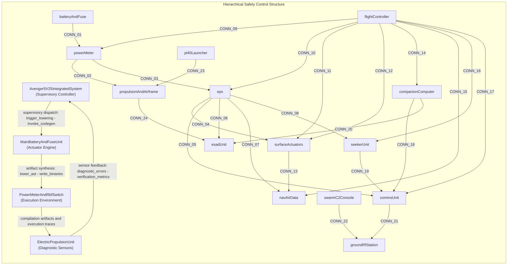
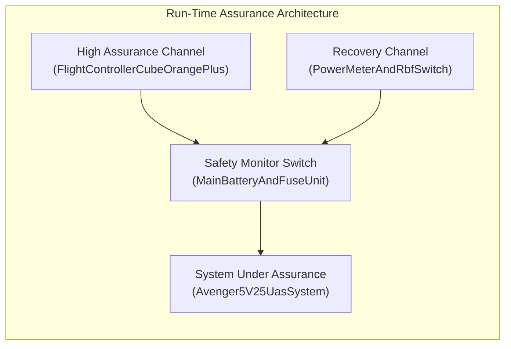

# Unified 8-Pillar STPA Safety & Risk Analysis Matrix

> **Primary Commercial Toolchain Integration Context:** MATLAB / Simulink / Stateflow / Embedded Coder
> **Safety Standards:** ISO/IEC/IEEE 15026-3 | ASTM F3269-17 RTA | MIL-STD-882E | Domain Integrity Framework

---

## System Losses

| Loss ID | Description |
| :--- | :--- |
| L-1 | Loss of safe function of Avenger5V25IntegratedSystem |

## System Hazards

| Hazard ID | Associated Control Action | Controller |
| :--- | :--- | :--- |
| H-1 | ValidateBatteryAndPowerOnRbf2 | Avenger5V25IntegratedSystem |
| H-2 | CommandPusherThrottleAndReadEscTelem | Avenger5V25IntegratedSystem |
| H-3 | DistributeRegulatedPowerRails | Avenger5V25IntegratedSystem |
| H-4 | MonitorBingoEnergyReserve | Avenger5V25IntegratedSystem |
| H-5 | ExecuteSimplexRtaEnvelopeCheck | Avenger5V25IntegratedSystem |
| H-6 | RunPitotAndMagPreflightCheck | Avenger5V25IntegratedSystem |
| H-7 | SwitchToGnssDeniedDeadReckoning | Avenger5V25IntegratedSystem |
| H-8 | SuperviseEsadOcMasterCycle | Avenger5V25IntegratedSystem |
| H-9 | ActuateTailAndWingSurfaces | Avenger5V25IntegratedSystem |
| H-10 | ExecuteEsadBootAndPbit | Avenger5V25IntegratedSystem |
| H-11 | TransitionEsadArmingSequence | Avenger5V25IntegratedSystem |
| H-12 | CommandEsadAbortAndSelfDestruct | Avenger5V25IntegratedSystem |
| H-13 | AcquireAndTrackTerminalTarget | Avenger5V25IntegratedSystem |
| H-14 | RebootGimbalAndBridgeEthernet | Avenger5V25IntegratedSystem |
| H-15 | ChargePl40CompressorWithUvloCheck | Avenger5V25IntegratedSystem |
| H-16 | ExecuteLaunchGoNoGoAndDualTrigger | Avenger5V25IntegratedSystem |
| H-17 | DepressurizeAndScrubPl40Launcher | Avenger5V25IntegratedSystem |
| H-18 | AuthenticateOperatorAndCalibrateRotator | Avenger5V25IntegratedSystem |
| H-19 | ExportTargetReport5wCff | Avenger5V25IntegratedSystem |

## Hierarchical Control Structure Topology




---

## 4. Unsafe Control Actions (**UCA-1..N**)

Systematic identification across the 4 STPA guide word / failure mode categories:

1. **Not providing causes hazard**
2. **Providing causes hazard**
3. **Too early, too late, or out of order**
4. **Stopped too soon or applied too long**

Cartesian product of controlling part-def control actions across the
four canonical STPA guide-word categories.

| UCA ID | Controller | Control Action | Guide Word | Context | Hazard | Safety Constraint | Severity | Integrity Level |
| :--- | :--- | :--- | :--- | :--- | :--- | :--- | :--- | :--- |
| UCA-001 | Avenger5V25IntegratedSystem | ValidateBatteryAndPowerOnRbf2 | Not providing | Avenger5V25IntegratedSystem omits ValidateBatteryAndPowerOnRbf2 in active operational state across control interface while constraint MainBatteryPreFlightVoltageConstraint (in packVoltageV : Real && in busVoltageV : Real && attribute invariantExpr : String = "packVoltageV >= 49.0 and packVoltageV <= 50.0 and busVoltageV >= 36.0 and busVoltageV <= 50.4") demands intervention | H-1 | SC-001 | Catastrophic (Derived) | SIL-3 (Derived) |
| UCA-002 | Avenger5V25IntegratedSystem | ValidateBatteryAndPowerOnRbf2 | Providing | Avenger5V25IntegratedSystem issues ValidateBatteryAndPowerOnRbf2 in active operational state across control interface violating constraint BingoEnergyReserveConstraint (in reserveRatio : Real && attribute invariantExpr : String = "reserveRatio >= 0.20") | H-1 | SC-002 | Catastrophic (Derived) | SIL-3 (Derived) |
| UCA-003 | Avenger5V25IntegratedSystem | ValidateBatteryAndPowerOnRbf2 | Too early / Too late / Out of order | Avenger5V25IntegratedSystem dispatches ValidateBatteryAndPowerOnRbf2 out of temporal sequence in active operational state via control interface relative to constraint FlightEnvelopeSpeedConstraint (in airspeedMs : Real && in engagementActive : Boolean && attribute invariantExpr : String = "airspeedMs >= 24.0 and airspeedMs <= 80.0 and (not engagementActive or airspeedMs <= 55.0)") | H-1 | SC-003 | Critical (Derived) | SIL-2 (Derived) |
| UCA-004 | Avenger5V25IntegratedSystem | ValidateBatteryAndPowerOnRbf2 | Stopped too soon / Applied too long | Avenger5V25IntegratedSystem prematurely halts or latches ValidateBatteryAndPowerOnRbf2 in active operational state on control interface against constraint EpsEsadZeroBrownoutMarginConstraint (in epsEsadOutV : Real && attribute invariantExpr : String = "epsEsadOutV >= 14.0 and epsEsadOutV <= 32.0") | H-1 | SC-004 | Critical (Derived) | SIL-2 (Derived) |
| UCA-005 | Avenger5V25IntegratedSystem | CommandPusherThrottleAndReadEscTelem | Not providing | Avenger5V25IntegratedSystem omits CommandPusherThrottleAndReadEscTelem in active operational state across control interface while constraint ProductionNoParachuteConstraint (in rndRecoveryOptionInstalled : Boolean && attribute invariantExpr : String = "rndRecoveryOptionInstalled == false") demands intervention | H-2 | SC-005 | Catastrophic (Derived) | SIL-3 (Derived) |
| UCA-006 | Avenger5V25IntegratedSystem | CommandPusherThrottleAndReadEscTelem | Providing | Avenger5V25IntegratedSystem issues CommandPusherThrottleAndReadEscTelem in active operational state across control interface violating constraint PitotPreflightCalibrationConstraint (in calmAirMs : Real && in blownAirMs : Real && attribute invariantExpr : String = "calmAirMs <= 3.0 and blownAirMs >= 10.0") | H-2 | SC-006 | Catastrophic (Derived) | SIL-3 (Derived) |
| UCA-007 | Avenger5V25IntegratedSystem | CommandPusherThrottleAndReadEscTelem | Too early / Too late / Out of order | Avenger5V25IntegratedSystem dispatches CommandPusherThrottleAndReadEscTelem out of temporal sequence in active operational state via control interface relative to constraint CanTopologyIsolationConstraint (in finCount : Integer && in wingCount : Integer && in magCount : Integer && in stubLenCm : Real && attribute invariantExpr : String = "finCount == 4 and wingCount == 4 and magCount == 2 and stubLenCm == 120.0") | H-2 | SC-007 | Critical (Derived) | SIL-2 (Derived) |
| UCA-008 | Avenger5V25IntegratedSystem | CommandPusherThrottleAndReadEscTelem | Stopped too soon / Applied too long | Avenger5V25IntegratedSystem prematurely halts or latches CommandPusherThrottleAndReadEscTelem in active operational state on control interface against constraint SimplexRtaSoftwareHostingConstraint (in standaloneRtaBoxCount : Integer && in rtaHostedOnCubeOrangePlus : Boolean && attribute invariantExpr : String = "standaloneRtaBoxCount == 0 and rtaHostedOnCubeOrangePlus == true") | H-2 | SC-008 | Critical (Derived) | SIL-2 (Derived) |
| UCA-009 | Avenger5V25IntegratedSystem | DistributeRegulatedPowerRails | Not providing | Avenger5V25IntegratedSystem omits DistributeRegulatedPowerRails in active operational state across control interface while constraint EsadInputVoltageAndBrownoutConstraint (in vdcInV : Real && attribute invariantExpr : String = "vdcInV >= 14.0 and vdcInV <= 32.0") demands intervention | H-3 | SC-009 | Catastrophic (Derived) | SIL-3 (Derived) |
| UCA-010 | Avenger5V25IntegratedSystem | DistributeRegulatedPowerRails | Providing | Avenger5V25IntegratedSystem issues DistributeRegulatedPowerRails in active operational state across control interface violating constraint EsadRs485ProtocolTimingConstraint (in baudBps : Integer && in pollHz : Real && in replyMs : Real && in timeoutMs : Real && attribute invariantExpr : String = "baudBps == 115200 and pollHz == 100.0 and replyMs <= 5.0 and timeoutMs <= 10.0") | H-3 | SC-010 | Catastrophic (Derived) | SIL-3 (Derived) |
| UCA-011 | Avenger5V25IntegratedSystem | DistributeRegulatedPowerRails | Too early / Too late / Out of order | Avenger5V25IntegratedSystem dispatches DistributeRegulatedPowerRails out of temporal sequence in active operational state via control interface relative to constraint EsadRbf3PowerBeforePullConstraint (in uavPoweredBeforeRbf3Pull : Boolean && in umbResistanceOhm : Real && attribute invariantExpr : String = "uavPoweredBeforeRbf3Pull == true and umbResistanceOhm < 0.5") | H-3 | SC-011 | Critical (Derived) | SIL-2 (Derived) |
| UCA-012 | Avenger5V25IntegratedSystem | DistributeRegulatedPowerRails | Stopped too soon / Applied too long | Avenger5V25IntegratedSystem prematurely halts or latches DistributeRegulatedPowerRails in active operational state on control interface against constraint EsadSafeDistanceExceedConstraint (in safeDistanceExceeded : Boolean && in ss1Sensed : Boolean && attribute invariantExpr : String = "safeDistanceExceeded == true and ss1Sensed == true") | H-3 | SC-012 | Critical (Derived) | SIL-2 (Derived) |
| UCA-013 | Avenger5V25IntegratedSystem | MonitorBingoEnergyReserve | Not providing | Avenger5V25IntegratedSystem omits MonitorBingoEnergyReserve in active operational state across control interface while constraint WarheadMassAndPbitHvSafetyConstraint (in warheadMassKg : Real && in pbitHvV : Real && in fireHvV : Real && attribute invariantExpr : String = "warheadMassKg <= 5.0 and pbitHvV < 50.0 and fireHvV >= 0.0 and fireHvV <= 1800.0") demands intervention | H-4 | SC-013 | Catastrophic (Derived) | SIL-3 (Derived) |
| UCA-014 | Avenger5V25IntegratedSystem | MonitorBingoEnergyReserve | Providing | Avenger5V25IntegratedSystem issues MonitorBingoEnergyReserve in active operational state across control interface violating constraint EngagementSpeedAndTrackHoldConstraint (in airspeedMs : Real && in trackHoldSec : Real && in cepM : Real && attribute invariantExpr : String = "airspeedMs <= 55.0 and trackHoldSec >= 2.0 and trackHoldSec <= 5.0 and cepM <= 0.5") | H-4 | SC-014 | Catastrophic (Derived) | SIL-3 (Derived) |
| UCA-015 | Avenger5V25IntegratedSystem | MonitorBingoEnergyReserve | Too early / Too late / Out of order | Avenger5V25IntegratedSystem dispatches MonitorBingoEnergyReserve out of temporal sequence in active operational state via control interface relative to constraint Pl40MassAndExitVelocityConstraint (in uavMassKg : Real && in pressureBar : Real && in exitVelMs : Real && in windMs : Real && attribute invariantExpr : String = "uavMassKg <= 30.0 and pressureBar >= 13.0 and pressureBar <= 14.0 and exitVelMs <= 25.0 and windMs <= 12.0") | H-4 | SC-015 | Critical (Derived) | SIL-2 (Derived) |
| UCA-016 | Avenger5V25IntegratedSystem | MonitorBingoEnergyReserve | Stopped too soon / Applied too long | Avenger5V25IntegratedSystem prematurely halts or latches MonitorBingoEnergyReserve in active operational state on control interface against constraint Pl40UvloAndDualSwitchConstraint (in packVoltageV : Real && in dualHoldSec : Real && attribute invariantExpr : String = "packVoltageV > 14.5 and dualHoldSec >= 2.0") | H-4 | SC-016 | Critical (Derived) | SIL-2 (Derived) |
| UCA-017 | Avenger5V25IntegratedSystem | ExecuteSimplexRtaEnvelopeCheck | Not providing | Avenger5V25IntegratedSystem omits ExecuteSimplexRtaEnvelopeCheck in active operational state across control interface while constraint SwarmC2AuthAndMissionBoundsConstraint (in passwordLen : Integer && in missionNameLen : Integer && in waypointAltM : Real && in loiterRadiusM : Real && attribute invariantExpr : String = "passwordLen >= 8 and missionNameLen <= 24 and waypointAltM >= 50.0 and waypointAltM <= 3000.0 and loiterRadiusM >= 300.0") demands intervention | H-5 | SC-017 | Catastrophic (Derived) | SIL-3 (Derived) |
| UCA-018 | Avenger5V25IntegratedSystem | ExecuteSimplexRtaEnvelopeCheck | Providing | Avenger5V25IntegratedSystem issues ExecuteSimplexRtaEnvelopeCheck in active operational state across control interface violating constraint GroundCrewSeparationAndEsdConstraint (in esdGrounded : Boolean && in separationM : Real && attribute invariantExpr : String = "esdGrounded == true and separationM >= 10.0") | H-5 | SC-018 | Catastrophic (Derived) | SIL-3 (Derived) |
| UCA-019 | Avenger5V25IntegratedSystem | ExecuteSimplexRtaEnvelopeCheck | Too early / Too late / Out of order | Avenger5V25IntegratedSystem dispatches ExecuteSimplexRtaEnvelopeCheck out of temporal sequence in active operational state via control interface relative to constraint MainBatteryPreFlightVoltageConstraint (in packVoltageV : Real && in busVoltageV : Real && attribute invariantExpr : String = "packVoltageV >= 49.0 and packVoltageV <= 50.0 and busVoltageV >= 36.0 and busVoltageV <= 50.4") | H-5 | SC-019 | Critical (Derived) | SIL-2 (Derived) |
| UCA-020 | Avenger5V25IntegratedSystem | ExecuteSimplexRtaEnvelopeCheck | Stopped too soon / Applied too long | Avenger5V25IntegratedSystem prematurely halts or latches ExecuteSimplexRtaEnvelopeCheck in active operational state on control interface against constraint BingoEnergyReserveConstraint (in reserveRatio : Real && attribute invariantExpr : String = "reserveRatio >= 0.20") | H-5 | SC-020 | Critical (Derived) | SIL-2 (Derived) |
| UCA-021 | Avenger5V25IntegratedSystem | RunPitotAndMagPreflightCheck | Not providing | Avenger5V25IntegratedSystem omits RunPitotAndMagPreflightCheck in active operational state across control interface while constraint FlightEnvelopeSpeedConstraint (in airspeedMs : Real && in engagementActive : Boolean && attribute invariantExpr : String = "airspeedMs >= 24.0 and airspeedMs <= 80.0 and (not engagementActive or airspeedMs <= 55.0)") demands intervention | H-6 | SC-021 | Catastrophic (Derived) | SIL-3 (Derived) |
| UCA-022 | Avenger5V25IntegratedSystem | RunPitotAndMagPreflightCheck | Providing | Avenger5V25IntegratedSystem issues RunPitotAndMagPreflightCheck in active operational state across control interface violating constraint EpsEsadZeroBrownoutMarginConstraint (in epsEsadOutV : Real && attribute invariantExpr : String = "epsEsadOutV >= 14.0 and epsEsadOutV <= 32.0") | H-6 | SC-022 | Catastrophic (Derived) | SIL-3 (Derived) |
| UCA-023 | Avenger5V25IntegratedSystem | RunPitotAndMagPreflightCheck | Too early / Too late / Out of order | Avenger5V25IntegratedSystem dispatches RunPitotAndMagPreflightCheck out of temporal sequence in active operational state via control interface relative to constraint ProductionNoParachuteConstraint (in rndRecoveryOptionInstalled : Boolean && attribute invariantExpr : String = "rndRecoveryOptionInstalled == false") | H-6 | SC-023 | Critical (Derived) | SIL-2 (Derived) |
| UCA-024 | Avenger5V25IntegratedSystem | RunPitotAndMagPreflightCheck | Stopped too soon / Applied too long | Avenger5V25IntegratedSystem prematurely halts or latches RunPitotAndMagPreflightCheck in active operational state on control interface against constraint PitotPreflightCalibrationConstraint (in calmAirMs : Real && in blownAirMs : Real && attribute invariantExpr : String = "calmAirMs <= 3.0 and blownAirMs >= 10.0") | H-6 | SC-024 | Critical (Derived) | SIL-2 (Derived) |
| UCA-025 | Avenger5V25IntegratedSystem | SwitchToGnssDeniedDeadReckoning | Not providing | Avenger5V25IntegratedSystem omits SwitchToGnssDeniedDeadReckoning in active operational state across control interface while constraint CanTopologyIsolationConstraint (in finCount : Integer && in wingCount : Integer && in magCount : Integer && in stubLenCm : Real && attribute invariantExpr : String = "finCount == 4 and wingCount == 4 and magCount == 2 and stubLenCm == 120.0") demands intervention | H-7 | SC-025 | Catastrophic (Derived) | SIL-3 (Derived) |
| UCA-026 | Avenger5V25IntegratedSystem | SwitchToGnssDeniedDeadReckoning | Providing | Avenger5V25IntegratedSystem issues SwitchToGnssDeniedDeadReckoning in active operational state across control interface violating constraint SimplexRtaSoftwareHostingConstraint (in standaloneRtaBoxCount : Integer && in rtaHostedOnCubeOrangePlus : Boolean && attribute invariantExpr : String = "standaloneRtaBoxCount == 0 and rtaHostedOnCubeOrangePlus == true") | H-7 | SC-026 | Catastrophic (Derived) | SIL-3 (Derived) |
| UCA-027 | Avenger5V25IntegratedSystem | SwitchToGnssDeniedDeadReckoning | Too early / Too late / Out of order | Avenger5V25IntegratedSystem dispatches SwitchToGnssDeniedDeadReckoning out of temporal sequence in active operational state via control interface relative to constraint EsadInputVoltageAndBrownoutConstraint (in vdcInV : Real && attribute invariantExpr : String = "vdcInV >= 14.0 and vdcInV <= 32.0") | H-7 | SC-027 | Critical (Derived) | SIL-2 (Derived) |
| UCA-028 | Avenger5V25IntegratedSystem | SwitchToGnssDeniedDeadReckoning | Stopped too soon / Applied too long | Avenger5V25IntegratedSystem prematurely halts or latches SwitchToGnssDeniedDeadReckoning in active operational state on control interface against constraint EsadRs485ProtocolTimingConstraint (in baudBps : Integer && in pollHz : Real && in replyMs : Real && in timeoutMs : Real && attribute invariantExpr : String = "baudBps == 115200 and pollHz == 100.0 and replyMs <= 5.0 and timeoutMs <= 10.0") | H-7 | SC-028 | Critical (Derived) | SIL-2 (Derived) |
| UCA-029 | Avenger5V25IntegratedSystem | SuperviseEsadOcMasterCycle | Not providing | Avenger5V25IntegratedSystem omits SuperviseEsadOcMasterCycle in active operational state across control interface while constraint EsadRbf3PowerBeforePullConstraint (in uavPoweredBeforeRbf3Pull : Boolean && in umbResistanceOhm : Real && attribute invariantExpr : String = "uavPoweredBeforeRbf3Pull == true and umbResistanceOhm < 0.5") demands intervention | H-8 | SC-029 | Catastrophic (Derived) | SIL-3 (Derived) |
| UCA-030 | Avenger5V25IntegratedSystem | SuperviseEsadOcMasterCycle | Providing | Avenger5V25IntegratedSystem issues SuperviseEsadOcMasterCycle in active operational state across control interface violating constraint EsadSafeDistanceExceedConstraint (in safeDistanceExceeded : Boolean && in ss1Sensed : Boolean && attribute invariantExpr : String = "safeDistanceExceeded == true and ss1Sensed == true") | H-8 | SC-030 | Catastrophic (Derived) | SIL-3 (Derived) |
| UCA-031 | Avenger5V25IntegratedSystem | SuperviseEsadOcMasterCycle | Too early / Too late / Out of order | Avenger5V25IntegratedSystem dispatches SuperviseEsadOcMasterCycle out of temporal sequence in active operational state via control interface relative to constraint WarheadMassAndPbitHvSafetyConstraint (in warheadMassKg : Real && in pbitHvV : Real && in fireHvV : Real && attribute invariantExpr : String = "warheadMassKg <= 5.0 and pbitHvV < 50.0 and fireHvV >= 0.0 and fireHvV <= 1800.0") | H-8 | SC-031 | Critical (Derived) | SIL-2 (Derived) |
| UCA-032 | Avenger5V25IntegratedSystem | SuperviseEsadOcMasterCycle | Stopped too soon / Applied too long | Avenger5V25IntegratedSystem prematurely halts or latches SuperviseEsadOcMasterCycle in active operational state on control interface against constraint EngagementSpeedAndTrackHoldConstraint (in airspeedMs : Real && in trackHoldSec : Real && in cepM : Real && attribute invariantExpr : String = "airspeedMs <= 55.0 and trackHoldSec >= 2.0 and trackHoldSec <= 5.0 and cepM <= 0.5") | H-8 | SC-032 | Critical (Derived) | SIL-2 (Derived) |
| UCA-033 | Avenger5V25IntegratedSystem | ActuateTailAndWingSurfaces | Not providing | Avenger5V25IntegratedSystem omits ActuateTailAndWingSurfaces in active operational state across control interface while constraint Pl40MassAndExitVelocityConstraint (in uavMassKg : Real && in pressureBar : Real && in exitVelMs : Real && in windMs : Real && attribute invariantExpr : String = "uavMassKg <= 30.0 and pressureBar >= 13.0 and pressureBar <= 14.0 and exitVelMs <= 25.0 and windMs <= 12.0") demands intervention | H-9 | SC-033 | Catastrophic (Derived) | SIL-3 (Derived) |
| UCA-034 | Avenger5V25IntegratedSystem | ActuateTailAndWingSurfaces | Providing | Avenger5V25IntegratedSystem issues ActuateTailAndWingSurfaces in active operational state across control interface violating constraint Pl40UvloAndDualSwitchConstraint (in packVoltageV : Real && in dualHoldSec : Real && attribute invariantExpr : String = "packVoltageV > 14.5 and dualHoldSec >= 2.0") | H-9 | SC-034 | Catastrophic (Derived) | SIL-3 (Derived) |
| UCA-035 | Avenger5V25IntegratedSystem | ActuateTailAndWingSurfaces | Too early / Too late / Out of order | Avenger5V25IntegratedSystem dispatches ActuateTailAndWingSurfaces out of temporal sequence in active operational state via control interface relative to constraint SwarmC2AuthAndMissionBoundsConstraint (in passwordLen : Integer && in missionNameLen : Integer && in waypointAltM : Real && in loiterRadiusM : Real && attribute invariantExpr : String = "passwordLen >= 8 and missionNameLen <= 24 and waypointAltM >= 50.0 and waypointAltM <= 3000.0 and loiterRadiusM >= 300.0") | H-9 | SC-035 | Critical (Derived) | SIL-2 (Derived) |
| UCA-036 | Avenger5V25IntegratedSystem | ActuateTailAndWingSurfaces | Stopped too soon / Applied too long | Avenger5V25IntegratedSystem prematurely halts or latches ActuateTailAndWingSurfaces in active operational state on control interface against constraint GroundCrewSeparationAndEsdConstraint (in esdGrounded : Boolean && in separationM : Real && attribute invariantExpr : String = "esdGrounded == true and separationM >= 10.0") | H-9 | SC-036 | Critical (Derived) | SIL-2 (Derived) |
| UCA-037 | Avenger5V25IntegratedSystem | ExecuteEsadBootAndPbit | Not providing | Avenger5V25IntegratedSystem omits ExecuteEsadBootAndPbit in active operational state across control interface while constraint MainBatteryPreFlightVoltageConstraint (in packVoltageV : Real && in busVoltageV : Real && attribute invariantExpr : String = "packVoltageV >= 49.0 and packVoltageV <= 50.0 and busVoltageV >= 36.0 and busVoltageV <= 50.4") demands intervention | H-10 | SC-037 | Catastrophic (Derived) | SIL-3 (Derived) |
| UCA-038 | Avenger5V25IntegratedSystem | ExecuteEsadBootAndPbit | Providing | Avenger5V25IntegratedSystem issues ExecuteEsadBootAndPbit in active operational state across control interface violating constraint BingoEnergyReserveConstraint (in reserveRatio : Real && attribute invariantExpr : String = "reserveRatio >= 0.20") | H-10 | SC-038 | Catastrophic (Derived) | SIL-3 (Derived) |
| UCA-039 | Avenger5V25IntegratedSystem | ExecuteEsadBootAndPbit | Too early / Too late / Out of order | Avenger5V25IntegratedSystem dispatches ExecuteEsadBootAndPbit out of temporal sequence in active operational state via control interface relative to constraint FlightEnvelopeSpeedConstraint (in airspeedMs : Real && in engagementActive : Boolean && attribute invariantExpr : String = "airspeedMs >= 24.0 and airspeedMs <= 80.0 and (not engagementActive or airspeedMs <= 55.0)") | H-10 | SC-039 | Critical (Derived) | SIL-2 (Derived) |
| UCA-040 | Avenger5V25IntegratedSystem | ExecuteEsadBootAndPbit | Stopped too soon / Applied too long | Avenger5V25IntegratedSystem prematurely halts or latches ExecuteEsadBootAndPbit in active operational state on control interface against constraint EpsEsadZeroBrownoutMarginConstraint (in epsEsadOutV : Real && attribute invariantExpr : String = "epsEsadOutV >= 14.0 and epsEsadOutV <= 32.0") | H-10 | SC-040 | Critical (Derived) | SIL-2 (Derived) |
| UCA-041 | Avenger5V25IntegratedSystem | TransitionEsadArmingSequence | Not providing | Avenger5V25IntegratedSystem omits TransitionEsadArmingSequence in active operational state across control interface while constraint ProductionNoParachuteConstraint (in rndRecoveryOptionInstalled : Boolean && attribute invariantExpr : String = "rndRecoveryOptionInstalled == false") demands intervention | H-11 | SC-041 | Catastrophic (Derived) | SIL-3 (Derived) |
| UCA-042 | Avenger5V25IntegratedSystem | TransitionEsadArmingSequence | Providing | Avenger5V25IntegratedSystem issues TransitionEsadArmingSequence in active operational state across control interface violating constraint PitotPreflightCalibrationConstraint (in calmAirMs : Real && in blownAirMs : Real && attribute invariantExpr : String = "calmAirMs <= 3.0 and blownAirMs >= 10.0") | H-11 | SC-042 | Catastrophic (Derived) | SIL-3 (Derived) |
| UCA-043 | Avenger5V25IntegratedSystem | TransitionEsadArmingSequence | Too early / Too late / Out of order | Avenger5V25IntegratedSystem dispatches TransitionEsadArmingSequence out of temporal sequence in active operational state via control interface relative to constraint CanTopologyIsolationConstraint (in finCount : Integer && in wingCount : Integer && in magCount : Integer && in stubLenCm : Real && attribute invariantExpr : String = "finCount == 4 and wingCount == 4 and magCount == 2 and stubLenCm == 120.0") | H-11 | SC-043 | Critical (Derived) | SIL-2 (Derived) |
| UCA-044 | Avenger5V25IntegratedSystem | TransitionEsadArmingSequence | Stopped too soon / Applied too long | Avenger5V25IntegratedSystem prematurely halts or latches TransitionEsadArmingSequence in active operational state on control interface against constraint SimplexRtaSoftwareHostingConstraint (in standaloneRtaBoxCount : Integer && in rtaHostedOnCubeOrangePlus : Boolean && attribute invariantExpr : String = "standaloneRtaBoxCount == 0 and rtaHostedOnCubeOrangePlus == true") | H-11 | SC-044 | Critical (Derived) | SIL-2 (Derived) |
| UCA-045 | Avenger5V25IntegratedSystem | CommandEsadAbortAndSelfDestruct | Not providing | Avenger5V25IntegratedSystem omits CommandEsadAbortAndSelfDestruct in active operational state across control interface while constraint EsadInputVoltageAndBrownoutConstraint (in vdcInV : Real && attribute invariantExpr : String = "vdcInV >= 14.0 and vdcInV <= 32.0") demands intervention | H-12 | SC-045 | Catastrophic (Derived) | SIL-3 (Derived) |
| UCA-046 | Avenger5V25IntegratedSystem | CommandEsadAbortAndSelfDestruct | Providing | Avenger5V25IntegratedSystem issues CommandEsadAbortAndSelfDestruct in active operational state across control interface violating constraint EsadRs485ProtocolTimingConstraint (in baudBps : Integer && in pollHz : Real && in replyMs : Real && in timeoutMs : Real && attribute invariantExpr : String = "baudBps == 115200 and pollHz == 100.0 and replyMs <= 5.0 and timeoutMs <= 10.0") | H-12 | SC-046 | Catastrophic (Derived) | SIL-3 (Derived) |
| UCA-047 | Avenger5V25IntegratedSystem | CommandEsadAbortAndSelfDestruct | Too early / Too late / Out of order | Avenger5V25IntegratedSystem dispatches CommandEsadAbortAndSelfDestruct out of temporal sequence in active operational state via control interface relative to constraint EsadRbf3PowerBeforePullConstraint (in uavPoweredBeforeRbf3Pull : Boolean && in umbResistanceOhm : Real && attribute invariantExpr : String = "uavPoweredBeforeRbf3Pull == true and umbResistanceOhm < 0.5") | H-12 | SC-047 | Critical (Derived) | SIL-2 (Derived) |
| UCA-048 | Avenger5V25IntegratedSystem | CommandEsadAbortAndSelfDestruct | Stopped too soon / Applied too long | Avenger5V25IntegratedSystem prematurely halts or latches CommandEsadAbortAndSelfDestruct in active operational state on control interface against constraint EsadSafeDistanceExceedConstraint (in safeDistanceExceeded : Boolean && in ss1Sensed : Boolean && attribute invariantExpr : String = "safeDistanceExceeded == true and ss1Sensed == true") | H-12 | SC-048 | Critical (Derived) | SIL-2 (Derived) |
| UCA-049 | Avenger5V25IntegratedSystem | AcquireAndTrackTerminalTarget | Not providing | Avenger5V25IntegratedSystem omits AcquireAndTrackTerminalTarget in active operational state across control interface while constraint WarheadMassAndPbitHvSafetyConstraint (in warheadMassKg : Real && in pbitHvV : Real && in fireHvV : Real && attribute invariantExpr : String = "warheadMassKg <= 5.0 and pbitHvV < 50.0 and fireHvV >= 0.0 and fireHvV <= 1800.0") demands intervention | H-13 | SC-049 | Catastrophic (Derived) | SIL-3 (Derived) |
| UCA-050 | Avenger5V25IntegratedSystem | AcquireAndTrackTerminalTarget | Providing | Avenger5V25IntegratedSystem issues AcquireAndTrackTerminalTarget in active operational state across control interface violating constraint EngagementSpeedAndTrackHoldConstraint (in airspeedMs : Real && in trackHoldSec : Real && in cepM : Real && attribute invariantExpr : String = "airspeedMs <= 55.0 and trackHoldSec >= 2.0 and trackHoldSec <= 5.0 and cepM <= 0.5") | H-13 | SC-050 | Catastrophic (Derived) | SIL-3 (Derived) |
| UCA-051 | Avenger5V25IntegratedSystem | AcquireAndTrackTerminalTarget | Too early / Too late / Out of order | Avenger5V25IntegratedSystem dispatches AcquireAndTrackTerminalTarget out of temporal sequence in active operational state via control interface relative to constraint Pl40MassAndExitVelocityConstraint (in uavMassKg : Real && in pressureBar : Real && in exitVelMs : Real && in windMs : Real && attribute invariantExpr : String = "uavMassKg <= 30.0 and pressureBar >= 13.0 and pressureBar <= 14.0 and exitVelMs <= 25.0 and windMs <= 12.0") | H-13 | SC-051 | Critical (Derived) | SIL-2 (Derived) |
| UCA-052 | Avenger5V25IntegratedSystem | AcquireAndTrackTerminalTarget | Stopped too soon / Applied too long | Avenger5V25IntegratedSystem prematurely halts or latches AcquireAndTrackTerminalTarget in active operational state on control interface against constraint Pl40UvloAndDualSwitchConstraint (in packVoltageV : Real && in dualHoldSec : Real && attribute invariantExpr : String = "packVoltageV > 14.5 and dualHoldSec >= 2.0") | H-13 | SC-052 | Critical (Derived) | SIL-2 (Derived) |
| UCA-053 | Avenger5V25IntegratedSystem | RebootGimbalAndBridgeEthernet | Not providing | Avenger5V25IntegratedSystem omits RebootGimbalAndBridgeEthernet in active operational state across control interface while constraint SwarmC2AuthAndMissionBoundsConstraint (in passwordLen : Integer && in missionNameLen : Integer && in waypointAltM : Real && in loiterRadiusM : Real && attribute invariantExpr : String = "passwordLen >= 8 and missionNameLen <= 24 and waypointAltM >= 50.0 and waypointAltM <= 3000.0 and loiterRadiusM >= 300.0") demands intervention | H-14 | SC-053 | Catastrophic (Derived) | SIL-3 (Derived) |
| UCA-054 | Avenger5V25IntegratedSystem | RebootGimbalAndBridgeEthernet | Providing | Avenger5V25IntegratedSystem issues RebootGimbalAndBridgeEthernet in active operational state across control interface violating constraint GroundCrewSeparationAndEsdConstraint (in esdGrounded : Boolean && in separationM : Real && attribute invariantExpr : String = "esdGrounded == true and separationM >= 10.0") | H-14 | SC-054 | Catastrophic (Derived) | SIL-3 (Derived) |
| UCA-055 | Avenger5V25IntegratedSystem | RebootGimbalAndBridgeEthernet | Too early / Too late / Out of order | Avenger5V25IntegratedSystem dispatches RebootGimbalAndBridgeEthernet out of temporal sequence in active operational state via control interface relative to constraint MainBatteryPreFlightVoltageConstraint (in packVoltageV : Real && in busVoltageV : Real && attribute invariantExpr : String = "packVoltageV >= 49.0 and packVoltageV <= 50.0 and busVoltageV >= 36.0 and busVoltageV <= 50.4") | H-14 | SC-055 | Critical (Derived) | SIL-2 (Derived) |
| UCA-056 | Avenger5V25IntegratedSystem | RebootGimbalAndBridgeEthernet | Stopped too soon / Applied too long | Avenger5V25IntegratedSystem prematurely halts or latches RebootGimbalAndBridgeEthernet in active operational state on control interface against constraint BingoEnergyReserveConstraint (in reserveRatio : Real && attribute invariantExpr : String = "reserveRatio >= 0.20") | H-14 | SC-056 | Critical (Derived) | SIL-2 (Derived) |
| UCA-057 | Avenger5V25IntegratedSystem | ChargePl40CompressorWithUvloCheck | Not providing | Avenger5V25IntegratedSystem omits ChargePl40CompressorWithUvloCheck in active operational state across control interface while constraint FlightEnvelopeSpeedConstraint (in airspeedMs : Real && in engagementActive : Boolean && attribute invariantExpr : String = "airspeedMs >= 24.0 and airspeedMs <= 80.0 and (not engagementActive or airspeedMs <= 55.0)") demands intervention | H-15 | SC-057 | Catastrophic (Derived) | SIL-3 (Derived) |
| UCA-058 | Avenger5V25IntegratedSystem | ChargePl40CompressorWithUvloCheck | Providing | Avenger5V25IntegratedSystem issues ChargePl40CompressorWithUvloCheck in active operational state across control interface violating constraint EpsEsadZeroBrownoutMarginConstraint (in epsEsadOutV : Real && attribute invariantExpr : String = "epsEsadOutV >= 14.0 and epsEsadOutV <= 32.0") | H-15 | SC-058 | Catastrophic (Derived) | SIL-3 (Derived) |
| UCA-059 | Avenger5V25IntegratedSystem | ChargePl40CompressorWithUvloCheck | Too early / Too late / Out of order | Avenger5V25IntegratedSystem dispatches ChargePl40CompressorWithUvloCheck out of temporal sequence in active operational state via control interface relative to constraint ProductionNoParachuteConstraint (in rndRecoveryOptionInstalled : Boolean && attribute invariantExpr : String = "rndRecoveryOptionInstalled == false") | H-15 | SC-059 | Critical (Derived) | SIL-2 (Derived) |
| UCA-060 | Avenger5V25IntegratedSystem | ChargePl40CompressorWithUvloCheck | Stopped too soon / Applied too long | Avenger5V25IntegratedSystem prematurely halts or latches ChargePl40CompressorWithUvloCheck in active operational state on control interface against constraint PitotPreflightCalibrationConstraint (in calmAirMs : Real && in blownAirMs : Real && attribute invariantExpr : String = "calmAirMs <= 3.0 and blownAirMs >= 10.0") | H-15 | SC-060 | Critical (Derived) | SIL-2 (Derived) |
| UCA-061 | Avenger5V25IntegratedSystem | ExecuteLaunchGoNoGoAndDualTrigger | Not providing | Avenger5V25IntegratedSystem omits ExecuteLaunchGoNoGoAndDualTrigger in active operational state across control interface while constraint CanTopologyIsolationConstraint (in finCount : Integer && in wingCount : Integer && in magCount : Integer && in stubLenCm : Real && attribute invariantExpr : String = "finCount == 4 and wingCount == 4 and magCount == 2 and stubLenCm == 120.0") demands intervention | H-16 | SC-061 | Catastrophic (Derived) | SIL-3 (Derived) |
| UCA-062 | Avenger5V25IntegratedSystem | ExecuteLaunchGoNoGoAndDualTrigger | Providing | Avenger5V25IntegratedSystem issues ExecuteLaunchGoNoGoAndDualTrigger in active operational state across control interface violating constraint SimplexRtaSoftwareHostingConstraint (in standaloneRtaBoxCount : Integer && in rtaHostedOnCubeOrangePlus : Boolean && attribute invariantExpr : String = "standaloneRtaBoxCount == 0 and rtaHostedOnCubeOrangePlus == true") | H-16 | SC-062 | Catastrophic (Derived) | SIL-3 (Derived) |
| UCA-063 | Avenger5V25IntegratedSystem | ExecuteLaunchGoNoGoAndDualTrigger | Too early / Too late / Out of order | Avenger5V25IntegratedSystem dispatches ExecuteLaunchGoNoGoAndDualTrigger out of temporal sequence in active operational state via control interface relative to constraint EsadInputVoltageAndBrownoutConstraint (in vdcInV : Real && attribute invariantExpr : String = "vdcInV >= 14.0 and vdcInV <= 32.0") | H-16 | SC-063 | Critical (Derived) | SIL-2 (Derived) |
| UCA-064 | Avenger5V25IntegratedSystem | ExecuteLaunchGoNoGoAndDualTrigger | Stopped too soon / Applied too long | Avenger5V25IntegratedSystem prematurely halts or latches ExecuteLaunchGoNoGoAndDualTrigger in active operational state on control interface against constraint EsadRs485ProtocolTimingConstraint (in baudBps : Integer && in pollHz : Real && in replyMs : Real && in timeoutMs : Real && attribute invariantExpr : String = "baudBps == 115200 and pollHz == 100.0 and replyMs <= 5.0 and timeoutMs <= 10.0") | H-16 | SC-064 | Critical (Derived) | SIL-2 (Derived) |
| UCA-065 | Avenger5V25IntegratedSystem | DepressurizeAndScrubPl40Launcher | Not providing | Avenger5V25IntegratedSystem omits DepressurizeAndScrubPl40Launcher in active operational state across control interface while constraint EsadRbf3PowerBeforePullConstraint (in uavPoweredBeforeRbf3Pull : Boolean && in umbResistanceOhm : Real && attribute invariantExpr : String = "uavPoweredBeforeRbf3Pull == true and umbResistanceOhm < 0.5") demands intervention | H-17 | SC-065 | Catastrophic (Derived) | SIL-3 (Derived) |
| UCA-066 | Avenger5V25IntegratedSystem | DepressurizeAndScrubPl40Launcher | Providing | Avenger5V25IntegratedSystem issues DepressurizeAndScrubPl40Launcher in active operational state across control interface violating constraint EsadSafeDistanceExceedConstraint (in safeDistanceExceeded : Boolean && in ss1Sensed : Boolean && attribute invariantExpr : String = "safeDistanceExceeded == true and ss1Sensed == true") | H-17 | SC-066 | Catastrophic (Derived) | SIL-3 (Derived) |
| UCA-067 | Avenger5V25IntegratedSystem | DepressurizeAndScrubPl40Launcher | Too early / Too late / Out of order | Avenger5V25IntegratedSystem dispatches DepressurizeAndScrubPl40Launcher out of temporal sequence in active operational state via control interface relative to constraint WarheadMassAndPbitHvSafetyConstraint (in warheadMassKg : Real && in pbitHvV : Real && in fireHvV : Real && attribute invariantExpr : String = "warheadMassKg <= 5.0 and pbitHvV < 50.0 and fireHvV >= 0.0 and fireHvV <= 1800.0") | H-17 | SC-067 | Critical (Derived) | SIL-2 (Derived) |
| UCA-068 | Avenger5V25IntegratedSystem | DepressurizeAndScrubPl40Launcher | Stopped too soon / Applied too long | Avenger5V25IntegratedSystem prematurely halts or latches DepressurizeAndScrubPl40Launcher in active operational state on control interface against constraint EngagementSpeedAndTrackHoldConstraint (in airspeedMs : Real && in trackHoldSec : Real && in cepM : Real && attribute invariantExpr : String = "airspeedMs <= 55.0 and trackHoldSec >= 2.0 and trackHoldSec <= 5.0 and cepM <= 0.5") | H-17 | SC-068 | Critical (Derived) | SIL-2 (Derived) |
| UCA-069 | Avenger5V25IntegratedSystem | AuthenticateOperatorAndCalibrateRotator | Not providing | Avenger5V25IntegratedSystem omits AuthenticateOperatorAndCalibrateRotator in active operational state across control interface while constraint Pl40MassAndExitVelocityConstraint (in uavMassKg : Real && in pressureBar : Real && in exitVelMs : Real && in windMs : Real && attribute invariantExpr : String = "uavMassKg <= 30.0 and pressureBar >= 13.0 and pressureBar <= 14.0 and exitVelMs <= 25.0 and windMs <= 12.0") demands intervention | H-18 | SC-069 | Catastrophic (Derived) | SIL-3 (Derived) |
| UCA-070 | Avenger5V25IntegratedSystem | AuthenticateOperatorAndCalibrateRotator | Providing | Avenger5V25IntegratedSystem issues AuthenticateOperatorAndCalibrateRotator in active operational state across control interface violating constraint Pl40UvloAndDualSwitchConstraint (in packVoltageV : Real && in dualHoldSec : Real && attribute invariantExpr : String = "packVoltageV > 14.5 and dualHoldSec >= 2.0") | H-18 | SC-070 | Catastrophic (Derived) | SIL-3 (Derived) |
| UCA-071 | Avenger5V25IntegratedSystem | AuthenticateOperatorAndCalibrateRotator | Too early / Too late / Out of order | Avenger5V25IntegratedSystem dispatches AuthenticateOperatorAndCalibrateRotator out of temporal sequence in active operational state via control interface relative to constraint SwarmC2AuthAndMissionBoundsConstraint (in passwordLen : Integer && in missionNameLen : Integer && in waypointAltM : Real && in loiterRadiusM : Real && attribute invariantExpr : String = "passwordLen >= 8 and missionNameLen <= 24 and waypointAltM >= 50.0 and waypointAltM <= 3000.0 and loiterRadiusM >= 300.0") | H-18 | SC-071 | Critical (Derived) | SIL-2 (Derived) |
| UCA-072 | Avenger5V25IntegratedSystem | AuthenticateOperatorAndCalibrateRotator | Stopped too soon / Applied too long | Avenger5V25IntegratedSystem prematurely halts or latches AuthenticateOperatorAndCalibrateRotator in active operational state on control interface against constraint GroundCrewSeparationAndEsdConstraint (in esdGrounded : Boolean && in separationM : Real && attribute invariantExpr : String = "esdGrounded == true and separationM >= 10.0") | H-18 | SC-072 | Critical (Derived) | SIL-2 (Derived) |
| UCA-073 | Avenger5V25IntegratedSystem | ExportTargetReport5wCff | Not providing | Avenger5V25IntegratedSystem omits ExportTargetReport5wCff in active operational state across control interface while constraint MainBatteryPreFlightVoltageConstraint (in packVoltageV : Real && in busVoltageV : Real && attribute invariantExpr : String = "packVoltageV >= 49.0 and packVoltageV <= 50.0 and busVoltageV >= 36.0 and busVoltageV <= 50.4") demands intervention | H-19 | SC-073 | Catastrophic (Derived) | SIL-3 (Derived) |
| UCA-074 | Avenger5V25IntegratedSystem | ExportTargetReport5wCff | Providing | Avenger5V25IntegratedSystem issues ExportTargetReport5wCff in active operational state across control interface violating constraint BingoEnergyReserveConstraint (in reserveRatio : Real && attribute invariantExpr : String = "reserveRatio >= 0.20") | H-19 | SC-074 | Catastrophic (Derived) | SIL-3 (Derived) |
| UCA-075 | Avenger5V25IntegratedSystem | ExportTargetReport5wCff | Too early / Too late / Out of order | Avenger5V25IntegratedSystem dispatches ExportTargetReport5wCff out of temporal sequence in active operational state via control interface relative to constraint FlightEnvelopeSpeedConstraint (in airspeedMs : Real && in engagementActive : Boolean && attribute invariantExpr : String = "airspeedMs >= 24.0 and airspeedMs <= 80.0 and (not engagementActive or airspeedMs <= 55.0)") | H-19 | SC-075 | Critical (Derived) | SIL-2 (Derived) |
| UCA-076 | Avenger5V25IntegratedSystem | ExportTargetReport5wCff | Stopped too soon / Applied too long | Avenger5V25IntegratedSystem prematurely halts or latches ExportTargetReport5wCff in active operational state on control interface against constraint EpsEsadZeroBrownoutMarginConstraint (in epsEsadOutV : Real && attribute invariantExpr : String = "epsEsadOutV >= 14.0 and epsEsadOutV <= 32.0") | H-19 | SC-076 | Critical (Derived) | SIL-2 (Derived) |


---

## 5. Loss Scenarios (**LS-1..N**) & Causal Factors

STPA control-loop loss scenario analysis synthesizing Class-1 controller process-model flaws and Class-2 control-path, feedback, and execution degradations from SysML v2 AST structure.

| Loss Scenario ID | UCA ID | Scenario Class | Controller | Control Action | Scenario | Causal Factor | Safety Constraint Mitigation |
| :--- | :--- | :--- | :--- | :--- | :--- | :--- | :--- |
| LS-001 | UCA-001 | Class-1 (Controller / Process-Model Flaw) | Avenger5V25IntegratedSystem | ValidateBatteryAndPowerOnRbf2 | Avenger5V25IntegratedSystem omits ValidateBatteryAndPowerOnRbf2 while in active operational mode with process-model state variable under ConstraintDef MainBatteryPreFlightVoltageConstraint (in packVoltageV : Real && in busVoltageV : Real && attribute invariantExpr : String = "packVoltageV >= 49.0 and packVoltageV <= 50.0 and busVoltageV >= 36.0 and busVoltageV <= 50.4") | Stale process-model belief in Avenger5V25IntegratedSystem during active operational mode due to unrefreshed process-model state variable on controller input boundary (Derived: STPA Class-1) | Enforce SC-001 and ConstraintDef MainBatteryPreFlightVoltageConstraint (in packVoltageV : Real && in busVoltageV : Real && attribute invariantExpr : String = "packVoltageV >= 49.0 and packVoltageV <= 50.0 and busVoltageV >= 36.0 and busVoltageV <= 50.4") with state-consistency check on controller input boundary before suppressing ValidateBatteryAndPowerOnRbf2 |
| LS-002 | UCA-001 | Class-2 (Control-Path / Feedback / Execution Degradation) | Avenger5V25IntegratedSystem | ValidateBatteryAndPowerOnRbf2 | Avenger5V25IntegratedSystem command or feedback for ValidateBatteryAndPowerOnRbf2 drops across actuation output channel and connection CONN_01 (CONN_01) while ConstraintDef MainBatteryPreFlightVoltageConstraint (in packVoltageV : Real && in busVoltageV : Real && attribute invariantExpr : String = "packVoltageV >= 49.0 and packVoltageV <= 50.0 and busVoltageV >= 36.0 and busVoltageV <= 50.4") requires dispatch | Feedback dropout or execution path stall across actuation output channel and connection CONN_01 (CONN_01) masking process-model state variable threshold (Derived: STPA Class-2) | Enforce SC-001 and ConstraintDef MainBatteryPreFlightVoltageConstraint (in packVoltageV : Real && in busVoltageV : Real && attribute invariantExpr : String = "packVoltageV >= 49.0 and packVoltageV <= 50.0 and busVoltageV >= 36.0 and busVoltageV <= 50.4") via closed-loop delivery confirmation across actuation output channel |
| LS-003 | UCA-002 | Class-1 (Controller / Process-Model Flaw) | Avenger5V25IntegratedSystem | ValidateBatteryAndPowerOnRbf2 | Avenger5V25IntegratedSystem erroneously issues ValidateBatteryAndPowerOnRbf2 while in active operational mode violating process-model state variable and ConstraintDef BingoEnergyReserveConstraint (in reserveRatio : Real && attribute invariantExpr : String = "reserveRatio >= 0.20") | Corrupted process-model transition into active operational mode or invalid process-model state variable evaluation on controller input boundary in Avenger5V25IntegratedSystem (Derived: STPA Class-1) | Enforce SC-002 precondition gate on ConstraintDef BingoEnergyReserveConstraint (in reserveRatio : Real && attribute invariantExpr : String = "reserveRatio >= 0.20") and active operational mode prior to ValidateBatteryAndPowerOnRbf2 |
| LS-004 | UCA-002 | Class-2 (Control-Path / Feedback / Execution Degradation) | Avenger5V25IntegratedSystem | ValidateBatteryAndPowerOnRbf2 | Spurious or corrupted ValidateBatteryAndPowerOnRbf2 execution propagates from Avenger5V25IntegratedSystem across actuation output channel and connection CONN_02 (CONN_02) against ConstraintDef BingoEnergyReserveConstraint (in reserveRatio : Real && attribute invariantExpr : String = "reserveRatio >= 0.20") | Corrupted ingress feedback on controller input boundary or unguarded channel transit over connection CONN_02 (CONN_02) distorting process-model state variable (Derived: STPA Class-2) | Enforce SC-002 runtime boundary monitor for ConstraintDef BingoEnergyReserveConstraint (in reserveRatio : Real && attribute invariantExpr : String = "reserveRatio >= 0.20") across actuation output channel |
| LS-005 | UCA-003 | Class-1 (Controller / Process-Model Flaw) | Avenger5V25IntegratedSystem | ValidateBatteryAndPowerOnRbf2 | Avenger5V25IntegratedSystem dispatches ValidateBatteryAndPowerOnRbf2 out of temporal sequence relative to active operational mode and process-model state variable under ConstraintDef FlightEnvelopeSpeedConstraint (in airspeedMs : Real && in engagementActive : Boolean && attribute invariantExpr : String = "airspeedMs >= 24.0 and airspeedMs <= 80.0 and (not engagementActive or airspeedMs <= 55.0)") | Premature or delayed mode transition across active operational mode and process-model state variable triggered by out-of-order input on controller input boundary (Derived: STPA Class-1) | Enforce SC-003 temporal ordering invariant from ConstraintDef FlightEnvelopeSpeedConstraint (in airspeedMs : Real && in engagementActive : Boolean && attribute invariantExpr : String = "airspeedMs >= 24.0 and airspeedMs <= 80.0 and (not engagementActive or airspeedMs <= 55.0)") in Avenger5V25IntegratedSystem |
| LS-006 | UCA-003 | Class-2 (Control-Path / Feedback / Execution Degradation) | Avenger5V25IntegratedSystem | ValidateBatteryAndPowerOnRbf2 | Avenger5V25IntegratedSystem dispatch of ValidateBatteryAndPowerOnRbf2 experiences transport skew across actuation output channel and connection CONN_03 (CONN_03) violating ConstraintDef FlightEnvelopeSpeedConstraint (in airspeedMs : Real && in engagementActive : Boolean && attribute invariantExpr : String = "airspeedMs >= 24.0 and airspeedMs <= 80.0 and (not engagementActive or airspeedMs <= 55.0)") | Queueing delay, jitter, or message reordering across actuation output channel and connection CONN_03 (CONN_03) exceeding process-model state variable (Derived: STPA Class-2) | Enforce SC-003 bounded-skew interlock for ConstraintDef FlightEnvelopeSpeedConstraint (in airspeedMs : Real && in engagementActive : Boolean && attribute invariantExpr : String = "airspeedMs >= 24.0 and airspeedMs <= 80.0 and (not engagementActive or airspeedMs <= 55.0)") across actuation output channel |
| LS-007 | UCA-004 | Class-1 (Controller / Process-Model Flaw) | Avenger5V25IntegratedSystem | ValidateBatteryAndPowerOnRbf2 | Avenger5V25IntegratedSystem terminates ValidateBatteryAndPowerOnRbf2 prematurely or latches execution in active operational mode against process-model state variable and ConstraintDef EpsEsadZeroBrownoutMarginConstraint (in epsEsadOutV : Real && attribute invariantExpr : String = "epsEsadOutV >= 14.0 and epsEsadOutV <= 32.0") | Miscalibrated completion predicate on process-model state variable in active operational mode due to stale feedback on controller input boundary (Derived: STPA Class-1) | Enforce SC-004 duration and termination predicate bound via ConstraintDef EpsEsadZeroBrownoutMarginConstraint (in epsEsadOutV : Real && attribute invariantExpr : String = "epsEsadOutV >= 14.0 and epsEsadOutV <= 32.0") in Avenger5V25IntegratedSystem |
| LS-008 | UCA-004 | Class-2 (Control-Path / Feedback / Execution Degradation) | Avenger5V25IntegratedSystem | ValidateBatteryAndPowerOnRbf2 | Avenger5V25IntegratedSystem execution of ValidateBatteryAndPowerOnRbf2 stalls early or remains latched across actuation output channel and connection CONN_04 (CONN_04) beyond ConstraintDef EpsEsadZeroBrownoutMarginConstraint (in epsEsadOutV : Real && attribute invariantExpr : String = "epsEsadOutV >= 14.0 and epsEsadOutV <= 32.0") | Lost completion acknowledgment or stuck execution channel on actuation output channel and connection CONN_04 (CONN_04) drifting process-model state variable (Derived: STPA Class-2) | Enforce SC-004 bounded-hold cutoff monitor for ConstraintDef EpsEsadZeroBrownoutMarginConstraint (in epsEsadOutV : Real && attribute invariantExpr : String = "epsEsadOutV >= 14.0 and epsEsadOutV <= 32.0") on actuation output channel |
| LS-009 | UCA-005 | Class-1 (Controller / Process-Model Flaw) | Avenger5V25IntegratedSystem | CommandPusherThrottleAndReadEscTelem | Avenger5V25IntegratedSystem omits CommandPusherThrottleAndReadEscTelem while in active operational mode with process-model state variable under ConstraintDef ProductionNoParachuteConstraint (in rndRecoveryOptionInstalled : Boolean && attribute invariantExpr : String = "rndRecoveryOptionInstalled == false") | Stale process-model belief in Avenger5V25IntegratedSystem during active operational mode due to unrefreshed process-model state variable on controller input boundary (Derived: STPA Class-1) | Enforce SC-005 and ConstraintDef ProductionNoParachuteConstraint (in rndRecoveryOptionInstalled : Boolean && attribute invariantExpr : String = "rndRecoveryOptionInstalled == false") with state-consistency check on controller input boundary before suppressing CommandPusherThrottleAndReadEscTelem |
| LS-010 | UCA-005 | Class-2 (Control-Path / Feedback / Execution Degradation) | Avenger5V25IntegratedSystem | CommandPusherThrottleAndReadEscTelem | Avenger5V25IntegratedSystem command or feedback for CommandPusherThrottleAndReadEscTelem drops across actuation output channel and connection CONN_05 (CONN_05) while ConstraintDef ProductionNoParachuteConstraint (in rndRecoveryOptionInstalled : Boolean && attribute invariantExpr : String = "rndRecoveryOptionInstalled == false") requires dispatch | Feedback dropout or execution path stall across actuation output channel and connection CONN_05 (CONN_05) masking process-model state variable threshold (Derived: STPA Class-2) | Enforce SC-005 and ConstraintDef ProductionNoParachuteConstraint (in rndRecoveryOptionInstalled : Boolean && attribute invariantExpr : String = "rndRecoveryOptionInstalled == false") via closed-loop delivery confirmation across actuation output channel |
| LS-011 | UCA-006 | Class-1 (Controller / Process-Model Flaw) | Avenger5V25IntegratedSystem | CommandPusherThrottleAndReadEscTelem | Avenger5V25IntegratedSystem erroneously issues CommandPusherThrottleAndReadEscTelem while in active operational mode violating process-model state variable and ConstraintDef PitotPreflightCalibrationConstraint (in calmAirMs : Real && in blownAirMs : Real && attribute invariantExpr : String = "calmAirMs <= 3.0 and blownAirMs >= 10.0") | Corrupted process-model transition into active operational mode or invalid process-model state variable evaluation on controller input boundary in Avenger5V25IntegratedSystem (Derived: STPA Class-1) | Enforce SC-006 precondition gate on ConstraintDef PitotPreflightCalibrationConstraint (in calmAirMs : Real && in blownAirMs : Real && attribute invariantExpr : String = "calmAirMs <= 3.0 and blownAirMs >= 10.0") and active operational mode prior to CommandPusherThrottleAndReadEscTelem |
| LS-012 | UCA-006 | Class-2 (Control-Path / Feedback / Execution Degradation) | Avenger5V25IntegratedSystem | CommandPusherThrottleAndReadEscTelem | Spurious or corrupted CommandPusherThrottleAndReadEscTelem execution propagates from Avenger5V25IntegratedSystem across actuation output channel and connection CONN_06 (CONN_06) against ConstraintDef PitotPreflightCalibrationConstraint (in calmAirMs : Real && in blownAirMs : Real && attribute invariantExpr : String = "calmAirMs <= 3.0 and blownAirMs >= 10.0") | Corrupted ingress feedback on controller input boundary or unguarded channel transit over connection CONN_06 (CONN_06) distorting process-model state variable (Derived: STPA Class-2) | Enforce SC-006 runtime boundary monitor for ConstraintDef PitotPreflightCalibrationConstraint (in calmAirMs : Real && in blownAirMs : Real && attribute invariantExpr : String = "calmAirMs <= 3.0 and blownAirMs >= 10.0") across actuation output channel |
| LS-013 | UCA-007 | Class-1 (Controller / Process-Model Flaw) | Avenger5V25IntegratedSystem | CommandPusherThrottleAndReadEscTelem | Avenger5V25IntegratedSystem dispatches CommandPusherThrottleAndReadEscTelem out of temporal sequence relative to active operational mode and process-model state variable under ConstraintDef CanTopologyIsolationConstraint (in finCount : Integer && in wingCount : Integer && in magCount : Integer && in stubLenCm : Real && attribute invariantExpr : String = "finCount == 4 and wingCount == 4 and magCount == 2 and stubLenCm == 120.0") | Premature or delayed mode transition across active operational mode and process-model state variable triggered by out-of-order input on controller input boundary (Derived: STPA Class-1) | Enforce SC-007 temporal ordering invariant from ConstraintDef CanTopologyIsolationConstraint (in finCount : Integer && in wingCount : Integer && in magCount : Integer && in stubLenCm : Real && attribute invariantExpr : String = "finCount == 4 and wingCount == 4 and magCount == 2 and stubLenCm == 120.0") in Avenger5V25IntegratedSystem |
| LS-014 | UCA-007 | Class-2 (Control-Path / Feedback / Execution Degradation) | Avenger5V25IntegratedSystem | CommandPusherThrottleAndReadEscTelem | Avenger5V25IntegratedSystem dispatch of CommandPusherThrottleAndReadEscTelem experiences transport skew across actuation output channel and connection CONN_07 (CONN_07) violating ConstraintDef CanTopologyIsolationConstraint (in finCount : Integer && in wingCount : Integer && in magCount : Integer && in stubLenCm : Real && attribute invariantExpr : String = "finCount == 4 and wingCount == 4 and magCount == 2 and stubLenCm == 120.0") | Queueing delay, jitter, or message reordering across actuation output channel and connection CONN_07 (CONN_07) exceeding process-model state variable (Derived: STPA Class-2) | Enforce SC-007 bounded-skew interlock for ConstraintDef CanTopologyIsolationConstraint (in finCount : Integer && in wingCount : Integer && in magCount : Integer && in stubLenCm : Real && attribute invariantExpr : String = "finCount == 4 and wingCount == 4 and magCount == 2 and stubLenCm == 120.0") across actuation output channel |
| LS-015 | UCA-008 | Class-1 (Controller / Process-Model Flaw) | Avenger5V25IntegratedSystem | CommandPusherThrottleAndReadEscTelem | Avenger5V25IntegratedSystem terminates CommandPusherThrottleAndReadEscTelem prematurely or latches execution in active operational mode against process-model state variable and ConstraintDef SimplexRtaSoftwareHostingConstraint (in standaloneRtaBoxCount : Integer && in rtaHostedOnCubeOrangePlus : Boolean && attribute invariantExpr : String = "standaloneRtaBoxCount == 0 and rtaHostedOnCubeOrangePlus == true") | Miscalibrated completion predicate on process-model state variable in active operational mode due to stale feedback on controller input boundary (Derived: STPA Class-1) | Enforce SC-008 duration and termination predicate bound via ConstraintDef SimplexRtaSoftwareHostingConstraint (in standaloneRtaBoxCount : Integer && in rtaHostedOnCubeOrangePlus : Boolean && attribute invariantExpr : String = "standaloneRtaBoxCount == 0 and rtaHostedOnCubeOrangePlus == true") in Avenger5V25IntegratedSystem |
| LS-016 | UCA-008 | Class-2 (Control-Path / Feedback / Execution Degradation) | Avenger5V25IntegratedSystem | CommandPusherThrottleAndReadEscTelem | Avenger5V25IntegratedSystem execution of CommandPusherThrottleAndReadEscTelem stalls early or remains latched across actuation output channel and connection CONN_08 (CONN_08) beyond ConstraintDef SimplexRtaSoftwareHostingConstraint (in standaloneRtaBoxCount : Integer && in rtaHostedOnCubeOrangePlus : Boolean && attribute invariantExpr : String = "standaloneRtaBoxCount == 0 and rtaHostedOnCubeOrangePlus == true") | Lost completion acknowledgment or stuck execution channel on actuation output channel and connection CONN_08 (CONN_08) drifting process-model state variable (Derived: STPA Class-2) | Enforce SC-008 bounded-hold cutoff monitor for ConstraintDef SimplexRtaSoftwareHostingConstraint (in standaloneRtaBoxCount : Integer && in rtaHostedOnCubeOrangePlus : Boolean && attribute invariantExpr : String = "standaloneRtaBoxCount == 0 and rtaHostedOnCubeOrangePlus == true") on actuation output channel |
| LS-017 | UCA-009 | Class-1 (Controller / Process-Model Flaw) | Avenger5V25IntegratedSystem | DistributeRegulatedPowerRails | Avenger5V25IntegratedSystem omits DistributeRegulatedPowerRails while in active operational mode with process-model state variable under ConstraintDef EsadInputVoltageAndBrownoutConstraint (in vdcInV : Real && attribute invariantExpr : String = "vdcInV >= 14.0 and vdcInV <= 32.0") | Stale process-model belief in Avenger5V25IntegratedSystem during active operational mode due to unrefreshed process-model state variable on controller input boundary (Derived: STPA Class-1) | Enforce SC-009 and ConstraintDef EsadInputVoltageAndBrownoutConstraint (in vdcInV : Real && attribute invariantExpr : String = "vdcInV >= 14.0 and vdcInV <= 32.0") with state-consistency check on controller input boundary before suppressing DistributeRegulatedPowerRails |
| LS-018 | UCA-009 | Class-2 (Control-Path / Feedback / Execution Degradation) | Avenger5V25IntegratedSystem | DistributeRegulatedPowerRails | Avenger5V25IntegratedSystem command or feedback for DistributeRegulatedPowerRails drops across actuation output channel and connection CONN_09 (CONN_09) while ConstraintDef EsadInputVoltageAndBrownoutConstraint (in vdcInV : Real && attribute invariantExpr : String = "vdcInV >= 14.0 and vdcInV <= 32.0") requires dispatch | Feedback dropout or execution path stall across actuation output channel and connection CONN_09 (CONN_09) masking process-model state variable threshold (Derived: STPA Class-2) | Enforce SC-009 and ConstraintDef EsadInputVoltageAndBrownoutConstraint (in vdcInV : Real && attribute invariantExpr : String = "vdcInV >= 14.0 and vdcInV <= 32.0") via closed-loop delivery confirmation across actuation output channel |
| LS-019 | UCA-010 | Class-1 (Controller / Process-Model Flaw) | Avenger5V25IntegratedSystem | DistributeRegulatedPowerRails | Avenger5V25IntegratedSystem erroneously issues DistributeRegulatedPowerRails while in active operational mode violating process-model state variable and ConstraintDef EsadRs485ProtocolTimingConstraint (in baudBps : Integer && in pollHz : Real && in replyMs : Real && in timeoutMs : Real && attribute invariantExpr : String = "baudBps == 115200 and pollHz == 100.0 and replyMs <= 5.0 and timeoutMs <= 10.0") | Corrupted process-model transition into active operational mode or invalid process-model state variable evaluation on controller input boundary in Avenger5V25IntegratedSystem (Derived: STPA Class-1) | Enforce SC-010 precondition gate on ConstraintDef EsadRs485ProtocolTimingConstraint (in baudBps : Integer && in pollHz : Real && in replyMs : Real && in timeoutMs : Real && attribute invariantExpr : String = "baudBps == 115200 and pollHz == 100.0 and replyMs <= 5.0 and timeoutMs <= 10.0") and active operational mode prior to DistributeRegulatedPowerRails |
| LS-020 | UCA-010 | Class-2 (Control-Path / Feedback / Execution Degradation) | Avenger5V25IntegratedSystem | DistributeRegulatedPowerRails | Spurious or corrupted DistributeRegulatedPowerRails execution propagates from Avenger5V25IntegratedSystem across actuation output channel and connection CONN_10 (CONN_10) against ConstraintDef EsadRs485ProtocolTimingConstraint (in baudBps : Integer && in pollHz : Real && in replyMs : Real && in timeoutMs : Real && attribute invariantExpr : String = "baudBps == 115200 and pollHz == 100.0 and replyMs <= 5.0 and timeoutMs <= 10.0") | Corrupted ingress feedback on controller input boundary or unguarded channel transit over connection CONN_10 (CONN_10) distorting process-model state variable (Derived: STPA Class-2) | Enforce SC-010 runtime boundary monitor for ConstraintDef EsadRs485ProtocolTimingConstraint (in baudBps : Integer && in pollHz : Real && in replyMs : Real && in timeoutMs : Real && attribute invariantExpr : String = "baudBps == 115200 and pollHz == 100.0 and replyMs <= 5.0 and timeoutMs <= 10.0") across actuation output channel |
| LS-021 | UCA-011 | Class-1 (Controller / Process-Model Flaw) | Avenger5V25IntegratedSystem | DistributeRegulatedPowerRails | Avenger5V25IntegratedSystem dispatches DistributeRegulatedPowerRails out of temporal sequence relative to active operational mode and process-model state variable under ConstraintDef EsadRbf3PowerBeforePullConstraint (in uavPoweredBeforeRbf3Pull : Boolean && in umbResistanceOhm : Real && attribute invariantExpr : String = "uavPoweredBeforeRbf3Pull == true and umbResistanceOhm < 0.5") | Premature or delayed mode transition across active operational mode and process-model state variable triggered by out-of-order input on controller input boundary (Derived: STPA Class-1) | Enforce SC-011 temporal ordering invariant from ConstraintDef EsadRbf3PowerBeforePullConstraint (in uavPoweredBeforeRbf3Pull : Boolean && in umbResistanceOhm : Real && attribute invariantExpr : String = "uavPoweredBeforeRbf3Pull == true and umbResistanceOhm < 0.5") in Avenger5V25IntegratedSystem |
| LS-022 | UCA-011 | Class-2 (Control-Path / Feedback / Execution Degradation) | Avenger5V25IntegratedSystem | DistributeRegulatedPowerRails | Avenger5V25IntegratedSystem dispatch of DistributeRegulatedPowerRails experiences transport skew across actuation output channel and connection CONN_11 (CONN_11) violating ConstraintDef EsadRbf3PowerBeforePullConstraint (in uavPoweredBeforeRbf3Pull : Boolean && in umbResistanceOhm : Real && attribute invariantExpr : String = "uavPoweredBeforeRbf3Pull == true and umbResistanceOhm < 0.5") | Queueing delay, jitter, or message reordering across actuation output channel and connection CONN_11 (CONN_11) exceeding process-model state variable (Derived: STPA Class-2) | Enforce SC-011 bounded-skew interlock for ConstraintDef EsadRbf3PowerBeforePullConstraint (in uavPoweredBeforeRbf3Pull : Boolean && in umbResistanceOhm : Real && attribute invariantExpr : String = "uavPoweredBeforeRbf3Pull == true and umbResistanceOhm < 0.5") across actuation output channel |
| LS-023 | UCA-012 | Class-1 (Controller / Process-Model Flaw) | Avenger5V25IntegratedSystem | DistributeRegulatedPowerRails | Avenger5V25IntegratedSystem terminates DistributeRegulatedPowerRails prematurely or latches execution in active operational mode against process-model state variable and ConstraintDef EsadSafeDistanceExceedConstraint (in safeDistanceExceeded : Boolean && in ss1Sensed : Boolean && attribute invariantExpr : String = "safeDistanceExceeded == true and ss1Sensed == true") | Miscalibrated completion predicate on process-model state variable in active operational mode due to stale feedback on controller input boundary (Derived: STPA Class-1) | Enforce SC-012 duration and termination predicate bound via ConstraintDef EsadSafeDistanceExceedConstraint (in safeDistanceExceeded : Boolean && in ss1Sensed : Boolean && attribute invariantExpr : String = "safeDistanceExceeded == true and ss1Sensed == true") in Avenger5V25IntegratedSystem |
| LS-024 | UCA-012 | Class-2 (Control-Path / Feedback / Execution Degradation) | Avenger5V25IntegratedSystem | DistributeRegulatedPowerRails | Avenger5V25IntegratedSystem execution of DistributeRegulatedPowerRails stalls early or remains latched across actuation output channel and connection CONN_12 (CONN_12) beyond ConstraintDef EsadSafeDistanceExceedConstraint (in safeDistanceExceeded : Boolean && in ss1Sensed : Boolean && attribute invariantExpr : String = "safeDistanceExceeded == true and ss1Sensed == true") | Lost completion acknowledgment or stuck execution channel on actuation output channel and connection CONN_12 (CONN_12) drifting process-model state variable (Derived: STPA Class-2) | Enforce SC-012 bounded-hold cutoff monitor for ConstraintDef EsadSafeDistanceExceedConstraint (in safeDistanceExceeded : Boolean && in ss1Sensed : Boolean && attribute invariantExpr : String = "safeDistanceExceeded == true and ss1Sensed == true") on actuation output channel |
| LS-025 | UCA-013 | Class-1 (Controller / Process-Model Flaw) | Avenger5V25IntegratedSystem | MonitorBingoEnergyReserve | Avenger5V25IntegratedSystem omits MonitorBingoEnergyReserve while in active operational mode with process-model state variable under ConstraintDef WarheadMassAndPbitHvSafetyConstraint (in warheadMassKg : Real && in pbitHvV : Real && in fireHvV : Real && attribute invariantExpr : String = "warheadMassKg <= 5.0 and pbitHvV < 50.0 and fireHvV >= 0.0 and fireHvV <= 1800.0") | Stale process-model belief in Avenger5V25IntegratedSystem during active operational mode due to unrefreshed process-model state variable on controller input boundary (Derived: STPA Class-1) | Enforce SC-013 and ConstraintDef WarheadMassAndPbitHvSafetyConstraint (in warheadMassKg : Real && in pbitHvV : Real && in fireHvV : Real && attribute invariantExpr : String = "warheadMassKg <= 5.0 and pbitHvV < 50.0 and fireHvV >= 0.0 and fireHvV <= 1800.0") with state-consistency check on controller input boundary before suppressing MonitorBingoEnergyReserve |
| LS-026 | UCA-013 | Class-2 (Control-Path / Feedback / Execution Degradation) | Avenger5V25IntegratedSystem | MonitorBingoEnergyReserve | Avenger5V25IntegratedSystem command or feedback for MonitorBingoEnergyReserve drops across actuation output channel and connection CONN_13 (CONN_13) while ConstraintDef WarheadMassAndPbitHvSafetyConstraint (in warheadMassKg : Real && in pbitHvV : Real && in fireHvV : Real && attribute invariantExpr : String = "warheadMassKg <= 5.0 and pbitHvV < 50.0 and fireHvV >= 0.0 and fireHvV <= 1800.0") requires dispatch | Feedback dropout or execution path stall across actuation output channel and connection CONN_13 (CONN_13) masking process-model state variable threshold (Derived: STPA Class-2) | Enforce SC-013 and ConstraintDef WarheadMassAndPbitHvSafetyConstraint (in warheadMassKg : Real && in pbitHvV : Real && in fireHvV : Real && attribute invariantExpr : String = "warheadMassKg <= 5.0 and pbitHvV < 50.0 and fireHvV >= 0.0 and fireHvV <= 1800.0") via closed-loop delivery confirmation across actuation output channel |
| LS-027 | UCA-014 | Class-1 (Controller / Process-Model Flaw) | Avenger5V25IntegratedSystem | MonitorBingoEnergyReserve | Avenger5V25IntegratedSystem erroneously issues MonitorBingoEnergyReserve while in active operational mode violating process-model state variable and ConstraintDef EngagementSpeedAndTrackHoldConstraint (in airspeedMs : Real && in trackHoldSec : Real && in cepM : Real && attribute invariantExpr : String = "airspeedMs <= 55.0 and trackHoldSec >= 2.0 and trackHoldSec <= 5.0 and cepM <= 0.5") | Corrupted process-model transition into active operational mode or invalid process-model state variable evaluation on controller input boundary in Avenger5V25IntegratedSystem (Derived: STPA Class-1) | Enforce SC-014 precondition gate on ConstraintDef EngagementSpeedAndTrackHoldConstraint (in airspeedMs : Real && in trackHoldSec : Real && in cepM : Real && attribute invariantExpr : String = "airspeedMs <= 55.0 and trackHoldSec >= 2.0 and trackHoldSec <= 5.0 and cepM <= 0.5") and active operational mode prior to MonitorBingoEnergyReserve |
| LS-028 | UCA-014 | Class-2 (Control-Path / Feedback / Execution Degradation) | Avenger5V25IntegratedSystem | MonitorBingoEnergyReserve | Spurious or corrupted MonitorBingoEnergyReserve execution propagates from Avenger5V25IntegratedSystem across actuation output channel and connection CONN_14 (CONN_14) against ConstraintDef EngagementSpeedAndTrackHoldConstraint (in airspeedMs : Real && in trackHoldSec : Real && in cepM : Real && attribute invariantExpr : String = "airspeedMs <= 55.0 and trackHoldSec >= 2.0 and trackHoldSec <= 5.0 and cepM <= 0.5") | Corrupted ingress feedback on controller input boundary or unguarded channel transit over connection CONN_14 (CONN_14) distorting process-model state variable (Derived: STPA Class-2) | Enforce SC-014 runtime boundary monitor for ConstraintDef EngagementSpeedAndTrackHoldConstraint (in airspeedMs : Real && in trackHoldSec : Real && in cepM : Real && attribute invariantExpr : String = "airspeedMs <= 55.0 and trackHoldSec >= 2.0 and trackHoldSec <= 5.0 and cepM <= 0.5") across actuation output channel |
| LS-029 | UCA-015 | Class-1 (Controller / Process-Model Flaw) | Avenger5V25IntegratedSystem | MonitorBingoEnergyReserve | Avenger5V25IntegratedSystem dispatches MonitorBingoEnergyReserve out of temporal sequence relative to active operational mode and process-model state variable under ConstraintDef Pl40MassAndExitVelocityConstraint (in uavMassKg : Real && in pressureBar : Real && in exitVelMs : Real && in windMs : Real && attribute invariantExpr : String = "uavMassKg <= 30.0 and pressureBar >= 13.0 and pressureBar <= 14.0 and exitVelMs <= 25.0 and windMs <= 12.0") | Premature or delayed mode transition across active operational mode and process-model state variable triggered by out-of-order input on controller input boundary (Derived: STPA Class-1) | Enforce SC-015 temporal ordering invariant from ConstraintDef Pl40MassAndExitVelocityConstraint (in uavMassKg : Real && in pressureBar : Real && in exitVelMs : Real && in windMs : Real && attribute invariantExpr : String = "uavMassKg <= 30.0 and pressureBar >= 13.0 and pressureBar <= 14.0 and exitVelMs <= 25.0 and windMs <= 12.0") in Avenger5V25IntegratedSystem |
| LS-030 | UCA-015 | Class-2 (Control-Path / Feedback / Execution Degradation) | Avenger5V25IntegratedSystem | MonitorBingoEnergyReserve | Avenger5V25IntegratedSystem dispatch of MonitorBingoEnergyReserve experiences transport skew across actuation output channel and connection CONN_15 (CONN_15) violating ConstraintDef Pl40MassAndExitVelocityConstraint (in uavMassKg : Real && in pressureBar : Real && in exitVelMs : Real && in windMs : Real && attribute invariantExpr : String = "uavMassKg <= 30.0 and pressureBar >= 13.0 and pressureBar <= 14.0 and exitVelMs <= 25.0 and windMs <= 12.0") | Queueing delay, jitter, or message reordering across actuation output channel and connection CONN_15 (CONN_15) exceeding process-model state variable (Derived: STPA Class-2) | Enforce SC-015 bounded-skew interlock for ConstraintDef Pl40MassAndExitVelocityConstraint (in uavMassKg : Real && in pressureBar : Real && in exitVelMs : Real && in windMs : Real && attribute invariantExpr : String = "uavMassKg <= 30.0 and pressureBar >= 13.0 and pressureBar <= 14.0 and exitVelMs <= 25.0 and windMs <= 12.0") across actuation output channel |
| LS-031 | UCA-016 | Class-1 (Controller / Process-Model Flaw) | Avenger5V25IntegratedSystem | MonitorBingoEnergyReserve | Avenger5V25IntegratedSystem terminates MonitorBingoEnergyReserve prematurely or latches execution in active operational mode against process-model state variable and ConstraintDef Pl40UvloAndDualSwitchConstraint (in packVoltageV : Real && in dualHoldSec : Real && attribute invariantExpr : String = "packVoltageV > 14.5 and dualHoldSec >= 2.0") | Miscalibrated completion predicate on process-model state variable in active operational mode due to stale feedback on controller input boundary (Derived: STPA Class-1) | Enforce SC-016 duration and termination predicate bound via ConstraintDef Pl40UvloAndDualSwitchConstraint (in packVoltageV : Real && in dualHoldSec : Real && attribute invariantExpr : String = "packVoltageV > 14.5 and dualHoldSec >= 2.0") in Avenger5V25IntegratedSystem |
| LS-032 | UCA-016 | Class-2 (Control-Path / Feedback / Execution Degradation) | Avenger5V25IntegratedSystem | MonitorBingoEnergyReserve | Avenger5V25IntegratedSystem execution of MonitorBingoEnergyReserve stalls early or remains latched across actuation output channel and connection CONN_16 (CONN_16) beyond ConstraintDef Pl40UvloAndDualSwitchConstraint (in packVoltageV : Real && in dualHoldSec : Real && attribute invariantExpr : String = "packVoltageV > 14.5 and dualHoldSec >= 2.0") | Lost completion acknowledgment or stuck execution channel on actuation output channel and connection CONN_16 (CONN_16) drifting process-model state variable (Derived: STPA Class-2) | Enforce SC-016 bounded-hold cutoff monitor for ConstraintDef Pl40UvloAndDualSwitchConstraint (in packVoltageV : Real && in dualHoldSec : Real && attribute invariantExpr : String = "packVoltageV > 14.5 and dualHoldSec >= 2.0") on actuation output channel |
| LS-033 | UCA-017 | Class-1 (Controller / Process-Model Flaw) | Avenger5V25IntegratedSystem | ExecuteSimplexRtaEnvelopeCheck | Avenger5V25IntegratedSystem omits ExecuteSimplexRtaEnvelopeCheck while in active operational mode with process-model state variable under ConstraintDef SwarmC2AuthAndMissionBoundsConstraint (in passwordLen : Integer && in missionNameLen : Integer && in waypointAltM : Real && in loiterRadiusM : Real && attribute invariantExpr : String = "passwordLen >= 8 and missionNameLen <= 24 and waypointAltM >= 50.0 and waypointAltM <= 3000.0 and loiterRadiusM >= 300.0") | Stale process-model belief in Avenger5V25IntegratedSystem during active operational mode due to unrefreshed process-model state variable on controller input boundary (Derived: STPA Class-1) | Enforce SC-017 and ConstraintDef SwarmC2AuthAndMissionBoundsConstraint (in passwordLen : Integer && in missionNameLen : Integer && in waypointAltM : Real && in loiterRadiusM : Real && attribute invariantExpr : String = "passwordLen >= 8 and missionNameLen <= 24 and waypointAltM >= 50.0 and waypointAltM <= 3000.0 and loiterRadiusM >= 300.0") with state-consistency check on controller input boundary before suppressing ExecuteSimplexRtaEnvelopeCheck |
| LS-034 | UCA-017 | Class-2 (Control-Path / Feedback / Execution Degradation) | Avenger5V25IntegratedSystem | ExecuteSimplexRtaEnvelopeCheck | Avenger5V25IntegratedSystem command or feedback for ExecuteSimplexRtaEnvelopeCheck drops across actuation output channel and connection CONN_17 (CONN_17) while ConstraintDef SwarmC2AuthAndMissionBoundsConstraint (in passwordLen : Integer && in missionNameLen : Integer && in waypointAltM : Real && in loiterRadiusM : Real && attribute invariantExpr : String = "passwordLen >= 8 and missionNameLen <= 24 and waypointAltM >= 50.0 and waypointAltM <= 3000.0 and loiterRadiusM >= 300.0") requires dispatch | Feedback dropout or execution path stall across actuation output channel and connection CONN_17 (CONN_17) masking process-model state variable threshold (Derived: STPA Class-2) | Enforce SC-017 and ConstraintDef SwarmC2AuthAndMissionBoundsConstraint (in passwordLen : Integer && in missionNameLen : Integer && in waypointAltM : Real && in loiterRadiusM : Real && attribute invariantExpr : String = "passwordLen >= 8 and missionNameLen <= 24 and waypointAltM >= 50.0 and waypointAltM <= 3000.0 and loiterRadiusM >= 300.0") via closed-loop delivery confirmation across actuation output channel |
| LS-035 | UCA-018 | Class-1 (Controller / Process-Model Flaw) | Avenger5V25IntegratedSystem | ExecuteSimplexRtaEnvelopeCheck | Avenger5V25IntegratedSystem erroneously issues ExecuteSimplexRtaEnvelopeCheck while in active operational mode violating process-model state variable and ConstraintDef GroundCrewSeparationAndEsdConstraint (in esdGrounded : Boolean && in separationM : Real && attribute invariantExpr : String = "esdGrounded == true and separationM >= 10.0") | Corrupted process-model transition into active operational mode or invalid process-model state variable evaluation on controller input boundary in Avenger5V25IntegratedSystem (Derived: STPA Class-1) | Enforce SC-018 precondition gate on ConstraintDef GroundCrewSeparationAndEsdConstraint (in esdGrounded : Boolean && in separationM : Real && attribute invariantExpr : String = "esdGrounded == true and separationM >= 10.0") and active operational mode prior to ExecuteSimplexRtaEnvelopeCheck |
| LS-036 | UCA-018 | Class-2 (Control-Path / Feedback / Execution Degradation) | Avenger5V25IntegratedSystem | ExecuteSimplexRtaEnvelopeCheck | Spurious or corrupted ExecuteSimplexRtaEnvelopeCheck execution propagates from Avenger5V25IntegratedSystem across actuation output channel and connection CONN_18 (CONN_18) against ConstraintDef GroundCrewSeparationAndEsdConstraint (in esdGrounded : Boolean && in separationM : Real && attribute invariantExpr : String = "esdGrounded == true and separationM >= 10.0") | Corrupted ingress feedback on controller input boundary or unguarded channel transit over connection CONN_18 (CONN_18) distorting process-model state variable (Derived: STPA Class-2) | Enforce SC-018 runtime boundary monitor for ConstraintDef GroundCrewSeparationAndEsdConstraint (in esdGrounded : Boolean && in separationM : Real && attribute invariantExpr : String = "esdGrounded == true and separationM >= 10.0") across actuation output channel |
| LS-037 | UCA-019 | Class-1 (Controller / Process-Model Flaw) | Avenger5V25IntegratedSystem | ExecuteSimplexRtaEnvelopeCheck | Avenger5V25IntegratedSystem dispatches ExecuteSimplexRtaEnvelopeCheck out of temporal sequence relative to active operational mode and process-model state variable under ConstraintDef MainBatteryPreFlightVoltageConstraint (in packVoltageV : Real && in busVoltageV : Real && attribute invariantExpr : String = "packVoltageV >= 49.0 and packVoltageV <= 50.0 and busVoltageV >= 36.0 and busVoltageV <= 50.4") | Premature or delayed mode transition across active operational mode and process-model state variable triggered by out-of-order input on controller input boundary (Derived: STPA Class-1) | Enforce SC-019 temporal ordering invariant from ConstraintDef MainBatteryPreFlightVoltageConstraint (in packVoltageV : Real && in busVoltageV : Real && attribute invariantExpr : String = "packVoltageV >= 49.0 and packVoltageV <= 50.0 and busVoltageV >= 36.0 and busVoltageV <= 50.4") in Avenger5V25IntegratedSystem |
| LS-038 | UCA-019 | Class-2 (Control-Path / Feedback / Execution Degradation) | Avenger5V25IntegratedSystem | ExecuteSimplexRtaEnvelopeCheck | Avenger5V25IntegratedSystem dispatch of ExecuteSimplexRtaEnvelopeCheck experiences transport skew across actuation output channel and connection CONN_19 (CONN_19) violating ConstraintDef MainBatteryPreFlightVoltageConstraint (in packVoltageV : Real && in busVoltageV : Real && attribute invariantExpr : String = "packVoltageV >= 49.0 and packVoltageV <= 50.0 and busVoltageV >= 36.0 and busVoltageV <= 50.4") | Queueing delay, jitter, or message reordering across actuation output channel and connection CONN_19 (CONN_19) exceeding process-model state variable (Derived: STPA Class-2) | Enforce SC-019 bounded-skew interlock for ConstraintDef MainBatteryPreFlightVoltageConstraint (in packVoltageV : Real && in busVoltageV : Real && attribute invariantExpr : String = "packVoltageV >= 49.0 and packVoltageV <= 50.0 and busVoltageV >= 36.0 and busVoltageV <= 50.4") across actuation output channel |
| LS-039 | UCA-020 | Class-1 (Controller / Process-Model Flaw) | Avenger5V25IntegratedSystem | ExecuteSimplexRtaEnvelopeCheck | Avenger5V25IntegratedSystem terminates ExecuteSimplexRtaEnvelopeCheck prematurely or latches execution in active operational mode against process-model state variable and ConstraintDef BingoEnergyReserveConstraint (in reserveRatio : Real && attribute invariantExpr : String = "reserveRatio >= 0.20") | Miscalibrated completion predicate on process-model state variable in active operational mode due to stale feedback on controller input boundary (Derived: STPA Class-1) | Enforce SC-020 duration and termination predicate bound via ConstraintDef BingoEnergyReserveConstraint (in reserveRatio : Real && attribute invariantExpr : String = "reserveRatio >= 0.20") in Avenger5V25IntegratedSystem |
| LS-040 | UCA-020 | Class-2 (Control-Path / Feedback / Execution Degradation) | Avenger5V25IntegratedSystem | ExecuteSimplexRtaEnvelopeCheck | Avenger5V25IntegratedSystem execution of ExecuteSimplexRtaEnvelopeCheck stalls early or remains latched across actuation output channel and connection CONN_20 (CONN_20) beyond ConstraintDef BingoEnergyReserveConstraint (in reserveRatio : Real && attribute invariantExpr : String = "reserveRatio >= 0.20") | Lost completion acknowledgment or stuck execution channel on actuation output channel and connection CONN_20 (CONN_20) drifting process-model state variable (Derived: STPA Class-2) | Enforce SC-020 bounded-hold cutoff monitor for ConstraintDef BingoEnergyReserveConstraint (in reserveRatio : Real && attribute invariantExpr : String = "reserveRatio >= 0.20") on actuation output channel |
| LS-041 | UCA-021 | Class-1 (Controller / Process-Model Flaw) | Avenger5V25IntegratedSystem | RunPitotAndMagPreflightCheck | Avenger5V25IntegratedSystem omits RunPitotAndMagPreflightCheck while in active operational mode with process-model state variable under ConstraintDef FlightEnvelopeSpeedConstraint (in airspeedMs : Real && in engagementActive : Boolean && attribute invariantExpr : String = "airspeedMs >= 24.0 and airspeedMs <= 80.0 and (not engagementActive or airspeedMs <= 55.0)") | Stale process-model belief in Avenger5V25IntegratedSystem during active operational mode due to unrefreshed process-model state variable on controller input boundary (Derived: STPA Class-1) | Enforce SC-021 and ConstraintDef FlightEnvelopeSpeedConstraint (in airspeedMs : Real && in engagementActive : Boolean && attribute invariantExpr : String = "airspeedMs >= 24.0 and airspeedMs <= 80.0 and (not engagementActive or airspeedMs <= 55.0)") with state-consistency check on controller input boundary before suppressing RunPitotAndMagPreflightCheck |
| LS-042 | UCA-021 | Class-2 (Control-Path / Feedback / Execution Degradation) | Avenger5V25IntegratedSystem | RunPitotAndMagPreflightCheck | Avenger5V25IntegratedSystem command or feedback for RunPitotAndMagPreflightCheck drops across actuation output channel and connection CONN_21 (CONN_21) while ConstraintDef FlightEnvelopeSpeedConstraint (in airspeedMs : Real && in engagementActive : Boolean && attribute invariantExpr : String = "airspeedMs >= 24.0 and airspeedMs <= 80.0 and (not engagementActive or airspeedMs <= 55.0)") requires dispatch | Feedback dropout or execution path stall across actuation output channel and connection CONN_21 (CONN_21) masking process-model state variable threshold (Derived: STPA Class-2) | Enforce SC-021 and ConstraintDef FlightEnvelopeSpeedConstraint (in airspeedMs : Real && in engagementActive : Boolean && attribute invariantExpr : String = "airspeedMs >= 24.0 and airspeedMs <= 80.0 and (not engagementActive or airspeedMs <= 55.0)") via closed-loop delivery confirmation across actuation output channel |
| LS-043 | UCA-022 | Class-1 (Controller / Process-Model Flaw) | Avenger5V25IntegratedSystem | RunPitotAndMagPreflightCheck | Avenger5V25IntegratedSystem erroneously issues RunPitotAndMagPreflightCheck while in active operational mode violating process-model state variable and ConstraintDef EpsEsadZeroBrownoutMarginConstraint (in epsEsadOutV : Real && attribute invariantExpr : String = "epsEsadOutV >= 14.0 and epsEsadOutV <= 32.0") | Corrupted process-model transition into active operational mode or invalid process-model state variable evaluation on controller input boundary in Avenger5V25IntegratedSystem (Derived: STPA Class-1) | Enforce SC-022 precondition gate on ConstraintDef EpsEsadZeroBrownoutMarginConstraint (in epsEsadOutV : Real && attribute invariantExpr : String = "epsEsadOutV >= 14.0 and epsEsadOutV <= 32.0") and active operational mode prior to RunPitotAndMagPreflightCheck |
| LS-044 | UCA-022 | Class-2 (Control-Path / Feedback / Execution Degradation) | Avenger5V25IntegratedSystem | RunPitotAndMagPreflightCheck | Spurious or corrupted RunPitotAndMagPreflightCheck execution propagates from Avenger5V25IntegratedSystem across actuation output channel and connection CONN_22 (CONN_22) against ConstraintDef EpsEsadZeroBrownoutMarginConstraint (in epsEsadOutV : Real && attribute invariantExpr : String = "epsEsadOutV >= 14.0 and epsEsadOutV <= 32.0") | Corrupted ingress feedback on controller input boundary or unguarded channel transit over connection CONN_22 (CONN_22) distorting process-model state variable (Derived: STPA Class-2) | Enforce SC-022 runtime boundary monitor for ConstraintDef EpsEsadZeroBrownoutMarginConstraint (in epsEsadOutV : Real && attribute invariantExpr : String = "epsEsadOutV >= 14.0 and epsEsadOutV <= 32.0") across actuation output channel |
| LS-045 | UCA-023 | Class-1 (Controller / Process-Model Flaw) | Avenger5V25IntegratedSystem | RunPitotAndMagPreflightCheck | Avenger5V25IntegratedSystem dispatches RunPitotAndMagPreflightCheck out of temporal sequence relative to active operational mode and process-model state variable under ConstraintDef ProductionNoParachuteConstraint (in rndRecoveryOptionInstalled : Boolean && attribute invariantExpr : String = "rndRecoveryOptionInstalled == false") | Premature or delayed mode transition across active operational mode and process-model state variable triggered by out-of-order input on controller input boundary (Derived: STPA Class-1) | Enforce SC-023 temporal ordering invariant from ConstraintDef ProductionNoParachuteConstraint (in rndRecoveryOptionInstalled : Boolean && attribute invariantExpr : String = "rndRecoveryOptionInstalled == false") in Avenger5V25IntegratedSystem |
| LS-046 | UCA-023 | Class-2 (Control-Path / Feedback / Execution Degradation) | Avenger5V25IntegratedSystem | RunPitotAndMagPreflightCheck | Avenger5V25IntegratedSystem dispatch of RunPitotAndMagPreflightCheck experiences transport skew across actuation output channel and connection CONN_23 (CONN_23) violating ConstraintDef ProductionNoParachuteConstraint (in rndRecoveryOptionInstalled : Boolean && attribute invariantExpr : String = "rndRecoveryOptionInstalled == false") | Queueing delay, jitter, or message reordering across actuation output channel and connection CONN_23 (CONN_23) exceeding process-model state variable (Derived: STPA Class-2) | Enforce SC-023 bounded-skew interlock for ConstraintDef ProductionNoParachuteConstraint (in rndRecoveryOptionInstalled : Boolean && attribute invariantExpr : String = "rndRecoveryOptionInstalled == false") across actuation output channel |
| LS-047 | UCA-024 | Class-1 (Controller / Process-Model Flaw) | Avenger5V25IntegratedSystem | RunPitotAndMagPreflightCheck | Avenger5V25IntegratedSystem terminates RunPitotAndMagPreflightCheck prematurely or latches execution in active operational mode against process-model state variable and ConstraintDef PitotPreflightCalibrationConstraint (in calmAirMs : Real && in blownAirMs : Real && attribute invariantExpr : String = "calmAirMs <= 3.0 and blownAirMs >= 10.0") | Miscalibrated completion predicate on process-model state variable in active operational mode due to stale feedback on controller input boundary (Derived: STPA Class-1) | Enforce SC-024 duration and termination predicate bound via ConstraintDef PitotPreflightCalibrationConstraint (in calmAirMs : Real && in blownAirMs : Real && attribute invariantExpr : String = "calmAirMs <= 3.0 and blownAirMs >= 10.0") in Avenger5V25IntegratedSystem |
| LS-048 | UCA-024 | Class-2 (Control-Path / Feedback / Execution Degradation) | Avenger5V25IntegratedSystem | RunPitotAndMagPreflightCheck | Avenger5V25IntegratedSystem execution of RunPitotAndMagPreflightCheck stalls early or remains latched across actuation output channel and connection CONN_24 (CONN_24) beyond ConstraintDef PitotPreflightCalibrationConstraint (in calmAirMs : Real && in blownAirMs : Real && attribute invariantExpr : String = "calmAirMs <= 3.0 and blownAirMs >= 10.0") | Lost completion acknowledgment or stuck execution channel on actuation output channel and connection CONN_24 (CONN_24) drifting process-model state variable (Derived: STPA Class-2) | Enforce SC-024 bounded-hold cutoff monitor for ConstraintDef PitotPreflightCalibrationConstraint (in calmAirMs : Real && in blownAirMs : Real && attribute invariantExpr : String = "calmAirMs <= 3.0 and blownAirMs >= 10.0") on actuation output channel |
| LS-049 | UCA-025 | Class-1 (Controller / Process-Model Flaw) | Avenger5V25IntegratedSystem | SwitchToGnssDeniedDeadReckoning | Avenger5V25IntegratedSystem omits SwitchToGnssDeniedDeadReckoning while in active operational mode with process-model state variable under ConstraintDef CanTopologyIsolationConstraint (in finCount : Integer && in wingCount : Integer && in magCount : Integer && in stubLenCm : Real && attribute invariantExpr : String = "finCount == 4 and wingCount == 4 and magCount == 2 and stubLenCm == 120.0") | Stale process-model belief in Avenger5V25IntegratedSystem during active operational mode due to unrefreshed process-model state variable on controller input boundary (Derived: STPA Class-1) | Enforce SC-025 and ConstraintDef CanTopologyIsolationConstraint (in finCount : Integer && in wingCount : Integer && in magCount : Integer && in stubLenCm : Real && attribute invariantExpr : String = "finCount == 4 and wingCount == 4 and magCount == 2 and stubLenCm == 120.0") with state-consistency check on controller input boundary before suppressing SwitchToGnssDeniedDeadReckoning |
| LS-050 | UCA-025 | Class-2 (Control-Path / Feedback / Execution Degradation) | Avenger5V25IntegratedSystem | SwitchToGnssDeniedDeadReckoning | Avenger5V25IntegratedSystem command or feedback for SwitchToGnssDeniedDeadReckoning drops across actuation output channel and connection CONN_01 (CONN_01) while ConstraintDef CanTopologyIsolationConstraint (in finCount : Integer && in wingCount : Integer && in magCount : Integer && in stubLenCm : Real && attribute invariantExpr : String = "finCount == 4 and wingCount == 4 and magCount == 2 and stubLenCm == 120.0") requires dispatch | Feedback dropout or execution path stall across actuation output channel and connection CONN_01 (CONN_01) masking process-model state variable threshold (Derived: STPA Class-2) | Enforce SC-025 and ConstraintDef CanTopologyIsolationConstraint (in finCount : Integer && in wingCount : Integer && in magCount : Integer && in stubLenCm : Real && attribute invariantExpr : String = "finCount == 4 and wingCount == 4 and magCount == 2 and stubLenCm == 120.0") via closed-loop delivery confirmation across actuation output channel |
| LS-051 | UCA-026 | Class-1 (Controller / Process-Model Flaw) | Avenger5V25IntegratedSystem | SwitchToGnssDeniedDeadReckoning | Avenger5V25IntegratedSystem erroneously issues SwitchToGnssDeniedDeadReckoning while in active operational mode violating process-model state variable and ConstraintDef SimplexRtaSoftwareHostingConstraint (in standaloneRtaBoxCount : Integer && in rtaHostedOnCubeOrangePlus : Boolean && attribute invariantExpr : String = "standaloneRtaBoxCount == 0 and rtaHostedOnCubeOrangePlus == true") | Corrupted process-model transition into active operational mode or invalid process-model state variable evaluation on controller input boundary in Avenger5V25IntegratedSystem (Derived: STPA Class-1) | Enforce SC-026 precondition gate on ConstraintDef SimplexRtaSoftwareHostingConstraint (in standaloneRtaBoxCount : Integer && in rtaHostedOnCubeOrangePlus : Boolean && attribute invariantExpr : String = "standaloneRtaBoxCount == 0 and rtaHostedOnCubeOrangePlus == true") and active operational mode prior to SwitchToGnssDeniedDeadReckoning |
| LS-052 | UCA-026 | Class-2 (Control-Path / Feedback / Execution Degradation) | Avenger5V25IntegratedSystem | SwitchToGnssDeniedDeadReckoning | Spurious or corrupted SwitchToGnssDeniedDeadReckoning execution propagates from Avenger5V25IntegratedSystem across actuation output channel and connection CONN_02 (CONN_02) against ConstraintDef SimplexRtaSoftwareHostingConstraint (in standaloneRtaBoxCount : Integer && in rtaHostedOnCubeOrangePlus : Boolean && attribute invariantExpr : String = "standaloneRtaBoxCount == 0 and rtaHostedOnCubeOrangePlus == true") | Corrupted ingress feedback on controller input boundary or unguarded channel transit over connection CONN_02 (CONN_02) distorting process-model state variable (Derived: STPA Class-2) | Enforce SC-026 runtime boundary monitor for ConstraintDef SimplexRtaSoftwareHostingConstraint (in standaloneRtaBoxCount : Integer && in rtaHostedOnCubeOrangePlus : Boolean && attribute invariantExpr : String = "standaloneRtaBoxCount == 0 and rtaHostedOnCubeOrangePlus == true") across actuation output channel |
| LS-053 | UCA-027 | Class-1 (Controller / Process-Model Flaw) | Avenger5V25IntegratedSystem | SwitchToGnssDeniedDeadReckoning | Avenger5V25IntegratedSystem dispatches SwitchToGnssDeniedDeadReckoning out of temporal sequence relative to active operational mode and process-model state variable under ConstraintDef EsadInputVoltageAndBrownoutConstraint (in vdcInV : Real && attribute invariantExpr : String = "vdcInV >= 14.0 and vdcInV <= 32.0") | Premature or delayed mode transition across active operational mode and process-model state variable triggered by out-of-order input on controller input boundary (Derived: STPA Class-1) | Enforce SC-027 temporal ordering invariant from ConstraintDef EsadInputVoltageAndBrownoutConstraint (in vdcInV : Real && attribute invariantExpr : String = "vdcInV >= 14.0 and vdcInV <= 32.0") in Avenger5V25IntegratedSystem |
| LS-054 | UCA-027 | Class-2 (Control-Path / Feedback / Execution Degradation) | Avenger5V25IntegratedSystem | SwitchToGnssDeniedDeadReckoning | Avenger5V25IntegratedSystem dispatch of SwitchToGnssDeniedDeadReckoning experiences transport skew across actuation output channel and connection CONN_03 (CONN_03) violating ConstraintDef EsadInputVoltageAndBrownoutConstraint (in vdcInV : Real && attribute invariantExpr : String = "vdcInV >= 14.0 and vdcInV <= 32.0") | Queueing delay, jitter, or message reordering across actuation output channel and connection CONN_03 (CONN_03) exceeding process-model state variable (Derived: STPA Class-2) | Enforce SC-027 bounded-skew interlock for ConstraintDef EsadInputVoltageAndBrownoutConstraint (in vdcInV : Real && attribute invariantExpr : String = "vdcInV >= 14.0 and vdcInV <= 32.0") across actuation output channel |
| LS-055 | UCA-028 | Class-1 (Controller / Process-Model Flaw) | Avenger5V25IntegratedSystem | SwitchToGnssDeniedDeadReckoning | Avenger5V25IntegratedSystem terminates SwitchToGnssDeniedDeadReckoning prematurely or latches execution in active operational mode against process-model state variable and ConstraintDef EsadRs485ProtocolTimingConstraint (in baudBps : Integer && in pollHz : Real && in replyMs : Real && in timeoutMs : Real && attribute invariantExpr : String = "baudBps == 115200 and pollHz == 100.0 and replyMs <= 5.0 and timeoutMs <= 10.0") | Miscalibrated completion predicate on process-model state variable in active operational mode due to stale feedback on controller input boundary (Derived: STPA Class-1) | Enforce SC-028 duration and termination predicate bound via ConstraintDef EsadRs485ProtocolTimingConstraint (in baudBps : Integer && in pollHz : Real && in replyMs : Real && in timeoutMs : Real && attribute invariantExpr : String = "baudBps == 115200 and pollHz == 100.0 and replyMs <= 5.0 and timeoutMs <= 10.0") in Avenger5V25IntegratedSystem |
| LS-056 | UCA-028 | Class-2 (Control-Path / Feedback / Execution Degradation) | Avenger5V25IntegratedSystem | SwitchToGnssDeniedDeadReckoning | Avenger5V25IntegratedSystem execution of SwitchToGnssDeniedDeadReckoning stalls early or remains latched across actuation output channel and connection CONN_04 (CONN_04) beyond ConstraintDef EsadRs485ProtocolTimingConstraint (in baudBps : Integer && in pollHz : Real && in replyMs : Real && in timeoutMs : Real && attribute invariantExpr : String = "baudBps == 115200 and pollHz == 100.0 and replyMs <= 5.0 and timeoutMs <= 10.0") | Lost completion acknowledgment or stuck execution channel on actuation output channel and connection CONN_04 (CONN_04) drifting process-model state variable (Derived: STPA Class-2) | Enforce SC-028 bounded-hold cutoff monitor for ConstraintDef EsadRs485ProtocolTimingConstraint (in baudBps : Integer && in pollHz : Real && in replyMs : Real && in timeoutMs : Real && attribute invariantExpr : String = "baudBps == 115200 and pollHz == 100.0 and replyMs <= 5.0 and timeoutMs <= 10.0") on actuation output channel |
| LS-057 | UCA-029 | Class-1 (Controller / Process-Model Flaw) | Avenger5V25IntegratedSystem | SuperviseEsadOcMasterCycle | Avenger5V25IntegratedSystem omits SuperviseEsadOcMasterCycle while in active operational mode with process-model state variable under ConstraintDef EsadRbf3PowerBeforePullConstraint (in uavPoweredBeforeRbf3Pull : Boolean && in umbResistanceOhm : Real && attribute invariantExpr : String = "uavPoweredBeforeRbf3Pull == true and umbResistanceOhm < 0.5") | Stale process-model belief in Avenger5V25IntegratedSystem during active operational mode due to unrefreshed process-model state variable on controller input boundary (Derived: STPA Class-1) | Enforce SC-029 and ConstraintDef EsadRbf3PowerBeforePullConstraint (in uavPoweredBeforeRbf3Pull : Boolean && in umbResistanceOhm : Real && attribute invariantExpr : String = "uavPoweredBeforeRbf3Pull == true and umbResistanceOhm < 0.5") with state-consistency check on controller input boundary before suppressing SuperviseEsadOcMasterCycle |
| LS-058 | UCA-029 | Class-2 (Control-Path / Feedback / Execution Degradation) | Avenger5V25IntegratedSystem | SuperviseEsadOcMasterCycle | Avenger5V25IntegratedSystem command or feedback for SuperviseEsadOcMasterCycle drops across actuation output channel and connection CONN_05 (CONN_05) while ConstraintDef EsadRbf3PowerBeforePullConstraint (in uavPoweredBeforeRbf3Pull : Boolean && in umbResistanceOhm : Real && attribute invariantExpr : String = "uavPoweredBeforeRbf3Pull == true and umbResistanceOhm < 0.5") requires dispatch | Feedback dropout or execution path stall across actuation output channel and connection CONN_05 (CONN_05) masking process-model state variable threshold (Derived: STPA Class-2) | Enforce SC-029 and ConstraintDef EsadRbf3PowerBeforePullConstraint (in uavPoweredBeforeRbf3Pull : Boolean && in umbResistanceOhm : Real && attribute invariantExpr : String = "uavPoweredBeforeRbf3Pull == true and umbResistanceOhm < 0.5") via closed-loop delivery confirmation across actuation output channel |
| LS-059 | UCA-030 | Class-1 (Controller / Process-Model Flaw) | Avenger5V25IntegratedSystem | SuperviseEsadOcMasterCycle | Avenger5V25IntegratedSystem erroneously issues SuperviseEsadOcMasterCycle while in active operational mode violating process-model state variable and ConstraintDef EsadSafeDistanceExceedConstraint (in safeDistanceExceeded : Boolean && in ss1Sensed : Boolean && attribute invariantExpr : String = "safeDistanceExceeded == true and ss1Sensed == true") | Corrupted process-model transition into active operational mode or invalid process-model state variable evaluation on controller input boundary in Avenger5V25IntegratedSystem (Derived: STPA Class-1) | Enforce SC-030 precondition gate on ConstraintDef EsadSafeDistanceExceedConstraint (in safeDistanceExceeded : Boolean && in ss1Sensed : Boolean && attribute invariantExpr : String = "safeDistanceExceeded == true and ss1Sensed == true") and active operational mode prior to SuperviseEsadOcMasterCycle |
| LS-060 | UCA-030 | Class-2 (Control-Path / Feedback / Execution Degradation) | Avenger5V25IntegratedSystem | SuperviseEsadOcMasterCycle | Spurious or corrupted SuperviseEsadOcMasterCycle execution propagates from Avenger5V25IntegratedSystem across actuation output channel and connection CONN_06 (CONN_06) against ConstraintDef EsadSafeDistanceExceedConstraint (in safeDistanceExceeded : Boolean && in ss1Sensed : Boolean && attribute invariantExpr : String = "safeDistanceExceeded == true and ss1Sensed == true") | Corrupted ingress feedback on controller input boundary or unguarded channel transit over connection CONN_06 (CONN_06) distorting process-model state variable (Derived: STPA Class-2) | Enforce SC-030 runtime boundary monitor for ConstraintDef EsadSafeDistanceExceedConstraint (in safeDistanceExceeded : Boolean && in ss1Sensed : Boolean && attribute invariantExpr : String = "safeDistanceExceeded == true and ss1Sensed == true") across actuation output channel |
| LS-061 | UCA-031 | Class-1 (Controller / Process-Model Flaw) | Avenger5V25IntegratedSystem | SuperviseEsadOcMasterCycle | Avenger5V25IntegratedSystem dispatches SuperviseEsadOcMasterCycle out of temporal sequence relative to active operational mode and process-model state variable under ConstraintDef WarheadMassAndPbitHvSafetyConstraint (in warheadMassKg : Real && in pbitHvV : Real && in fireHvV : Real && attribute invariantExpr : String = "warheadMassKg <= 5.0 and pbitHvV < 50.0 and fireHvV >= 0.0 and fireHvV <= 1800.0") | Premature or delayed mode transition across active operational mode and process-model state variable triggered by out-of-order input on controller input boundary (Derived: STPA Class-1) | Enforce SC-031 temporal ordering invariant from ConstraintDef WarheadMassAndPbitHvSafetyConstraint (in warheadMassKg : Real && in pbitHvV : Real && in fireHvV : Real && attribute invariantExpr : String = "warheadMassKg <= 5.0 and pbitHvV < 50.0 and fireHvV >= 0.0 and fireHvV <= 1800.0") in Avenger5V25IntegratedSystem |
| LS-062 | UCA-031 | Class-2 (Control-Path / Feedback / Execution Degradation) | Avenger5V25IntegratedSystem | SuperviseEsadOcMasterCycle | Avenger5V25IntegratedSystem dispatch of SuperviseEsadOcMasterCycle experiences transport skew across actuation output channel and connection CONN_07 (CONN_07) violating ConstraintDef WarheadMassAndPbitHvSafetyConstraint (in warheadMassKg : Real && in pbitHvV : Real && in fireHvV : Real && attribute invariantExpr : String = "warheadMassKg <= 5.0 and pbitHvV < 50.0 and fireHvV >= 0.0 and fireHvV <= 1800.0") | Queueing delay, jitter, or message reordering across actuation output channel and connection CONN_07 (CONN_07) exceeding process-model state variable (Derived: STPA Class-2) | Enforce SC-031 bounded-skew interlock for ConstraintDef WarheadMassAndPbitHvSafetyConstraint (in warheadMassKg : Real && in pbitHvV : Real && in fireHvV : Real && attribute invariantExpr : String = "warheadMassKg <= 5.0 and pbitHvV < 50.0 and fireHvV >= 0.0 and fireHvV <= 1800.0") across actuation output channel |
| LS-063 | UCA-032 | Class-1 (Controller / Process-Model Flaw) | Avenger5V25IntegratedSystem | SuperviseEsadOcMasterCycle | Avenger5V25IntegratedSystem terminates SuperviseEsadOcMasterCycle prematurely or latches execution in active operational mode against process-model state variable and ConstraintDef EngagementSpeedAndTrackHoldConstraint (in airspeedMs : Real && in trackHoldSec : Real && in cepM : Real && attribute invariantExpr : String = "airspeedMs <= 55.0 and trackHoldSec >= 2.0 and trackHoldSec <= 5.0 and cepM <= 0.5") | Miscalibrated completion predicate on process-model state variable in active operational mode due to stale feedback on controller input boundary (Derived: STPA Class-1) | Enforce SC-032 duration and termination predicate bound via ConstraintDef EngagementSpeedAndTrackHoldConstraint (in airspeedMs : Real && in trackHoldSec : Real && in cepM : Real && attribute invariantExpr : String = "airspeedMs <= 55.0 and trackHoldSec >= 2.0 and trackHoldSec <= 5.0 and cepM <= 0.5") in Avenger5V25IntegratedSystem |
| LS-064 | UCA-032 | Class-2 (Control-Path / Feedback / Execution Degradation) | Avenger5V25IntegratedSystem | SuperviseEsadOcMasterCycle | Avenger5V25IntegratedSystem execution of SuperviseEsadOcMasterCycle stalls early or remains latched across actuation output channel and connection CONN_08 (CONN_08) beyond ConstraintDef EngagementSpeedAndTrackHoldConstraint (in airspeedMs : Real && in trackHoldSec : Real && in cepM : Real && attribute invariantExpr : String = "airspeedMs <= 55.0 and trackHoldSec >= 2.0 and trackHoldSec <= 5.0 and cepM <= 0.5") | Lost completion acknowledgment or stuck execution channel on actuation output channel and connection CONN_08 (CONN_08) drifting process-model state variable (Derived: STPA Class-2) | Enforce SC-032 bounded-hold cutoff monitor for ConstraintDef EngagementSpeedAndTrackHoldConstraint (in airspeedMs : Real && in trackHoldSec : Real && in cepM : Real && attribute invariantExpr : String = "airspeedMs <= 55.0 and trackHoldSec >= 2.0 and trackHoldSec <= 5.0 and cepM <= 0.5") on actuation output channel |
| LS-065 | UCA-033 | Class-1 (Controller / Process-Model Flaw) | Avenger5V25IntegratedSystem | ActuateTailAndWingSurfaces | Avenger5V25IntegratedSystem omits ActuateTailAndWingSurfaces while in active operational mode with process-model state variable under ConstraintDef Pl40MassAndExitVelocityConstraint (in uavMassKg : Real && in pressureBar : Real && in exitVelMs : Real && in windMs : Real && attribute invariantExpr : String = "uavMassKg <= 30.0 and pressureBar >= 13.0 and pressureBar <= 14.0 and exitVelMs <= 25.0 and windMs <= 12.0") | Stale process-model belief in Avenger5V25IntegratedSystem during active operational mode due to unrefreshed process-model state variable on controller input boundary (Derived: STPA Class-1) | Enforce SC-033 and ConstraintDef Pl40MassAndExitVelocityConstraint (in uavMassKg : Real && in pressureBar : Real && in exitVelMs : Real && in windMs : Real && attribute invariantExpr : String = "uavMassKg <= 30.0 and pressureBar >= 13.0 and pressureBar <= 14.0 and exitVelMs <= 25.0 and windMs <= 12.0") with state-consistency check on controller input boundary before suppressing ActuateTailAndWingSurfaces |
| LS-066 | UCA-033 | Class-2 (Control-Path / Feedback / Execution Degradation) | Avenger5V25IntegratedSystem | ActuateTailAndWingSurfaces | Avenger5V25IntegratedSystem command or feedback for ActuateTailAndWingSurfaces drops across actuation output channel and connection CONN_09 (CONN_09) while ConstraintDef Pl40MassAndExitVelocityConstraint (in uavMassKg : Real && in pressureBar : Real && in exitVelMs : Real && in windMs : Real && attribute invariantExpr : String = "uavMassKg <= 30.0 and pressureBar >= 13.0 and pressureBar <= 14.0 and exitVelMs <= 25.0 and windMs <= 12.0") requires dispatch | Feedback dropout or execution path stall across actuation output channel and connection CONN_09 (CONN_09) masking process-model state variable threshold (Derived: STPA Class-2) | Enforce SC-033 and ConstraintDef Pl40MassAndExitVelocityConstraint (in uavMassKg : Real && in pressureBar : Real && in exitVelMs : Real && in windMs : Real && attribute invariantExpr : String = "uavMassKg <= 30.0 and pressureBar >= 13.0 and pressureBar <= 14.0 and exitVelMs <= 25.0 and windMs <= 12.0") via closed-loop delivery confirmation across actuation output channel |
| LS-067 | UCA-034 | Class-1 (Controller / Process-Model Flaw) | Avenger5V25IntegratedSystem | ActuateTailAndWingSurfaces | Avenger5V25IntegratedSystem erroneously issues ActuateTailAndWingSurfaces while in active operational mode violating process-model state variable and ConstraintDef Pl40UvloAndDualSwitchConstraint (in packVoltageV : Real && in dualHoldSec : Real && attribute invariantExpr : String = "packVoltageV > 14.5 and dualHoldSec >= 2.0") | Corrupted process-model transition into active operational mode or invalid process-model state variable evaluation on controller input boundary in Avenger5V25IntegratedSystem (Derived: STPA Class-1) | Enforce SC-034 precondition gate on ConstraintDef Pl40UvloAndDualSwitchConstraint (in packVoltageV : Real && in dualHoldSec : Real && attribute invariantExpr : String = "packVoltageV > 14.5 and dualHoldSec >= 2.0") and active operational mode prior to ActuateTailAndWingSurfaces |
| LS-068 | UCA-034 | Class-2 (Control-Path / Feedback / Execution Degradation) | Avenger5V25IntegratedSystem | ActuateTailAndWingSurfaces | Spurious or corrupted ActuateTailAndWingSurfaces execution propagates from Avenger5V25IntegratedSystem across actuation output channel and connection CONN_10 (CONN_10) against ConstraintDef Pl40UvloAndDualSwitchConstraint (in packVoltageV : Real && in dualHoldSec : Real && attribute invariantExpr : String = "packVoltageV > 14.5 and dualHoldSec >= 2.0") | Corrupted ingress feedback on controller input boundary or unguarded channel transit over connection CONN_10 (CONN_10) distorting process-model state variable (Derived: STPA Class-2) | Enforce SC-034 runtime boundary monitor for ConstraintDef Pl40UvloAndDualSwitchConstraint (in packVoltageV : Real && in dualHoldSec : Real && attribute invariantExpr : String = "packVoltageV > 14.5 and dualHoldSec >= 2.0") across actuation output channel |
| LS-069 | UCA-035 | Class-1 (Controller / Process-Model Flaw) | Avenger5V25IntegratedSystem | ActuateTailAndWingSurfaces | Avenger5V25IntegratedSystem dispatches ActuateTailAndWingSurfaces out of temporal sequence relative to active operational mode and process-model state variable under ConstraintDef SwarmC2AuthAndMissionBoundsConstraint (in passwordLen : Integer && in missionNameLen : Integer && in waypointAltM : Real && in loiterRadiusM : Real && attribute invariantExpr : String = "passwordLen >= 8 and missionNameLen <= 24 and waypointAltM >= 50.0 and waypointAltM <= 3000.0 and loiterRadiusM >= 300.0") | Premature or delayed mode transition across active operational mode and process-model state variable triggered by out-of-order input on controller input boundary (Derived: STPA Class-1) | Enforce SC-035 temporal ordering invariant from ConstraintDef SwarmC2AuthAndMissionBoundsConstraint (in passwordLen : Integer && in missionNameLen : Integer && in waypointAltM : Real && in loiterRadiusM : Real && attribute invariantExpr : String = "passwordLen >= 8 and missionNameLen <= 24 and waypointAltM >= 50.0 and waypointAltM <= 3000.0 and loiterRadiusM >= 300.0") in Avenger5V25IntegratedSystem |
| LS-070 | UCA-035 | Class-2 (Control-Path / Feedback / Execution Degradation) | Avenger5V25IntegratedSystem | ActuateTailAndWingSurfaces | Avenger5V25IntegratedSystem dispatch of ActuateTailAndWingSurfaces experiences transport skew across actuation output channel and connection CONN_11 (CONN_11) violating ConstraintDef SwarmC2AuthAndMissionBoundsConstraint (in passwordLen : Integer && in missionNameLen : Integer && in waypointAltM : Real && in loiterRadiusM : Real && attribute invariantExpr : String = "passwordLen >= 8 and missionNameLen <= 24 and waypointAltM >= 50.0 and waypointAltM <= 3000.0 and loiterRadiusM >= 300.0") | Queueing delay, jitter, or message reordering across actuation output channel and connection CONN_11 (CONN_11) exceeding process-model state variable (Derived: STPA Class-2) | Enforce SC-035 bounded-skew interlock for ConstraintDef SwarmC2AuthAndMissionBoundsConstraint (in passwordLen : Integer && in missionNameLen : Integer && in waypointAltM : Real && in loiterRadiusM : Real && attribute invariantExpr : String = "passwordLen >= 8 and missionNameLen <= 24 and waypointAltM >= 50.0 and waypointAltM <= 3000.0 and loiterRadiusM >= 300.0") across actuation output channel |
| LS-071 | UCA-036 | Class-1 (Controller / Process-Model Flaw) | Avenger5V25IntegratedSystem | ActuateTailAndWingSurfaces | Avenger5V25IntegratedSystem terminates ActuateTailAndWingSurfaces prematurely or latches execution in active operational mode against process-model state variable and ConstraintDef GroundCrewSeparationAndEsdConstraint (in esdGrounded : Boolean && in separationM : Real && attribute invariantExpr : String = "esdGrounded == true and separationM >= 10.0") | Miscalibrated completion predicate on process-model state variable in active operational mode due to stale feedback on controller input boundary (Derived: STPA Class-1) | Enforce SC-036 duration and termination predicate bound via ConstraintDef GroundCrewSeparationAndEsdConstraint (in esdGrounded : Boolean && in separationM : Real && attribute invariantExpr : String = "esdGrounded == true and separationM >= 10.0") in Avenger5V25IntegratedSystem |
| LS-072 | UCA-036 | Class-2 (Control-Path / Feedback / Execution Degradation) | Avenger5V25IntegratedSystem | ActuateTailAndWingSurfaces | Avenger5V25IntegratedSystem execution of ActuateTailAndWingSurfaces stalls early or remains latched across actuation output channel and connection CONN_12 (CONN_12) beyond ConstraintDef GroundCrewSeparationAndEsdConstraint (in esdGrounded : Boolean && in separationM : Real && attribute invariantExpr : String = "esdGrounded == true and separationM >= 10.0") | Lost completion acknowledgment or stuck execution channel on actuation output channel and connection CONN_12 (CONN_12) drifting process-model state variable (Derived: STPA Class-2) | Enforce SC-036 bounded-hold cutoff monitor for ConstraintDef GroundCrewSeparationAndEsdConstraint (in esdGrounded : Boolean && in separationM : Real && attribute invariantExpr : String = "esdGrounded == true and separationM >= 10.0") on actuation output channel |
| LS-073 | UCA-037 | Class-1 (Controller / Process-Model Flaw) | Avenger5V25IntegratedSystem | ExecuteEsadBootAndPbit | Avenger5V25IntegratedSystem omits ExecuteEsadBootAndPbit while in active operational mode with process-model state variable under ConstraintDef MainBatteryPreFlightVoltageConstraint (in packVoltageV : Real && in busVoltageV : Real && attribute invariantExpr : String = "packVoltageV >= 49.0 and packVoltageV <= 50.0 and busVoltageV >= 36.0 and busVoltageV <= 50.4") | Stale process-model belief in Avenger5V25IntegratedSystem during active operational mode due to unrefreshed process-model state variable on controller input boundary (Derived: STPA Class-1) | Enforce SC-037 and ConstraintDef MainBatteryPreFlightVoltageConstraint (in packVoltageV : Real && in busVoltageV : Real && attribute invariantExpr : String = "packVoltageV >= 49.0 and packVoltageV <= 50.0 and busVoltageV >= 36.0 and busVoltageV <= 50.4") with state-consistency check on controller input boundary before suppressing ExecuteEsadBootAndPbit |
| LS-074 | UCA-037 | Class-2 (Control-Path / Feedback / Execution Degradation) | Avenger5V25IntegratedSystem | ExecuteEsadBootAndPbit | Avenger5V25IntegratedSystem command or feedback for ExecuteEsadBootAndPbit drops across actuation output channel and connection CONN_13 (CONN_13) while ConstraintDef MainBatteryPreFlightVoltageConstraint (in packVoltageV : Real && in busVoltageV : Real && attribute invariantExpr : String = "packVoltageV >= 49.0 and packVoltageV <= 50.0 and busVoltageV >= 36.0 and busVoltageV <= 50.4") requires dispatch | Feedback dropout or execution path stall across actuation output channel and connection CONN_13 (CONN_13) masking process-model state variable threshold (Derived: STPA Class-2) | Enforce SC-037 and ConstraintDef MainBatteryPreFlightVoltageConstraint (in packVoltageV : Real && in busVoltageV : Real && attribute invariantExpr : String = "packVoltageV >= 49.0 and packVoltageV <= 50.0 and busVoltageV >= 36.0 and busVoltageV <= 50.4") via closed-loop delivery confirmation across actuation output channel |
| LS-075 | UCA-038 | Class-1 (Controller / Process-Model Flaw) | Avenger5V25IntegratedSystem | ExecuteEsadBootAndPbit | Avenger5V25IntegratedSystem erroneously issues ExecuteEsadBootAndPbit while in active operational mode violating process-model state variable and ConstraintDef BingoEnergyReserveConstraint (in reserveRatio : Real && attribute invariantExpr : String = "reserveRatio >= 0.20") | Corrupted process-model transition into active operational mode or invalid process-model state variable evaluation on controller input boundary in Avenger5V25IntegratedSystem (Derived: STPA Class-1) | Enforce SC-038 precondition gate on ConstraintDef BingoEnergyReserveConstraint (in reserveRatio : Real && attribute invariantExpr : String = "reserveRatio >= 0.20") and active operational mode prior to ExecuteEsadBootAndPbit |
| LS-076 | UCA-038 | Class-2 (Control-Path / Feedback / Execution Degradation) | Avenger5V25IntegratedSystem | ExecuteEsadBootAndPbit | Spurious or corrupted ExecuteEsadBootAndPbit execution propagates from Avenger5V25IntegratedSystem across actuation output channel and connection CONN_14 (CONN_14) against ConstraintDef BingoEnergyReserveConstraint (in reserveRatio : Real && attribute invariantExpr : String = "reserveRatio >= 0.20") | Corrupted ingress feedback on controller input boundary or unguarded channel transit over connection CONN_14 (CONN_14) distorting process-model state variable (Derived: STPA Class-2) | Enforce SC-038 runtime boundary monitor for ConstraintDef BingoEnergyReserveConstraint (in reserveRatio : Real && attribute invariantExpr : String = "reserveRatio >= 0.20") across actuation output channel |
| LS-077 | UCA-039 | Class-1 (Controller / Process-Model Flaw) | Avenger5V25IntegratedSystem | ExecuteEsadBootAndPbit | Avenger5V25IntegratedSystem dispatches ExecuteEsadBootAndPbit out of temporal sequence relative to active operational mode and process-model state variable under ConstraintDef FlightEnvelopeSpeedConstraint (in airspeedMs : Real && in engagementActive : Boolean && attribute invariantExpr : String = "airspeedMs >= 24.0 and airspeedMs <= 80.0 and (not engagementActive or airspeedMs <= 55.0)") | Premature or delayed mode transition across active operational mode and process-model state variable triggered by out-of-order input on controller input boundary (Derived: STPA Class-1) | Enforce SC-039 temporal ordering invariant from ConstraintDef FlightEnvelopeSpeedConstraint (in airspeedMs : Real && in engagementActive : Boolean && attribute invariantExpr : String = "airspeedMs >= 24.0 and airspeedMs <= 80.0 and (not engagementActive or airspeedMs <= 55.0)") in Avenger5V25IntegratedSystem |
| LS-078 | UCA-039 | Class-2 (Control-Path / Feedback / Execution Degradation) | Avenger5V25IntegratedSystem | ExecuteEsadBootAndPbit | Avenger5V25IntegratedSystem dispatch of ExecuteEsadBootAndPbit experiences transport skew across actuation output channel and connection CONN_15 (CONN_15) violating ConstraintDef FlightEnvelopeSpeedConstraint (in airspeedMs : Real && in engagementActive : Boolean && attribute invariantExpr : String = "airspeedMs >= 24.0 and airspeedMs <= 80.0 and (not engagementActive or airspeedMs <= 55.0)") | Queueing delay, jitter, or message reordering across actuation output channel and connection CONN_15 (CONN_15) exceeding process-model state variable (Derived: STPA Class-2) | Enforce SC-039 bounded-skew interlock for ConstraintDef FlightEnvelopeSpeedConstraint (in airspeedMs : Real && in engagementActive : Boolean && attribute invariantExpr : String = "airspeedMs >= 24.0 and airspeedMs <= 80.0 and (not engagementActive or airspeedMs <= 55.0)") across actuation output channel |
| LS-079 | UCA-040 | Class-1 (Controller / Process-Model Flaw) | Avenger5V25IntegratedSystem | ExecuteEsadBootAndPbit | Avenger5V25IntegratedSystem terminates ExecuteEsadBootAndPbit prematurely or latches execution in active operational mode against process-model state variable and ConstraintDef EpsEsadZeroBrownoutMarginConstraint (in epsEsadOutV : Real && attribute invariantExpr : String = "epsEsadOutV >= 14.0 and epsEsadOutV <= 32.0") | Miscalibrated completion predicate on process-model state variable in active operational mode due to stale feedback on controller input boundary (Derived: STPA Class-1) | Enforce SC-040 duration and termination predicate bound via ConstraintDef EpsEsadZeroBrownoutMarginConstraint (in epsEsadOutV : Real && attribute invariantExpr : String = "epsEsadOutV >= 14.0 and epsEsadOutV <= 32.0") in Avenger5V25IntegratedSystem |
| LS-080 | UCA-040 | Class-2 (Control-Path / Feedback / Execution Degradation) | Avenger5V25IntegratedSystem | ExecuteEsadBootAndPbit | Avenger5V25IntegratedSystem execution of ExecuteEsadBootAndPbit stalls early or remains latched across actuation output channel and connection CONN_16 (CONN_16) beyond ConstraintDef EpsEsadZeroBrownoutMarginConstraint (in epsEsadOutV : Real && attribute invariantExpr : String = "epsEsadOutV >= 14.0 and epsEsadOutV <= 32.0") | Lost completion acknowledgment or stuck execution channel on actuation output channel and connection CONN_16 (CONN_16) drifting process-model state variable (Derived: STPA Class-2) | Enforce SC-040 bounded-hold cutoff monitor for ConstraintDef EpsEsadZeroBrownoutMarginConstraint (in epsEsadOutV : Real && attribute invariantExpr : String = "epsEsadOutV >= 14.0 and epsEsadOutV <= 32.0") on actuation output channel |
| LS-081 | UCA-041 | Class-1 (Controller / Process-Model Flaw) | Avenger5V25IntegratedSystem | TransitionEsadArmingSequence | Avenger5V25IntegratedSystem omits TransitionEsadArmingSequence while in active operational mode with process-model state variable under ConstraintDef ProductionNoParachuteConstraint (in rndRecoveryOptionInstalled : Boolean && attribute invariantExpr : String = "rndRecoveryOptionInstalled == false") | Stale process-model belief in Avenger5V25IntegratedSystem during active operational mode due to unrefreshed process-model state variable on controller input boundary (Derived: STPA Class-1) | Enforce SC-041 and ConstraintDef ProductionNoParachuteConstraint (in rndRecoveryOptionInstalled : Boolean && attribute invariantExpr : String = "rndRecoveryOptionInstalled == false") with state-consistency check on controller input boundary before suppressing TransitionEsadArmingSequence |
| LS-082 | UCA-041 | Class-2 (Control-Path / Feedback / Execution Degradation) | Avenger5V25IntegratedSystem | TransitionEsadArmingSequence | Avenger5V25IntegratedSystem command or feedback for TransitionEsadArmingSequence drops across actuation output channel and connection CONN_17 (CONN_17) while ConstraintDef ProductionNoParachuteConstraint (in rndRecoveryOptionInstalled : Boolean && attribute invariantExpr : String = "rndRecoveryOptionInstalled == false") requires dispatch | Feedback dropout or execution path stall across actuation output channel and connection CONN_17 (CONN_17) masking process-model state variable threshold (Derived: STPA Class-2) | Enforce SC-041 and ConstraintDef ProductionNoParachuteConstraint (in rndRecoveryOptionInstalled : Boolean && attribute invariantExpr : String = "rndRecoveryOptionInstalled == false") via closed-loop delivery confirmation across actuation output channel |
| LS-083 | UCA-042 | Class-1 (Controller / Process-Model Flaw) | Avenger5V25IntegratedSystem | TransitionEsadArmingSequence | Avenger5V25IntegratedSystem erroneously issues TransitionEsadArmingSequence while in active operational mode violating process-model state variable and ConstraintDef PitotPreflightCalibrationConstraint (in calmAirMs : Real && in blownAirMs : Real && attribute invariantExpr : String = "calmAirMs <= 3.0 and blownAirMs >= 10.0") | Corrupted process-model transition into active operational mode or invalid process-model state variable evaluation on controller input boundary in Avenger5V25IntegratedSystem (Derived: STPA Class-1) | Enforce SC-042 precondition gate on ConstraintDef PitotPreflightCalibrationConstraint (in calmAirMs : Real && in blownAirMs : Real && attribute invariantExpr : String = "calmAirMs <= 3.0 and blownAirMs >= 10.0") and active operational mode prior to TransitionEsadArmingSequence |
| LS-084 | UCA-042 | Class-2 (Control-Path / Feedback / Execution Degradation) | Avenger5V25IntegratedSystem | TransitionEsadArmingSequence | Spurious or corrupted TransitionEsadArmingSequence execution propagates from Avenger5V25IntegratedSystem across actuation output channel and connection CONN_18 (CONN_18) against ConstraintDef PitotPreflightCalibrationConstraint (in calmAirMs : Real && in blownAirMs : Real && attribute invariantExpr : String = "calmAirMs <= 3.0 and blownAirMs >= 10.0") | Corrupted ingress feedback on controller input boundary or unguarded channel transit over connection CONN_18 (CONN_18) distorting process-model state variable (Derived: STPA Class-2) | Enforce SC-042 runtime boundary monitor for ConstraintDef PitotPreflightCalibrationConstraint (in calmAirMs : Real && in blownAirMs : Real && attribute invariantExpr : String = "calmAirMs <= 3.0 and blownAirMs >= 10.0") across actuation output channel |
| LS-085 | UCA-043 | Class-1 (Controller / Process-Model Flaw) | Avenger5V25IntegratedSystem | TransitionEsadArmingSequence | Avenger5V25IntegratedSystem dispatches TransitionEsadArmingSequence out of temporal sequence relative to active operational mode and process-model state variable under ConstraintDef CanTopologyIsolationConstraint (in finCount : Integer && in wingCount : Integer && in magCount : Integer && in stubLenCm : Real && attribute invariantExpr : String = "finCount == 4 and wingCount == 4 and magCount == 2 and stubLenCm == 120.0") | Premature or delayed mode transition across active operational mode and process-model state variable triggered by out-of-order input on controller input boundary (Derived: STPA Class-1) | Enforce SC-043 temporal ordering invariant from ConstraintDef CanTopologyIsolationConstraint (in finCount : Integer && in wingCount : Integer && in magCount : Integer && in stubLenCm : Real && attribute invariantExpr : String = "finCount == 4 and wingCount == 4 and magCount == 2 and stubLenCm == 120.0") in Avenger5V25IntegratedSystem |
| LS-086 | UCA-043 | Class-2 (Control-Path / Feedback / Execution Degradation) | Avenger5V25IntegratedSystem | TransitionEsadArmingSequence | Avenger5V25IntegratedSystem dispatch of TransitionEsadArmingSequence experiences transport skew across actuation output channel and connection CONN_19 (CONN_19) violating ConstraintDef CanTopologyIsolationConstraint (in finCount : Integer && in wingCount : Integer && in magCount : Integer && in stubLenCm : Real && attribute invariantExpr : String = "finCount == 4 and wingCount == 4 and magCount == 2 and stubLenCm == 120.0") | Queueing delay, jitter, or message reordering across actuation output channel and connection CONN_19 (CONN_19) exceeding process-model state variable (Derived: STPA Class-2) | Enforce SC-043 bounded-skew interlock for ConstraintDef CanTopologyIsolationConstraint (in finCount : Integer && in wingCount : Integer && in magCount : Integer && in stubLenCm : Real && attribute invariantExpr : String = "finCount == 4 and wingCount == 4 and magCount == 2 and stubLenCm == 120.0") across actuation output channel |
| LS-087 | UCA-044 | Class-1 (Controller / Process-Model Flaw) | Avenger5V25IntegratedSystem | TransitionEsadArmingSequence | Avenger5V25IntegratedSystem terminates TransitionEsadArmingSequence prematurely or latches execution in active operational mode against process-model state variable and ConstraintDef SimplexRtaSoftwareHostingConstraint (in standaloneRtaBoxCount : Integer && in rtaHostedOnCubeOrangePlus : Boolean && attribute invariantExpr : String = "standaloneRtaBoxCount == 0 and rtaHostedOnCubeOrangePlus == true") | Miscalibrated completion predicate on process-model state variable in active operational mode due to stale feedback on controller input boundary (Derived: STPA Class-1) | Enforce SC-044 duration and termination predicate bound via ConstraintDef SimplexRtaSoftwareHostingConstraint (in standaloneRtaBoxCount : Integer && in rtaHostedOnCubeOrangePlus : Boolean && attribute invariantExpr : String = "standaloneRtaBoxCount == 0 and rtaHostedOnCubeOrangePlus == true") in Avenger5V25IntegratedSystem |
| LS-088 | UCA-044 | Class-2 (Control-Path / Feedback / Execution Degradation) | Avenger5V25IntegratedSystem | TransitionEsadArmingSequence | Avenger5V25IntegratedSystem execution of TransitionEsadArmingSequence stalls early or remains latched across actuation output channel and connection CONN_20 (CONN_20) beyond ConstraintDef SimplexRtaSoftwareHostingConstraint (in standaloneRtaBoxCount : Integer && in rtaHostedOnCubeOrangePlus : Boolean && attribute invariantExpr : String = "standaloneRtaBoxCount == 0 and rtaHostedOnCubeOrangePlus == true") | Lost completion acknowledgment or stuck execution channel on actuation output channel and connection CONN_20 (CONN_20) drifting process-model state variable (Derived: STPA Class-2) | Enforce SC-044 bounded-hold cutoff monitor for ConstraintDef SimplexRtaSoftwareHostingConstraint (in standaloneRtaBoxCount : Integer && in rtaHostedOnCubeOrangePlus : Boolean && attribute invariantExpr : String = "standaloneRtaBoxCount == 0 and rtaHostedOnCubeOrangePlus == true") on actuation output channel |
| LS-089 | UCA-045 | Class-1 (Controller / Process-Model Flaw) | Avenger5V25IntegratedSystem | CommandEsadAbortAndSelfDestruct | Avenger5V25IntegratedSystem omits CommandEsadAbortAndSelfDestruct while in active operational mode with process-model state variable under ConstraintDef EsadInputVoltageAndBrownoutConstraint (in vdcInV : Real && attribute invariantExpr : String = "vdcInV >= 14.0 and vdcInV <= 32.0") | Stale process-model belief in Avenger5V25IntegratedSystem during active operational mode due to unrefreshed process-model state variable on controller input boundary (Derived: STPA Class-1) | Enforce SC-045 and ConstraintDef EsadInputVoltageAndBrownoutConstraint (in vdcInV : Real && attribute invariantExpr : String = "vdcInV >= 14.0 and vdcInV <= 32.0") with state-consistency check on controller input boundary before suppressing CommandEsadAbortAndSelfDestruct |
| LS-090 | UCA-045 | Class-2 (Control-Path / Feedback / Execution Degradation) | Avenger5V25IntegratedSystem | CommandEsadAbortAndSelfDestruct | Avenger5V25IntegratedSystem command or feedback for CommandEsadAbortAndSelfDestruct drops across actuation output channel and connection CONN_21 (CONN_21) while ConstraintDef EsadInputVoltageAndBrownoutConstraint (in vdcInV : Real && attribute invariantExpr : String = "vdcInV >= 14.0 and vdcInV <= 32.0") requires dispatch | Feedback dropout or execution path stall across actuation output channel and connection CONN_21 (CONN_21) masking process-model state variable threshold (Derived: STPA Class-2) | Enforce SC-045 and ConstraintDef EsadInputVoltageAndBrownoutConstraint (in vdcInV : Real && attribute invariantExpr : String = "vdcInV >= 14.0 and vdcInV <= 32.0") via closed-loop delivery confirmation across actuation output channel |
| LS-091 | UCA-046 | Class-1 (Controller / Process-Model Flaw) | Avenger5V25IntegratedSystem | CommandEsadAbortAndSelfDestruct | Avenger5V25IntegratedSystem erroneously issues CommandEsadAbortAndSelfDestruct while in active operational mode violating process-model state variable and ConstraintDef EsadRs485ProtocolTimingConstraint (in baudBps : Integer && in pollHz : Real && in replyMs : Real && in timeoutMs : Real && attribute invariantExpr : String = "baudBps == 115200 and pollHz == 100.0 and replyMs <= 5.0 and timeoutMs <= 10.0") | Corrupted process-model transition into active operational mode or invalid process-model state variable evaluation on controller input boundary in Avenger5V25IntegratedSystem (Derived: STPA Class-1) | Enforce SC-046 precondition gate on ConstraintDef EsadRs485ProtocolTimingConstraint (in baudBps : Integer && in pollHz : Real && in replyMs : Real && in timeoutMs : Real && attribute invariantExpr : String = "baudBps == 115200 and pollHz == 100.0 and replyMs <= 5.0 and timeoutMs <= 10.0") and active operational mode prior to CommandEsadAbortAndSelfDestruct |
| LS-092 | UCA-046 | Class-2 (Control-Path / Feedback / Execution Degradation) | Avenger5V25IntegratedSystem | CommandEsadAbortAndSelfDestruct | Spurious or corrupted CommandEsadAbortAndSelfDestruct execution propagates from Avenger5V25IntegratedSystem across actuation output channel and connection CONN_22 (CONN_22) against ConstraintDef EsadRs485ProtocolTimingConstraint (in baudBps : Integer && in pollHz : Real && in replyMs : Real && in timeoutMs : Real && attribute invariantExpr : String = "baudBps == 115200 and pollHz == 100.0 and replyMs <= 5.0 and timeoutMs <= 10.0") | Corrupted ingress feedback on controller input boundary or unguarded channel transit over connection CONN_22 (CONN_22) distorting process-model state variable (Derived: STPA Class-2) | Enforce SC-046 runtime boundary monitor for ConstraintDef EsadRs485ProtocolTimingConstraint (in baudBps : Integer && in pollHz : Real && in replyMs : Real && in timeoutMs : Real && attribute invariantExpr : String = "baudBps == 115200 and pollHz == 100.0 and replyMs <= 5.0 and timeoutMs <= 10.0") across actuation output channel |
| LS-093 | UCA-047 | Class-1 (Controller / Process-Model Flaw) | Avenger5V25IntegratedSystem | CommandEsadAbortAndSelfDestruct | Avenger5V25IntegratedSystem dispatches CommandEsadAbortAndSelfDestruct out of temporal sequence relative to active operational mode and process-model state variable under ConstraintDef EsadRbf3PowerBeforePullConstraint (in uavPoweredBeforeRbf3Pull : Boolean && in umbResistanceOhm : Real && attribute invariantExpr : String = "uavPoweredBeforeRbf3Pull == true and umbResistanceOhm < 0.5") | Premature or delayed mode transition across active operational mode and process-model state variable triggered by out-of-order input on controller input boundary (Derived: STPA Class-1) | Enforce SC-047 temporal ordering invariant from ConstraintDef EsadRbf3PowerBeforePullConstraint (in uavPoweredBeforeRbf3Pull : Boolean && in umbResistanceOhm : Real && attribute invariantExpr : String = "uavPoweredBeforeRbf3Pull == true and umbResistanceOhm < 0.5") in Avenger5V25IntegratedSystem |
| LS-094 | UCA-047 | Class-2 (Control-Path / Feedback / Execution Degradation) | Avenger5V25IntegratedSystem | CommandEsadAbortAndSelfDestruct | Avenger5V25IntegratedSystem dispatch of CommandEsadAbortAndSelfDestruct experiences transport skew across actuation output channel and connection CONN_23 (CONN_23) violating ConstraintDef EsadRbf3PowerBeforePullConstraint (in uavPoweredBeforeRbf3Pull : Boolean && in umbResistanceOhm : Real && attribute invariantExpr : String = "uavPoweredBeforeRbf3Pull == true and umbResistanceOhm < 0.5") | Queueing delay, jitter, or message reordering across actuation output channel and connection CONN_23 (CONN_23) exceeding process-model state variable (Derived: STPA Class-2) | Enforce SC-047 bounded-skew interlock for ConstraintDef EsadRbf3PowerBeforePullConstraint (in uavPoweredBeforeRbf3Pull : Boolean && in umbResistanceOhm : Real && attribute invariantExpr : String = "uavPoweredBeforeRbf3Pull == true and umbResistanceOhm < 0.5") across actuation output channel |
| LS-095 | UCA-048 | Class-1 (Controller / Process-Model Flaw) | Avenger5V25IntegratedSystem | CommandEsadAbortAndSelfDestruct | Avenger5V25IntegratedSystem terminates CommandEsadAbortAndSelfDestruct prematurely or latches execution in active operational mode against process-model state variable and ConstraintDef EsadSafeDistanceExceedConstraint (in safeDistanceExceeded : Boolean && in ss1Sensed : Boolean && attribute invariantExpr : String = "safeDistanceExceeded == true and ss1Sensed == true") | Miscalibrated completion predicate on process-model state variable in active operational mode due to stale feedback on controller input boundary (Derived: STPA Class-1) | Enforce SC-048 duration and termination predicate bound via ConstraintDef EsadSafeDistanceExceedConstraint (in safeDistanceExceeded : Boolean && in ss1Sensed : Boolean && attribute invariantExpr : String = "safeDistanceExceeded == true and ss1Sensed == true") in Avenger5V25IntegratedSystem |
| LS-096 | UCA-048 | Class-2 (Control-Path / Feedback / Execution Degradation) | Avenger5V25IntegratedSystem | CommandEsadAbortAndSelfDestruct | Avenger5V25IntegratedSystem execution of CommandEsadAbortAndSelfDestruct stalls early or remains latched across actuation output channel and connection CONN_24 (CONN_24) beyond ConstraintDef EsadSafeDistanceExceedConstraint (in safeDistanceExceeded : Boolean && in ss1Sensed : Boolean && attribute invariantExpr : String = "safeDistanceExceeded == true and ss1Sensed == true") | Lost completion acknowledgment or stuck execution channel on actuation output channel and connection CONN_24 (CONN_24) drifting process-model state variable (Derived: STPA Class-2) | Enforce SC-048 bounded-hold cutoff monitor for ConstraintDef EsadSafeDistanceExceedConstraint (in safeDistanceExceeded : Boolean && in ss1Sensed : Boolean && attribute invariantExpr : String = "safeDistanceExceeded == true and ss1Sensed == true") on actuation output channel |
| LS-097 | UCA-049 | Class-1 (Controller / Process-Model Flaw) | Avenger5V25IntegratedSystem | AcquireAndTrackTerminalTarget | Avenger5V25IntegratedSystem omits AcquireAndTrackTerminalTarget while in active operational mode with process-model state variable under ConstraintDef WarheadMassAndPbitHvSafetyConstraint (in warheadMassKg : Real && in pbitHvV : Real && in fireHvV : Real && attribute invariantExpr : String = "warheadMassKg <= 5.0 and pbitHvV < 50.0 and fireHvV >= 0.0 and fireHvV <= 1800.0") | Stale process-model belief in Avenger5V25IntegratedSystem during active operational mode due to unrefreshed process-model state variable on controller input boundary (Derived: STPA Class-1) | Enforce SC-049 and ConstraintDef WarheadMassAndPbitHvSafetyConstraint (in warheadMassKg : Real && in pbitHvV : Real && in fireHvV : Real && attribute invariantExpr : String = "warheadMassKg <= 5.0 and pbitHvV < 50.0 and fireHvV >= 0.0 and fireHvV <= 1800.0") with state-consistency check on controller input boundary before suppressing AcquireAndTrackTerminalTarget |
| LS-098 | UCA-049 | Class-2 (Control-Path / Feedback / Execution Degradation) | Avenger5V25IntegratedSystem | AcquireAndTrackTerminalTarget | Avenger5V25IntegratedSystem command or feedback for AcquireAndTrackTerminalTarget drops across actuation output channel and connection CONN_01 (CONN_01) while ConstraintDef WarheadMassAndPbitHvSafetyConstraint (in warheadMassKg : Real && in pbitHvV : Real && in fireHvV : Real && attribute invariantExpr : String = "warheadMassKg <= 5.0 and pbitHvV < 50.0 and fireHvV >= 0.0 and fireHvV <= 1800.0") requires dispatch | Feedback dropout or execution path stall across actuation output channel and connection CONN_01 (CONN_01) masking process-model state variable threshold (Derived: STPA Class-2) | Enforce SC-049 and ConstraintDef WarheadMassAndPbitHvSafetyConstraint (in warheadMassKg : Real && in pbitHvV : Real && in fireHvV : Real && attribute invariantExpr : String = "warheadMassKg <= 5.0 and pbitHvV < 50.0 and fireHvV >= 0.0 and fireHvV <= 1800.0") via closed-loop delivery confirmation across actuation output channel |
| LS-099 | UCA-050 | Class-1 (Controller / Process-Model Flaw) | Avenger5V25IntegratedSystem | AcquireAndTrackTerminalTarget | Avenger5V25IntegratedSystem erroneously issues AcquireAndTrackTerminalTarget while in active operational mode violating process-model state variable and ConstraintDef EngagementSpeedAndTrackHoldConstraint (in airspeedMs : Real && in trackHoldSec : Real && in cepM : Real && attribute invariantExpr : String = "airspeedMs <= 55.0 and trackHoldSec >= 2.0 and trackHoldSec <= 5.0 and cepM <= 0.5") | Corrupted process-model transition into active operational mode or invalid process-model state variable evaluation on controller input boundary in Avenger5V25IntegratedSystem (Derived: STPA Class-1) | Enforce SC-050 precondition gate on ConstraintDef EngagementSpeedAndTrackHoldConstraint (in airspeedMs : Real && in trackHoldSec : Real && in cepM : Real && attribute invariantExpr : String = "airspeedMs <= 55.0 and trackHoldSec >= 2.0 and trackHoldSec <= 5.0 and cepM <= 0.5") and active operational mode prior to AcquireAndTrackTerminalTarget |
| LS-100 | UCA-050 | Class-2 (Control-Path / Feedback / Execution Degradation) | Avenger5V25IntegratedSystem | AcquireAndTrackTerminalTarget | Spurious or corrupted AcquireAndTrackTerminalTarget execution propagates from Avenger5V25IntegratedSystem across actuation output channel and connection CONN_02 (CONN_02) against ConstraintDef EngagementSpeedAndTrackHoldConstraint (in airspeedMs : Real && in trackHoldSec : Real && in cepM : Real && attribute invariantExpr : String = "airspeedMs <= 55.0 and trackHoldSec >= 2.0 and trackHoldSec <= 5.0 and cepM <= 0.5") | Corrupted ingress feedback on controller input boundary or unguarded channel transit over connection CONN_02 (CONN_02) distorting process-model state variable (Derived: STPA Class-2) | Enforce SC-050 runtime boundary monitor for ConstraintDef EngagementSpeedAndTrackHoldConstraint (in airspeedMs : Real && in trackHoldSec : Real && in cepM : Real && attribute invariantExpr : String = "airspeedMs <= 55.0 and trackHoldSec >= 2.0 and trackHoldSec <= 5.0 and cepM <= 0.5") across actuation output channel |
| LS-101 | UCA-051 | Class-1 (Controller / Process-Model Flaw) | Avenger5V25IntegratedSystem | AcquireAndTrackTerminalTarget | Avenger5V25IntegratedSystem dispatches AcquireAndTrackTerminalTarget out of temporal sequence relative to active operational mode and process-model state variable under ConstraintDef Pl40MassAndExitVelocityConstraint (in uavMassKg : Real && in pressureBar : Real && in exitVelMs : Real && in windMs : Real && attribute invariantExpr : String = "uavMassKg <= 30.0 and pressureBar >= 13.0 and pressureBar <= 14.0 and exitVelMs <= 25.0 and windMs <= 12.0") | Premature or delayed mode transition across active operational mode and process-model state variable triggered by out-of-order input on controller input boundary (Derived: STPA Class-1) | Enforce SC-051 temporal ordering invariant from ConstraintDef Pl40MassAndExitVelocityConstraint (in uavMassKg : Real && in pressureBar : Real && in exitVelMs : Real && in windMs : Real && attribute invariantExpr : String = "uavMassKg <= 30.0 and pressureBar >= 13.0 and pressureBar <= 14.0 and exitVelMs <= 25.0 and windMs <= 12.0") in Avenger5V25IntegratedSystem |
| LS-102 | UCA-051 | Class-2 (Control-Path / Feedback / Execution Degradation) | Avenger5V25IntegratedSystem | AcquireAndTrackTerminalTarget | Avenger5V25IntegratedSystem dispatch of AcquireAndTrackTerminalTarget experiences transport skew across actuation output channel and connection CONN_03 (CONN_03) violating ConstraintDef Pl40MassAndExitVelocityConstraint (in uavMassKg : Real && in pressureBar : Real && in exitVelMs : Real && in windMs : Real && attribute invariantExpr : String = "uavMassKg <= 30.0 and pressureBar >= 13.0 and pressureBar <= 14.0 and exitVelMs <= 25.0 and windMs <= 12.0") | Queueing delay, jitter, or message reordering across actuation output channel and connection CONN_03 (CONN_03) exceeding process-model state variable (Derived: STPA Class-2) | Enforce SC-051 bounded-skew interlock for ConstraintDef Pl40MassAndExitVelocityConstraint (in uavMassKg : Real && in pressureBar : Real && in exitVelMs : Real && in windMs : Real && attribute invariantExpr : String = "uavMassKg <= 30.0 and pressureBar >= 13.0 and pressureBar <= 14.0 and exitVelMs <= 25.0 and windMs <= 12.0") across actuation output channel |
| LS-103 | UCA-052 | Class-1 (Controller / Process-Model Flaw) | Avenger5V25IntegratedSystem | AcquireAndTrackTerminalTarget | Avenger5V25IntegratedSystem terminates AcquireAndTrackTerminalTarget prematurely or latches execution in active operational mode against process-model state variable and ConstraintDef Pl40UvloAndDualSwitchConstraint (in packVoltageV : Real && in dualHoldSec : Real && attribute invariantExpr : String = "packVoltageV > 14.5 and dualHoldSec >= 2.0") | Miscalibrated completion predicate on process-model state variable in active operational mode due to stale feedback on controller input boundary (Derived: STPA Class-1) | Enforce SC-052 duration and termination predicate bound via ConstraintDef Pl40UvloAndDualSwitchConstraint (in packVoltageV : Real && in dualHoldSec : Real && attribute invariantExpr : String = "packVoltageV > 14.5 and dualHoldSec >= 2.0") in Avenger5V25IntegratedSystem |
| LS-104 | UCA-052 | Class-2 (Control-Path / Feedback / Execution Degradation) | Avenger5V25IntegratedSystem | AcquireAndTrackTerminalTarget | Avenger5V25IntegratedSystem execution of AcquireAndTrackTerminalTarget stalls early or remains latched across actuation output channel and connection CONN_04 (CONN_04) beyond ConstraintDef Pl40UvloAndDualSwitchConstraint (in packVoltageV : Real && in dualHoldSec : Real && attribute invariantExpr : String = "packVoltageV > 14.5 and dualHoldSec >= 2.0") | Lost completion acknowledgment or stuck execution channel on actuation output channel and connection CONN_04 (CONN_04) drifting process-model state variable (Derived: STPA Class-2) | Enforce SC-052 bounded-hold cutoff monitor for ConstraintDef Pl40UvloAndDualSwitchConstraint (in packVoltageV : Real && in dualHoldSec : Real && attribute invariantExpr : String = "packVoltageV > 14.5 and dualHoldSec >= 2.0") on actuation output channel |
| LS-105 | UCA-053 | Class-1 (Controller / Process-Model Flaw) | Avenger5V25IntegratedSystem | RebootGimbalAndBridgeEthernet | Avenger5V25IntegratedSystem omits RebootGimbalAndBridgeEthernet while in active operational mode with process-model state variable under ConstraintDef SwarmC2AuthAndMissionBoundsConstraint (in passwordLen : Integer && in missionNameLen : Integer && in waypointAltM : Real && in loiterRadiusM : Real && attribute invariantExpr : String = "passwordLen >= 8 and missionNameLen <= 24 and waypointAltM >= 50.0 and waypointAltM <= 3000.0 and loiterRadiusM >= 300.0") | Stale process-model belief in Avenger5V25IntegratedSystem during active operational mode due to unrefreshed process-model state variable on controller input boundary (Derived: STPA Class-1) | Enforce SC-053 and ConstraintDef SwarmC2AuthAndMissionBoundsConstraint (in passwordLen : Integer && in missionNameLen : Integer && in waypointAltM : Real && in loiterRadiusM : Real && attribute invariantExpr : String = "passwordLen >= 8 and missionNameLen <= 24 and waypointAltM >= 50.0 and waypointAltM <= 3000.0 and loiterRadiusM >= 300.0") with state-consistency check on controller input boundary before suppressing RebootGimbalAndBridgeEthernet |
| LS-106 | UCA-053 | Class-2 (Control-Path / Feedback / Execution Degradation) | Avenger5V25IntegratedSystem | RebootGimbalAndBridgeEthernet | Avenger5V25IntegratedSystem command or feedback for RebootGimbalAndBridgeEthernet drops across actuation output channel and connection CONN_05 (CONN_05) while ConstraintDef SwarmC2AuthAndMissionBoundsConstraint (in passwordLen : Integer && in missionNameLen : Integer && in waypointAltM : Real && in loiterRadiusM : Real && attribute invariantExpr : String = "passwordLen >= 8 and missionNameLen <= 24 and waypointAltM >= 50.0 and waypointAltM <= 3000.0 and loiterRadiusM >= 300.0") requires dispatch | Feedback dropout or execution path stall across actuation output channel and connection CONN_05 (CONN_05) masking process-model state variable threshold (Derived: STPA Class-2) | Enforce SC-053 and ConstraintDef SwarmC2AuthAndMissionBoundsConstraint (in passwordLen : Integer && in missionNameLen : Integer && in waypointAltM : Real && in loiterRadiusM : Real && attribute invariantExpr : String = "passwordLen >= 8 and missionNameLen <= 24 and waypointAltM >= 50.0 and waypointAltM <= 3000.0 and loiterRadiusM >= 300.0") via closed-loop delivery confirmation across actuation output channel |
| LS-107 | UCA-054 | Class-1 (Controller / Process-Model Flaw) | Avenger5V25IntegratedSystem | RebootGimbalAndBridgeEthernet | Avenger5V25IntegratedSystem erroneously issues RebootGimbalAndBridgeEthernet while in active operational mode violating process-model state variable and ConstraintDef GroundCrewSeparationAndEsdConstraint (in esdGrounded : Boolean && in separationM : Real && attribute invariantExpr : String = "esdGrounded == true and separationM >= 10.0") | Corrupted process-model transition into active operational mode or invalid process-model state variable evaluation on controller input boundary in Avenger5V25IntegratedSystem (Derived: STPA Class-1) | Enforce SC-054 precondition gate on ConstraintDef GroundCrewSeparationAndEsdConstraint (in esdGrounded : Boolean && in separationM : Real && attribute invariantExpr : String = "esdGrounded == true and separationM >= 10.0") and active operational mode prior to RebootGimbalAndBridgeEthernet |
| LS-108 | UCA-054 | Class-2 (Control-Path / Feedback / Execution Degradation) | Avenger5V25IntegratedSystem | RebootGimbalAndBridgeEthernet | Spurious or corrupted RebootGimbalAndBridgeEthernet execution propagates from Avenger5V25IntegratedSystem across actuation output channel and connection CONN_06 (CONN_06) against ConstraintDef GroundCrewSeparationAndEsdConstraint (in esdGrounded : Boolean && in separationM : Real && attribute invariantExpr : String = "esdGrounded == true and separationM >= 10.0") | Corrupted ingress feedback on controller input boundary or unguarded channel transit over connection CONN_06 (CONN_06) distorting process-model state variable (Derived: STPA Class-2) | Enforce SC-054 runtime boundary monitor for ConstraintDef GroundCrewSeparationAndEsdConstraint (in esdGrounded : Boolean && in separationM : Real && attribute invariantExpr : String = "esdGrounded == true and separationM >= 10.0") across actuation output channel |
| LS-109 | UCA-055 | Class-1 (Controller / Process-Model Flaw) | Avenger5V25IntegratedSystem | RebootGimbalAndBridgeEthernet | Avenger5V25IntegratedSystem dispatches RebootGimbalAndBridgeEthernet out of temporal sequence relative to active operational mode and process-model state variable under ConstraintDef MainBatteryPreFlightVoltageConstraint (in packVoltageV : Real && in busVoltageV : Real && attribute invariantExpr : String = "packVoltageV >= 49.0 and packVoltageV <= 50.0 and busVoltageV >= 36.0 and busVoltageV <= 50.4") | Premature or delayed mode transition across active operational mode and process-model state variable triggered by out-of-order input on controller input boundary (Derived: STPA Class-1) | Enforce SC-055 temporal ordering invariant from ConstraintDef MainBatteryPreFlightVoltageConstraint (in packVoltageV : Real && in busVoltageV : Real && attribute invariantExpr : String = "packVoltageV >= 49.0 and packVoltageV <= 50.0 and busVoltageV >= 36.0 and busVoltageV <= 50.4") in Avenger5V25IntegratedSystem |
| LS-110 | UCA-055 | Class-2 (Control-Path / Feedback / Execution Degradation) | Avenger5V25IntegratedSystem | RebootGimbalAndBridgeEthernet | Avenger5V25IntegratedSystem dispatch of RebootGimbalAndBridgeEthernet experiences transport skew across actuation output channel and connection CONN_07 (CONN_07) violating ConstraintDef MainBatteryPreFlightVoltageConstraint (in packVoltageV : Real && in busVoltageV : Real && attribute invariantExpr : String = "packVoltageV >= 49.0 and packVoltageV <= 50.0 and busVoltageV >= 36.0 and busVoltageV <= 50.4") | Queueing delay, jitter, or message reordering across actuation output channel and connection CONN_07 (CONN_07) exceeding process-model state variable (Derived: STPA Class-2) | Enforce SC-055 bounded-skew interlock for ConstraintDef MainBatteryPreFlightVoltageConstraint (in packVoltageV : Real && in busVoltageV : Real && attribute invariantExpr : String = "packVoltageV >= 49.0 and packVoltageV <= 50.0 and busVoltageV >= 36.0 and busVoltageV <= 50.4") across actuation output channel |
| LS-111 | UCA-056 | Class-1 (Controller / Process-Model Flaw) | Avenger5V25IntegratedSystem | RebootGimbalAndBridgeEthernet | Avenger5V25IntegratedSystem terminates RebootGimbalAndBridgeEthernet prematurely or latches execution in active operational mode against process-model state variable and ConstraintDef BingoEnergyReserveConstraint (in reserveRatio : Real && attribute invariantExpr : String = "reserveRatio >= 0.20") | Miscalibrated completion predicate on process-model state variable in active operational mode due to stale feedback on controller input boundary (Derived: STPA Class-1) | Enforce SC-056 duration and termination predicate bound via ConstraintDef BingoEnergyReserveConstraint (in reserveRatio : Real && attribute invariantExpr : String = "reserveRatio >= 0.20") in Avenger5V25IntegratedSystem |
| LS-112 | UCA-056 | Class-2 (Control-Path / Feedback / Execution Degradation) | Avenger5V25IntegratedSystem | RebootGimbalAndBridgeEthernet | Avenger5V25IntegratedSystem execution of RebootGimbalAndBridgeEthernet stalls early or remains latched across actuation output channel and connection CONN_08 (CONN_08) beyond ConstraintDef BingoEnergyReserveConstraint (in reserveRatio : Real && attribute invariantExpr : String = "reserveRatio >= 0.20") | Lost completion acknowledgment or stuck execution channel on actuation output channel and connection CONN_08 (CONN_08) drifting process-model state variable (Derived: STPA Class-2) | Enforce SC-056 bounded-hold cutoff monitor for ConstraintDef BingoEnergyReserveConstraint (in reserveRatio : Real && attribute invariantExpr : String = "reserveRatio >= 0.20") on actuation output channel |
| LS-113 | UCA-057 | Class-1 (Controller / Process-Model Flaw) | Avenger5V25IntegratedSystem | ChargePl40CompressorWithUvloCheck | Avenger5V25IntegratedSystem omits ChargePl40CompressorWithUvloCheck while in active operational mode with process-model state variable under ConstraintDef FlightEnvelopeSpeedConstraint (in airspeedMs : Real && in engagementActive : Boolean && attribute invariantExpr : String = "airspeedMs >= 24.0 and airspeedMs <= 80.0 and (not engagementActive or airspeedMs <= 55.0)") | Stale process-model belief in Avenger5V25IntegratedSystem during active operational mode due to unrefreshed process-model state variable on controller input boundary (Derived: STPA Class-1) | Enforce SC-057 and ConstraintDef FlightEnvelopeSpeedConstraint (in airspeedMs : Real && in engagementActive : Boolean && attribute invariantExpr : String = "airspeedMs >= 24.0 and airspeedMs <= 80.0 and (not engagementActive or airspeedMs <= 55.0)") with state-consistency check on controller input boundary before suppressing ChargePl40CompressorWithUvloCheck |
| LS-114 | UCA-057 | Class-2 (Control-Path / Feedback / Execution Degradation) | Avenger5V25IntegratedSystem | ChargePl40CompressorWithUvloCheck | Avenger5V25IntegratedSystem command or feedback for ChargePl40CompressorWithUvloCheck drops across actuation output channel and connection CONN_09 (CONN_09) while ConstraintDef FlightEnvelopeSpeedConstraint (in airspeedMs : Real && in engagementActive : Boolean && attribute invariantExpr : String = "airspeedMs >= 24.0 and airspeedMs <= 80.0 and (not engagementActive or airspeedMs <= 55.0)") requires dispatch | Feedback dropout or execution path stall across actuation output channel and connection CONN_09 (CONN_09) masking process-model state variable threshold (Derived: STPA Class-2) | Enforce SC-057 and ConstraintDef FlightEnvelopeSpeedConstraint (in airspeedMs : Real && in engagementActive : Boolean && attribute invariantExpr : String = "airspeedMs >= 24.0 and airspeedMs <= 80.0 and (not engagementActive or airspeedMs <= 55.0)") via closed-loop delivery confirmation across actuation output channel |
| LS-115 | UCA-058 | Class-1 (Controller / Process-Model Flaw) | Avenger5V25IntegratedSystem | ChargePl40CompressorWithUvloCheck | Avenger5V25IntegratedSystem erroneously issues ChargePl40CompressorWithUvloCheck while in active operational mode violating process-model state variable and ConstraintDef EpsEsadZeroBrownoutMarginConstraint (in epsEsadOutV : Real && attribute invariantExpr : String = "epsEsadOutV >= 14.0 and epsEsadOutV <= 32.0") | Corrupted process-model transition into active operational mode or invalid process-model state variable evaluation on controller input boundary in Avenger5V25IntegratedSystem (Derived: STPA Class-1) | Enforce SC-058 precondition gate on ConstraintDef EpsEsadZeroBrownoutMarginConstraint (in epsEsadOutV : Real && attribute invariantExpr : String = "epsEsadOutV >= 14.0 and epsEsadOutV <= 32.0") and active operational mode prior to ChargePl40CompressorWithUvloCheck |
| LS-116 | UCA-058 | Class-2 (Control-Path / Feedback / Execution Degradation) | Avenger5V25IntegratedSystem | ChargePl40CompressorWithUvloCheck | Spurious or corrupted ChargePl40CompressorWithUvloCheck execution propagates from Avenger5V25IntegratedSystem across actuation output channel and connection CONN_10 (CONN_10) against ConstraintDef EpsEsadZeroBrownoutMarginConstraint (in epsEsadOutV : Real && attribute invariantExpr : String = "epsEsadOutV >= 14.0 and epsEsadOutV <= 32.0") | Corrupted ingress feedback on controller input boundary or unguarded channel transit over connection CONN_10 (CONN_10) distorting process-model state variable (Derived: STPA Class-2) | Enforce SC-058 runtime boundary monitor for ConstraintDef EpsEsadZeroBrownoutMarginConstraint (in epsEsadOutV : Real && attribute invariantExpr : String = "epsEsadOutV >= 14.0 and epsEsadOutV <= 32.0") across actuation output channel |
| LS-117 | UCA-059 | Class-1 (Controller / Process-Model Flaw) | Avenger5V25IntegratedSystem | ChargePl40CompressorWithUvloCheck | Avenger5V25IntegratedSystem dispatches ChargePl40CompressorWithUvloCheck out of temporal sequence relative to active operational mode and process-model state variable under ConstraintDef ProductionNoParachuteConstraint (in rndRecoveryOptionInstalled : Boolean && attribute invariantExpr : String = "rndRecoveryOptionInstalled == false") | Premature or delayed mode transition across active operational mode and process-model state variable triggered by out-of-order input on controller input boundary (Derived: STPA Class-1) | Enforce SC-059 temporal ordering invariant from ConstraintDef ProductionNoParachuteConstraint (in rndRecoveryOptionInstalled : Boolean && attribute invariantExpr : String = "rndRecoveryOptionInstalled == false") in Avenger5V25IntegratedSystem |
| LS-118 | UCA-059 | Class-2 (Control-Path / Feedback / Execution Degradation) | Avenger5V25IntegratedSystem | ChargePl40CompressorWithUvloCheck | Avenger5V25IntegratedSystem dispatch of ChargePl40CompressorWithUvloCheck experiences transport skew across actuation output channel and connection CONN_11 (CONN_11) violating ConstraintDef ProductionNoParachuteConstraint (in rndRecoveryOptionInstalled : Boolean && attribute invariantExpr : String = "rndRecoveryOptionInstalled == false") | Queueing delay, jitter, or message reordering across actuation output channel and connection CONN_11 (CONN_11) exceeding process-model state variable (Derived: STPA Class-2) | Enforce SC-059 bounded-skew interlock for ConstraintDef ProductionNoParachuteConstraint (in rndRecoveryOptionInstalled : Boolean && attribute invariantExpr : String = "rndRecoveryOptionInstalled == false") across actuation output channel |
| LS-119 | UCA-060 | Class-1 (Controller / Process-Model Flaw) | Avenger5V25IntegratedSystem | ChargePl40CompressorWithUvloCheck | Avenger5V25IntegratedSystem terminates ChargePl40CompressorWithUvloCheck prematurely or latches execution in active operational mode against process-model state variable and ConstraintDef PitotPreflightCalibrationConstraint (in calmAirMs : Real && in blownAirMs : Real && attribute invariantExpr : String = "calmAirMs <= 3.0 and blownAirMs >= 10.0") | Miscalibrated completion predicate on process-model state variable in active operational mode due to stale feedback on controller input boundary (Derived: STPA Class-1) | Enforce SC-060 duration and termination predicate bound via ConstraintDef PitotPreflightCalibrationConstraint (in calmAirMs : Real && in blownAirMs : Real && attribute invariantExpr : String = "calmAirMs <= 3.0 and blownAirMs >= 10.0") in Avenger5V25IntegratedSystem |
| LS-120 | UCA-060 | Class-2 (Control-Path / Feedback / Execution Degradation) | Avenger5V25IntegratedSystem | ChargePl40CompressorWithUvloCheck | Avenger5V25IntegratedSystem execution of ChargePl40CompressorWithUvloCheck stalls early or remains latched across actuation output channel and connection CONN_12 (CONN_12) beyond ConstraintDef PitotPreflightCalibrationConstraint (in calmAirMs : Real && in blownAirMs : Real && attribute invariantExpr : String = "calmAirMs <= 3.0 and blownAirMs >= 10.0") | Lost completion acknowledgment or stuck execution channel on actuation output channel and connection CONN_12 (CONN_12) drifting process-model state variable (Derived: STPA Class-2) | Enforce SC-060 bounded-hold cutoff monitor for ConstraintDef PitotPreflightCalibrationConstraint (in calmAirMs : Real && in blownAirMs : Real && attribute invariantExpr : String = "calmAirMs <= 3.0 and blownAirMs >= 10.0") on actuation output channel |
| LS-121 | UCA-061 | Class-1 (Controller / Process-Model Flaw) | Avenger5V25IntegratedSystem | ExecuteLaunchGoNoGoAndDualTrigger | Avenger5V25IntegratedSystem omits ExecuteLaunchGoNoGoAndDualTrigger while in active operational mode with process-model state variable under ConstraintDef CanTopologyIsolationConstraint (in finCount : Integer && in wingCount : Integer && in magCount : Integer && in stubLenCm : Real && attribute invariantExpr : String = "finCount == 4 and wingCount == 4 and magCount == 2 and stubLenCm == 120.0") | Stale process-model belief in Avenger5V25IntegratedSystem during active operational mode due to unrefreshed process-model state variable on controller input boundary (Derived: STPA Class-1) | Enforce SC-061 and ConstraintDef CanTopologyIsolationConstraint (in finCount : Integer && in wingCount : Integer && in magCount : Integer && in stubLenCm : Real && attribute invariantExpr : String = "finCount == 4 and wingCount == 4 and magCount == 2 and stubLenCm == 120.0") with state-consistency check on controller input boundary before suppressing ExecuteLaunchGoNoGoAndDualTrigger |
| LS-122 | UCA-061 | Class-2 (Control-Path / Feedback / Execution Degradation) | Avenger5V25IntegratedSystem | ExecuteLaunchGoNoGoAndDualTrigger | Avenger5V25IntegratedSystem command or feedback for ExecuteLaunchGoNoGoAndDualTrigger drops across actuation output channel and connection CONN_13 (CONN_13) while ConstraintDef CanTopologyIsolationConstraint (in finCount : Integer && in wingCount : Integer && in magCount : Integer && in stubLenCm : Real && attribute invariantExpr : String = "finCount == 4 and wingCount == 4 and magCount == 2 and stubLenCm == 120.0") requires dispatch | Feedback dropout or execution path stall across actuation output channel and connection CONN_13 (CONN_13) masking process-model state variable threshold (Derived: STPA Class-2) | Enforce SC-061 and ConstraintDef CanTopologyIsolationConstraint (in finCount : Integer && in wingCount : Integer && in magCount : Integer && in stubLenCm : Real && attribute invariantExpr : String = "finCount == 4 and wingCount == 4 and magCount == 2 and stubLenCm == 120.0") via closed-loop delivery confirmation across actuation output channel |
| LS-123 | UCA-062 | Class-1 (Controller / Process-Model Flaw) | Avenger5V25IntegratedSystem | ExecuteLaunchGoNoGoAndDualTrigger | Avenger5V25IntegratedSystem erroneously issues ExecuteLaunchGoNoGoAndDualTrigger while in active operational mode violating process-model state variable and ConstraintDef SimplexRtaSoftwareHostingConstraint (in standaloneRtaBoxCount : Integer && in rtaHostedOnCubeOrangePlus : Boolean && attribute invariantExpr : String = "standaloneRtaBoxCount == 0 and rtaHostedOnCubeOrangePlus == true") | Corrupted process-model transition into active operational mode or invalid process-model state variable evaluation on controller input boundary in Avenger5V25IntegratedSystem (Derived: STPA Class-1) | Enforce SC-062 precondition gate on ConstraintDef SimplexRtaSoftwareHostingConstraint (in standaloneRtaBoxCount : Integer && in rtaHostedOnCubeOrangePlus : Boolean && attribute invariantExpr : String = "standaloneRtaBoxCount == 0 and rtaHostedOnCubeOrangePlus == true") and active operational mode prior to ExecuteLaunchGoNoGoAndDualTrigger |
| LS-124 | UCA-062 | Class-2 (Control-Path / Feedback / Execution Degradation) | Avenger5V25IntegratedSystem | ExecuteLaunchGoNoGoAndDualTrigger | Spurious or corrupted ExecuteLaunchGoNoGoAndDualTrigger execution propagates from Avenger5V25IntegratedSystem across actuation output channel and connection CONN_14 (CONN_14) against ConstraintDef SimplexRtaSoftwareHostingConstraint (in standaloneRtaBoxCount : Integer && in rtaHostedOnCubeOrangePlus : Boolean && attribute invariantExpr : String = "standaloneRtaBoxCount == 0 and rtaHostedOnCubeOrangePlus == true") | Corrupted ingress feedback on controller input boundary or unguarded channel transit over connection CONN_14 (CONN_14) distorting process-model state variable (Derived: STPA Class-2) | Enforce SC-062 runtime boundary monitor for ConstraintDef SimplexRtaSoftwareHostingConstraint (in standaloneRtaBoxCount : Integer && in rtaHostedOnCubeOrangePlus : Boolean && attribute invariantExpr : String = "standaloneRtaBoxCount == 0 and rtaHostedOnCubeOrangePlus == true") across actuation output channel |
| LS-125 | UCA-063 | Class-1 (Controller / Process-Model Flaw) | Avenger5V25IntegratedSystem | ExecuteLaunchGoNoGoAndDualTrigger | Avenger5V25IntegratedSystem dispatches ExecuteLaunchGoNoGoAndDualTrigger out of temporal sequence relative to active operational mode and process-model state variable under ConstraintDef EsadInputVoltageAndBrownoutConstraint (in vdcInV : Real && attribute invariantExpr : String = "vdcInV >= 14.0 and vdcInV <= 32.0") | Premature or delayed mode transition across active operational mode and process-model state variable triggered by out-of-order input on controller input boundary (Derived: STPA Class-1) | Enforce SC-063 temporal ordering invariant from ConstraintDef EsadInputVoltageAndBrownoutConstraint (in vdcInV : Real && attribute invariantExpr : String = "vdcInV >= 14.0 and vdcInV <= 32.0") in Avenger5V25IntegratedSystem |
| LS-126 | UCA-063 | Class-2 (Control-Path / Feedback / Execution Degradation) | Avenger5V25IntegratedSystem | ExecuteLaunchGoNoGoAndDualTrigger | Avenger5V25IntegratedSystem dispatch of ExecuteLaunchGoNoGoAndDualTrigger experiences transport skew across actuation output channel and connection CONN_15 (CONN_15) violating ConstraintDef EsadInputVoltageAndBrownoutConstraint (in vdcInV : Real && attribute invariantExpr : String = "vdcInV >= 14.0 and vdcInV <= 32.0") | Queueing delay, jitter, or message reordering across actuation output channel and connection CONN_15 (CONN_15) exceeding process-model state variable (Derived: STPA Class-2) | Enforce SC-063 bounded-skew interlock for ConstraintDef EsadInputVoltageAndBrownoutConstraint (in vdcInV : Real && attribute invariantExpr : String = "vdcInV >= 14.0 and vdcInV <= 32.0") across actuation output channel |
| LS-127 | UCA-064 | Class-1 (Controller / Process-Model Flaw) | Avenger5V25IntegratedSystem | ExecuteLaunchGoNoGoAndDualTrigger | Avenger5V25IntegratedSystem terminates ExecuteLaunchGoNoGoAndDualTrigger prematurely or latches execution in active operational mode against process-model state variable and ConstraintDef EsadRs485ProtocolTimingConstraint (in baudBps : Integer && in pollHz : Real && in replyMs : Real && in timeoutMs : Real && attribute invariantExpr : String = "baudBps == 115200 and pollHz == 100.0 and replyMs <= 5.0 and timeoutMs <= 10.0") | Miscalibrated completion predicate on process-model state variable in active operational mode due to stale feedback on controller input boundary (Derived: STPA Class-1) | Enforce SC-064 duration and termination predicate bound via ConstraintDef EsadRs485ProtocolTimingConstraint (in baudBps : Integer && in pollHz : Real && in replyMs : Real && in timeoutMs : Real && attribute invariantExpr : String = "baudBps == 115200 and pollHz == 100.0 and replyMs <= 5.0 and timeoutMs <= 10.0") in Avenger5V25IntegratedSystem |
| LS-128 | UCA-064 | Class-2 (Control-Path / Feedback / Execution Degradation) | Avenger5V25IntegratedSystem | ExecuteLaunchGoNoGoAndDualTrigger | Avenger5V25IntegratedSystem execution of ExecuteLaunchGoNoGoAndDualTrigger stalls early or remains latched across actuation output channel and connection CONN_16 (CONN_16) beyond ConstraintDef EsadRs485ProtocolTimingConstraint (in baudBps : Integer && in pollHz : Real && in replyMs : Real && in timeoutMs : Real && attribute invariantExpr : String = "baudBps == 115200 and pollHz == 100.0 and replyMs <= 5.0 and timeoutMs <= 10.0") | Lost completion acknowledgment or stuck execution channel on actuation output channel and connection CONN_16 (CONN_16) drifting process-model state variable (Derived: STPA Class-2) | Enforce SC-064 bounded-hold cutoff monitor for ConstraintDef EsadRs485ProtocolTimingConstraint (in baudBps : Integer && in pollHz : Real && in replyMs : Real && in timeoutMs : Real && attribute invariantExpr : String = "baudBps == 115200 and pollHz == 100.0 and replyMs <= 5.0 and timeoutMs <= 10.0") on actuation output channel |
| LS-129 | UCA-065 | Class-1 (Controller / Process-Model Flaw) | Avenger5V25IntegratedSystem | DepressurizeAndScrubPl40Launcher | Avenger5V25IntegratedSystem omits DepressurizeAndScrubPl40Launcher while in active operational mode with process-model state variable under ConstraintDef EsadRbf3PowerBeforePullConstraint (in uavPoweredBeforeRbf3Pull : Boolean && in umbResistanceOhm : Real && attribute invariantExpr : String = "uavPoweredBeforeRbf3Pull == true and umbResistanceOhm < 0.5") | Stale process-model belief in Avenger5V25IntegratedSystem during active operational mode due to unrefreshed process-model state variable on controller input boundary (Derived: STPA Class-1) | Enforce SC-065 and ConstraintDef EsadRbf3PowerBeforePullConstraint (in uavPoweredBeforeRbf3Pull : Boolean && in umbResistanceOhm : Real && attribute invariantExpr : String = "uavPoweredBeforeRbf3Pull == true and umbResistanceOhm < 0.5") with state-consistency check on controller input boundary before suppressing DepressurizeAndScrubPl40Launcher |
| LS-130 | UCA-065 | Class-2 (Control-Path / Feedback / Execution Degradation) | Avenger5V25IntegratedSystem | DepressurizeAndScrubPl40Launcher | Avenger5V25IntegratedSystem command or feedback for DepressurizeAndScrubPl40Launcher drops across actuation output channel and connection CONN_17 (CONN_17) while ConstraintDef EsadRbf3PowerBeforePullConstraint (in uavPoweredBeforeRbf3Pull : Boolean && in umbResistanceOhm : Real && attribute invariantExpr : String = "uavPoweredBeforeRbf3Pull == true and umbResistanceOhm < 0.5") requires dispatch | Feedback dropout or execution path stall across actuation output channel and connection CONN_17 (CONN_17) masking process-model state variable threshold (Derived: STPA Class-2) | Enforce SC-065 and ConstraintDef EsadRbf3PowerBeforePullConstraint (in uavPoweredBeforeRbf3Pull : Boolean && in umbResistanceOhm : Real && attribute invariantExpr : String = "uavPoweredBeforeRbf3Pull == true and umbResistanceOhm < 0.5") via closed-loop delivery confirmation across actuation output channel |
| LS-131 | UCA-066 | Class-1 (Controller / Process-Model Flaw) | Avenger5V25IntegratedSystem | DepressurizeAndScrubPl40Launcher | Avenger5V25IntegratedSystem erroneously issues DepressurizeAndScrubPl40Launcher while in active operational mode violating process-model state variable and ConstraintDef EsadSafeDistanceExceedConstraint (in safeDistanceExceeded : Boolean && in ss1Sensed : Boolean && attribute invariantExpr : String = "safeDistanceExceeded == true and ss1Sensed == true") | Corrupted process-model transition into active operational mode or invalid process-model state variable evaluation on controller input boundary in Avenger5V25IntegratedSystem (Derived: STPA Class-1) | Enforce SC-066 precondition gate on ConstraintDef EsadSafeDistanceExceedConstraint (in safeDistanceExceeded : Boolean && in ss1Sensed : Boolean && attribute invariantExpr : String = "safeDistanceExceeded == true and ss1Sensed == true") and active operational mode prior to DepressurizeAndScrubPl40Launcher |
| LS-132 | UCA-066 | Class-2 (Control-Path / Feedback / Execution Degradation) | Avenger5V25IntegratedSystem | DepressurizeAndScrubPl40Launcher | Spurious or corrupted DepressurizeAndScrubPl40Launcher execution propagates from Avenger5V25IntegratedSystem across actuation output channel and connection CONN_18 (CONN_18) against ConstraintDef EsadSafeDistanceExceedConstraint (in safeDistanceExceeded : Boolean && in ss1Sensed : Boolean && attribute invariantExpr : String = "safeDistanceExceeded == true and ss1Sensed == true") | Corrupted ingress feedback on controller input boundary or unguarded channel transit over connection CONN_18 (CONN_18) distorting process-model state variable (Derived: STPA Class-2) | Enforce SC-066 runtime boundary monitor for ConstraintDef EsadSafeDistanceExceedConstraint (in safeDistanceExceeded : Boolean && in ss1Sensed : Boolean && attribute invariantExpr : String = "safeDistanceExceeded == true and ss1Sensed == true") across actuation output channel |
| LS-133 | UCA-067 | Class-1 (Controller / Process-Model Flaw) | Avenger5V25IntegratedSystem | DepressurizeAndScrubPl40Launcher | Avenger5V25IntegratedSystem dispatches DepressurizeAndScrubPl40Launcher out of temporal sequence relative to active operational mode and process-model state variable under ConstraintDef WarheadMassAndPbitHvSafetyConstraint (in warheadMassKg : Real && in pbitHvV : Real && in fireHvV : Real && attribute invariantExpr : String = "warheadMassKg <= 5.0 and pbitHvV < 50.0 and fireHvV >= 0.0 and fireHvV <= 1800.0") | Premature or delayed mode transition across active operational mode and process-model state variable triggered by out-of-order input on controller input boundary (Derived: STPA Class-1) | Enforce SC-067 temporal ordering invariant from ConstraintDef WarheadMassAndPbitHvSafetyConstraint (in warheadMassKg : Real && in pbitHvV : Real && in fireHvV : Real && attribute invariantExpr : String = "warheadMassKg <= 5.0 and pbitHvV < 50.0 and fireHvV >= 0.0 and fireHvV <= 1800.0") in Avenger5V25IntegratedSystem |
| LS-134 | UCA-067 | Class-2 (Control-Path / Feedback / Execution Degradation) | Avenger5V25IntegratedSystem | DepressurizeAndScrubPl40Launcher | Avenger5V25IntegratedSystem dispatch of DepressurizeAndScrubPl40Launcher experiences transport skew across actuation output channel and connection CONN_19 (CONN_19) violating ConstraintDef WarheadMassAndPbitHvSafetyConstraint (in warheadMassKg : Real && in pbitHvV : Real && in fireHvV : Real && attribute invariantExpr : String = "warheadMassKg <= 5.0 and pbitHvV < 50.0 and fireHvV >= 0.0 and fireHvV <= 1800.0") | Queueing delay, jitter, or message reordering across actuation output channel and connection CONN_19 (CONN_19) exceeding process-model state variable (Derived: STPA Class-2) | Enforce SC-067 bounded-skew interlock for ConstraintDef WarheadMassAndPbitHvSafetyConstraint (in warheadMassKg : Real && in pbitHvV : Real && in fireHvV : Real && attribute invariantExpr : String = "warheadMassKg <= 5.0 and pbitHvV < 50.0 and fireHvV >= 0.0 and fireHvV <= 1800.0") across actuation output channel |
| LS-135 | UCA-068 | Class-1 (Controller / Process-Model Flaw) | Avenger5V25IntegratedSystem | DepressurizeAndScrubPl40Launcher | Avenger5V25IntegratedSystem terminates DepressurizeAndScrubPl40Launcher prematurely or latches execution in active operational mode against process-model state variable and ConstraintDef EngagementSpeedAndTrackHoldConstraint (in airspeedMs : Real && in trackHoldSec : Real && in cepM : Real && attribute invariantExpr : String = "airspeedMs <= 55.0 and trackHoldSec >= 2.0 and trackHoldSec <= 5.0 and cepM <= 0.5") | Miscalibrated completion predicate on process-model state variable in active operational mode due to stale feedback on controller input boundary (Derived: STPA Class-1) | Enforce SC-068 duration and termination predicate bound via ConstraintDef EngagementSpeedAndTrackHoldConstraint (in airspeedMs : Real && in trackHoldSec : Real && in cepM : Real && attribute invariantExpr : String = "airspeedMs <= 55.0 and trackHoldSec >= 2.0 and trackHoldSec <= 5.0 and cepM <= 0.5") in Avenger5V25IntegratedSystem |
| LS-136 | UCA-068 | Class-2 (Control-Path / Feedback / Execution Degradation) | Avenger5V25IntegratedSystem | DepressurizeAndScrubPl40Launcher | Avenger5V25IntegratedSystem execution of DepressurizeAndScrubPl40Launcher stalls early or remains latched across actuation output channel and connection CONN_20 (CONN_20) beyond ConstraintDef EngagementSpeedAndTrackHoldConstraint (in airspeedMs : Real && in trackHoldSec : Real && in cepM : Real && attribute invariantExpr : String = "airspeedMs <= 55.0 and trackHoldSec >= 2.0 and trackHoldSec <= 5.0 and cepM <= 0.5") | Lost completion acknowledgment or stuck execution channel on actuation output channel and connection CONN_20 (CONN_20) drifting process-model state variable (Derived: STPA Class-2) | Enforce SC-068 bounded-hold cutoff monitor for ConstraintDef EngagementSpeedAndTrackHoldConstraint (in airspeedMs : Real && in trackHoldSec : Real && in cepM : Real && attribute invariantExpr : String = "airspeedMs <= 55.0 and trackHoldSec >= 2.0 and trackHoldSec <= 5.0 and cepM <= 0.5") on actuation output channel |
| LS-137 | UCA-069 | Class-1 (Controller / Process-Model Flaw) | Avenger5V25IntegratedSystem | AuthenticateOperatorAndCalibrateRotator | Avenger5V25IntegratedSystem omits AuthenticateOperatorAndCalibrateRotator while in active operational mode with process-model state variable under ConstraintDef Pl40MassAndExitVelocityConstraint (in uavMassKg : Real && in pressureBar : Real && in exitVelMs : Real && in windMs : Real && attribute invariantExpr : String = "uavMassKg <= 30.0 and pressureBar >= 13.0 and pressureBar <= 14.0 and exitVelMs <= 25.0 and windMs <= 12.0") | Stale process-model belief in Avenger5V25IntegratedSystem during active operational mode due to unrefreshed process-model state variable on controller input boundary (Derived: STPA Class-1) | Enforce SC-069 and ConstraintDef Pl40MassAndExitVelocityConstraint (in uavMassKg : Real && in pressureBar : Real && in exitVelMs : Real && in windMs : Real && attribute invariantExpr : String = "uavMassKg <= 30.0 and pressureBar >= 13.0 and pressureBar <= 14.0 and exitVelMs <= 25.0 and windMs <= 12.0") with state-consistency check on controller input boundary before suppressing AuthenticateOperatorAndCalibrateRotator |
| LS-138 | UCA-069 | Class-2 (Control-Path / Feedback / Execution Degradation) | Avenger5V25IntegratedSystem | AuthenticateOperatorAndCalibrateRotator | Avenger5V25IntegratedSystem command or feedback for AuthenticateOperatorAndCalibrateRotator drops across actuation output channel and connection CONN_21 (CONN_21) while ConstraintDef Pl40MassAndExitVelocityConstraint (in uavMassKg : Real && in pressureBar : Real && in exitVelMs : Real && in windMs : Real && attribute invariantExpr : String = "uavMassKg <= 30.0 and pressureBar >= 13.0 and pressureBar <= 14.0 and exitVelMs <= 25.0 and windMs <= 12.0") requires dispatch | Feedback dropout or execution path stall across actuation output channel and connection CONN_21 (CONN_21) masking process-model state variable threshold (Derived: STPA Class-2) | Enforce SC-069 and ConstraintDef Pl40MassAndExitVelocityConstraint (in uavMassKg : Real && in pressureBar : Real && in exitVelMs : Real && in windMs : Real && attribute invariantExpr : String = "uavMassKg <= 30.0 and pressureBar >= 13.0 and pressureBar <= 14.0 and exitVelMs <= 25.0 and windMs <= 12.0") via closed-loop delivery confirmation across actuation output channel |
| LS-139 | UCA-070 | Class-1 (Controller / Process-Model Flaw) | Avenger5V25IntegratedSystem | AuthenticateOperatorAndCalibrateRotator | Avenger5V25IntegratedSystem erroneously issues AuthenticateOperatorAndCalibrateRotator while in active operational mode violating process-model state variable and ConstraintDef Pl40UvloAndDualSwitchConstraint (in packVoltageV : Real && in dualHoldSec : Real && attribute invariantExpr : String = "packVoltageV > 14.5 and dualHoldSec >= 2.0") | Corrupted process-model transition into active operational mode or invalid process-model state variable evaluation on controller input boundary in Avenger5V25IntegratedSystem (Derived: STPA Class-1) | Enforce SC-070 precondition gate on ConstraintDef Pl40UvloAndDualSwitchConstraint (in packVoltageV : Real && in dualHoldSec : Real && attribute invariantExpr : String = "packVoltageV > 14.5 and dualHoldSec >= 2.0") and active operational mode prior to AuthenticateOperatorAndCalibrateRotator |
| LS-140 | UCA-070 | Class-2 (Control-Path / Feedback / Execution Degradation) | Avenger5V25IntegratedSystem | AuthenticateOperatorAndCalibrateRotator | Spurious or corrupted AuthenticateOperatorAndCalibrateRotator execution propagates from Avenger5V25IntegratedSystem across actuation output channel and connection CONN_22 (CONN_22) against ConstraintDef Pl40UvloAndDualSwitchConstraint (in packVoltageV : Real && in dualHoldSec : Real && attribute invariantExpr : String = "packVoltageV > 14.5 and dualHoldSec >= 2.0") | Corrupted ingress feedback on controller input boundary or unguarded channel transit over connection CONN_22 (CONN_22) distorting process-model state variable (Derived: STPA Class-2) | Enforce SC-070 runtime boundary monitor for ConstraintDef Pl40UvloAndDualSwitchConstraint (in packVoltageV : Real && in dualHoldSec : Real && attribute invariantExpr : String = "packVoltageV > 14.5 and dualHoldSec >= 2.0") across actuation output channel |
| LS-141 | UCA-071 | Class-1 (Controller / Process-Model Flaw) | Avenger5V25IntegratedSystem | AuthenticateOperatorAndCalibrateRotator | Avenger5V25IntegratedSystem dispatches AuthenticateOperatorAndCalibrateRotator out of temporal sequence relative to active operational mode and process-model state variable under ConstraintDef SwarmC2AuthAndMissionBoundsConstraint (in passwordLen : Integer && in missionNameLen : Integer && in waypointAltM : Real && in loiterRadiusM : Real && attribute invariantExpr : String = "passwordLen >= 8 and missionNameLen <= 24 and waypointAltM >= 50.0 and waypointAltM <= 3000.0 and loiterRadiusM >= 300.0") | Premature or delayed mode transition across active operational mode and process-model state variable triggered by out-of-order input on controller input boundary (Derived: STPA Class-1) | Enforce SC-071 temporal ordering invariant from ConstraintDef SwarmC2AuthAndMissionBoundsConstraint (in passwordLen : Integer && in missionNameLen : Integer && in waypointAltM : Real && in loiterRadiusM : Real && attribute invariantExpr : String = "passwordLen >= 8 and missionNameLen <= 24 and waypointAltM >= 50.0 and waypointAltM <= 3000.0 and loiterRadiusM >= 300.0") in Avenger5V25IntegratedSystem |
| LS-142 | UCA-071 | Class-2 (Control-Path / Feedback / Execution Degradation) | Avenger5V25IntegratedSystem | AuthenticateOperatorAndCalibrateRotator | Avenger5V25IntegratedSystem dispatch of AuthenticateOperatorAndCalibrateRotator experiences transport skew across actuation output channel and connection CONN_23 (CONN_23) violating ConstraintDef SwarmC2AuthAndMissionBoundsConstraint (in passwordLen : Integer && in missionNameLen : Integer && in waypointAltM : Real && in loiterRadiusM : Real && attribute invariantExpr : String = "passwordLen >= 8 and missionNameLen <= 24 and waypointAltM >= 50.0 and waypointAltM <= 3000.0 and loiterRadiusM >= 300.0") | Queueing delay, jitter, or message reordering across actuation output channel and connection CONN_23 (CONN_23) exceeding process-model state variable (Derived: STPA Class-2) | Enforce SC-071 bounded-skew interlock for ConstraintDef SwarmC2AuthAndMissionBoundsConstraint (in passwordLen : Integer && in missionNameLen : Integer && in waypointAltM : Real && in loiterRadiusM : Real && attribute invariantExpr : String = "passwordLen >= 8 and missionNameLen <= 24 and waypointAltM >= 50.0 and waypointAltM <= 3000.0 and loiterRadiusM >= 300.0") across actuation output channel |
| LS-143 | UCA-072 | Class-1 (Controller / Process-Model Flaw) | Avenger5V25IntegratedSystem | AuthenticateOperatorAndCalibrateRotator | Avenger5V25IntegratedSystem terminates AuthenticateOperatorAndCalibrateRotator prematurely or latches execution in active operational mode against process-model state variable and ConstraintDef GroundCrewSeparationAndEsdConstraint (in esdGrounded : Boolean && in separationM : Real && attribute invariantExpr : String = "esdGrounded == true and separationM >= 10.0") | Miscalibrated completion predicate on process-model state variable in active operational mode due to stale feedback on controller input boundary (Derived: STPA Class-1) | Enforce SC-072 duration and termination predicate bound via ConstraintDef GroundCrewSeparationAndEsdConstraint (in esdGrounded : Boolean && in separationM : Real && attribute invariantExpr : String = "esdGrounded == true and separationM >= 10.0") in Avenger5V25IntegratedSystem |
| LS-144 | UCA-072 | Class-2 (Control-Path / Feedback / Execution Degradation) | Avenger5V25IntegratedSystem | AuthenticateOperatorAndCalibrateRotator | Avenger5V25IntegratedSystem execution of AuthenticateOperatorAndCalibrateRotator stalls early or remains latched across actuation output channel and connection CONN_24 (CONN_24) beyond ConstraintDef GroundCrewSeparationAndEsdConstraint (in esdGrounded : Boolean && in separationM : Real && attribute invariantExpr : String = "esdGrounded == true and separationM >= 10.0") | Lost completion acknowledgment or stuck execution channel on actuation output channel and connection CONN_24 (CONN_24) drifting process-model state variable (Derived: STPA Class-2) | Enforce SC-072 bounded-hold cutoff monitor for ConstraintDef GroundCrewSeparationAndEsdConstraint (in esdGrounded : Boolean && in separationM : Real && attribute invariantExpr : String = "esdGrounded == true and separationM >= 10.0") on actuation output channel |
| LS-145 | UCA-073 | Class-1 (Controller / Process-Model Flaw) | Avenger5V25IntegratedSystem | ExportTargetReport5wCff | Avenger5V25IntegratedSystem omits ExportTargetReport5wCff while in active operational mode with process-model state variable under ConstraintDef MainBatteryPreFlightVoltageConstraint (in packVoltageV : Real && in busVoltageV : Real && attribute invariantExpr : String = "packVoltageV >= 49.0 and packVoltageV <= 50.0 and busVoltageV >= 36.0 and busVoltageV <= 50.4") | Stale process-model belief in Avenger5V25IntegratedSystem during active operational mode due to unrefreshed process-model state variable on controller input boundary (Derived: STPA Class-1) | Enforce SC-073 and ConstraintDef MainBatteryPreFlightVoltageConstraint (in packVoltageV : Real && in busVoltageV : Real && attribute invariantExpr : String = "packVoltageV >= 49.0 and packVoltageV <= 50.0 and busVoltageV >= 36.0 and busVoltageV <= 50.4") with state-consistency check on controller input boundary before suppressing ExportTargetReport5wCff |
| LS-146 | UCA-073 | Class-2 (Control-Path / Feedback / Execution Degradation) | Avenger5V25IntegratedSystem | ExportTargetReport5wCff | Avenger5V25IntegratedSystem command or feedback for ExportTargetReport5wCff drops across actuation output channel and connection CONN_01 (CONN_01) while ConstraintDef MainBatteryPreFlightVoltageConstraint (in packVoltageV : Real && in busVoltageV : Real && attribute invariantExpr : String = "packVoltageV >= 49.0 and packVoltageV <= 50.0 and busVoltageV >= 36.0 and busVoltageV <= 50.4") requires dispatch | Feedback dropout or execution path stall across actuation output channel and connection CONN_01 (CONN_01) masking process-model state variable threshold (Derived: STPA Class-2) | Enforce SC-073 and ConstraintDef MainBatteryPreFlightVoltageConstraint (in packVoltageV : Real && in busVoltageV : Real && attribute invariantExpr : String = "packVoltageV >= 49.0 and packVoltageV <= 50.0 and busVoltageV >= 36.0 and busVoltageV <= 50.4") via closed-loop delivery confirmation across actuation output channel |
| LS-147 | UCA-074 | Class-1 (Controller / Process-Model Flaw) | Avenger5V25IntegratedSystem | ExportTargetReport5wCff | Avenger5V25IntegratedSystem erroneously issues ExportTargetReport5wCff while in active operational mode violating process-model state variable and ConstraintDef BingoEnergyReserveConstraint (in reserveRatio : Real && attribute invariantExpr : String = "reserveRatio >= 0.20") | Corrupted process-model transition into active operational mode or invalid process-model state variable evaluation on controller input boundary in Avenger5V25IntegratedSystem (Derived: STPA Class-1) | Enforce SC-074 precondition gate on ConstraintDef BingoEnergyReserveConstraint (in reserveRatio : Real && attribute invariantExpr : String = "reserveRatio >= 0.20") and active operational mode prior to ExportTargetReport5wCff |
| LS-148 | UCA-074 | Class-2 (Control-Path / Feedback / Execution Degradation) | Avenger5V25IntegratedSystem | ExportTargetReport5wCff | Spurious or corrupted ExportTargetReport5wCff execution propagates from Avenger5V25IntegratedSystem across actuation output channel and connection CONN_02 (CONN_02) against ConstraintDef BingoEnergyReserveConstraint (in reserveRatio : Real && attribute invariantExpr : String = "reserveRatio >= 0.20") | Corrupted ingress feedback on controller input boundary or unguarded channel transit over connection CONN_02 (CONN_02) distorting process-model state variable (Derived: STPA Class-2) | Enforce SC-074 runtime boundary monitor for ConstraintDef BingoEnergyReserveConstraint (in reserveRatio : Real && attribute invariantExpr : String = "reserveRatio >= 0.20") across actuation output channel |
| LS-149 | UCA-075 | Class-1 (Controller / Process-Model Flaw) | Avenger5V25IntegratedSystem | ExportTargetReport5wCff | Avenger5V25IntegratedSystem dispatches ExportTargetReport5wCff out of temporal sequence relative to active operational mode and process-model state variable under ConstraintDef FlightEnvelopeSpeedConstraint (in airspeedMs : Real && in engagementActive : Boolean && attribute invariantExpr : String = "airspeedMs >= 24.0 and airspeedMs <= 80.0 and (not engagementActive or airspeedMs <= 55.0)") | Premature or delayed mode transition across active operational mode and process-model state variable triggered by out-of-order input on controller input boundary (Derived: STPA Class-1) | Enforce SC-075 temporal ordering invariant from ConstraintDef FlightEnvelopeSpeedConstraint (in airspeedMs : Real && in engagementActive : Boolean && attribute invariantExpr : String = "airspeedMs >= 24.0 and airspeedMs <= 80.0 and (not engagementActive or airspeedMs <= 55.0)") in Avenger5V25IntegratedSystem |
| LS-150 | UCA-075 | Class-2 (Control-Path / Feedback / Execution Degradation) | Avenger5V25IntegratedSystem | ExportTargetReport5wCff | Avenger5V25IntegratedSystem dispatch of ExportTargetReport5wCff experiences transport skew across actuation output channel and connection CONN_03 (CONN_03) violating ConstraintDef FlightEnvelopeSpeedConstraint (in airspeedMs : Real && in engagementActive : Boolean && attribute invariantExpr : String = "airspeedMs >= 24.0 and airspeedMs <= 80.0 and (not engagementActive or airspeedMs <= 55.0)") | Queueing delay, jitter, or message reordering across actuation output channel and connection CONN_03 (CONN_03) exceeding process-model state variable (Derived: STPA Class-2) | Enforce SC-075 bounded-skew interlock for ConstraintDef FlightEnvelopeSpeedConstraint (in airspeedMs : Real && in engagementActive : Boolean && attribute invariantExpr : String = "airspeedMs >= 24.0 and airspeedMs <= 80.0 and (not engagementActive or airspeedMs <= 55.0)") across actuation output channel |
| LS-151 | UCA-076 | Class-1 (Controller / Process-Model Flaw) | Avenger5V25IntegratedSystem | ExportTargetReport5wCff | Avenger5V25IntegratedSystem terminates ExportTargetReport5wCff prematurely or latches execution in active operational mode against process-model state variable and ConstraintDef EpsEsadZeroBrownoutMarginConstraint (in epsEsadOutV : Real && attribute invariantExpr : String = "epsEsadOutV >= 14.0 and epsEsadOutV <= 32.0") | Miscalibrated completion predicate on process-model state variable in active operational mode due to stale feedback on controller input boundary (Derived: STPA Class-1) | Enforce SC-076 duration and termination predicate bound via ConstraintDef EpsEsadZeroBrownoutMarginConstraint (in epsEsadOutV : Real && attribute invariantExpr : String = "epsEsadOutV >= 14.0 and epsEsadOutV <= 32.0") in Avenger5V25IntegratedSystem |
| LS-152 | UCA-076 | Class-2 (Control-Path / Feedback / Execution Degradation) | Avenger5V25IntegratedSystem | ExportTargetReport5wCff | Avenger5V25IntegratedSystem execution of ExportTargetReport5wCff stalls early or remains latched across actuation output channel and connection CONN_04 (CONN_04) beyond ConstraintDef EpsEsadZeroBrownoutMarginConstraint (in epsEsadOutV : Real && attribute invariantExpr : String = "epsEsadOutV >= 14.0 and epsEsadOutV <= 32.0") | Lost completion acknowledgment or stuck execution channel on actuation output channel and connection CONN_04 (CONN_04) drifting process-model state variable (Derived: STPA Class-2) | Enforce SC-076 bounded-hold cutoff monitor for ConstraintDef EpsEsadZeroBrownoutMarginConstraint (in epsEsadOutV : Real && attribute invariantExpr : String = "epsEsadOutV >= 14.0 and epsEsadOutV <= 32.0") on actuation output channel |


---

## 6. Formal Safety Constraints (**SC-1..N**) & Stateflow Synthesis Hooks

The formal safety constraints and Run-Time Assurance supervisory monitors (`RTA`) are synthesized directly into **MATLAB / Simulink / Stateflow** charts for envelope protection and SLDV verification.

## Derived Safety Constraints per Unsafe Control Action

| Safety Constraint ID | UCA ID | Constraint Statement |
| :--- | :--- | :--- |
| SC-001 | UCA-001 | ValidateBatteryAndPowerOnRbf2 shall remain within safe bounds under Not providing |
| SC-002 | UCA-002 | ValidateBatteryAndPowerOnRbf2 shall remain within safe bounds under Providing |
| SC-003 | UCA-003 | ValidateBatteryAndPowerOnRbf2 shall remain within safe bounds under Too early / Too late / Out of order |
| SC-004 | UCA-004 | ValidateBatteryAndPowerOnRbf2 shall remain within safe bounds under Stopped too soon / Applied too long |
| SC-005 | UCA-005 | CommandPusherThrottleAndReadEscTelem shall remain within safe bounds under Not providing |
| SC-006 | UCA-006 | CommandPusherThrottleAndReadEscTelem shall remain within safe bounds under Providing |
| SC-007 | UCA-007 | CommandPusherThrottleAndReadEscTelem shall remain within safe bounds under Too early / Too late / Out of order |
| SC-008 | UCA-008 | CommandPusherThrottleAndReadEscTelem shall remain within safe bounds under Stopped too soon / Applied too long |
| SC-009 | UCA-009 | DistributeRegulatedPowerRails shall remain within safe bounds under Not providing |
| SC-010 | UCA-010 | DistributeRegulatedPowerRails shall remain within safe bounds under Providing |
| SC-011 | UCA-011 | DistributeRegulatedPowerRails shall remain within safe bounds under Too early / Too late / Out of order |
| SC-012 | UCA-012 | DistributeRegulatedPowerRails shall remain within safe bounds under Stopped too soon / Applied too long |
| SC-013 | UCA-013 | MonitorBingoEnergyReserve shall remain within safe bounds under Not providing |
| SC-014 | UCA-014 | MonitorBingoEnergyReserve shall remain within safe bounds under Providing |
| SC-015 | UCA-015 | MonitorBingoEnergyReserve shall remain within safe bounds under Too early / Too late / Out of order |
| SC-016 | UCA-016 | MonitorBingoEnergyReserve shall remain within safe bounds under Stopped too soon / Applied too long |
| SC-017 | UCA-017 | ExecuteSimplexRtaEnvelopeCheck shall remain within safe bounds under Not providing |
| SC-018 | UCA-018 | ExecuteSimplexRtaEnvelopeCheck shall remain within safe bounds under Providing |
| SC-019 | UCA-019 | ExecuteSimplexRtaEnvelopeCheck shall remain within safe bounds under Too early / Too late / Out of order |
| SC-020 | UCA-020 | ExecuteSimplexRtaEnvelopeCheck shall remain within safe bounds under Stopped too soon / Applied too long |
| SC-021 | UCA-021 | RunPitotAndMagPreflightCheck shall remain within safe bounds under Not providing |
| SC-022 | UCA-022 | RunPitotAndMagPreflightCheck shall remain within safe bounds under Providing |
| SC-023 | UCA-023 | RunPitotAndMagPreflightCheck shall remain within safe bounds under Too early / Too late / Out of order |
| SC-024 | UCA-024 | RunPitotAndMagPreflightCheck shall remain within safe bounds under Stopped too soon / Applied too long |
| SC-025 | UCA-025 | SwitchToGnssDeniedDeadReckoning shall remain within safe bounds under Not providing |
| SC-026 | UCA-026 | SwitchToGnssDeniedDeadReckoning shall remain within safe bounds under Providing |
| SC-027 | UCA-027 | SwitchToGnssDeniedDeadReckoning shall remain within safe bounds under Too early / Too late / Out of order |
| SC-028 | UCA-028 | SwitchToGnssDeniedDeadReckoning shall remain within safe bounds under Stopped too soon / Applied too long |
| SC-029 | UCA-029 | SuperviseEsadOcMasterCycle shall remain within safe bounds under Not providing |
| SC-030 | UCA-030 | SuperviseEsadOcMasterCycle shall remain within safe bounds under Providing |
| SC-031 | UCA-031 | SuperviseEsadOcMasterCycle shall remain within safe bounds under Too early / Too late / Out of order |
| SC-032 | UCA-032 | SuperviseEsadOcMasterCycle shall remain within safe bounds under Stopped too soon / Applied too long |
| SC-033 | UCA-033 | ActuateTailAndWingSurfaces shall remain within safe bounds under Not providing |
| SC-034 | UCA-034 | ActuateTailAndWingSurfaces shall remain within safe bounds under Providing |
| SC-035 | UCA-035 | ActuateTailAndWingSurfaces shall remain within safe bounds under Too early / Too late / Out of order |
| SC-036 | UCA-036 | ActuateTailAndWingSurfaces shall remain within safe bounds under Stopped too soon / Applied too long |
| SC-037 | UCA-037 | ExecuteEsadBootAndPbit shall remain within safe bounds under Not providing |
| SC-038 | UCA-038 | ExecuteEsadBootAndPbit shall remain within safe bounds under Providing |
| SC-039 | UCA-039 | ExecuteEsadBootAndPbit shall remain within safe bounds under Too early / Too late / Out of order |
| SC-040 | UCA-040 | ExecuteEsadBootAndPbit shall remain within safe bounds under Stopped too soon / Applied too long |
| SC-041 | UCA-041 | TransitionEsadArmingSequence shall remain within safe bounds under Not providing |
| SC-042 | UCA-042 | TransitionEsadArmingSequence shall remain within safe bounds under Providing |
| SC-043 | UCA-043 | TransitionEsadArmingSequence shall remain within safe bounds under Too early / Too late / Out of order |
| SC-044 | UCA-044 | TransitionEsadArmingSequence shall remain within safe bounds under Stopped too soon / Applied too long |
| SC-045 | UCA-045 | CommandEsadAbortAndSelfDestruct shall remain within safe bounds under Not providing |
| SC-046 | UCA-046 | CommandEsadAbortAndSelfDestruct shall remain within safe bounds under Providing |
| SC-047 | UCA-047 | CommandEsadAbortAndSelfDestruct shall remain within safe bounds under Too early / Too late / Out of order |
| SC-048 | UCA-048 | CommandEsadAbortAndSelfDestruct shall remain within safe bounds under Stopped too soon / Applied too long |
| SC-049 | UCA-049 | AcquireAndTrackTerminalTarget shall remain within safe bounds under Not providing |
| SC-050 | UCA-050 | AcquireAndTrackTerminalTarget shall remain within safe bounds under Providing |
| SC-051 | UCA-051 | AcquireAndTrackTerminalTarget shall remain within safe bounds under Too early / Too late / Out of order |
| SC-052 | UCA-052 | AcquireAndTrackTerminalTarget shall remain within safe bounds under Stopped too soon / Applied too long |
| SC-053 | UCA-053 | RebootGimbalAndBridgeEthernet shall remain within safe bounds under Not providing |
| SC-054 | UCA-054 | RebootGimbalAndBridgeEthernet shall remain within safe bounds under Providing |
| SC-055 | UCA-055 | RebootGimbalAndBridgeEthernet shall remain within safe bounds under Too early / Too late / Out of order |
| SC-056 | UCA-056 | RebootGimbalAndBridgeEthernet shall remain within safe bounds under Stopped too soon / Applied too long |
| SC-057 | UCA-057 | ChargePl40CompressorWithUvloCheck shall remain within safe bounds under Not providing |
| SC-058 | UCA-058 | ChargePl40CompressorWithUvloCheck shall remain within safe bounds under Providing |
| SC-059 | UCA-059 | ChargePl40CompressorWithUvloCheck shall remain within safe bounds under Too early / Too late / Out of order |
| SC-060 | UCA-060 | ChargePl40CompressorWithUvloCheck shall remain within safe bounds under Stopped too soon / Applied too long |
| SC-061 | UCA-061 | ExecuteLaunchGoNoGoAndDualTrigger shall remain within safe bounds under Not providing |
| SC-062 | UCA-062 | ExecuteLaunchGoNoGoAndDualTrigger shall remain within safe bounds under Providing |
| SC-063 | UCA-063 | ExecuteLaunchGoNoGoAndDualTrigger shall remain within safe bounds under Too early / Too late / Out of order |
| SC-064 | UCA-064 | ExecuteLaunchGoNoGoAndDualTrigger shall remain within safe bounds under Stopped too soon / Applied too long |
| SC-065 | UCA-065 | DepressurizeAndScrubPl40Launcher shall remain within safe bounds under Not providing |
| SC-066 | UCA-066 | DepressurizeAndScrubPl40Launcher shall remain within safe bounds under Providing |
| SC-067 | UCA-067 | DepressurizeAndScrubPl40Launcher shall remain within safe bounds under Too early / Too late / Out of order |
| SC-068 | UCA-068 | DepressurizeAndScrubPl40Launcher shall remain within safe bounds under Stopped too soon / Applied too long |
| SC-069 | UCA-069 | AuthenticateOperatorAndCalibrateRotator shall remain within safe bounds under Not providing |
| SC-070 | UCA-070 | AuthenticateOperatorAndCalibrateRotator shall remain within safe bounds under Providing |
| SC-071 | UCA-071 | AuthenticateOperatorAndCalibrateRotator shall remain within safe bounds under Too early / Too late / Out of order |
| SC-072 | UCA-072 | AuthenticateOperatorAndCalibrateRotator shall remain within safe bounds under Stopped too soon / Applied too long |
| SC-073 | UCA-073 | ExportTargetReport5wCff shall remain within safe bounds under Not providing |
| SC-074 | UCA-074 | ExportTargetReport5wCff shall remain within safe bounds under Providing |
| SC-075 | UCA-075 | ExportTargetReport5wCff shall remain within safe bounds under Too early / Too late / Out of order |
| SC-076 | UCA-076 | ExportTargetReport5wCff shall remain within safe bounds under Stopped too soon / Applied too long |

## Schema-Declared Constraint Defs (SysML v2 SSOT)

| Constraint Def | Expression |
| :--- | :--- |
| MainBatteryPreFlightVoltageConstraint | in packVoltageV : Real && in busVoltageV : Real && attribute invariantExpr : String = "packVoltageV >= 49.0 and packVoltageV <= 50.0 and busVoltageV >= 36.0 and busVoltageV <= 50.4" |
| BingoEnergyReserveConstraint | in reserveRatio : Real && attribute invariantExpr : String = "reserveRatio >= 0.20" |
| FlightEnvelopeSpeedConstraint | in airspeedMs : Real && in engagementActive : Boolean && attribute invariantExpr : String = "airspeedMs >= 24.0 and airspeedMs <= 80.0 and (not engagementActive or airspeedMs <= 55.0)" |
| EpsEsadZeroBrownoutMarginConstraint | in epsEsadOutV : Real && attribute invariantExpr : String = "epsEsadOutV >= 14.0 and epsEsadOutV <= 32.0" |
| ProductionNoParachuteConstraint | in rndRecoveryOptionInstalled : Boolean && attribute invariantExpr : String = "rndRecoveryOptionInstalled == false" |
| PitotPreflightCalibrationConstraint | in calmAirMs : Real && in blownAirMs : Real && attribute invariantExpr : String = "calmAirMs <= 3.0 and blownAirMs >= 10.0" |
| CanTopologyIsolationConstraint | in finCount : Integer && in wingCount : Integer && in magCount : Integer && in stubLenCm : Real && attribute invariantExpr : String = "finCount == 4 and wingCount == 4 and magCount == 2 and stubLenCm == 120.0" |
| SimplexRtaSoftwareHostingConstraint | in standaloneRtaBoxCount : Integer && in rtaHostedOnCubeOrangePlus : Boolean && attribute invariantExpr : String = "standaloneRtaBoxCount == 0 and rtaHostedOnCubeOrangePlus == true" |
| EsadInputVoltageAndBrownoutConstraint | in vdcInV : Real && attribute invariantExpr : String = "vdcInV >= 14.0 and vdcInV <= 32.0" |
| EsadRs485ProtocolTimingConstraint | in baudBps : Integer && in pollHz : Real && in replyMs : Real && in timeoutMs : Real && attribute invariantExpr : String = "baudBps == 115200 and pollHz == 100.0 and replyMs <= 5.0 and timeoutMs <= 10.0" |
| EsadRbf3PowerBeforePullConstraint | in uavPoweredBeforeRbf3Pull : Boolean && in umbResistanceOhm : Real && attribute invariantExpr : String = "uavPoweredBeforeRbf3Pull == true and umbResistanceOhm < 0.5" |
| EsadSafeDistanceExceedConstraint | in safeDistanceExceeded : Boolean && in ss1Sensed : Boolean && attribute invariantExpr : String = "safeDistanceExceeded == true and ss1Sensed == true" |
| WarheadMassAndPbitHvSafetyConstraint | in warheadMassKg : Real && in pbitHvV : Real && in fireHvV : Real && attribute invariantExpr : String = "warheadMassKg <= 5.0 and pbitHvV < 50.0 and fireHvV >= 0.0 and fireHvV <= 1800.0" |
| EngagementSpeedAndTrackHoldConstraint | in airspeedMs : Real && in trackHoldSec : Real && in cepM : Real && attribute invariantExpr : String = "airspeedMs <= 55.0 and trackHoldSec >= 2.0 and trackHoldSec <= 5.0 and cepM <= 0.5" |
| Pl40MassAndExitVelocityConstraint | in uavMassKg : Real && in pressureBar : Real && in exitVelMs : Real && in windMs : Real && attribute invariantExpr : String = "uavMassKg <= 30.0 and pressureBar >= 13.0 and pressureBar <= 14.0 and exitVelMs <= 25.0 and windMs <= 12.0" |
| Pl40UvloAndDualSwitchConstraint | in packVoltageV : Real && in dualHoldSec : Real && attribute invariantExpr : String = "packVoltageV > 14.5 and dualHoldSec >= 2.0" |
| SwarmC2AuthAndMissionBoundsConstraint | in passwordLen : Integer && in missionNameLen : Integer && in waypointAltM : Real && in loiterRadiusM : Real && attribute invariantExpr : String = "passwordLen >= 8 and missionNameLen <= 24 and waypointAltM >= 50.0 and waypointAltM <= 3000.0 and loiterRadiusM >= 300.0" |
| GroundCrewSeparationAndEsdConstraint | in esdGrounded : Boolean && in separationM : Real && attribute invariantExpr : String = "esdGrounded == true and separationM >= 10.0" |

## Schema-Declared Calculation Obligations (SysML v2 SSOT)

No `calc def` expressions declared in package `Avenger5V25UasSystem`.

## Schema-Declared Safety Requirement Obligations (SysML v2 SSOT)

| Requirement Def | Specification |
| :--- | :--- |
| REQ_L_01 | Schema-declared safety requirement obligation |
| REQ_L_02 | Schema-declared safety requirement obligation |
| REQ_H_01 | Schema-declared safety requirement obligation |
| REQ_H_02 | Schema-declared safety requirement obligation |
| REQ_UCA_01 | Schema-declared safety requirement obligation |
| REQ_UCA_02 | Schema-declared safety requirement obligation |
| REQ_SC_01 | Schema-declared safety requirement obligation |
| REQ_SC_02 | Schema-declared safety requirement obligation |
| REQ_SC_03 | Schema-declared safety requirement obligation |
| REQ_SC_04 | Schema-declared safety requirement obligation |
| REQ_SAF_01 | Schema-declared safety requirement obligation |
| REQ_SAF_02 | Schema-declared safety requirement obligation |
| REQ_SAF_05 | Schema-declared safety requirement obligation |
| REQ_L_03 | Schema-declared safety requirement obligation |
| REQ_H_03 | Schema-declared safety requirement obligation |
| REQ_UCA_03 | Schema-declared safety requirement obligation |
| REQ_UCA_04 | Schema-declared safety requirement obligation |
| REQ_SC_05 | Schema-declared safety requirement obligation |
| REQ_SC_06 | Schema-declared safety requirement obligation |
| REQ_SC_07 | Schema-declared safety requirement obligation |
| REQ_SC_08 | Schema-declared safety requirement obligation |
| REQ_SAF_08 | Schema-declared safety requirement obligation |
| REQ_SAF_09 | Schema-declared safety requirement obligation |
| REQ_L_04 | Schema-declared safety requirement obligation |
| REQ_H_04 | Schema-declared safety requirement obligation |
| REQ_H_05 | Schema-declared safety requirement obligation |
| REQ_UCA_05 | Schema-declared safety requirement obligation |
| REQ_UCA_06 | Schema-declared safety requirement obligation |
| REQ_UCA_07 | Schema-declared safety requirement obligation |
| REQ_SC_09 | Schema-declared safety requirement obligation |
| REQ_SC_10 | Schema-declared safety requirement obligation |
| REQ_SC_11 | Schema-declared safety requirement obligation |
| REQ_SC_12 | Schema-declared safety requirement obligation |
| REQ_SAF_04 | Schema-declared safety requirement obligation |
| REQ_SAF_06 | Schema-declared safety requirement obligation |
| REQ_SAF_07 | Schema-declared safety requirement obligation |
| REQ_SAF_10 | Schema-declared safety requirement obligation |
| REQ_H_06 | Schema-declared safety requirement obligation |
| REQ_UCA_08 | Schema-declared safety requirement obligation |
| REQ_SC_13 | Schema-declared safety requirement obligation |
| REQ_SC_14 | Schema-declared safety requirement obligation |
| REQ_SC_15 | Schema-declared safety requirement obligation |
| REQ_SC_16 | Schema-declared safety requirement obligation |
| REQ_SAF_03 | Schema-declared safety requirement obligation |
| REQ_SAF_11 | Schema-declared safety requirement obligation |
| REQ_SAF_12 | Schema-declared safety requirement obligation |


---

## 7. FMECA Criticality Matrix

The Risk Priority Number is the product of severity (S), occurrence (O)
and detection (D) scores.

| FMECA ID | Component | Failure Mode | Potential Effect | Severity (S) | Occurrence (O) | Detection (D) | RPN (S x O x D) | Mitigation | Derivation Basis |
| :--- | :--- | :--- | :--- | :--- | :--- | :--- | :--- | :--- | :--- |
| FMECA-001 | Avenger5V25IntegratedSystem | Avenger5V25IntegratedSystem Interface Contract Violation / Payload Malformation | Avenger5V25IntegratedSystem: Loss of inter-component contract exchange or rejected boundary message | 8 | 3 | 2 | 48 | Avenger5V25IntegratedSystem: Enforce boundary schema contract validation and deterministic rejection | Derived |
| FMECA-002 | Avenger5V25IntegratedSystem | Avenger5V25IntegratedSystem State Invariant Divergence / Transition Deadlock | Avenger5V25IntegratedSystem: Component fails to satisfy target lifecycle state invariant | 7 | 3 | 2 | 42 | Avenger5V25IntegratedSystem: Enforce guarded state transition preconditions and deterministic recovery transition | Derived |
| FMECA-003 | Avenger5V25IntegratedSystem | Avenger5V25IntegratedSystem Behavioral Execution Fault / Postcondition Violation | Avenger5V25IntegratedSystem: Incomplete or non-terminating behavioral transformation | 8 | 2 | 3 | 48 | Avenger5V25IntegratedSystem: Enforce precondition guards, bounded execution steps, and postcondition assertions | Derived |
| FMECA-004 | Avenger5V25IntegratedSystem | Avenger5V25IntegratedSystem Resource Capacity Exhaustion / Attribute Bound Breach | Avenger5V25IntegratedSystem: Degraded structural capacity or rejected allocation under peak load | 6 | 3 | 2 | 36 | Avenger5V25IntegratedSystem: Enforce explicit capacity bounds, quota checks, and admission backpressure | Derived |
| FMECA-005 | MainBatteryAndFuseUnit | MainBatteryAndFuseUnit Port 'protectedDcOut' Interface Contract Violation / Payload Malformation | MainBatteryAndFuseUnit: Loss of inter-component contract exchange or rejected boundary message on port 'protectedDcOut' | 8 | 3 | 2 | 48 | MainBatteryAndFuseUnit: Enforce boundary schema contract validation and deterministic rejection for port 'protectedDcOut' | Derived |
| FMECA-006 | MainBatteryAndFuseUnit | MainBatteryAndFuseUnit State Invariant Divergence / Transition Deadlock | MainBatteryAndFuseUnit: Component fails to satisfy target lifecycle state invariant | 7 | 3 | 2 | 42 | MainBatteryAndFuseUnit: Enforce guarded state transition preconditions and deterministic recovery transition | Derived |
| FMECA-007 | MainBatteryAndFuseUnit | MainBatteryAndFuseUnit Behavioral Execution Fault / Postcondition Violation | MainBatteryAndFuseUnit: Incomplete or non-terminating behavioral transformation | 8 | 2 | 3 | 48 | MainBatteryAndFuseUnit: Enforce precondition guards, bounded execution steps, and postcondition assertions | Derived |
| FMECA-008 | MainBatteryAndFuseUnit | MainBatteryAndFuseUnit Attribute 'chemistryModel' Resource Capacity Exhaustion / Attribute Bound Breach | MainBatteryAndFuseUnit: Degraded structural capacity or rejected allocation under peak load affecting attribute 'chemistryModel' | 6 | 3 | 2 | 36 | MainBatteryAndFuseUnit: Enforce explicit capacity bounds, quota checks, and admission backpressure for attribute 'chemistryModel' | Derived |
| FMECA-009 | MainBatteryAndFuseUnit | MainBatteryAndFuseUnit Attribute 'voltageMinV' Resource Capacity Exhaustion / Attribute Bound Breach | MainBatteryAndFuseUnit: Degraded structural capacity or rejected allocation under peak load affecting attribute 'voltageMinV' | 6 | 3 | 2 | 36 | MainBatteryAndFuseUnit: Enforce explicit capacity bounds, quota checks, and admission backpressure for attribute 'voltageMinV' | Derived |
| FMECA-010 | MainBatteryAndFuseUnit | MainBatteryAndFuseUnit Attribute 'voltageMaxV' Resource Capacity Exhaustion / Attribute Bound Breach | MainBatteryAndFuseUnit: Degraded structural capacity or rejected allocation under peak load affecting attribute 'voltageMaxV' | 6 | 3 | 2 | 36 | MainBatteryAndFuseUnit: Enforce explicit capacity bounds, quota checks, and admission backpressure for attribute 'voltageMaxV' | Derived |
| FMECA-011 | MainBatteryAndFuseUnit | MainBatteryAndFuseUnit Attribute 'preflightVoltageMinV' Resource Capacity Exhaustion / Attribute Bound Breach | MainBatteryAndFuseUnit: Degraded structural capacity or rejected allocation under peak load affecting attribute 'preflightVoltageMinV' | 6 | 3 | 2 | 36 | MainBatteryAndFuseUnit: Enforce explicit capacity bounds, quota checks, and admission backpressure for attribute 'preflightVoltageMinV' | Derived |
| FMECA-012 | MainBatteryAndFuseUnit | MainBatteryAndFuseUnit Attribute 'preflightVoltageNominalMaxV' Resource Capacity Exhaustion / Attribute Bound Breach | MainBatteryAndFuseUnit: Degraded structural capacity or rejected allocation under peak load affecting attribute 'preflightVoltageNominalMaxV' | 6 | 3 | 2 | 36 | MainBatteryAndFuseUnit: Enforce explicit capacity bounds, quota checks, and admission backpressure for attribute 'preflightVoltageNominalMaxV' | Derived |
| FMECA-013 | MainBatteryAndFuseUnit | MainBatteryAndFuseUnit Attribute 'automotiveFuseRatingA' Resource Capacity Exhaustion / Attribute Bound Breach | MainBatteryAndFuseUnit: Degraded structural capacity or rejected allocation under peak load affecting attribute 'automotiveFuseRatingA' | 6 | 3 | 2 | 36 | MainBatteryAndFuseUnit: Enforce explicit capacity bounds, quota checks, and admission backpressure for attribute 'automotiveFuseRatingA' | Derived |
| FMECA-014 | MainBatteryAndFuseUnit | MainBatteryAndFuseUnit Attribute 'maxEnduranceMin' Resource Capacity Exhaustion / Attribute Bound Breach | MainBatteryAndFuseUnit: Degraded structural capacity or rejected allocation under peak load affecting attribute 'maxEnduranceMin' | 6 | 3 | 2 | 36 | MainBatteryAndFuseUnit: Enforce explicit capacity bounds, quota checks, and admission backpressure for attribute 'maxEnduranceMin' | Derived |
| FMECA-015 | MainBatteryAndFuseUnit | MainBatteryAndFuseUnit Attribute 'maxEnduranceSec' Resource Capacity Exhaustion / Attribute Bound Breach | MainBatteryAndFuseUnit: Degraded structural capacity or rejected allocation under peak load affecting attribute 'maxEnduranceSec' | 6 | 3 | 2 | 36 | MainBatteryAndFuseUnit: Enforce explicit capacity bounds, quota checks, and admission backpressure for attribute 'maxEnduranceSec' | Derived |
| FMECA-016 | MainBatteryAndFuseUnit | MainBatteryAndFuseUnit Attribute 'bingoReserveRatio' Resource Capacity Exhaustion / Attribute Bound Breach | MainBatteryAndFuseUnit: Degraded structural capacity or rejected allocation under peak load affecting attribute 'bingoReserveRatio' | 6 | 3 | 2 | 36 | MainBatteryAndFuseUnit: Enforce explicit capacity bounds, quota checks, and admission backpressure for attribute 'bingoReserveRatio' | Derived |
| FMECA-017 | MainBatteryAndFuseUnit | MainBatteryAndFuseUnit Attribute 'bingoReserveSec' Resource Capacity Exhaustion / Attribute Bound Breach | MainBatteryAndFuseUnit: Degraded structural capacity or rejected allocation under peak load affecting attribute 'bingoReserveSec' | 6 | 3 | 2 | 36 | MainBatteryAndFuseUnit: Enforce explicit capacity bounds, quota checks, and admission backpressure for attribute 'bingoReserveSec' | Derived |
| FMECA-018 | MainBatteryAndFuseUnit | MainBatteryAndFuseUnit Attribute 'legacy24VUiRejected' Resource Capacity Exhaustion / Attribute Bound Breach | MainBatteryAndFuseUnit: Degraded structural capacity or rejected allocation under peak load affecting attribute 'legacy24VUiRejected' | 6 | 3 | 2 | 36 | MainBatteryAndFuseUnit: Enforce explicit capacity bounds, quota checks, and admission backpressure for attribute 'legacy24VUiRejected' | Derived |
| FMECA-019 | PowerMeterAndRbfSwitch | PowerMeterAndRbfSwitch Port 'mainDcIn' Interface Contract Violation / Payload Malformation | PowerMeterAndRbfSwitch: Loss of inter-component contract exchange or rejected boundary message on port 'mainDcIn' | 8 | 3 | 2 | 48 | PowerMeterAndRbfSwitch: Enforce boundary schema contract validation and deterministic rejection for port 'mainDcIn' | Derived |
| FMECA-020 | PowerMeterAndRbfSwitch | PowerMeterAndRbfSwitch Port 'escDriveOut' Interface Contract Violation / Payload Malformation | PowerMeterAndRbfSwitch: Loss of inter-component contract exchange or rejected boundary message on port 'escDriveOut' | 8 | 3 | 2 | 48 | PowerMeterAndRbfSwitch: Enforce boundary schema contract validation and deterministic rejection for port 'escDriveOut' | Derived |
| FMECA-021 | PowerMeterAndRbfSwitch | PowerMeterAndRbfSwitch Port 'trunkDcOut970cm' Interface Contract Violation / Payload Malformation | PowerMeterAndRbfSwitch: Loss of inter-component contract exchange or rejected boundary message on port 'trunkDcOut970cm' | 8 | 3 | 2 | 48 | PowerMeterAndRbfSwitch: Enforce boundary schema contract validation and deterministic rejection for port 'trunkDcOut970cm' | Derived |
| FMECA-022 | PowerMeterAndRbfSwitch | PowerMeterAndRbfSwitch Port 'can1Tap' Interface Contract Violation / Payload Malformation | PowerMeterAndRbfSwitch: Loss of inter-component contract exchange or rejected boundary message on port 'can1Tap' | 8 | 3 | 2 | 48 | PowerMeterAndRbfSwitch: Enforce boundary schema contract validation and deterministic rejection for port 'can1Tap' | Derived |
| FMECA-023 | PowerMeterAndRbfSwitch | PowerMeterAndRbfSwitch State Invariant Divergence / Transition Deadlock | PowerMeterAndRbfSwitch: Component fails to satisfy target lifecycle state invariant | 7 | 3 | 2 | 42 | PowerMeterAndRbfSwitch: Enforce guarded state transition preconditions and deterministic recovery transition | Derived |
| FMECA-024 | PowerMeterAndRbfSwitch | PowerMeterAndRbfSwitch Behavioral Execution Fault / Postcondition Violation | PowerMeterAndRbfSwitch: Incomplete or non-terminating behavioral transformation | 8 | 2 | 3 | 48 | PowerMeterAndRbfSwitch: Enforce precondition guards, bounded execution steps, and postcondition assertions | Derived |
| FMECA-025 | PowerMeterAndRbfSwitch | PowerMeterAndRbfSwitch Attribute 'rbfKeyId' Resource Capacity Exhaustion / Attribute Bound Breach | PowerMeterAndRbfSwitch: Degraded structural capacity or rejected allocation under peak load affecting attribute 'rbfKeyId' | 6 | 3 | 2 | 36 | PowerMeterAndRbfSwitch: Enforce explicit capacity bounds, quota checks, and admission backpressure for attribute 'rbfKeyId' | Derived |
| FMECA-026 | PowerMeterAndRbfSwitch | PowerMeterAndRbfSwitch Attribute 'busVoltageMinV' Resource Capacity Exhaustion / Attribute Bound Breach | PowerMeterAndRbfSwitch: Degraded structural capacity or rejected allocation under peak load affecting attribute 'busVoltageMinV' | 6 | 3 | 2 | 36 | PowerMeterAndRbfSwitch: Enforce explicit capacity bounds, quota checks, and admission backpressure for attribute 'busVoltageMinV' | Derived |
| FMECA-027 | PowerMeterAndRbfSwitch | PowerMeterAndRbfSwitch Attribute 'busVoltageMaxV' Resource Capacity Exhaustion / Attribute Bound Breach | PowerMeterAndRbfSwitch: Degraded structural capacity or rejected allocation under peak load affecting attribute 'busVoltageMaxV' | 6 | 3 | 2 | 36 | PowerMeterAndRbfSwitch: Enforce explicit capacity bounds, quota checks, and admission backpressure for attribute 'busVoltageMaxV' | Derived |
| FMECA-028 | PowerMeterAndRbfSwitch | PowerMeterAndRbfSwitch Attribute 'trunkHarnessLengthCm' Resource Capacity Exhaustion / Attribute Bound Breach | PowerMeterAndRbfSwitch: Degraded structural capacity or rejected allocation under peak load affecting attribute 'trunkHarnessLengthCm' | 6 | 3 | 2 | 36 | PowerMeterAndRbfSwitch: Enforce explicit capacity bounds, quota checks, and admission backpressure for attribute 'trunkHarnessLengthCm' | Derived |
| FMECA-029 | PowerMeterAndRbfSwitch | PowerMeterAndRbfSwitch Attribute 'rbf2RemovedPowersOn' Resource Capacity Exhaustion / Attribute Bound Breach | PowerMeterAndRbfSwitch: Degraded structural capacity or rejected allocation under peak load affecting attribute 'rbf2RemovedPowersOn' | 6 | 3 | 2 | 36 | PowerMeterAndRbfSwitch: Enforce explicit capacity bounds, quota checks, and admission backpressure for attribute 'rbf2RemovedPowersOn' | Derived |
| FMECA-030 | PowerMeterAndRbfSwitch | PowerMeterAndRbfSwitch Attribute 'pullRbf2BeforeRbf3' Resource Capacity Exhaustion / Attribute Bound Breach | PowerMeterAndRbfSwitch: Degraded structural capacity or rejected allocation under peak load affecting attribute 'pullRbf2BeforeRbf3' | 6 | 3 | 2 | 36 | PowerMeterAndRbfSwitch: Enforce explicit capacity bounds, quota checks, and admission backpressure for attribute 'pullRbf2BeforeRbf3' | Derived |
| FMECA-031 | ElectricPropulsionUnit | ElectricPropulsionUnit Port 'escDriveIn' Interface Contract Violation / Payload Malformation | ElectricPropulsionUnit: Loss of inter-component contract exchange or rejected boundary message on port 'escDriveIn' | 8 | 3 | 2 | 48 | ElectricPropulsionUnit: Enforce boundary schema contract validation and deterministic rejection for port 'escDriveIn' | Derived |
| FMECA-032 | ElectricPropulsionUnit | ElectricPropulsionUnit Port 'mechLaunchRailIn' Interface Contract Violation / Payload Malformation | ElectricPropulsionUnit: Loss of inter-component contract exchange or rejected boundary message on port 'mechLaunchRailIn' | 8 | 3 | 2 | 48 | ElectricPropulsionUnit: Enforce boundary schema contract validation and deterministic rejection for port 'mechLaunchRailIn' | Derived |
| FMECA-033 | ElectricPropulsionUnit | ElectricPropulsionUnit Port 'inertialSs1Out' Interface Contract Violation / Payload Malformation | ElectricPropulsionUnit: Loss of inter-component contract exchange or rejected boundary message on port 'inertialSs1Out' | 8 | 3 | 2 | 48 | ElectricPropulsionUnit: Enforce boundary schema contract validation and deterministic rejection for port 'inertialSs1Out' | Derived |
| FMECA-034 | ElectricPropulsionUnit | ElectricPropulsionUnit State Invariant Divergence / Transition Deadlock | ElectricPropulsionUnit: Component fails to satisfy target lifecycle state invariant | 7 | 3 | 2 | 42 | ElectricPropulsionUnit: Enforce guarded state transition preconditions and deterministic recovery transition | Derived |
| FMECA-035 | ElectricPropulsionUnit | ElectricPropulsionUnit Behavioral Execution Fault / Postcondition Violation | ElectricPropulsionUnit: Incomplete or non-terminating behavioral transformation | 8 | 2 | 3 | 48 | ElectricPropulsionUnit: Enforce precondition guards, bounded execution steps, and postcondition assertions | Derived |
| FMECA-036 | ElectricPropulsionUnit | ElectricPropulsionUnit Attribute 'airframeModel' Resource Capacity Exhaustion / Attribute Bound Breach | ElectricPropulsionUnit: Degraded structural capacity or rejected allocation under peak load affecting attribute 'airframeModel' | 6 | 3 | 2 | 36 | ElectricPropulsionUnit: Enforce explicit capacity bounds, quota checks, and admission backpressure for attribute 'airframeModel' | Derived |
| FMECA-037 | ElectricPropulsionUnit | ElectricPropulsionUnit Attribute 'escModel' Resource Capacity Exhaustion / Attribute Bound Breach | ElectricPropulsionUnit: Degraded structural capacity or rejected allocation under peak load affecting attribute 'escModel' | 6 | 3 | 2 | 36 | ElectricPropulsionUnit: Enforce explicit capacity bounds, quota checks, and admission backpressure for attribute 'escModel' | Derived |
| FMECA-038 | ElectricPropulsionUnit | ElectricPropulsionUnit Attribute 'motorModel' Resource Capacity Exhaustion / Attribute Bound Breach | ElectricPropulsionUnit: Degraded structural capacity or rejected allocation under peak load affecting attribute 'motorModel' | 6 | 3 | 2 | 36 | ElectricPropulsionUnit: Enforce explicit capacity bounds, quota checks, and admission backpressure for attribute 'motorModel' | Derived |
| FMECA-039 | ElectricPropulsionUnit | ElectricPropulsionUnit Attribute 'wingspanNominalM' Resource Capacity Exhaustion / Attribute Bound Breach | ElectricPropulsionUnit: Degraded structural capacity or rejected allocation under peak load affecting attribute 'wingspanNominalM' | 6 | 3 | 2 | 36 | ElectricPropulsionUnit: Enforce explicit capacity bounds, quota checks, and admission backpressure for attribute 'wingspanNominalM' | Derived |
| FMECA-040 | ElectricPropulsionUnit | ElectricPropulsionUnit Attribute 'wingspanCadMm' Resource Capacity Exhaustion / Attribute Bound Breach | ElectricPropulsionUnit: Degraded structural capacity or rejected allocation under peak load affecting attribute 'wingspanCadMm' | 6 | 3 | 2 | 36 | ElectricPropulsionUnit: Enforce explicit capacity bounds, quota checks, and admission backpressure for attribute 'wingspanCadMm' | Derived |
| FMECA-041 | ElectricPropulsionUnit | ElectricPropulsionUnit Attribute 'lengthNominalM' Resource Capacity Exhaustion / Attribute Bound Breach | ElectricPropulsionUnit: Degraded structural capacity or rejected allocation under peak load affecting attribute 'lengthNominalM' | 6 | 3 | 2 | 36 | ElectricPropulsionUnit: Enforce explicit capacity bounds, quota checks, and admission backpressure for attribute 'lengthNominalM' | Derived |
| FMECA-042 | ElectricPropulsionUnit | ElectricPropulsionUnit Attribute 'lengthCadMm' Resource Capacity Exhaustion / Attribute Bound Breach | ElectricPropulsionUnit: Degraded structural capacity or rejected allocation under peak load affecting attribute 'lengthCadMm' | 6 | 3 | 2 | 36 | ElectricPropulsionUnit: Enforce explicit capacity bounds, quota checks, and admission backpressure for attribute 'lengthCadMm' | Derived |
| FMECA-043 | ElectricPropulsionUnit | ElectricPropulsionUnit Attribute 'heightNominalM' Resource Capacity Exhaustion / Attribute Bound Breach | ElectricPropulsionUnit: Degraded structural capacity or rejected allocation under peak load affecting attribute 'heightNominalM' | 6 | 3 | 2 | 36 | ElectricPropulsionUnit: Enforce explicit capacity bounds, quota checks, and admission backpressure for attribute 'heightNominalM' | Derived |
| FMECA-044 | ElectricPropulsionUnit | ElectricPropulsionUnit Attribute 'heightCadMinMm' Resource Capacity Exhaustion / Attribute Bound Breach | ElectricPropulsionUnit: Degraded structural capacity or rejected allocation under peak load affecting attribute 'heightCadMinMm' | 6 | 3 | 2 | 36 | ElectricPropulsionUnit: Enforce explicit capacity bounds, quota checks, and admission backpressure for attribute 'heightCadMinMm' | Derived |
| FMECA-045 | ElectricPropulsionUnit | ElectricPropulsionUnit Attribute 'heightCadMaxMm' Resource Capacity Exhaustion / Attribute Bound Breach | ElectricPropulsionUnit: Degraded structural capacity or rejected allocation under peak load affecting attribute 'heightCadMaxMm' | 6 | 3 | 2 | 36 | ElectricPropulsionUnit: Enforce explicit capacity bounds, quota checks, and admission backpressure for attribute 'heightCadMaxMm' | Derived |
| FMECA-046 | ElectricPropulsionUnit | ElectricPropulsionUnit Attribute 'maxTakeoffWeightKg' Resource Capacity Exhaustion / Attribute Bound Breach | ElectricPropulsionUnit: Degraded structural capacity or rejected allocation under peak load affecting attribute 'maxTakeoffWeightKg' | 6 | 3 | 2 | 36 | ElectricPropulsionUnit: Enforce explicit capacity bounds, quota checks, and admission backpressure for attribute 'maxTakeoffWeightKg' | Derived |
| FMECA-047 | ElectricPropulsionUnit | ElectricPropulsionUnit Attribute 'wingBoltDiameterMm' Resource Capacity Exhaustion / Attribute Bound Breach | ElectricPropulsionUnit: Degraded structural capacity or rejected allocation under peak load affecting attribute 'wingBoltDiameterMm' | 6 | 3 | 2 | 36 | ElectricPropulsionUnit: Enforce explicit capacity bounds, quota checks, and admission backpressure for attribute 'wingBoltDiameterMm' | Derived |
| FMECA-048 | ElectricPropulsionUnit | ElectricPropulsionUnit Attribute 'wingBoltLengthMm' Resource Capacity Exhaustion / Attribute Bound Breach | ElectricPropulsionUnit: Degraded structural capacity or rejected allocation under peak load affecting attribute 'wingBoltLengthMm' | 6 | 3 | 2 | 36 | ElectricPropulsionUnit: Enforce explicit capacity bounds, quota checks, and admission backpressure for attribute 'wingBoltLengthMm' | Derived |
| FMECA-049 | ElectricPropulsionUnit | ElectricPropulsionUnit Attribute 'wingBoltSpannerMm' Resource Capacity Exhaustion / Attribute Bound Breach | ElectricPropulsionUnit: Degraded structural capacity or rejected allocation under peak load affecting attribute 'wingBoltSpannerMm' | 6 | 3 | 2 | 36 | ElectricPropulsionUnit: Enforce explicit capacity bounds, quota checks, and admission backpressure for attribute 'wingBoltSpannerMm' | Derived |
| FMECA-050 | ElectricPropulsionUnit | ElectricPropulsionUnit Attribute 'airframeLiftCrewMin' Resource Capacity Exhaustion / Attribute Bound Breach | ElectricPropulsionUnit: Degraded structural capacity or rejected allocation under peak load affecting attribute 'airframeLiftCrewMin' | 6 | 3 | 2 | 36 | ElectricPropulsionUnit: Enforce explicit capacity bounds, quota checks, and admission backpressure for attribute 'airframeLiftCrewMin' | Derived |
| FMECA-051 | ElectricPropulsionUnit | ElectricPropulsionUnit Attribute 'stallSpeedV25Ms' Resource Capacity Exhaustion / Attribute Bound Breach | ElectricPropulsionUnit: Degraded structural capacity or rejected allocation under peak load affecting attribute 'stallSpeedV25Ms' | 6 | 3 | 2 | 36 | ElectricPropulsionUnit: Enforce explicit capacity bounds, quota checks, and admission backpressure for attribute 'stallSpeedV25Ms' | Derived |
| FMECA-052 | ElectricPropulsionUnit | ElectricPropulsionUnit Attribute 'minSpeedV1Ms' Resource Capacity Exhaustion / Attribute Bound Breach | ElectricPropulsionUnit: Degraded structural capacity or rejected allocation under peak load affecting attribute 'minSpeedV1Ms' | 6 | 3 | 2 | 36 | ElectricPropulsionUnit: Enforce explicit capacity bounds, quota checks, and admission backpressure for attribute 'minSpeedV1Ms' | Derived |
| FMECA-053 | ElectricPropulsionUnit | ElectricPropulsionUnit Attribute 'cruiseSpeedV1Ms' Resource Capacity Exhaustion / Attribute Bound Breach | ElectricPropulsionUnit: Degraded structural capacity or rejected allocation under peak load affecting attribute 'cruiseSpeedV1Ms' | 6 | 3 | 2 | 36 | ElectricPropulsionUnit: Enforce explicit capacity bounds, quota checks, and admission backpressure for attribute 'cruiseSpeedV1Ms' | Derived |
| FMECA-054 | ElectricPropulsionUnit | ElectricPropulsionUnit Attribute 'cruiseSpeedV25Ms' Resource Capacity Exhaustion / Attribute Bound Breach | ElectricPropulsionUnit: Degraded structural capacity or rejected allocation under peak load affecting attribute 'cruiseSpeedV25Ms' | 6 | 3 | 2 | 36 | ElectricPropulsionUnit: Enforce explicit capacity bounds, quota checks, and admission backpressure for attribute 'cruiseSpeedV25Ms' | Derived |
| FMECA-055 | ElectricPropulsionUnit | ElectricPropulsionUnit Attribute 'maxHorizSpeedV1Ms' Resource Capacity Exhaustion / Attribute Bound Breach | ElectricPropulsionUnit: Degraded structural capacity or rejected allocation under peak load affecting attribute 'maxHorizSpeedV1Ms' | 6 | 3 | 2 | 36 | ElectricPropulsionUnit: Enforce explicit capacity bounds, quota checks, and admission backpressure for attribute 'maxHorizSpeedV1Ms' | Derived |
| FMECA-056 | ElectricPropulsionUnit | ElectricPropulsionUnit Attribute 'maxHorizSpeedV25Ms' Resource Capacity Exhaustion / Attribute Bound Breach | ElectricPropulsionUnit: Degraded structural capacity or rejected allocation under peak load affecting attribute 'maxHorizSpeedV25Ms' | 6 | 3 | 2 | 36 | ElectricPropulsionUnit: Enforce explicit capacity bounds, quota checks, and admission backpressure for attribute 'maxHorizSpeedV25Ms' | Derived |
| FMECA-057 | ElectricPropulsionUnit | ElectricPropulsionUnit Attribute 'targetEngagementSpeedCapMs' Resource Capacity Exhaustion / Attribute Bound Breach | ElectricPropulsionUnit: Degraded structural capacity or rejected allocation under peak load affecting attribute 'targetEngagementSpeedCapMs' | 6 | 3 | 2 | 36 | ElectricPropulsionUnit: Enforce explicit capacity bounds, quota checks, and admission backpressure for attribute 'targetEngagementSpeedCapMs' | Derived |
| FMECA-058 | ElectricPropulsionUnit | ElectricPropulsionUnit Attribute 'structuralVneSpeedMs' Resource Capacity Exhaustion / Attribute Bound Breach | ElectricPropulsionUnit: Degraded structural capacity or rejected allocation under peak load affecting attribute 'structuralVneSpeedMs' | 6 | 3 | 2 | 36 | ElectricPropulsionUnit: Enforce explicit capacity bounds, quota checks, and admission backpressure for attribute 'structuralVneSpeedMs' | Derived |
| FMECA-059 | ElectricPropulsionUnit | ElectricPropulsionUnit Attribute 'maxDiveAngleDeg' Resource Capacity Exhaustion / Attribute Bound Breach | ElectricPropulsionUnit: Degraded structural capacity or rejected allocation under peak load affecting attribute 'maxDiveAngleDeg' | 6 | 3 | 2 | 36 | ElectricPropulsionUnit: Enforce explicit capacity bounds, quota checks, and admission backpressure for attribute 'maxDiveAngleDeg' | Derived |
| FMECA-060 | ElectricPropulsionUnit | ElectricPropulsionUnit Attribute 'shallowApproachAngleDeg' Resource Capacity Exhaustion / Attribute Bound Breach | ElectricPropulsionUnit: Degraded structural capacity or rejected allocation under peak load affecting attribute 'shallowApproachAngleDeg' | 6 | 3 | 2 | 36 | ElectricPropulsionUnit: Enforce explicit capacity bounds, quota checks, and admission backpressure for attribute 'shallowApproachAngleDeg' | Derived |
| FMECA-061 | ElectricPropulsionUnit | ElectricPropulsionUnit Attribute 'serviceCeilingM' Resource Capacity Exhaustion / Attribute Bound Breach | ElectricPropulsionUnit: Degraded structural capacity or rejected allocation under peak load affecting attribute 'serviceCeilingM' | 6 | 3 | 2 | 36 | ElectricPropulsionUnit: Enforce explicit capacity bounds, quota checks, and admission backpressure for attribute 'serviceCeilingM' | Derived |
| FMECA-062 | ElectricPropulsionUnit | ElectricPropulsionUnit Attribute 'groundWindToleranceMaxMs' Resource Capacity Exhaustion / Attribute Bound Breach | ElectricPropulsionUnit: Degraded structural capacity or rejected allocation under peak load affecting attribute 'groundWindToleranceMaxMs' | 6 | 3 | 2 | 36 | ElectricPropulsionUnit: Enforce explicit capacity bounds, quota checks, and admission backpressure for attribute 'groundWindToleranceMaxMs' | Derived |
| FMECA-063 | ElectricPropulsionUnit | ElectricPropulsionUnit Attribute 'cruiseWindToleranceMaxMs' Resource Capacity Exhaustion / Attribute Bound Breach | ElectricPropulsionUnit: Degraded structural capacity or rejected allocation under peak load affecting attribute 'cruiseWindToleranceMaxMs' | 6 | 3 | 2 | 36 | ElectricPropulsionUnit: Enforce explicit capacity bounds, quota checks, and admission backpressure for attribute 'cruiseWindToleranceMaxMs' | Derived |
| FMECA-064 | ElectricPropulsionUnit | ElectricPropulsionUnit Attribute 'operatingTempMinDegC' Resource Capacity Exhaustion / Attribute Bound Breach | ElectricPropulsionUnit: Degraded structural capacity or rejected allocation under peak load affecting attribute 'operatingTempMinDegC' | 6 | 3 | 2 | 36 | ElectricPropulsionUnit: Enforce explicit capacity bounds, quota checks, and admission backpressure for attribute 'operatingTempMinDegC' | Derived |
| FMECA-065 | ElectricPropulsionUnit | ElectricPropulsionUnit Attribute 'operatingTempMaxDegC' Resource Capacity Exhaustion / Attribute Bound Breach | ElectricPropulsionUnit: Degraded structural capacity or rejected allocation under peak load affecting attribute 'operatingTempMaxDegC' | 6 | 3 | 2 | 36 | ElectricPropulsionUnit: Enforce explicit capacity bounds, quota checks, and admission backpressure for attribute 'operatingTempMaxDegC' | Derived |
| FMECA-066 | ElectricPropulsionUnit | ElectricPropulsionUnit Attribute 'carriagePropSafeZoneMinMm' Resource Capacity Exhaustion / Attribute Bound Breach | ElectricPropulsionUnit: Degraded structural capacity or rejected allocation under peak load affecting attribute 'carriagePropSafeZoneMinMm' | 6 | 3 | 2 | 36 | ElectricPropulsionUnit: Enforce explicit capacity bounds, quota checks, and admission backpressure for attribute 'carriagePropSafeZoneMinMm' | Derived |
| FMECA-067 | ElectricPropulsionUnit | ElectricPropulsionUnit Attribute 'carriagePropSafeZoneMaxMm' Resource Capacity Exhaustion / Attribute Bound Breach | ElectricPropulsionUnit: Degraded structural capacity or rejected allocation under peak load affecting attribute 'carriagePropSafeZoneMaxMm' | 6 | 3 | 2 | 36 | ElectricPropulsionUnit: Enforce explicit capacity bounds, quota checks, and admission backpressure for attribute 'carriagePropSafeZoneMaxMm' | Derived |
| FMECA-068 | ElectronicPowerSystemEps | ElectronicPowerSystemEps Port 'trunkDcIn' Interface Contract Violation / Payload Malformation | ElectronicPowerSystemEps: Loss of inter-component contract exchange or rejected boundary message on port 'trunkDcIn' | 8 | 3 | 2 | 48 | ElectronicPowerSystemEps: Enforce boundary schema contract validation and deterministic rejection for port 'trunkDcIn' | Derived |
| FMECA-069 | ElectronicPowerSystemEps | ElectronicPowerSystemEps Port 'can1Tap' Interface Contract Violation / Payload Malformation | ElectronicPowerSystemEps: Loss of inter-component contract exchange or rejected boundary message on port 'can1Tap' | 8 | 3 | 2 | 48 | ElectronicPowerSystemEps: Enforce boundary schema contract validation and deterministic rejection for port 'can1Tap' | Derived |
| FMECA-070 | ElectronicPowerSystemEps | ElectronicPowerSystemEps Port 'servo8VOut' Interface Contract Violation / Payload Malformation | ElectronicPowerSystemEps: Loss of inter-component contract exchange or rejected boundary message on port 'servo8VOut' | 8 | 3 | 2 | 48 | ElectronicPowerSystemEps: Enforce boundary schema contract validation and deterministic rejection for port 'servo8VOut' | Derived |
| FMECA-071 | ElectronicPowerSystemEps | ElectronicPowerSystemEps Port 'radio12VOut' Interface Contract Violation / Payload Malformation | ElectronicPowerSystemEps: Loss of inter-component contract exchange or rejected boundary message on port 'radio12VOut' | 8 | 3 | 2 | 48 | ElectronicPowerSystemEps: Enforce boundary schema contract validation and deterministic rejection for port 'radio12VOut' | Derived |
| FMECA-072 | ElectronicPowerSystemEps | ElectronicPowerSystemEps Port 'esad14VOut' Interface Contract Violation / Payload Malformation | ElectronicPowerSystemEps: Loss of inter-component contract exchange or rejected boundary message on port 'esad14VOut' | 8 | 3 | 2 | 48 | ElectronicPowerSystemEps: Enforce boundary schema contract validation and deterministic rejection for port 'esad14VOut' | Derived |
| FMECA-073 | ElectronicPowerSystemEps | ElectronicPowerSystemEps Port 'sensorPowerOut' Interface Contract Violation / Payload Malformation | ElectronicPowerSystemEps: Loss of inter-component contract exchange or rejected boundary message on port 'sensorPowerOut' | 8 | 3 | 2 | 48 | ElectronicPowerSystemEps: Enforce boundary schema contract validation and deterministic rejection for port 'sensorPowerOut' | Derived |
| FMECA-074 | ElectronicPowerSystemEps | ElectronicPowerSystemEps Port 'gimbalPowerOut' Interface Contract Violation / Payload Malformation | ElectronicPowerSystemEps: Loss of inter-component contract exchange or rejected boundary message on port 'gimbalPowerOut' | 8 | 3 | 2 | 48 | ElectronicPowerSystemEps: Enforce boundary schema contract validation and deterministic rejection for port 'gimbalPowerOut' | Derived |
| FMECA-075 | ElectronicPowerSystemEps | ElectronicPowerSystemEps State Invariant Divergence / Transition Deadlock | ElectronicPowerSystemEps: Component fails to satisfy target lifecycle state invariant | 7 | 3 | 2 | 42 | ElectronicPowerSystemEps: Enforce guarded state transition preconditions and deterministic recovery transition | Derived |
| FMECA-076 | ElectronicPowerSystemEps | ElectronicPowerSystemEps Behavioral Execution Fault / Postcondition Violation | ElectronicPowerSystemEps: Incomplete or non-terminating behavioral transformation | 8 | 2 | 3 | 48 | ElectronicPowerSystemEps: Enforce precondition guards, bounded execution steps, and postcondition assertions | Derived |
| FMECA-077 | ElectronicPowerSystemEps | ElectronicPowerSystemEps Attribute 'servoRailVoltageV' Resource Capacity Exhaustion / Attribute Bound Breach | ElectronicPowerSystemEps: Degraded structural capacity or rejected allocation under peak load affecting attribute 'servoRailVoltageV' | 6 | 3 | 2 | 36 | ElectronicPowerSystemEps: Enforce explicit capacity bounds, quota checks, and admission backpressure for attribute 'servoRailVoltageV' | Derived |
| FMECA-078 | ElectronicPowerSystemEps | ElectronicPowerSystemEps Attribute 'radioRailVoltageV' Resource Capacity Exhaustion / Attribute Bound Breach | ElectronicPowerSystemEps: Degraded structural capacity or rejected allocation under peak load affecting attribute 'radioRailVoltageV' | 6 | 3 | 2 | 36 | ElectronicPowerSystemEps: Enforce explicit capacity bounds, quota checks, and admission backpressure for attribute 'radioRailVoltageV' | Derived |
| FMECA-079 | ElectronicPowerSystemEps | ElectronicPowerSystemEps Attribute 'esadRailVoltageV' Resource Capacity Exhaustion / Attribute Bound Breach | ElectronicPowerSystemEps: Degraded structural capacity or rejected allocation under peak load affecting attribute 'esadRailVoltageV' | 6 | 3 | 2 | 36 | ElectronicPowerSystemEps: Enforce explicit capacity bounds, quota checks, and admission backpressure for attribute 'esadRailVoltageV' | Derived |
| FMECA-080 | ElectronicPowerSystemEps | ElectronicPowerSystemEps Attribute 'rndRecoveryRailVoltageV' Resource Capacity Exhaustion / Attribute Bound Breach | ElectronicPowerSystemEps: Degraded structural capacity or rejected allocation under peak load affecting attribute 'rndRecoveryRailVoltageV' | 6 | 3 | 2 | 36 | ElectronicPowerSystemEps: Enforce explicit capacity bounds, quota checks, and admission backpressure for attribute 'rndRecoveryRailVoltageV' | Derived |
| FMECA-081 | ElectronicPowerSystemEps | ElectronicPowerSystemEps Attribute 'rndRecoveryOptionInstalled' Resource Capacity Exhaustion / Attribute Bound Breach | ElectronicPowerSystemEps: Degraded structural capacity or rejected allocation under peak load affecting attribute 'rndRecoveryOptionInstalled' | 6 | 3 | 2 | 36 | ElectronicPowerSystemEps: Enforce explicit capacity bounds, quota checks, and admission backpressure for attribute 'rndRecoveryOptionInstalled' | Derived |
| FMECA-082 | ElectronicPowerSystemEps | ElectronicPowerSystemEps Attribute 'productionRecoverySystemInstalled' Resource Capacity Exhaustion / Attribute Bound Breach | ElectronicPowerSystemEps: Degraded structural capacity or rejected allocation under peak load affecting attribute 'productionRecoverySystemInstalled' | 6 | 3 | 2 | 36 | ElectronicPowerSystemEps: Enforce explicit capacity bounds, quota checks, and admission backpressure for attribute 'productionRecoverySystemInstalled' | Derived |
| FMECA-083 | ElectronicPowerSystemEps | ElectronicPowerSystemEps Attribute 'esadBrownoutMarginV' Resource Capacity Exhaustion / Attribute Bound Breach | ElectronicPowerSystemEps: Degraded structural capacity or rejected allocation under peak load affecting attribute 'esadBrownoutMarginV' | 6 | 3 | 2 | 36 | ElectronicPowerSystemEps: Enforce explicit capacity bounds, quota checks, and admission backpressure for attribute 'esadBrownoutMarginV' | Derived |
| FMECA-084 | FlightControllerCubeOrangePlus | FlightControllerCubeOrangePlus Port 'can1Master' Interface Contract Violation / Payload Malformation | FlightControllerCubeOrangePlus: Loss of inter-component contract exchange or rejected boundary message on port 'can1Master' | 8 | 3 | 2 | 48 | FlightControllerCubeOrangePlus: Enforce boundary schema contract validation and deterministic rejection for port 'can1Master' | Derived |
| FMECA-085 | FlightControllerCubeOrangePlus | FlightControllerCubeOrangePlus Port 'can2Master' Interface Contract Violation / Payload Malformation | FlightControllerCubeOrangePlus: Loss of inter-component contract exchange or rejected boundary message on port 'can2Master' | 8 | 3 | 2 | 48 | FlightControllerCubeOrangePlus: Enforce boundary schema contract validation and deterministic rejection for port 'can2Master' | Derived |
| FMECA-086 | FlightControllerCubeOrangePlus | FlightControllerCubeOrangePlus Port 'serialRpi' Interface Contract Violation / Payload Malformation | FlightControllerCubeOrangePlus: Loss of inter-component contract exchange or rejected boundary message on port 'serialRpi' | 8 | 3 | 2 | 48 | FlightControllerCubeOrangePlus: Enforce boundary schema contract validation and deterministic rejection for port 'serialRpi' | Derived |
| FMECA-087 | FlightControllerCubeOrangePlus | FlightControllerCubeOrangePlus Port 'serialGnss' Interface Contract Violation / Payload Malformation | FlightControllerCubeOrangePlus: Loss of inter-component contract exchange or rejected boundary message on port 'serialGnss' | 8 | 3 | 2 | 48 | FlightControllerCubeOrangePlus: Enforce boundary schema contract validation and deterministic rejection for port 'serialGnss' | Derived |
| FMECA-088 | FlightControllerCubeOrangePlus | FlightControllerCubeOrangePlus Port 'serialTrip6' Interface Contract Violation / Payload Malformation | FlightControllerCubeOrangePlus: Loss of inter-component contract exchange or rejected boundary message on port 'serialTrip6' | 8 | 3 | 2 | 48 | FlightControllerCubeOrangePlus: Enforce boundary schema contract validation and deterministic rejection for port 'serialTrip6' | Derived |
| FMECA-089 | FlightControllerCubeOrangePlus | FlightControllerCubeOrangePlus Port 'serialRadioAndUsbExt' Interface Contract Violation / Payload Malformation | FlightControllerCubeOrangePlus: Loss of inter-component contract exchange or rejected boundary message on port 'serialRadioAndUsbExt' | 8 | 3 | 2 | 48 | FlightControllerCubeOrangePlus: Enforce boundary schema contract validation and deterministic rejection for port 'serialRadioAndUsbExt' | Derived |
| FMECA-090 | FlightControllerCubeOrangePlus | FlightControllerCubeOrangePlus State Invariant Divergence / Transition Deadlock | FlightControllerCubeOrangePlus: Component fails to satisfy target lifecycle state invariant | 7 | 3 | 2 | 42 | FlightControllerCubeOrangePlus: Enforce guarded state transition preconditions and deterministic recovery transition | Derived |
| FMECA-091 | FlightControllerCubeOrangePlus | FlightControllerCubeOrangePlus Behavioral Execution Fault / Postcondition Violation | FlightControllerCubeOrangePlus: Incomplete or non-terminating behavioral transformation | 8 | 2 | 3 | 48 | FlightControllerCubeOrangePlus: Enforce precondition guards, bounded execution steps, and postcondition assertions | Derived |
| FMECA-092 | FlightControllerCubeOrangePlus | FlightControllerCubeOrangePlus Attribute 'autopilotModel' Resource Capacity Exhaustion / Attribute Bound Breach | FlightControllerCubeOrangePlus: Degraded structural capacity or rejected allocation under peak load affecting attribute 'autopilotModel' | 6 | 3 | 2 | 36 | FlightControllerCubeOrangePlus: Enforce explicit capacity bounds, quota checks, and admission backpressure for attribute 'autopilotModel' | Derived |
| FMECA-093 | FlightControllerCubeOrangePlus | FlightControllerCubeOrangePlus Attribute 'canBusCount' Resource Capacity Exhaustion / Attribute Bound Breach | FlightControllerCubeOrangePlus: Degraded structural capacity or rejected allocation under peak load affecting attribute 'canBusCount' | 6 | 3 | 2 | 36 | FlightControllerCubeOrangePlus: Enforce explicit capacity bounds, quota checks, and admission backpressure for attribute 'canBusCount' | Derived |
| FMECA-094 | FlightControllerCubeOrangePlus | FlightControllerCubeOrangePlus Attribute 'serialPortCount' Resource Capacity Exhaustion / Attribute Bound Breach | FlightControllerCubeOrangePlus: Degraded structural capacity or rejected allocation under peak load affecting attribute 'serialPortCount' | 6 | 3 | 2 | 36 | FlightControllerCubeOrangePlus: Enforce explicit capacity bounds, quota checks, and admission backpressure for attribute 'serialPortCount' | Derived |
| FMECA-095 | FlightControllerCubeOrangePlus | FlightControllerCubeOrangePlus Attribute 'standaloneRtaBoxCount' Resource Capacity Exhaustion / Attribute Bound Breach | FlightControllerCubeOrangePlus: Degraded structural capacity or rejected allocation under peak load affecting attribute 'standaloneRtaBoxCount' | 6 | 3 | 2 | 36 | FlightControllerCubeOrangePlus: Enforce explicit capacity bounds, quota checks, and admission backpressure for attribute 'standaloneRtaBoxCount' | Derived |
| FMECA-096 | FlightControllerCubeOrangePlus | FlightControllerCubeOrangePlus Attribute 'simplexRtaSoftwareHosted' Resource Capacity Exhaustion / Attribute Bound Breach | FlightControllerCubeOrangePlus: Degraded structural capacity or rejected allocation under peak load affecting attribute 'simplexRtaSoftwareHosted' | 6 | 3 | 2 | 36 | FlightControllerCubeOrangePlus: Enforce explicit capacity bounds, quota checks, and admission backpressure for attribute 'simplexRtaSoftwareHosted' | Derived |
| FMECA-097 | FlightControllerCubeOrangePlus | FlightControllerCubeOrangePlus Attribute 'gcsFailsafeTimeoutExampleSec' Resource Capacity Exhaustion / Attribute Bound Breach | FlightControllerCubeOrangePlus: Degraded structural capacity or rejected allocation under peak load affecting attribute 'gcsFailsafeTimeoutExampleSec' | 6 | 3 | 2 | 36 | FlightControllerCubeOrangePlus: Enforce explicit capacity bounds, quota checks, and admission backpressure for attribute 'gcsFailsafeTimeoutExampleSec' | Derived |
| FMECA-098 | FlightControllerCubeOrangePlus | FlightControllerCubeOrangePlus Attribute 'engagementSpeedCapMs' Resource Capacity Exhaustion / Attribute Bound Breach | FlightControllerCubeOrangePlus: Degraded structural capacity or rejected allocation under peak load affecting attribute 'engagementSpeedCapMs' | 6 | 3 | 2 | 36 | FlightControllerCubeOrangePlus: Enforce explicit capacity bounds, quota checks, and admission backpressure for attribute 'engagementSpeedCapMs' | Derived |
| FMECA-099 | FlightControllerCubeOrangePlus | FlightControllerCubeOrangePlus Attribute 'structuralVneSpeedMs' Resource Capacity Exhaustion / Attribute Bound Breach | FlightControllerCubeOrangePlus: Degraded structural capacity or rejected allocation under peak load affecting attribute 'structuralVneSpeedMs' | 6 | 3 | 2 | 36 | FlightControllerCubeOrangePlus: Enforce explicit capacity bounds, quota checks, and admission backpressure for attribute 'structuralVneSpeedMs' | Derived |
| FMECA-100 | CompanionComputeRpiCm5 | CompanionComputeRpiCm5 Port 'serialFc' Interface Contract Violation / Payload Malformation | CompanionComputeRpiCm5: Loss of inter-component contract exchange or rejected boundary message on port 'serialFc' | 8 | 3 | 2 | 48 | CompanionComputeRpiCm5: Enforce boundary schema contract validation and deterministic rejection for port 'serialFc' | Derived |
| FMECA-101 | CompanionComputeRpiCm5 | CompanionComputeRpiCm5 Port 'ethSwitch' Interface Contract Violation / Payload Malformation | CompanionComputeRpiCm5: Loss of inter-component contract exchange or rejected boundary message on port 'ethSwitch' | 8 | 3 | 2 | 48 | CompanionComputeRpiCm5: Enforce boundary schema contract validation and deterministic rejection for port 'ethSwitch' | Derived |
| FMECA-102 | CompanionComputeRpiCm5 | CompanionComputeRpiCm5 Port 'esadOcControl' Interface Contract Violation / Payload Malformation | CompanionComputeRpiCm5: Loss of inter-component contract exchange or rejected boundary message on port 'esadOcControl' | 8 | 3 | 2 | 48 | CompanionComputeRpiCm5: Enforce boundary schema contract validation and deterministic rejection for port 'esadOcControl' | Derived |
| FMECA-103 | CompanionComputeRpiCm5 | CompanionComputeRpiCm5 State Invariant Divergence / Transition Deadlock | CompanionComputeRpiCm5: Component fails to satisfy target lifecycle state invariant | 7 | 3 | 2 | 42 | CompanionComputeRpiCm5: Enforce guarded state transition preconditions and deterministic recovery transition | Derived |
| FMECA-104 | CompanionComputeRpiCm5 | CompanionComputeRpiCm5 Behavioral Execution Fault / Postcondition Violation | CompanionComputeRpiCm5: Incomplete or non-terminating behavioral transformation | 8 | 2 | 3 | 48 | CompanionComputeRpiCm5: Enforce precondition guards, bounded execution steps, and postcondition assertions | Derived |
| FMECA-105 | CompanionComputeRpiCm5 | CompanionComputeRpiCm5 Attribute 'computeModel' Resource Capacity Exhaustion / Attribute Bound Breach | CompanionComputeRpiCm5: Degraded structural capacity or rejected allocation under peak load affecting attribute 'computeModel' | 6 | 3 | 2 | 36 | CompanionComputeRpiCm5: Enforce explicit capacity bounds, quota checks, and admission backpressure for attribute 'computeModel' | Derived |
| FMECA-106 | CompanionComputeRpiCm5 | CompanionComputeRpiCm5 Attribute 'rs485BaudBps' Resource Capacity Exhaustion / Attribute Bound Breach | CompanionComputeRpiCm5: Degraded structural capacity or rejected allocation under peak load affecting attribute 'rs485BaudBps' | 6 | 3 | 2 | 36 | CompanionComputeRpiCm5: Enforce explicit capacity bounds, quota checks, and admission backpressure for attribute 'rs485BaudBps' | Derived |
| FMECA-107 | CompanionComputeRpiCm5 | CompanionComputeRpiCm5 Attribute 'esadPollFrequencyHz' Resource Capacity Exhaustion / Attribute Bound Breach | CompanionComputeRpiCm5: Degraded structural capacity or rejected allocation under peak load affecting attribute 'esadPollFrequencyHz' | 6 | 3 | 2 | 36 | CompanionComputeRpiCm5: Enforce explicit capacity bounds, quota checks, and admission backpressure for attribute 'esadPollFrequencyHz' | Derived |
| FMECA-108 | CompanionComputeRpiCm5 | CompanionComputeRpiCm5 Attribute 'esadPollPeriodSec' Resource Capacity Exhaustion / Attribute Bound Breach | CompanionComputeRpiCm5: Degraded structural capacity or rejected allocation under peak load affecting attribute 'esadPollPeriodSec' | 6 | 3 | 2 | 36 | CompanionComputeRpiCm5: Enforce explicit capacity bounds, quota checks, and admission backpressure for attribute 'esadPollPeriodSec' | Derived |
| FMECA-109 | CompanionComputeRpiCm5 | CompanionComputeRpiCm5 Attribute 'esadReplyMaxLatencyMs' Resource Capacity Exhaustion / Attribute Bound Breach | CompanionComputeRpiCm5: Degraded structural capacity or rejected allocation under peak load affecting attribute 'esadReplyMaxLatencyMs' | 6 | 3 | 2 | 36 | CompanionComputeRpiCm5: Enforce explicit capacity bounds, quota checks, and admission backpressure for attribute 'esadReplyMaxLatencyMs' | Derived |
| FMECA-110 | CompanionComputeRpiCm5 | CompanionComputeRpiCm5 Attribute 'esadIncompleteTimeoutMs' Resource Capacity Exhaustion / Attribute Bound Breach | CompanionComputeRpiCm5: Degraded structural capacity or rejected allocation under peak load affecting attribute 'esadIncompleteTimeoutMs' | 6 | 3 | 2 | 36 | CompanionComputeRpiCm5: Enforce explicit capacity bounds, quota checks, and admission backpressure for attribute 'esadIncompleteTimeoutMs' | Derived |
| FMECA-111 | CompanionComputeRpiCm5 | CompanionComputeRpiCm5 Attribute 'crcPolynomial' Resource Capacity Exhaustion / Attribute Bound Breach | CompanionComputeRpiCm5: Degraded structural capacity or rejected allocation under peak load affecting attribute 'crcPolynomial' | 6 | 3 | 2 | 36 | CompanionComputeRpiCm5: Enforce explicit capacity bounds, quota checks, and admission backpressure for attribute 'crcPolynomial' | Derived |
| FMECA-112 | CompanionComputeRpiCm5 | CompanionComputeRpiCm5 Attribute 'dscIn1PulseFreqHz' Resource Capacity Exhaustion / Attribute Bound Breach | CompanionComputeRpiCm5: Degraded structural capacity or rejected allocation under peak load affecting attribute 'dscIn1PulseFreqHz' | 6 | 3 | 2 | 36 | CompanionComputeRpiCm5: Enforce explicit capacity bounds, quota checks, and admission backpressure for attribute 'dscIn1PulseFreqHz' | Derived |
| FMECA-113 | CompanionComputeRpiCm5 | CompanionComputeRpiCm5 Attribute 'dscIn1PulseCount' Resource Capacity Exhaustion / Attribute Bound Breach | CompanionComputeRpiCm5: Degraded structural capacity or rejected allocation under peak load affecting attribute 'dscIn1PulseCount' | 6 | 3 | 2 | 36 | CompanionComputeRpiCm5: Enforce explicit capacity bounds, quota checks, and admission backpressure for attribute 'dscIn1PulseCount' | Derived |
| FMECA-114 | NavigationAndAirDataSuite | NavigationAndAirDataSuite Port 'serialGnss' Interface Contract Violation / Payload Malformation | NavigationAndAirDataSuite: Loss of inter-component contract exchange or rejected boundary message on port 'serialGnss' | 8 | 3 | 2 | 48 | NavigationAndAirDataSuite: Enforce boundary schema contract validation and deterministic rejection for port 'serialGnss' | Derived |
| FMECA-115 | NavigationAndAirDataSuite | NavigationAndAirDataSuite Port 'can2DaisyIn' Interface Contract Violation / Payload Malformation | NavigationAndAirDataSuite: Loss of inter-component contract exchange or rejected boundary message on port 'can2DaisyIn' | 8 | 3 | 2 | 48 | NavigationAndAirDataSuite: Enforce boundary schema contract validation and deterministic rejection for port 'can2DaisyIn' | Derived |
| FMECA-116 | NavigationAndAirDataSuite | NavigationAndAirDataSuite Port 'sensorPowerIn' Interface Contract Violation / Payload Malformation | NavigationAndAirDataSuite: Loss of inter-component contract exchange or rejected boundary message on port 'sensorPowerIn' | 8 | 3 | 2 | 48 | NavigationAndAirDataSuite: Enforce boundary schema contract validation and deterministic rejection for port 'sensorPowerIn' | Derived |
| FMECA-117 | NavigationAndAirDataSuite | NavigationAndAirDataSuite State Invariant Divergence / Transition Deadlock | NavigationAndAirDataSuite: Component fails to satisfy target lifecycle state invariant | 7 | 3 | 2 | 42 | NavigationAndAirDataSuite: Enforce guarded state transition preconditions and deterministic recovery transition | Derived |
| FMECA-118 | NavigationAndAirDataSuite | NavigationAndAirDataSuite Behavioral Execution Fault / Postcondition Violation | NavigationAndAirDataSuite: Incomplete or non-terminating behavioral transformation | 8 | 2 | 3 | 48 | NavigationAndAirDataSuite: Enforce precondition guards, bounded execution steps, and postcondition assertions | Derived |
| FMECA-119 | NavigationAndAirDataSuite | NavigationAndAirDataSuite Attribute 'gnssReceiverModel' Resource Capacity Exhaustion / Attribute Bound Breach | NavigationAndAirDataSuite: Degraded structural capacity or rejected allocation under peak load affecting attribute 'gnssReceiverModel' | 6 | 3 | 2 | 36 | NavigationAndAirDataSuite: Enforce explicit capacity bounds, quota checks, and admission backpressure for attribute 'gnssReceiverModel' | Derived |
| FMECA-120 | NavigationAndAirDataSuite | NavigationAndAirDataSuite Attribute 'gnssAntennaModel' Resource Capacity Exhaustion / Attribute Bound Breach | NavigationAndAirDataSuite: Degraded structural capacity or rejected allocation under peak load affecting attribute 'gnssAntennaModel' | 6 | 3 | 2 | 36 | NavigationAndAirDataSuite: Enforce explicit capacity bounds, quota checks, and admission backpressure for attribute 'gnssAntennaModel' | Derived |
| FMECA-121 | NavigationAndAirDataSuite | NavigationAndAirDataSuite Attribute 'magBaroModel' Resource Capacity Exhaustion / Attribute Bound Breach | NavigationAndAirDataSuite: Degraded structural capacity or rejected allocation under peak load affecting attribute 'magBaroModel' | 6 | 3 | 2 | 36 | NavigationAndAirDataSuite: Enforce explicit capacity bounds, quota checks, and admission backpressure for attribute 'magBaroModel' | Derived |
| FMECA-122 | NavigationAndAirDataSuite | NavigationAndAirDataSuite Attribute 'magBaroCount' Resource Capacity Exhaustion / Attribute Bound Breach | NavigationAndAirDataSuite: Degraded structural capacity or rejected allocation under peak load affecting attribute 'magBaroCount' | 6 | 3 | 2 | 36 | NavigationAndAirDataSuite: Enforce explicit capacity bounds, quota checks, and admission backpressure for attribute 'magBaroCount' | Derived |
| FMECA-123 | NavigationAndAirDataSuite | NavigationAndAirDataSuite Attribute 'pitotModel' Resource Capacity Exhaustion / Attribute Bound Breach | NavigationAndAirDataSuite: Degraded structural capacity or rejected allocation under peak load affecting attribute 'pitotModel' | 6 | 3 | 2 | 36 | NavigationAndAirDataSuite: Enforce explicit capacity bounds, quota checks, and admission backpressure for attribute 'pitotModel' | Derived |
| FMECA-124 | NavigationAndAirDataSuite | NavigationAndAirDataSuite Attribute 'calmAirPitotMaxMs' Resource Capacity Exhaustion / Attribute Bound Breach | NavigationAndAirDataSuite: Degraded structural capacity or rejected allocation under peak load affecting attribute 'calmAirPitotMaxMs' | 6 | 3 | 2 | 36 | NavigationAndAirDataSuite: Enforce explicit capacity bounds, quota checks, and admission backpressure for attribute 'calmAirPitotMaxMs' | Derived |
| FMECA-125 | NavigationAndAirDataSuite | NavigationAndAirDataSuite Attribute 'airflowCheckPitotMinMs' Resource Capacity Exhaustion / Attribute Bound Breach | NavigationAndAirDataSuite: Degraded structural capacity or rejected allocation under peak load affecting attribute 'airflowCheckPitotMinMs' | 6 | 3 | 2 | 36 | NavigationAndAirDataSuite: Enforce explicit capacity bounds, quota checks, and admission backpressure for attribute 'airflowCheckPitotMinMs' | Derived |
| FMECA-126 | NavigationAndAirDataSuite | NavigationAndAirDataSuite Attribute 'supportsGnssDeniedDr' Resource Capacity Exhaustion / Attribute Bound Breach | NavigationAndAirDataSuite: Degraded structural capacity or rejected allocation under peak load affecting attribute 'supportsGnssDeniedDr' | 6 | 3 | 2 | 36 | NavigationAndAirDataSuite: Enforce explicit capacity bounds, quota checks, and admission backpressure for attribute 'supportsGnssDeniedDr' | Derived |
| FMECA-127 | DroneCanSurfaceActuation | DroneCanSurfaceActuation Port 'can1TailFins' Interface Contract Violation / Payload Malformation | DroneCanSurfaceActuation: Loss of inter-component contract exchange or rejected boundary message on port 'can1TailFins' | 8 | 3 | 2 | 48 | DroneCanSurfaceActuation: Enforce boundary schema contract validation and deterministic rejection for port 'can1TailFins' | Derived |
| FMECA-128 | DroneCanSurfaceActuation | DroneCanSurfaceActuation Port 'can2SplitterIn' Interface Contract Violation / Payload Malformation | DroneCanSurfaceActuation: Loss of inter-component contract exchange or rejected boundary message on port 'can2SplitterIn' | 8 | 3 | 2 | 48 | DroneCanSurfaceActuation: Enforce boundary schema contract validation and deterministic rejection for port 'can2SplitterIn' | Derived |
| FMECA-129 | DroneCanSurfaceActuation | DroneCanSurfaceActuation Port 'can2DaisyOutToSensors' Interface Contract Violation / Payload Malformation | DroneCanSurfaceActuation: Loss of inter-component contract exchange or rejected boundary message on port 'can2DaisyOutToSensors' | 8 | 3 | 2 | 48 | DroneCanSurfaceActuation: Enforce boundary schema contract validation and deterministic rejection for port 'can2DaisyOutToSensors' | Derived |
| FMECA-130 | DroneCanSurfaceActuation | DroneCanSurfaceActuation Port 'servo8VIn' Interface Contract Violation / Payload Malformation | DroneCanSurfaceActuation: Loss of inter-component contract exchange or rejected boundary message on port 'servo8VIn' | 8 | 3 | 2 | 48 | DroneCanSurfaceActuation: Enforce boundary schema contract validation and deterministic rejection for port 'servo8VIn' | Derived |
| FMECA-131 | DroneCanSurfaceActuation | DroneCanSurfaceActuation State Invariant Divergence / Transition Deadlock | DroneCanSurfaceActuation: Component fails to satisfy target lifecycle state invariant | 7 | 3 | 2 | 42 | DroneCanSurfaceActuation: Enforce guarded state transition preconditions and deterministic recovery transition | Derived |
| FMECA-132 | DroneCanSurfaceActuation | DroneCanSurfaceActuation Behavioral Execution Fault / Postcondition Violation | DroneCanSurfaceActuation: Incomplete or non-terminating behavioral transformation | 8 | 2 | 3 | 48 | DroneCanSurfaceActuation: Enforce precondition guards, bounded execution steps, and postcondition assertions | Derived |
| FMECA-133 | DroneCanSurfaceActuation | DroneCanSurfaceActuation Attribute 'servoModel' Resource Capacity Exhaustion / Attribute Bound Breach | DroneCanSurfaceActuation: Degraded structural capacity or rejected allocation under peak load affecting attribute 'servoModel' | 6 | 3 | 2 | 36 | DroneCanSurfaceActuation: Enforce explicit capacity bounds, quota checks, and admission backpressure for attribute 'servoModel' | Derived |
| FMECA-134 | DroneCanSurfaceActuation | DroneCanSurfaceActuation Attribute 'tailFinServoCount' Resource Capacity Exhaustion / Attribute Bound Breach | DroneCanSurfaceActuation: Degraded structural capacity or rejected allocation under peak load affecting attribute 'tailFinServoCount' | 6 | 3 | 2 | 36 | DroneCanSurfaceActuation: Enforce explicit capacity bounds, quota checks, and admission backpressure for attribute 'tailFinServoCount' | Derived |
| FMECA-135 | DroneCanSurfaceActuation | DroneCanSurfaceActuation Attribute 'wingPanelServoCount' Resource Capacity Exhaustion / Attribute Bound Breach | DroneCanSurfaceActuation: Degraded structural capacity or rejected allocation under peak load affecting attribute 'wingPanelServoCount' | 6 | 3 | 2 | 36 | DroneCanSurfaceActuation: Enforce explicit capacity bounds, quota checks, and admission backpressure for attribute 'wingPanelServoCount' | Derived |
| FMECA-136 | DroneCanSurfaceActuation | DroneCanSurfaceActuation Attribute 'finCan1StubLengthCm' Resource Capacity Exhaustion / Attribute Bound Breach | DroneCanSurfaceActuation: Degraded structural capacity or rejected allocation under peak load affecting attribute 'finCan1StubLengthCm' | 6 | 3 | 2 | 36 | DroneCanSurfaceActuation: Enforce explicit capacity bounds, quota checks, and admission backpressure for attribute 'finCan1StubLengthCm' | Derived |
| FMECA-137 | DroneCanSurfaceActuation | DroneCanSurfaceActuation Attribute 'splitterPcbModel' Resource Capacity Exhaustion / Attribute Bound Breach | DroneCanSurfaceActuation: Degraded structural capacity or rejected allocation under peak load affecting attribute 'splitterPcbModel' | 6 | 3 | 2 | 36 | DroneCanSurfaceActuation: Enforce explicit capacity bounds, quota checks, and admission backpressure for attribute 'splitterPcbModel' | Derived |
| FMECA-138 | DroneCanSurfaceActuation | DroneCanSurfaceActuation Attribute 'servoSupplyVoltageV' Resource Capacity Exhaustion / Attribute Bound Breach | DroneCanSurfaceActuation: Degraded structural capacity or rejected allocation under peak load affecting attribute 'servoSupplyVoltageV' | 6 | 3 | 2 | 36 | DroneCanSurfaceActuation: Enforce explicit capacity bounds, quota checks, and admission backpressure for attribute 'servoSupplyVoltageV' | Derived |
| FMECA-139 | OnboardEthernetAndC2RadioUnit | OnboardEthernetAndC2RadioUnit Port 'radio12VIn' Interface Contract Violation / Payload Malformation | OnboardEthernetAndC2RadioUnit: Loss of inter-component contract exchange or rejected boundary message on port 'radio12VIn' | 8 | 3 | 2 | 48 | OnboardEthernetAndC2RadioUnit: Enforce boundary schema contract validation and deterministic rejection for port 'radio12VIn' | Derived |
| FMECA-140 | OnboardEthernetAndC2RadioUnit | OnboardEthernetAndC2RadioUnit Port 'fcSerialAndUsbExt' Interface Contract Violation / Payload Malformation | OnboardEthernetAndC2RadioUnit: Loss of inter-component contract exchange or rejected boundary message on port 'fcSerialAndUsbExt' | 8 | 3 | 2 | 48 | OnboardEthernetAndC2RadioUnit: Enforce boundary schema contract validation and deterministic rejection for port 'fcSerialAndUsbExt' | Derived |
| FMECA-141 | OnboardEthernetAndC2RadioUnit | OnboardEthernetAndC2RadioUnit Port 'ethRpiPort' Interface Contract Violation / Payload Malformation | OnboardEthernetAndC2RadioUnit: Loss of inter-component contract exchange or rejected boundary message on port 'ethRpiPort' | 8 | 3 | 2 | 48 | OnboardEthernetAndC2RadioUnit: Enforce boundary schema contract validation and deterministic rejection for port 'ethRpiPort' | Derived |
| FMECA-142 | OnboardEthernetAndC2RadioUnit | OnboardEthernetAndC2RadioUnit Port 'ethTrip6Port' Interface Contract Violation / Payload Malformation | OnboardEthernetAndC2RadioUnit: Loss of inter-component contract exchange or rejected boundary message on port 'ethTrip6Port' | 8 | 3 | 2 | 48 | OnboardEthernetAndC2RadioUnit: Enforce boundary schema contract validation and deterministic rejection for port 'ethTrip6Port' | Derived |
| FMECA-143 | OnboardEthernetAndC2RadioUnit | OnboardEthernetAndC2RadioUnit Port 'rfDatalinkOut' Interface Contract Violation / Payload Malformation | OnboardEthernetAndC2RadioUnit: Loss of inter-component contract exchange or rejected boundary message on port 'rfDatalinkOut' | 8 | 3 | 2 | 48 | OnboardEthernetAndC2RadioUnit: Enforce boundary schema contract validation and deterministic rejection for port 'rfDatalinkOut' | Derived |
| FMECA-144 | OnboardEthernetAndC2RadioUnit | OnboardEthernetAndC2RadioUnit State Invariant Divergence / Transition Deadlock | OnboardEthernetAndC2RadioUnit: Component fails to satisfy target lifecycle state invariant | 7 | 3 | 2 | 42 | OnboardEthernetAndC2RadioUnit: Enforce guarded state transition preconditions and deterministic recovery transition | Derived |
| FMECA-145 | OnboardEthernetAndC2RadioUnit | OnboardEthernetAndC2RadioUnit Behavioral Execution Fault / Postcondition Violation | OnboardEthernetAndC2RadioUnit: Incomplete or non-terminating behavioral transformation | 8 | 2 | 3 | 48 | OnboardEthernetAndC2RadioUnit: Enforce precondition guards, bounded execution steps, and postcondition assertions | Derived |
| FMECA-146 | OnboardEthernetAndC2RadioUnit | OnboardEthernetAndC2RadioUnit Attribute 'radioModel' Resource Capacity Exhaustion / Attribute Bound Breach | OnboardEthernetAndC2RadioUnit: Degraded structural capacity or rejected allocation under peak load affecting attribute 'radioModel' | 6 | 3 | 2 | 36 | OnboardEthernetAndC2RadioUnit: Enforce explicit capacity bounds, quota checks, and admission backpressure for attribute 'radioModel' | Derived |
| FMECA-147 | OnboardEthernetAndC2RadioUnit | OnboardEthernetAndC2RadioUnit Attribute 'antennaModel' Resource Capacity Exhaustion / Attribute Bound Breach | OnboardEthernetAndC2RadioUnit: Degraded structural capacity or rejected allocation under peak load affecting attribute 'antennaModel' | 6 | 3 | 2 | 36 | OnboardEthernetAndC2RadioUnit: Enforce explicit capacity bounds, quota checks, and admission backpressure for attribute 'antennaModel' | Derived |
| FMECA-148 | OnboardEthernetAndC2RadioUnit | OnboardEthernetAndC2RadioUnit Attribute 'freqMinGHz' Resource Capacity Exhaustion / Attribute Bound Breach | OnboardEthernetAndC2RadioUnit: Degraded structural capacity or rejected allocation under peak load affecting attribute 'freqMinGHz' | 6 | 3 | 2 | 36 | OnboardEthernetAndC2RadioUnit: Enforce explicit capacity bounds, quota checks, and admission backpressure for attribute 'freqMinGHz' | Derived |
| FMECA-149 | OnboardEthernetAndC2RadioUnit | OnboardEthernetAndC2RadioUnit Attribute 'freqMaxGHz' Resource Capacity Exhaustion / Attribute Bound Breach | OnboardEthernetAndC2RadioUnit: Degraded structural capacity or rejected allocation under peak load affecting attribute 'freqMaxGHz' | 6 | 3 | 2 | 36 | OnboardEthernetAndC2RadioUnit: Enforce explicit capacity bounds, quota checks, and admission backpressure for attribute 'freqMaxGHz' | Derived |
| FMECA-150 | OnboardEthernetAndC2RadioUnit | OnboardEthernetAndC2RadioUnit Attribute 'totalTxPowerW' Resource Capacity Exhaustion / Attribute Bound Breach | OnboardEthernetAndC2RadioUnit: Degraded structural capacity or rejected allocation under peak load affecting attribute 'totalTxPowerW' | 6 | 3 | 2 | 36 | OnboardEthernetAndC2RadioUnit: Enforce explicit capacity bounds, quota checks, and admission backpressure for attribute 'totalTxPowerW' | Derived |
| FMECA-151 | OnboardEthernetAndC2RadioUnit | OnboardEthernetAndC2RadioUnit Attribute 'perAntennaPowerW' Resource Capacity Exhaustion / Attribute Bound Breach | OnboardEthernetAndC2RadioUnit: Degraded structural capacity or rejected allocation under peak load affecting attribute 'perAntennaPowerW' | 6 | 3 | 2 | 36 | OnboardEthernetAndC2RadioUnit: Enforce explicit capacity bounds, quota checks, and admission backpressure for attribute 'perAntennaPowerW' | Derived |
| FMECA-152 | OnboardEthernetAndC2RadioUnit | OnboardEthernetAndC2RadioUnit Attribute 'aesBits' Resource Capacity Exhaustion / Attribute Bound Breach | OnboardEthernetAndC2RadioUnit: Degraded structural capacity or rejected allocation under peak load affecting attribute 'aesBits' | 6 | 3 | 2 | 36 | OnboardEthernetAndC2RadioUnit: Enforce explicit capacity bounds, quota checks, and admission backpressure for attribute 'aesBits' | Derived |
| FMECA-153 | OnboardEthernetAndC2RadioUnit | OnboardEthernetAndC2RadioUnit Attribute 'inputVoltageMinV' Resource Capacity Exhaustion / Attribute Bound Breach | OnboardEthernetAndC2RadioUnit: Degraded structural capacity or rejected allocation under peak load affecting attribute 'inputVoltageMinV' | 6 | 3 | 2 | 36 | OnboardEthernetAndC2RadioUnit: Enforce explicit capacity bounds, quota checks, and admission backpressure for attribute 'inputVoltageMinV' | Derived |
| FMECA-154 | OnboardEthernetAndC2RadioUnit | OnboardEthernetAndC2RadioUnit Attribute 'inputVoltageMaxV' Resource Capacity Exhaustion / Attribute Bound Breach | OnboardEthernetAndC2RadioUnit: Degraded structural capacity or rejected allocation under peak load affecting attribute 'inputVoltageMaxV' | 6 | 3 | 2 | 36 | OnboardEthernetAndC2RadioUnit: Enforce explicit capacity bounds, quota checks, and admission backpressure for attribute 'inputVoltageMaxV' | Derived |
| FMECA-155 | OnboardEthernetAndC2RadioUnit | OnboardEthernetAndC2RadioUnit Attribute 'nominalEpsRailV' Resource Capacity Exhaustion / Attribute Bound Breach | OnboardEthernetAndC2RadioUnit: Degraded structural capacity or rejected allocation under peak load affecting attribute 'nominalEpsRailV' | 6 | 3 | 2 | 36 | OnboardEthernetAndC2RadioUnit: Enforce explicit capacity bounds, quota checks, and admission backpressure for attribute 'nominalEpsRailV' | Derived |
| FMECA-156 | OnboardEthernetAndC2RadioUnit | OnboardEthernetAndC2RadioUnit Attribute 'rlosBaselineKm' Resource Capacity Exhaustion / Attribute Bound Breach | OnboardEthernetAndC2RadioUnit: Degraded structural capacity or rejected allocation under peak load affecting attribute 'rlosBaselineKm' | 6 | 3 | 2 | 36 | OnboardEthernetAndC2RadioUnit: Enforce explicit capacity bounds, quota checks, and admission backpressure for attribute 'rlosBaselineKm' | Derived |
| FMECA-157 | OnboardEthernetAndC2RadioUnit | OnboardEthernetAndC2RadioUnit Attribute 'rlosExtendedV25Km' Resource Capacity Exhaustion / Attribute Bound Breach | OnboardEthernetAndC2RadioUnit: Degraded structural capacity or rejected allocation under peak load affecting attribute 'rlosExtendedV25Km' | 6 | 3 | 2 | 36 | OnboardEthernetAndC2RadioUnit: Enforce explicit capacity bounds, quota checks, and admission backpressure for attribute 'rlosExtendedV25Km' | Derived |
| FMECA-158 | OnboardEthernetAndC2RadioUnit | OnboardEthernetAndC2RadioUnit Attribute 'rlosExtendedV1Km' Resource Capacity Exhaustion / Attribute Bound Breach | OnboardEthernetAndC2RadioUnit: Degraded structural capacity or rejected allocation under peak load affecting attribute 'rlosExtendedV1Km' | 6 | 3 | 2 | 36 | OnboardEthernetAndC2RadioUnit: Enforce explicit capacity bounds, quota checks, and admission backpressure for attribute 'rlosExtendedV1Km' | Derived |
| FMECA-159 | EoIrSeekerAndTrackerUnit | EoIrSeekerAndTrackerUnit Port 'gimbalPowerIn' Interface Contract Violation / Payload Malformation | EoIrSeekerAndTrackerUnit: Loss of inter-component contract exchange or rejected boundary message on port 'gimbalPowerIn' | 8 | 3 | 2 | 48 | EoIrSeekerAndTrackerUnit: Enforce boundary schema contract validation and deterministic rejection for port 'gimbalPowerIn' | Derived |
| FMECA-160 | EoIrSeekerAndTrackerUnit | EoIrSeekerAndTrackerUnit Port 'serialFc' Interface Contract Violation / Payload Malformation | EoIrSeekerAndTrackerUnit: Loss of inter-component contract exchange or rejected boundary message on port 'serialFc' | 8 | 3 | 2 | 48 | EoIrSeekerAndTrackerUnit: Enforce boundary schema contract validation and deterministic rejection for port 'serialFc' | Derived |
| FMECA-161 | EoIrSeekerAndTrackerUnit | EoIrSeekerAndTrackerUnit Port 'ethSwitch' Interface Contract Violation / Payload Malformation | EoIrSeekerAndTrackerUnit: Loss of inter-component contract exchange or rejected boundary message on port 'ethSwitch' | 8 | 3 | 2 | 48 | EoIrSeekerAndTrackerUnit: Enforce boundary schema contract validation and deterministic rejection for port 'ethSwitch' | Derived |
| FMECA-162 | EoIrSeekerAndTrackerUnit | EoIrSeekerAndTrackerUnit State Invariant Divergence / Transition Deadlock | EoIrSeekerAndTrackerUnit: Component fails to satisfy target lifecycle state invariant | 7 | 3 | 2 | 42 | EoIrSeekerAndTrackerUnit: Enforce guarded state transition preconditions and deterministic recovery transition | Derived |
| FMECA-163 | EoIrSeekerAndTrackerUnit | EoIrSeekerAndTrackerUnit Behavioral Execution Fault / Postcondition Violation | EoIrSeekerAndTrackerUnit: Incomplete or non-terminating behavioral transformation | 8 | 2 | 3 | 48 | EoIrSeekerAndTrackerUnit: Enforce precondition guards, bounded execution steps, and postcondition assertions | Derived |
| FMECA-164 | EoIrSeekerAndTrackerUnit | EoIrSeekerAndTrackerUnit Attribute 'gimbalModel' Resource Capacity Exhaustion / Attribute Bound Breach | EoIrSeekerAndTrackerUnit: Degraded structural capacity or rejected allocation under peak load affecting attribute 'gimbalModel' | 6 | 3 | 2 | 36 | EoIrSeekerAndTrackerUnit: Enforce explicit capacity bounds, quota checks, and admission backpressure for attribute 'gimbalModel' | Derived |
| FMECA-165 | EoIrSeekerAndTrackerUnit | EoIrSeekerAndTrackerUnit Attribute 'trackerComputeModel' Resource Capacity Exhaustion / Attribute Bound Breach | EoIrSeekerAndTrackerUnit: Degraded structural capacity or rejected allocation under peak load affecting attribute 'trackerComputeModel' | 6 | 3 | 2 | 36 | EoIrSeekerAndTrackerUnit: Enforce explicit capacity bounds, quota checks, and admission backpressure for attribute 'trackerComputeModel' | Derived |
| FMECA-166 | EoIrSeekerAndTrackerUnit | EoIrSeekerAndTrackerUnit Attribute 'videoWidthPx' Resource Capacity Exhaustion / Attribute Bound Breach | EoIrSeekerAndTrackerUnit: Degraded structural capacity or rejected allocation under peak load affecting attribute 'videoWidthPx' | 6 | 3 | 2 | 36 | EoIrSeekerAndTrackerUnit: Enforce explicit capacity bounds, quota checks, and admission backpressure for attribute 'videoWidthPx' | Derived |
| FMECA-167 | EoIrSeekerAndTrackerUnit | EoIrSeekerAndTrackerUnit Attribute 'videoHeightPx' Resource Capacity Exhaustion / Attribute Bound Breach | EoIrSeekerAndTrackerUnit: Degraded structural capacity or rejected allocation under peak load affecting attribute 'videoHeightPx' | 6 | 3 | 2 | 36 | EoIrSeekerAndTrackerUnit: Enforce explicit capacity bounds, quota checks, and admission backpressure for attribute 'videoHeightPx' | Derived |
| FMECA-168 | EoIrSeekerAndTrackerUnit | EoIrSeekerAndTrackerUnit Attribute 'zoomFactor' Resource Capacity Exhaustion / Attribute Bound Breach | EoIrSeekerAndTrackerUnit: Degraded structural capacity or rejected allocation under peak load affecting attribute 'zoomFactor' | 6 | 3 | 2 | 36 | EoIrSeekerAndTrackerUnit: Enforce explicit capacity bounds, quota checks, and admission backpressure for attribute 'zoomFactor' | Derived |
| FMECA-169 | EoIrSeekerAndTrackerUnit | EoIrSeekerAndTrackerUnit Attribute 'pitchMinDeg' Resource Capacity Exhaustion / Attribute Bound Breach | EoIrSeekerAndTrackerUnit: Degraded structural capacity or rejected allocation under peak load affecting attribute 'pitchMinDeg' | 6 | 3 | 2 | 36 | EoIrSeekerAndTrackerUnit: Enforce explicit capacity bounds, quota checks, and admission backpressure for attribute 'pitchMinDeg' | Derived |
| FMECA-170 | EoIrSeekerAndTrackerUnit | EoIrSeekerAndTrackerUnit Attribute 'pitchMaxDeg' Resource Capacity Exhaustion / Attribute Bound Breach | EoIrSeekerAndTrackerUnit: Degraded structural capacity or rejected allocation under peak load affecting attribute 'pitchMaxDeg' | 6 | 3 | 2 | 36 | EoIrSeekerAndTrackerUnit: Enforce explicit capacity bounds, quota checks, and admission backpressure for attribute 'pitchMaxDeg' | Derived |
| FMECA-171 | EoIrSeekerAndTrackerUnit | EoIrSeekerAndTrackerUnit Attribute 'yawRollMinDeg' Resource Capacity Exhaustion / Attribute Bound Breach | EoIrSeekerAndTrackerUnit: Degraded structural capacity or rejected allocation under peak load affecting attribute 'yawRollMinDeg' | 6 | 3 | 2 | 36 | EoIrSeekerAndTrackerUnit: Enforce explicit capacity bounds, quota checks, and admission backpressure for attribute 'yawRollMinDeg' | Derived |
| FMECA-172 | EoIrSeekerAndTrackerUnit | EoIrSeekerAndTrackerUnit Attribute 'yawRollMaxDeg' Resource Capacity Exhaustion / Attribute Bound Breach | EoIrSeekerAndTrackerUnit: Degraded structural capacity or rejected allocation under peak load affecting attribute 'yawRollMaxDeg' | 6 | 3 | 2 | 36 | EoIrSeekerAndTrackerUnit: Enforce explicit capacity bounds, quota checks, and admission backpressure for attribute 'yawRollMaxDeg' | Derived |
| FMECA-173 | EoIrSeekerAndTrackerUnit | EoIrSeekerAndTrackerUnit Attribute 'engagementSpeedCapMs' Resource Capacity Exhaustion / Attribute Bound Breach | EoIrSeekerAndTrackerUnit: Degraded structural capacity or rejected allocation under peak load affecting attribute 'engagementSpeedCapMs' | 6 | 3 | 2 | 36 | EoIrSeekerAndTrackerUnit: Enforce explicit capacity bounds, quota checks, and admission backpressure for attribute 'engagementSpeedCapMs' | Derived |
| FMECA-174 | EoIrSeekerAndTrackerUnit | EoIrSeekerAndTrackerUnit Attribute 'trackHoldMinSec' Resource Capacity Exhaustion / Attribute Bound Breach | EoIrSeekerAndTrackerUnit: Degraded structural capacity or rejected allocation under peak load affecting attribute 'trackHoldMinSec' | 6 | 3 | 2 | 36 | EoIrSeekerAndTrackerUnit: Enforce explicit capacity bounds, quota checks, and admission backpressure for attribute 'trackHoldMinSec' | Derived |
| FMECA-175 | EoIrSeekerAndTrackerUnit | EoIrSeekerAndTrackerUnit Attribute 'trackHoldMaxSec' Resource Capacity Exhaustion / Attribute Bound Breach | EoIrSeekerAndTrackerUnit: Degraded structural capacity or rejected allocation under peak load affecting attribute 'trackHoldMaxSec' | 6 | 3 | 2 | 36 | EoIrSeekerAndTrackerUnit: Enforce explicit capacity bounds, quota checks, and admission backpressure for attribute 'trackHoldMaxSec' | Derived |
| FMECA-176 | EoIrSeekerAndTrackerUnit | EoIrSeekerAndTrackerUnit Attribute 'maxTargetElevAtStartDeg' Resource Capacity Exhaustion / Attribute Bound Breach | EoIrSeekerAndTrackerUnit: Degraded structural capacity or rejected allocation under peak load affecting attribute 'maxTargetElevAtStartDeg' | 6 | 3 | 2 | 36 | EoIrSeekerAndTrackerUnit: Enforce explicit capacity bounds, quota checks, and admission backpressure for attribute 'maxTargetElevAtStartDeg' | Derived |
| FMECA-177 | EoIrSeekerAndTrackerUnit | EoIrSeekerAndTrackerUnit Attribute 'shallowApproachAngleDeg' Resource Capacity Exhaustion / Attribute Bound Breach | EoIrSeekerAndTrackerUnit: Degraded structural capacity or rejected allocation under peak load affecting attribute 'shallowApproachAngleDeg' | 6 | 3 | 2 | 36 | EoIrSeekerAndTrackerUnit: Enforce explicit capacity bounds, quota checks, and admission backpressure for attribute 'shallowApproachAngleDeg' | Derived |
| FMECA-178 | EoIrSeekerAndTrackerUnit | EoIrSeekerAndTrackerUnit Attribute 'terminalCepMaxM' Resource Capacity Exhaustion / Attribute Bound Breach | EoIrSeekerAndTrackerUnit: Degraded structural capacity or rejected allocation under peak load affecting attribute 'terminalCepMaxM' | 6 | 3 | 2 | 36 | EoIrSeekerAndTrackerUnit: Enforce explicit capacity bounds, quota checks, and admission backpressure for attribute 'terminalCepMaxM' | Derived |
| FMECA-179 | EoIrSeekerAndTrackerUnit | EoIrSeekerAndTrackerUnit Attribute 'terminalCepMaxCm' Resource Capacity Exhaustion / Attribute Bound Breach | EoIrSeekerAndTrackerUnit: Degraded structural capacity or rejected allocation under peak load affecting attribute 'terminalCepMaxCm' | 6 | 3 | 2 | 36 | EoIrSeekerAndTrackerUnit: Enforce explicit capacity bounds, quota checks, and admission backpressure for attribute 'terminalCepMaxCm' | Derived |
| FMECA-180 | ArtronEsadAndSensorUnit | ArtronEsadAndSensorUnit Port 'esad14VIn' Interface Contract Violation / Payload Malformation | ArtronEsadAndSensorUnit: Loss of inter-component contract exchange or rejected boundary message on port 'esad14VIn' | 8 | 3 | 2 | 48 | ArtronEsadAndSensorUnit: Enforce boundary schema contract validation and deterministic rejection for port 'esad14VIn' | Derived |
| FMECA-181 | ArtronEsadAndSensorUnit | ArtronEsadAndSensorUnit Port 'ocControlIn' Interface Contract Violation / Payload Malformation | ArtronEsadAndSensorUnit: Loss of inter-component contract exchange or rejected boundary message on port 'ocControlIn' | 8 | 3 | 2 | 48 | ArtronEsadAndSensorUnit: Enforce boundary schema contract validation and deterministic rejection for port 'ocControlIn' | Derived |
| FMECA-182 | ArtronEsadAndSensorUnit | ArtronEsadAndSensorUnit Port 'inertialSs1In' Interface Contract Violation / Payload Malformation | ArtronEsadAndSensorUnit: Loss of inter-component contract exchange or rejected boundary message on port 'inertialSs1In' | 8 | 3 | 2 | 48 | ArtronEsadAndSensorUnit: Enforce boundary schema contract validation and deterministic rejection for port 'inertialSs1In' | Derived |
| FMECA-183 | ArtronEsadAndSensorUnit | ArtronEsadAndSensorUnit State Invariant Divergence / Transition Deadlock | ArtronEsadAndSensorUnit: Component fails to satisfy target lifecycle state invariant | 7 | 3 | 2 | 42 | ArtronEsadAndSensorUnit: Enforce guarded state transition preconditions and deterministic recovery transition | Derived |
| FMECA-184 | ArtronEsadAndSensorUnit | ArtronEsadAndSensorUnit Behavioral Execution Fault / Postcondition Violation | ArtronEsadAndSensorUnit: Incomplete or non-terminating behavioral transformation | 8 | 2 | 3 | 48 | ArtronEsadAndSensorUnit: Enforce precondition guards, bounded execution steps, and postcondition assertions | Derived |
| FMECA-185 | ArtronEsadAndSensorUnit | ArtronEsadAndSensorUnit Attribute 'esadPartNumber' Resource Capacity Exhaustion / Attribute Bound Breach | ArtronEsadAndSensorUnit: Degraded structural capacity or rejected allocation under peak load affecting attribute 'esadPartNumber' | 6 | 3 | 2 | 36 | ArtronEsadAndSensorUnit: Enforce explicit capacity bounds, quota checks, and admission backpressure for attribute 'esadPartNumber' | Derived |
| FMECA-186 | ArtronEsadAndSensorUnit | ArtronEsadAndSensorUnit Attribute 'standardCompliance' Resource Capacity Exhaustion / Attribute Bound Breach | ArtronEsadAndSensorUnit: Degraded structural capacity or rejected allocation under peak load affecting attribute 'standardCompliance' | 6 | 3 | 2 | 36 | ArtronEsadAndSensorUnit: Enforce explicit capacity bounds, quota checks, and admission backpressure for attribute 'standardCompliance' | Derived |
| FMECA-187 | ArtronEsadAndSensorUnit | ArtronEsadAndSensorUnit Attribute 'vdcInMinV' Resource Capacity Exhaustion / Attribute Bound Breach | ArtronEsadAndSensorUnit: Degraded structural capacity or rejected allocation under peak load affecting attribute 'vdcInMinV' | 6 | 3 | 2 | 36 | ArtronEsadAndSensorUnit: Enforce explicit capacity bounds, quota checks, and admission backpressure for attribute 'vdcInMinV' | Derived |
| FMECA-188 | ArtronEsadAndSensorUnit | ArtronEsadAndSensorUnit Attribute 'vdcInNominalIcdV' Resource Capacity Exhaustion / Attribute Bound Breach | ArtronEsadAndSensorUnit: Degraded structural capacity or rejected allocation under peak load affecting attribute 'vdcInNominalIcdV' | 6 | 3 | 2 | 36 | ArtronEsadAndSensorUnit: Enforce explicit capacity bounds, quota checks, and admission backpressure for attribute 'vdcInNominalIcdV' | Derived |
| FMECA-189 | ArtronEsadAndSensorUnit | ArtronEsadAndSensorUnit Attribute 'vdcInMaxV' Resource Capacity Exhaustion / Attribute Bound Breach | ArtronEsadAndSensorUnit: Degraded structural capacity or rejected allocation under peak load affecting attribute 'vdcInMaxV' | 6 | 3 | 2 | 36 | ArtronEsadAndSensorUnit: Enforce explicit capacity bounds, quota checks, and admission backpressure for attribute 'vdcInMaxV' | Derived |
| FMECA-190 | ArtronEsadAndSensorUnit | ArtronEsadAndSensorUnit Attribute 'umbMaxResistanceOhm' Resource Capacity Exhaustion / Attribute Bound Breach | ArtronEsadAndSensorUnit: Degraded structural capacity or rejected allocation under peak load affecting attribute 'umbMaxResistanceOhm' | 6 | 3 | 2 | 36 | ArtronEsadAndSensorUnit: Enforce explicit capacity bounds, quota checks, and admission backpressure for attribute 'umbMaxResistanceOhm' | Derived |
| FMECA-191 | ArtronEsadAndSensorUnit | ArtronEsadAndSensorUnit Attribute 'umbSenseCurrentMa' Resource Capacity Exhaustion / Attribute Bound Breach | ArtronEsadAndSensorUnit: Degraded structural capacity or rejected allocation under peak load affecting attribute 'umbSenseCurrentMa' | 6 | 3 | 2 | 36 | ArtronEsadAndSensorUnit: Enforce explicit capacity bounds, quota checks, and admission backpressure for attribute 'umbSenseCurrentMa' | Derived |
| FMECA-192 | ArtronEsadAndSensorUnit | ArtronEsadAndSensorUnit Attribute 'sensorBoardSupplyV' Resource Capacity Exhaustion / Attribute Bound Breach | ArtronEsadAndSensorUnit: Degraded structural capacity or rejected allocation under peak load affecting attribute 'sensorBoardSupplyV' | 6 | 3 | 2 | 36 | ArtronEsadAndSensorUnit: Enforce explicit capacity bounds, quota checks, and admission backpressure for attribute 'sensorBoardSupplyV' | Derived |
| FMECA-193 | ArtronEsadAndSensorUnit | ArtronEsadAndSensorUnit Attribute 'pbitSafeHvMaxV' Resource Capacity Exhaustion / Attribute Bound Breach | ArtronEsadAndSensorUnit: Degraded structural capacity or rejected allocation under peak load affecting attribute 'pbitSafeHvMaxV' | 6 | 3 | 2 | 36 | ArtronEsadAndSensorUnit: Enforce explicit capacity bounds, quota checks, and admission backpressure for attribute 'pbitSafeHvMaxV' | Derived |
| FMECA-194 | ArtronEsadAndSensorUnit | ArtronEsadAndSensorUnit Attribute 'hvOutputMinV' Resource Capacity Exhaustion / Attribute Bound Breach | ArtronEsadAndSensorUnit: Degraded structural capacity or rejected allocation under peak load affecting attribute 'hvOutputMinV' | 6 | 3 | 2 | 36 | ArtronEsadAndSensorUnit: Enforce explicit capacity bounds, quota checks, and admission backpressure for attribute 'hvOutputMinV' | Derived |
| FMECA-195 | ArtronEsadAndSensorUnit | ArtronEsadAndSensorUnit Attribute 'hvOutputMaxV' Resource Capacity Exhaustion / Attribute Bound Breach | ArtronEsadAndSensorUnit: Degraded structural capacity or rejected allocation under peak load affecting attribute 'hvOutputMaxV' | 6 | 3 | 2 | 36 | ArtronEsadAndSensorUnit: Enforce explicit capacity bounds, quota checks, and admission backpressure for attribute 'hvOutputMaxV' | Derived |
| FMECA-196 | ArtronEsadAndSensorUnit | ArtronEsadAndSensorUnit Attribute 'hvScaleVPerLsb' Resource Capacity Exhaustion / Attribute Bound Breach | ArtronEsadAndSensorUnit: Degraded structural capacity or rejected allocation under peak load affecting attribute 'hvScaleVPerLsb' | 6 | 3 | 2 | 36 | ArtronEsadAndSensorUnit: Enforce explicit capacity bounds, quota checks, and admission backpressure for attribute 'hvScaleVPerLsb' | Derived |
| FMECA-197 | ArtronEsadAndSensorUnit | ArtronEsadAndSensorUnit Attribute 'flightTimerScaleSecPerLsb' Resource Capacity Exhaustion / Attribute Bound Breach | ArtronEsadAndSensorUnit: Degraded structural capacity or rejected allocation under peak load affecting attribute 'flightTimerScaleSecPerLsb' | 6 | 3 | 2 | 36 | ArtronEsadAndSensorUnit: Enforce explicit capacity bounds, quota checks, and admission backpressure for attribute 'flightTimerScaleSecPerLsb' | Derived |
| FMECA-198 | ArtronEsadAndSensorUnit | ArtronEsadAndSensorUnit Attribute 'accelScaleGPerLsb' Resource Capacity Exhaustion / Attribute Bound Breach | ArtronEsadAndSensorUnit: Degraded structural capacity or rejected allocation under peak load affecting attribute 'accelScaleGPerLsb' | 6 | 3 | 2 | 36 | ArtronEsadAndSensorUnit: Enforce explicit capacity bounds, quota checks, and admission backpressure for attribute 'accelScaleGPerLsb' | Derived |
| FMECA-199 | ArtronEsadAndSensorUnit | ArtronEsadAndSensorUnit Attribute 'warheadMaxMassKg' Resource Capacity Exhaustion / Attribute Bound Breach | ArtronEsadAndSensorUnit: Degraded structural capacity or rejected allocation under peak load affecting attribute 'warheadMaxMassKg' | 6 | 3 | 2 | 36 | ArtronEsadAndSensorUnit: Enforce explicit capacity bounds, quota checks, and admission backpressure for attribute 'warheadMaxMassKg' | Derived |
| FMECA-200 | ArtronEsadAndSensorUnit | ArtronEsadAndSensorUnit Attribute 'warheadTestedMassKg' Resource Capacity Exhaustion / Attribute Bound Breach | ArtronEsadAndSensorUnit: Degraded structural capacity or rejected allocation under peak load affecting attribute 'warheadTestedMassKg' | 6 | 3 | 2 | 36 | ArtronEsadAndSensorUnit: Enforce explicit capacity bounds, quota checks, and admission backpressure for attribute 'warheadTestedMassKg' | Derived |
| FMECA-201 | ArtronEsadAndSensorUnit | ArtronEsadAndSensorUnit Attribute 'warheadTestedTolKg' Resource Capacity Exhaustion / Attribute Bound Breach | ArtronEsadAndSensorUnit: Degraded structural capacity or rejected allocation under peak load affecting attribute 'warheadTestedTolKg' | 6 | 3 | 2 | 36 | ArtronEsadAndSensorUnit: Enforce explicit capacity bounds, quota checks, and admission backpressure for attribute 'warheadTestedTolKg' | Derived |
| FMECA-202 | ArtronEsadAndSensorUnit | ArtronEsadAndSensorUnit Attribute 'warheadCgCtqNominal' Resource Capacity Exhaustion / Attribute Bound Breach | ArtronEsadAndSensorUnit: Degraded structural capacity or rejected allocation under peak load affecting attribute 'warheadCgCtqNominal' | 6 | 3 | 2 | 36 | ArtronEsadAndSensorUnit: Enforce explicit capacity bounds, quota checks, and admission backpressure for attribute 'warheadCgCtqNominal' | Derived |
| FMECA-203 | ArtronEsadAndSensorUnit | ArtronEsadAndSensorUnit Attribute 'warheadCgCtqTol' Resource Capacity Exhaustion / Attribute Bound Breach | ArtronEsadAndSensorUnit: Degraded structural capacity or rejected allocation under peak load affecting attribute 'warheadCgCtqTol' | 6 | 3 | 2 | 36 | ArtronEsadAndSensorUnit: Enforce explicit capacity bounds, quota checks, and admission backpressure for attribute 'warheadCgCtqTol' | Derived |
| FMECA-204 | ArtronEsadAndSensorUnit | ArtronEsadAndSensorUnit Attribute 'warheadOverallCtq' Resource Capacity Exhaustion / Attribute Bound Breach | ArtronEsadAndSensorUnit: Degraded structural capacity or rejected allocation under peak load affecting attribute 'warheadOverallCtq' | 6 | 3 | 2 | 36 | ArtronEsadAndSensorUnit: Enforce explicit capacity bounds, quota checks, and admission backpressure for attribute 'warheadOverallCtq' | Derived |
| FMECA-205 | ArtronEsadAndSensorUnit | ArtronEsadAndSensorUnit Attribute 'hexToolSizeMm' Resource Capacity Exhaustion / Attribute Bound Breach | ArtronEsadAndSensorUnit: Degraded structural capacity or rejected allocation under peak load affecting attribute 'hexToolSizeMm' | 6 | 3 | 2 | 36 | ArtronEsadAndSensorUnit: Enforce explicit capacity bounds, quota checks, and admission backpressure for attribute 'hexToolSizeMm' | Derived |
| FMECA-206 | ArtronEsadAndSensorUnit | ArtronEsadAndSensorUnit Attribute 'esadMountHoleM3Mm' Resource Capacity Exhaustion / Attribute Bound Breach | ArtronEsadAndSensorUnit: Degraded structural capacity or rejected allocation under peak load affecting attribute 'esadMountHoleM3Mm' | 6 | 3 | 2 | 36 | ArtronEsadAndSensorUnit: Enforce explicit capacity bounds, quota checks, and admission backpressure for attribute 'esadMountHoleM3Mm' | Derived |
| FMECA-207 | ArtronEsadAndSensorUnit | ArtronEsadAndSensorUnit Attribute 'esadMountBcdMm' Resource Capacity Exhaustion / Attribute Bound Breach | ArtronEsadAndSensorUnit: Degraded structural capacity or rejected allocation under peak load affecting attribute 'esadMountBcdMm' | 6 | 3 | 2 | 36 | ArtronEsadAndSensorUnit: Enforce explicit capacity bounds, quota checks, and admission backpressure for attribute 'esadMountBcdMm' | Derived |
| FMECA-208 | ArtronEsadAndSensorUnit | ArtronEsadAndSensorUnit Attribute 'sensorMountHoleM2Mm' Resource Capacity Exhaustion / Attribute Bound Breach | ArtronEsadAndSensorUnit: Degraded structural capacity or rejected allocation under peak load affecting attribute 'sensorMountHoleM2Mm' | 6 | 3 | 2 | 36 | ArtronEsadAndSensorUnit: Enforce explicit capacity bounds, quota checks, and admission backpressure for attribute 'sensorMountHoleM2Mm' | Derived |
| FMECA-209 | ArtronEsadAndSensorUnit | ArtronEsadAndSensorUnit Attribute 'opcodeExchange' Resource Capacity Exhaustion / Attribute Bound Breach | ArtronEsadAndSensorUnit: Degraded structural capacity or rejected allocation under peak load affecting attribute 'opcodeExchange' | 6 | 3 | 2 | 36 | ArtronEsadAndSensorUnit: Enforce explicit capacity bounds, quota checks, and admission backpressure for attribute 'opcodeExchange' | Derived |
| FMECA-210 | ArtronEsadAndSensorUnit | ArtronEsadAndSensorUnit Attribute 'opcodePbit' Resource Capacity Exhaustion / Attribute Bound Breach | ArtronEsadAndSensorUnit: Degraded structural capacity or rejected allocation under peak load affecting attribute 'opcodePbit' | 6 | 3 | 2 | 36 | ArtronEsadAndSensorUnit: Enforce explicit capacity bounds, quota checks, and admission backpressure for attribute 'opcodePbit' | Derived |
| FMECA-211 | ArtronEsadAndSensorUnit | ArtronEsadAndSensorUnit Attribute 'opcodeHighVoltage' Resource Capacity Exhaustion / Attribute Bound Breach | ArtronEsadAndSensorUnit: Degraded structural capacity or rejected allocation under peak load affecting attribute 'opcodeHighVoltage' | 6 | 3 | 2 | 36 | ArtronEsadAndSensorUnit: Enforce explicit capacity bounds, quota checks, and admission backpressure for attribute 'opcodeHighVoltage' | Derived |
| FMECA-212 | ArtronEsadAndSensorUnit | ArtronEsadAndSensorUnit Attribute 'opcodeVersion' Resource Capacity Exhaustion / Attribute Bound Breach | ArtronEsadAndSensorUnit: Degraded structural capacity or rejected allocation under peak load affecting attribute 'opcodeVersion' | 6 | 3 | 2 | 36 | ArtronEsadAndSensorUnit: Enforce explicit capacity bounds, quota checks, and admission backpressure for attribute 'opcodeVersion' | Derived |
| FMECA-213 | ArtronEsadAndSensorUnit | ArtronEsadAndSensorUnit Attribute 'opcodeWelcome' Resource Capacity Exhaustion / Attribute Bound Breach | ArtronEsadAndSensorUnit: Degraded structural capacity or rejected allocation under peak load affecting attribute 'opcodeWelcome' | 6 | 3 | 2 | 36 | ArtronEsadAndSensorUnit: Enforce explicit capacity bounds, quota checks, and admission backpressure for attribute 'opcodeWelcome' | Derived |
| FMECA-214 | Pl40PneumaticLauncher | Pl40PneumaticLauncher Port 'mechLaunchOut' Interface Contract Violation / Payload Malformation | Pl40PneumaticLauncher: Loss of inter-component contract exchange or rejected boundary message on port 'mechLaunchOut' | 8 | 3 | 2 | 48 | Pl40PneumaticLauncher: Enforce boundary schema contract validation and deterministic rejection for port 'mechLaunchOut' | Derived |
| FMECA-215 | Pl40PneumaticLauncher | Pl40PneumaticLauncher State Invariant Divergence / Transition Deadlock | Pl40PneumaticLauncher: Component fails to satisfy target lifecycle state invariant | 7 | 3 | 2 | 42 | Pl40PneumaticLauncher: Enforce guarded state transition preconditions and deterministic recovery transition | Derived |
| FMECA-216 | Pl40PneumaticLauncher | Pl40PneumaticLauncher Behavioral Execution Fault / Postcondition Violation | Pl40PneumaticLauncher: Incomplete or non-terminating behavioral transformation | 8 | 2 | 3 | 48 | Pl40PneumaticLauncher: Enforce precondition guards, bounded execution steps, and postcondition assertions | Derived |
| FMECA-217 | Pl40PneumaticLauncher | Pl40PneumaticLauncher Attribute 'launcherModel' Resource Capacity Exhaustion / Attribute Bound Breach | Pl40PneumaticLauncher: Degraded structural capacity or rejected allocation under peak load affecting attribute 'launcherModel' | 6 | 3 | 2 | 36 | Pl40PneumaticLauncher: Enforce explicit capacity bounds, quota checks, and admission backpressure for attribute 'launcherModel' | Derived |
| FMECA-218 | Pl40PneumaticLauncher | Pl40PneumaticLauncher Attribute 'railLengthNominalM' Resource Capacity Exhaustion / Attribute Bound Breach | Pl40PneumaticLauncher: Degraded structural capacity or rejected allocation under peak load affecting attribute 'railLengthNominalM' | 6 | 3 | 2 | 36 | Pl40PneumaticLauncher: Enforce explicit capacity bounds, quota checks, and admission backpressure for attribute 'railLengthNominalM' | Derived |
| FMECA-219 | Pl40PneumaticLauncher | Pl40PneumaticLauncher Attribute 'railEnvelopeCadMm' Resource Capacity Exhaustion / Attribute Bound Breach | Pl40PneumaticLauncher: Degraded structural capacity or rejected allocation under peak load affecting attribute 'railEnvelopeCadMm' | 6 | 3 | 2 | 36 | Pl40PneumaticLauncher: Enforce explicit capacity bounds, quota checks, and admission backpressure for attribute 'railEnvelopeCadMm' | Derived |
| FMECA-220 | Pl40PneumaticLauncher | Pl40PneumaticLauncher Attribute 'packedSectionLengthM' Resource Capacity Exhaustion / Attribute Bound Breach | Pl40PneumaticLauncher: Degraded structural capacity or rejected allocation under peak load affecting attribute 'packedSectionLengthM' | 6 | 3 | 2 | 36 | Pl40PneumaticLauncher: Enforce explicit capacity bounds, quota checks, and admission backpressure for attribute 'packedSectionLengthM' | Derived |
| FMECA-221 | Pl40PneumaticLauncher | Pl40PneumaticLauncher Attribute 'railElevationDeg' Resource Capacity Exhaustion / Attribute Bound Breach | Pl40PneumaticLauncher: Degraded structural capacity or rejected allocation under peak load affecting attribute 'railElevationDeg' | 6 | 3 | 2 | 36 | Pl40PneumaticLauncher: Enforce explicit capacity bounds, quota checks, and admission backpressure for attribute 'railElevationDeg' | Derived |
| FMECA-222 | Pl40PneumaticLauncher | Pl40PneumaticLauncher Attribute 'frontLegSpanMm' Resource Capacity Exhaustion / Attribute Bound Breach | Pl40PneumaticLauncher: Degraded structural capacity or rejected allocation under peak load affecting attribute 'frontLegSpanMm' | 6 | 3 | 2 | 36 | Pl40PneumaticLauncher: Enforce explicit capacity bounds, quota checks, and admission backpressure for attribute 'frontLegSpanMm' | Derived |
| FMECA-223 | Pl40PneumaticLauncher | Pl40PneumaticLauncher Attribute 'deployedRailHeightMm' Resource Capacity Exhaustion / Attribute Bound Breach | Pl40PneumaticLauncher: Degraded structural capacity or rejected allocation under peak load affecting attribute 'deployedRailHeightMm' | 6 | 3 | 2 | 36 | Pl40PneumaticLauncher: Enforce explicit capacity bounds, quota checks, and admission backpressure for attribute 'deployedRailHeightMm' | Derived |
| FMECA-224 | Pl40PneumaticLauncher | Pl40PneumaticLauncher Attribute 'totalSystemMassKg' Resource Capacity Exhaustion / Attribute Bound Breach | Pl40PneumaticLauncher: Degraded structural capacity or rejected allocation under peak load affecting attribute 'totalSystemMassKg' | 6 | 3 | 2 | 36 | Pl40PneumaticLauncher: Enforce explicit capacity bounds, quota checks, and admission backpressure for attribute 'totalSystemMassKg' | Derived |
| FMECA-225 | Pl40PneumaticLauncher | Pl40PneumaticLauncher Attribute 'caseMassKg' Resource Capacity Exhaustion / Attribute Bound Breach | Pl40PneumaticLauncher: Degraded structural capacity or rejected allocation under peak load affecting attribute 'caseMassKg' | 6 | 3 | 2 | 36 | Pl40PneumaticLauncher: Enforce explicit capacity bounds, quota checks, and admission backpressure for attribute 'caseMassKg' | Derived |
| FMECA-226 | Pl40PneumaticLauncher | Pl40PneumaticLauncher Attribute 'compressorMassKg' Resource Capacity Exhaustion / Attribute Bound Breach | Pl40PneumaticLauncher: Degraded structural capacity or rejected allocation under peak load affecting attribute 'compressorMassKg' | 6 | 3 | 2 | 36 | Pl40PneumaticLauncher: Enforce explicit capacity bounds, quota checks, and admission backpressure for attribute 'compressorMassKg' | Derived |
| FMECA-227 | Pl40PneumaticLauncher | Pl40PneumaticLauncher Attribute 'maxSupportedMtowKg' Resource Capacity Exhaustion / Attribute Bound Breach | Pl40PneumaticLauncher: Degraded structural capacity or rejected allocation under peak load affecting attribute 'maxSupportedMtowKg' | 6 | 3 | 2 | 36 | Pl40PneumaticLauncher: Enforce explicit capacity bounds, quota checks, and admission backpressure for attribute 'maxSupportedMtowKg' | Derived |
| FMECA-228 | Pl40PneumaticLauncher | Pl40PneumaticLauncher Attribute 'maxExitVelocityMs' Resource Capacity Exhaustion / Attribute Bound Breach | Pl40PneumaticLauncher: Degraded structural capacity or rejected allocation under peak load affecting attribute 'maxExitVelocityMs' | 6 | 3 | 2 | 36 | Pl40PneumaticLauncher: Enforce explicit capacity bounds, quota checks, and admission backpressure for attribute 'maxExitVelocityMs' | Derived |
| FMECA-229 | Pl40PneumaticLauncher | Pl40PneumaticLauncher Attribute 'avenger5ExitVelocityMs' Resource Capacity Exhaustion / Attribute Bound Breach | Pl40PneumaticLauncher: Degraded structural capacity or rejected allocation under peak load affecting attribute 'avenger5ExitVelocityMs' | 6 | 3 | 2 | 36 | Pl40PneumaticLauncher: Enforce explicit capacity bounds, quota checks, and admission backpressure for attribute 'avenger5ExitVelocityMs' | Derived |
| FMECA-230 | Pl40PneumaticLauncher | Pl40PneumaticLauncher Attribute 'avenger5ExitLowerMs' Resource Capacity Exhaustion / Attribute Bound Breach | Pl40PneumaticLauncher: Degraded structural capacity or rejected allocation under peak load affecting attribute 'avenger5ExitLowerMs' | 6 | 3 | 2 | 36 | Pl40PneumaticLauncher: Enforce explicit capacity bounds, quota checks, and admission backpressure for attribute 'avenger5ExitLowerMs' | Derived |
| FMECA-231 | Pl40PneumaticLauncher | Pl40PneumaticLauncher Attribute 'avenger5ExitUpperMs' Resource Capacity Exhaustion / Attribute Bound Breach | Pl40PneumaticLauncher: Degraded structural capacity or rejected allocation under peak load affecting attribute 'avenger5ExitUpperMs' | 6 | 3 | 2 | 36 | Pl40PneumaticLauncher: Enforce explicit capacity bounds, quota checks, and admission backpressure for attribute 'avenger5ExitUpperMs' | Derived |
| FMECA-232 | Pl40PneumaticLauncher | Pl40PneumaticLauncher Attribute 'launchPressureMinBar' Resource Capacity Exhaustion / Attribute Bound Breach | Pl40PneumaticLauncher: Degraded structural capacity or rejected allocation under peak load affecting attribute 'launchPressureMinBar' | 6 | 3 | 2 | 36 | Pl40PneumaticLauncher: Enforce explicit capacity bounds, quota checks, and admission backpressure for attribute 'launchPressureMinBar' | Derived |
| FMECA-233 | Pl40PneumaticLauncher | Pl40PneumaticLauncher Attribute 'launchPressureMaxBar' Resource Capacity Exhaustion / Attribute Bound Breach | Pl40PneumaticLauncher: Degraded structural capacity or rejected allocation under peak load affecting attribute 'launchPressureMaxBar' | 6 | 3 | 2 | 36 | Pl40PneumaticLauncher: Enforce explicit capacity bounds, quota checks, and admission backpressure for attribute 'launchPressureMaxBar' | Derived |
| FMECA-234 | Pl40PneumaticLauncher | Pl40PneumaticLauncher Attribute 'pressureHysteresisBar' Resource Capacity Exhaustion / Attribute Bound Breach | Pl40PneumaticLauncher: Degraded structural capacity or rejected allocation under peak load affecting attribute 'pressureHysteresisBar' | 6 | 3 | 2 | 36 | Pl40PneumaticLauncher: Enforce explicit capacity bounds, quota checks, and admission backpressure for attribute 'pressureHysteresisBar' | Derived |
| FMECA-235 | Pl40PneumaticLauncher | Pl40PneumaticLauncher Attribute 'compressorChargeMaxMin' Resource Capacity Exhaustion / Attribute Bound Breach | Pl40PneumaticLauncher: Degraded structural capacity or rejected allocation under peak load affecting attribute 'compressorChargeMaxMin' | 6 | 3 | 2 | 36 | Pl40PneumaticLauncher: Enforce explicit capacity bounds, quota checks, and admission backpressure for attribute 'compressorChargeMaxMin' | Derived |
| FMECA-236 | Pl40PneumaticLauncher | Pl40PneumaticLauncher Attribute 'auxPcpMaxPressureBar' Resource Capacity Exhaustion / Attribute Bound Breach | Pl40PneumaticLauncher: Degraded structural capacity or rejected allocation under peak load affecting attribute 'auxPcpMaxPressureBar' | 6 | 3 | 2 | 36 | Pl40PneumaticLauncher: Enforce explicit capacity bounds, quota checks, and admission backpressure for attribute 'auxPcpMaxPressureBar' | Derived |
| FMECA-237 | Pl40PneumaticLauncher | Pl40PneumaticLauncher Attribute 'batteryPackModel' Resource Capacity Exhaustion / Attribute Bound Breach | Pl40PneumaticLauncher: Degraded structural capacity or rejected allocation under peak load affecting attribute 'batteryPackModel' | 6 | 3 | 2 | 36 | Pl40PneumaticLauncher: Enforce explicit capacity bounds, quota checks, and admission backpressure for attribute 'batteryPackModel' | Derived |
| FMECA-238 | Pl40PneumaticLauncher | Pl40PneumaticLauncher Attribute 'batteryNominalV' Resource Capacity Exhaustion / Attribute Bound Breach | Pl40PneumaticLauncher: Degraded structural capacity or rejected allocation under peak load affecting attribute 'batteryNominalV' | 6 | 3 | 2 | 36 | Pl40PneumaticLauncher: Enforce explicit capacity bounds, quota checks, and admission backpressure for attribute 'batteryNominalV' | Derived |
| FMECA-239 | Pl40PneumaticLauncher | Pl40PneumaticLauncher Attribute 'batteryCapacityMah' Resource Capacity Exhaustion / Attribute Bound Breach | Pl40PneumaticLauncher: Degraded structural capacity or rejected allocation under peak load affecting attribute 'batteryCapacityMah' | 6 | 3 | 2 | 36 | Pl40PneumaticLauncher: Enforce explicit capacity bounds, quota checks, and admission backpressure for attribute 'batteryCapacityMah' | Derived |
| FMECA-240 | Pl40PneumaticLauncher | Pl40PneumaticLauncher Attribute 'uvloCutoffV' Resource Capacity Exhaustion / Attribute Bound Breach | Pl40PneumaticLauncher: Degraded structural capacity or rejected allocation under peak load affecting attribute 'uvloCutoffV' | 6 | 3 | 2 | 36 | Pl40PneumaticLauncher: Enforce explicit capacity bounds, quota checks, and admission backpressure for attribute 'uvloCutoffV' | Derived |
| FMECA-241 | Pl40PneumaticLauncher | Pl40PneumaticLauncher Attribute 'uvloRestartMinV' Resource Capacity Exhaustion / Attribute Bound Breach | Pl40PneumaticLauncher: Degraded structural capacity or rejected allocation under peak load affecting attribute 'uvloRestartMinV' | 6 | 3 | 2 | 36 | Pl40PneumaticLauncher: Enforce explicit capacity bounds, quota checks, and admission backpressure for attribute 'uvloRestartMinV' | Derived |
| FMECA-242 | Pl40PneumaticLauncher | Pl40PneumaticLauncher Attribute 'uvloRestartDelaySec' Resource Capacity Exhaustion / Attribute Bound Breach | Pl40PneumaticLauncher: Degraded structural capacity or rejected allocation under peak load affecting attribute 'uvloRestartDelaySec' | 6 | 3 | 2 | 36 | Pl40PneumaticLauncher: Enforce explicit capacity bounds, quota checks, and admission backpressure for attribute 'uvloRestartDelaySec' | Derived |
| FMECA-243 | Pl40PneumaticLauncher | Pl40PneumaticLauncher Attribute 'dualSwitchHoldMinSec' Resource Capacity Exhaustion / Attribute Bound Breach | Pl40PneumaticLauncher: Degraded structural capacity or rejected allocation under peak load affecting attribute 'dualSwitchHoldMinSec' | 6 | 3 | 2 | 36 | Pl40PneumaticLauncher: Enforce explicit capacity bounds, quota checks, and admission backpressure for attribute 'dualSwitchHoldMinSec' | Derived |
| FMECA-244 | Pl40PneumaticLauncher | Pl40PneumaticLauncher Attribute 'ropeBearingIntervalLaunches' Resource Capacity Exhaustion / Attribute Bound Breach | Pl40PneumaticLauncher: Degraded structural capacity or rejected allocation under peak load affecting attribute 'ropeBearingIntervalLaunches' | 6 | 3 | 2 | 36 | Pl40PneumaticLauncher: Enforce explicit capacity bounds, quota checks, and admission backpressure for attribute 'ropeBearingIntervalLaunches' | Derived |
| FMECA-245 | Pl40PneumaticLauncher | Pl40PneumaticLauncher Attribute 'electricalWireToUavCount' Resource Capacity Exhaustion / Attribute Bound Breach | Pl40PneumaticLauncher: Degraded structural capacity or rejected allocation under peak load affecting attribute 'electricalWireToUavCount' | 6 | 3 | 2 | 36 | Pl40PneumaticLauncher: Enforce explicit capacity bounds, quota checks, and admission backpressure for attribute 'electricalWireToUavCount' | Derived |
| FMECA-246 | SwarmC2OperatorConsole | SwarmC2OperatorConsole Port 'gcsStationPort' Interface Contract Violation / Payload Malformation | SwarmC2OperatorConsole: Loss of inter-component contract exchange or rejected boundary message on port 'gcsStationPort' | 8 | 3 | 2 | 48 | SwarmC2OperatorConsole: Enforce boundary schema contract validation and deterministic rejection for port 'gcsStationPort' | Derived |
| FMECA-247 | SwarmC2OperatorConsole | SwarmC2OperatorConsole State Invariant Divergence / Transition Deadlock | SwarmC2OperatorConsole: Component fails to satisfy target lifecycle state invariant | 7 | 3 | 2 | 42 | SwarmC2OperatorConsole: Enforce guarded state transition preconditions and deterministic recovery transition | Derived |
| FMECA-248 | SwarmC2OperatorConsole | SwarmC2OperatorConsole Behavioral Execution Fault / Postcondition Violation | SwarmC2OperatorConsole: Incomplete or non-terminating behavioral transformation | 8 | 2 | 3 | 48 | SwarmC2OperatorConsole: Enforce precondition guards, bounded execution steps, and postcondition assertions | Derived |
| FMECA-249 | SwarmC2OperatorConsole | SwarmC2OperatorConsole Attribute 'osPlatform' Resource Capacity Exhaustion / Attribute Bound Breach | SwarmC2OperatorConsole: Degraded structural capacity or rejected allocation under peak load affecting attribute 'osPlatform' | 6 | 3 | 2 | 36 | SwarmC2OperatorConsole: Enforce explicit capacity bounds, quota checks, and admission backpressure for attribute 'osPlatform' | Derived |
| FMECA-250 | SwarmC2OperatorConsole | SwarmC2OperatorConsole Attribute 'softwareSuite' Resource Capacity Exhaustion / Attribute Bound Breach | SwarmC2OperatorConsole: Degraded structural capacity or rejected allocation under peak load affecting attribute 'softwareSuite' | 6 | 3 | 2 | 36 | SwarmC2OperatorConsole: Enforce explicit capacity bounds, quota checks, and admission backpressure for attribute 'softwareSuite' | Derived |
| FMECA-251 | SwarmC2OperatorConsole | SwarmC2OperatorConsole Attribute 'passwordMinChars' Resource Capacity Exhaustion / Attribute Bound Breach | SwarmC2OperatorConsole: Degraded structural capacity or rejected allocation under peak load affecting attribute 'passwordMinChars' | 6 | 3 | 2 | 36 | SwarmC2OperatorConsole: Enforce explicit capacity bounds, quota checks, and admission backpressure for attribute 'passwordMinChars' | Derived |
| FMECA-252 | SwarmC2OperatorConsole | SwarmC2OperatorConsole Attribute 'missionNameMaxChars' Resource Capacity Exhaustion / Attribute Bound Breach | SwarmC2OperatorConsole: Degraded structural capacity or rejected allocation under peak load affecting attribute 'missionNameMaxChars' | 6 | 3 | 2 | 36 | SwarmC2OperatorConsole: Enforce explicit capacity bounds, quota checks, and admission backpressure for attribute 'missionNameMaxChars' | Derived |
| FMECA-253 | SwarmC2OperatorConsole | SwarmC2OperatorConsole Attribute 'telemetryDetectTimeoutMin' Resource Capacity Exhaustion / Attribute Bound Breach | SwarmC2OperatorConsole: Degraded structural capacity or rejected allocation under peak load affecting attribute 'telemetryDetectTimeoutMin' | 6 | 3 | 2 | 36 | SwarmC2OperatorConsole: Enforce explicit capacity bounds, quota checks, and admission backpressure for attribute 'telemetryDetectTimeoutMin' | Derived |
| FMECA-254 | SwarmC2OperatorConsole | SwarmC2OperatorConsole Attribute 'waypointAltMinM' Resource Capacity Exhaustion / Attribute Bound Breach | SwarmC2OperatorConsole: Degraded structural capacity or rejected allocation under peak load affecting attribute 'waypointAltMinM' | 6 | 3 | 2 | 36 | SwarmC2OperatorConsole: Enforce explicit capacity bounds, quota checks, and admission backpressure for attribute 'waypointAltMinM' | Derived |
| FMECA-255 | SwarmC2OperatorConsole | SwarmC2OperatorConsole Attribute 'altitudeSliderMaxM' Resource Capacity Exhaustion / Attribute Bound Breach | SwarmC2OperatorConsole: Degraded structural capacity or rejected allocation under peak load affecting attribute 'altitudeSliderMaxM' | 6 | 3 | 2 | 36 | SwarmC2OperatorConsole: Enforce explicit capacity bounds, quota checks, and admission backpressure for attribute 'altitudeSliderMaxM' | Derived |
| FMECA-256 | SwarmC2OperatorConsole | SwarmC2OperatorConsole Attribute 'altitudeSliderStepM' Resource Capacity Exhaustion / Attribute Bound Breach | SwarmC2OperatorConsole: Degraded structural capacity or rejected allocation under peak load affecting attribute 'altitudeSliderStepM' | 6 | 3 | 2 | 36 | SwarmC2OperatorConsole: Enforce explicit capacity bounds, quota checks, and admission backpressure for attribute 'altitudeSliderStepM' | Derived |
| FMECA-257 | SwarmC2OperatorConsole | SwarmC2OperatorConsole Attribute 'loiterRadiusMinM' Resource Capacity Exhaustion / Attribute Bound Breach | SwarmC2OperatorConsole: Degraded structural capacity or rejected allocation under peak load affecting attribute 'loiterRadiusMinM' | 6 | 3 | 2 | 36 | SwarmC2OperatorConsole: Enforce explicit capacity bounds, quota checks, and admission backpressure for attribute 'loiterRadiusMinM' | Derived |
| FMECA-258 | SwarmC2OperatorConsole | SwarmC2OperatorConsole Attribute 'gcsFailsafeTimeoutSec' Resource Capacity Exhaustion / Attribute Bound Breach | SwarmC2OperatorConsole: Degraded structural capacity or rejected allocation under peak load affecting attribute 'gcsFailsafeTimeoutSec' | 6 | 3 | 2 | 36 | SwarmC2OperatorConsole: Enforce explicit capacity bounds, quota checks, and admission backpressure for attribute 'gcsFailsafeTimeoutSec' | Derived |
| FMECA-259 | SwarmC2OperatorConsole | SwarmC2OperatorConsole Attribute 'esadSelfDestructHoldSec' Resource Capacity Exhaustion / Attribute Bound Breach | SwarmC2OperatorConsole: Degraded structural capacity or rejected allocation under peak load affecting attribute 'esadSelfDestructHoldSec' | 6 | 3 | 2 | 36 | SwarmC2OperatorConsole: Enforce explicit capacity bounds, quota checks, and admission backpressure for attribute 'esadSelfDestructHoldSec' | Derived |
| FMECA-260 | SwarmC2OperatorConsole | SwarmC2OperatorConsole Attribute 'c2ExportFormats' Resource Capacity Exhaustion / Attribute Bound Breach | SwarmC2OperatorConsole: Degraded structural capacity or rejected allocation under peak load affecting attribute 'c2ExportFormats' | 6 | 3 | 2 | 36 | SwarmC2OperatorConsole: Enforce explicit capacity bounds, quota checks, and admission backpressure for attribute 'c2ExportFormats' | Derived |
| FMECA-261 | GroundRfStationAndAntennaTracker | GroundRfStationAndAntennaTracker Port 'gcsStationPort' Interface Contract Violation / Payload Malformation | GroundRfStationAndAntennaTracker: Loss of inter-component contract exchange or rejected boundary message on port 'gcsStationPort' | 8 | 3 | 2 | 48 | GroundRfStationAndAntennaTracker: Enforce boundary schema contract validation and deterministic rejection for port 'gcsStationPort' | Derived |
| FMECA-262 | GroundRfStationAndAntennaTracker | GroundRfStationAndAntennaTracker Port 'rfAirPort' Interface Contract Violation / Payload Malformation | GroundRfStationAndAntennaTracker: Loss of inter-component contract exchange or rejected boundary message on port 'rfAirPort' | 8 | 3 | 2 | 48 | GroundRfStationAndAntennaTracker: Enforce boundary schema contract validation and deterministic rejection for port 'rfAirPort' | Derived |
| FMECA-263 | GroundRfStationAndAntennaTracker | GroundRfStationAndAntennaTracker State Invariant Divergence / Transition Deadlock | GroundRfStationAndAntennaTracker: Component fails to satisfy target lifecycle state invariant | 7 | 3 | 2 | 42 | GroundRfStationAndAntennaTracker: Enforce guarded state transition preconditions and deterministic recovery transition | Derived |
| FMECA-264 | GroundRfStationAndAntennaTracker | GroundRfStationAndAntennaTracker Behavioral Execution Fault / Postcondition Violation | GroundRfStationAndAntennaTracker: Incomplete or non-terminating behavioral transformation | 8 | 2 | 3 | 48 | GroundRfStationAndAntennaTracker: Enforce precondition guards, bounded execution steps, and postcondition assertions | Derived |
| FMECA-265 | GroundRfStationAndAntennaTracker | GroundRfStationAndAntennaTracker Attribute 'groundRadioModel' Resource Capacity Exhaustion / Attribute Bound Breach | GroundRfStationAndAntennaTracker: Degraded structural capacity or rejected allocation under peak load affecting attribute 'groundRadioModel' | 6 | 3 | 2 | 36 | GroundRfStationAndAntennaTracker: Enforce explicit capacity bounds, quota checks, and admission backpressure for attribute 'groundRadioModel' | Derived |
| FMECA-266 | GroundRfStationAndAntennaTracker | GroundRfStationAndAntennaTracker Attribute 'dirAntennaGainDbi' Resource Capacity Exhaustion / Attribute Bound Breach | GroundRfStationAndAntennaTracker: Degraded structural capacity or rejected allocation under peak load affecting attribute 'dirAntennaGainDbi' | 6 | 3 | 2 | 36 | GroundRfStationAndAntennaTracker: Enforce explicit capacity bounds, quota checks, and admission backpressure for attribute 'dirAntennaGainDbi' | Derived |
| FMECA-267 | GroundRfStationAndAntennaTracker | GroundRfStationAndAntennaTracker Attribute 'rotatorFineStepDeg' Resource Capacity Exhaustion / Attribute Bound Breach | GroundRfStationAndAntennaTracker: Degraded structural capacity or rejected allocation under peak load affecting attribute 'rotatorFineStepDeg' | 6 | 3 | 2 | 36 | GroundRfStationAndAntennaTracker: Enforce explicit capacity bounds, quota checks, and admission backpressure for attribute 'rotatorFineStepDeg' | Derived |
| FMECA-268 | GroundRfStationAndAntennaTracker | GroundRfStationAndAntennaTracker Attribute 'exampleChannelFreqMHz' Resource Capacity Exhaustion / Attribute Bound Breach | GroundRfStationAndAntennaTracker: Degraded structural capacity or rejected allocation under peak load affecting attribute 'exampleChannelFreqMHz' | 6 | 3 | 2 | 36 | GroundRfStationAndAntennaTracker: Enforce explicit capacity bounds, quota checks, and admission backpressure for attribute 'exampleChannelFreqMHz' | Derived |
| FMECA-269 | GroundRfStationAndAntennaTracker | GroundRfStationAndAntennaTracker Attribute 'optionalFiberSpoolM' Resource Capacity Exhaustion / Attribute Bound Breach | GroundRfStationAndAntennaTracker: Degraded structural capacity or rejected allocation under peak load affecting attribute 'optionalFiberSpoolM' | 6 | 3 | 2 | 36 | GroundRfStationAndAntennaTracker: Enforce explicit capacity bounds, quota checks, and admission backpressure for attribute 'optionalFiberSpoolM' | Derived |
| FMECA-270 | GroundRfStationAndAntennaTracker | GroundRfStationAndAntennaTracker Attribute 'minRadioToUavSepM' Resource Capacity Exhaustion / Attribute Bound Breach | GroundRfStationAndAntennaTracker: Degraded structural capacity or rejected allocation under peak load affecting attribute 'minRadioToUavSepM' | 6 | 3 | 2 | 36 | GroundRfStationAndAntennaTracker: Enforce explicit capacity bounds, quota checks, and admission backpressure for attribute 'minRadioToUavSepM' | Derived |
| FMECA-271 | GroundRfStationAndAntennaTracker | GroundRfStationAndAntennaTracker Attribute 'esdGroundingMandatory' Resource Capacity Exhaustion / Attribute Bound Breach | GroundRfStationAndAntennaTracker: Degraded structural capacity or rejected allocation under peak load affecting attribute 'esdGroundingMandatory' | 6 | 3 | 2 | 36 | GroundRfStationAndAntennaTracker: Enforce explicit capacity bounds, quota checks, and admission backpressure for attribute 'esdGroundingMandatory' | Derived |


---

## 8. Domain Regulatory Objectives & Integrity Level Mapping

| Assessment Field | Value |
| :--- | :--- |
| Target System Package | Avenger5V25UasSystem |
| Declared Architectural Components | 15 |
| Declared Formal Constraints & Calculations | 18 constraints, 0 calculations |

## Declared Regulatory Safety Objectives

| Objective ID | Objective | Robustness | Integrity | Assurance Level | Evidence |
| :--- | :--- | :--- | :--- | :--- | :--- |
| OBJ-01 | Satisfy requirement REQ_L_01 | Verified | Requirement Bound | SIL-2 / Elevated Assurance (Derived: AST Formal Bound) | RequirementDef(REQ_L_01) |
| OBJ-02 | Satisfy requirement REQ_L_02 | Verified | Requirement Bound | SIL-2 / Elevated Assurance (Derived: AST Formal Bound) | RequirementDef(REQ_L_02) |
| OBJ-03 | Satisfy requirement REQ_H_01 | Verified | Requirement Bound | SIL-2 / Elevated Assurance (Derived: AST Formal Bound) | RequirementDef(REQ_H_01) |
| OBJ-04 | Satisfy requirement REQ_H_02 | Verified | Requirement Bound | SIL-2 / Elevated Assurance (Derived: AST Formal Bound) | RequirementDef(REQ_H_02) |
| OBJ-05 | Satisfy requirement REQ_UCA_01 | Verified | Requirement Bound | SIL-2 / Elevated Assurance (Derived: AST Formal Bound) | RequirementDef(REQ_UCA_01) |
| OBJ-06 | Satisfy requirement REQ_UCA_02 | Verified | Requirement Bound | SIL-2 / Elevated Assurance (Derived: AST Formal Bound) | RequirementDef(REQ_UCA_02) |
| OBJ-07 | Satisfy requirement REQ_SC_01 | Verified | Requirement Bound | SIL-2 / Elevated Assurance (Derived: AST Formal Bound) | RequirementDef(REQ_SC_01) |
| OBJ-08 | Satisfy requirement REQ_SC_02 | Verified | Requirement Bound | SIL-2 / Elevated Assurance (Derived: AST Formal Bound) | RequirementDef(REQ_SC_02) |
| OBJ-09 | Satisfy requirement REQ_SC_03 | Verified | Requirement Bound | SIL-2 / Elevated Assurance (Derived: AST Formal Bound) | RequirementDef(REQ_SC_03) |
| OBJ-10 | Satisfy requirement REQ_SC_04 | Verified | Requirement Bound | SIL-2 / Elevated Assurance (Derived: AST Formal Bound) | RequirementDef(REQ_SC_04) |
| OBJ-11 | Satisfy requirement REQ_SAF_01 | Verified | Requirement Bound | SIL-2 / Elevated Assurance (Derived: AST Formal Bound) | RequirementDef(REQ_SAF_01) |
| OBJ-12 | Satisfy requirement REQ_SAF_02 | Verified | Requirement Bound | SIL-2 / Elevated Assurance (Derived: AST Formal Bound) | RequirementDef(REQ_SAF_02) |
| OBJ-13 | Satisfy requirement REQ_SAF_05 | Verified | Requirement Bound | SIL-2 / Elevated Assurance (Derived: AST Formal Bound) | RequirementDef(REQ_SAF_05) |
| OBJ-14 | Satisfy requirement REQ_L_03 | Verified | Requirement Bound | SIL-2 / Elevated Assurance (Derived: AST Formal Bound) | RequirementDef(REQ_L_03) |
| OBJ-15 | Satisfy requirement REQ_H_03 | Verified | Requirement Bound | SIL-2 / Elevated Assurance (Derived: AST Formal Bound) | RequirementDef(REQ_H_03) |
| OBJ-16 | Satisfy requirement REQ_UCA_03 | Verified | Requirement Bound | SIL-2 / Elevated Assurance (Derived: AST Formal Bound) | RequirementDef(REQ_UCA_03) |
| OBJ-17 | Satisfy requirement REQ_UCA_04 | Verified | Requirement Bound | SIL-2 / Elevated Assurance (Derived: AST Formal Bound) | RequirementDef(REQ_UCA_04) |
| OBJ-18 | Satisfy requirement REQ_SC_05 | Verified | Requirement Bound | SIL-2 / Elevated Assurance (Derived: AST Formal Bound) | RequirementDef(REQ_SC_05) |
| OBJ-19 | Satisfy requirement REQ_SC_06 | Verified | Requirement Bound | SIL-2 / Elevated Assurance (Derived: AST Formal Bound) | RequirementDef(REQ_SC_06) |
| OBJ-20 | Satisfy requirement REQ_SC_07 | Verified | Requirement Bound | SIL-2 / Elevated Assurance (Derived: AST Formal Bound) | RequirementDef(REQ_SC_07) |
| OBJ-21 | Satisfy requirement REQ_SC_08 | Verified | Requirement Bound | SIL-2 / Elevated Assurance (Derived: AST Formal Bound) | RequirementDef(REQ_SC_08) |
| OBJ-22 | Satisfy requirement REQ_SAF_08 | Verified | Requirement Bound | SIL-2 / Elevated Assurance (Derived: AST Formal Bound) | RequirementDef(REQ_SAF_08) |
| OBJ-23 | Satisfy requirement REQ_SAF_09 | Verified | Requirement Bound | SIL-2 / Elevated Assurance (Derived: AST Formal Bound) | RequirementDef(REQ_SAF_09) |
| OBJ-24 | Satisfy requirement REQ_L_04 | Verified | Requirement Bound | SIL-2 / Elevated Assurance (Derived: AST Formal Bound) | RequirementDef(REQ_L_04) |
| OBJ-25 | Satisfy requirement REQ_H_04 | Verified | Requirement Bound | SIL-2 / Elevated Assurance (Derived: AST Formal Bound) | RequirementDef(REQ_H_04) |
| OBJ-26 | Satisfy requirement REQ_H_05 | Verified | Requirement Bound | SIL-2 / Elevated Assurance (Derived: AST Formal Bound) | RequirementDef(REQ_H_05) |
| OBJ-27 | Satisfy requirement REQ_UCA_05 | Verified | Requirement Bound | SIL-2 / Elevated Assurance (Derived: AST Formal Bound) | RequirementDef(REQ_UCA_05) |
| OBJ-28 | Satisfy requirement REQ_UCA_06 | Verified | Requirement Bound | SIL-2 / Elevated Assurance (Derived: AST Formal Bound) | RequirementDef(REQ_UCA_06) |
| OBJ-29 | Satisfy requirement REQ_UCA_07 | Verified | Requirement Bound | SIL-2 / Elevated Assurance (Derived: AST Formal Bound) | RequirementDef(REQ_UCA_07) |
| OBJ-30 | Satisfy requirement REQ_SC_09 | Verified | Requirement Bound | SIL-2 / Elevated Assurance (Derived: AST Formal Bound) | RequirementDef(REQ_SC_09) |
| OBJ-31 | Satisfy requirement REQ_SC_10 | Verified | Requirement Bound | SIL-2 / Elevated Assurance (Derived: AST Formal Bound) | RequirementDef(REQ_SC_10) |
| OBJ-32 | Satisfy requirement REQ_SC_11 | Verified | Requirement Bound | SIL-2 / Elevated Assurance (Derived: AST Formal Bound) | RequirementDef(REQ_SC_11) |
| OBJ-33 | Satisfy requirement REQ_SC_12 | Verified | Requirement Bound | SIL-2 / Elevated Assurance (Derived: AST Formal Bound) | RequirementDef(REQ_SC_12) |
| OBJ-34 | Satisfy requirement REQ_SAF_04 | Verified | Requirement Bound | SIL-2 / Elevated Assurance (Derived: AST Formal Bound) | RequirementDef(REQ_SAF_04) |
| OBJ-35 | Satisfy requirement REQ_SAF_06 | Verified | Requirement Bound | SIL-2 / Elevated Assurance (Derived: AST Formal Bound) | RequirementDef(REQ_SAF_06) |
| OBJ-36 | Satisfy requirement REQ_SAF_07 | Verified | Requirement Bound | SIL-2 / Elevated Assurance (Derived: AST Formal Bound) | RequirementDef(REQ_SAF_07) |
| OBJ-37 | Satisfy requirement REQ_SAF_10 | Verified | Requirement Bound | SIL-2 / Elevated Assurance (Derived: AST Formal Bound) | RequirementDef(REQ_SAF_10) |
| OBJ-38 | Satisfy requirement REQ_H_06 | Verified | Requirement Bound | SIL-2 / Elevated Assurance (Derived: AST Formal Bound) | RequirementDef(REQ_H_06) |
| OBJ-39 | Satisfy requirement REQ_UCA_08 | Verified | Requirement Bound | SIL-2 / Elevated Assurance (Derived: AST Formal Bound) | RequirementDef(REQ_UCA_08) |
| OBJ-40 | Satisfy requirement REQ_SC_13 | Verified | Requirement Bound | SIL-2 / Elevated Assurance (Derived: AST Formal Bound) | RequirementDef(REQ_SC_13) |
| OBJ-41 | Satisfy requirement REQ_SC_14 | Verified | Requirement Bound | SIL-2 / Elevated Assurance (Derived: AST Formal Bound) | RequirementDef(REQ_SC_14) |
| OBJ-42 | Satisfy requirement REQ_SC_15 | Verified | Requirement Bound | SIL-2 / Elevated Assurance (Derived: AST Formal Bound) | RequirementDef(REQ_SC_15) |
| OBJ-43 | Satisfy requirement REQ_SC_16 | Verified | Requirement Bound | SIL-2 / Elevated Assurance (Derived: AST Formal Bound) | RequirementDef(REQ_SC_16) |
| OBJ-44 | Satisfy requirement REQ_SAF_03 | Verified | Requirement Bound | SIL-2 / Elevated Assurance (Derived: AST Formal Bound) | RequirementDef(REQ_SAF_03) |
| OBJ-45 | Satisfy requirement REQ_SAF_11 | Verified | Requirement Bound | SIL-2 / Elevated Assurance (Derived: AST Formal Bound) | RequirementDef(REQ_SAF_11) |
| OBJ-46 | Satisfy requirement REQ_SAF_12 | Verified | Requirement Bound | SIL-2 / Elevated Assurance (Derived: AST Formal Bound) | RequirementDef(REQ_SAF_12) |
| OBJ-47 | Enforce constraint MainBatteryPreFlightVoltageConstraint: in packVoltageV : Real && in busVoltageV : Real && attribute invariantExpr : String = "packVoltageV >= 49.0 and packVoltageV <= 50.0 and busVoltageV >= 36.0 and busVoltageV <= 50.4" | Run-Time Monitored | Formal Invariant | SIL-2 / Elevated Assurance (Derived: AST Formal Bound) | ConstraintDef(MainBatteryPreFlightVoltageConstraint) |
| OBJ-48 | Enforce constraint BingoEnergyReserveConstraint: in reserveRatio : Real && attribute invariantExpr : String = "reserveRatio >= 0.20" | Run-Time Monitored | Formal Invariant | SIL-2 / Elevated Assurance (Derived: AST Formal Bound) | ConstraintDef(BingoEnergyReserveConstraint) |
| OBJ-49 | Enforce constraint FlightEnvelopeSpeedConstraint: in airspeedMs : Real && in engagementActive : Boolean && attribute invariantExpr : String = "airspeedMs >= 24.0 and airspeedMs <= 80.0 and (not engagementActive or airspeedMs <= 55.0)" | Run-Time Monitored | Formal Invariant | SIL-2 / Elevated Assurance (Derived: AST Formal Bound) | ConstraintDef(FlightEnvelopeSpeedConstraint) |
| OBJ-50 | Enforce constraint EpsEsadZeroBrownoutMarginConstraint: in epsEsadOutV : Real && attribute invariantExpr : String = "epsEsadOutV >= 14.0 and epsEsadOutV <= 32.0" | Run-Time Monitored | Formal Invariant | SIL-2 / Elevated Assurance (Derived: AST Formal Bound) | ConstraintDef(EpsEsadZeroBrownoutMarginConstraint) |
| OBJ-51 | Enforce constraint ProductionNoParachuteConstraint: in rndRecoveryOptionInstalled : Boolean && attribute invariantExpr : String = "rndRecoveryOptionInstalled == false" | Run-Time Monitored | Formal Invariant | SIL-2 / Elevated Assurance (Derived: AST Formal Bound) | ConstraintDef(ProductionNoParachuteConstraint) |
| OBJ-52 | Enforce constraint PitotPreflightCalibrationConstraint: in calmAirMs : Real && in blownAirMs : Real && attribute invariantExpr : String = "calmAirMs <= 3.0 and blownAirMs >= 10.0" | Run-Time Monitored | Formal Invariant | SIL-2 / Elevated Assurance (Derived: AST Formal Bound) | ConstraintDef(PitotPreflightCalibrationConstraint) |
| OBJ-53 | Enforce constraint CanTopologyIsolationConstraint: in finCount : Integer && in wingCount : Integer && in magCount : Integer && in stubLenCm : Real && attribute invariantExpr : String = "finCount == 4 and wingCount == 4 and magCount == 2 and stubLenCm == 120.0" | Run-Time Monitored | Formal Invariant | SIL-2 / Elevated Assurance (Derived: AST Formal Bound) | ConstraintDef(CanTopologyIsolationConstraint) |
| OBJ-54 | Enforce constraint SimplexRtaSoftwareHostingConstraint: in standaloneRtaBoxCount : Integer && in rtaHostedOnCubeOrangePlus : Boolean && attribute invariantExpr : String = "standaloneRtaBoxCount == 0 and rtaHostedOnCubeOrangePlus == true" | Run-Time Monitored | Formal Invariant | SIL-2 / Elevated Assurance (Derived: AST Formal Bound) | ConstraintDef(SimplexRtaSoftwareHostingConstraint) |
| OBJ-55 | Enforce constraint EsadInputVoltageAndBrownoutConstraint: in vdcInV : Real && attribute invariantExpr : String = "vdcInV >= 14.0 and vdcInV <= 32.0" | Run-Time Monitored | Formal Invariant | SIL-2 / Elevated Assurance (Derived: AST Formal Bound) | ConstraintDef(EsadInputVoltageAndBrownoutConstraint) |
| OBJ-56 | Enforce constraint EsadRs485ProtocolTimingConstraint: in baudBps : Integer && in pollHz : Real && in replyMs : Real && in timeoutMs : Real && attribute invariantExpr : String = "baudBps == 115200 and pollHz == 100.0 and replyMs <= 5.0 and timeoutMs <= 10.0" | Run-Time Monitored | Formal Invariant | SIL-2 / Elevated Assurance (Derived: AST Formal Bound) | ConstraintDef(EsadRs485ProtocolTimingConstraint) |
| OBJ-57 | Enforce constraint EsadRbf3PowerBeforePullConstraint: in uavPoweredBeforeRbf3Pull : Boolean && in umbResistanceOhm : Real && attribute invariantExpr : String = "uavPoweredBeforeRbf3Pull == true and umbResistanceOhm < 0.5" | Run-Time Monitored | Formal Invariant | SIL-2 / Elevated Assurance (Derived: AST Formal Bound) | ConstraintDef(EsadRbf3PowerBeforePullConstraint) |
| OBJ-58 | Enforce constraint EsadSafeDistanceExceedConstraint: in safeDistanceExceeded : Boolean && in ss1Sensed : Boolean && attribute invariantExpr : String = "safeDistanceExceeded == true and ss1Sensed == true" | Run-Time Monitored | Formal Invariant | SIL-2 / Elevated Assurance (Derived: AST Formal Bound) | ConstraintDef(EsadSafeDistanceExceedConstraint) |
| OBJ-59 | Enforce constraint WarheadMassAndPbitHvSafetyConstraint: in warheadMassKg : Real && in pbitHvV : Real && in fireHvV : Real && attribute invariantExpr : String = "warheadMassKg <= 5.0 and pbitHvV < 50.0 and fireHvV >= 0.0 and fireHvV <= 1800.0" | Run-Time Monitored | Formal Invariant | SIL-2 / Elevated Assurance (Derived: AST Formal Bound) | ConstraintDef(WarheadMassAndPbitHvSafetyConstraint) |
| OBJ-60 | Enforce constraint EngagementSpeedAndTrackHoldConstraint: in airspeedMs : Real && in trackHoldSec : Real && in cepM : Real && attribute invariantExpr : String = "airspeedMs <= 55.0 and trackHoldSec >= 2.0 and trackHoldSec <= 5.0 and cepM <= 0.5" | Run-Time Monitored | Formal Invariant | SIL-2 / Elevated Assurance (Derived: AST Formal Bound) | ConstraintDef(EngagementSpeedAndTrackHoldConstraint) |
| OBJ-61 | Enforce constraint Pl40MassAndExitVelocityConstraint: in uavMassKg : Real && in pressureBar : Real && in exitVelMs : Real && in windMs : Real && attribute invariantExpr : String = "uavMassKg <= 30.0 and pressureBar >= 13.0 and pressureBar <= 14.0 and exitVelMs <= 25.0 and windMs <= 12.0" | Run-Time Monitored | Formal Invariant | SIL-2 / Elevated Assurance (Derived: AST Formal Bound) | ConstraintDef(Pl40MassAndExitVelocityConstraint) |
| OBJ-62 | Enforce constraint Pl40UvloAndDualSwitchConstraint: in packVoltageV : Real && in dualHoldSec : Real && attribute invariantExpr : String = "packVoltageV > 14.5 and dualHoldSec >= 2.0" | Run-Time Monitored | Formal Invariant | SIL-2 / Elevated Assurance (Derived: AST Formal Bound) | ConstraintDef(Pl40UvloAndDualSwitchConstraint) |
| OBJ-63 | Enforce constraint SwarmC2AuthAndMissionBoundsConstraint: in passwordLen : Integer && in missionNameLen : Integer && in waypointAltM : Real && in loiterRadiusM : Real && attribute invariantExpr : String = "passwordLen >= 8 and missionNameLen <= 24 and waypointAltM >= 50.0 and waypointAltM <= 3000.0 and loiterRadiusM >= 300.0" | Run-Time Monitored | Formal Invariant | SIL-2 / Elevated Assurance (Derived: AST Formal Bound) | ConstraintDef(SwarmC2AuthAndMissionBoundsConstraint) |
| OBJ-64 | Enforce constraint GroundCrewSeparationAndEsdConstraint: in esdGrounded : Boolean && in separationM : Real && attribute invariantExpr : String = "esdGrounded == true and separationM >= 10.0" | Run-Time Monitored | Formal Invariant | SIL-2 / Elevated Assurance (Derived: AST Formal Bound) | ConstraintDef(GroundCrewSeparationAndEsdConstraint) |


---

## 9. ASTM F3269-17 Run-Time Assurance (RTA) Architecture & Toolchain Proof Hooks

## Simplex Run-Time Assurance Topology



## Formal Proof Suite

## Theorem T-01 -- MainBatteryPreFlightVoltageConstraint

### Formal Theorem Statement

$$
\begin{aligned}
    \mathrm{MainBatteryPreFlightVoltageConstraint} &: \mathrm{in} \mathrm{packVoltageV} : \mathrm{Real} \land \mathrm{in} \mathrm{busVoltageV} : \mathrm{Real} \land \mathrm{attribute} \mathrm{invariantExpr} : \mathrm{String} = \text{"packVoltageV >= 49.0 and packVoltageV <= 50.0 and busVoltageV >= 36.0 and busVoltageV <= 50.4"}
\end{aligned}
$$

### Symbolic Derivation

$$
\begin{aligned}
    \mathrm{MainBatteryPreFlightVoltageConstraint} &\iff \mathrm{in} \mathrm{packVoltageV} : \mathrm{Real} \land \mathrm{in} \mathrm{busVoltageV} : \mathrm{Real} \land \mathrm{attribute} \mathrm{invariantExpr} : \mathrm{String} = \text{"packVoltageV >= 49.0 and packVoltageV <= 50.0 and busVoltageV >= 36.0 and busVoltageV <= 50.4"} \\
\end{aligned}
$$

### Parameter Definitions & Engineering Units Table

| Symbol | Description | Value | Engineering Unit |
| :--- | :--- | :--- | :--- |
| `MainBatteryPreFlightVoltageConstraint` | AST Constraint Invariant | `in packVoltageV : Real && in busVoltageV : Real && attribute invariantExpr : String = "packVoltageV >= 49.0 and packVoltageV <= 50.0 and busVoltageV >= 36.0 and busVoltageV <= 50.4"` | boolean |

### Step-by-Step Numerical Proof Evaluation

$$
\begin{aligned}
    \mathrm{MainBatteryPreFlightVoltageConstraint} &\implies \mathrm{in} \mathrm{packVoltageV} : \mathrm{Real} \land \mathrm{in} \mathrm{busVoltageV} : \mathrm{Real} \land \mathrm{attribute} \mathrm{invariantExpr} : \mathrm{String} = \text{"packVoltageV >= 49.0 and packVoltageV <= 50.0 and busVoltageV >= 36.0 and busVoltageV <= 50.4"} \\
\end{aligned}
$$

### SLDV Temporal Assertion Binding

```matlab
sldv.assert( (in packVoltageV Real && in busVoltageV Real && attribute invariantExpr String == 'packVoltageV >= 49.0 and packVoltageV <= 50.0 and busVoltageV >= 36.0 and busVoltageV <= 50.4'), 'Bind_MAINBATTERYPREFLIGHTVOLTAGECONSTRAINT_ASSERTION' );
```

## Theorem T-02 -- BingoEnergyReserveConstraint

### Formal Theorem Statement

$$
\begin{aligned}
    \mathrm{BingoEnergyReserveConstraint} &: \mathrm{in} \mathrm{reserveRatio} : \mathrm{Real} \land \mathrm{attribute} \mathrm{invariantExpr} : \mathrm{String} = \text{"reserveRatio >= 0.20"}
\end{aligned}
$$

### Symbolic Derivation

$$
\begin{aligned}
    \mathrm{BingoEnergyReserveConstraint} &\iff \mathrm{in} \mathrm{reserveRatio} : \mathrm{Real} \land \mathrm{attribute} \mathrm{invariantExpr} : \mathrm{String} = \text{"reserveRatio >= 0.20"} \\
\end{aligned}
$$

### Parameter Definitions & Engineering Units Table

| Symbol | Description | Value | Engineering Unit |
| :--- | :--- | :--- | :--- |
| `BingoEnergyReserveConstraint` | AST Constraint Invariant | `in reserveRatio : Real && attribute invariantExpr : String = "reserveRatio >= 0.20"` | boolean |

### Step-by-Step Numerical Proof Evaluation

$$
\begin{aligned}
    \mathrm{BingoEnergyReserveConstraint} &\implies \mathrm{in} \mathrm{reserveRatio} : \mathrm{Real} \land \mathrm{attribute} \mathrm{invariantExpr} : \mathrm{String} = \text{"reserveRatio >= 0.20"} \\
\end{aligned}
$$

### SLDV Temporal Assertion Binding

```matlab
sldv.assert( (in reserveRatio Real && attribute invariantExpr String == 'reserveRatio >= 0.20'), 'Bind_BINGOENERGYRESERVECONSTRAINT_ASSERTION' );
```

## Theorem T-03 -- FlightEnvelopeSpeedConstraint

### Formal Theorem Statement

$$
\begin{aligned}
    \mathrm{FlightEnvelopeSpeedConstraint} &: \mathrm{in} \mathrm{airspeedMs} : \mathrm{Real} \land \mathrm{in} \mathrm{engagementActive} : \mathrm{Boolean} \land \mathrm{attribute} \mathrm{invariantExpr} : \mathrm{String} = \text{"airspeedMs >= 24.0 and airspeedMs <= 80.0 and (not engagementActive or airspeedMs <= 55.0)"}
\end{aligned}
$$

### Symbolic Derivation

$$
\begin{aligned}
    \mathrm{FlightEnvelopeSpeedConstraint} &\iff \mathrm{in} \mathrm{airspeedMs} : \mathrm{Real} \land \mathrm{in} \mathrm{engagementActive} : \mathrm{Boolean} \land \mathrm{attribute} \mathrm{invariantExpr} : \mathrm{String} = \text{"airspeedMs >= 24.0 and airspeedMs <= 80.0 and (not engagementActive or airspeedMs <= 55.0)"} \\
\end{aligned}
$$

### Parameter Definitions & Engineering Units Table

| Symbol | Description | Value | Engineering Unit |
| :--- | :--- | :--- | :--- |
| `FlightEnvelopeSpeedConstraint` | AST Constraint Invariant | `in airspeedMs : Real && in engagementActive : Boolean && attribute invariantExpr : String = "airspeedMs >= 24.0 and airspeedMs <= 80.0 and (not engagementActive or airspeedMs <= 55.0)"` | boolean |

### Step-by-Step Numerical Proof Evaluation

$$
\begin{aligned}
    \mathrm{FlightEnvelopeSpeedConstraint} &\implies \mathrm{in} \mathrm{airspeedMs} : \mathrm{Real} \land \mathrm{in} \mathrm{engagementActive} : \mathrm{Boolean} \land \mathrm{attribute} \mathrm{invariantExpr} : \mathrm{String} = \text{"airspeedMs >= 24.0 and airspeedMs <= 80.0 and (not engagementActive or airspeedMs <= 55.0)"} \\
\end{aligned}
$$

### SLDV Temporal Assertion Binding

```matlab
sldv.assert( (in airspeedMs Real && in engagementActive Boolean && attribute invariantExpr String == 'airspeedMs >= 24.0 and airspeedMs <= 80.0 and (not engagementActive or airspeedMs <= 55.0)'), 'Bind_FLIGHTENVELOPESPEEDCONSTRAINT_ASSERTION' );
```

## Theorem T-04 -- EpsEsadZeroBrownoutMarginConstraint

### Formal Theorem Statement

$$
\begin{aligned}
    \mathrm{EpsEsadZeroBrownoutMarginConstraint} &: \mathrm{in} \mathrm{epsEsadOutV} : \mathrm{Real} \land \mathrm{attribute} \mathrm{invariantExpr} : \mathrm{String} = \text{"epsEsadOutV >= 14.0 and epsEsadOutV <= 32.0"}
\end{aligned}
$$

### Symbolic Derivation

$$
\begin{aligned}
    \mathrm{EpsEsadZeroBrownoutMarginConstraint} &\iff \mathrm{in} \mathrm{epsEsadOutV} : \mathrm{Real} \land \mathrm{attribute} \mathrm{invariantExpr} : \mathrm{String} = \text{"epsEsadOutV >= 14.0 and epsEsadOutV <= 32.0"} \\
\end{aligned}
$$

### Parameter Definitions & Engineering Units Table

| Symbol | Description | Value | Engineering Unit |
| :--- | :--- | :--- | :--- |
| `EpsEsadZeroBrownoutMarginConstraint` | AST Constraint Invariant | `in epsEsadOutV : Real && attribute invariantExpr : String = "epsEsadOutV >= 14.0 and epsEsadOutV <= 32.0"` | boolean |

### Step-by-Step Numerical Proof Evaluation

$$
\begin{aligned}
    \mathrm{EpsEsadZeroBrownoutMarginConstraint} &\implies \mathrm{in} \mathrm{epsEsadOutV} : \mathrm{Real} \land \mathrm{attribute} \mathrm{invariantExpr} : \mathrm{String} = \text{"epsEsadOutV >= 14.0 and epsEsadOutV <= 32.0"} \\
\end{aligned}
$$

### SLDV Temporal Assertion Binding

```matlab
sldv.assert( (in epsEsadOutV Real && attribute invariantExpr String == 'epsEsadOutV >= 14.0 and epsEsadOutV <= 32.0'), 'Bind_EPSESADZEROBROWNOUTMARGINCONSTRAINT_ASSERTION' );
```

## Theorem T-05 -- ProductionNoParachuteConstraint

### Formal Theorem Statement

$$
\begin{aligned}
    \mathrm{ProductionNoParachuteConstraint} &: \mathrm{in} \mathrm{rndRecoveryOptionInstalled} : \mathrm{Boolean} \land \mathrm{attribute} \mathrm{invariantExpr} : \mathrm{String} = \text{"rndRecoveryOptionInstalled == false"}
\end{aligned}
$$

### Symbolic Derivation

$$
\begin{aligned}
    \mathrm{ProductionNoParachuteConstraint} &\iff \mathrm{in} \mathrm{rndRecoveryOptionInstalled} : \mathrm{Boolean} \land \mathrm{attribute} \mathrm{invariantExpr} : \mathrm{String} = \text{"rndRecoveryOptionInstalled == false"} \\
\end{aligned}
$$

### Parameter Definitions & Engineering Units Table

| Symbol | Description | Value | Engineering Unit |
| :--- | :--- | :--- | :--- |
| `ProductionNoParachuteConstraint` | AST Constraint Invariant | `in rndRecoveryOptionInstalled : Boolean && attribute invariantExpr : String = "rndRecoveryOptionInstalled == false"` | boolean |

### Step-by-Step Numerical Proof Evaluation

$$
\begin{aligned}
    \mathrm{ProductionNoParachuteConstraint} &\implies \mathrm{in} \mathrm{rndRecoveryOptionInstalled} : \mathrm{Boolean} \land \mathrm{attribute} \mathrm{invariantExpr} : \mathrm{String} = \text{"rndRecoveryOptionInstalled == false"} \\
\end{aligned}
$$

### SLDV Temporal Assertion Binding

```matlab
sldv.assert( (in rndRecoveryOptionInstalled Boolean && attribute invariantExpr String == 'rndRecoveryOptionInstalled == false'), 'Bind_PRODUCTIONNOPARACHUTECONSTRAINT_ASSERTION' );
```

## Theorem T-06 -- PitotPreflightCalibrationConstraint

### Formal Theorem Statement

$$
\begin{aligned}
    \mathrm{PitotPreflightCalibrationConstraint} &: \mathrm{in} \mathrm{calmAirMs} : \mathrm{Real} \land \mathrm{in} \mathrm{blownAirMs} : \mathrm{Real} \land \mathrm{attribute} \mathrm{invariantExpr} : \mathrm{String} = \text{"calmAirMs <= 3.0 and blownAirMs >= 10.0"}
\end{aligned}
$$

### Symbolic Derivation

$$
\begin{aligned}
    \mathrm{PitotPreflightCalibrationConstraint} &\iff \mathrm{in} \mathrm{calmAirMs} : \mathrm{Real} \land \mathrm{in} \mathrm{blownAirMs} : \mathrm{Real} \land \mathrm{attribute} \mathrm{invariantExpr} : \mathrm{String} = \text{"calmAirMs <= 3.0 and blownAirMs >= 10.0"} \\
\end{aligned}
$$

### Parameter Definitions & Engineering Units Table

| Symbol | Description | Value | Engineering Unit |
| :--- | :--- | :--- | :--- |
| `PitotPreflightCalibrationConstraint` | AST Constraint Invariant | `in calmAirMs : Real && in blownAirMs : Real && attribute invariantExpr : String = "calmAirMs <= 3.0 and blownAirMs >= 10.0"` | boolean |

### Step-by-Step Numerical Proof Evaluation

$$
\begin{aligned}
    \mathrm{PitotPreflightCalibrationConstraint} &\implies \mathrm{in} \mathrm{calmAirMs} : \mathrm{Real} \land \mathrm{in} \mathrm{blownAirMs} : \mathrm{Real} \land \mathrm{attribute} \mathrm{invariantExpr} : \mathrm{String} = \text{"calmAirMs <= 3.0 and blownAirMs >= 10.0"} \\
\end{aligned}
$$

### SLDV Temporal Assertion Binding

```matlab
sldv.assert( (in calmAirMs Real && in blownAirMs Real && attribute invariantExpr String == 'calmAirMs <= 3.0 and blownAirMs >= 10.0'), 'Bind_PITOTPREFLIGHTCALIBRATIONCONSTRAINT_ASSERTION' );
```

## Theorem T-07 -- CanTopologyIsolationConstraint

### Formal Theorem Statement

$$
\begin{aligned}
    \mathrm{CanTopologyIsolationConstraint} &: \mathrm{in} \mathrm{finCount} : \mathrm{Integer} \land \mathrm{in} \mathrm{wingCount} : \mathrm{Integer} \land \mathrm{in} \mathrm{magCount} : \mathrm{Integer} \land \mathrm{in} \mathrm{stubLenCm} : \mathrm{Real} \land \mathrm{attribute} \mathrm{invariantExpr} : \mathrm{String} = \text{"finCount == 4 and wingCount == 4 and magCount == 2 and stubLenCm == 120.0"}
\end{aligned}
$$

### Symbolic Derivation

$$
\begin{aligned}
    \mathrm{CanTopologyIsolationConstraint} &\iff \mathrm{in} \mathrm{finCount} : \mathrm{Integer} \land \mathrm{in} \mathrm{wingCount} : \mathrm{Integer} \land \mathrm{in} \mathrm{magCount} : \mathrm{Integer} \land \mathrm{in} \mathrm{stubLenCm} : \mathrm{Real} \land \mathrm{attribute} \mathrm{invariantExpr} : \mathrm{String} = \text{"finCount == 4 and wingCount == 4 and magCount == 2 and stubLenCm == 120.0"} \\
\end{aligned}
$$

### Parameter Definitions & Engineering Units Table

| Symbol | Description | Value | Engineering Unit |
| :--- | :--- | :--- | :--- |
| `CanTopologyIsolationConstraint` | AST Constraint Invariant | `in finCount : Integer && in wingCount : Integer && in magCount : Integer && in stubLenCm : Real && attribute invariantExpr : String = "finCount == 4 and wingCount == 4 and magCount == 2 and stubLenCm == 120.0"` | boolean |

### Step-by-Step Numerical Proof Evaluation

$$
\begin{aligned}
    \mathrm{CanTopologyIsolationConstraint} &\implies \mathrm{in} \mathrm{finCount} : \mathrm{Integer} \land \mathrm{in} \mathrm{wingCount} : \mathrm{Integer} \land \mathrm{in} \mathrm{magCount} : \mathrm{Integer} \land \mathrm{in} \mathrm{stubLenCm} : \mathrm{Real} \land \mathrm{attribute} \mathrm{invariantExpr} : \mathrm{String} = \text{"finCount == 4 and wingCount == 4 and magCount == 2 and stubLenCm == 120.0"} \\
\end{aligned}
$$

### SLDV Temporal Assertion Binding

```matlab
sldv.assert( (in finCount Integer && in wingCount Integer && in magCount Integer && in stubLenCm Real && attribute invariantExpr String == 'finCount == 4 and wingCount == 4 and magCount == 2 and stubLenCm == 120.0'), 'Bind_CANTOPOLOGYISOLATIONCONSTRAINT_ASSERTION' );
```

## Theorem T-08 -- SimplexRtaSoftwareHostingConstraint

### Formal Theorem Statement

$$
\begin{aligned}
    \mathrm{SimplexRtaSoftwareHostingConstraint} &: \mathrm{in} \mathrm{standaloneRtaBoxCount} : \mathrm{Integer} \land \mathrm{in} \mathrm{rtaHostedOnCubeOrangePlus} : \mathrm{Boolean} \land \mathrm{attribute} \mathrm{invariantExpr} : \mathrm{String} = \text{"standaloneRtaBoxCount == 0 and rtaHostedOnCubeOrangePlus == true"}
\end{aligned}
$$

### Symbolic Derivation

$$
\begin{aligned}
    \mathrm{SimplexRtaSoftwareHostingConstraint} &\iff \mathrm{in} \mathrm{standaloneRtaBoxCount} : \mathrm{Integer} \land \mathrm{in} \mathrm{rtaHostedOnCubeOrangePlus} : \mathrm{Boolean} \land \mathrm{attribute} \mathrm{invariantExpr} : \mathrm{String} = \text{"standaloneRtaBoxCount == 0 and rtaHostedOnCubeOrangePlus == true"} \\
\end{aligned}
$$

### Parameter Definitions & Engineering Units Table

| Symbol | Description | Value | Engineering Unit |
| :--- | :--- | :--- | :--- |
| `SimplexRtaSoftwareHostingConstraint` | AST Constraint Invariant | `in standaloneRtaBoxCount : Integer && in rtaHostedOnCubeOrangePlus : Boolean && attribute invariantExpr : String = "standaloneRtaBoxCount == 0 and rtaHostedOnCubeOrangePlus == true"` | boolean |

### Step-by-Step Numerical Proof Evaluation

$$
\begin{aligned}
    \mathrm{SimplexRtaSoftwareHostingConstraint} &\implies \mathrm{in} \mathrm{standaloneRtaBoxCount} : \mathrm{Integer} \land \mathrm{in} \mathrm{rtaHostedOnCubeOrangePlus} : \mathrm{Boolean} \land \mathrm{attribute} \mathrm{invariantExpr} : \mathrm{String} = \text{"standaloneRtaBoxCount == 0 and rtaHostedOnCubeOrangePlus == true"} \\
\end{aligned}
$$

### SLDV Temporal Assertion Binding

```matlab
sldv.assert( (in standaloneRtaBoxCount Integer && in rtaHostedOnCubeOrangePlus Boolean && attribute invariantExpr String == 'standaloneRtaBoxCount == 0 and rtaHostedOnCubeOrangePlus == true'), 'Bind_SIMPLEXRTASOFTWAREHOSTINGCONSTRAINT_ASSERTION' );
```

## Theorem T-09 -- EsadInputVoltageAndBrownoutConstraint

### Formal Theorem Statement

$$
\begin{aligned}
    \mathrm{EsadInputVoltageAndBrownoutConstraint} &: \mathrm{in} \mathrm{vdcInV} : \mathrm{Real} \land \mathrm{attribute} \mathrm{invariantExpr} : \mathrm{String} = \text{"vdcInV >= 14.0 and vdcInV <= 32.0"}
\end{aligned}
$$

### Symbolic Derivation

$$
\begin{aligned}
    \mathrm{EsadInputVoltageAndBrownoutConstraint} &\iff \mathrm{in} \mathrm{vdcInV} : \mathrm{Real} \land \mathrm{attribute} \mathrm{invariantExpr} : \mathrm{String} = \text{"vdcInV >= 14.0 and vdcInV <= 32.0"} \\
\end{aligned}
$$

### Parameter Definitions & Engineering Units Table

| Symbol | Description | Value | Engineering Unit |
| :--- | :--- | :--- | :--- |
| `EsadInputVoltageAndBrownoutConstraint` | AST Constraint Invariant | `in vdcInV : Real && attribute invariantExpr : String = "vdcInV >= 14.0 and vdcInV <= 32.0"` | boolean |

### Step-by-Step Numerical Proof Evaluation

$$
\begin{aligned}
    \mathrm{EsadInputVoltageAndBrownoutConstraint} &\implies \mathrm{in} \mathrm{vdcInV} : \mathrm{Real} \land \mathrm{attribute} \mathrm{invariantExpr} : \mathrm{String} = \text{"vdcInV >= 14.0 and vdcInV <= 32.0"} \\
\end{aligned}
$$

### SLDV Temporal Assertion Binding

```matlab
sldv.assert( (in vdcInV Real && attribute invariantExpr String == 'vdcInV >= 14.0 and vdcInV <= 32.0'), 'Bind_ESADINPUTVOLTAGEANDBROWNOUTCONSTRAINT_ASSERTION' );
```

## Theorem T-10 -- EsadRs485ProtocolTimingConstraint

### Formal Theorem Statement

$$
\begin{aligned}
    \mathrm{EsadRs485ProtocolTimingConstraint} &: \mathrm{in} \mathrm{baudBps} : \mathrm{Integer} \land \mathrm{in} \mathrm{pollHz} : \mathrm{Real} \land \mathrm{in} \mathrm{replyMs} : \mathrm{Real} \land \mathrm{in} \mathrm{timeoutMs} : \mathrm{Real} \land \mathrm{attribute} \mathrm{invariantExpr} : \mathrm{String} = \text{"baudBps == 115200 and pollHz == 100.0 and replyMs <= 5.0 and timeoutMs <= 10.0"}
\end{aligned}
$$

### Symbolic Derivation

$$
\begin{aligned}
    \mathrm{EsadRs485ProtocolTimingConstraint} &\iff \mathrm{in} \mathrm{baudBps} : \mathrm{Integer} \land \mathrm{in} \mathrm{pollHz} : \mathrm{Real} \land \mathrm{in} \mathrm{replyMs} : \mathrm{Real} \land \mathrm{in} \mathrm{timeoutMs} : \mathrm{Real} \land \mathrm{attribute} \mathrm{invariantExpr} : \mathrm{String} = \text{"baudBps == 115200 and pollHz == 100.0 and replyMs <= 5.0 and timeoutMs <= 10.0"} \\
\end{aligned}
$$

### Parameter Definitions & Engineering Units Table

| Symbol | Description | Value | Engineering Unit |
| :--- | :--- | :--- | :--- |
| `EsadRs485ProtocolTimingConstraint` | AST Constraint Invariant | `in baudBps : Integer && in pollHz : Real && in replyMs : Real && in timeoutMs : Real && attribute invariantExpr : String = "baudBps == 115200 and pollHz == 100.0 and replyMs <= 5.0 and timeoutMs <= 10.0"` | boolean |

### Step-by-Step Numerical Proof Evaluation

$$
\begin{aligned}
    \mathrm{EsadRs485ProtocolTimingConstraint} &\implies \mathrm{in} \mathrm{baudBps} : \mathrm{Integer} \land \mathrm{in} \mathrm{pollHz} : \mathrm{Real} \land \mathrm{in} \mathrm{replyMs} : \mathrm{Real} \land \mathrm{in} \mathrm{timeoutMs} : \mathrm{Real} \land \mathrm{attribute} \mathrm{invariantExpr} : \mathrm{String} = \text{"baudBps == 115200 and pollHz == 100.0 and replyMs <= 5.0 and timeoutMs <= 10.0"} \\
\end{aligned}
$$

### SLDV Temporal Assertion Binding

```matlab
sldv.assert( (in baudBps Integer && in pollHz Real && in replyMs Real && in timeoutMs Real && attribute invariantExpr String == 'baudBps == 115200 and pollHz == 100.0 and replyMs <= 5.0 and timeoutMs <= 10.0'), 'Bind_ESADRS485PROTOCOLTIMINGCONSTRAINT_ASSERTION' );
```

## Theorem T-11 -- EsadRbf3PowerBeforePullConstraint

### Formal Theorem Statement

$$
\begin{aligned}
    \mathrm{EsadRbf3PowerBeforePullConstraint} &: \mathrm{in} \mathrm{uavPoweredBeforeRbf3Pull} : \mathrm{Boolean} \land \mathrm{in} \mathrm{umbResistanceOhm} : \mathrm{Real} \land \mathrm{attribute} \mathrm{invariantExpr} : \mathrm{String} = \text{"uavPoweredBeforeRbf3Pull == true and umbResistanceOhm < 0.5"}
\end{aligned}
$$

### Symbolic Derivation

$$
\begin{aligned}
    \mathrm{EsadRbf3PowerBeforePullConstraint} &\iff \mathrm{in} \mathrm{uavPoweredBeforeRbf3Pull} : \mathrm{Boolean} \land \mathrm{in} \mathrm{umbResistanceOhm} : \mathrm{Real} \land \mathrm{attribute} \mathrm{invariantExpr} : \mathrm{String} = \text{"uavPoweredBeforeRbf3Pull == true and umbResistanceOhm < 0.5"} \\
\end{aligned}
$$

### Parameter Definitions & Engineering Units Table

| Symbol | Description | Value | Engineering Unit |
| :--- | :--- | :--- | :--- |
| `EsadRbf3PowerBeforePullConstraint` | AST Constraint Invariant | `in uavPoweredBeforeRbf3Pull : Boolean && in umbResistanceOhm : Real && attribute invariantExpr : String = "uavPoweredBeforeRbf3Pull == true and umbResistanceOhm < 0.5"` | boolean |

### Step-by-Step Numerical Proof Evaluation

$$
\begin{aligned}
    \mathrm{EsadRbf3PowerBeforePullConstraint} &\implies \mathrm{in} \mathrm{uavPoweredBeforeRbf3Pull} : \mathrm{Boolean} \land \mathrm{in} \mathrm{umbResistanceOhm} : \mathrm{Real} \land \mathrm{attribute} \mathrm{invariantExpr} : \mathrm{String} = \text{"uavPoweredBeforeRbf3Pull == true and umbResistanceOhm < 0.5"} \\
\end{aligned}
$$

### SLDV Temporal Assertion Binding

```matlab
sldv.assert( (in uavPoweredBeforeRbf3Pull Boolean && in umbResistanceOhm Real && attribute invariantExpr String == 'uavPoweredBeforeRbf3Pull == true and umbResistanceOhm < 0.5'), 'Bind_ESADRBF3POWERBEFOREPULLCONSTRAINT_ASSERTION' );
```

## Theorem T-12 -- EsadSafeDistanceExceedConstraint

### Formal Theorem Statement

$$
\begin{aligned}
    \mathrm{EsadSafeDistanceExceedConstraint} &: \mathrm{in} \mathrm{safeDistanceExceeded} : \mathrm{Boolean} \land \mathrm{in} \mathrm{ss1Sensed} : \mathrm{Boolean} \land \mathrm{attribute} \mathrm{invariantExpr} : \mathrm{String} = \text{"safeDistanceExceeded == true and ss1Sensed == true"}
\end{aligned}
$$

### Symbolic Derivation

$$
\begin{aligned}
    \mathrm{EsadSafeDistanceExceedConstraint} &\iff \mathrm{in} \mathrm{safeDistanceExceeded} : \mathrm{Boolean} \land \mathrm{in} \mathrm{ss1Sensed} : \mathrm{Boolean} \land \mathrm{attribute} \mathrm{invariantExpr} : \mathrm{String} = \text{"safeDistanceExceeded == true and ss1Sensed == true"} \\
\end{aligned}
$$

### Parameter Definitions & Engineering Units Table

| Symbol | Description | Value | Engineering Unit |
| :--- | :--- | :--- | :--- |
| `EsadSafeDistanceExceedConstraint` | AST Constraint Invariant | `in safeDistanceExceeded : Boolean && in ss1Sensed : Boolean && attribute invariantExpr : String = "safeDistanceExceeded == true and ss1Sensed == true"` | boolean |

### Step-by-Step Numerical Proof Evaluation

$$
\begin{aligned}
    \mathrm{EsadSafeDistanceExceedConstraint} &\implies \mathrm{in} \mathrm{safeDistanceExceeded} : \mathrm{Boolean} \land \mathrm{in} \mathrm{ss1Sensed} : \mathrm{Boolean} \land \mathrm{attribute} \mathrm{invariantExpr} : \mathrm{String} = \text{"safeDistanceExceeded == true and ss1Sensed == true"} \\
\end{aligned}
$$

### SLDV Temporal Assertion Binding

```matlab
sldv.assert( (in safeDistanceExceeded Boolean && in ss1Sensed Boolean && attribute invariantExpr String == 'safeDistanceExceeded == true and ss1Sensed == true'), 'Bind_ESADSAFEDISTANCEEXCEEDCONSTRAINT_ASSERTION' );
```

## Theorem T-13 -- WarheadMassAndPbitHvSafetyConstraint

### Formal Theorem Statement

$$
\begin{aligned}
    \mathrm{WarheadMassAndPbitHvSafetyConstraint} &: \mathrm{in} \mathrm{warheadMassKg} : \mathrm{Real} \land \mathrm{in} \mathrm{pbitHvV} : \mathrm{Real} \land \mathrm{in} \mathrm{fireHvV} : \mathrm{Real} \land \mathrm{attribute} \mathrm{invariantExpr} : \mathrm{String} = \text{"warheadMassKg <= 5.0 and pbitHvV < 50.0 and fireHvV >= 0.0 and fireHvV <= 1800.0"}
\end{aligned}
$$

### Symbolic Derivation

$$
\begin{aligned}
    \mathrm{WarheadMassAndPbitHvSafetyConstraint} &\iff \mathrm{in} \mathrm{warheadMassKg} : \mathrm{Real} \land \mathrm{in} \mathrm{pbitHvV} : \mathrm{Real} \land \mathrm{in} \mathrm{fireHvV} : \mathrm{Real} \land \mathrm{attribute} \mathrm{invariantExpr} : \mathrm{String} = \text{"warheadMassKg <= 5.0 and pbitHvV < 50.0 and fireHvV >= 0.0 and fireHvV <= 1800.0"} \\
\end{aligned}
$$

### Parameter Definitions & Engineering Units Table

| Symbol | Description | Value | Engineering Unit |
| :--- | :--- | :--- | :--- |
| `WarheadMassAndPbitHvSafetyConstraint` | AST Constraint Invariant | `in warheadMassKg : Real && in pbitHvV : Real && in fireHvV : Real && attribute invariantExpr : String = "warheadMassKg <= 5.0 and pbitHvV < 50.0 and fireHvV >= 0.0 and fireHvV <= 1800.0"` | boolean |

### Step-by-Step Numerical Proof Evaluation

$$
\begin{aligned}
    \mathrm{WarheadMassAndPbitHvSafetyConstraint} &\implies \mathrm{in} \mathrm{warheadMassKg} : \mathrm{Real} \land \mathrm{in} \mathrm{pbitHvV} : \mathrm{Real} \land \mathrm{in} \mathrm{fireHvV} : \mathrm{Real} \land \mathrm{attribute} \mathrm{invariantExpr} : \mathrm{String} = \text{"warheadMassKg <= 5.0 and pbitHvV < 50.0 and fireHvV >= 0.0 and fireHvV <= 1800.0"} \\
\end{aligned}
$$

### SLDV Temporal Assertion Binding

```matlab
sldv.assert( (in warheadMassKg Real && in pbitHvV Real && in fireHvV Real && attribute invariantExpr String == 'warheadMassKg <= 5.0 and pbitHvV < 50.0 and fireHvV >= 0.0 and fireHvV <= 1800.0'), 'Bind_WARHEADMASSANDPBITHVSAFETYCONSTRAINT_ASSERTION' );
```

## Theorem T-14 -- EngagementSpeedAndTrackHoldConstraint

### Formal Theorem Statement

$$
\begin{aligned}
    \mathrm{EngagementSpeedAndTrackHoldConstraint} &: \mathrm{in} \mathrm{airspeedMs} : \mathrm{Real} \land \mathrm{in} \mathrm{trackHoldSec} : \mathrm{Real} \land \mathrm{in} \mathrm{cepM} : \mathrm{Real} \land \mathrm{attribute} \mathrm{invariantExpr} : \mathrm{String} = \text{"airspeedMs <= 55.0 and trackHoldSec >= 2.0 and trackHoldSec <= 5.0 and cepM <= 0.5"}
\end{aligned}
$$

### Symbolic Derivation

$$
\begin{aligned}
    \mathrm{EngagementSpeedAndTrackHoldConstraint} &\iff \mathrm{in} \mathrm{airspeedMs} : \mathrm{Real} \land \mathrm{in} \mathrm{trackHoldSec} : \mathrm{Real} \land \mathrm{in} \mathrm{cepM} : \mathrm{Real} \land \mathrm{attribute} \mathrm{invariantExpr} : \mathrm{String} = \text{"airspeedMs <= 55.0 and trackHoldSec >= 2.0 and trackHoldSec <= 5.0 and cepM <= 0.5"} \\
\end{aligned}
$$

### Parameter Definitions & Engineering Units Table

| Symbol | Description | Value | Engineering Unit |
| :--- | :--- | :--- | :--- |
| `EngagementSpeedAndTrackHoldConstraint` | AST Constraint Invariant | `in airspeedMs : Real && in trackHoldSec : Real && in cepM : Real && attribute invariantExpr : String = "airspeedMs <= 55.0 and trackHoldSec >= 2.0 and trackHoldSec <= 5.0 and cepM <= 0.5"` | boolean |

### Step-by-Step Numerical Proof Evaluation

$$
\begin{aligned}
    \mathrm{EngagementSpeedAndTrackHoldConstraint} &\implies \mathrm{in} \mathrm{airspeedMs} : \mathrm{Real} \land \mathrm{in} \mathrm{trackHoldSec} : \mathrm{Real} \land \mathrm{in} \mathrm{cepM} : \mathrm{Real} \land \mathrm{attribute} \mathrm{invariantExpr} : \mathrm{String} = \text{"airspeedMs <= 55.0 and trackHoldSec >= 2.0 and trackHoldSec <= 5.0 and cepM <= 0.5"} \\
\end{aligned}
$$

### SLDV Temporal Assertion Binding

```matlab
sldv.assert( (in airspeedMs Real && in trackHoldSec Real && in cepM Real && attribute invariantExpr String == 'airspeedMs <= 55.0 and trackHoldSec >= 2.0 and trackHoldSec <= 5.0 and cepM <= 0.5'), 'Bind_ENGAGEMENTSPEEDANDTRACKHOLDCONSTRAINT_ASSERTION' );
```

## Theorem T-15 -- Pl40MassAndExitVelocityConstraint

### Formal Theorem Statement

$$
\begin{aligned}
    \mathrm{Pl40MassAndExitVelocityConstraint} &: \mathrm{in} \mathrm{uavMassKg} : \mathrm{Real} \land \mathrm{in} \mathrm{pressureBar} : \mathrm{Real} \land \mathrm{in} \mathrm{exitVelMs} : \mathrm{Real} \land \mathrm{in} \mathrm{windMs} : \mathrm{Real} \land \mathrm{attribute} \mathrm{invariantExpr} : \mathrm{String} = \text{"uavMassKg <= 30.0 and pressureBar >= 13.0 and pressureBar <= 14.0 and exitVelMs <= 25.0 and windMs <= 12.0"}
\end{aligned}
$$

### Symbolic Derivation

$$
\begin{aligned}
    \mathrm{Pl40MassAndExitVelocityConstraint} &\iff \mathrm{in} \mathrm{uavMassKg} : \mathrm{Real} \land \mathrm{in} \mathrm{pressureBar} : \mathrm{Real} \land \mathrm{in} \mathrm{exitVelMs} : \mathrm{Real} \land \mathrm{in} \mathrm{windMs} : \mathrm{Real} \land \mathrm{attribute} \mathrm{invariantExpr} : \mathrm{String} = \text{"uavMassKg <= 30.0 and pressureBar >= 13.0 and pressureBar <= 14.0 and exitVelMs <= 25.0 and windMs <= 12.0"} \\
\end{aligned}
$$

### Parameter Definitions & Engineering Units Table

| Symbol | Description | Value | Engineering Unit |
| :--- | :--- | :--- | :--- |
| `Pl40MassAndExitVelocityConstraint` | AST Constraint Invariant | `in uavMassKg : Real && in pressureBar : Real && in exitVelMs : Real && in windMs : Real && attribute invariantExpr : String = "uavMassKg <= 30.0 and pressureBar >= 13.0 and pressureBar <= 14.0 and exitVelMs <= 25.0 and windMs <= 12.0"` | boolean |

### Step-by-Step Numerical Proof Evaluation

$$
\begin{aligned}
    \mathrm{Pl40MassAndExitVelocityConstraint} &\implies \mathrm{in} \mathrm{uavMassKg} : \mathrm{Real} \land \mathrm{in} \mathrm{pressureBar} : \mathrm{Real} \land \mathrm{in} \mathrm{exitVelMs} : \mathrm{Real} \land \mathrm{in} \mathrm{windMs} : \mathrm{Real} \land \mathrm{attribute} \mathrm{invariantExpr} : \mathrm{String} = \text{"uavMassKg <= 30.0 and pressureBar >= 13.0 and pressureBar <= 14.0 and exitVelMs <= 25.0 and windMs <= 12.0"} \\
\end{aligned}
$$

### SLDV Temporal Assertion Binding

```matlab
sldv.assert( (in uavMassKg Real && in pressureBar Real && in exitVelMs Real && in windMs Real && attribute invariantExpr String == 'uavMassKg <= 30.0 and pressureBar >= 13.0 and pressureBar <= 14.0 and exitVelMs <= 25.0 and windMs <= 12.0'), 'Bind_PL40MASSANDEXITVELOCITYCONSTRAINT_ASSERTION' );
```

## Theorem T-16 -- Pl40UvloAndDualSwitchConstraint

### Formal Theorem Statement

$$
\begin{aligned}
    \mathrm{Pl40UvloAndDualSwitchConstraint} &: \mathrm{in} \mathrm{packVoltageV} : \mathrm{Real} \land \mathrm{in} \mathrm{dualHoldSec} : \mathrm{Real} \land \mathrm{attribute} \mathrm{invariantExpr} : \mathrm{String} = \text{"packVoltageV > 14.5 and dualHoldSec >= 2.0"}
\end{aligned}
$$

### Symbolic Derivation

$$
\begin{aligned}
    \mathrm{Pl40UvloAndDualSwitchConstraint} &\iff \mathrm{in} \mathrm{packVoltageV} : \mathrm{Real} \land \mathrm{in} \mathrm{dualHoldSec} : \mathrm{Real} \land \mathrm{attribute} \mathrm{invariantExpr} : \mathrm{String} = \text{"packVoltageV > 14.5 and dualHoldSec >= 2.0"} \\
\end{aligned}
$$

### Parameter Definitions & Engineering Units Table

| Symbol | Description | Value | Engineering Unit |
| :--- | :--- | :--- | :--- |
| `Pl40UvloAndDualSwitchConstraint` | AST Constraint Invariant | `in packVoltageV : Real && in dualHoldSec : Real && attribute invariantExpr : String = "packVoltageV > 14.5 and dualHoldSec >= 2.0"` | boolean |

### Step-by-Step Numerical Proof Evaluation

$$
\begin{aligned}
    \mathrm{Pl40UvloAndDualSwitchConstraint} &\implies \mathrm{in} \mathrm{packVoltageV} : \mathrm{Real} \land \mathrm{in} \mathrm{dualHoldSec} : \mathrm{Real} \land \mathrm{attribute} \mathrm{invariantExpr} : \mathrm{String} = \text{"packVoltageV > 14.5 and dualHoldSec >= 2.0"} \\
\end{aligned}
$$

### SLDV Temporal Assertion Binding

```matlab
sldv.assert( (in packVoltageV Real && in dualHoldSec Real && attribute invariantExpr String == 'packVoltageV > 14.5 and dualHoldSec >= 2.0'), 'Bind_PL40UVLOANDDUALSWITCHCONSTRAINT_ASSERTION' );
```

## Theorem T-17 -- SwarmC2AuthAndMissionBoundsConstraint

### Formal Theorem Statement

$$
\begin{aligned}
    \mathrm{SwarmC2AuthAndMissionBoundsConstraint} &: \mathrm{in} \mathrm{passwordLen} : \mathrm{Integer} \land \mathrm{in} \mathrm{missionNameLen} : \mathrm{Integer} \land \mathrm{in} \mathrm{waypointAltM} : \mathrm{Real} \land \mathrm{in} \mathrm{loiterRadiusM} : \mathrm{Real} \land \mathrm{attribute} \mathrm{invariantExpr} : \mathrm{String} = \text{"passwordLen >= 8 and missionNameLen <= 24 and waypointAltM >= 50.0 and waypointAltM <= 3000.0 and loiterRadiusM >= 300.0"}
\end{aligned}
$$

### Symbolic Derivation

$$
\begin{aligned}
    \mathrm{SwarmC2AuthAndMissionBoundsConstraint} &\iff \mathrm{in} \mathrm{passwordLen} : \mathrm{Integer} \land \mathrm{in} \mathrm{missionNameLen} : \mathrm{Integer} \land \mathrm{in} \mathrm{waypointAltM} : \mathrm{Real} \land \mathrm{in} \mathrm{loiterRadiusM} : \mathrm{Real} \land \mathrm{attribute} \mathrm{invariantExpr} : \mathrm{String} = \text{"passwordLen >= 8 and missionNameLen <= 24 and waypointAltM >= 50.0 and waypointAltM <= 3000.0 and loiterRadiusM >= 300.0"} \\
\end{aligned}
$$

### Parameter Definitions & Engineering Units Table

| Symbol | Description | Value | Engineering Unit |
| :--- | :--- | :--- | :--- |
| `SwarmC2AuthAndMissionBoundsConstraint` | AST Constraint Invariant | `in passwordLen : Integer && in missionNameLen : Integer && in waypointAltM : Real && in loiterRadiusM : Real && attribute invariantExpr : String = "passwordLen >= 8 and missionNameLen <= 24 and waypointAltM >= 50.0 and waypointAltM <= 3000.0 and loiterRadiusM >= 300.0"` | boolean |

### Step-by-Step Numerical Proof Evaluation

$$
\begin{aligned}
    \mathrm{SwarmC2AuthAndMissionBoundsConstraint} &\implies \mathrm{in} \mathrm{passwordLen} : \mathrm{Integer} \land \mathrm{in} \mathrm{missionNameLen} : \mathrm{Integer} \land \mathrm{in} \mathrm{waypointAltM} : \mathrm{Real} \land \mathrm{in} \mathrm{loiterRadiusM} : \mathrm{Real} \land \mathrm{attribute} \mathrm{invariantExpr} : \mathrm{String} = \text{"passwordLen >= 8 and missionNameLen <= 24 and waypointAltM >= 50.0 and waypointAltM <= 3000.0 and loiterRadiusM >= 300.0"} \\
\end{aligned}
$$

### SLDV Temporal Assertion Binding

```matlab
sldv.assert( (in passwordLen Integer && in missionNameLen Integer && in waypointAltM Real && in loiterRadiusM Real && attribute invariantExpr String == 'passwordLen >= 8 and missionNameLen <= 24 and waypointAltM >= 50.0 and waypointAltM <= 3000.0 and loiterRadiusM >= 300.0'), 'Bind_SWARMC2AUTHANDMISSIONBOUNDSCONSTRAINT_ASSERTION' );
```

## Theorem T-18 -- GroundCrewSeparationAndEsdConstraint

### Formal Theorem Statement

$$
\begin{aligned}
    \mathrm{GroundCrewSeparationAndEsdConstraint} &: \mathrm{in} \mathrm{esdGrounded} : \mathrm{Boolean} \land \mathrm{in} \mathrm{separationM} : \mathrm{Real} \land \mathrm{attribute} \mathrm{invariantExpr} : \mathrm{String} = \text{"esdGrounded == true and separationM >= 10.0"}
\end{aligned}
$$

### Symbolic Derivation

$$
\begin{aligned}
    \mathrm{GroundCrewSeparationAndEsdConstraint} &\iff \mathrm{in} \mathrm{esdGrounded} : \mathrm{Boolean} \land \mathrm{in} \mathrm{separationM} : \mathrm{Real} \land \mathrm{attribute} \mathrm{invariantExpr} : \mathrm{String} = \text{"esdGrounded == true and separationM >= 10.0"} \\
\end{aligned}
$$

### Parameter Definitions & Engineering Units Table

| Symbol | Description | Value | Engineering Unit |
| :--- | :--- | :--- | :--- |
| `GroundCrewSeparationAndEsdConstraint` | AST Constraint Invariant | `in esdGrounded : Boolean && in separationM : Real && attribute invariantExpr : String = "esdGrounded == true and separationM >= 10.0"` | boolean |

### Step-by-Step Numerical Proof Evaluation

$$
\begin{aligned}
    \mathrm{GroundCrewSeparationAndEsdConstraint} &\implies \mathrm{in} \mathrm{esdGrounded} : \mathrm{Boolean} \land \mathrm{in} \mathrm{separationM} : \mathrm{Real} \land \mathrm{attribute} \mathrm{invariantExpr} : \mathrm{String} = \text{"esdGrounded == true and separationM >= 10.0"} \\
\end{aligned}
$$

### SLDV Temporal Assertion Binding

```matlab
sldv.assert( (in esdGrounded Boolean && in separationM Real && attribute invariantExpr String == 'esdGrounded == true and separationM >= 10.0'), 'Bind_GROUNDCREWSEPARATIONANDESDCONSTRAINT_ASSERTION' );
```

