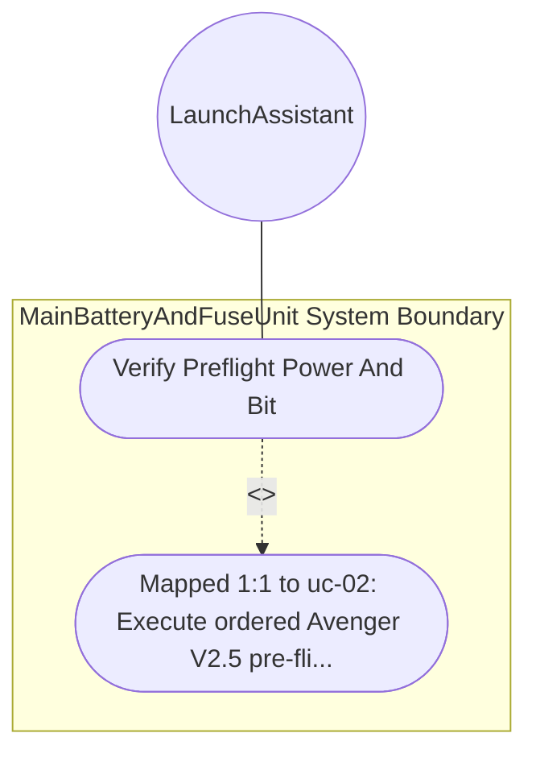

| Attribute | Specification Detail |
| :--- | :--- |
| **Issue ID** | #24 |
| **Title** | Use Case 01: Verify Preflight Power And Bit |
| **Type** | use-case |
| **Primary Actor** | LaunchAssistant |
| **Scope** | MainBatteryAndFuseUnit |
| **Level** | User Goal |
| **Generation Mode** | subagent |
| **Specification Source** | [schema/model.sysml](../../schema/model.sysml) |

# Use Case 01: Verify Preflight Power And Bit

## UML Diagrams

## 1. Actors
- `LaunchAssistant`
- `Pilot`

## 2. Preconditions
- `MainBatteryAndFuseUnit` is initialized and ready to enforce `Guarantee main bus 49.0-50.0 V, zero premature ESAD RBF #3 removal fault (GAP-06), and healthy avionics/propulsion BIT before PL-40 rail arming.`.
- `LaunchAssistant` holds authorized operational access to `MainBatteryAndFuseUnit`.

## 3. Trigger
- Guarantee main bus 49.0-50.0 V, zero premature ESAD RBF #3 removal fault (GAP-06), and healthy avionics/propulsion BIT before PL-40 rail arming.

## 4. Main Success Scenario
1. Mapped 1:1 to uc-02: Execute ordered Avenger V2.5 pre-flight power-on, voltage verification (49.0-50.0 V), pitot/mag/servo BIT, and ESAD PBIT (< 50.0 V) prior to RBF #3 pull.

## 5. Alternate and Exception Flows
- Precondition guard failure in `MainBatteryAndFuseUnit`:
  - `MainBatteryAndFuseUnit` rejects the `Verify Preflight Power And Bit` request without partial state mutation and reports diagnostic status to `LaunchAssistant`.
- Invariant violation while enforcing `Guarantee main bus 49.0-50.0 V, zero premature ESAD RBF #3 removal fault (GAP-06), and healthy avionics/propulsion BIT before PL-40 rail arming.`:
  - `MainBatteryAndFuseUnit` aborts `Verify Preflight Power And Bit` execution, preserves prior verified state, and notifies `LaunchAssistant`.

## 6. Postconditions
- `MainBatteryAndFuseUnit` satisfies declared objective `Guarantee main bus 49.0-50.0 V, zero premature ESAD RBF #3 removal fault (GAP-06), and healthy avionics/propulsion BIT before PL-40 rail arming.` with all subsystem invariants intact.
- Verified `Verify Preflight Power And Bit` completion status is recorded for `LaunchAssistant`.

## 8. Realization Matrix
| Specification Item | Type | Link / Reference |
| :--- | :--- | :--- |
| **#5** | User Story | [User Story 01: Validate Battery And Power On Rbf2](../user-stories/US-01-ValidateBatteryAndPowerOnRbf2.md) |
| **#33** | Feature | [Feature 02: [Airframe Power And Propulsion] MainBatteryAndFuseUnit](../features/FEAT-02-MainBatteryAndFuseUnit.md) |

## Source References
Use case operational flows and lifecycle activity references:
- System Architecture Model: `schema/model.sysml`
- Normative Systems Engineering Standard: ISO/IEC/IEEE 29148:2018 §6.4.2 Concept of Operations

Operational use case realization and traceability links derive from `schema/model.sysml` pursuant to ISO/IEC/IEEE 29148.
