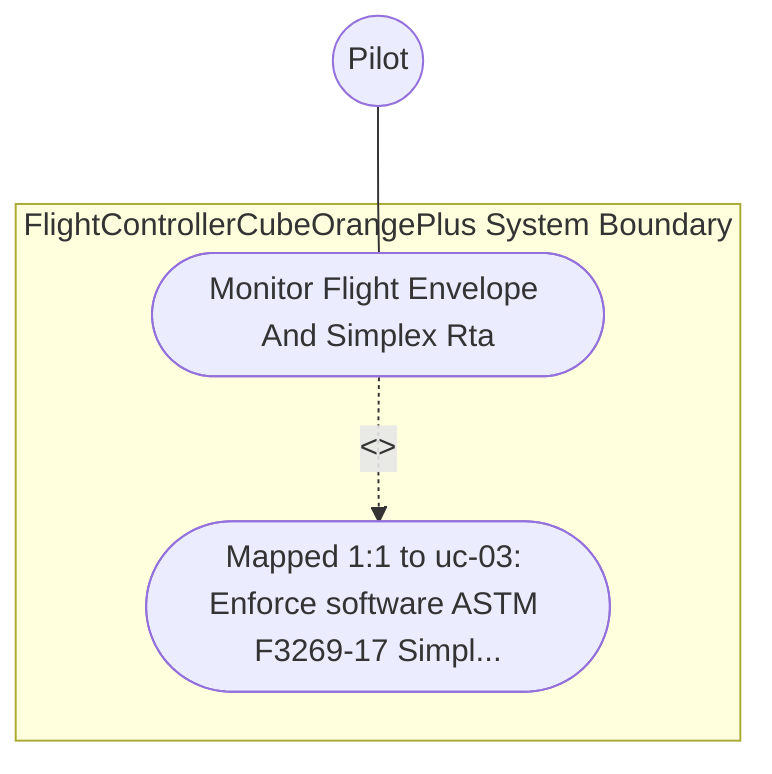

| Attribute | Specification Detail |
| :--- | :--- |
| **Issue ID** | #25 |
| **Title** | Use Case 02: Monitor Flight Envelope And Simplex Rta |
| **Type** | use-case |
| **Primary Actor** | Pilot |
| **Scope** | FlightControllerCubeOrangePlus |
| **Level** | User Goal |
| **Generation Mode** | subagent |
| **Specification Source** | [schema/model.sysml](../../schema/model.sysml) |

# Use Case 02: Monitor Flight Envelope And Simplex Rta

## UML Diagrams

## 1. Actors
- `Pilot`

## 2. Preconditions
- `FlightControllerCubeOrangePlus` is initialized and ready to enforce `Maintain inner-loop aerodynamic stability and automatically abort or clamp dive trajectories exceeding safety thresholds.`.
- `Pilot` holds authorized operational access to `FlightControllerCubeOrangePlus`.

## 3. Trigger
- Maintain inner-loop aerodynamic stability and automatically abort or clamp dive trajectories exceeding safety thresholds.

## 4. Main Success Scenario
1. Mapped 1:1 to uc-03: Enforce software ASTM F3269-17 Simplex RTA boundaries on Cube orange+ across DroneCAN CAN 1/CAN 2 actuators, preventing exceedance of 55.0 m/s engagement and 80.0 m/s VNE limits.

## 5. Alternate and Exception Flows
- Precondition guard failure in `FlightControllerCubeOrangePlus`:
  - `FlightControllerCubeOrangePlus` rejects the `Monitor Flight Envelope And Simplex Rta` request without partial state mutation and reports diagnostic status to `Pilot`.
- Invariant violation while enforcing `Maintain inner-loop aerodynamic stability and automatically abort or clamp dive trajectories exceeding safety thresholds.`:
  - `FlightControllerCubeOrangePlus` aborts `Monitor Flight Envelope And Simplex Rta` execution, preserves prior verified state, and notifies `Pilot`.

## 6. Postconditions
- `FlightControllerCubeOrangePlus` satisfies declared objective `Maintain inner-loop aerodynamic stability and automatically abort or clamp dive trajectories exceeding safety thresholds.` with all subsystem invariants intact.
- Verified `Monitor Flight Envelope And Simplex Rta` completion status is recorded for `Pilot`.

## 8. Realization Matrix
| Specification Item | Type | Link / Reference |
| :--- | :--- | :--- |
| **#9** | User Story | [User Story 05: Execute Simplex Rta Envelope Check](../user-stories/US-05-ExecuteSimplexRtaEnvelopeCheck.md) |
| **#37** | Feature | [Feature 06: [Avionics Guidance And Control] FlightControllerCubeOrangePlus](../features/FEAT-06-FlightControllerCubeOrangePlus.md) |

## Source References
Use case operational flows and lifecycle activity references:
- System Architecture Model: `schema/model.sysml`
- Normative Systems Engineering Standard: ISO/IEC/IEEE 29148:2018 §6.4.2 Concept of Operations

Operational use case realization and traceability links derive from `schema/model.sysml` pursuant to ISO/IEC/IEEE 29148.
