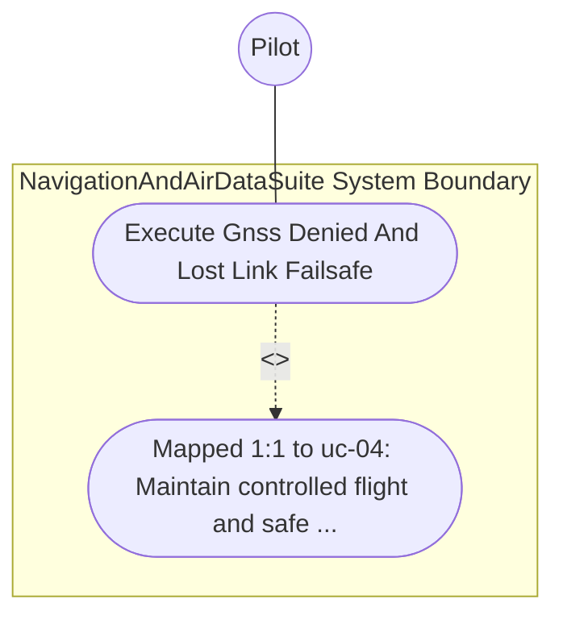

| Attribute | Specification Detail |
| :--- | :--- |
| **Issue ID** | #26 |
| **Title** | Use Case 03: Execute Gnss Denied And Lost Link Failsafe |
| **Type** | use-case |
| **Primary Actor** | Pilot |
| **Scope** | NavigationAndAirDataSuite |
| **Level** | User Goal |
| **Generation Mode** | subagent |
| **Specification Source** | [schema/model.sysml](../../schema/model.sysml) |

# Use Case 03: Execute Gnss Denied And Lost Link Failsafe

## UML Diagrams

## 1. Actors
- `Pilot`

## 2. Preconditions
- `NavigationAndAirDataSuite` is initialized and ready to enforce `Transition seamlessly to RM3100/SKYE2 dead-reckoning and execute Disarm ESAD On GCS Timeout + RTL on sustained C2 loss.`.
- `Pilot` holds authorized operational access to `NavigationAndAirDataSuite`.

## 3. Trigger
- Transition seamlessly to RM3100/SKYE2 dead-reckoning and execute Disarm ESAD On GCS Timeout + RTL on sustained C2 loss.

## 4. Main Success Scenario
1. Mapped 1:1 to uc-04: Maintain controlled flight and safe ordnance posture during GNSS spoofing/denial (Disable GNSS DR mode) or C2 link loss (105.0 s GCS Failsafe RTL + ESAD disarm).

## 5. Alternate and Exception Flows
- Precondition guard failure in `NavigationAndAirDataSuite`:
  - `NavigationAndAirDataSuite` rejects the `Execute Gnss Denied And Lost Link Failsafe` request without partial state mutation and reports diagnostic status to `Pilot`.
- Invariant violation while enforcing `Transition seamlessly to RM3100/SKYE2 dead-reckoning and execute Disarm ESAD On GCS Timeout + RTL on sustained C2 loss.`:
  - `NavigationAndAirDataSuite` aborts `Execute Gnss Denied And Lost Link Failsafe` execution, preserves prior verified state, and notifies `Pilot`.

## 6. Postconditions
- `NavigationAndAirDataSuite` satisfies declared objective `Transition seamlessly to RM3100/SKYE2 dead-reckoning and execute Disarm ESAD On GCS Timeout + RTL on sustained C2 loss.` with all subsystem invariants intact.
- Verified `Execute Gnss Denied And Lost Link Failsafe` completion status is recorded for `Pilot`.

## 8. Realization Matrix
| Specification Item | Type | Link / Reference |
| :--- | :--- | :--- |
| **#10** | User Story | [User Story 06: Run Pitot And Mag Preflight Check](../user-stories/US-06-RunPitotAndMagPreflightCheck.md) |
| **#39** | Feature | [Feature 08: [Avionics Guidance And Control] NavigationAndAirDataSuite](../features/FEAT-08-NavigationAndAirDataSuite.md) |

## Source References
Use case operational flows and lifecycle activity references:
- System Architecture Model: `schema/model.sysml`
- Normative Systems Engineering Standard: ISO/IEC/IEEE 29148:2018 §6.4.2 Concept of Operations

Operational use case realization and traceability links derive from `schema/model.sysml` pursuant to ISO/IEC/IEEE 29148.
