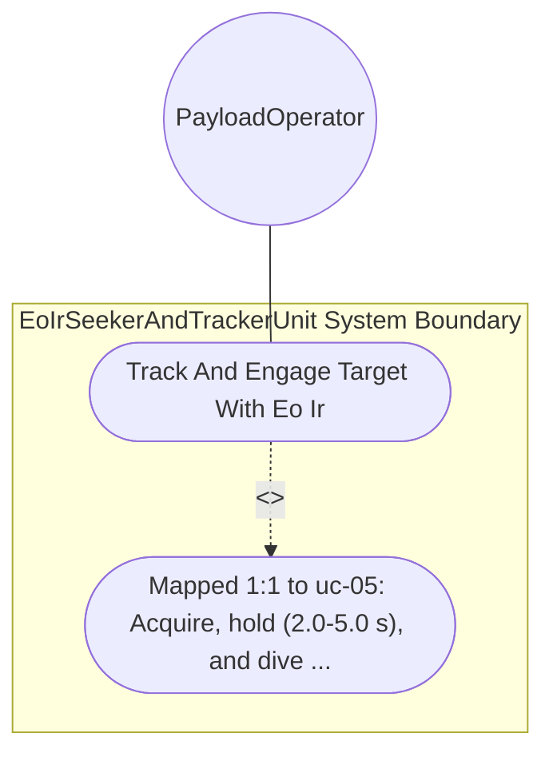

| Attribute | Specification Detail |
| :--- | :--- |
| **Issue ID** | #27 |
| **Title** | Use Case 04: Track And Engage Target With Eo Ir |
| **Type** | use-case |
| **Primary Actor** | PayloadOperator |
| **Scope** | EoIrSeekerAndTrackerUnit |
| **Level** | User Goal |
| **Generation Mode** | subagent |
| **Specification Source** | [schema/model.sysml](../../schema/model.sysml) |

# Use Case 04: Track And Engage Target With Eo Ir

## UML Diagrams

## 1. Actors
- `PayloadOperator`

## 2. Preconditions
- `EoIrSeekerAndTrackerUnit` is initialized and ready to enforce `Achieve <= 0.5 m terminal accuracy while enforcing <= 55.0 m/s gimbal saturation safety abort.`.
- `PayloadOperator` holds authorized operational access to `EoIrSeekerAndTrackerUnit`.

## 3. Trigger
- Achieve <= 0.5 m terminal accuracy while enforcing <= 55.0 m/s gimbal saturation safety abort.

## 4. Main Success Scenario
1. Mapped 1:1 to uc-05: Acquire, hold (2.0-5.0 s), and dive onto stationary target at <= 55.0 m/s (0.5 m CEP) using Nighthawk2UZ + Trip6, aborting on > 55.0 m/s or lost track.

## 5. Alternate and Exception Flows
- Precondition guard failure in `EoIrSeekerAndTrackerUnit`:
  - `EoIrSeekerAndTrackerUnit` rejects the `Track And Engage Target With Eo Ir` request without partial state mutation and reports diagnostic status to `PayloadOperator`.
- Invariant violation while enforcing `Achieve <= 0.5 m terminal accuracy while enforcing <= 55.0 m/s gimbal saturation safety abort.`:
  - `EoIrSeekerAndTrackerUnit` aborts `Track And Engage Target With Eo Ir` execution, preserves prior verified state, and notifies `PayloadOperator`.

## 6. Postconditions
- `EoIrSeekerAndTrackerUnit` satisfies declared objective `Achieve <= 0.5 m terminal accuracy while enforcing <= 55.0 m/s gimbal saturation safety abort.` with all subsystem invariants intact.
- Verified `Track And Engage Target With Eo Ir` completion status is recorded for `PayloadOperator`.

## 8. Realization Matrix
| Specification Item | Type | Link / Reference |
| :--- | :--- | :--- |
| **#14** | User Story | [User Story 10: Execute Esad Boot And Pbit](../user-stories/US-10-ExecuteEsadBootAndPbit.md) |
| **#42** | Feature | [Feature 11: [Mission Payloads Comms And Ordnance Safety] EoIrSeekerAndTrackerUnit](../features/FEAT-11-EoIrSeekerAndTrackerUnit.md) |

## Source References
Use case operational flows and lifecycle activity references:
- System Architecture Model: `schema/model.sysml`
- Normative Systems Engineering Standard: ISO/IEC/IEEE 29148:2018 §6.4.2 Concept of Operations

Operational use case realization and traceability links derive from `schema/model.sysml` pursuant to ISO/IEC/IEEE 29148.
