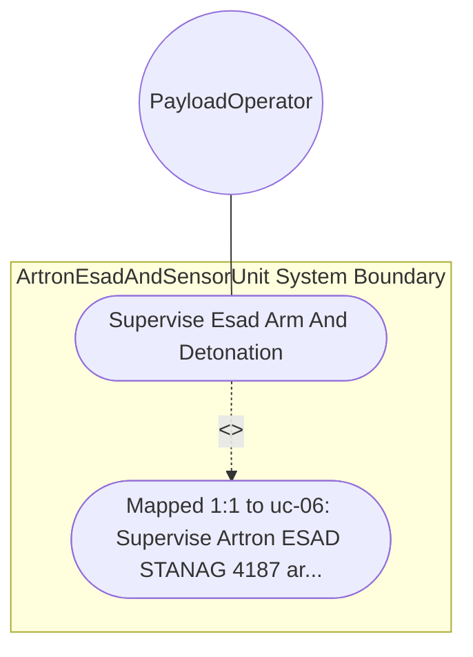

| Attribute | Specification Detail |
| :--- | :--- |
| **Issue ID** | #28 |
| **Title** | Use Case 05: Supervise Esad Arm And Detonation |
| **Type** | use-case |
| **Primary Actor** | PayloadOperator |
| **Scope** | ArtronEsadAndSensorUnit |
| **Level** | User Goal |
| **Generation Mode** | subagent |
| **Specification Source** | [schema/model.sysml](../../schema/model.sysml) |

# Use Case 05: Supervise Esad Arm And Detonation

## UML Diagrams

## 1. Actors
- `PayloadOperator`

## 2. Preconditions
- `ArtronEsadAndSensorUnit` is initialized and ready to enforce `Guarantee zero premature HV output (< 50.0 V PBIT) and strictly gated detonation only after SS1, SS2, DSC_IN1, and IRQ_L / OC Trigger.`.
- `PayloadOperator` holds authorized operational access to `ArtronEsadAndSensorUnit`.

## 3. Trigger
- Guarantee zero premature HV output (< 50.0 V PBIT) and strictly gated detonation only after SS1, SS2, DSC_IN1, and IRQ_L / OC Trigger.

## 4. Main Success Scenario
1. Mapped 1:1 to uc-06: Supervise Artron ESAD STANAG 4187 arming via RPI CM5 OC Master (RS-485 100 Hz + DSC_IN1) with SS1, SS2 Safe Distance Exceed == 1, RBF #3 power-before-pull, and Sensor Board IRQ_L / J401 HV fire.

## 5. Alternate and Exception Flows
- Precondition guard failure in `ArtronEsadAndSensorUnit`:
  - `ArtronEsadAndSensorUnit` rejects the `Supervise Esad Arm And Detonation` request without partial state mutation and reports diagnostic status to `PayloadOperator`.
- Invariant violation while enforcing `Guarantee zero premature HV output (< 50.0 V PBIT) and strictly gated detonation only after SS1, SS2, DSC_IN1, and IRQ_L / OC Trigger.`:
  - `ArtronEsadAndSensorUnit` aborts `Supervise Esad Arm And Detonation` execution, preserves prior verified state, and notifies `PayloadOperator`.

## 6. Postconditions
- `ArtronEsadAndSensorUnit` satisfies declared objective `Guarantee zero premature HV output (< 50.0 V PBIT) and strictly gated detonation only after SS1, SS2, DSC_IN1, and IRQ_L / OC Trigger.` with all subsystem invariants intact.
- Verified `Supervise Esad Arm And Detonation` completion status is recorded for `PayloadOperator`.

## 8. Realization Matrix
| Specification Item | Type | Link / Reference |
| :--- | :--- | :--- |
| **#15** | User Story | [User Story 11: Transition Esad Arming Sequence](../user-stories/US-11-TransitionEsadArmingSequence.md) |
| **#43** | Feature | [Feature 12: [Mission Payloads Comms And Ordnance Safety] ArtronEsadAndSensorUnit](../features/FEAT-12-ArtronEsadAndSensorUnit.md) |

## Source References
Use case operational flows and lifecycle activity references:
- System Architecture Model: `schema/model.sysml`
- Normative Systems Engineering Standard: ISO/IEC/IEEE 29148:2018 §6.4.2 Concept of Operations

Operational use case realization and traceability links derive from `schema/model.sysml` pursuant to ISO/IEC/IEEE 29148.
