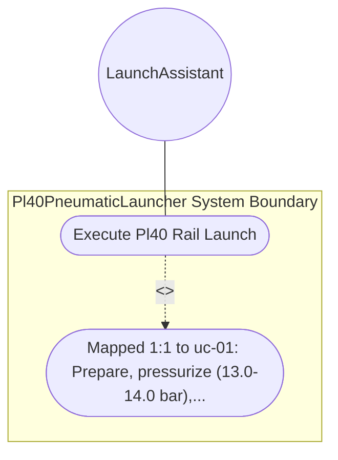

| Attribute | Specification Detail |
| :--- | :--- |
| **Issue ID** | #29 |
| **Title** | Use Case 06: Execute Pl40 Rail Launch |
| **Type** | use-case |
| **Primary Actor** | LaunchAssistant |
| **Scope** | Pl40PneumaticLauncher |
| **Level** | User Goal |
| **Generation Mode** | subagent |
| **Specification Source** | [schema/model.sysml](../../schema/model.sysml) |

# Use Case 06: Execute Pl40 Rail Launch

## UML Diagrams

## 1. Actors
- `LaunchAssistant`
- `Pilot`

## 2. Preconditions
- `Pl40PneumaticLauncher` is initialized and ready to enforce `Achieve safe rail exit velocity (~23.0 m/s at 17.0 kg, <= 25.0 m/s limit) with zero electrical umbilical wires and clean onboard SS1 accel trigger.`.
- `LaunchAssistant` holds authorized operational access to `Pl40PneumaticLauncher`.

## 3. Trigger
- Achieve safe rail exit velocity (~23.0 m/s at 17.0 kg, <= 25.0 m/s limit) with zero electrical umbilical wires and clean onboard SS1 accel trigger.

## 4. Main Success Scenario
1. Mapped 1:1 to uc-01: Prepare, pressurize (13.0-14.0 bar), pass Go/No-Go gate (GAP-03), pull carriage red safety pin, open Main Valve 4, hold dual switches >= 2.0 s, and execute purely mechanical PL-40 rail launch.

## 5. Alternate and Exception Flows
- Precondition guard failure in `Pl40PneumaticLauncher`:
  - `Pl40PneumaticLauncher` rejects the `Execute Pl40 Rail Launch` request without partial state mutation and reports diagnostic status to `LaunchAssistant`.
- Invariant violation while enforcing `Achieve safe rail exit velocity (~23.0 m/s at 17.0 kg, <= 25.0 m/s limit) with zero electrical umbilical wires and clean onboard SS1 accel trigger.`:
  - `Pl40PneumaticLauncher` aborts `Execute Pl40 Rail Launch` execution, preserves prior verified state, and notifies `LaunchAssistant`.

## 6. Postconditions
- `Pl40PneumaticLauncher` satisfies declared objective `Achieve safe rail exit velocity (~23.0 m/s at 17.0 kg, <= 25.0 m/s limit) with zero electrical umbilical wires and clean onboard SS1 accel trigger.` with all subsystem invariants intact.
- Verified `Execute Pl40 Rail Launch` completion status is recorded for `LaunchAssistant`.

## 8. Realization Matrix
| Specification Item | Type | Link / Reference |
| :--- | :--- | :--- |
| **#19** | User Story | [User Story 15: Charge Pl40 Compressor With Uvlo Check](../user-stories/US-15-ChargePl40CompressorWithUvloCheck.md) |
| **#44** | Feature | [Feature 13: [Ground Launch And Command Segment] Pl40PneumaticLauncher](../features/FEAT-13-Pl40PneumaticLauncher.md) |

## Source References
Use case operational flows and lifecycle activity references:
- System Architecture Model: `schema/model.sysml`
- Normative Systems Engineering Standard: ISO/IEC/IEEE 29148:2018 §6.4.2 Concept of Operations

Operational use case realization and traceability links derive from `schema/model.sysml` pursuant to ISO/IEC/IEEE 29148.
